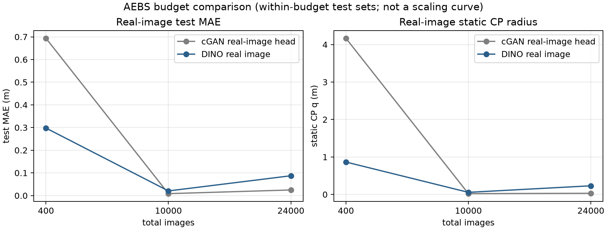

# AEBS 严格总包量 400 / 10k / 24k：真实图 cGAN 头 vs DINO

2026-11-10。按严格总包量执行：400、10k、24k 各自划分 train/val/test；同一档内 cGAN 与 DINO 共用同一 test；不同档 test 集不同。

**核心修正：** cGAN 的 state_net 必须在**真实 32×32 灰度图**上重新训练，不能只用 generated-image 训练的旧 state_net 迁移。后者是迁移基线，不是 cGAN 方案的真实图性能。

## 1. 主结果：真实图 cGAN 头 vs DINO

| 总包 | test n | cGAN realhead MAE / q / 覆盖 | DINO real MAE / q / 覆盖 | 胜负 |
|---:|---:|---:|---:|---|
| 400 | 72 | 0.6937 / 4.1690 / 71/72 | **0.2978 / 0.8649 / 69/72** | DINO MAE/q 更低；cGAN 覆盖略高 |
| 10k | 2,000 | **0.0085 / 0.0209 / 1894/2000** | 0.0205 / 0.0557 / 1893/2000 | cGAN MAE/q 更低；覆盖相近 |
| 24k | 4,920 | **0.0247 / 0.0307 / 4382/4920** | 0.0874 / 0.2307 / 4592/4920 | cGAN MAE/q 更低；DINO 覆盖更高 |

- **400 图：DINO 胜。**
- **10k/24k：cGAN realhead 的 MAE/q 更低。**
- **24k：cGAN q 更小但覆盖 89.1%（4382/4920），DINO 覆盖 93.3%；不能只看 q。**
- **没有单向赢家**；结果随预算交叉，不能写“DINO 架构全面更好”。

## 2. 三种 cGAN 口径必须分开

| cGAN 口径 | 训练数据/输入 | 10k q / 覆盖 | 24k q / 覆盖 | 能否代表真实图 cGAN |
|---|---|---:|---:|---|
| cGAN realhead（主） | state_net 在真实 32×32 灰度图上训练 | **0.0209 / 94.7%** | **0.0307 / 89.1%** | **可以** |
| cGAN generated-trained real | state_net 只在生成图上训练，迁移到真实图 | 2.6634 / 94.2% | 2.7190 / 95.2% | 不能；这是迁移 |
| cGAN native | 生成图→state_net | 0.0474 / 94.85% | 0.0473 / 90.5% | 不能；这不是真实图输入 |

旧 `cgan_<N>/report.json` 里的 `real` 字段是 **generated-trained 迁移**；新 `cgan_realhead_<N>/report.json` 才是真实图训练。

## 3. 结果说明

- cGAN realhead 是 1024→256→64→1 的像素 MLP，从零训练；DINO 是冻结预训练 ViT-S/14 + 投影头。
- 400 图时 DINO 明显更好；数据到 10k/24k 后，像素 MLP 在**平均/分位误差**上反超。
- 24k cGAN q 小但 test 覆盖低，说明 validation 与 test 的尾部不同；不能只报 q。
- 三档 test 不同，**不能画跨档 scaling 曲线**；只能在同一档内比较 cGAN vs DINO。
- 单训练种子、单次训练；不是多种子总体结论。

## 4. 文件

- `cgan_realhead_400|10000|24000/`：真实图训练的 cGAN/state_net 头（主基线）；
- `cgan_400|10000|24000/`：generated-trained 迁移 + native 生成图；
- `dino_400|10000|24000/`：DINO 投影；
- `summary/summary_all.json`、`summary/report.md`、`summary/error_by_budget.png`；
- `protocol.json`。

## 5. 边界

- 输入仍不同：cGAN 32×32 灰度 vs DINO RGB；
- 预训练不同：cGAN 从零训练 vs DINO 冻结预训练；
- 单种子；三档 test 不同；
- 静态图像误差，不是轨迹 CP/SBC/实车；
- 不能把 cGAN native 的 0.047 m 与 DINO real 0.2307 m 直接比。
