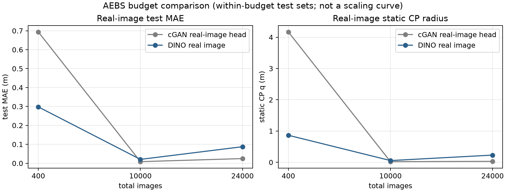

# AEBS 严格总包量：真实图 cGAN 头 vs DINO

同一档内 cGAN/DINO 共用同一 test；cGAN 头在真实 32×32 灰度图上训练；DINO 用 RGB。

| 总包 | test n | cGAN realhead MAE / q / 覆盖 | DINO real MAE / q / 覆盖 | 结论 |
|---:|---:|---:|---:|---|
| 400 | 72 | 0.6937 / 4.1690 / 71/72 | 0.2978 / 0.8649 / 69/72 | DINO MAE/q 更低 |
| 10000 | 2000 | 0.0085 / 0.0209 / 1894/2000 | 0.0205 / 0.0557 / 1893/2000 | cGAN MAE/q 更低 |
| 24000 | 4920 | 0.0247 / 0.0307 / 4382/4920 | 0.0874 / 0.2307 / 4592/4920 | cGAN MAE/q 更低 |

**cGAN realhead** 是真实图训练的 cGAN/state_net 头；**cGAN native** 是生成图→state_net，不与 DINO real 同输入；**cGAN generated-trained real** 是旧 state_net 迁移，不应作为真实图训练基线。

**注意：**三档 test 集不同，不能把三档点连成 scaling 曲线；只能在同一档内比较 cGAN realhead vs DINO。
