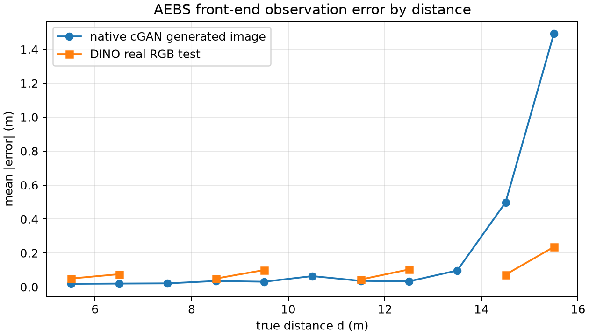

# AEBS：原 SPVC cGAN 前端 vs 新 DINO 前端的误差/覆盖对照

2026-11-10。**整体前端替换的原生对照。** 结论先说：

> **原生 cGAN 前端在 15–16 m 出现明显误差长尾，轨迹 CP 半径 1.9156 m、留出覆盖 92/100；新 DINO 前端轨迹 CP 0.4184 m、留出 99/100。两者行为都成功（100/100 与 4800/4800），所以收益主要落在误差包络/可认证性，不是任务成功率。**

这不是同预算架构胜负：cGAN 用旧 400 张生成图体系训练，DINO 用 24k 真实图训练；actor/SBC 也不同。它是**整体系统级**对照，不是“只换前端”的因果实验。

## 1. 先分清三种 cGAN 数字

| 口径 | 输入 | q / 覆盖 | 能不能叫原 SPVC 原生？ |
|---|---|---|---|
| cGAN 旧 state_net 迁移到 24k 真实灰度图 | 真实 RGB→32×32 灰度 | q=5.221 m；test 覆盖 87.64% | **不能**；这是跨库迁移 |
| **原生 cGAN 生成图闭环** | cGAN generator→32×32→state_net→原 PPO | q=**1.9156 m**；留出 **92/100** | **可以**；这是原生生成链路 |
| 原生 cGAN 观测 + 新 actor | 同上，接到新 `policy.pt` | q=1.9156 m；留出 92/100；行为 100/100 | 受控适配；不是原 actor |

把 5.221 m 当作“原 SPVC 原生 q”会严重高估差距；原生 cGAN 的 q 是 1.9156 m。

## 2. 静态误差：原生 cGAN vs DINO 真实图

原生 cGAN：在 5–16 m 均匀取 5,000 个距离，生成图像经 state_net 预测；DINO：24k test 的 4,920 张真实图。

| 指标 | 原生 cGAN 生成图 | DINO 真实 RGB test |
|---|---:|---:|
| MAE | **0.2219 m** | **0.0874 m** |
| RMSE | 0.5090 m | 0.1211 m |
| P95 | 1.5084 m | 0.2614 m |
| max | 1.9839 m | 0.5250 m |

图注：按真实距离分箱的平均绝对误差。原生 cGAN 在 5–13 m 很小，但 14.5 m 后迅速变大；DINO 在整个 5–16 m 都保持较小误差。cGAN 的“平均 MAE”被近距离大量小误差拉低，单看平均值会掩盖尾部。

### 分箱尾部

| 距离 bin | cGAN native MAE | DINO test MAE |
|---|---:|---:|
| 13.5 m | 0.0970 | —（无 test 图） |
| 14.5 m | 0.4983 | 0.0724 |
| 15.5 m | **1.4916** | 0.2358 |

这张表说明：原 SPVC cGAN 的误差问题不是全区间都差，而是**远距离/初始段的长尾**；轨迹 CP 取全程最大值，因此 q 被这个尾部抬高。

## 3. 轨迹 CP 和覆盖

同一任务、同样的 400 步、初始状态 `[15,16]×[2.5,3]`、同一终点规则；每个版本各 199 校准 + 100 留出。

| 项目 | 原生 cGAN | 原生 cGAN + 新 actor | 新 DINO |
|---|---:|---:|---:|
| 轨迹 q | **1.9156 m** | 1.9156 m | **0.4184 m** |
| 校准覆盖 | 190/199 | 190/199 | 190/199 |
| 留出覆盖 | **92/100** | 92/100 | **99/100** |
| 留出成功 / unsafe / timeout | 100 / 0 / 0 | 100 / 0 / 0 | 4800 / 0 / 0（12 组） |
| 留出帧误差均值 | 0.1328 m | 0.0829 m | — |
| 留出帧误差最大 | 1.9754 m | 1.9754 m | 0.5250 m（静态 max） |

- 原生 cGAN 的 q 是 DINO 的 **4.58 倍**；
- 留出覆盖 92/100 对 99/100；两个 100 条样本的二项区间分别约 [0.848,0.965] 和 [0.966,0.998]；
- **行为都成功**：cGAN 原生 100/100，DINO 4,800/4,800；所以不能说“新前端让任务从失败变成功”；
- 收益是**误差包络更小、尾部更短、留出覆盖更高**，从而更容易接条件 SBC。

### 为什么 cGAN + 新 actor 的 q 不变

q 是观测路径（生成图像→state_net）的轨迹最大误差，新 actor 改变访问状态，但本次样本的最大误差仍由远距离尾部支配；因此 q 相同、行为仍成功。不能把“换 actor 后帧均值变小”当成前端误差变小。

## 3.1 同 400 图预算、同 actor 的附加对照

为了回答“同预算架构胜负”，把现有 **400 图 DINO 前端**（与 cGAN 同一批 400 图训练）接到**同一个新 actor**，跑同样的 199 校准 + 100 留出：

| 项目 | cGAN 400 | DINO 400 | 说明 |
|---|---:|---:|---|
| 轨迹 q | **1.9156 m** | **4.0205 m** | cGAN 更小 |
| 留出覆盖 | 92/100 | **94/100** | DINO 略高 2 个百分点 |
| 留出行为 | 100/100 | 100/100 | 都成功 |
| 静态 test MAE | 0.2219 m（生成图） | 0.1293 m（80 张 test） | DINO 平均更小 |

**结论：在 400 图预算、同 actor 下，cGAN 的轨迹 q 更小；DINO-400 只有覆盖高 2 个百分点，行为相同。没有“DINO 架构在同预算下胜出”的证据。**

DINO 的 24k 版本 q=0.4184 m/99，主要是数据规模从 400 到 24k 带来的收益，不能把它当成纯架构收益。

## 4. 和旧迁移数字的关系

旧表里的 cGAN q=5.221 m、覆盖 87.64% 是**旧 state_net 迁移到 24k 真实图**；原生 cGAN 生成图 q=1.9156 m、覆盖 92/100。两者不同：

- 5.221 m 回答“旧 cGAN 配套 state_net 能否直接读新真实图”；
- 1.9156 m 回答“原 SPVC 自己的生成图闭环误差多大”；
- 原生 cGAN 更小，但仍远大于 DINO 的 0.4184 m。

## 5. 安全证书层面的位置

- 新 DINO：同一新 SBC 在 0.418359 m 下 **292,024 区间，0 见证/0 未解决**（条件数值审计）；
- 原生 cGAN：本次只做了误差/覆盖和行为，**没有**把新 SBC 直接套到 cGAN 的 1.9156 m 上宣称通过；原 cGAN 自己的 SBC 也没有在这批中重新验证；
- 因此当前能说的是“cGAN 的误差包络更大、更难接证书”，不能说“原 cGAN 已被证明不安全”，也不能说“新 DINO 在实车上安全”。

## 6. 边界

- cGAN 是**生成图像**闭环，DINO 是**保存真实图像**最近邻回放；输入分布不同；
- cGAN 用 400 张生成图体系训练，DINO 用 24k 真实图；训练预算/数据不同；
- cGAN 原生 actor 是旧 PPO；DINO 是新 actor；A-matched 仅接到新 actor，SBC 没有对 cGAN q 重训；
- cGAN 生成用 z=0 确定性模式；原 SPVC 的随机 z 没有完整采样；
- 轨迹 CP 的校准/留出种子、外观组不同，不是配对样本；
- 这些是系统级描述性证据，不是架构因果结论。

## 7. 文件

- `native_cgan/report.json`：原生 cGAN 199/100、q、覆盖、行为；
- `matched_cgan_new_actor/report.json`：同一观测接新 actor；
- `dino400_matched/report.json`：400 图 DINO 前端 + 同一新 actor；
- `summary.json`：静态分箱、轨迹对照、DINO 证书引用；
- `error_by_distance.png`：误差-距离图；
- 新 DINO 证据：`../real_aebs_repair_20261109_release/verification_report.json`。
