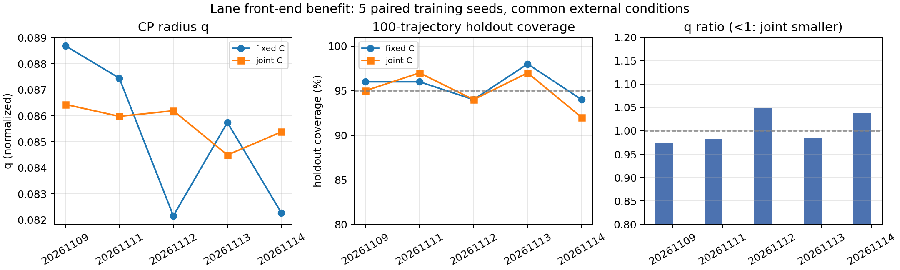

# 车道前端收益证明：5 对训练种子配对结果

固定 C 与联合 C 每对共享训练数据、warm start、预算和外部条件种子；但闭环轨迹由各自模型重新生成。

| 训练种子 | 固定 C q | 联合 C q | q 比 | 固定 C 留出 | 联合 C 留出 | 固定 C 证书 | 联合 C 证书 |
|---|---:|---:|---:|---:|---:|---|---|
| 20261109 | 0.088690 | 0.086439 | 0.9746 | 96/100 | 95/100 | passed_numerical | passed_numerical |
| 20261111 | 0.087447 | 0.085980 | 0.9832 | 96/100 | 97/100 | passed_numerical | passed_numerical |
| 20261112 | 0.082158 | 0.086194 | 1.0491 | 94/100 | 94/100 | passed_numerical | passed_numerical |
| 20261113 | 0.085749 | 0.084497 | 0.9854 | 98/100 | 97/100 | passed_numerical | passed_numerical |
| 20261114 | 0.082272 | 0.085384 | 1.0378 | 94/100 | 92/100 | passed_numerical | passed_numerical |

| 汇总 | 固定 C | 联合 C |
|---|---:|---:|
| q 均值 | 0.085263 | 0.085699 |
| q 中位数 | 0.085749 | 0.085980 |
| 留出覆盖均值 | 0.956 | 0.950 |
| SBC 通过 | 5/5 | 5/5 |
| 平均 |action| | 0.084837 | 0.083737 |
| 平均 |Δaction| | 0.115240 | 0.113763 |
| 静态 test e MAE | 0.017927 m | 0.018012 m |
| 静态 test θ MAE | 0.005104 rad | 0.005124 rad |
| C 变化 / 条件数 | 0.000000 / 1.000000 | 0.001382 / 1.001649 |

q 差（joint−fixed）均值 **0.000435**，中位数 -0.001252；联合 C 更小的对数 **3/5**。

留出覆盖差（joint−fixed）均值 **-0.006**；配对覆盖总计 both=461, fixed-only=17, joint-only=14, neither=8。

**解释边界：**5 对是训练种子层面的小样本先导；q 差异很小且受采样噪声影响；联合 C 的变化本身很小，不能把 q 差直接归因于“C 学到了更好的可观测性”。两种证书都是条件数值审计，不是实车/形式化证明。

