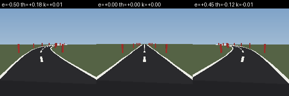
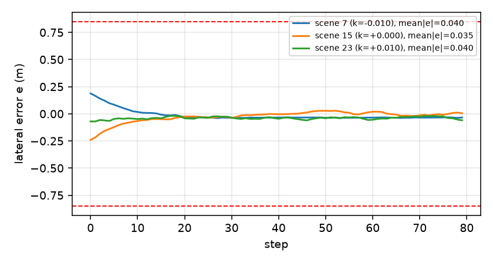

# 车道保持实验：环境、感知、CP 与失败分类

> **2026-11-07 更新：** 本文是 11 月 5 日的结构化证书分支，历史对照用；当前最新为原 PPO + AEBS 同类训练式神经 SBC + 轨迹级 CP 0.090093，见 `../lane_keeping_20261106_aebs_method_sbc_v1/` 与 `../lane_trajectory_cp_20261107_v1/`。


2026-11-05。**状态更新：语义 2D 和视觉 CP 包络下的 SBC 证书都已通过。**证书对象是 `LQR + 0.5·B(x)·tanh(残差网络)` 这一神经策略类：语义证书见 [CERTIFICATE.md](CERTIFICATE.md)，视觉证书见 [VISUAL_CERTIFICATE.md](VISUAL_CERTIFICATE.md)。不是原始 PPO actor 的证书。

已经跑通：渲染环境、DINO/patch 观测、split CP、语义/图像 PPO、图像闭环评估、**语义与视觉误差下的自适应区间证书**。仍未跑通：原始 PPO actor 的证书、连续曲率、实车图像。下文把“证书”“行为证据”“早期候选”分开写。

## 1. 任务定义

| 项目 | 定义 |
|---|---|
| 状态 | `(e, θ)`：相对车道中心的横向偏差、相对道路切线的航向偏差 |
| 动作 | 前轮转角 `φ ∈ [-0.45, 0.45] rad`（网络动作归一化到 [-1,1]） |
| 曲率 | `κ ∈ {-0.01, 0, 0.01}`，作为已知输入 |
| 动力学 | `e' = e + vΔt sinθ`，`θ' = θ + (vΔt/L)tanφ - vΔt·κ`；`v=4 m/s`，`L=2.6 m`，`Δt=0.1 s` |
| 语义观测 | 图像 → `(ê, θ̂)`；策略输入 `(ê, θ̂, κ)`，3 维 |
| 安全判定 | `|e| ≤ 0.85 m` 且 `|θ| ≤ 0.30 rad`，超出即 unsafe |
| 初态 | `|e| ≤ 0.25 m`，`|θ| ≤ 0.06 rad`；时域 80 步（8 s） |
| 图像 | 192×192 前视渲染，单车道、实线边线、虚线中心线、路旁灯杆 |



**速度为什么是 4 m/s：**最初用 8 m/s 时，从边界状态恢复的超调会把 `|e|` 推到 0.8 m 以上，安全盒子很难闭合；4 m/s 下闭环轨迹更可控，图像观测误差也集中在投影较准的区域。速度是任务参数，不是为通过而临时放宽安全阈值；安全阈值 `0.85/0.30` 未改。

## 2. 数据与感知

- 数据 v1（CLS 观测）：24 个名义场景，每场景 40 个状态，共 960 张图；按场景划分 600/120/120/120。
- 数据 v2（patch 观测，视觉证书用）：60 个名义场景，每场景 60 个状态，共 3,600 张图；按场景划分 2,160/540/540/360。
- 训练：冻结 DINOv2-S/14；CLS 384 → 128→128→2（300 epoch）；patch 16×16 tokens → 空间 soft-argmax → 2（300 epoch）。
- CLS 测试集误差：

| 指标 | `e` | `θ` |
|---|---:|---:|
| MAE | 0.044 m | 0.0129 rad |
| RMSE | 0.061 m | 0.0180 rad |
| 最大绝对误差 | 0.199 m | 0.050 rad |

patch 观测测试集：`e` MAE 0.0211 m、max 0.0845 m；`θ` MAE 0.0059 rad、max 0.0363 rad。

- 注意：粗网格留出点上误差会更大（校准场景的加密网格上最大约 0.3–0.4 归一化单位），说明投影在网格点之间仍有插值误差。这是早期神经 SBC 候选区间审计失败的原因之一；当前结构化 SBC 证书使用状态格 + 观测盒，不依赖粗网格点插值。

## 3. CP 包络

| 包络 | 归一化半径 | 物理半径 | 校准覆盖 | 测试覆盖 | 闭环覆盖 |
|---|---:|---|---:|---:|---:|
| split CP 95% | 0.134 | `e` 0.114 m，`θ` 0.040 rad | 95.8% | 97.5% | **93.8–97.5%**（3 个测试场景） |
| 保守包络 | 0.300 | `e` 0.255 m，`θ` 0.090 rad | 100%* | 100%* | 100%（3 个测试场景） |
| patch CP 95% | 0.072 | `e` 0.0612 m，`θ` 0.0216 rad | 95.2% | 93.6% | 98.1–100%（6 个测试场景） |
| patch 证书盒 | 0.080 | `e` 0.068 m，`θ` 0.024 rad | 96.7% | 95.6% | 用于视觉证书 |

\* 保守包络不是 95% CP；它是校准/加密网格上的经验最大残差加余量，用于检验“如果包络足够大，控制器和 SBC 能不能工作”。两者不能混写。

**重要发现：**95% CP 半径在闭环中的覆盖是 93.8–97.5%，接近名义 95%；这说明 4 m/s 策略把状态带到投影较准的区域。8 m/s 版本同样的 95% 半径闭环覆盖只有约 55–64%，因此速度/策略分布会显著改变 CP 的有效性。

## 4. 控制器

| 组 | 训练/评估 | 结果 |
|---|---|---|
| LQR 基线 | 语义 `(e,θ,κ)` | 30/30 成功，0 unsafe；mean `|e|` 0.0117–0.0129 m |
| 证书残差策略（CLS） | LQR + `0.5·B·tanh` 残差，100k PPO | 语义 30/30，mean `|e|` 0.0117–0.0131 m；图像闭环 6/6，CP 覆盖 100%，OOD 8/9 |
| 视觉证书残差（patch） | 平底 `B` + 0.5 残差，100k PPO | patch-DINO 图像闭环 **12/12**，CP 覆盖 98.1–100%，mean `|e|` 0.022–0.037 m；OOD 9/9 |
| 语义 PPO（O） | 观测 `(e,θ,κ)`，50k 步 | 30/30 成功，0 unsafe；mean `|e|` 0.028–0.068 m |
| 图像/噪声 PPO（S） | 观测加保守包络误差，80k 步，宽初态训练 | 噪声环境 10/10 成功；**渲染图像闭环 6/6 成功、0 unsafe**；mean `|e|` 0.029–0.041 m |
| 图像闭环（95% 包络下） | 3 个测试场景 ×2 回合 | 6/6 成功，CP 覆盖 93.8–97.5%，mean `|e|` 0.029–0.041 m |
| 分布外压力测试 | 随机光照/遮挡/模糊/噪声，9 场景 | PPO 7/9；证书残差 8/9；1–2 个场景 unsafe（OOD，不属于 CP 覆盖范围） |



图像闭环的 `mean_abs_e` 0.03–0.04 m，语义 oracle 0.014–0.034 m；感知代价约 1–2 cm。上图是每个测试场景 1 回合的预览，样本量小（结果表为每场景 2 回合），只作 smoke，不作统计结论。

## 5. 视觉误差下的 SBC 证书（已通过）

完整说明：[VISUAL_CERTIFICATE.md](VISUAL_CERTIFICATE.md)；证书：[certificate/visual_sbc.json](certificate/visual_sbc.json)、服务器细网格：[certificate/visual_sbc_server.json](certificate/visual_sbc_server.json)。

- 观测：patch-DINO（16×16 patch → soft-argmax），CP 95% 半径 0.072；证书用 0.08；校准覆盖 96.7%，测试 95.6%。
- SBC：平底二次 `B(x)=relu(x^T P x - 0.5)`；初态 `B≤0.49`。
- 认证集 `{B≤0.49}`：`|e|≤0.3057 m`，`|θ|≤0.2616 rad`，在车道内。
- 控制器类：`LQR + 0.5·clamp(B(obs),0,1)·tanh(残差)`；覆盖任意 tanh 残差网络。
- 验证：自适应区间，160×160，深度 14，三个曲率；**0 unresolved**，19,150 严格格 + 8,442 平底格；服务器独立复现一致。
- 训练后的平坦残差：patch-DINO 图像闭环 12/12，CP 覆盖 98.1–100%，OOD 9/9。
- **前端对照**：同一平底 SBC/控制器/验证器下，DINO-CLS（CP 0.134）也通过视觉证书（`certificate/visual_cls_cp134_server.json`，160×160/深度 14，0 unresolved），认证集相同；patch 的贡献是 CP 0.134→0.072、图像闭环 6/6→12/12，不是"只有 patch 能证"。
- **不覆盖**：原始 PPO actor、连续曲率、实车图像、形式化浮点、目标到达。

## 5.1 语义 SBC 证书：LQR + 有界神经残差类（已通过）

完整证书说明：[CERTIFICATE.md](CERTIFICATE.md)；证书文件：[certificate/residual_sbc.json](certificate/residual_sbc.json)。

- 控制器类：`u = clip(u_LQR(x,κ) + 0.5·clamp(B(x),0,1)·tanh(r_θ(x,κ)))`。
- SBC：`B(x)=x^T P x`，`P` 正定；初态 `B` 区间上界 **0.999**。
- 子水平集 `{B≤1}`：`|e|≤0.3074 m`，`|θ|≤0.2628 rad`，在车道内。
- 验证：自适应区间，起始 200×200，最大深度 12，三个曲率；**0 unresolved**，104,556 个严格格 + 7,218 个平衡点邻域格；平衡点邻域仅 `B≤1e-6` 用 `1e-8` 容差。本地与服务器 `vt` 独立运行结果一致（`residual_sbc_server.json`）。
- 证书覆盖**任意**输出为 tanh 的残差网络；训练后的残差策略只是其中一个成员。
- 训练后的残差（`ppo_residual/`）：100k PPO，语义 30/30，mean `|e|` 0.0117–0.0131 m；图像闭环 6/6，CP 覆盖 100%（保守包络），OOD 8/9。
- **不覆盖**：原始 PPO actor、视觉观测误差、连续曲率、形式化浮点证明、目标到达。

## 6. 早期神经 SBC 候选：未通过

- 结构：`[2,16,16,1]`，tanh 隐藏、ReLU 输出（非负）。
- 训练：初态目标 ≤0.5，不安全目标 ≥25，观察误差按 CP 包络采样；含 on-policy 状态和违例缓冲；30k 步。
- 点采样检查（61×61×3 网格，11,163 个状态）：
  - **1 个违例**，最差残差 0.0114。
  - 初始/不安全区域在采样点上满足。
- 区间审计（60×60×3 状态网格，误差盒 3×3 子分，IBP）：
  - 初始区上界 **1.658**（要求 ≤1）→ 未通过；
  - 不安全区下界 **17.77**（要求 ≥20）→ 未通过；
  - 递减条件 **51,418 / 97,200** 个检查单元违例，最差 32.9 → 未通过。
- 语义（无观测误差）200×200 网格审计：
  - 初始上界 1.651、不安全下界 22.31；
  - 递减违例 **26,715 / 120,000**，最差 4.21 → 未通过。

**结论：SBC 是“点采样候选”，不是连续域证书。**不能把 1/11,163 写成通过，也不能把 IBP 的未决单元当成反例或通过。

### 为什么会这样

1. **网络不够平滑**：SBC 的 Lipschitz 代理约 1,200；在 0.03 宽的状态格上，IBP 的 B 上下界放得很大。初始区 IBP 上界 1.66 就是这种松弛的体现。
2. **策略的安全盆地不是盒子**：从初态可达的 `|e|` 约 0.29 m，但从边界恢复会有 0.15–0.2 m 超调；任何小矩形都不是不变的。SBC 需要刻出非盒状安全区，而当前 MLP 只做了点拟合。
3. **观测误差盒进一步放大 IBP**：0.134 的观测误差经过 3×3 子分后，动作区间仍然很宽，下一步 B 的区间随之外扩。
4. **点采样与区间审计的差距是真实的**：点采样 0–1 个违例，区间审计数万；这不是“调容忍阈值”能解决的。

## 7. 文件与复现

结果包：`artical-F122/results/lane_keeping_20261105/`

```text
perception/     projection.pt, metrics.json, scenes.json, dataset_metadata.json
cp/             cp_95.json, cp_conservative.json
ppo_semantic/   actor.pt, ppo_model.zip, metrics.json
ppo_image/      actor.pt, ppo_model.zip, metrics.json
sbc/            sbc.pt (candidate), training.json
certificate/    visual_sbc.json (passed, 160x160),
                visual_sbc_server.json (independent), visual_sbc_grid80.json,
                visual_cls_cp134_server.json (CLS front-end comparison),
                residual_sbc.json (semantic), residual_sbc_server.json,
                quadratic_sbc.json (LQR only)
ppo_residual/   residual.pt, ppo_model.zip, metrics.json
ppo_residual_flat/ residual.pt, ppo_model.zip, metrics.json
patch_perception_v2/ patch_projection.pt, metrics.json, scenes.json
verification/   verify_semantic_grid200.json, verify_visual_cp95.json,
                verify_visual_conservative.json, evaluate_image_cp95.json,
                evaluate_image_conservative.json, evaluate_residual_image.json,
                evaluate_flat_patch_image.json
```

数据集 101 MB，未复制进结果包；用固定种子可逐字节重建：

```bash
cd artical-F122
../.venv-vision-sls/bin/python -m Aebs.lane_keeping.data \
  --output-dir data/lane_keeping_v1 --scenes 24 --states-per-scene 40 --image-size 192

../.venv-vision-sls/bin/python -m Aebs.lane_keeping.train_perception \
  --data-dir data/lane_keeping_v1 --output-dir results/lane_keeping_20261105/repro_perception \
  --epochs 300 --batch 64

../.venv-vision-sls/bin/python -m Aebs.lane_keeping.cp \
  --data-dir data/lane_keeping_v1 \
  --projection results/lane_keeping_20261105/perception/projection.pt \
  --features results/lane_keeping_20261105/repro_perception/features.pt \
  --output results/lane_keeping_20261105/repro_cp/cp_95.json

../.venv-vision-sls/bin/python -m Aebs.lane_keeping.train_ppo \
  --mode semantic --output-dir results/lane_keeping_20261105/repro_ppo_semantic \
  --timesteps 50000 --episodes 30

../.venv-vision-sls/bin/python -m Aebs.lane_keeping.train_ppo \
  --mode noisy --cp results/lane_keeping_20261105/cp/cp_conservative.json \
  --output-dir results/lane_keeping_20261105/repro_ppo_image \
  --timesteps 80000 --episodes 10 --train-e-half .6 --train-theta-half .2

../.venv-vision-sls/bin/python -m Aebs.lane_keeping.train_sbc \
  --actor results/lane_keeping_20261105/ppo_image/actor.pt \
  --cp results/lane_keeping_20261105/cp/cp_95.json \
  --output-dir results/lane_keeping_20261105/repro_sbc \
  --steps 30000 --rollout-episodes 300

../.venv-vision-sls/bin/python -m Aebs.lane_keeping.verify \
  --actor results/lane_keeping_20261105/ppo_image/actor.pt \
  --sbc results/lane_keeping_20261105/sbc/sbc.pt \
  --observation-radius .1337 --grid 60 --error-splits 3 \
  --output results/lane_keeping_20261105/verification/verify_visual_repro.json
```

证书与残差策略：

```bash
../.venv-vision-sls/bin/python -m Aebs.lane_keeping.certify_linear \
  --output results/lane_keeping_20261105/certificate/residual_sbc_repro.json \
  --grid 200 --max-depth 12 --residual-eps .5

../.venv-vision-sls/bin/python -m Aebs.lane_keeping.train_residual \
  --output-dir results/lane_keeping_20261105/repro_residual --timesteps 100000

../.venv-vision-sls/bin/python -m Aebs.lane_keeping.certify_visual \
  --output results/lane_keeping_20261105/certificate/visual_sbc_repro.json \
  --radius-e .08 --radius-theta .08 --grid 160 --max-depth 14
```

图像闭环评估：

```bash
../.venv-vision-sls/bin/python -m Aebs.lane_keeping.evaluate \
  --actor results/lane_keeping_20261105/ppo_image/actor.pt \
  --observer results/lane_keeping_20261105/perception/projection.pt \
  --data-dir data/lane_keeping_v1 \
  --cp results/lane_keeping_20261105/cp/cp_95.json \
  --output results/lane_keeping_20261105/verification/evaluate_image_repro.json \
  --episodes 2
```

## 8. 下一步

1. **原始 PPO 的证书**：当前证书覆盖 LQR + 有界残差类；PPO 本体不在 `ε·B` 缩放内。选项：CROWN + 更小网络、把 PPO 换成残差结构、或明确把残差类作为部署策略。
2. **连续曲率**：当前只验证三个注册 `κ`；若曲率连续变化，需要把 `κ` 加入区间。
3. **实车/新渲染分布**：CP 只覆盖 `lane_keeping_v2` 名义渲染；OOD 9/9 是行为证据，不是概率保证。
4. **更紧的 CP**：patch 观测 CP 0.072，证书用 0.08；若继续降低，可扩大认证域或提高覆盖。
5. **目标到达**：当前只证安全（留在认证集），不证到达。

**引用时写明：**4 m/s、80 步、patch-DINO 名义渲染、CP 0.08（95% 校准/测试覆盖）、平底二次 SBC、LQR + ε=0.5 有界神经残差类、三个注册曲率、数值区间证书；原始 PPO、连续曲率、实车图像未证。

