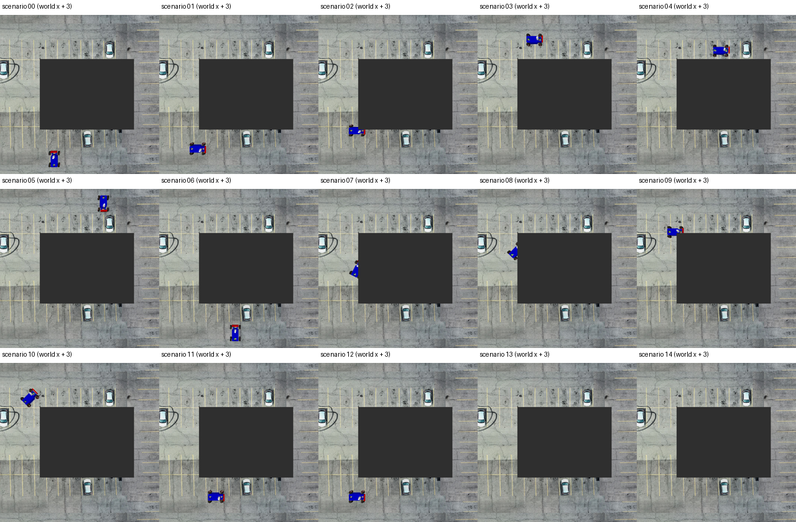
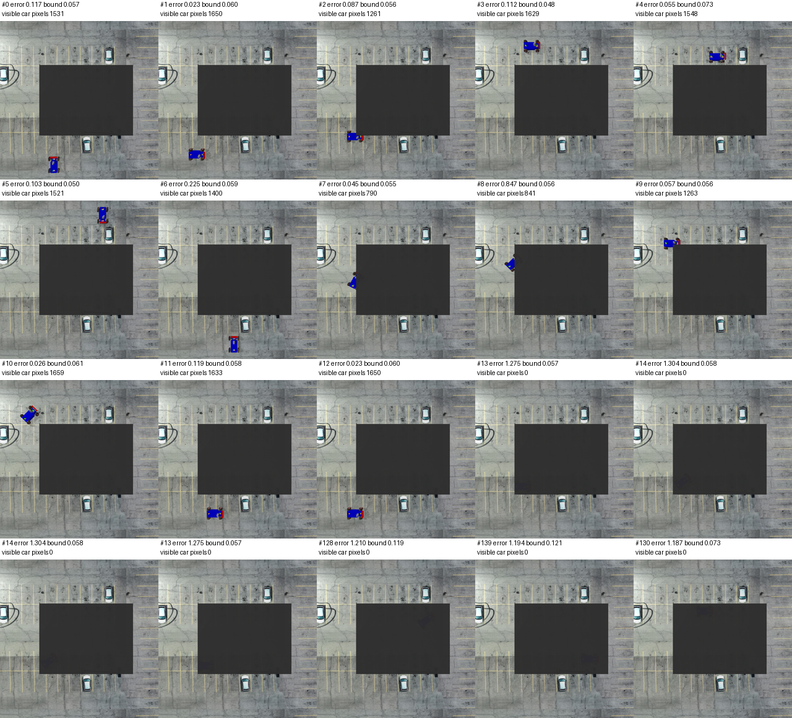
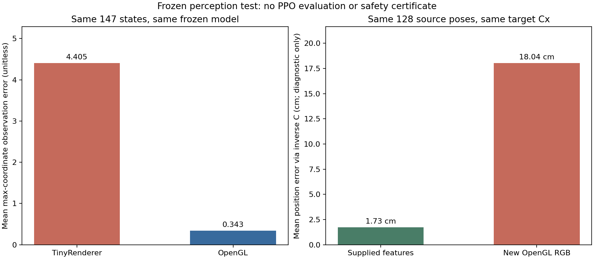
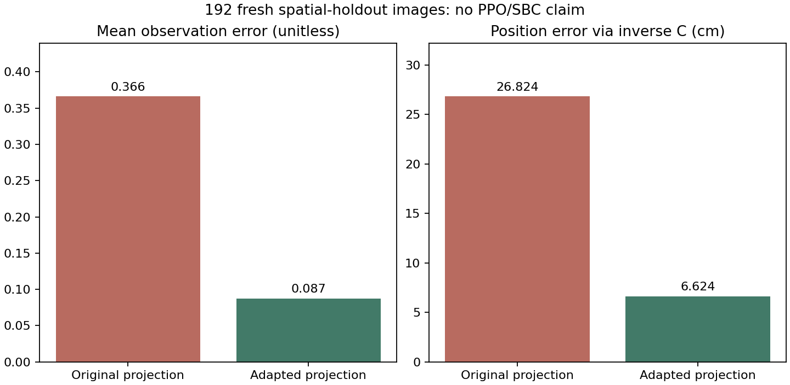
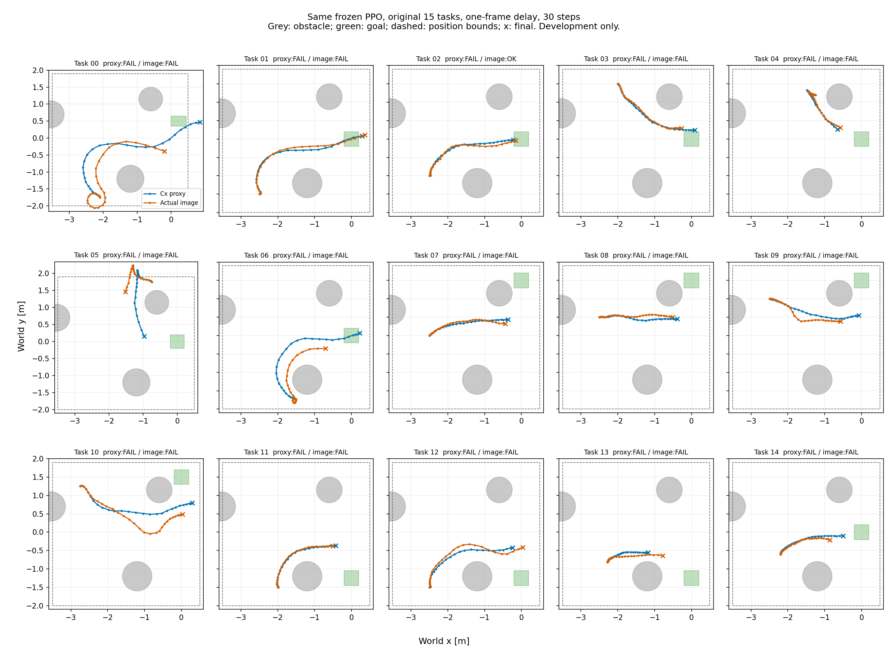
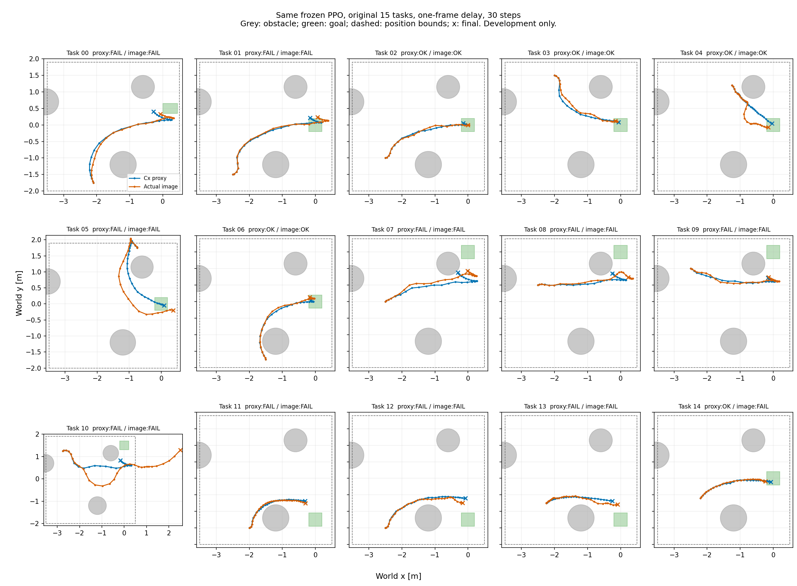
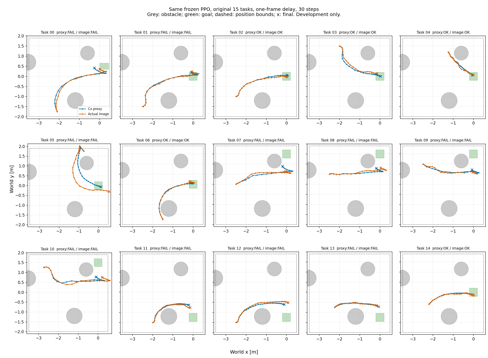

> 已归档（2026-10-29）。本文保留当时的实验与计划；当前方案请阅读[最新总览](../../../current/当前方案与验证结果.md)。

# VISION-SLS：图像如何转换成低维观测，以及感知误差如何建模

> CP 专题阅读入口（2026-10-26）：[CP 加入 VISION-SLS 的完整说明与可行性分析](</Users/johann/project/work_based_on_spvc/docs/archive/2026-10-29_主线更新前文档/current/VISION-SLS_CP完整说明与可行性分析.md>)。本文件保留原论文/视觉前端及独立专题内容；其中 CP 阶段记录不再作为当前实验结论入口。


完整流程和效果的独立易读报告已整理为[VISION-SLS停车场三维前端与SPVC后端实验报告](VISION-SLS停车场三维前端与SPVC后端_独立实验报告.md)，包含感知、PPO、SBC、历史软包络尝试、口径和术语解释。本篇继续保留详细技术阅读与逐步日志。

当前停车场主线已按用户最新要求确定为：**DINO＋三维投影／Cx前端，接入原SPVC的PPO控制器更新与SBC训练后端**，不训练32维停车场latent，不使用SLS控制器。首轮原actor学习率0.05使控制明显退化；只降至0.0003后，代理成功维持5/15、图像从4/15升至5/15，均无碰撞但各3个任务出界。原SPVC训练方法已实际调用，43项相关测试通过；SBC区域条件尚未满足、完整连续状态验证未运行，不能声称有证书。[第十八节记录本轮结构、配置、成功和失败](#十八-三维前端接入原-spvc-训练后端)。

2026年10月25日停车场PPO闭环已接通并完成两轮训练：固定适配后的DINO前端，保留一拍延迟，策略只读历史三维观测、已执行动作和目标命令，不额外拼接真实速度或位置。实际301056步时，Cx/图像成功为0/15和1/15；只增加训练到累计1001472步后升为5/15和4/15，平均终点距离0.7345→0.4169米、0.9221→0.5382米。第二轮两路径均无碰撞，但各有3个任务出界，整体仍未合格。36项相关测试通过，四组共1800个保存转移重算差为0。下一步先改善多目标控制训练，不接新SBC、不改成功标准。[配置、全部任务轨迹和失败分析见第十七节](#十七-停车场历史观测-ppo-与真实图像闭环)。

2026年10月25日小投影适配首轮已完成：DINO和C不变，1024张新OpenGL图像按位置区域划分为640/192/192，只微调小投影。新测试区域的位置偏差从26.82降到6.62厘米，平均表示误差0.3661→0.0872，95分位1.0882→0.1971，最大值2.2894→0.4386。验证集选中第73轮，随后才编码和评估测试；保存模型复算差为0，30项相关测试通过。旧包络覆盖虽升至54.69%，仍不能使用为安全契约，也没有训练PPO/SBC。[详细配置、隔离记录和结果见第十六节](#十六只适配小投影网络的第一轮实验)。

2026年10月25日感知实测更新：已在10.x服务器完成官方DINO-G/14与作者投影的真实截图推理。相同147个状态上，OpenGL平均表示误差0.3433，TinyRenderer为4.4052，因此精度测试不再使用TinyRenderer。进一步同128个作者保存状态对照，原特征反算位置误差1.73厘米，当前OpenGL截图18.04厘米，旧包络覆盖98.44%→30.47%。特征余弦相似度虽达0.9975，投影输出仍明显改变。结论是场景与感知链条已接通，但原视觉权重尚不能直接迁移为可靠控制前端；下一步先适配投影，不盲目训练PPO/SBC。第十五节记录配置、正负结果与复跑方式。

2026年10月25日第一阶段接入记录：停车场环境接口已在10.x服务器实际跑通。原15个起点共450次状态转移、465条状态记录；坐标放置误差、同状态重复截图差及仅变速度的截图差均为0。15项单元测试在本地和服务器通过，另有13项状态包络回归测试通过。拼图已由助手检查，黑色遮挡板是原场景设置，不是渲染故障。第十四节记录这个未加载DINO/PPO/SBC的环境接线步骤；随后完成的DINO感知实测见第十五节。原AEBS后端未修改。
## 一、主题

重点分析论文中的感知部分：

> 一张图像如何变成控制器能够使用的低维观测，以及作者如何描述这个转换过程中的误差。

我主要想回答六个问题：

1. 图像经过哪些处理，最终得到的低维向量是什么？
2. 这个向量和机器人的真实状态有什么关系？
3. 作者怎样训练这个映射，为什么要考虑动力学和可观测性？
4. 误差是怎样定义、怎样从数据中计算出来的？
5. 误差范围怎样拟合，又怎样传给后面的控制器？
6. 论文公式与当前公开代码是否完全一致？

首先给出这个模块最终希望建立的关系：

$$
\boxed{
p_\theta\bigl(\psi_{\mathrm{DINO}}(I)\bigr)
=
Cx+F(x)e
}
$$

先逐个解释：

- $I$：摄像头拍到的图像。
- $\psi_{\mathrm{DINO}}$：预训练的 DINO 视觉模型，负责把图像变成特征向量。
- $p_\theta$：作者训练的一个较小的神经网络，参数记为 $\theta$，把 DINO 特征继续压缩。
- 左边整体：机器人实际从图像计算出来的低维观测。
- $x$：机器人的真实物理状态。
- $C$：一个矩阵，把物理状态变换到与低维观测相同的空间。
- $F(x)e$：低维视觉观测相对 $Cx$ 的偏差。
- $F(x)$：描述这个偏差允许有多大。
- $e$：归一化误差变量，用来表示允许范围内的不同误差方向和大小。

这个公式的意思是：

> 从图像得到的低维向量，应该接近某个能够根据物理状态计算的量；两者之间允许存在误差，但希望把误差限制在一个明确的范👍围内。

这里有一个非常重要的理解：

**代码不是让一个网络同时输出“低维向量”和“当前误差”。**

它实际上分开建立三个对象：

| 对象 | 作用 | 如何得到 |
|---|---|---|
| 投影网络 $p_\theta$ | 图像特征 → 低维观测 | 用带状态标签的数据训练 |
| 状态观测模型 $Cx$ | 物理状态 → 同一个低维空间 | 学习矩阵 $C$，然后供控制器使用 |
| 误差函数 $F(x)$ | 描述不同状态下允许的观测偏差 | 固定感知网络后，利用残差数据单独拟合 |

后面我就按照这三个对象的建立过程，逐步展开。

---

## 二、为什么不能直接把图像交给控制器

以停车场小车实验为例，小车状态是：

$$
x=
\begin{bmatrix}
p_x\\p_y\\\vartheta\\v
\end{bmatrix}
$$

其中：

- $p_x,p_y$：小车在平面上的位置；
- $\vartheta$：车头朝向；
- $v$：前进速度。

所以物理状态只有 4 维。

但一张 $512\times512$ 的 RGB 图像包含：

$$
512\times512\times3=786432
$$

个像素通道数值。

图像里有大量与当前控制任务没有直接关系的信息，例如地面纹理、颜色、背景细节。

如果把这些像素全部作为控制器的观测变量，后面的反馈设计和误差传播计算会非常大。

因此，作者希望提取一个只有少数几个数的观测向量。

停车场实验最终采用的是：

$$
y^r\in\mathbb R^3
$$

这里的：

- $y$ 表示观测；
- 上标 $r$ 表示 reduced，即经过降维；
- $\mathbb R^3$ 表示它包含 3 个实数。

但是，仅仅“把图像压成 3 个数”还不够。

如果这 3 个数只是某种没有明确规律的图像编码，控制器仍然不知道：

> 当小车从一个位置运动到另一个位置时，这 3 个数应该怎样变化？

因此，作者同时要求这个向量满足：

$$
y^r\approx Cx
$$

这样，规划器知道候选状态 $x$，就能预测低维观测应该是多少，而不需要先生成一张未来图像。

所以这个模块的目标可以更准确地表述为：

> 把图像转换成一个维度小、与物理状态具有简单关系、剩余误差能够建模的观测。

---

## 三、第一步：图像怎样变成 DINO 特征

### 3.1 输入和输出

这一阶段的数据流是：

```text
RGB 图像
   ↓
图像预处理
   ↓
预训练 DINOv2
   ↓
1536 维特征向量
```

用公式表示：

$$
d=\psi_{\mathrm{DINO}}(T(I))
$$

这里：

- $I$：原始图像；
- $T$：图像预处理；
- $\psi_{\mathrm{DINO}}$：DINO 模型；
- $d$：模型输出的特征向量。

停车场使用的模型是 DINOv2 `vitg14`，输出特征为：

$$
d\in\mathbb R^{1536}
$$

也就是用 1536 个数描述一张图像。

### 3.2 代码实际做了哪些预处理

停车场先渲染 $512\times512$ 图像，去掉 alpha 通道，保留 RGB。

随后调用默认预处理：

```python
preprocess = get_dino_v2_preprocess()
```

这条路径会：

1. 把图像缩放到默认的 224 尺度；停车场输入是正方形，因此变成 $224\times224$；
2. 转换成张量；
3. 对 RGB 通道进行标准化。

标准化可以写成：

$$
I'_{c,h,w}
=
\frac{I_{c,h,w}/255-\mu_c}{\sigma_c}
$$

符号解释：

- $c$：颜色通道，可以是红、绿、蓝；
- $h,w$：像素位置；
- 除以 255：把常见的整数像素范围转换到 $0$ 到 $1$；
- $\mu_c$：该颜色通道使用的均值；
- $\sigma_c$：该颜色通道使用的标准差；
- $I'$：标准化后的输入。

这里使用的是预训练模型常见的 ImageNet 均值和标准差。

这一步只是让输入格式与预训练模型的使用方式对齐，不是误差校准。

### 3.3 DINO 输出的具体是哪种特征

核心代码是：

```python
descriptor = model_dino.forward_features(images)["x_norm_clstoken"]
```

这里取的是全局 CLS token。

可以把它理解成：

> DINO 对整张图像汇总得到的一组特征。

当前执行路径不是把每个图像块的全部特征都送进控制器。

### 3.4 哪些参数会训练

在可见执行路径中，DINO 作为固定特征提取器：

```python
with torch.no_grad():
    descriptor = model_dino.forward_features(images)["x_norm_clstoken"]
```

这里的 `no_grad()` 表示不记录用于训练的梯度。

作者在这个接口上主要学习的是后面的投影网络和状态观测矩阵。

### 3.5 这一步能保证什么

DINO 能提供较有用的视觉表示，但它本身不能保证：

- 特征能够恢复机器人状态；
- 特征一定保留速度等控制所需的信息；
- 特征误差被某个集合覆盖；
- 控制器一定安全。

这些问题需要后面建立状态关系和误差模型才能处理。

代码依据：[DINO 预处理与特征提取](/Users/johann/project/work_based_on_spvc/VISION-SLS/perception_utils/eval_dino.py:69)、[停车场实际推理路径](/Users/johann/project/work_based_on_spvc/VISION-SLS/expe/parking_lot/run_parking_lot_dino.py:80)。

---

## 四、第二步：1536 维特征怎样变成 3 维观测

### 4.1 网络结构

停车场的投影网络是：

```text
1536
  ↓ 线性层
512
  ↓ GELU
512
  ↓ GELU
3
```

更准确地说，有三个线性层：

```python
self.net = nn.Sequential(
    nn.Linear(1536, 512),
    nn.GELU(approximate="tanh"),
    nn.Linear(512, 512),
    nn.GELU(approximate="tanh"),
    nn.Linear(512, 3)
)
```

用公式写成：

$$
a_1=W_1d+b_1
$$

$$
a_2=W_2g(a_1)+b_2
$$

$$
y^r=W_3g(a_2)+b_3
$$

逐项解释：

- $d$：1536 维 DINO 特征；
- $W_1$：$512\times1536$ 的权重矩阵；
- $b_1$：512 维偏置；
- $W_2$：$512\times512$ 的权重矩阵；
- $b_2$：512 维偏置；
- $W_3$：$3\times512$ 的权重矩阵；
- $b_3$：3 维偏置；
- $g$：GELU 激活函数；
- $y^r$：最后的 3 维观测。

线性层负责重新组合特征，激活函数让网络能够表达非线性映射。

### 4.2 GELU 是什么

代码使用双曲正切近似形式：

$$
g(a)
\approx
\frac{a}{2}
\left[
1+\tanh\left(
\sqrt{\frac{2}{\pi}}
\left(a+0.044715a^3\right)
\right)
\right]
$$

这个函数对向量中的每个数分别作用。

不必把它理解成一个控制理论公式。它只是神经网络中的一种平滑非线性：

- 较大的正数大体保留；
- 较大的负数受到抑制；
- 在中间区域平滑过渡。

它的作用是增强网络拟合能力，不承担安全保证。

### 4.3 这 3 个数到底代表什么

这 3 个数不是必须直接等于：

```text
横向位置、纵向位置、朝向
```

作者允许它们是这些物理量的线性组合：

$$
y^r\approx Cx
$$

这里 $C$ 的尺寸是 $3\times4$。

停车场实际使用的矩阵约为：

$$
C=
\begin{bmatrix}
0.9761&0.1324&-0.1721&0\\
-0.2165&0.6678&-0.7121&0\\
0.0209&0.7329&0.6800&0
\end{bmatrix}
$$

所以第一维观测目标为：

$$
(Cx)_1
=
0.9761p_x+0.1324p_y-0.1721\vartheta
$$

意思是：

> 第一维观测不是单独的横坐标，而是位置和朝向的一种固定组合。

另外两维也是类似的组合。

因此，误差数值例如 0.03，是这个低维观测空间中的误差，**不能直接解释成位置误差 3 厘米**。

### 4.4 为什么 $C$ 的速度列是零

矩阵最后一列为零，说明：

$$
Cx
=
C
\begin{bmatrix}
p_x\\p_y\\\vartheta\\v
\end{bmatrix}
$$

实际上不直接依赖 $v$。

这是合理的：单张静态图像通常不直接包含速度。

作者没有强迫单张图像预测所有状态，而是让观测先表达能够从图像辨认的部分，再让观测历史和动力学提供剩余信息。

### 4.5 我核对了 checkpoint 与控制模型是否一致

这个问题在复现时很重要：训练出来的 $C$ 和控制代码硬编码的 $C$ 必须使用同一个坐标约定。

本次检查中，从实际 checkpoint 读取到的是一个未经行归一化的 $3\times4$ 矩阵。

按代码执行：

```python
C_norm = C / C.norm(dim=1, keepdim=True)
```

之后，它与控制模型中使用的 $C$ 在所显示精度下一致。

因此，这一处训练模型与控制模型的接口能够对应起来。

代码依据：[投影网络定义](/Users/johann/project/work_based_on_spvc/VISION-SLS/perception_utils/networks.py:409)、[控制器使用的观测矩阵](/Users/johann/project/work_based_on_spvc/VISION-SLS/dyn/unicycle_of_perception.py:19)。

---

## 五、第三步：这个低维观测是怎样训练出来的

### 5.1 训练数据需要成对提供什么

每条训练样本需要：

$$
(I_i,x_i)
$$

其中：

- $I_i$：某个场景中的图像；
- $x_i$：这张图像对应的机器人真实状态。

先提取图像特征：

$$
d_i=\psi_{\mathrm{DINO}}(T(I_i))
$$

之后，训练数据就可以保存成：

$$
(d_i,x_i)
$$

这样训练小网络时不必每轮重新运行 DINO。

这也解释了代码为什么读取的是状态和特征文件，而不一定直接读取原始图像。

### 5.2 两条路径在同一个空间中对齐

对同一个样本，计算：

$$
\widehat y_i^r=p_\theta(d_i)
$$

以及：

$$
y_{i,\mathrm{target}}^r=Cx_i
$$

这里：

- $\widehat y_i^r$：网络预测；
- $y_{i,\mathrm{target}}^r$：根据状态计算的监督目标。

训练希望两者接近：

$$
p_\theta(d_i)\approx Cx_i
$$

数据流是：

```text
同一场景的一张图像和一个状态标签
             │
       ┌─────┴─────┐
       ↓           ↓
    DINO 特征      状态 x
       ↓           ↓
   投影网络 p      矩阵 C
       ↓           ↓
   预测观测       目标观测
       └─────┬─────┘
             ↓
         计算差异
             ↓
      更新 p 的参数和 C
```

### 5.3 匹配损失怎样计算

一个基本匹配目标是：

$$
\mathcal L_{\mathrm{match}}
=
\frac{1}{B}
\sum_{i=1}^{B}
\left\|
p_\theta(d_i)-Cx_i
\right\|_2
$$

解释：

- $B$：一次训练使用的样本数，称为批大小；
- $i$：批内样本编号；
- $p_\theta(d_i)-Cx_i$：3 维预测残差；
- $\|\cdot\|_2$：二范数，也就是平方和开根号；
- 对一个批次取平均：衡量这批样本的平均匹配误差。

例如一个样本的残差是：

$$
\begin{bmatrix}
0.03\\-0.04\\0
\end{bmatrix}
$$

则其二范数为：

$$
\sqrt{0.03^2+(-0.04)^2}=0.05
$$

训练就是调整网络和 $C$，让这样的数值下降。

### 5.4 为什么只让预测误差小还不够

如果 $C$ 和网络一起学习，却没有额外限制，可能出现：

$$
C=0,\qquad p_\theta(d)=0
$$

这样两边完全相等，损失为零，但这个表示不包含任何状态信息。

所以，小误差不等于好表示。

可见代码使用了 $C$ 的逐行归一化：

$$
\widetilde C_{j,:}
=
\frac{C_{j,:}}{\|C_{j,:}\|_2}
$$

这里：

- $j$：第几行；
- $C_{j,:}$：这一行的所有元素；
- 除以该行的二范数：让这一行的长度为 1。

它防止通过把整行缩成很小来降低匹配误差。

但是，**行归一化不能保证不同行彼此独立，也不能保证所有状态都能够被辨认。**

这就是论文还需要可观测性目标的原因。

### 5.5 实际训练代码做了什么

通用训练循环的主要步骤是：

```python
prediction = model(features)
loss = loss_fn(model, features, states)

optimizer.zero_grad()
loss.backward()
optimizer.step()
```

其含义是：

1. 输入一批特征；
2. 计算预测与目标之间的损失；
3. 计算损失对模型参数的变化率；
4. 用 Adam 更新参数。

这里的参数包括投影网络参数，也包括被注册为可学习参数的 $C$。

当前源码还包含训练集、验证集划分和模型保存逻辑。

不过，**存在训练工具，不等于当前仓库已经完整提供论文中每个 checkpoint 的全部训练过程。** 可观测性这一项需要进一步区分论文与实现。

代码依据：[数据集接口](/Users/johann/project/work_based_on_spvc/VISION-SLS/perception_utils/datasets.py:5)、[通用训练循环](/Users/johann/project/work_based_on_spvc/VISION-SLS/perception_utils/train.py:25)。

---

## 六、为什么表示学习要考虑动力学和可观测性

### 6.1 可观测性是什么意思

这里的可观测性，可以用一句话解释：

> 根据一段观测历史和已知的运动规律，能不能区分不同的真实状态？

它不要求一张图像包含全部状态。

例如，只看某一时刻的位置，不知道速度；但看两次位置，并知道间隔时间，就可以推断速度。

### 6.2 用最简单的例子解释

假设机器人只沿直线匀速运动：

$$
p_{k+1}=p_k+h v_k
$$

$$
v_{k+1}=v_k
$$

并且只能测量位置：

$$
y_k=p_k
$$

这里：

- $p_k$：位置；
- $v_k$：速度；
- $h$：两次测量的时间间隔；
- $y_k$：观测值。

只给 $y_k$，不能唯一确定 $v_k$。

但如果还有下一次观测：

$$
y_{k+1}=p_k+h v_k
$$

就能得到：

$$
v_k=\frac{y_{k+1}-y_k}{h}
$$

这说明速度虽然没有被直接测量，却能够通过观测历史恢复。

因此，小车的 3 维观测用于控制 4 维状态，并不矛盾。

### 6.3 论文怎样把这个思想写进训练目标

论文考虑给定动作序列后，从初始状态出发产生的一段预测观测：

$$
\mathcal H(x;\mathbf u)
=
\begin{bmatrix}
h_r(x_1)\\
h_r(x_2)\\
\vdots\\
h_r(x_L)
\end{bmatrix}
$$

其中：

$$
x_{\ell+1}=f(x_\ell,u_\ell),
\qquad h_r(x)=Cx
$$

解释：

- $x$：这段预测的初始状态；
- $\mathbf u$：给定的一串控制输入；
- $f$：已知动力学；
- $x_1,\ldots,x_L$：按动力学预测的未来状态；
- $h_r(x_\ell)$：该状态对应的低维观测；
- $\mathcal H$：把这些预测观测堆叠起来。

接着，看初始状态变化会怎样影响这一串观测：

$$
\mathcal O_x
=
\frac{\partial \mathcal H}{\partial x}
$$

这个导数矩阵称为 Jacobian。

这里可以直接理解为：

> 如果初始状态稍微改变一点，整段观测会改变多少？

如果某个状态方向发生变化，整段观测几乎不变，就很难通过观测辨认这个方向。

### 6.4 最小奇异值为什么有意义

论文通过最小奇异值描述最难辨认的方向。

它可以写成：

$$
\sigma_{\min}(\mathcal O_x)
=
\min_{\|\delta x\|_2=1}
\|\mathcal O_x\delta x\|_2
$$

解释：

- $\delta x$：一个状态变化方向；
- $\|\delta x\|_2=1$：把方向长度统一，公平比较；
- $\mathcal O_x\delta x$：这个方向的状态变化产生的观测变化；
- 对所有方向取最小值：找到最不容易看出来的那个方向。

如果这个最小值非常小，就说明至少有一个状态方向很难辨认。

所以论文希望它大一些。

### 6.5 总训练目标怎么理解

论文的目标可以按含义写成：

$$
\mathcal L
=
\mathcal L_{\mathrm{match}}
-
\lambda \sigma_{\min}(\mathcal O_x)
$$

其中：

- 第一项：图像预测要接近状态观测模型；
- 第二项：希望最难辨认的状态方向也能引起足够明显的观测变化；
- $\lambda>0$：控制这两个目标的权衡；
- 负号：因为训练是在最小化损失，所以减去它相当于鼓励最小奇异值增大。

这就使降维目标从“保留图像信息”变成：

> 保留经过动力学和时间历史后，能够用于区分状态的信息。

这也是作者不单纯使用图像重建损失的原因。重建图像可能花很多容量保存背景纹理，却没有优先保存控制所需的信息。

### 6.6 当前代码能确认什么，不能确认什么

当前可见的实机训练脚本定义了：

```python
loss_gramian(...)
```

里面使用导数、矩阵拼接和 SVD，体现了通过动力学构造可观测性指标的意图。

但是，实际返回损失的函数中：

```python
# loss_gramian_val = loss_gramian(net, x)
```

这一项被注释了。

当前实际使用的主要是：

```python
loss = ((C_norm @ x.T).T - y_red_pred).norm(dim=1).mean()
```

也就是观测匹配损失。

因此，汇报时应该明确说明：

> 论文提出了包含可观测性目标的表示学习方法；当前公开代码包含相关函数，但可见实机训练入口没有启用这一项，停车场 checkpoint 的完整训练入口也没有在当前源码中清楚呈现。

这并不证明历史 checkpoint 没有使用过该目标，只说明**不能仅凭当前入口认定已经完整复现论文训练目标**。

代码依据：[可观测性函数与实际损失](/Users/johann/project/work_based_on_spvc/VISION-SLS/expe/hardware/train_observability.py:21)。

---

## 七、第四步：低维观测的“误差”究竟是什么

### 7.1 先固定感知模型

完成表示学习后，作者先固定：

- DINO；
- 投影网络 $p_\theta$；
- 观测矩阵 $C$。

再用校准数据计算残差。

原因是：如果网络还在变化，之前统计的误差就不再对应当前网络。

### 7.2 残差怎样定义

对第 $i$ 个校准样本：

$$
\epsilon_i
=
p_\theta(d_i)-Cx_i
$$

其中：

- 第一项：从图像特征计算出的观测；
- 第二项：从真实状态计算出的理想目标；
- $\epsilon_i$：两者的差，是一个 3 维向量。

这个误差统一包含了图像到低维观测这条链中的剩余不一致，例如：

- 图像噪声；
- 遮挡；
- 投影网络拟合不准确；
- 视觉特征降维后丢失信息；
- 简单线性观测模型无法完全匹配视觉输出。

它不是机器人的运动扰动。运动扰动是动力学中的另一类误差。

### 7.3 为什么把向量误差变成一个标量

代码计算：

$$
r_i=\|\epsilon_i\|_\infty
=
\max_j|\epsilon_{i,j}|
$$

解释：

- $j$：低维观测的分量编号；
- $|\epsilon_{i,j}|$：该分量的绝对误差；
- 最大值：取三个分量中最大的那个。

例如：

$$
\epsilon_i=
\begin{bmatrix}
0.02\\-0.05\\0.01
\end{bmatrix}
$$

则：

$$
r_i=0.05
$$

如果以后找到一个上界 $b(x_i)\ge0.05$，就能同时覆盖三个分量的绝对误差。

对应代码：

```python
error = torch.abs(
    model(data.data_z) - (C_norm @ data.data_x.T).T
).max(dim=1)[0]
```

这里每个操作的含义都可以对应上：

- `model(...)`：预测观测；
- `C_norm @ ...`：状态目标观测；
- 相减：残差；
- `abs()`：取绝对值；
- `max(dim=1)`：每个样本内部取最大分量。

### 7.4 训练损失与校准残差为什么使用不同范数

表示训练里主要使用二范数，关心平均拟合效果。

误差校准使用无穷范数，是为了用一个标量同时限制每个观测分量。

两者目的不同，不必使用相同范数。

但后续控制器使用哪种误差集合，必须与校准结果相匹配。这个问题后面会专门说明。

代码依据：[残差计算](/Users/johann/project/work_based_on_spvc/VISION-SLS/expe/parking_lot/train_error_bound.py:95)。

---

## 八、第五步：误差范围怎样从数据拟合出来

### 8.1 为什么误差界要随位置变化

停车场中存在遮挡区域。

在容易观察的位置，同样的状态变化能在图像中清楚体现，误差可能较小。

在遮挡严重的位置，不同状态对应的图像可能很相似，网络更容易预测不准。

因此作者不只使用一个全局常数，而是希望建立：

$$
r_i\lesssim b(x_i)
$$

其中 $b(x)$ 表示：

> 在状态 $x$ 附近，为视觉观测误差预留多大的范围。

它是一张从状态到误差大小的地图。

### 8.2 停车场为什么只用位置拟合

停车场代码中：

```yaml
x_dim_error: 2
```

随后只保留状态前两个分量作为误差拟合输入。

所以实际采用：

$$
b(x)=b(p_x,p_y)
$$

也就是说：

- 投影网络的输入是视觉特征；
- 误差函数的输入是位置；
- 两者不是同一个输入，也不是同一个模型。

这个简化让误差函数容易拟合、容易在轨迹优化中计算。

代价是：朝向等没有显式进入误差函数的变量，需要由校准数据覆盖它们的影响。不能只因为 $b$ 是位置函数，就认为误差与朝向完全无关。

### 8.3 三次多项式具体是什么

停车场用二变量三次多项式。

把所有使用的单项式写成：

$$
m(p_x,p_y)
=
\begin{bmatrix}
1\\
p_y\\
p_y^2\\
p_y^3\\
p_x\\
p_xp_y\\
p_xp_y^2\\
p_x^2\\
p_x^2p_y\\
p_x^3
\end{bmatrix}
$$

这里 $m$ 是一个 10 维向量。

再用 10 个系数组合它们：

$$
q_\beta(p_x,p_y)
=
\beta^\top m(p_x,p_y)
$$

其中：

- $\beta$：10 个待拟合系数；
- $\beta^\top m$：每个单项式乘以对应系数，再相加；
- $q_\beta$：拟合得到的多项式值。

多项式的作用是让误差大小能够随位置平滑变化，同时计算成本很低。

### 8.4 论文给出的拟合目标

论文式（31）采用下面的包络拟合。这里先讲论文中的连续松弛变量，下一节再讲停车场代码采用的二进制变量；二者不是同一种松弛方式。

$$
\begin{aligned}
\min_{\beta,\xi_i\ge0}\quad&
\sum_i\beta^\top m(x_i)
+\gamma\|\beta\|_2^2
+\mu\sum_i\xi_i\\
\text{s.t.}\quad&
\beta^\top m(x_i)\ge r_i-\xi_i
\end{aligned}
$$

为方便阅读，把这一节的多项式暂记为：

$$
b_\beta(x)=\beta^\top m(x).
$$

这里的 $b_\beta$ 是论文该式中的多项式，不是下一节已经加上常数下界的 $\max\{q_\beta,b_{\min}\}$。

#### 8.4.1 输入、变量和输出分别是什么

| 对象 | 是否由本次优化决定 | 含义 |
|---|---|---|
| $x_i$ | 否，来自校准数据 | 第 $i$ 个样本的状态标签，或选出的拟合输入分量 |
| $r_i$ | 否，已事先计算 | 第 $i$ 个样本的最大绝对观测残差 |
| $m(x_i)$ | 否，由输入与基函数确定 | 在样本位置上计算出的单项式向量 |
| $\beta$ | 是 | 所有样本共享的多项式系数 |
| $\xi_i\ge0$ | 是 | 第 $i$ 个样本允许的欠覆盖量 |
| $\gamma,\mu$ | 否，事先设定 | 系数正则与欠覆盖惩罚的权重 |

因此，优化器是在一条共享包络曲面和每个样本各自的放宽量之间进行选择，而不是为每个样本单独拟合一套多项式。

#### 8.4.2 如果没有松弛，本来要求什么

若完全不允许放宽，对每个校准样本都要求：

$$
b_\beta(x_i)\ge r_i.
$$

例如某个位置的实际残差是 0.10，拟合误差界至少也要达到 0.10。低于这个值就不满足约束。

这种必须满足的条件称为硬约束。它能强制覆盖拟合样本，但可能让包络变得很大；若再有参数范围等限制，也可能导致无解。没有额外限制时，足够大的常数有时就能覆盖全部有限样本，因此不能说“没有松弛就一定无解”。

#### 8.4.3 加入 $\xi_i$ 以后究竟放松了什么

加入松弛变量后：

$$
b_\beta(x_i)\ge r_i-\xi_i,
\qquad\xi_i\ge0.
$$

等价地：

$$
\boxed{r_i\le b_\beta(x_i)+\xi_i.}
$$

因此它允许：**当前多项式界不够高时，由 $\xi_i$ 记录缺少的那部分。**

以下是同一个样本 $r_i=0.10$ 的几种情况：

| 拟合值 $b_\beta(x_i)$ | 至少需要的 $\xi_i$ | 多项式本身是否覆盖实际残差 |
|---:|---:|---|
| 0.12 | 0 | 覆盖，并有 0.02 余量 |
| 0.10 | 0 | 刚好覆盖 |
| 0.08 | 0.02 | 未覆盖，缺少 0.02 |
| 0.03 | 0.07 | 未覆盖，缺少 0.07 |

表中的“至少需要”来自约束。比如 $b_\beta=0.08$ 时，取 $\xi_i=0.03$ 也满足约束；但在 $\mu>0$ 时，这会比取 0.02 多付惩罚，所以通常没有必要。

对于固定的 $\beta$，当 $\mu>0$ 且没有其他关于 $\xi_i$ 的约束时，最优选择就是：

$$
\boxed{
\xi_i^*=\max\{0,r_i-b_\beta(x_i)\}.
}
$$

这说明它精确对应“该样本缺少多少覆盖”。若 $\mu=0$，目标不惩罚松弛，其取值就不一定是这个最小值。

#### 8.4.4 $\xi_i$ 不是实际噪声，也不会把误差纠正掉

需要把几个容易混淆的量分开：

| 符号 | 含义 |
|---|---|
| $\epsilon_i=y_i^r-Cx_i$ | 实际产生的观测误差向量 |
| $r_i=\|\epsilon_i\|_\infty$ | 已计算出的实际误差大小，标量 |
| $b_\beta(x_i)$ | 拟合得到的误差界 |
| $\xi_i$ | 优化器允许误差界欠覆盖的量，标量 |
| $e$ | 后文 $F(x)e$ 中的归一化未知误差向量 |

$\xi_i$ 是拟合阶段引入的辅助变量，不是从图像中测得的物理噪声。优化器把 $\xi_i$ 设成 0.02，不会把真实误差从 0.10 减少到 0.08。

它只是让原本不满足 $0.08\ge0.10$ 的拟合结果，在放松后的约束中成为允许的候选解。

#### 8.4.5 为什么还要允许这种放宽

因为所有样本共享一组系数 $\beta$。为了覆盖某个大残差点而抬高多项式，可能同时改变附近甚至更大区域的包络。

这可能带来三个问题：

1. 大部分容易观察的位置也获得过大的误差界；
2. 控制器为这些过大的误差预留更多安全距离，路线变得保守；
3. 在某些任务和限制下，优化器可能找不到满足收紧约束的控制方案。

松弛让拟合器能够选择：为了压低整体包络，是否值得接受少数样本的一定欠覆盖，并为此付出代价。

但“大残差点”不一定是无效异常数据，也可能恰好代表某个真实、困难且危险的视觉情形。因此，这种选择改善的是拟合折中和可用性，不能凭“它是异常点”就免除安全分析。

#### 8.4.6 目标函数的三个部分分别做什么

**第一项：压低样本位置上的包络值。**

$$
\sum_i b_\beta(x_i).
$$

如果没有这一类代价，拟合器可以把误差界设得很大来覆盖数据，但控制器会很保守。这里优化的是样本位置上多项式值的和，不是直接计算整个连续状态空间中的包络体积。

**第二项：限制系数规模。**

$$
\gamma\|\beta\|_2^2.
$$

它惩罚过大的系数，但不能单靠这一项保证所有区域内的包络都准确、覆盖充分，或者保证多项式处处非负。真正作为误差尺度使用时，还需保证适用区域内的非负性；下一节代码中的常数下界处理了这一部分问题。

**第三项：让欠覆盖付出代价。**

$$
\mu\sum_i\xi_i.
$$

它按欠覆盖的幅度累加：一个样本少覆盖 0.10，与十个样本各少覆盖 0.01，在这项中的代价相同。

所以这一项不是直接控制“允许多少个失败样本”，也没有直接规定“必须覆盖 97% 的样本”。幅度和样本数量是两个不同指标。

#### 8.4.7 消去松弛变量后，更容易看懂目标

在 $\mu>0$ 时，把最小松弛量代回目标，等价于：

$$
\min_\beta\quad
\sum_i b_\beta(x_i)
+\gamma\|\beta\|_2^2
+\mu\sum_i\max\{0,r_i-b_\beta(x_i)\}.
$$

最后一项是单边惩罚：

- 当 $b_\beta(x_i)\ge r_i$，没有欠覆盖惩罚；
- 当 $b_\beta(x_i)<r_i$，差多少，就按 $\mu$ 倍惩罚多少。

这也解释了为什么在 $\gamma\ge0$、$\mu>0$ 的设定下，这个问题是凸的：校准输入固定以后，$b_\beta(x_i)=\beta^\top m(x_i)$ 对待优化参数 $\beta$ 是线性的；系数二次惩罚是凸的，`max` 单边惩罚也是凸的。位置上使用多项式，并不意味着它对系数的拟合必然是非凸优化。

#### 8.4.8 用三个样本看 $\mu$ 怎样改变结果

为了只观察松弛的影响，考虑一个简化示例：用常数 $b\ge0$ 作为所有样本的误差界，不使用系数正则，三个已知残差为：

$$
r_1=0.02,\qquad r_2=0.03,\qquad r_3=0.20.
$$

这里是解释性玩具问题，不是重新运行论文拟合。其目标为：

$$
J(b)=3b+\mu\sum_{i=1}^{3}\max\{0,r_i-b\}.
$$

比较两个候选界：

| 候选界 | 各样本最小松弛量 | 松弛量之和 | $\mu=2$ 时的目标 | $\mu=4$ 时的目标 |
|---|---|---:|---:|---:|
| $b=0.03$ | $[0,0,0.17]$ | 0.17 | $0.09+2\times0.17=0.43$ | $0.09+4\times0.17=0.77$ |
| $b=0.20$ | $[0,0,0]$ | 0 | 0.60 | 0.60 |

当 $\mu=2$，在这两个选择中，目标宁愿保留较小的界并接受第三个样本欠覆盖；当 $\mu=4$，目标更倾向于把界抬高以覆盖第三个样本。

对这个简单分段线性例子，还可以检查其他 $b$，相应最优点分别为 0.03 和 0.20。但一般多项式拟合的各样本相互耦合，不能把这里的阈值直接照搬过去。

通常提高 $\mu$ 会更不愿意欠覆盖；但不能仅凭“把 $\mu$ 设得很大”就宣布所有松弛必为零，需要检查实际解，或者明确采用硬约束。

#### 8.4.9 允许松弛为什么会影响安全

如果第 $i$ 个样本的解是：

$$
r_i=0.10,\qquad b_\beta(x_i)=0.08,
\qquad\xi_i=0.02,
$$

放松后的拟合约束成立，但真正成立的只是：

$$
r_i\le b_\beta(x_i)+\xi_i.
$$

它并没有证明：

$$
r_i\le b_\beta(x_i).
$$

假设控制器仍然只使用 $F(x_i)=0.08I$，而实际误差最大分量为 0.10，则后文归一化误差满足：

$$
\|e_i\|_\infty
=\frac{0.10}{0.08}
=1.25>1.
$$

实际观测误差已经落到控制器声明的允许集合之外。反馈仍可能纠正它，机器人也不一定立即碰撞；但原有鲁棒安全证明的误差包含前提已经不成立。

**松弛不是没有代价的数值技巧，它允许拟合放弃对某些实际误差的覆盖。**

还要区分：这里放松的是“感知误差包络的拟合约束”，不是直接允许小车穿过障碍物。不过，误差界偏小会让后续安全余量偏小，从而间接影响运动安全。

#### 8.4.10 松弛量会不会自动加进后续控制模型

不能这样理解。$\xi_i$ 是某个已知校准样本对应的辅助变量，未来新图像没有一个已经知道的 $\xi_{\mathrm{new}}$ 可供直接查询。

若控制器只使用拟合出来的 $b_\beta(x)$，它不会自动获得前面放松掉的那部分覆盖。

作为有限数据上的数学修补，如果已知一组满足约束的松弛量，可以令：

$$
\delta=\max_i\xi_i,
\qquad\widetilde b(x)=b_\beta(x)+\delta.
$$

于是对这些拟合样本有：

$$
r_i\le b_\beta(x_i)+\xi_i
\le\widetilde b(x_i).
$$

但这只恢复了这些已知样本的覆盖，仍不能证明所有未见图像也被覆盖。本文是在解释条件关系，不是说当前代码已经自动执行了这个加回操作。

如果需要更强结论，还需针对目标工作区域建立严格上界，或者使用具备相应假设与结论的统计校准方法。即使所有训练样本 $\xi_i=0$，也不能直接推出未来误差始终落在集合内。

#### 8.4.11 与下一节二进制松弛有什么区别

| 对比项 | 本节的 $\xi_i$ | 下一节代码的 $q_i$ |
|---|---|---|
| 类型 | 非负连续数 | 0 或 1 的二进制数 |
| 主要意义 | 允许少覆盖多少 | 是否允许通过 Big-M 放宽该样本 |
| 对大误差的处理 | 欠覆盖幅度越大，惩罚越大 | 主要受计数关系限制，不直接按欠覆盖幅度计费 |
| 优化结构 | 给定基函数下保持凸性 | 引入离散选择，形成混合整数问题 |
| 是否自动保证未来安全 | 否 | 否 |

因此，不应把下一节的 `q_var` 当成论文 $\xi_i$ 的直接改名。两者都可以允许欠覆盖，但放宽机制与目标函数不同。

#### 8.4.12 怎样说更准确

> 松弛变量 $\xi_i$ 表示第 $i$ 个校准样本允许的包络欠覆盖量。它可以避免为了少数大残差而把整个误差函数抬得过高，目标中的 $\mu\sum_i\xi_i$ 则让这种欠覆盖付出代价。但有惩罚不等于禁止违反：如果最优解中仍有正松弛，那么多项式本身没有覆盖相应实际误差。后续安全结论只有在实际误差确实落在控制器使用的集合内时才成立，因此需要把经验拟合、样本覆盖和鲁棒安全保证分开陈述。

### 8.5 当前停车场代码实际用了什么

这一节要把三个问题分开：**最终使用什么误差函数、怎样用优化拟合它、这个优化真正保证了什么。**

当前脚本与论文上一节的凸程序并不完全相同。它使用带二进制变量的混合整数优化，由 Gurobi 求解。下面按代码实际执行的 `relax_poly=True` 分支展开。

#### 8.5.1 这一阶段的输入和输出

进入这个优化之前，感知网络和观测矩阵已经固定。对每个校准样本，都已经计算好：

$$
s_i=(p_{x,i},p_{y,i}),
\qquad
r_i=\left\|p_\theta(d_i)-Cx_i\right\|_\infty.
$$

这里用 $s_i$ 专门表示用于拟合的二维位置，避免把它与完整四维状态 $x_i$ 混淆。

优化器的输入是一组已经确定的数字：

$$
\mathcal D_{\mathrm{cal}}=\{(s_i,r_i)\}_{i=1}^{N}.
$$

- $s_i$ 告诉优化器“这个样本在哪里”；
- $r_i$ 告诉优化器“这个样本的最大观测误差是多少”；
- DINO 和投影网络在此阶段不再更新。

输出主要是多项式系数 $\beta$ 和一个常数下界 $b_{\min}$。二进制变量则记录这次拟合选择了怎样的覆盖或放宽分配。

#### 8.5.2 最后使用的是“多项式与常数取最大值”

误差函数为：

$$
\boxed{
b(s)=\max\{q_\beta(s),b_{\min}\},
\qquad q_\beta(s)=\beta^\top m(s).
}
$$

其中 $m(s)$ 是前文列出的 10 维三次单项式向量。

可以把它想象成：先画出一张随位置起伏的多项式曲面，再放置一个高度为 $b_{\min}$ 的水平面。多项式高于水平面时使用多项式，低于水平面时使用水平面。

例如，以下数值仅用于解释函数形状：

| 某位置的多项式值 $q_\beta(s)$ | 常数下界 $b_{\min}$ | 最终误差界 $b(s)$ |
|---:|---:|---:|
| 0.080 | 0.016 | 0.080 |
| 0.010 | 0.016 | 0.016 |
| -0.020 | 0.016 | 0.016 |

因此，**多项式本身不一定处处非负，但真正送入观测模型的误差尺度不会低于非负的常数下界。**

这里的“下界”是指误差函数 $b(s)$ 的最小允许值，不是说真实误差至少有这么大。即使真实误差为零，模型也可以预留 0.016 的误差范围。

同时，设置一个非负下界并不自动保证覆盖真实误差。假如真实误差为 0.10，而最终界为 0.016，仍然是欠覆盖。

本次读取的已保存参数为：

$$
b_{\min}=0.01583513617515564.
$$

**这个值也是优化得到的，不是脚本固定指定为 0.015835。** 脚本指定的是范围：

$$
0\le b_{\min}\le0.04.
$$

它有助于给容易观察的区域保留一层基础误差范围，但代码也允许优化结果取零；不能说代码强制设置了一个严格为正的下界。

#### 8.5.3 为什么需要二进制变量

先暂时不允许放宽。对第 $i$ 个样本，想让最终函数覆盖残差，即：

$$
\max\{q_\beta(s_i),b_{\min}\}\ge r_i.
$$

这等价于一个“或者”条件：

$$
\boxed{
q_\beta(s_i)\ge r_i
\quad\text{或者}\quad
b_{\min}\ge r_i.
}
$$

不需要多项式和常数同时覆盖，至少一个覆盖就可以。

这样的“二选一”约束一般不是一个凸约束。例如对固定 $r_i=0.02$，点 $(q_\beta,b_{\min})=(0.02,0)$ 和 $(0,0.02)$ 都满足条件，但中点 $(0.01,0.01)$ 不满足。

代码引入 $z_i\in\{0,1\}$，用它来选择哪一条覆盖条件必须成立。这是一种常见的析取约束建模思路。

**$z_i$ 选择的是覆盖责任，不一定标记最后 `max` 的哪一项更大。** 例如常数和多项式都覆盖时，选择 $z_i=1$ 并不要求常数大于多项式。原约束没有强制两者的大小排序。

#### 8.5.4 全部优化变量及其含义

| 数学记号 | 代码变量 | 类型和数量 | 作用 |
|---|---|---|---|
| $\beta$ | `theta` | 10 个连续变量 | 决定位置多项式的形状 |
| $b_{\min}$ | `theta_bias` | 1 个连续变量 | 决定常数误差下界 |
| $z_i$ | `z_var[i]` | 每个样本一个二进制变量 | 选择主要由哪条分支承担覆盖 |
| $q_i$ | `q_var[i]` | 每个样本一个二进制变量 | 允许进一步放宽该样本的覆盖条件 |

注意，$q_i$ 是一个只能取 0 或 1 的开关；$q_\beta(s)$ 是一个多项式函数。两者虽然都用了字母 $q$，但不是同一个对象。

$q_i$ 也不同于上一节连续松弛变量 $\xi_i$：

- $\xi_i$ 表示“允许欠覆盖多少”；
- $q_i$ 表示“是否允许通过 Big-M 放宽这个样本”。

在当前目标函数中，没有直接按欠覆盖幅度惩罚 $q_i$，它主要受后面的计数关系约束。

#### 8.5.5 Big-M 怎样实现开关

代码中的两条主要约束是：

$$
\boxed{
q_\beta(s_i)\ge r_i-Mz_i-Mq_i
}
\tag{A}
$$

$$
\boxed{
b_{\min}\ge r_i-M(1-z_i)-Mq_i.
}
\tag{B}
$$

$M$ 是一个预先计算好的常数。开关为 0 时不减去对应的 $M$；开关为 1 时，把右侧往下移 $M$，使原本较强的覆盖要求变弱。

举一个简单例子：假设 $r_i=0.08$、$M=0.20$，则：

$$
q_\beta(s_i)\ge0.08
$$

要求多项式至少达到 0.08；而：

$$
q_\beta(s_i)\ge0.08-0.20=-0.12
$$

只要求它不低于 -0.12，就容易满足得多。

代码并不是随意选择一个无限大的数，而是使用：

```python
M = 1.001 * data_error.max()
```

即本次拟合样本的最大残差乘以 1.001。对于非零最大残差，它略大于所有拟合样本的 $r_i$。

这个写法解释了为什么常数分支减去 $M$ 后通常不再形成限制：因为 $r_i-M\le0$，而代码已经要求 $b_{\min}\ge0$。

但对多项式分支，事情更细一点：代码没有要求 $q_\beta(s_i)\ge0$，所以放宽后的 $q_\beta(s_i)\ge r_i-M$ 仍可能限制过于负的多项式值。

因此，**“减去 $M$”应理解为放松，不宜不加条件地说成彻底删除约束。** 对一般 Big-M 建模，若希望非选中分支完全不受限制，需要根据变量可能范围论证 $M$ 足够大；仅由最大残差选择 $M$，并没有自动完成对多项式全部可能负值的这种论证。

#### 8.5.6 四种二进制组合逐项代入

把 $(z_i,q_i)$ 的四种情况全部展开：

| $z_i$ | $q_i$ | 约束 A                     | 约束 B                | 能否据此保证该样本被最终包络覆盖 |
| ----: | ----: | ------------------------ | ------------------- | ---------------- |
|     0 |     0 | $q_\beta(s_i)\ge r_i$    | $b_{\min}\ge r_i-M$ | 能，多项式必须覆盖        |
|     1 |     0 | $q_\beta(s_i)\ge r_i-M$  | $b_{\min}\ge r_i$   | 能，常数必须覆盖         |
|     0 |     1 | $q_\beta(s_i)\ge r_i-M$  | $b_{\min}\ge r_i-M$ | 不能，允许欠覆盖         |
|     1 |     1 | $q_\beta(s_i)\ge r_i-2M$ | $b_{\min}\ge r_i-M$ | 不能，允许欠覆盖         |

这张表给出最关键的结论：

$$
\boxed{
q_i=0
\ \Longrightarrow\ 
\max\{q_\beta(s_i),b_{\min}\}\ge r_i.
}
$$

但反过来不能说 $q_i=1$ 就一定没有覆盖。它只是取消了这两条约束对覆盖的强制要求；最终多项式仍然可能因为其他样本和整体形状而恰好覆盖这个点。

因此，**放宽样本数不等于实际欠覆盖样本数。** 实际欠覆盖率必须代入拟合完成后的 $b(s_i)$，重新与 $r_i$ 比较。

#### 8.5.7 三个局部数值例子

下面只展示单个样本约束的作用，不代表整套优化的最优解。所有数字均为解释性示例。

**例子一：高误差样本交给多项式。**

$$
r_i=0.08,\quad M=0.20,\quad b_{\min}=0.02,
\quad z_i=0,\ q_i=0.
$$

约束变成：

$$
q_\beta(s_i)\ge0.08,\qquad b_{\min}\ge-0.12.
$$

取 $q_\beta(s_i)=0.09$，最终 $b(s_i)=0.09$，覆盖实际误差。

**例子二：低误差样本交给常数下界。**

$$
r_i=0.01,\quad M=0.20,\quad b_{\min}=0.02,
\quad z_i=1,\ q_i=0.
$$

约束变成：

$$
q_\beta(s_i)\ge-0.19,\qquad b_{\min}\ge0.01.
$$

即使多项式取 -0.03，最终也是 $b(s_i)=\max\{-0.03,0.02\}=0.02$，仍然覆盖误差。这说明某些低误差区域可以靠常数平面覆盖，不必强迫多项式在每个位置都保持较高数值。

**例子三：放宽后可以出现欠覆盖。**

$$
r_i=0.08,\quad M=0.20,\quad b_{\min}=0.02,
\quad z_i=1,\ q_i=1.
$$

约束变成：

$$
q_\beta(s_i)\ge-0.32,\qquad b_{\min}\ge-0.12.
$$

此时取 $q_\beta(s_i)=0.03$ 满足两条放宽约束，但：

$$
b(s_i)=0.03<r_i=0.08.
$$

所以放宽确实可能把一个真实大误差排除在控制器使用的误差集合之外。它不只是一个无害的数值技巧。

#### 8.5.8 计数约束究竟在限制什么

代码使用：

$$
\sum_{i=1}^{N}q_i=(1-\eta)\sum_{i=1}^{N}z_i,
\qquad \eta=0.97.
$$

定义：

$$
Q=\sum_iq_i,\qquad Z=\sum_iz_i.
$$

则条件是：

$$
Q=0.03Z.
$$

它并不是直接写成 $Q=0.03N$。分母是优化器自己选择出来的 $z_i=1$ 的数量，而不是全部校准样本数。

例如 $N=2500$，如果优化器选择 $Z=700$，就必须有：

$$
Q=0.03\times700=21.
$$

即在全部样本中，放宽标记比例是：

$$
\frac QN=\frac{21}{2500}=0.84\%,
$$

而不是 3%。

另外，代码中本来可以约束 $q_i\le z_i$，但这一行被注释掉了：

```python
# prog.AddConstraint(le(q_var, z_var))
```

因此，从当前约束形式本身不能断言“每一个被放宽的样本都属于 $z_i=1$ 组”。表中的 $(z_i,q_i)=(0,1)$ 组合没有被逐点禁止。当前保存结果恰好没有这一组合，但这不能替代模型中的约束。

这条计数关系还存在一个容易忽略的整数效应。理想精确约束下：

$$
Q=\frac3{100}Z
\quad\Longrightarrow\quad
100Q=3Z.
$$

由于 $Q,Z$ 都是整数，$Z$ 必须是 100 的倍数。对于当前默认的 $N=250$，只能选择：

$$
(Z,Q)=(0,0),(100,3),(200,6).
$$

真实求解器有数值容差，但数学模型本身存在这种离散限制。因此，这个等式不只是一个平滑可调的百分比控制参数；改动样本数或阈值时，应检查它给可行计数带来的限制。

#### 8.5.9 它能给出什么样的拟合样本覆盖结论

假设求解结果确实满足所写约束，并暂不计数值容差：

1. 每个 $q_i=0$ 的样本都被最终包络覆盖；
2. 所以实际欠覆盖的样本只能出现在 $q_i=1$ 的集合中；
3. 因而拟合样本欠覆盖数至多为 $Q$。

于是拟合样本上的覆盖比例至少为：

$$
1-\frac QN
=1-0.03\frac ZN
\ge0.97.
$$

**这个有限拟合集上的条件性结论是可以从约束推出的，但它不是未来样本的统计保证。**

还要区分“拟合集覆盖率”“独立测试集经验覆盖率”“真实闭环轨迹上的覆盖或安全概率”。这三者不是同一个对象。

在当前允许欠覆盖的设置下，不能仅凭 `THRESH_KEEP=0.97` 宣称对任意新环境、任意未来图像都有 97% 的覆盖概率，也不能直接把它当成整段运动的安全率。

#### 8.5.10 实际目标函数在优化什么

除了约束，还必须看优化器在最小化什么。当前代码为：

```python
lamb = len(data_error) * 5.
objective = (theta[:, None].T @ mons_val).sum() + lamb * theta_bias[0]
```

数学形式是：

$$
\boxed{
\min_{\beta,b_{\min},z,q}
\sum_{i=1}^{N}q_\beta(s_i)+5N\,b_{\min}.
}
$$

除以正数 $N$，不改变最优解，等价于：

$$
\min\ \frac1N\sum_{i=1}^{N}q_\beta(s_i)+5b_{\min}.
$$

可以这样理解：

- 第一项希望样本位置上的多项式值总体不要太大；
- 第二项惩罚常数下界，防止所有地方都通过抬高同一个基础误差来覆盖；
- 覆盖约束迫使它们又不能随意压低，除非相应样本被放宽。

这个权衡可能得到“低误差区域由常数覆盖，高误差区域由多项式抬起来覆盖”的形状，但这是目标与约束共同作用的结果，不是二进制变量事先知道了哪些地方是遮挡区。

还需要注意三个精确区别：

1. **目标惩罚的是原始多项式值，不是最终的 $\sum_i\max\{q_\beta(s_i),b_{\min}\}$。** 两者不是同一个目标。在由常数覆盖的区域，降低已经为负的多项式值仍可能降低当前目标，即使最终误差界完全没变。
2. **当前目标没有论文上一节的 $\gamma\|\beta\|_2^2$ 项。** 代码对系数采用的是硬范围约束，而不是同样的二次正则。
3. **没有 $\mu\sum_i\xi_i$ 这种按欠覆盖幅度计费的项。** 二进制放宽主要受计数关系限制；被放宽样本究竟欠覆盖多少，需要拟合后检查。

因此，不宜把当前优化目标简单概括成“最小化最终误差包络体积”。它实际最小化的是特定的线性代理目标。

#### 8.5.11 把当前完整优化问题写在一起

在默认 `relax_poly=True` 分支中，可以整理为：

$$
\begin{aligned}
\min_{\beta,b_{\min},z,q}\quad&
\sum_{i=1}^{N}\beta^\top m(s_i)+5N\,b_{\min}\\
\text{s.t.}\quad&
\beta^\top m(s_i)\ge r_i-Mz_i-Mq_i,\quad\forall i,\\
&b_{\min}\ge r_i-M(1-z_i)-Mq_i,\quad\forall i,\\
&\sum_iq_i=(1-\eta)\sum_iz_i,\\
&0\le b_{\min}\le0.04,\\
&-0.5\le\beta_j\le0.5,\quad j=1,\ldots,10,\\
&z_i,q_i\in\{0,1\},\quad\forall i.
\end{aligned}
$$

其中 $m(s_i)$、$r_i$、$M$ 都是在求解之前计算好的数，$\eta=0.97$。

因此，尽管最终函数是位置上的多项式，对拟合参数 $\beta$ 来说，$\beta^\top m(s_i)$ 仍然是线性的。固定数据后，上面的目标和约束都是线性的，非凸性来自二进制选择。

更准确地说，这是一个**混合整数线性规划（MILP）**，而不是必须使用一般非线性求解器的多项式优化。

当前默认 $N=250$，有 10 个多项式连续系数、1 个常数下界、500 个二进制变量。Gurobi 对这些二进制选择进行搜索，并在搜索过程中求解相应线性松弛问题。

代码设置了 180 秒求解时间上限。时间上限的作用是限制运行时间，不意味着返回结果一定已经证明全局最优。当前脚本在 `Solve()` 后直接读取解，没有保存完整求解状态、最优性间隙和停止原因；实际复现时需要单独核查这些信息。

#### 8.5.12 当前脚本默认值与已有参数文件要分开看

当前可见脚本的默认配置是：

| 项目 | 当前默认值 |
|---|---|
| 拟合样本数 | 随机抽取 250 个 |
| 误差函数输入 | 二维位置 |
| 多项式次数 | 3 |
| 多项式系数数目 | 10 |
| `THRESH_KEEP` | 0.97 |
| 常数下界范围 | $[0,0.04]$ |
| 多项式系数范围 | 每项 $[-0.5,0.5]$ |
| Big-M | 当前样本最大残差的 1.001 倍 |
| 求解器与时限 | Gurobi，180 秒 |

但本次读取的已有参数文件：

```text
unicycle_observability_bound_ppoly_097_300000_val_3_0.97_0.04.npz
```

其中 `z_val` 和 `q_val` 的长度均为 **2500**，并不是 250。实际读取结果为：

$$
\sum_i z_i=700,\qquad\sum_iq_i=21,
\qquad M\approx1.420665.
$$

二进制组合的计数为：

| $(z_i,q_i)$ | 已保存数量 | 在约束中承担的角色 |
|---|---:|---|
| $(0,0)$ | 1800 | 多项式必须覆盖 |
| $(1,0)$ | 679 | 常数下界必须覆盖 |
| $(0,1)$ | 0 | 该解中没有出现，但模型没有禁止 |
| $(1,1)$ | 21 | 允许放宽覆盖 |

它满足：

$$
21=0.03\times700.
$$

若这份保存结果满足当时对应数据的全部约束，则至少有 $1800+679=2479$ 个拟合样本被强制覆盖，即比例至少为：

$$
\frac{2479}{2500}=99.16\%.
$$

这是根据保存的标签和约束逻辑推导的条件性下限，**不是本次重新计算全部原始残差得到的实测覆盖率**；21 个放宽样本中也可能有实际被覆盖的样本。

因此，不能说“这份参数就是当前 250 样本默认配置刚刚生成的”。能确认的是：当前脚本默认 250，而该保存文件记录了 2500 个样本的二进制分配。仅凭文件名或当前脚本，无法完整还原那次历史拟合的所有设置。

#### 8.5.13 与论文凸程序的对应与区别

| 项目 | 论文上一节的凸拟合 | 当前停车场脚本 |
|---|---|---|
| 基本函数 | 多项式包络 $\beta^\top m(x)$ | $\max\{\beta^\top m(s),b_{\min}\}$ |
| 覆盖放宽 | 连续松弛量 $\xi_i$ | 二进制开关 $q_i$ 和 Big-M |
| 分支选择 | 没有这里的常数/多项式二选一变量 | 用 $z_i$ 分配覆盖责任 |
| 放宽代价 | 在目标中惩罚松弛幅度 | 主要通过计数关系限制放宽数量 |
| 参数限制 | 包含二次系数惩罚 | 使用系数上下界和常数下界范围 |
| 优化类型 | 在给定基函数下是凸程序 | 混合整数线性规划 |
| 对未来数据的保证 | 单靠有限样本拟合不能自动得到 | 同样不能自动得到 |

汇报时可以这样表述：

> 论文给出了带连续松弛的凸包络拟合。公开停车场代码使用多项式与可学习常数下界取最大值的误差函数，并用二进制变量分别处理分支覆盖和样本放宽，因此形成一个混合整数线性规划。计数约束可以限制拟合集上未被强制覆盖的样本数量，但不直接提供未来图像或整段控制任务的安全概率保证。

### 8.6 最终保存了什么

#### 8.6.1 函数参数与拟合记录分别保存

当前脚本实际保存的字段有 7 个，前四个描述误差函数，后三个记录本次混合整数拟合的分配和常数：

| 字段 | 已保存形状或类型 | 含义 | 计算误差函数时是否需要 |
|---|---|---|---|
| `theta_poly` | 长度为 10 的向量 | 多项式系数 $\beta$ | 需要 |
| `theta_bias` | 长度为 1 的数组 | 常数下界 $b_{\min}$ | 需要 |
| `degree` | 标量整数，当前为 3 | 多项式次数 | 用于解释和构造单项式基 |
| `nx` | 标量整数，当前为 2 | 误差函数输入维度，不是完整机器人状态维度 | 用于解释和构造单项式基 |
| `z_val` | 每个拟合样本一个值 | 求解得到的分支覆盖标记 | 执行时不需要 |
| `q_val` | 每个拟合样本一个值 | 求解得到的放宽标记 | 执行时不需要 |
| `M` | 标量 | 拟合时使用的 Big-M 常数 | 执行时不需要 |

`z_val`、`q_val` 保存为浮点数组，但表达的是二进制解。核对时应考虑求解器容差，不宜仅因出现极小的浮点偏差就把它当成连续变量。

#### 8.6.2 控制模型加载以后怎样计算

加载阶段得到：

$$
\beta=\texttt{theta\_poly},
\qquad b_{\min}=\texttt{theta\_bias}.
$$

接到一个规划位置以后，计算：

$$
s=(p_x+3,p_y),
$$

$$
q_\beta(s)=\beta^\top m(s),
$$

$$
b(s)=\max\{q_\beta(s),b_{\min}\},
$$

$$
F(x)=b(s)I_3.
$$

这里的横坐标加 3 是当前停车场规划坐标与感知场景的对齐约定，不是所有环境都需要加 3。多项式基的顺序也必须与保存系数时一致，否则相同系数会产生不同函数。

例如，使用已经保存的常数下界，假设某个位置算出：

$$
q_\beta(s)=0.010,
$$

则：

$$
b(s)=\max\{0.010,0.015835136\}\approx0.015835136.
$$

这个多项式值 0.010 只是解释性假设；常数下界来自已保存参数。若另一个位置多项式为 0.080，就会使用 0.080。

**执行或规划时只需代入位置、计算多项式和取最大值，不再求解 Gurobi，也不再逐点决定 $z_i,q_i$。** 这些二进制变量属于离线拟合，不是机器人每一步执行的动作。

#### 8.6.3 这些字段还不足以完整复现那次拟合

当前参数文件没有保存所有有助于完整追溯的信息，例如：

- 随机抽到的样本索引及其顺序；
- 每个样本实际使用的位置和残差；
- 完整训练配置、随机种子和感知 checkpoint 标识；
- 求解状态、停止原因和最优性间隙。

因此可以从文件重新计算误差函数，也可以统计二进制标记，但不能仅凭这几个字段把每个标记可靠对应回原始数据中的某一行，并重新检查那次拟合的全部约束。

本文对保存标签数量和参数的核对，不等于重新完成了全部残差覆盖验证。

代码依据：[残差计算与样本选择](/Users/johann/project/work_based_on_spvc/VISION-SLS/expe/parking_lot/train_error_bound.py:95)、[变量、目标及 Big-M 约束](/Users/johann/project/work_based_on_spvc/VISION-SLS/expe/parking_lot/train_error_bound.py:129)、[计数与范围约束](/Users/johann/project/work_based_on_spvc/VISION-SLS/expe/parking_lot/train_error_bound.py:151)、[求解设置和参数保存](/Users/johann/project/work_based_on_spvc/VISION-SLS/expe/parking_lot/train_error_bound.py:161)、[误差函数加载与计算](/Users/johann/project/work_based_on_spvc/VISION-SLS/dyn/unicycle_of_perception.py:23)。

---

## 九、用仓库中的真实数据走一遍完整计算

为了避免只停留在概念上，我用当前保存的数据和网络权重，实际核对了一组样本。

这次计算从已经保存的 DINO 特征开始，没有重新对原始图像运行 DINO。

### 9.1 校准数据实际是什么形状

虽然文件名中包含 `10000`，但当前这个文件保存的张量实际是：

| 内容 | 形状 | 含义 |
|---|---|---|
| 状态标签 | $5000\times3$ | 5000 组位置和朝向 |
| DINO 特征 | $5000\times1536$ | 每组图像对应的特征 |

所以不能仅凭文件名判断数据量。

本次核对的数据文件是：

```text
expe/parking_lot/data/
unicycle_10000_512small_03width_background4_075w_3pi4_op097_dino_1536_states_large_val.pt
```

### 9.2 为什么代码又补了一维随机数

误差训练脚本执行：

```python
data.data_x = torch.hstack([
    data.data_x,
    torch.randn(data.data_x.shape[0], 1)
])
```

这把 3 维位姿标签扩展成 4 维形式。

最后一维是随机生成的数，并不是实际测得的速度。

这乍看容易令人困惑，但当前 checkpoint 的 $C$ 第四列恰好为零，所以：

$$
C
\begin{bmatrix}
p_x\\p_y\\\vartheta\\v_{\mathrm{dummy}}
\end{bmatrix}
=
C
\begin{bmatrix}
p_x\\p_y\\\vartheta\\0
\end{bmatrix}
$$

这里 $v_{\mathrm{dummy}}$ 表示人为补的随机数。

因此，它不会改变当前模型中的监督目标。

但这依赖当前 $C$ 的第四列为零。若换一个速度列不为零的模型，就必须重新检查这一做法。

### 9.3 一组实际样本

该样本位姿约为：

$$
\begin{bmatrix}
p_x\\p_y\\\vartheta
\end{bmatrix}
=
\begin{bmatrix}
1.57949\\
-0.92452\\
-1.15230
\end{bmatrix}
$$

把对应的 1536 维特征送入实际投影网络，得到：

$$
\widehat y^r
\approx
\begin{bmatrix}
1.64391\\
-0.13153\\
-1.43707
\end{bmatrix}
$$

用同一状态计算：

$$
Cx
\approx
\begin{bmatrix}
1.61765\\
-0.13877\\
-1.42817
\end{bmatrix}
$$

两者相减：

$$
\epsilon
=
\widehat y^r-Cx
\approx
\begin{bmatrix}
0.02626\\
0.00724\\
-0.00890
\end{bmatrix}
$$

再取最大绝对分量：

$$
r=\|\epsilon\|_\infty\approx0.02626
$$

已保存的误差函数在同一位置给出：

$$
b(x)\approx0.07795
$$

因为：

$$
0.02626<0.07795
$$

所以这一样本的残差被该包络覆盖。

这条计算把几个概念完全区分开了：

- 网络输出是一个 3 维向量；
- $Cx$ 是同空间中的目标向量；
- 两者差是 3 维残差；
- 残差无穷范数是一个标量；
- 误差包络也是一个标量；
- 比较最后两个标量，判断该样本是否被覆盖。

这只是单个样本核对，不能代替整个测试集上的覆盖率评估。

---

## 十、第六步：标量误差怎样变成控制器能用的集合

### 10.1 从“最大误差”到“误差盒子”

这一部分的核心是：**把一个难以预测的视觉残差，写成“已标定的尺度矩阵”乘以“范围固定的未知向量”，从而让控制器能够统一处理。**

先重新写出三个相关的量：

$$
\underbrace{y^r=p_\theta(\psi_{\mathrm{DINO}}(T(I)))}_{\text{图像实际算出的低维观测}},
\qquad
\underbrace{Cx}_{\text{真实状态对应的观测模型}},
$$

$$
\underbrace{\epsilon=y^r-Cx}_{\text{实际观测残差}}.
$$

停车场中，$y^r,Cx,\epsilon$ 都是 3 维向量；完整状态 $x$ 是 4 维。

前面的校准步骤希望得到：

$$
\|\epsilon\|_\infty\le b(x).
$$

由于无穷范数是各分量绝对值的最大值，这等价于：

$$
-b(x)\le\epsilon_j\le b(x),\qquad j=1,2,3.
$$

如果 $b(x)=0.05$，意味着每个低维观测分量相对 $Cx$ 的允许偏移都在 $[-0.05,0.05]$ 中。

因此，允许的残差集合是：

$$
\mathcal E(x)=[-b(x),b(x)]^3.
$$

对应的观测集合为：

$$
\mathcal Y(x)=Cx+\mathcal E(x).
$$

可以把 $Cx$ 看成三维盒子的中心，$b(x)$ 看成每条边的一半长度。

**这是低维观测空间中的盒子，不是小车物理位置空间中的安全矩形。** 视觉误差还要经过动力学和反馈控制传播，才能转成后续的状态误差管道。

三个低维观测分量是学习得到的状态线性组合，不宜把这里的 0.05 直接解释成“位置误差 5 厘米”。它首先是对应观测坐标中的尺度。

### 10.2 为什么能写成 $F(x)e$

#### 10.2.1 实际残差、尺度和归一化变量各是什么

希望使用的形式是：

$$
\boxed{
y^r=Cx+F(x)e,
\qquad \|e\|_\infty\le1.
}
$$

| 对象 | 意义 | 停车场中的形式 |
|---|---|---|
| $\epsilon$ | 某次图像实际产生的观测残差 | $y^r-Cx\in\mathbb R^3$ |
| $F(x)$ | 状态 $x$ 上允许误差的尺度与形状 | $b(x)I_3\in\mathbb R^{3\times3}$ |
| $e$ | 将残差按允许范围归一化后的未知向量 | $e\in[-1,1]^3$ |

$F(x)e$ 整体才对应实际残差 $\epsilon$，不能只把 $e$ 当成未经缩放的原始误差。

#### 10.2.2 从误差界定义 $e$

停车场采用 $F(x)=b(x)I_3$，其中 $I_3$ 是三阶单位矩阵。当 $b(x)>0$ 时，定义：

$$
\boxed{
e=\frac{\epsilon}{b(x)}
=\frac{y^r-Cx}{b(x)}.
}
$$

除以标量的操作作用于每个分量，即 $e_j=\epsilon_j/b(x)$。如果原误差界有效，则：

$$
|\epsilon_j|\le b(x)
\quad\Longrightarrow\quad
|e_j|\le1.
$$

同时：

$$
F(x)e=b(x)I_3\frac{\epsilon}{b(x)}=\epsilon.
$$

这就解释了 $e$ “怎么来的”：**先有实际视觉残差，再按标定范围归一化，就可以用一个范围统一的变量表示它。** 不需要再训练一个专门输出 $e$ 的网络。

#### 10.2.3 反过来，用单位盒表示全部允许误差

如果取任意 $e\in[-1,1]^3$，则：

$$
F(x)e
=\begin{bmatrix}
b(x)e_1\\b(x)e_2\\b(x)e_3
\end{bmatrix}.
$$

它的每个分量都落在 $[-b(x),b(x)]$ 中。任意位于该盒子中的残差，也可以在 $b(x)>0$ 时通过前面的除法找到对应的 $e$。

因此，以下两种说法描述同一个集合：

$$
\|y^r-Cx\|_\infty\le b(x)
$$

与：

$$
\exists e:\quad
y^r=Cx+F(x)e,\quad \|e\|_\infty\le1.
$$

还可以写成：

$$
\mathcal E(x)=F(x)\mathbb B_\infty,
\qquad
\mathbb B_\infty=\{e:\|e\|_\infty\le1\}.
$$

$F(x)\mathbb B_\infty$ 表示“单位盒中所有向量经过 $F(x)$ 映射后的集合”，不是只乘某个预先选好的误差样本。

#### 10.2.4 一个完整数值例子

以下是假设数值。假设同一状态上：

$$
Cx=\begin{bmatrix}1.00\\-0.20\\0.50\end{bmatrix},
\qquad
y^r=\begin{bmatrix}1.02\\-0.25\\0.51\end{bmatrix}.
$$

实际残差为：

$$
\epsilon=y^r-Cx
=\begin{bmatrix}0.02\\-0.05\\0.01\end{bmatrix}.
$$

若标定界为 $b(x)=0.05$，则：

$$
F(x)=\begin{bmatrix}
0.05&0&0\\0&0.05&0\\0&0&0.05
\end{bmatrix},
\qquad
e=\begin{bmatrix}0.4\\-1\\0.2\end{bmatrix}.
$$

- 第一维沿正方向使用了允许半宽的 40%；
- 第二维沿负方向到达允许边界；
- 第三维沿正方向使用了允许半宽的 20%。

最终：

$$
Cx+F(x)e
=\begin{bmatrix}1.00\\-0.20\\0.50\end{bmatrix}
+\begin{bmatrix}0.02\\-0.05\\0.01\end{bmatrix}
=y^r.
$$

#### 10.2.5 归一化不意味着误差长度必须等于 1

这里要求每个分量绝对值不超过 1，不是 $\|e\|_2=1$，也不要求 $e$ 只能取正负端点。

- $e=[0,0,0]^\top$：没有观测残差；
- $e=[0.2,-0.3,0.1]^\top$：残差在盒子内部；
- $e=[1,-1,1]^\top$：残差位于盒子角点。

最后一个向量二范数是 $\sqrt3$，无穷范数仍为 1，所以属于这里声明的允许集合。

从统计意义上，也不能因为每个分量可以取区间内的值，就断言真实误差分量在概率上相互独立。集合外包络与概率独立性是不同概念。

#### 10.2.6 同一个残差在不同尺度下对应不同的 $e$

仍取 $\epsilon=[0.02,-0.05,0.01]^\top$。

若使用更大的界 $b(x)=0.10$，则：

$$
e=[0.2,-0.5,0.1]^\top.
$$

实际残差没有改变，只是它相对允许范围占的比例变小了。所以 $e$ 不是独立于 $F(x)$ 的固定物理量，而是相对于当前集合表示的归一化坐标。

反过来，若错误地使用 $b(x)=0.02$，则：

$$
e=[1,-2.5,0.5]^\top,
\qquad\|e\|_\infty=2.5>1.
$$

代数等式 $\epsilon=F(x)e$ 仍可写出来，但这个 $e$ 已超出控制器考虑的单位盒，不能再声称该实际残差被误差集合覆盖。

**归一化不能把本来不成立的误差界变成成立的误差界。**

#### 10.2.7 如果 $b(x)=0$ 怎么办

此时 $F(x)=0$。若原误差界有效，就必须有 $\epsilon=0$，可以取 $e=0$，不需要除零。

若 $b(x)=0$ 但实际残差非零，则不存在满足 $\epsilon=F(x)e$ 的 $e$，说明误差界失效。

当前保存的常数下界约为 0.015835，因此该误差函数不会取零；但训练程序本身允许 $b_{\min}=0$，一般解释时仍需区分。

### 10.3 控制代码的对应形式

#### 10.3.1 公式与代码的变量名并不相同

模型类中的实际形式为：

```python
def measurement(self, x, v):
    e = self.get_disturbance(x, 1.) * np.eye(self.nv)
    measurement = self.C @ x + e @ v
    return measurement
```

这里的变量名容易混淆：

| 数学对象 | 代码中的表达 |
|---|---|
| 状态 $x$ | 函数参数 `x` |
| 观测模型 $Cx$ | `self.C @ x` |
| 标量误差界 $b(x)$ | `self.get_disturbance(x, 1.)` |
| 尺度矩阵 $F(x)=b(x)I_3$ | 局部变量 `e` |
| 归一化误差向量 $e$ | 函数参数 `v` |
| 观测残差 $F(x)e$ | 代码中的 `e @ v` |

因此，**代码里的矩阵 `e` 对应公式中的 $F(x)$，代码里的向量 `v` 才对应公式中的归一化误差 $e$。** 这里的 `v` 也不是小车状态中的速度分量。

如果只为了让命名更清晰，可以理解成以下等价伪代码：

```python
error_scale = b(x) * identity(3)       # F(x)
normalized_error = v                 # 数学上的 e
measurement = C @ x + error_scale @ normalized_error
```

本文只解释命名，没有修改原函数。

#### 10.3.2 这个函数提供用于规划和分析的观测模型

`measurement(x, v)` 可以接收符号状态和符号扰动，构造：

$$
h_r(x,e)=Cx+F(x)e.
$$

控制求解器随后计算对噪声参数的 Jacobian：

$$
\frac{\partial h_r}{\partial e}=F(x).
$$

代码中相应的是：

```python
meas_sym = self.m.measurement(x, v)
F = ca.jacobian(meas_sym, v)
```

这样，标定得到的误差尺度就变成了 SLS 局部模型中的观测扰动通道。

把噪声参数置零时，名义观测是 $Cx$；误差范围并没有因此被删除，而是通过 $F$ 保留在后续扰动传播中。

#### 10.3.3 真实图像执行时不需要再人工加一次误差

真实图像执行路径是：

$$
I\longrightarrow T(I)
\longrightarrow\psi_{\mathrm{DINO}}
\longrightarrow p_\theta
\longrightarrow y^r.
$$

这个 $y^r$ 本来就带有视觉处理产生的残差。一般不需要再随机采样 $e$、计算 $F(x)e$ 加到它上面，否则可能重复计算同一种感知误差。

在只验证抽象观测模型的仿真中，可以人为选择或采样 $e$ 来生成模拟观测；这与“真实图像自然产生了某个残差”是两种使用场景。

当前停车场视觉 rollout 使用图像经过网络计算观测，视觉误差来自该处理链。

代码依据：[观测模型定义](/Users/johann/project/work_based_on_spvc/VISION-SLS/dyn/unicycle_of_perception.py:35)、[观测扰动 Jacobian](/Users/johann/project/work_based_on_spvc/VISION-SLS/solver/SCP_OF_SLS.py:306)、[图像观测与反馈](/Users/johann/project/work_based_on_spvc/VISION-SLS/expe/parking_lot/run_parking_lot_dino.py:199)。

### 10.4 为什么真实状态未知，仍然能使用状态相关误差函数

#### 10.4.1 区分校准、规划和执行

| 阶段 | 知道什么 | 对 $F(x)$ 和 $e$ 做什么 |
|---|---|---|
| 离线校准 | 图像/特征及真实状态标签 | 计算实际残差，拟合误差尺度；如有需要，可事后计算归一化 $e$ |
| 规划设计 | 候选名义状态 $z_k$、模型、已拟合误差函数 | 评价 $F(z_k)$，分析允许集合中所有 $e$ 的影响 |
| 真实执行 | 图像观测历史、已求得的控制方案 | 利用观测纠偏，不要求先知道真实 $x$ 或 $e$ |

因此，写成状态相关的 $F(x)$，不意味着机器人每步必须精确测得真实状态后，才能使用整个方法。

#### 10.4.2 规划时评价的是候选位置

规划器在比较“如果计划走到 $z_k$ 会怎样”，可以计算：

$$
\overline y_k^r=Cz_k
$$

以及：

$$
F(z_k)
$$

它们表示：

- 如果名义上走到这里，观测大概应该是多少；
- 在这里，感知可能有多不可靠。

这里暂时省略观测延迟。实际代码需要对齐名义观测与图像对应的状态时刻，并统一规划坐标和感知坐标的偏移约定。

#### 10.4.3 设计时考虑所有允许误差，不是选择最有利误差

$e\in\mathbb B_\infty$ 表达的是“实际误差未知，但假设落在这个集合”。鲁棒设计需要检查：

$$
\forall e\in\mathbb B_\infty,
\quad\text{相应闭环状态和输入满足约束。}
$$

优化器可以选择轨迹和反馈策略，但不能通过选择 $e=0$ 来假装没有误差。后面的支持函数和约束收紧，正是避免逐个枚举 $e$、同时覆盖整个允许集合的计算方式。

#### 10.4.4 执行时的反馈残差不等于纯感知误差

假设已经统一坐标并对齐观测时刻，真实观测为：

$$
y^r=Cx+\epsilon.
$$

控制器能计算的是实际观测与名义观测的差：

$$
\rho=y^r-Cz.
$$

代入后：

$$
\boxed{
\rho=C(x-z)+\epsilon
=C\Delta x+F(x)e.
}
$$

所以，反馈使用的 $\rho$ 同时包含：

1. 机器人偏离名义状态带来的观测变化 $C\Delta x$；
2. 视觉测量本身的残差 $\epsilon$。

执行时知道 $y^r$ 和计划状态 $z$，就能算出 $\rho$；不知道真实 $x$，通常无法把这两项精确分开，也就不能直接反推出当前真实 $e$。

这正是输出反馈要处理的问题。动态控制器利用观测历史和模型，在误差存在时仍然纠偏。

因此，不宜写成“运行时把 $y^r-Cz$ 除以 $b(z)$ 就得到真实 $e$”。这个商还混入了跟踪偏差。

#### 10.4.5 正确的数据流

```text
离线校准：
真实状态标签 x 与图像特征 → 实际残差 ε → 校准 F(x)

规划分支：
候选状态 z → Cz 和 F(z) → 分析允许误差集合 → 规划反馈与安全余量

执行分支：
真实图像 I → DINO → p → 实际低维观测
                              ↓
                      与名义观测比较
                              ↓
                          修正动作
```

#### 10.4.6 取 $F(z)$ 不等于覆盖真实状态附近的所有误差

如果实际状态是 $x=z+\Delta x$，真实误差尺度可能是 $F(x)$，而不是恰好等于 $F(z)$。例如名义位置仍在遮挡外，实际位置偏移后已进入遮挡区，误差范围可能变大。

严格分析需要对整个可能状态集合 $\mathcal X_k$ 建立包含关系：

$$
\bigcup_{x\in\mathcal X_k}F(x)\mathbb B_\infty
\subseteq\Upsilon_k\mathbb B_\infty.
$$

对当前标量同尺度形式，一个充分条件是找到：

$$
\overline b_k\ge\sup_{x\in\mathcal X_k}b(x),
\qquad \Upsilon_k=\overline b_kI_3.
$$

这解释了论文为什么引入与管道半径有关的观测误差膨胀。只在中心 $z$ 取一个 $b(z)$，一般不能替代整个集合上的上界。

当前主实现没有完整实现这项管道相关膨胀；后面第 11.3 节还会说明。这是安全结论的前提，不能仅凭“误差函数已经拟合好”就省略。

### 10.5 误差地图怎样影响运动选择

#### 10.5.1 $F$ 描述误差尺度，反馈响应决定它怎样影响运动

观测误差不是直接等于位置误差。它先进入控制器，影响动作，再通过机器人动力学影响未来状态。

在局部闭环模型中，观测误差对未来状态的贡献可以写为：

$$
\Delta x_k^{\mathrm{obs}}
=\sum_j\Phi_{xe}^{k,j}F_je_j.
$$

对控制输入的贡献为：

$$
\Delta u_k^{\mathrm{obs}}
=\sum_j\Phi_{ue}^{k,j}F_je_j.
$$

这里 $F_j$ 是与相应观测时刻对齐的误差矩阵；$\Phi_{xe}^{k,j}$、$\Phi_{ue}^{k,j}$ 表示这份观测误差经过闭环后如何影响状态和输入。求和只包含相应因果结构允许起作用的时间块。

判断感知误差造成多大运动偏差，需要同时看 $F$ 和闭环响应，不能只看网络平均预测误差。

#### 10.5.2 一个方向上的最坏影响怎样计算

假设某条约束方向上，单次观测误差的影响为：

$$
a^\top Fe.
$$

若允许集合是单位盒 $\|e\|_\infty\le1$，则：

$$
\max_{\|e\|_\infty\le1}a^\top Fe
=\|F^\top a\|_1.
$$

当 $F=bI$ 时：

$$
\|F^\top a\|_1=b\|a\|_1.
$$

因此，在固定响应和约束方向时，误差尺度增大会扩大这条通道所需的安全余量。这就是 $F(x)e$ 与约束收紧的数学连接。

这里用一范数是因为采用盒形允许集合。当前主代码采用二范数收紧，与该盒形集合需要另行对齐；第 11.3 节专门讨论这一差异。

#### 10.5.3 为什么会产生主动获取信息的路线

如果候选路线经过遮挡区，$F(z)$ 较大，观测误差经过反馈传播后，可能带来更大的状态偏差、输入变化和安全余量。

代码的性能目标也惩罚闭环误差能量，例如：

$$
\|\Phi_{xe}^{k,j}F(z_j)\|_F^2.
$$

规划器因此可能愿意多走一点路，换取更容易观察的位置，使反馈更有依据、最终误差更小。

这不意味着“任何时候都只选 $F$ 最小的位置”。优化还需要考虑到达目标、控制代价、动力学可达性和障碍物限制。

也不能说 $F$ 变大时，重新优化后每个状态分量的管道都必然严格增大，因为轨迹和反馈响应本身也会改变。

### 10.6 为什么用矩阵，而不只写一个标量

#### 10.6.1 同尺度矩阵：三个观测分量共用一个界

当前停车场使用：

$$
F(x)=b(x)I_3.
$$

它让三个观测分量共用同一个半宽，与前面把三个绝对残差取最大值作为标量目标相匹配。

这种表示简单，但如果三个分量的可靠性差异很大，可能比较保守。

#### 10.6.2 对角矩阵：各分量使用不同的误差范围

可以扩展为：

$$
F(x)=\operatorname{diag}(b_1(x),b_2(x),b_3(x)),
\qquad b_j(x)\ge0.
$$

则：

$$
\epsilon_j=b_j(x)e_j,
\qquad |\epsilon_j|\le b_j(x).
$$

例如三个有效半宽分别为 0.02、0.08、0.03，就不必都按 0.08 处理，对应允许集合是长方体。

前提是这些界分别经过可靠校准。改成对角矩阵本身不会自动产生有效误差界；这也不是当前停车场已经使用的形式。

#### 10.6.3 非对角矩阵：表达耦合的误差方向

以二维示意为例：

$$
F=\begin{bmatrix}0.04&0.02\\0&0.03\end{bmatrix},
\qquad e\in[-1,1]^2.
$$

则：

$$
\epsilon_1=0.04e_1+0.02e_2,
\qquad\epsilon_2=0.03e_2.
$$

两个分量共享 $e_2$ 的影响方向。单位方形经过这个矩阵变换后成为平行四边形，可以表达坐标轴未对齐的误差形状。

这是几何上的方向耦合，不是已经声明某种统计相关性。高维或非方阵时，还可以使用更一般的线性映射描述集合。

一般矩阵下，应使用“存在 $e$ 使得 $\epsilon=Fe$ 且 $e$ 属于单位集合”的定义。不能总写成 $e=F^{-1}\epsilon$，因为 $F$ 可能非方阵或不可逆。

### 10.7 $F$ 不是自动的协方差，$e$ 也不是自动的高斯噪声

当前表达首先是一个有界集合模型：

$$
\epsilon\in F(x)\mathbb B_\infty.
$$

它说明哪些误差被允许，没有说明哪些误差更常出现。因此，仅凭 $F(x)e$ 不能推出：

- $e$ 服从高斯分布或在单位盒中均匀分布；
- 不同时刻或不同分量的误差相互独立；
- 这个盒子自动对应 95% 或 99% 的置信水平；
- $F$ 本身就是协方差矩阵。

如果另外建立零均值随机误差模型，并指定 $e$ 的协方差为 $\Sigma_e$，才有：

$$
\operatorname{Cov}(\epsilon)=F\Sigma_eF^\top,
$$

这里将状态和 $F$ 视为给定。只有再设定 $\Sigma_e=I$，才得到 $FF^\top$。这些概率假设不是单位盒约束自动带来的。

前面讨论的 97% 拟合参数和经验覆盖率，也不会凭这一个矩阵乘法变成未来误差的概率分布。

### 10.8 怎样解释这一项


> 先固定视觉网络，把图像输出与状态模型 $Cx$ 的差定义为实际观测残差。然后根据校准数据，建立状态相关的误差尺度 $F(x)$。停车场采用 $F(x)=b(x)I$，所以只要实际残差的每个分量不超过 $b(x)$，就可以把残差除以这个尺度，写成各分量落在 $[-1,1]$ 中的归一化向量 $e$。因此，$F(x)e$ 不是额外训练出来的一项，而是对全部允许观测误差的集合表示。控制器设计时分析这些允许误差的影响，执行时使用实际观测与名义观测的差进行反馈，不要求知道真实 $e$。安全结论仍然依赖误差集合确实覆盖真实残差，以及状态变化和约束收紧被正确处理。

可以用三个问题检查是否理解了这个模型：

| 问题 | 回答 |
|---|---|
| 真正的观测误差是什么？ | $\epsilon=y^r-Cx=F(x)e$ |
| 校准学到了什么？ | 误差尺度或集合形状 $F(x)$，不是当前真实 $e$ |
| 执行时为什么不用算出 $e$？ | 控制器直接使用可计算的观测偏差，并在设计时处理未知误差集合 |

---

## 十一、必须说明的三个实现问题

### 11.1 误差界是经验拟合，不是对任意图像都成立的定理

当前误差包络根据有限校准样本拟合，且允许部分样本放宽。

因此，不能直接把：

$$
\|y^r-Cx\|_\infty\le b(x)
$$

说成对任何环境、任何遮挡、任何新图像都已经严格成立。

更准确的表述是：

> 作者希望用经过数据校准的状态相关包络覆盖感知残差，并在这个覆盖条件成立时，把误差交给鲁棒控制器处理。

如果背景、相机、光照或遮挡方式改变，误差分布也可能改变，需要重新验证。

预训练特征能够迁移，不等于原来的误差界也自动能够迁移。

### 11.2 可见的覆盖率验证代码漏了绝对值

正确的残差指标应为：

```python
np.max(np.abs(residual))
```

但当前停车场验证脚本写的是：

```python
Norm_res[t] = np.max(residual)
```

例如：

$$
\epsilon=
\begin{bmatrix}
-0.20\\0.01\\0.02
\end{bmatrix}
$$

真实最大绝对误差是：

$$
\|\epsilon\|_\infty=0.20
$$

当前代码却得到：

$$
\max(\epsilon)=0.02
$$

这会漏掉大的负向误差，可能高估覆盖率。

因此，我能确认的是验证方式存在这个问题；在没有重新评估之前，不能给出修正后的覆盖率，也不能把当前统计直接当作严格证书。

代码依据：[覆盖率检查](/Users/johann/project/work_based_on_spvc/VISION-SLS/expe/parking_lot/verify_perception.py:153)。

### 11.3 校准的误差形状与控制代码的收紧范数需要对齐

感知校准得到的是：

$$
\|\epsilon\|_\infty\le b
$$

它对应盒形误差集合。

但当前主要约束收紧代码使用二范数计算影响，对应球形误差集合。

三维时：

$$
\|\epsilon\|_\infty\le b
$$

一般只能推出：

$$
\|\epsilon\|_2\le\sqrt3\,b
$$

不能直接推出二范数也不超过 $b$。

例如：

$$
\epsilon=
\begin{bmatrix}
b\\b\\b
\end{bmatrix}
$$

满足每个分量不超过 $b$，但总的二范数为：

$$
\sqrt{b^2+b^2+b^2}=\sqrt3\,b
$$

所以，完整接口还要确认：

> 感知校准得到的集合，是否真的被控制器假设的误差集合覆盖。

如果不一致，就需要调整集合、缩放或收紧公式。

另外，严格非线性分析还需要覆盖真实状态偏离名义状态以后，$F(x)$ 的变化。只在名义位置取一个 $F(z)$，不自动等于覆盖整个附近状态范围。当前主实现没有完整实现论文所需的管道相关误差膨胀。

代码依据：[二范数收紧](/Users/johann/project/work_based_on_spvc/VISION-SLS/solver/parallel_riccati.py:153)、[名义轨迹上的误差矩阵取值](/Users/johann/project/work_based_on_spvc/VISION-SLS/solver/SCP_OF_SLS.py:469)。

---

## 十二、把整个模块的数据流完整串起来

### 12.1 离线准备数据

```text
场景中的机器人状态
        │
        ├─ 获得对应状态标签 x
        │
        └─ 获取对应图像 I
                    ↓
                 预处理
                    ↓
                  DINO
                    ↓
               特征 d，1536 维
                    │
                    └─ 与状态标签配对保存
```

这里的真实状态用于提供监督与校准依据。

停车场仿真能够根据已知状态设置机器人并渲染图像；真实机器人中则需要其他方式提供足够可靠的训练标签。

### 12.2 表示学习数据流

```text
一批 DINO 特征：B×1536
             ↓
         投影网络 p
             ↓
      预测观测：B×3
             │
             ├─────────┐
             │         │
             │    状态标签：B×4
             │         ↓
             │      C，3×4
             │         ↓
             │    目标观测：B×3
             └────┬────┘
                  ↓
              匹配损失
                  ↓
        更新投影网络参数与 C
```

论文还希望在这个过程中加入动力学相关的可观测性目标。

训练结束后固定模型。

### 12.3 误差校准数据流

```text
校准特征 d ──→ 固定投影网络 ──→ 预测观测
                                      │
校准状态 x ──→ 固定 C ────────→ 目标观测
                                      │
                              两者相减
                                      ↓
                              3 维残差
                                      ↓
                             最大绝对分量
                                      ↓
                              标量残差 r
                                      │
位置标签 px、py ───────────────────────┤
                                      ↓
                             多项式包络拟合
                                      ↓
                       系数 β、常数下界 b_min
                                      ↓
                              误差函数 F(x)
```

这一阶段训练的是误差函数，不再更新前面的感知网络。

### 12.4 控制设计数据流

```text
候选机器人状态 z
        ├─ C z：预测低维观测
        └─ F(z)：预测感知误差范围
                     ↓
         与动力学、约束一起进入控制优化
                     ↓
           名义轨迹、反馈控制器、安全余量
```

### 12.5 在线执行数据流

```text
当前图像
   ↓
预处理
   ↓
DINO：1536 维
   ↓
投影网络：3 维
   ↓
实际低维观测
   ↓
与延迟对齐的名义观测比较
   ↓
根据观测历史计算反馈修正
   ↓
名义动作 + 修正动作
   ↓
机器人执行
```

在线执行中：

- 不使用真实状态标签来训练；
- 不重新拟合多项式；
- 不需要知道当前实际感知误差是多少；
- 使用的是实际观测，以及设计阶段考虑过的误差范围。

---

## 十三、汇报收尾：我对这个模块的理解

我认为这部分最关键的贡献，是建立了一个控制器能够理解的视觉接口。

这个接口不是只有一个压缩向量，而是三个相互配套的对象：

$$
\boxed{
\text{图像到观测的映射 }p_\theta\circ\psi_{\mathrm{DINO}}
}
$$

$$
\boxed{
\text{状态到观测的模型 }Cx
}
$$

$$
\boxed{
\text{两者偏差的集合模型 }F(x)\mathbb B_\infty
}
$$

这里 $\mathbb B_\infty=\{e:\|e\|_\infty\le1\}$，也就是前面解释的单位盒；$F(x)$ 把它缩放为允许的观测误差范围。

其中：

- 第一项让机器人能够从真实图像获得观测；
- 第二项让规划器能够从候选状态预测观测；
- 第三项让控制器能够考虑预测不准确的影响。

它解决的不是“把图像压缩得越小越好”，而是：

> 压缩以后，还要保留通过动力学和时间历史能够用于控制的信息；同时，把图像映射与状态模型之间的差异转成可计算的误差集合。

从当前代码来看，这条主要链条能够对应起来，实际 checkpoint 的观测矩阵也与控制模型一致。但完整理解还必须保留几个边界：可观测性损失的公开训练入口不完整，误差包络采用经验拟合，覆盖验证存在绝对值问题，校准误差集合与控制收紧使用的范数还需要进一步对齐。

因此，对这部分最准确的评价是：

**它给出了把学习视觉表示接入鲁棒控制的一条具体路径；其安全结论依赖于误差集合确实有效，并且整个感知—控制接口保持一致。**

---

## 十四、停车场场景接入当前项目

### 14.1 本次接入什么，不接入什么

2026年10月25日先完成环境接线，不同时更换视觉模型、控制算法和证书。新增代码放在 `artical-F122/Aebs/vision_sls_parking/`，与AEBS的原始实验分开。现有DINO/q/PPO/SBC权重、CP半径和VT后端均不修改。

本次复用VISION-SLS的4维小车运动方程、原15个起点及对应目标、3个规划圆障碍、地面纹理、小车模型、遮挡板与固定俯视相机。小车位置为解析动力学计算的结果，再放进PyBullet截图；不是使用PyBullet车轮运动推进控制状态。

作者的SLS规划器没有接入本项目。当前也没有定义新的PPO奖励、训练新的PPO，或将AEBS旧模型当作停车场控制器。

### 14.2 状态、动作、图像和坐标怎样对应

物理状态为 `x=[p_x,p_y,theta,v]`，位置单位米，朝向单位弧度，速度单位米/秒。动作是 `[yaw_rate,acceleration]`，分别为转向角速度和加速度；正加速度让车更快，不能按AEBS“正动作是制动”的符号解释。

每步时长0.15秒，固定时域30步，与停车场示例相同。动作范围为 `[-pi,pi] × [-4,4]`。环境入口将越界动作裁剪并记录；物理状态不裁剪回安全域，越界必须被检测出来。默认过程扰动为零。可显式传入四维 `w∈[-1,1]^4`，按原方程在微分方程内加入 `0.01*w` 再做RK4积分，不能在每步结束后直接加0.01。

原脚本的动力学世界坐标与渲染坐标不同：截图前需要加 `[3,0,0,0]`。名义观测也按 `C @ (x+[3,0,0,0])` 计算，不能只给图片平移却不给Cx平移。

相机保持原代码参数：位置 `[1.6,0,2.25]`，看向 `[1.6,0,0]`，512×512像素，90度视场，近远裁剪面0.02/25.5。遮挡板仍位于渲染坐标 `[1.75,0,0.55]`。三个圆障碍是原规划/碰撞检查使用的几何，渲染脚本没有为它们逐个建立圆柱模型；本次不擅自增添可见障碍物改变图像。

默认保留一拍观测延迟：控制时刻0使用状态0图像；时刻1仍使用状态0图像；时刻2使用状态1图像。输出同时记录 `current_state`、`observation_state` 和 `observation_index`，保证误差评估对的是拍摄时刻，而不是把旧图像当作当前图像。`--observation-delay 0` 是显式的无延迟变体，不应与原版混称同一设置。

### 14.3 本次的数据流和接口

```text
reset(原版起点)
       ↓
保留当前物理状态和历史状态
       ↓
按观测延迟选择拍摄状态 → 坐标平移 → 原场景渲染 → RGB
       ↓
step(固定测试动作)
       ↓
动作范围处理 → 原方程RK4积分 → 下一物理状态
       ↓
记录边界/障碍/目标检查，再重复
```

`ParkingEnv.reset/step/observe/close` 是低层环境接口，尚不是可直接交给SB3的Gym环境。返回的真实状态是开发诊断信息，未来图像PPO不能偷偷把这些状态当作观测。`nominal_observation` 是原代码中硬编码C计算的3维名义观测，尚未在本次加载作者投影checkpoint或检验图像投影与C的等价性。

| 代码 | 本次职责 |
|---|---|
| `core.py` | 4维动力学、RK4、动作/状态范围、15个起点及目标、规划障碍、Cx |
| `renderer.py` | 独立PyBullet连接、原地面/小车/遮挡板/相机、离屏或GUI渲染、坐标检查 |
| `env.py` | 状态推进、历史观测、动作裁剪记录、固定时域和事件信息 |
| `smoke_test.py` | 跑15个起点各30步，导出数据、画面、来源哈希和汇总 |
| `tests/test_vision_sls_parking.py` | 原版常量、真实函数体动力学对照、延迟、符号、终止和输入检查 |
| `UPSTREAM_LICENSE` | 保留复用源代码的MIT署名和许可 |

### 14.4 实验设置与评价边界

这轮只使用固定开环动作 `yaw_rate=0.08*sin(0.2*t), acceleration=0.25`，不使用PPO或SLS控制器。15个原始起点各推进30步，共450次状态转移、465条含初始状态的记录。固定动作到不了目标或越界，不是新PPO失败；它只用于检查每一步状态、动作、图片和时间索引是否接通。

原碰撞检查针对采样时刻的小车中心与3个圆障碍，不能当成车身与障碍物的连续扫掠碰撞保证。程序保留整段路径中的不安全标记，不能用后来回到安全域覆盖之前的违规。固定时域结束再检查目标；目标不能当作提前终止而改变原示例口径。原脚本的“仅位置到达且不撞障碍”与“满足全部约束”也不是同一个指标，接口分别记录。

默认无界面渲染采用PyBullet DIRECT加TinyRenderer，方便10.x服务器运行。**这与原GUI/OpenGL并不保证像素一致**，所以本轮画面不能直接当作作者投影权重在原分布上的准确率。`--renderer opengl` 才选择原GUI/OpenGL路径，需具备显示环境。没有静默自动切换渲染器。

自动检查包括：相同状态重复渲染是否一致；仅改变速度时静态画面是否保持相同；不同位置画面是否变化；实际小车中心坐标与请求坐标是否一致；来源文件是否在测试中被更改。还需要人工检查拼图中的地面、车和遮挡是否正常。

### 14.5 运行方式

10.x服务器的独立测试Python为：

```text
/root/work_based_on_spvc/venvs/vision_sls_parking/bin/python
```

它使用vt的已有科学计算依赖，只在独立venv安装了 `pybullet==3.2.7`；没有往vt里安装、降级Gym、Drake或CasADi。原PyBullet小车帮助脚本通过独立文件加载，避免导入整个 `pybullet_envs` 时触发不相关Gym环境注册。

```bash
cd /root/work_based_on_spvc/artical-F122
OMP_NUM_THREADS=1 /root/work_based_on_spvc/venvs/vision_sls_parking/bin/python \
  -m Aebs.vision_sls_parking.smoke_test \
  --vision-sls-root /root/work_based_on_spvc/VISION-SLS \
  --renderer tiny \
  --output-dir results/vision_sls_parking_reproduce01
```

输出目录必须是新目录，避免覆盖旧结果。`metrics.json` 看接线和自动检查；`contact_sheet.png` 看15个起点的画面；`scene_*.png` 看原尺寸截图；`samples.npz` 保存状态、动作、观测时刻及Cx；`config.json` 保存来源哈希与设置。只跑数学接口可加 `--renderer none`，这不会产生RGB，不能宣称渲染已通过。

运行单元测试：

```bash
/root/work_based_on_spvc/venvs/vision_sls_parking/bin/python \
  -m unittest discover -s tests -p test_vision_sls_parking.py -v
```

### 14.6 本步之后只做什么

- [x] 抽出独立场景与动力学接口，不修改AEBS。
- [x] 15项单元测试在本地和服务器通过，其中100组数值对照执行了上游实际动力学函数体。
- [x] 完成450步实际渲染检查并检查拼图。
- [x] 后续第十五节已加载匹配的DINO与作者投影，在精确同步图像和状态上核对两路误差；仍有迁移差距，不代表准确率达标。
- [ ] 再设计Gym观测/奖励和PPO训练，比较图像与代理两路。
- [ ] 固定前端与PPO后重新评估误差，并实现新场景SBC。

后续必须先解决三个接口问题：作者是1536维DINOv2 vitg14而当前AEBS是384维，不能交叉使用权重；图像延迟存在时，SBC需显式处理历史/扩展状态，不能假装4维当前状态足以描述整个闭环；原AEBS的CP速度误差、二维网格和SBC权重都不能直接迁移为本场景保证。停车场是第二场景验证通用性的起点，不自动解决先前的概率误差建模和无限时域证明缺口。

### 14.7 已运行结果与遇到的问题

2026年10月25日在10.x服务器完成 `results/vision_sls_parking_20261025_smoke_v1`。同一份结果已下载到本地 `artical-F122/results/`。

| 检查 | 结果 | 说明 |
|---|---|---|
| 程序状态 | `scene_connection_pass` | 场景接口、状态推进和RGB渲染实际运行 |
| 起点/步数/状态记录 | 15 / 450 / 465 | 每个起点30步，加各自初始状态 |
| 相机图像 | 512×512 RGB | 保存18张原尺寸截图和1张15起点拼图 |
| 请求与实际小车中心差 | 0米 | 世界到渲染坐标偏移接线通过 |
| 同状态重复画面最大差 | 0 | 同条件渲染可重复 |
| 仅变速度的画面最大差 | 0 | 静态画面不提供速度标签，不能要求单帧网络凭空恢复速度 |
| 不同位置画面平均像素差 | 1.034471 | 场景不是固定图片；该数不是感知准确度 |
| 观测延迟标签误差 | 0 | 465条记录核对，观测状态均与预期上一拍对应 |
| 运行耗时 | 121.29秒 | 含PyBullet初始化与465余次截图，不是模型推理速度 |
| 新场景单元测试 | 15项通过 | 含100组上游实际动力学函数体的数值对照 |
| 既有状态包络回归 | 13项通过 | 不代表对整个旧项目进行了全量回归 |



画面中蓝色小车位置和朝向随起点变化，中央大块深色矩形是原版遮挡板，部分起点的小车完全或部分被它遮住。这是原任务的部分可观测设置，不应删除遮挡板来让误差看起来更小。

固定开环动作在15个场景中均未满足最终全部任务条件；其中12条记录曾违反采样安全约束，465个状态中51个碰到规划圆、28个出边界，共79个违规状态。这些不是“新控制器成功率为0”的测试结果，因为本轮根本没有控制器。它说明接口会保留违规轨迹，而不会通过裁剪状态或删除失败记录制造成功。后续PPO需要真正学习到达目标和避障。

已解决的工程问题：跳板连接本次失败，但直连 `root@10.11.154.191:20020` 成功；本地Mac缺少PyBullet可用二进制且源码编译失败，因此渲染实际在Linux服务器完成；用独立venv隔离PyBullet，并绕开无关Gym注册依赖。没有因此修改vt、替换地面/相机或伪造RGB。

尚未解决：TinyRenderer与作者OpenGL画面是否足够一致；原投影在当前渲染器上的图像—Cx误差；延迟条件下的PPO观测设计及SBC状态；新任务奖励与安全证书。这些均属于下一步，不能从 `scene_connection_pass` 推出已完成。

## 十五、冻结感知前端的实际测试

### 15.1 为什么场景跑通之后还要单独测感知

停车场场景跑通，只说明状态推进和图片获取接口能运行，不代表图片经过DINO之后能得到正确观测，也不代表PPO已经学会停车。本轮固定作者的DINO、投影网络和观测矩阵，不做训练，先测“同一状态对应的真实截图输出”与“矩阵算出的Cx”到底差多少。

不把停车场与AEBS原来的32维模型直接按latent数值排名：两者任务、状态、表示维度和尺度都不同。停车场的表示误差没有米/秒单位，也不是之前0.15米/秒的后继速度残差；这一阶段没有控制器，尚不能测出受控闭环的速度残差或SBC通过率。

### 15.2 配置和每一步数据流

投影严格采用作者的1536→512→512→3网络，两层激活均为GELU近似tanh，加载原始checkpoint。将checkpoint的C按行归一化后，与场景硬编码C的最大差为 `2.4911e-8`。新接口的投影输出与直接执行上游原类的输出逐项相等，参数全部冻结。

测试分成两个用途不同的面板：

1. **作者保存的5000条状态—DINO特征。** 直接运行投影，检查加载、坐标和矩阵接口。文件名虽然含10000，实际只有5000条；必须以实际内容为准。这批数据可能与作者训练/误差拟合相关，不能当成新的独立测试集。
2. **新渲染的147个精确状态。** 包括原15个起点、随机种子7预先固定的128个状态，以及4个遮挡诊断点。随机部分采用作者感知检查范围：渲染坐标x∈[0,3]、y∈[-1.5,1.5]、朝向∈[-3π/4,3π/4]，速度固定为0。世界坐标的x因此是[-3,0]。四个额外点用于检查遮挡引起的信息缺失，单列而不混称随机样本。相机与遮挡位置不变，按同一批状态比较两种渲染器。

```text
同一个物理状态 x
  ├─ +[3,0,0,0] → 放置小车 → RGB → 原预处理 → 冻结DINO-G/14 → 原投影 → y_image
  └─ +[3,0,0,0] → 行归一化C                                      → y_model
                                                        ↓
                                    residual = y_image - y_model
```

预处理与原脚本保持一致：PIL RGB图像、双三次缩放到224×224、不中心裁剪、转张量、ImageNet通道标准化。DINO必须是官方G/14的1536维CLS特征，不能替换为当前AEBS的384维S/14并复用作者投影。计算使用float32，不用混合精度缩小测试开销。

每张图都和实际拍摄状态精确配对，不查最近图片。DINO、投影、PPO、SBC都不进行训练；本轮PPO/SBC没有加载。采样种子仅用于重现这一个固定面板，没有多随机种子搜索。

### 15.3 怎样解释表示误差和物理偏差

主指标是 `max(abs(y_image-Cx))`，即三维观测中偏差最大的那个分量。汇总它的均值、95分位和最大值，并另报全部分量的RMSE。这个数属于观测坐标，不能写成“米”。

C的前三列构成可逆3×3矩阵，因此还可以仅用于诊断地反算位置和朝向：`pose_hat = inverse(C[:,:3]) @ y_image`，再减去坐标偏移。报告位置欧氏误差，单位米；朝向误差，单位弧度并按2π折回。**这不是新增训练的距离头，也没有把反算位置交给控制器。** 它只是帮助理解表示误差对应多大的物理偏差。

原三次多项式包络按上游 `get_disturbance` 的项次序与坐标偏移原样计算，检查 `max(abs(residual)) <= b(x)`。同时记录原部分脚本中 `max(residual)` 的读数，但不把漏掉负向误差的读数当作正确覆盖率。原包络是经验拟合，不是本轮重新校准的CP契约。

### 15.4 作者保存特征上的结果

实验目录为 `results/vision_sls_parking_20261025_features_v1`。

| 指标 | 5000条作者保存特征 |
|---|---:|
| 表示最大分量绝对误差的均值 | 0.0263835 |
| 表示最大分量绝对误差的95分位 | 0.0538347 |
| 表示最大分量绝对误差的最大值 | 1.4192455 |
| 三维表示RMSE | 0.0296286 |
| 相对居中目标尺度的RMSE | 2.5715% |
| C反算位置平均欧氏误差 | 0.0191381米 |
| C反算朝向平均误差 | 0.0223349弧度 |
| 原包络正确绝对误差口径覆盖 | 4930/5000 = 98.60% |
| 原包络只看最大有符号残差的读数 | 99.02% |

平均位置误差约1.9厘米，表明投影与坐标接口基本可用；但最大表示误差明显高于平均，仍有70条样本未被包络覆盖。不能据平均误差小就宣布所有状态安全，更不能把98.60%理解为整个控制轨迹的安全率。

### 15.5 渲染器差异先于模型误差被发现

TinyRenderer和作者原OpenGL使用相同的地面、小车、相机、0.97 alpha遮挡板与同一批147个状态，但实际RGB不等价。TinyRenderer下49个不同状态得到完全相同的RGB，且目标Cx不同。对这组样本，任何确定性的单帧图像映射至少在一个样本上的最大分量误差不小于2.0384346；这是由相同输入必须产生相同输出得到的有限面板结论，不依赖DINO结构或训练轮数。

不能把这个结论直接归给论文的OpenGL场景。当前容器的EGL插件初始化报 `failed to EGL with glad`，该尝试失败并退出，没有静默改渲染器。服务器已有Xvfb，随后在新虚拟显示器中运行原 `p.GUI + ER_BULLET_HARDWARE_OPENGL` 路径，实际OpenGL驱动是Mesa llvmpipe。无需安装或更改系统图形依赖，也没有改遮挡板alpha或删掉遮挡样本。

同一批147个状态在OpenGL下没有发现“完全相同RGB但Cx不同”的样本组。**因此后续精度测试使用OpenGL作为主口径，TinyRenderer只保留预览和对照。** 这不表示OpenGL下误差一定很小，仍需真实DINO推理；也不保证Mesa驱动逐像素复现作者GPU驱动。

两种渲染器的分割图中均有51个状态没有小车像素。对于带透明度的遮挡物，“分割图没有小车”不等于RGB绝对没有小车信号，所以正式分组名称是 `no_car_segmentation`，不是直接断言“完全不可见”。是否有信息缺失，由上述精确RGB重复证据另行判断。

### 15.6 代码、测试与下一步

新增 `perception.py` 用于原投影加载、正确绝对误差、原多项式包络和相同图像的信息缺失检查；`test_perception.py` 负责固定面板、来源哈希、缓存和自动汇总。渲染器新增显式EGL入口，没有改动AEBS后端。

24项停车场/感知测试已在服务器全部通过，包括原投影等价、C归一化、误差绝对值、坐标偏移、包络项次序、分割图link编号处理、固定面板和一拍延迟。局部轻量Python不带Torch，投影等价测试在本地跳过，但服务器实际执行通过。

官方G/14权重和两种渲染器的推理均已完成，结果如下。没有因为精度差而替换权重、删遮挡样本或调整相机。

### 15.7 实际新截图的结果

同一批147个状态、同一官方DINO、同一投影和同一Cx，只有渲染器不同：

| 指标 | TinyRenderer | 原OpenGL路径，经Xvfb和Mesa运行 |
|---|---:|---:|
| 平均最大分量绝对表示误差 | 4.405239 | 0.343284 |
| 95分位表示误差 | 9.954671 | 1.116091 |
| 最大表示误差 | 10.437701 | 1.304122 |
| 反算位置平均欧氏误差 | 4.160488米 | 0.232834米 |
| 反算朝向平均误差 | 1.062072弧度 | 0.297380弧度 |
| 原经验包络覆盖 | 0/147 = 0% | 44/147 = 29.93% |

这说明离屏渲染方式是一个很大的影响因素；TinyRenderer不能拿来评价作者视觉权重的正常效果。切回OpenGL之后，画面仍存在感知迁移差距，旧包络也不能直接套用。没有达到安全证书，只是定位出一个必须先解决的问题。

OpenGL下按分割图分组：

| 分组 | 数量 | 平均表示误差 | 反算位置误差 | 原包络覆盖 |
|---|---:|---:|---:|---:|
| 分割图能看到小车 | 96 | 0.141022 | 0.083585米 | 44/96 = 45.83% |
| 分割图没有小车 | 51 | 0.724011 | 0.513775米 | 0/51 = 0% |

误差在遮挡相关区域更大，但未删除这些状态。前15个原起点中，表示误差平均0.294414，原包络只覆盖5个起点。上述都是感知误差，不是停车成功率。



### 15.8 排除不同样本分布干扰的同状态对照

前面的5000条原特征和147条新状态不是同一批样本，不能只看两组均值便断言全部差距来自渲染。为此，在作者5000个保存状态中用固定种子7无放回抽取128个，再按照**完全相同的位置和朝向**生成OpenGL图像，比较两个来源的DINO特征通过同一个投影后与同一个Cx的偏差。

| 指标 | 作者保存特征，同128个状态 | 当前OpenGL重渲染，同128个状态 |
|---|---:|---:|
| 平均表示误差 | 0.025024 | 0.271305 |
| 最大表示误差 | 0.167184 | 2.296283 |
| 三维表示RMSE | 0.023600 | 0.368504 |
| 反算位置平均欧氏误差 | 0.017336米，约1.73厘米 | 0.180373米，约18.04厘米 |
| 反算朝向平均误差 | 0.021816弧度 | 0.259233弧度 |
| 原包络覆盖 | 126/128 = 98.44% | 39/128 = 30.47% |

两种来源的DINO特征平均余弦相似度为0.997475，5分位为0.996492；经过同一投影之后，两者观测输出最大分量差的均值仍为0.267171，最大为2.261715。

通俗地说，DINO对两种画面的整体描述已经很接近，但“小网络把这些特征解释成观测”的过程没有足够稳定：很接近的特征，仍然能得到明显不同的观测。因此不能用“特征相似度99.75%”代替实际预测准确率。

可以确定：这不是当前PPO训练造成的，因为本轮根本没有运行PPO；也不是把两个不同坐标的Cx直接相减，因为同状态、偏移和C等价检查都通过。仍需区分的原因包括当前Mesa/OpenGL与作者采集环境的差异、历史特征生成细节、遮挡区域的弱视觉信号，以及投影对这些差异的敏感程度。**现有证据不支持把差距全部归因于某一个驱动或DINO本体。**

这也没有证明VISION-SLS算法不能工作，或我们32维AEBS方案一定更优；它证明的是原停车场视觉权重与旧包络不能不经验证就搬进当前环境。



### 15.9 实验目录和复跑命令

| 目录，均在 `artical-F122/results/` 下 | 内容 |
|---|---|
| `vision_sls_parking_20261025_features_v1` | 5000条作者保存特征基准 |
| `vision_sls_parking_20261025_panel_v1` | 147状态TinyRenderer精确RGB缓存与重复图片诊断 |
| `vision_sls_parking_20261025_panel_opengl_v1` | 相同147状态的OpenGL精确RGB缓存 |
| `vision_sls_parking_20261025_perception_opengl_v1` | 主口径，147状态实际DINO推理 |
| `vision_sls_parking_20261025_perception_tiny_v1` | TinyRenderer的同状态对照，不作为正式视觉前端 |
| `vision_sls_parking_20261025_same_state_v1` | 128个作者状态重新截图，与原特征逐一匹配 |
| `vision_sls_parking_20261025_summary_v1` | 汇总JSON与配对图 |

每个推理目录都保存 `config.json`、`metrics.json`、`samples.npz` 和标注误差的截图拼图。状态、预测、目标、残差、1536维特征、误差包络以及同状态对照的原索引均可追溯。汇总脚本先核对147状态/目标确实相同，再核对DINO与投影哈希相同，才生成对照图，不是把无关数字拼成排名。

配套官方权重约4.55GB，下载遇到连接重置和超时后分段补齐；整文件按8MiB分片计算的multipart ETag与官方标识 `d4649ad58e41f329aea632ecbc41c810-542` 完全一致。权重SHA256为 `baf8467e50af277596bbbafa06887c177ee899ab46033649c383577d7e9309d3`。没有以小模型或不完整文件冒充G/14。

在服务器重新生成精确OpenGL图像并推理：

```bash
cd /root/work_based_on_spvc/artical-F122
OMP_NUM_THREADS=1 LIBGL_ALWAYS_SOFTWARE=1 xvfb-run -a \
  -s "-screen 0 1280x1024x24 +extension GLX" \
  /root/work_based_on_spvc/venvs/vision_sls_parking/bin/python \
  -m Aebs.vision_sls_parking.test_perception \
  --renderer opengl \
  --output-dir results/parking_perception_reproduce01
```

重做同128个作者状态的配对诊断，在上述命令中增加 `--panel-source supplied_features --samples 128`，并使用另一个新输出目录。

若直接复用已经精确采集的147状态缓存，不需要启动新图形界面，且不涉及查最近图：

```bash
OMP_NUM_THREADS=1 /root/work_based_on_spvc/venvs/vision_sls_parking/bin/python \
  -m Aebs.vision_sls_parking.test_perception \
  --renderer opengl \
  --panel-cache results/vision_sls_parking_20261025_panel_opengl_v1/rendered_panel.npz \
  --output-dir results/parking_perception_cached_reproduce01
```

### 15.10 接下来优先做什么

- [x] 真实场景与状态推进接通，旧AEBS不变。
- [x] 作者投影严格加载与C等价检查，24项停车场/感知测试通过。
- [x] 官方G/14实际推理，两种渲染器同状态比较。
- [x] 排除不同状态分布干扰，同128个作者状态的重新截图对照。
- [x] 第十六节首轮已固定DINO和C，仅适配小投影到当前OpenGL图像，保留目标尺度。
- [x] 首轮已在新保留区域的192张图上比较均值、尾部和遮挡分组；没有使用此前128个诊断点来选模型或报告提升。
- [ ] 感知适配后，重新估计误差包络；旧包络不能因格式一致而自动继承。
- [ ] 再设计历史观测PPO和速度信息接口，训练当前场景控制器。
- [ ] 固定实际闭环之后，进入停车场SBC与真实误差保证。

最小下一轮不先换DINO、不训练全部PPO/SBC，也不把所有误差当作每步最坏扰动盒；先检验固定DINO下的小投影适配能否缩小真实截图与Cx的差距。如果这一项没有改善，继续增加控制器训练轮数不能修复输入观测本身的系统偏差。

## 十六、只适配小投影网络的第一轮实验

### 16.1 这一轮解决什么问题

上一轮已经证明，同一物理状态下作者保存特征的观测很准确，而当前OpenGL图像经过相同投影后误差明显增加。因此这一轮先不训练控制器，也不继续训练SBC，而是验证：**用当前渲染环境的少量精确图像—状态对，只调整小投影网络，能否缩小图片输出与Cx之间的差异。**

这一轮冻结官方DINO-G/14、原始C及其坐标偏移，保留原场景、相机和alpha=0.97遮挡板，不缩小C、不修改后端动力学、不添加CP/QP。原投影checkpoint不覆盖，微调结果另存。没有训练距离预测头；米制位置误差仍然只是用固定C的代数逆计算的诊断指标。

### 16.2 新数据怎样收集和划分

在作者感知检查范围内，新采集1024张512×512 OpenGL图像。世界位置x∈[-3,0]米，y∈[-1.5,1.5]米，朝向∈[-3π/4,3π/4]，速度为0。速度不参与静态图像目标，后面控制器如何利用速度或历史观测不是本步的训练内容。这个范围也不是停车场完整控制状态域，不能据此宣称全域控制已验证。

将位置范围划为8×8的64个小区域，每个区域采16组位置/朝向，再按固定种子7一次性划分整个区域：

| 用途 | 位置区域数 | 新图像数 | 在训练中怎样使用 |
|---|---:|---:|---|
| 训练 | 40 | 640 | 更新小投影网络 |
| 验证 | 12 | 192 | 只计算误差、选择模型轮次 |
| 测试 | 12 | 192 | 选定并保存模型后评估一次 |

三个集合没有共同的位置区域，不是把相邻图片随机打散。每张图都与真正拍摄的物理状态配对，不查最近图片；拍摄完成后还检查跨集合是否出现完全相同RGB，如出现便停止，不将重复图片当独立测试证据。

这里的“保留区域”指**本轮微调**没有使用这些区域的数据，并不保证作者历史预训练从未接触相关位置。原模型和新模型都从同一个预训练checkpoint出发，测试的是当前OpenGL图像上的适配效果，不是从零学习的泛化定理。

### 16.3 怎样训练，不让误差因尺度变化而变小

目标仍是原行归一化矩阵定义的 `C @ (x+[3,0,0,0])`。DINO只计算特征，不更新参数；C不进入优化器。只开放投影MLP的参数，训练前后按位检查C相同，因而不能通过C和输出一起缩小来制造低误差。

单次预设配置为：Adam，学习率0.0001，120轮，batch size 128。新图像的投影输出与固定Cx使用均方误差。为避免适配当前渲染器时完全遗忘原表示，同时从作者保存特征中选最多512条做回放，其物理位置也必须只落在本轮训练区域，不能混入验证/测试区域。

训练损失为：

```text
当前OpenGL图像特征的观测MSE
    + 0.25 × 历史训练区域特征的观测MSE
```

这不是新PPO奖励，也不是屏障损失。它只约束图像特征如何变成三维观测。历史回放中的目标同样是固定Cx，不是让模型模仿一个错误动作。

### 16.4 选模型和测试如何隔离

先只编码训练与验证图像的DINO特征，测试图像虽然已采集，但对应特征保持未计算。验证集MSE最低的轮次作为候选，同时把原模型第0轮也纳入选择，防止训练只产生更差的验证结果。

候选保存为 `projection_adapted.pt` 后，先写出 `selection_before_test.json`，记录选中轮次、checkpoint哈希和此时已经编码的测试图像数。必须为0才允许继续。然后冻结候选，才计算192张测试图像的DINO特征，并在**同一批测试特征**上评估原模型与新模型。测试后再检查checkpoint哈希未变化。

没有根据测试集再选另一轮、再调学习率或追加训练。测试会同时报告平均、95分位、最大表示误差和位置偏差，并分别查看分割图中能看到小车、看不到小车的样本。原多项式包络覆盖只作对照，不重新把它命名成有效CP契约。

### 16.5 运行与输出

实现为 `Aebs/vision_sls_parking/adapt_projection.py`。新增6项测试检查位置划分、历史回放不进入保留区域、出域点不被裁剪入训练区、验证选择包括第0轮、只更新小投影及原模型/C不变。与既有24项停车场测试一起执行。

```bash
cd /root/work_based_on_spvc/artical-F122
OMP_NUM_THREADS=1 LIBGL_ALWAYS_SOFTWARE=1 xvfb-run -a \
  -s "-screen 0 1280x1024x24 +extension GLX" \
  /root/work_based_on_spvc/venvs/vision_sls_parking/bin/python \
  -m Aebs.vision_sls_parking.adapt_projection \
  --output-dir results/parking_projection_adapt_reproduce01
```

输出目录必须是新目录。本轮自动实验目录为 `results/vision_sls_parking_20261025_adaptation_v1`。

| 文件 | 内容 |
|---|---|
| `config.json` | 训练前登记的配置、源模型/场景/代码哈希 |
| `split_plan.npz` | 1024个状态、区域编号和集合划分 |
| `paired_data.h5` | 真实RGB、精确状态、分割图可见像素数、冻结DINO特征及编码标记 |
| `historical_replay_indices.npy` | 实际参与回放的历史特征索引，可核对所属区域 |
| `projection_adapted.pt` | 单独保存的小投影候选，旧文件不覆盖 |
| `selection_before_test.json` | 选模型时测试特征尚未编码的记录 |
| `metrics.json` | 原/新模型在各集合及遮挡分组的结果，完整训练/验证记录 |
| `test_predictions.npz` | 测试状态、目标、原模型/新模型预测，便于独立重算 |
| `spatial_split_contact_sheet.png` | 64个区域的示例图和划分标记 |
| `test_comparison.png` | 新保留区域上原模型与微调模型对照 |
| `audit.json` | 单独重新加载checkpoint并核对原文件、区域隔离、测试时机和预测一致性 |

### 16.6 已完成的测试结果

2026年10月25日在10.x服务器完成一次预先登记的配置，状态为 `development_mean_and_tail_improved`。采集、特征计算、120轮小投影训练及评估共344.55秒。没有因测试结果追加训练、调参或换划分。

以下数字来自**新测试区域的同192张OpenGL图像**，原模型与新模型使用同一份DINO特征、同一Cx，不是把上轮128个诊断状态的数字拿来直接相减。

| 测试指标 | 原投影 | 微调后投影 | 变化 |
|---|---:|---:|---|
| 平均最大分量绝对表示误差 | 0.366062 | 0.087223 | 减小76.17% |
| 表示误差95分位 | 1.088233 | 0.197065 | 减小81.89% |
| 最大表示误差 | 2.289413 | 0.438551 | 减小80.84% |
| 三维表示RMSE | 0.408552 | 0.076396 | 目标和尺度不变 |
| 反算位置平均欧氏偏差 | 26.823968厘米 | 6.624323厘米 | 减小75.30% |
| 反算朝向平均偏差 | 0.296883弧度 | 0.070638弧度 | 更接近真实朝向 |
| 旧经验包络覆盖 | 55/192 = 28.65% | 105/192 = 54.69% | 仍有87个样本未被覆盖 |



结果表明，在当前OpenGL环境中，冻结DINO、只适配小投影已经能明显改善新区域上的图像—Cx一致性，而且不是只改善平均值却恶化尾部。固定C、固定维度、固定目标和严格配对排除了“把latent整体缩小就显得误差更小”的解释。

这一步得到的是静态感知适配效果；没有测试PPO动作，也没有测下一速度残差，不能把6.62厘米改写成控制器的安全误差上界。

### 16.7 遮挡分组和仍然存在的泛化差距

分割图只是标记小车是否被几何遮住，带透明度的遮挡板下面仍可能有微弱RGB信号，不能将该分组解释为绝对无视觉信息。

| 新测试区域分组 | 数量 | 位置平均偏差，原→新 | 平均表示误差，原→新 |
|---|---:|---:|---:|
| 分割图没有小车像素，遮挡相关 | 77 | 56.59→8.48厘米 | 0.742166→0.103751 |
| 分割图能看到小车 | 115 | 6.89→5.38厘米 | 0.114236→0.076156 |

改善主要发生在原模型偏差较大的遮挡相关区域；可见小车组的均值和尾部也没有因此被牺牲。但这只是当前固定相机、背景、光照和0.97 alpha下的开发评估，不代表更换环境、完全不透明遮挡或真实相机时也能得到相同效果。

新模型各集合的结果为：

| 集合 | 平均表示误差 | 三维RMSE | 反算位置平均偏差 |
|---|---:|---:|---:|
| 训练区域，640张 | 0.028347 | 0.024616 | 2.20厘米 |
| 验证区域，192张 | 0.083953 | 0.076298 | 6.09厘米 |
| 测试区域，192张 | 0.087223 | 0.076396 | 6.62厘米 |

训练区域仍比新区域更准，说明泛化差距尚未消除；不能仅以训练误差约2厘米汇报整个系统已经达到2厘米精度。最大表示误差仍有0.438551，旧包络覆盖也只有54.69%，因此**不直接把旧包络接进SBC宣称通过**。

### 16.8 模型保存与测试隔离复查

验证集最低MSE发生在第73轮，最终保存的是该轮而不是第120轮。`selection_before_test.json` 记录选模型时测试特征编码数为0，之后才计算192张测试图像的DINO特征。旧模型也在同一批测试特征上评估，避免比较对象发生变化。

单独执行 `audit_adaptation.py` 后得到 `saved_checkpoint_and_test_protocol_audit_pass`：

- 所有登记源文件SHA256均未变，包括DINO权重、作者投影、作者特征、场景和实现代码。
- 训练、验证、测试的空间区域不相交；512条历史回放也全部来自训练区域。
- 原C按位不变，只有3层线性投影的6个权重/偏置张量改变。
- 重新加载保存checkpoint，在相同测试特征上复算，预测最大绝对差为0。
- 复算测试平均表示误差仍为0.087222804，位置偏差仍为0.066243230米。

保存模型SHA256为 `58c4f75c540ca24d40bf3241386922185f3d5b7c5ec9d0993d2b264f27d6a16b`，路径为 `results/vision_sls_parking_20261025_adaptation_v1/projection_adapted.pt`。它是新的停车场感知候选，不覆盖作者原文件，也没有自动替换AEBS模型或原安全证书。

复查命令如下，默认保留已有审计文件，不覆盖：

```bash
cd /root/work_based_on_spvc/artical-F122
/root/work_based_on_spvc/venvs/vision_sls_parking/bin/python \
  -m Aebs.vision_sls_parking.audit_adaptation \
  --result-dir results/vision_sls_parking_20261025_adaptation_v1
```

服务器保留完整 `paired_data.h5`，大小约443MB，包含1024张原始RGB及精确状态。模型、指标、划分、测试预测和图表已下载本地；没有为节省传输而将完整RGB数据换成最近邻查图数据。

### 16.9 这一轮能说明什么，下一步做什么

已经解决：当前渲染环境中的图像—Cx差异可以在不改DINO、不改C和不训练控制器的情况下显著降低。之前的高误差不应简单归因为DINO完全不可用，也不需要先反复训练PPO来补救。

尚未解决：新位置泛化误差仍高于训练误差；尾部与新环境覆盖仍需处理；旧经验包络不能继承；没有停车任务表现、动作误差、轨迹残差或SBC证书。此前192张测试图像如今已经公开评估，如果下一轮据其结果修改投影，后续就应作为开发数据，另留新测试集。

本步完成后先固定这份投影候选，下一步设计并接通停车场PPO的观测接口：明确原一拍延迟、历史观测和速度信息如何处理，再进行图像路径与Cx代理路径的闭环任务对照。不要直接将AEBS旧PPO搬过来，也不要在未完成闭环之前把当前静态表示误差当成物理下一状态误差契约。

- [x] 新OpenGL图像和精确状态采集，1024张全部完成。
- [x] 训练/验证/测试按位置区域隔离，跨集合重复RGB为0。
- [x] 固定DINO与C，只更新小投影，一次配置120轮。
- [x] 仅验证集选第73轮，测试在其后编码并评估一次。
- [x] 新区域平均、95分位和最大误差均改善，遮挡分组单独报告。
- [x] 保存模型、不可变源文件及测试隔离复查通过；30项相关测试通过。
- [ ] 停车场PPO观测接口、训练和图像/Cx闭环对照。
- [ ] 新控制器对应的误差模型、独立校准和SBC安全分析。

## 十七 停车场历史观测 PPO 与真实图像闭环

### 17.1 这一轮要检验什么

上一轮说明，当前OpenGL图像经DINO和适配投影后，能够比原投影更接近固定的三维目标Cx。但是，静态表示误差小，不等于控制器能够停车。本轮固定这份投影，只接通新的停车场PPO，再用同一个保存控制器比较Cx路径与实际图像路径。

这是新的第二场景控制实验，不修改AEBS原实验，也不把VISION-SLS的控制器或安全定理直接算作自己的结果。VISION-SLS原控制器不是这里新训练的PPO。

### 17.2 控制器真正能看到什么

训练路径为：真实模拟状态 → 固定C得到三维观测 → 保留原来的一拍延迟 → 历史观测PPO → 两维动作 → 原RK4动力学 → 下一状态。这里Cx简写仍包含原固定位置平移，即C(x+[3,0,0,0])。真实状态只用于产生模拟观测、奖励和评估，不直接拼接给PPO。

图像测试路径为：按当前闭环产生的延迟状态实际渲染512×512 RGB → 原预处理 → 冻结DINO-G/14的1536维特征 → 冻结的适配小投影 → 三维观测 → 同一个历史观测PPO → 原动力学。每一步用真实渲染，不用最近图片检索，也不将Cx代替图像输出。

PPO输入共16个数：

| 输入 | 维数 | 为什么提供 |
|---|---:|---|
| 最近三次三维观测，各除以3 | 9 | 单张图不能直接测速度；相邻观测提供运动变化信息 |
| 最近两次实际执行的归一化动作 | 4 | 告诉策略自己刚才怎样转向、加减速 |
| 用户指定目标矩形中心的平面坐标，各除以3 | 2 | 同一个起点可能有不同停车目标，不能只由起点猜任务 |
| 已执行步数除以30 | 1 | 当前实验有固定的30步结束时刻 |

**没有把真实速度、当前位置或由真实状态计算的当前目标相对距离给策略。** 目标位置是任务命令，不是车辆当前位置。上述输入同时供actor和critic使用；本轮没有让critic额外读取隐藏状态。

初始时三份观测都填初始图像输出，两份动作填0。第0步看初始状态，第1步仍看初始状态，第2步才看到第1步状态，严格保留原一拍延迟。后续历史也是实际收到的观测，不包含未来帧。

这种短历史是本项目的PPO接口选择，不等于已经证明三帧足以恢复所有状态。以后若训练SBC，需要考虑带延迟和历史的闭环状态，不能不加分析就直接把原四维物理状态当作完整马尔可夫闭环。

### 17.3 保留的任务设置与新增训练设置

保留15个原起点及对应目标，固定30步、每步0.15秒，共4.5秒。动作是角速度和加速度，分别限于±π弧度/秒、±4米/秒²；不是AEBS的制动量。保留原位置、朝向、速度边界，以及三个圆形障碍的离散时刻点中心碰撞判定。没有缩小障碍、放大目标、延长时域、裁剪物理速度或加入安全过滤器。

每回合训练随机选择原15个任务之一，起点不加抖动。即使中途进入目标、发生碰撞或出界，也一直运行到第30步。成功必须整个回合没有碰撞或出界，而且结束状态满足原完整目标矩形及速度范围，而不是“曾经过目标附近”。当前过程扰动为0；没有给未定义的环境噪声擅自指定概率分布。

新增奖励是本项目的训练设计，不是论文原奖励。令d为到目标中心的真实平面距离、c_j为车辆中心到第j个障碍圆周的距离、a为归一化动作，单步奖励为：

```text
10 × (上一步d − 当前d)
− 0.2 × 当前d
− 0.02 × 动作平方和
− 2 × 各障碍 max(0.15 − c_j, 0) 之和
− 20 × 当前发生碰撞
− 5 × 各物理状态超出边界的幅度之和
```

结束时，若完整任务成功再加30，否则减去10×最终距离。奖励可以使用模拟器真实状态作为训练监督，但这不意味着策略部署时也能读取真实状态。

PPO采用SB3 2.4.1、Gymnasium 1.0.0、PyTorch 2.3.1；8个CPU环境、单线程，随机种子7。actor和critic各两层128单元，默认Tanh；每环境采样256步，每批256，优化10轮，学习率0.0003，折扣0.99，GAE系数0.95，熵系数0.005。首轮计划300000步，SB3会补齐整批采样，因此实际步数以metrics为准。没有做不同随机种子筛选。

### 17.4 代码与接口检查

新增代码仅在停车场目录：

- `Aebs/vision_sls_parking/ppo_env.py`：严格限定策略观测，维护历史、动作映射、新奖励和真实图像传感器。
- `Aebs/vision_sls_parking/train_ppo.py`：训练、保存模型、复用同模型做15任务的Cx/图像闭环评估，输出每个任务的碰撞、出界和终点距离。
- `tests/test_parking_ppo.py`：检查延迟和历史、隐藏状态不泄漏、同起点不同目标、动作上界与固定30步，以及Gym接口。

服务器6项新增接口与保存轨迹检查已通过，连同原30项场景、感知和投影检查共36项。修改当前隐藏状态而不改变已收到观测时，策略输入逐元素不变；这直接检查了没有把当前位置和速度偷偷拼到输入里。另将保存轨迹的一步位置人为改变1厘米，独立复算能够拒绝这份不一致记录。

### 17.5 运行方式和结果文件

首轮结果目录：`results/vision_sls_parking_20261025_ppo_v1`。图像测试继续使用上一轮已冻结的 `results/vision_sls_parking_20261025_adaptation_v1/projection_adapted.pt`。其SHA256随训练配置记录，图像评估后再次核对投影和控制器文件未变。

```bash
cd /root/work_based_on_spvc/artical-F122
OMP_NUM_THREADS=1 OPENBLAS_NUM_THREADS=1 LIBGL_ALWAYS_SOFTWARE=1 \
xvfb-run -a -s "-screen 0 1280x1024x24 +extension GLX" \
/root/work_based_on_spvc/venvs/vision_sls_parking/bin/python -u \
  -m Aebs.vision_sls_parking.train_ppo \
  --timesteps 300000 --image-eval \
  --output-dir results/vision_sls_parking_20261025_ppo_v1
```

已存在目录不会覆盖；自行复跑需要换新目录。`config.json`记录配置，`ppo.zip`为控制器，`metrics.json`记录路径汇总和逐任务结果，`rollouts.npz`记录完整状态和执行动作。本轮15起点也是训练任务，因此只是闭环接通和任务学习诊断，不是独立泛化成功率或安全概率。

`report_ppo.py --result-dir 结果目录` 可从保存状态/动作独立重算全部转移和任务判定，生成 `rollout_audit.json` 及展示全部15个任务的 `paired_rollouts.png`。原演示脚本的“结束进入目标平面区域且无碰撞”计数也另存到审计文件；它不检查全程出界和终点完整速度范围，不与这里更完整的任务成功计数混用。

投影训练的主要区域是x∈[-3,0]、y∈[-1.5,1.5]、朝向∈[-0.75π,0.75π]，原任务允许的运动域更宽。图像评估不把车辆裁剪回训练区域，而是单独记录超出感知适配区域的帧数，以免隐藏分布外问题。

### 17.6 首轮结果及只增加步数的对照

首轮实际训练301056步，用时167.02秒，连同真实图像测试共322.33秒。同一个保存控制器逐一测试全部15个原任务：

| 路径 | 完整任务成功 | 发生过碰撞 | 发生过出界 | 结束时到目标中心平均距离 |
|---|---:|---:|---:|---:|
| 精确Cx代理 | 0/15 | 0/15 | 2/15 | 0.734547米 |
| 实际图像经DINO与适配投影 | 1/15 | 0/15 | 3/15 | 0.922055米 |

首轮图像路径只有第02号任务成功。图像路径总共实际渲染450帧，92帧超出之前投影适配的空间或朝向区域；初始帧因一拍延迟重复时复用同一结果，不当成新的采集帧。结束状态的截图不是下一控制动作的输入，因此不额外算一次。

这个结果首先说明，当前训练配方下的PPO还没有在理想观测上学会完整任务，不能把失败全部推给DINO或误差包络。轨迹显示部分任务已经向目标移动，但没有在30步结束时满足目标；没有碰撞并不能代替停车成功。图像偶然比代理多成功1个，也不能据此声称视觉误差有益。

图像测试过程中投影文件及PPO文件哈希均未改变。所有任务的完整31个状态和30个动作均保留，不只展示成功案例。



为区分训练不足和训练设计问题，第二轮从首轮PPO继续增加700000步，其他配置保持一致，不改奖励、观测、感知或任务。第二轮单独写入 `results/vision_sls_parking_20261025_ppo_v2`，不覆盖首轮。这个对照只回答增加训练能否有效；若仍未合格，下一步先诊断控制训练，而不是继续盲目接SBC。

### 17.7 第二轮结果

第二轮实际新增700416步，累计1001472步，继续训练395.48秒，连同这一轮图像测试546.76秒。固定同一组15个原任务、同一奖励与输入形式：

| 指标 | 首轮Cx | 第二轮Cx | 首轮图像 | 第二轮图像 |
|---|---:|---:|---:|---:|
| 完整任务成功 | 0/15 | 5/15 | 1/15 | 4/15 |
| 发生过碰撞 | 0/15 | 0/15 | 0/15 | 0/15 |
| 发生过出界 | 2/15 | 3/15 | 3/15 | 3/15 |
| 最终到目标中心平均距离 | 0.734547米 | 0.416901米 | 0.922055米 | 0.538164米 |

第二轮Cx路径成功任务为02、03、04、06、14；图像路径为02、03、04、06。第二轮图像路径450帧中104帧超出静态投影适配区域。这些计数来自固定任务上的确定性策略，不是随机抽样安全概率。

原演示脚本较窄的“结束XY进目标且无碰撞”口径，第二轮Cx为6/15，图像为4/15。Cx中第05号虽然最后进入目标，但之前出界，因此在本项目完整判定中仍记为失败，不能用6替代5并声称标准一致。



图中灰色是规划障碍，绿色是目标，虚线是位置边界，叉号是终点。若轨迹出界，坐标范围会扩展显示完整轨迹，不将失败部分裁掉。第10号图像轨迹的向右出界因此可以直接看到。

四组保存轨迹分别独立复算450次原动力学转移，共1800次，最大状态误差均为0，执行动作均未超出动作上限，成功/碰撞/出界计数均与保存指标一致。两轮图像测试前后投影和各轮PPO文件均未变化。第二轮PPO SHA256为 `1a7837d752e0acbd1e068c24c00263fa1a49647199f7f16d5dd895e76770b242`。模型、指标、完整状态动作、审计和图已经回传本地，完整结果也保留在服务器。

第二轮复跑方式如下；已存在目录需改名：

```bash
cd /root/work_based_on_spvc/artical-F122
OMP_NUM_THREADS=1 OPENBLAS_NUM_THREADS=1 LIBGL_ALWAYS_SOFTWARE=1 \
xvfb-run -a -s "-screen 0 1280x1024x24 +extension GLX" \
/root/work_based_on_spvc/venvs/vision_sls_parking/bin/python -u \
  -m Aebs.vision_sls_parking.train_ppo \
  --load results/vision_sls_parking_20261025_ppo_v1/ppo.zip \
  --timesteps 700000 --image-eval \
  --output-dir results/vision_sls_parking_20261025_ppo_v2
```

### 17.8 失败发生在哪里 下一步只改什么

首先是多目标控制还没学好。目标为[0,0]的7个任务，第二轮Cx成功5个，图像成功4个；上方目标的第07至10号、下方目标的第11至13号全部失败，且理想Cx也失败。这些轨迹往往已经靠近障碍或目标方向，但没有在30步内完成绕行和最终入位。多目标输入、探索及奖励导致局部最优，是下一步应检验的解释；本轮结果尚不能区分各自贡献。

其次，动作不超限不等于状态不超限。第二轮Cx的第00、01号车速峰值分别为2.093888和2.001459米/秒，而原上限为2米/秒，判定只允许原1e-3容差；第05号y达到1.964281米，超过1.9米上限。这些都保留为失败，不通过加大容差或强制裁剪速度来消除。

视觉误差还会额外改变控制。第二轮第14号的Cx成功，但图像终点距离0.249097米、未入目标，且这条图像路径没有超出投影适配区域。因此“扩大图像采集范围”不能单独解释或自动解决全部差距。第10号图像路径还出现x=2.515209米、车速2.926248米/秒的较大偏离，图像观测误差与后续状态变化可能互相放大；仅静态平均6.62厘米不足以承诺闭环成功。

当时提出、但尚未实施的候选是目标相对观测：把每帧观测减去已知停车目标在同一C空间中的表示，再送入历史PPO，同时保留目标命令。用户随后明确优先“三维原前端＋SPVC后端”，因此本候选暂停，不是当前正在运行的改动；最新实施见第十八节。它本身不新增真实状态或速度，也尚未证明能解决绕障。

本轮没有实施上述相对目标版本，也没有继续无上限加训练。先要求理想Cx路径在全部15任务上学会，再检查图像路径的差距，最后才固定控制器开展对应误差建模和SBC。当前不应拿旧经验包络或旧AEBS证书来解释这个新的停车场PPO。

### 17.9 当前执行状态

- [x] 历史观测PPO接口和保存轨迹复算完成，6项新增检查通过。
- [x] 保留原动力学、任务目标、30步时域和一拍延迟。
- [x] 首轮训练提交10.x服务器，投影与DINO冻结。
- [x] 首轮训练和实际图像对照完成，结果未合格。
- [x] 仅增加步数的第二轮对照完成，成功数改善但未合格。
- [x] 全15任务真实渲染、保存模型不变与1800次转移复算完成。
- [x] 按目标分组、出界状态分量和视觉新增失败分析，优先修多目标控制。
- [ ] 目标相对观测候选暂停，当前先按第十八节接SPVC后端。
- [ ] 固定合格控制器后再讨论对应误差模型和SBC，不继承旧经验包络。

本轮保留的是VISION-SLS原30步停车任务，不是用30步成功率替代AEBS主线争取的无限时域概率保证。如果未来要在停车场建立无限时域SBC，还需明确30步后的控制策略和目标保持行为，并处理历史与延迟；当前有限长度实验不解决这些理论条件。

## 十八 三维前端接入原 SPVC 训练后端

### 18.1 本轮明确采用的结构

用户要求不是把停车场改成旧AEBS的32维表示，而是保留VISION-SLS式三维前端，再接原SPVC方法。本轮已按这一结构实现并在10.x服务器实际训练、测试：

```text
实际图像路径
延迟RGB → 冻结DINO-G/14 → 冻结适配投影 → 每帧3维观测 ─┐
                                                        ├→ 同一个历史PPO → 两维动作 → 原停车场动力学
物理代理路径                                            │
对应物理状态 → 固定 C(x+[3,0,0,0]) → 每帧3维观测 ──────┘

代理闭环 → 原SPVC的屏障训练 → 原SPVC的actor更新
                         ↓
                保存候选并重新测试两条闭环
```

大DINO和小投影均不参与本轮安全更新。这里用的是上一轮已经适配并冻结的三维投影，不是重新声称作者原权重可无误差迁移。没有cGAN、32维q网络、CP、QP或运行时安全过滤器，也没有用SLS求解器替代PPO。

PPO先按第十七节做强化学习预训练。本轮之后的控制器更新直接调用原SPVC安全训练方法，优化屏障下降和对旧actor的动作保留等损失，**不是重新执行PPO策略梯度算法**；仍将更新后的actor导回原PPO模型接口部署。

### 18.2 为什么前端3维 后端却记录20个数

3维是每张图像的观测，不是系统所有记忆的总维数。本轮保留原来的一拍图像延迟和之前PPO的历史输入：三帧观测9个数、两次动作4个数、目标命令2个数、时钟1个数，共16个策略输入。

SBC还要知道当前物理状态才能计算下一状态。因此验证用的增广状态为20维：

| 索引 | 内容 | 策略是否直接读取 |
|---|---|---|
| 0至3 | 当前物理位置x、y、朝向、速度，按原状态域中心和半宽归一化 | 不读取，仅供动力学与SBC |
| 4至12 | 三帧已收到的三维观测，各除以3 | 读取 |
| 13至16 | 最近两次已执行动作，按动作上限归一化 | 读取 |
| 17至18 | 已知目标中心坐标，各除以3 | 读取 |
| 19 | 已执行步数/30 | 读取 |

这不是将前端改成20维latent，也不是给PPO偷偷拼真实位置或速度。actor仅取后16个数；测试中任意改变前4个数而不改变观测，actor动作逐元素不变。

状态转移同样保留延迟。决策时刻t先按动作推进物理状态，但时刻t+1收到的新观测应对应旧的x_t，而不是刚算出的x_{t+1}；然后移入历史，并保存本次执行动作。30个连续步骤的全部20个分量均已与原停车场环境逐步核对。

### 18.3 真正复用了哪些原后端代码

| 部分 | 本轮调用或适配 |
|---|---|
| 屏障网络 | 原 `Aebs.VT.utils.MLP`，20→16→8→1，Tanh隐藏层、Softplus非负输出 |
| 屏障训练 | 直接继承并调用 `VTLearner.train_step_l` 和 `train_epoch`，不重写损失 |
| 控制器更新 | 直接调用 `VTLearner.train_step_p`，不重写其下降、动作保留等损失 |
| 初始/危险区域采样 | 适配停车场15个原起点、三个圆形障碍及原状态边界 |
| 动力学 | 将原RK4停车场动力学写成可求梯度的Torch接口，增加必要的历史移位 |
| 期望下一屏障值诊断 | 调用原 `VTVerifier.compute_expected_l`，此步仅点输入、零过程噪声 |
| 完整原训练验证循环 | 尚未运行 `Loop.run` 的全域连续验证，不假装完成了20维网格证明 |

`train.py`、`verify.py`、`loop.py`、`utils.py` 在两轮实验前后哈希均不变。这指沿用本项目仓库现有版本，并不表示所有作者公开版本都相同。单元测试还直接检查继承方法与原 `VTLearner` 是同一个函数，避免只是另写一个相似算法却称为原方法。

必要场景适配不等于零修改：网络输入维数、两维动作、历史动力学和停车场区域采样必须改变。此步也没有沿用AEBS的噪声大小；保留第十七节停车场的零过程扰动，只用于接线诊断，没有把它说成已经覆盖视觉环境扰动。

### 18.4 数据与单轮配置

基准控制器为 `results/vision_sls_parking_20261025_ppo_v2/ppo.zip`，其三维前端、原15任务、30步时域和全部目标不变。每个任务记录30个决策状态，共450个20维代理闭环样本；15个准确初始状态另存。第30步结束状态用于结果和下一屏障值，不额外当成还有动作的训练节点。

本轮调用原方法进行100个屏障epoch，再进行1个actor epoch，批量256。因此屏障共200次优化，actor共2次优化。训练样本不做网格抖动，`current_delta=0`；这是轨迹样本接线实验，不把这450个点冒充全域网格或独立验证集。

主要原参数保留：屏障Adam学习率0.003、下降epsilon=0.1、屏障Lipschitz目标4、actor目标2、下降系数1、训练目标概率参数0.95、Lipschitz惩罚权重0.001。区域目标仍是初始B≤1、危险B≥20，原损失中还包含其自身的零点项。参数里的0.95只是训练目标，不是已经获得95%保证。

初始采样从15个实际起点选择；危险样本一半位于原障碍圆内，一半越过原位置、角度或速度边界。危险点的物理状态与历史组合是训练用覆盖样本，不声称每个组合都可达。独立种子生成的1024个危险样本逐一检查，均确实满足当前碰撞或出界定义；这不等于完成连续危险域验证。

两轮从同一基准PPO和同一种子7重新开始，不从第一轮失败控制器继续。第二轮只将actor学习率从原0.05改为0.0003，屏障和其余设置保持一致；两轮屏障训练后的区域读数也完全一致。

### 18.5 两轮真实闭环结果

| 指标 | 预训练基准 | 原actor学习率0.05 | 仅改actor学习率0.0003 |
|---|---:|---:|---:|
| Cx路径完整成功 | 5/15 | 0/15 | 5/15 |
| 图像路径完整成功 | 4/15 | 0/15 | 5/15 |
| Cx路径碰撞任务 | 0/15 | 6/15 | 0/15 |
| 图像路径碰撞任务 | 0/15 | 6/15 | 0/15 |
| Cx路径出界任务 | 3/15 | 15/15 | 3/15 |
| 图像路径出界任务 | 3/15 | 15/15 | 3/15 |
| Cx路径终点平均距离 | 0.416901米 | 14.061129米 | 0.407377米 |
| 图像路径终点平均距离 | 0.538164米 | 3.794016米 | 0.455136米 |

第一轮训练与导出共8.24秒，含图像评估总149.58秒。第二轮对应7.38秒和178.84秒；时间差包含模型初始化、渲染和推理开销，不用于比较训练算法速度。

第二轮两条路径成功任务均为02、03、04、06、14，比基准图像路径增加第14号。代理出界仍是00、01、05；图像出界仍是00、05、10。逐任务配对检查没有新增或消除碰撞/出界任务，不能以成功多1个宣称安全性已经改善。原演示的“XY入位且无碰撞”口径第二轮代理为7/15，但完整判定仅5/15，依旧不混用。



结果支持本次移植中原0.05更新过大，小步更新能避免这次全面退化；它不证明0.0003是通用最优参数。两轮原PPO和投影文件均未覆盖，候选只保存在新目录，当前均没有自动晋升为已认证主模型。

### 18.6 SBC做到了什么 为什么还不能通过

450个旧轨迹节点上的点值诊断如下：

| 检查 | 随机初始屏障 | 训练100个屏障epoch后 | 小学习率actor更新后 |
|---|---:|---:|---:|
| 下一B未减小的节点 | 231/450 | 7/450 | 6/450 |
| 不满足0.1下降裕量的节点 | 450/450 | 197/450 | 183/450 |
| 初始区最大B，目标≤1 | 0.772056 | 4.026962 | 4.026962 |
| 初始区违反 | 0/15 | 15/15 | 15/15 |
| 危险样本最小B，目标≥20 | 0.671269 | 0.355073 | 0.355073 |
| 危险样本违反 | 1024/1024 | 1024/1024 | 1024/1024 |

这说明屏障学到了轨迹上的下降趋势，但没有形成所需的区域分离。即使下降损失明显改善，危险处仍低、初始处反而高，不能作为有用的安全证书。第一轮大步actor在旧节点上的未下降点甚至只剩1个，但真实代理闭环6次碰撞、15次出界；只看旧节点下降指标会产生严重误判。

还重新检查了候选自身新走出的450个代理节点。小学习率候选有6个不减小节点、200个不满足0.1裕量节点，最差下降差值-0.022807。这与旧轨迹的183个严格裕量违反不是同一个集合，不能混成一次检查。

这些全轨迹点值是诊断，不是原SPVC指定危险近带的完整验证结果。尤其不能把“所有30步都必须下降0.1”冒充SBC的普遍要求：若同时要求B非负、起点B≤1，30次这样的下降将累计至少3，本身就不能同时成立。原方法的下降适用域不能在移植时丢掉；后续应按原证书要求处理相应子域，而不是为了让本表变成0违反就无限硬训全部轨迹。

本步没有运行完整连续状态网格、没有校验所有历史组合、没有把图像—Cx差异及其条件分布纳入证书，也没有拟合新的有效F(x)。旧经验包络54.69%的覆盖仍不足以直接继承。`certificate_probability` 和 `probability_guarantee` 均为null，不输出一个未经验证的安全概率。

原单独actor训练中的部分正则实现限制也仍沿用，未在此步暗中修复。保留原损失不等于自动获得原定理；当前的成功是模块与梯度链条接通，并发现了数值更新与证书条件仍不匹配的问题，不是SBC已经成功。

### 18.7 代码 检查和结果文件

- `spvc_backend.py`：20维闭环记录、可微RK4和历史移位、PPO动作适配、停车场区域采样，直接继承原学习器及调用原期望计算。
- `run_spvc.py`：原模块的屏障/actor交替更新、导回PPO、双路径评估、前端和原后端文件哈希检查。
- `tests/test_parking_spvc.py`：7项检查，覆盖全部历史转移、延迟时序、真实状态不泄漏、原函数身份、动作一致、梯度及区域采样。
- `report_ppo.py`：复查保存转移、逐任务配对安全结果，绘制全部任务轨迹。

总43项相关测试通过。新两轮的四组共1800个保存动力学转移逐步重算差为0，动作均未超限，成功/碰撞/出界计数与保存轨迹相符。两轮actor和屏障均有6个参数张量改变，actor更新阶段屏障参数不变；第二轮还记录了屏障阶段actor参数不变。导出的PPO与SPVC actor动作数值最大差分别3.815e-6、2.623e-6，低于本步1e-4导出检查阈值。

结果目录分别为：

```text
results/vision_sls_parking_20261025_spvc_backend_v1
results/vision_sls_parking_20261025_spvc_backend_v2
```

每个目录保留 `config.json`、`sbc.pt`、`policy_spvc.pt`、可部署候选 `ppo.zip`、完整 `metrics.json`、基准/候选增广状态、实际闭环 `rollouts.npz`、复算 `rollout_audit.json` 和轨迹图。源PPO、源投影与原四个VT文件的哈希检查均通过。基准图像结果来自上一轮与同一checkpoint、同一投影匹配的已完成评估，以节省重复DINO推理；候选图像路径均实际重新渲染，不查图、不用代理输出代替图像。

第二轮运行命令如下。首次原数值对照去掉 `--actor-lr 0.0003`，并选择另一个新结果目录；已存在目录不会覆盖。

```bash
cd /root/work_based_on_spvc/artical-F122
OMP_NUM_THREADS=1 OPENBLAS_NUM_THREADS=1 LIBGL_ALWAYS_SOFTWARE=1 \
xvfb-run -a -s "-screen 0 1280x1024x24 +extension GLX" \
/root/work_based_on_spvc/venvs/vision_sls_parking/bin/python -u \
  -m Aebs.vision_sls_parking.run_spvc \
  --barrier-epochs 100 --actor-epochs 1 --actor-lr 0.0003 --image-eval \
  --output-dir results/vision_sls_parking_20261025_spvc_backend_v2
```

### 18.8 当前计划与下一步

- [x] 按用户要求确定三维前端＋原SPVC后端，不改32维。
- [x] 延迟和历史状态接口、可微停车场动力学及两维动作接通。
- [x] 原屏障训练与actor更新实际执行，完成原数值和小学习率两轮对照。
- [x] 保存候选、原模型不覆盖、真实图像复测与完整轨迹复算完成。
- [ ] SBC区域分离和原方法规定子域的下降条件同时满足。
- [ ] 多目标PPO和实际图像闭环达到合格任务表现。
- [ ] 可扩展的连续增广状态验证，以及图像/环境误差模型与证书连接。
- [ ] 在对应条件全部成立后报告相应安全保证。

下一步优先检查并改善SBC区域分离与下降适用域的匹配，在屏障尚不能区分初始和危险时，不继续用大步actor更新冒险覆盖旧控制器。仍沿用三维前端和原SPVC的证书条件，不以拟合一个全轨迹时间倒计时、减小验收要求或重新加入全局最坏CP盒来宣称成功。

## 资料来源

- [VISION-SLS 论文 PDF](</Users/johann/project/work_based_on_spvc/VISION-SLS- Safe Perception-Based Control from Learned Visual Representations via System Level Synthesis.pdf>)，重点为正文第 V 节、VI-C 节和附录 D 的感知校准部分。
- [源码仓库固定版本](https://github.com/trustworthyrobotics/VISION-SLS/tree/89b5896a326a57dc8bd7edf7e93f13105a47cdd4)。文中代码链接指向本地对应文件。
- 第一至十三节中的样本来自仓库保存的特征、投影权重与误差包络参数。第十四节之后另行记录本项目实际完成的场景接入、原始图像DINO推理及投影适配；这些实验仍不等于复现了作者完整SLS控制器或安全证明。
