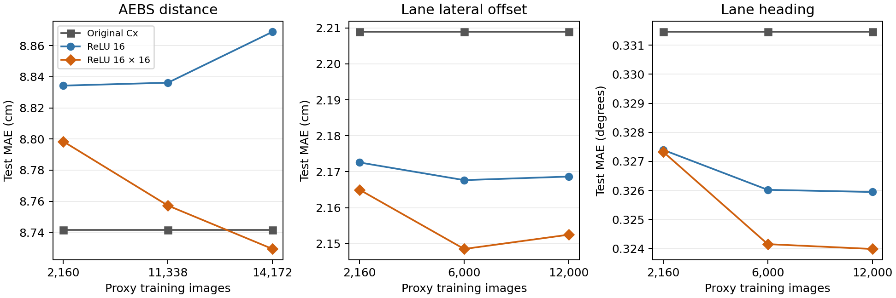

# AEBS 与车道保持：扩大训练集后，两层状态代理能否减小误差？

**车道保持有小幅收益，AEBS 没有显示出选择两层的稳定优势。** 在新采的车道图像上，三个训练预算都由开发集选中两层 ReLU。最大预算下，相对原始 $Cx$，测试横向等效误差从 2.209 降至 2.152 cm，航向等效误差从 0.3315° 降至 0.3240°。AEBS 的最大预算下，简单仿射代理的测试 MAE 为 8.708 cm，优于所测六种神经代理。

## 1. 比较的误差是什么

给定同一场景的一帧图像 $I$ 和真实物理状态 $x$，先由冻结的 DINO 和视觉投影得到 $y(I)$，再让状态代理 $h(x)$ 预测这个向量。以所有方法共用的原始矩阵 $C$ 做单位换算，将 $C^{-1}(y-h(x))$ 的各维乘回物理尺度，再取绝对值求平均。数值越低，表示代理越能预报这套视觉系统会输出什么。

- **AEBS** 输入归一化车距 $d/3.18272$，输出一个视觉坐标，表中误差换成厘米。该图像包提供距离标签，代理输入只有距离。
- **车道保持** 输入归一化横偏 $e/0.85$ 和航向偏角 $\theta/0.30$，输出两个视觉坐标。横偏换成厘米，航向换成度。道路曲率影响图像，沿用当前前端的两维代理输入。

原始代理为 $Cx$。神经代理为 $Cx+g(x)$，其中 $g$ 是一层或两层、每层 16 个单元的小网络，分别试 ReLU、Tanh、SiLU。输出层从零开始，训练第 0 步恰好恢复原代理。另设无偏置线性和带偏置仿射两个最小二乘基线。AEBS 一层和两层分别有 49、321 个可训练参数，车道分别有 82、354 个。因此这里比较的是等宽、等更新预算下增加深度的实际效果，同时包含参数量增加的影响。

## 2. 数据怎么增加，对照怎么做

| 实验 | 代理训练张数（三档嵌套） | 固定开发 | 固定静态校准 | 固定测试 | 数据来源 |
|---|---:|---:|---:|---:|---|
| AEBS | 2,160 / 11,338 / 14,172 | 2,454 | 2,454 | 4,920 | 原 24,000 张 CARLA RGB 包及其冻结视觉输出 |
| 车道 | 2,160 / 6,000 / 12,000 | 1,000 | 1,000 | 2,000 | 新渲染 16,000 张 192×192 RGB 图，在服务器重新做 DINO 推理 |

AEBS 最大训练集比上一轮多 2,834 张，约 25%。中档精确保留上轮的代理训练行，大档加入上轮用于开发的行。本轮将原 validation 固定分成新的开发和校准两半，原 test 完整保留。每个预算都按本轮的开发集重新选型。不同预算的架构比较可直接配对，上轮和本轮的差值会同时受到开发划分变化的影响。这里增加的是同一图像包中用于训练代理的样本数。逐张解码原始 RGB 后得到 24,000 个不同的像素哈希，4,920 张测试图像与训练、开发、校准均无像素完全相同的图片。相邻车距或同一场景仍可形成相似画面。[RGB 去重审核](../../../../artical-F122/results/proxy_depth_data_20261122/aebs_rgb_hashes.json)

车道最大训练集是上轮 2,160 张的 5.56 倍。对每个划分分别抽取横偏 $[-0.8,0.8]$ m、航向 $[-0.25,0.25]$ rad 的均匀状态，等概率抽取曲率 $-0.01,0,+0.01$ m⁻¹，用原渲染器的标称相机、光照和无遮挡设置成像。与原 3,600 行图像哈希清单和本轮已接受图像逐张比较，丢弃 18 次像素重复，再补采至目标数。新测试帧在代理训练、开发选型和静态校准中均未出现。上轮使用另一套测试图像，见[上轮结果](../../../experiments/跨实验对照/AEBS与车道_小型神经代理结构对照_20261121.md)。

每个任务和预算均训练六种网络，每种使用相同的三个训练种子，各做 1,500 次 Adam 更新，学习率 0.001，批量 128。同预算、同种子的所有结构共用相同的批次序列。每 50 步在开发集检查一次（含第 0 步），按归一化坐标均方误差选权重；再按三个种子的平均开发误差选结构。下文测试 MAE 为各次训练在**同一批测试帧**上的结果均值。共 108 次神经网络训练，另有 18 个线性基线评估。固定更新次数意味着各档处理的批次数相同，大数据档每个训练样本被抽中的平均次数相应变少。

## 3. 最大数据量：各结构测试误差

| 状态代理 | AEBS 距离 MAE（cm） | 车道横偏 MAE（cm） | 车道航向 MAE（°） |
|---|---:|---:|---:|
| 原始 Cx | 8.7415 | 2.2089 | 0.3315 |
| 重拟合 Cx | 8.7202 | 2.2072 | 0.3309 |
| 仿射 Ax+b | **8.7075** | 2.2081 | 0.3311 |
| 一层 Tanh | 8.8141 | 2.2055 | 0.3305 |
| 两层 Tanh | 8.7678 | 2.1989 | 0.3304 |
| 一层 ReLU | 8.8689 | 2.1687 | 0.3259 |
| 两层 ReLU | 8.7293 | **2.1525** | **0.3240** |
| 一层 SiLU | 8.8216 | 2.2003 | 0.3306 |
| 两层 SiLU | 8.8009 | 2.2015 | 0.3303 |

**AEBS。** 开发集在最大预算选中一层 Tanh，测试误差反而比原 Cx 高 0.073 cm。两层 ReLU 的测试均值虽比原 Cx 低 0.012 cm，但三个种子的开发选中步数为 0、50、0，两次直接回到原 Cx。仿射基线在三档的测试距离 MAE 都优于六种神经代理。开发与测试图像覆盖的距离区间有差异，且选型指标是平方误差，报告指标是绝对误差。这里无法将排名变化唯一归因于其中一个因素。

**车道。** 相对原 Cx，两层 ReLU 的横向、航向 MAE 分别降低 2.55%、2.26%，横向绝对改善约 **0.56 毫米**。三个种子在两项指标上均优于 Cx。相对使用相同激活的一层 ReLU，两层平均另降低 0.0162 cm 和 0.00196°，其中一个种子的横向指标略有回退。横向绝对误差的第 95 百分位也从原 Cx 的 5.838 cm 降至 5.651 cm，航向从 0.882° 降至 0.861°。

在固定这三个训练种子的条件下，对 2,000 个测试帧作配对重采样 5,000 次。两层 ReLU 相对 Cx 的平均改善，横向的 95% 百分位区间为 [0.028, 0.087] cm，航向为 [0.0042°, 0.0108°]。两层相对一层 ReLU 分别为 [0.0053, 0.0271] cm、[0.00081°, 0.00317°]。这些区间描述本次标称静态帧的抽样变动；扩展到不同训练数据集、训练随机性、恶劣天气或连续轨迹，需要相应的独立实验。

## 4. 增加数据时，结果如何变化

| 任务 | 训练张数 | 按开发集选出的结构 | 该结构在固定测试集上的 MAE |
|---|---:|---|---|
| AEBS | 2,160 | 一层 SiLU | 8.8280 cm |
| AEBS | 11,338 | 一层 SiLU | 8.8452 cm |
| AEBS | 14,172 | 一层 Tanh | 8.8141 cm |
| 车道 | 2,160 | 两层 ReLU | 2.1650 cm / 0.3273° |
| 车道 | 6,000 | 两层 ReLU | 2.1485 cm / 0.3242° |
| 车道 | 12,000 | 两层 ReLU | 2.1525 cm / 0.3240° |



图中固定激活为 ReLU，只比较深度。不同面板使用各自的纵轴范围，绝对量级见轴标。车道从 2,160 张增加至 6,000 张，两项误差均降低；从 6,000 增至 12,000，横向略有回升，航向几乎持平。当前训练预算下，数据继续翻倍没有带来同等幅度的改善。

## 5. 这能支持怎样的论文结论

可以报告**冻结线性参照视觉投影后，一个小型两层 ReLU 状态代理在新采的标称车道图像上改善了低维视觉输出拟合，且收益具有任务依赖性**。AEBS 是对应的反例，简单仿射模型已经有竞争力。三档训练量共用同一测试集，对预算趋势提供配对证据。

本轮控制器、在线图像输出和车辆动力学均保持原设置，测量对象是单帧代理残差。制动终点距离、闭环车道跟踪误差、轨迹级 CP 包络和鲁棒屏障验证均需另行实测。新代理的名义映射发生变化，即使静态残差下降，旧控制器与证书也不能自动取得更高的安全下界。若将两层 ReLU 接入车道后端，必须在闭环中处理新名义映射、重新采集校准轨迹并验证相应扰动集合。

## 6. 数据与复现

在服务器 vt 环境、项目的 artical-F122 目录运行。车道使用 GPU 推理，两个任务的小代理使用 CPU 训练。下列命令使用新目录保留已完成的结果。

```bash
OUT=results/proxy_depth_data_repeat
python -m Aebs.paper_comparison.collect_proxy_lane_bank "$OUT" --device cuda:1
python -m Aebs.paper_comparison.proxy_depth_data aebs "$OUT"
python -m Aebs.paper_comparison.proxy_depth_data lane "$OUT"
python -m Aebs.paper_comparison.audit_proxy_rgb_bank /root/carla_data_spvc_expanded/full01 "$OUT"
python -m Aebs.paper_comparison.summarize_proxy_depth "$OUT"
```

归档包括各预算的原始行号、预测、权重、开发选型记录和单帧分位数。汇总脚本逐模型加载选中权重，重算预测、测试 MAE 和开发损失，并核对嵌套训练集、固定留出集及同种子批次。[机器可读结果](../../../../artical-F122/results/proxy_depth_data_20261122/summary.json) · [车道新数据清单](../../../../artical-F122/results/proxy_depth_data_20261122/lane_bank.json) · [车道配对重采样](../../../../artical-F122/results/proxy_depth_data_20261122/lane_paired_test.json) · [训练入口](../../../../artical-F122/Aebs/paper_comparison/proxy_depth_data.py)

另外，按归档状态抽取 8 帧重新渲染，8 个像素哈希全部相同。重新组批进行 GPU 视觉推理后，相对归档的最大潜变量差为 0.0000142。AEBS 的全部 24,000 个文件名与原 CSV 匹配，距离标签最大差小于 0.000001 m。[原始数据复核](../../../../artical-F122/results/proxy_depth_data_20261122/source_replay.json)
