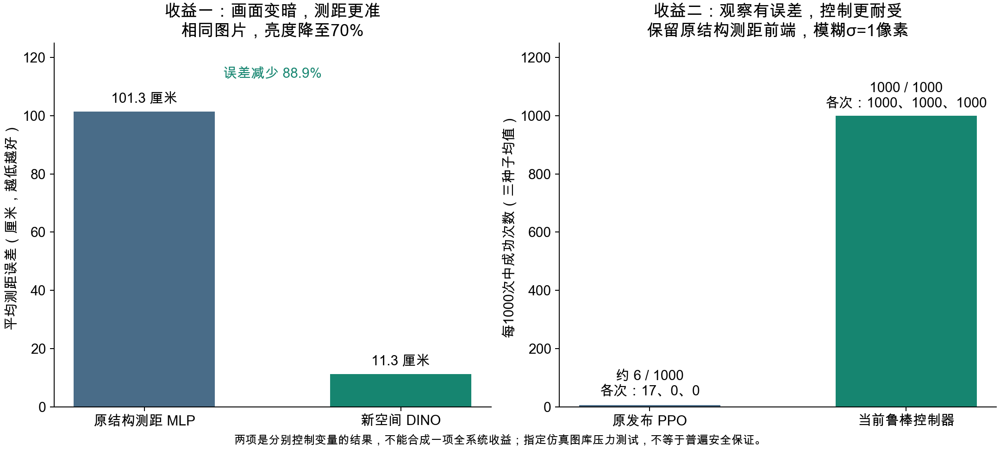
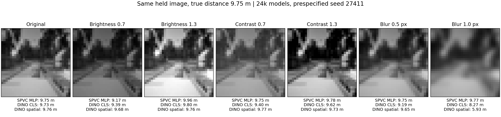
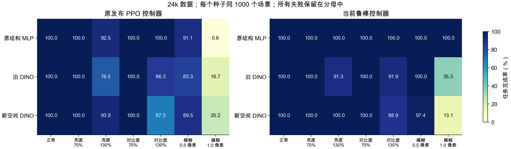
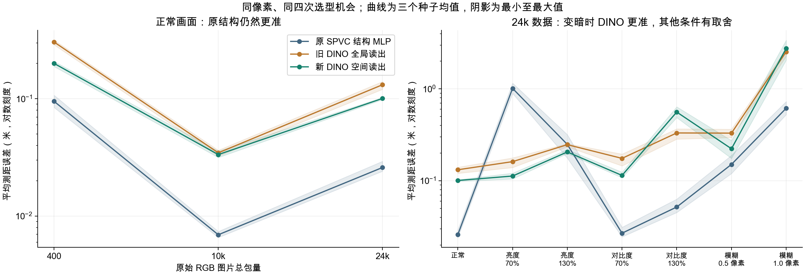

# 相比 SPVC，误差和任务表现究竟有没有改善：AEBS 直接对照

2026-11-18 登记训练与图像变化方案，2026-11-20 继续完成闭环确认。在主项目 main 上开发，在服务器 10.11.154.191:20147 的 vt 环境运行。本文使用原 SPVC 的 AEBS 任务，直接测量测距误差、制动任务完成与失败类型，不以“验证更快”代替任务表现。

## 先看最直观的结果

**有收益，但收益分属不同组件，不能合并说成整套方法处处优于 SPVC。**

| 直接问题 | 原 SPVC 侧 | 当前改进侧 | 能得出什么 |
|---|---|---|---|
| 画面变暗，距离还能估准吗？ | 原结构 MLP 平均误差 **101.3 cm** | 新空间 DINO **11.3 cm** | 指定亮度降低下，误差减少 **88.9%** |
| 同一个前端读得有误差，控制器能否完成制动？ | 原 MLP＋发布 PPO，强模糊下三个种子成功 **17、0、0／1000** | 同一个原 MLP＋当前鲁棒控制器，均 **1000／1000** | 固定视觉读数，只换控制器，完成率平均增加 **99.43 个百分点** |
| 新空间读出比旧 DINO 好在哪？ | 400 图包＋当前控制器，平均 **887／1000** 完成 | 换空间读出后，均 **1000／1000** | 当前框架内部完成率提高 **11.33 个百分点**，追平原结构 MLP |
| 正常画面谁更准？ | 原 MLP24k 平均误差 **2.6 cm** | 空间 DINO **10.1 cm** | 原结构更好，这个负面结果保留 |

左边只比较前端准确性，右边只比较同一前端下的控制器。右边不是 DINO 的收益，也不是原论文未公开最终系统的直接复现。所有变换强度事先固定，七种条件完整结果见第 6 节。

## 1. 先把比较对象讲清楚

我们比较三个方面，避免把不同原因合并成一个“当前方法更好”。

| 问题 | 固定什么 | 改什么 | 主要指标 |
|---|---|---|---|
| 当前前端是否测得更准 | 相同灰度图片、标签、数据划分及调参机会 | 原 SPVC 结构的像素 MLP、DINO 全局读出、DINO 空间读出 | 同一留出图库的 MAE、RMSE、95% 绝对误差分位数 |
| 当前控制器是否更容易完成任务 | 同一个测距网络、相同物理状态和速度输入、相同初始场景 | 发布 PPO 初始化与当前鲁棒控制器 | 完成率、危险终止率、目标区间偏离、达标时间 |
| 遇到输入变化时是否更稳健 | 冻结的模型、相同变换后像素、相同任务 | 预先规定的亮度、对比度和模糊条件 | 每种变化下的测距误差及闭环完成率 |

“原 SPVC 结构 MLP”是原作者状态估计网络结构，在当前目标图像域重新公平训练。它比“直接拿旧发布权重迁移到新图像域”更强，也更适合判断新前端是否有结构收益。“发布 PPO”是作者公开的控制器初始化，不是论文未公开的最终策略与 SBC。当前鲁棒控制器经过额外任务适配和鲁棒训练，因此两控制器对照是冻结系统的实际能力比较，不是本轮重新完成的等计算量综合算法对比。

本轮不在在线阶段使用 cGAN 生成图像。各测距网络都读取相机库中的实际图像像素；实验考察原结构与当前前端的实际部署读数，以及两种控制器对该读数的响应。它不是原论文全部 cGAN、PPO、随机 SBC 链路从头复现。

## 2. 任务及指标：成功不等于静止在 5.5 米

每趟初始距离均匀取自 15–16 m，速度均匀取自 2.5–3 m/s。一个外观条件在整趟中固定，从 12 个天气／车色组合中等概率抽取。每步 0.05 s，最多 400 步，即 20 s；动作范围为 −3 至 3 m/s²，正数表示制动，车速裁剪到 0–3 m/s。

两边读取相同的物理测距结果和真实速度，进入各自网络前使用该网络原有的尺度换算。相同初态和外观构成配对，但不同策略产生不同后续状态，所以不会强迫两辆车观看同一条预录视频。

| 名称 | 怎么算 | 直观含义 |
|---|---|---|
| 成功 | 首次进入距离 5–6 m 且速度不超过 0.5 m/s | 在要求的位置前已充分减速，完成原任务；速度可以尚未归零 |
| 危险终止 | 距离不超过 6 m 时速度仍超过 0.5 m/s | 接近目标时速度太快；这是任务危险定义，不等同于几何上已经撞车 |
| 安全但停早 | 距离大于 6 m 时速度已不超过 10⁻⁶ m/s | 没有发生危险，但未到目标区 |
| 离域／超时 | 超出登记状态域，或到 400 步仍无其他终止事件 | 单列失败，不能删掉再计算成功率 |
| 静态 MAE | 同一张图的预测距离与其真实标签之差的绝对值，再在图库平均 | 平均测距误差，单位 m；不含闭环查图的离散误差 |
| 静态 RMSE | 预测误差平方平均后开方 | 对较大误差惩罚更重，单位 m |
| 轨迹最大误差 | 一趟中预测距离与当前物理距离之差的最大绝对值 | 用于整轨迹 CP；包含网络误差及最近图片与当前位置不完全一致的误差 |
| 终点目标区间偏离 | max(5−d_f, 0, d_f−6) | 离目标区还有多远，所有成功和失败都计入 |
| 终点超速 | max(v_f−0.5, 0) | 终点超过安全速度多少，单位 m/s |
| 20 秒截断达标时间 | 成功取实际达标时间；其他结果一律记 20 s | 防止因很早危险终止而被误评为“完成更快” |

原论文／PPO 没有把“精确停在 5.5 m”作为专门优化目标。因此虽然保存了 |d_f−5.5|，它只是附加位置诊断，不能用它替代原任务的完成和安全条件。

## 3. 数据、训练与新测试怎样分开

### 3.1 同源、同像素、同预算

| 原 RGB 图片总包 | 训练 | 开发选择 | 包内测试 |
|---:|---:|---:|---:|
| 400 | 240 | 88 | 72 |
| 10,000 | 6000 | 2000 | 2000 |
| 24,000 | 14,172 | 4908 | 4920 |

三个预算共用已登记的划分，没有因为新结果修改。主测试库为 3229 张图片：从三个预算的所有训练与开发图像中，按文件和灰度输入像素去除重叠后得到。它对小预算方法是单独列账的额外评测资源。三个方法都使用同一份 32×32 灰度像素；没有一边额外使用 RGB、高清图像或真实距离旁路。

DINO 的外部预训练知识仍是额外资源，应在论文里声明。共享目标域训练数据并不意味着总预训练成本完全相同。

### 3.2 新增空间读出在做什么

旧版只保留 DINO 的 384 维全局 CLS 特征。这个向量适合描述整幅图，但测距依赖目标在图像中的大小、位置等空间关系；只使用全局向量可能丢掉有用信息。

新增版本保留同一个冻结 DINO 的局部 patch 特征，将 16×16 的 patch 网格平均池化为 2×2 或 4×4 网格。各位置共享一个 384→32 的线性层与 GELU，再按位置展平，经 128 维隐藏层输出一个标量。

输出仍是 d/S，其中 S=3.182720661 m，状态侧名义代理仍为 C=[1,0]。因此这是视觉投影的优化，没有偷换成直接输入真实距离，也没有改变控制器、安全条件或误差单位。

### 3.3 三种方法都获得四次选型机会

| 方法 | 四个训练候选 | 可训练参数 |
|---|---|---:|
| 原结构 MLP | 学习率 3×10⁻⁵、10⁻⁴、3×10⁻⁴、10⁻³ | 279,553 |
| 旧 DINO 全局读出 | 同上四个学习率 | 65,921 |
| 新 DINO 空间读出 | 2×2／4×4 网格 × 学习率 10⁻⁴／10⁻³ | 28,961／78,113 |

每候选训练 100 个 epoch，batch=64，三个种子为 27411、27412、27413。只按开发集均方误差选择候选及 epoch；所有最终模型冻结后才进入测试。总计 3 方法×3 预算×3 种子×4 候选=108 次读出训练。它们的更新次数和选择次数匹配，参数量与每步计算量不同，不能称为完全等 FLOPs。

空间版本从同一灰度字节重新抽取特征。复核发现重算的全局 CLS 与旧缓存逐元素完全一致，避免将预处理、颜色或数值精度变化当成空间读出的收益。

### 3.4 新场景测试

先固定 199 个新校准场景和 1000 个新测试场景，所有方法使用相同的初态和外观。各自按自己的闭环运行并校准；先冻结所有阈值，再开始盲测。随机种子分别为 202611189101、202611189102。

这里新的是轨迹抽样，图像仍来自固定库。一次查询图片不是一次新的独立相机采集。每个训练种子都使用相同的 1000 个场景；计算三种子的总体差值时，先在同一场景内平均，再按 1000 个场景配对重抽样，不把它们当成 3000 个独立场景。

## 4. 已有冻结版本的独立确认

这组使用此前公平训练的模型，不是本轮四候选重训结果。主对照为两种前端×三个预算×三个种子×两控制器=36 臂；另外增加 8 个发布权重迁移交叉臂和 4 个理想观测诊断臂，共 48 臂。

### 4.1 原结构在名义图像上更准，复查仍然成立

下表是同一 3229 张图上，三个冻结训练种子的指标平均，单位 m。

| 图包 | 原结构 MLP 的 MAE | 旧 DINO 全局读出的 MAE | 原 MLP 的 RMSE | 旧 DINO 的 RMSE |
|---:|---:|---:|---:|---:|
| 400 | 0.09509 | 0.30454 | 0.16553 | 0.44300 |
| 10k | 0.00694 | 0.03464 | 0.00904 | 0.04535 |
| 24k | 0.02555 | 0.12396 | 0.05383 | 0.21170 |

这组确认了一个不能回避的事实：**已有 DINO 全局读出在名义同像素条件下没有超过原结构 MLP。** 不同预算并非同一个嵌套训练集，表中 24k 不如 10k 也不能直接解释成“增加数据必然变差”。

### 4.2 控制器适配确实减少部分危险终止

固定 400 张图包的同一个旧 DINO 前端，只换控制器，在 1000 个新配对场景上：

| 前端训练种子 | 发布 PPO 成功 | 当前鲁棒控制器成功 | 新增成功数 |
|---|---:|---:|---:|
| 27411 | 671/1000 | 917/1000 | +246 |
| 27412 | 826/1000 | 917/1000 | +91 |
| 27413 | 749/1000 | 826/1000 | +77 |

平均完成率从 **74.87% 提高到 88.67%，增加 13.80 个百分点**；按同一场景先平均三个冻结种子、再整场景配对 bootstrap，差值的 95% 区间为 [12.27,15.37] 个百分点。本组未成功者均为危险终止。这是相同前端下的控制器适配收益，不能归因于测距变准。三个种子全部报告，没有只挑提升最大的一个。

但更强的原结构 MLP400 在两种控制器下都为 1000/1000 成功；10k 和 24k 两种冻结前端也都达到 1000/1000。不能说“当前整套方法普遍比目标域重训的 SPVC 更容易成功”。

当前控制器更保守也有时间代价。例如原结构 MLP400 下，两边都全部成功，平均达标时间约从 **4.53 s 增加到 9.42 s**。仅报告危险减少而省略速度损失，会夸大整体性能。

### 4.3 为什么网络已经很准，轨迹误差半径仍接近 0.9 米

还运行了“最近图片的真实标签”诊断：网络不再犯测距错误，直接返回选中图片的真实距离。但是该图片仍是离当前位置最近的一张，并不恰好对应当前位置。此时轨迹 CP 半径仍约 **0.882–0.883 m**，两控制器均全部成功。

所以本图库中一部分轨迹大误差来自离散查图，而非神经网络。主实验分别保存“相对图片标签的网络误差”“图片标签与当前物理距离的偏差”“两者合成的实际观察误差”，避免把静态精度改善与查图密度混在一起。

原发布测距头直接迁移到当前库时表现很差，目标域适配的 RGB DINO 能明显改善。但它们的目标域训练、输入信息和预训练资源不同；这组只作为迁移诊断，不用来代替上述强公平基线。

## 5. 本轮重新训练后的准确性与任务表现

三个方法各自获得四次开发选型机会后，同一 3229 张名义测试图像上的三种子平均 MAE 如下。

| 总图包 | 原 SPVC 结构 MLP | 旧 DINO 全局读出 | 新 DINO 空间读出 |
|---:|---:|---:|---:|
| 400 | **9.51 cm** | 30.45 cm | 20.02 cm |
| 10k | **0.69 cm** | 3.46 cm | 3.35 cm |
| 24k | **2.60 cm** | 13.17 cm | 10.07 cm |

空间读出确实改善了当前 DINO：400 图包的平均误差下降约 34.3%，24k 下降约 23.6%。但是仍未超过原结构 MLP，不能把“比旧 DINO 好”说成“正常画面下比 SPVC 更准”。参数量较少是读出头的性质；完整系统还需运行 DINO 骨干，不能据此声称端到端更轻。

正式训练总计 27 个冻结模型、108 次候选训练，六个 CPU 工作进程耗时约 593.4 s；另有一次冻结 DINO 空间特征提取约 35.7 s。未修改已有模型，未将测试成绩用于选择候选。

### 5.1 新空间读出有没有让任务做得更好

固定当前鲁棒控制器和 400 图包，三个种子的成功数从旧 DINO 的 **917、917、826／1000** 提高到新空间 DINO 的 **1000、1000、1000／1000**。平均完成率由 88.67% 到 100%，增加 **11.33 个百分点**。

这是一项明确的当前框架内部优化，但原结构 MLP 同样是 1000、1000、1000，因而此处是追平强基线，并非超过 SPVC。若接原发布 PPO，新空间 DINO 三种子为 1000、749、749；结果随控制器变化，不能把视觉与控制的配合省略。

10k 和 24k 的三方法、三种子、两控制器都为 1000/1000 成功。名义任务的完成率已经饱和，需要看图像变化后的表现才有区分度。24k 在名义图像下，原 MLP＋发布 PPO 平均达标约 4.53 s，新空间 DINO＋发布 PPO 也约 4.53 s，而新空间 DINO＋当前鲁棒控制器约 9.43 s。

## 6. 固定图像变化下的泛化能力

预先固定七种条件，全部保留，不按结果筛选：原图；亮度乘 0.7、1.3；以 127.5 为中心的对比度乘 0.7、1.3；高斯模糊 σ=0.5、1.0 像素。作用对象始终是同一份 32×32 灰度像素，变换后裁剪到 0–255、四舍五入为 uint8，再分别交给 MLP 或 DINO。模糊采用 reflect 边界与 truncate=4。

所有前端只在名义数据上训练，变化后的图片不参与训练或开发选型。这是指定数字图像变换的零样本泛化测试，不等于新的真实天气采集。静态精度覆盖三预算、三种子、全部七条件；闭环压力测试固定最大 24k 图包，以三方法、三种子、两控制器、六个变化条件构成 108 臂，每臂使用同一批 1000 个测试场景。不因为某种条件对 DINO 有利才选它。

### 6.1 直观的测距收益：变暗时，误差从一米降到约十一厘米

固定 24k 图包及同像素输入，三个训练种子的平均静态 MAE：

| 图像条件 | 原结构 MLP | DINO 全局读出 | DINO 空间读出 | 空间版相对原结构 |
|---|---:|---:|---:|---|
| 正常 | **2.60 cm** | 13.17 cm | 10.07 cm | 更差 |
| 亮度降到 70% | 101.34 cm | 16.15 cm | **11.26 cm** | **误差减少 88.89%** |
| 亮度升到 130% | 24.89 cm | 24.72 cm | **20.58 cm** | 误差减少 17.31% |
| 对比度降到 70% | **2.69 cm** | 17.53 cm | 11.44 cm | 更差 |
| 对比度升到 130% | **5.18 cm** | 33.16 cm | 55.98 cm | 更差 |
| 轻度模糊 σ=0.5 | **15.07 cm** | 33.00 cm | 22.31 cm | 更差 |
| 较强模糊 σ=1.0 | **61.62 cm** | 254.00 cm | 276.30 cm | 更差 |

因此当前证据支持“**在指定亮度变化下，冻结预训练视觉特征的测距泛化更好**”，不支持“各种图像干扰下都更好”。这里没有给任何方法加入亮度数据增强训练；若原 MLP 也获得针对变化的增强训练，差距可能改变，尚未比较。

上图固定展示真距离 9.75 m 的同一张留出图。选图规则事先确定为首个外观组中最接近 10 m 的图片，固定模型种子 27411，没有按误差挑图。看每列下方数字即可比较同一画面三种方法读成多少米；样例用于理解，表格统计使用全部 3229 张图。

### 6.2 误差变小不一定让成功率更高：要真的跑闭环

亮度降到 70% 时，三方法、两控制器、三个种子均完成 1000/1000。空间 DINO 的测距误差明显更小，但本轮没有进一步提高已饱和的完成率。固定发布 PPO，其平均达标时间由原 MLP 的 5.25 s 降到空间 DINO 的 4.57 s，减少约 0.68 s；这是该条件下的性能结果，未对所有环境给统一时间优势。

更明显的控制器收益出现在强模糊下：**保留相同的原结构 MLP，只更换控制器**。

| 24k 前端种子 | 发布 PPO 成功／危险 | 当前鲁棒控制器成功／危险 |
|---|---:|---:|
| 27411 | 17／983 | 1000／0 |
| 27412 | 0／1000 | 1000／0 |
| 27413 | 0／1000 | 1000／0 |

三个种子平均完成率从 0.57% 到 100%，增加 **99.43 个百分点**；固定三套前端、按 1000 个完整场景配对 bootstrap，差值的点态 95% 区间为 [99.13,99.70] 个百分点。失败计 20 s 的截断达标时间从 19.91 s 降到 6.90 s，改善 13.01 s。没有删去原 PPO 的失败轨迹。

这个结果说明当前经过额外鲁棒训练的控制器在指定误差条件下更耐受。它没有说明已完成两种综合算法同预算重训，也没有说明原论文所有最终模型都会失败。正常画面下当前策略反而较慢，因此不能脱离干扰条件宣称速度更快。

### 6.3 全部七种条件，避免只展示有利场景

下表是 24k 图包三种子平均完成率。每个种子各有同一批 1000 个场景；百分比允许小数，不把三种子当作 3000 个独立初态。

| 图像条件 | 原MLP＋发布PPO | 原MLP＋当前控制器 | 旧DINO＋发布PPO | 旧DINO＋当前控制器 | 空间DINO＋发布PPO | 空间DINO＋当前控制器 |
|---|---:|---:|---:|---:|---:|---:|
| 正常 | 100% | 100% | 100% | 100% | 100% | 100% |
| 亮度70% | 100% | 100% | 100% | 100% | 100% | 100% |
| 亮度130% | 92.47% | 100% | 76.53% | 91.30% | 93.93% | 100% |
| 对比度70% | 100% | 100% | 100% | 100% | 100% | 100% |
| 对比度130% | 100% | 100% | 86.27% | 91.93% | 67.30% | 88.87% |
| 模糊σ=0.5 | 91.13% | 100% | 83.30% | 100% | 89.53% | 97.43% |
| 模糊σ=1.0 | 0.57% | 100% | 16.73% | 35.30% | 25.20% | 13.10% |

图越深代表成功越多。看左右相同的行，可比较只换控制器；看同一列的不同前端，可比较只换前端。尤其要保留右下角：**强模糊下空间 DINO＋当前控制器只有 13.10% 完成，反而不如该前端接发布 PPO 的 25.20%。** 三种子合计（仅作计数）为成功 393、危险 849、安全停早 1355、超时 403；减少危险不代表完成任务，过早停住也是失败。

误差图使用对数纵轴以同时容纳厘米级和米级误差。三个图包并非嵌套链，所以连线用于对照已有配置，不作为严格数据量因果曲线；所有 189 行静态指标保留在原始 CSV。

### 6.4 哪些可以写进论文，哪些还不够

可以写：在同像素、同四次开发选型的受控 AEBS 实验中，新空间 DINO 在固定亮度降低压力下将测距 MAE 降低 88.9%；同一原结构前端下，当前控制器在固定模糊条件中显著改善任务完成，表明控制器对视觉误差的适配价值。空间读出还修复了当前小样本 DINO 的部分完成率损失。

不能写：正常精度普遍优于 SPVC、所有天气和模糊下鲁棒、更少的 MAE 必然带来更高完成率，或者完整新系统在所有条件下胜过原论文。前端最佳和后端最佳来自不同受控条件；它们可以成为分别解释的论文证据，不能把最有利数字拼成一套从未运行的系统。

若要进一步确认论文竞争力，下一组应给原 MLP 与 DINO **相同的亮度／模糊训练增强机会**，再用未用于开发的变换强度和新的场景确认。当前实验是未经变化增强的零样本压力测试，不是已经战胜增强后的强基线。

## 7. 本轮安全结论怎样读

名义轨迹校准是每个冻结闭环各自的误差覆盖统计；较小的 q 不自动意味着更安全，也可能因为危险提前终止而缩短了观测时域。纯视觉准确性主要看同图静态误差，任务效果看完整且保留失败分母的闭环指标。

旧鲁棒屏障不会因为更换前端或控制器而自动转移。对新的图像变化，本轮测的是准确性与任务表现，没有把旧 CP 的覆盖承诺延伸过去，也没有新增对应分布的安全概率保证。1000 次测试全部成功同样不是零风险证明。

## 8. 证据文件

| 内容 | 文件 |
|---|---|
| 48 臂冻结模型的协议与结果 | [协议](../../../../artical-F122/results/spvc_intuitive_comparison_20261118_v1/protocol.json)、[汇总](../../../../artical-F122/results/spvc_intuitive_comparison_20261118_v1/summary.json)、[逐臂 CSV](../../../../artical-F122/results/spvc_intuitive_comparison_20261118_v1/summary.csv) |
| 48 臂静态误差与配对区间 | [静态指标](../../../../artical-F122/results/spvc_intuitive_comparison_20261118_v1/static_metrics.json)、[配对比较](../../../../artical-F122/results/spvc_intuitive_comparison_20261118_v1/paired_comparisons.json) |
| 评估与统计程序 | [评估入口](../../../../artical-F122/Aebs/paper_comparison/aebs_intuitive_evaluate.py)、[统计入口](../../../../artical-F122/Aebs/paper_comparison/aebs_intuitive_summarize.py) |
| 与前一轮验证能力对照的关系 | [五任务实测报告](../../../experiments/跨实验对照/SPVC_SPVT五任务实测对照_收益与适用范围_20261118.md) |
| 新四候选训练 | [冻结协议](../../../../artical-F122/results/aebs_spatial_readout_20261118_v1/protocol.json)、[27 模型清单](../../../../artical-F122/results/aebs_spatial_readout_20261118_v1/models_manifest.json)、[训练代码](../../../../artical-F122/Aebs/experiments/spatial_aebs.py) |
| 新模型名义闭环 54 臂 | [结果](../../../../artical-F122/results/spvc_intuitive_retrained_20261120_v1/summary.json)、[协议](../../../../artical-F122/results/spvc_intuitive_retrained_20261120_v1/protocol.json) |
| 全七条件静态图像对照 | [189 行指标](../../../../artical-F122/results/spvc_image_shift_20261118_v1/new27/static_flat.csv)、[固定变换协议](../../../../artical-F122/results/spvc_image_shift_20261118_v1/protocol.json) |
| 图像变化闭环108臂 | [全部结果](../../../../artical-F122/results/spvc_shift_closed_loop_20261120_v1/summary.json)、[全部终止类别CSV](../../../../artical-F122/results/spvc_shift_closed_loop_20261120_v1/complete_outcomes.csv)、[配对与独立复核](../../../../artical-F122/results/spvc_shift_closed_loop_20261120_v1/independent_audit_and_pairs.json) |
| 结果绘图 | [绘图程序](../../../../artical-F122/Aebs/paper_comparison/plot_aebs_intuitive.py)、[绘图数值](../../../assets/spvc_intuitive_20261120/plotted_values.json) |

本轮共 48 个历史冻结模型交叉臂＋54 个新读出名义臂＋108 个图像变化臂，合计 **210,000 条盲测闭环执行**；前两组另有 102×199=20,298 条校准执行。它们共享 1000 个外生场景，不是 210,000 个独立相机样本。图像变化组没有新增校准或重新发证。新增名义54臂约102.8秒、变化108臂约113.8秒，均使用CPU缓存预测；不含先前DINO提取与训练成本。独立核对了108臂的配对初态／外观、数据哈希、终止计数与目标区间偏离；所有检查通过。
