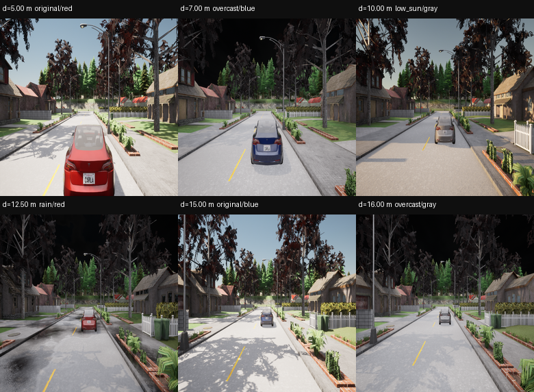
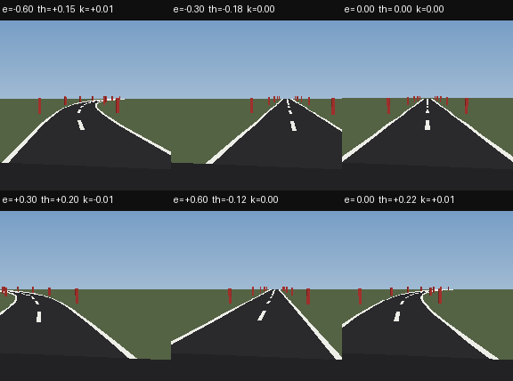
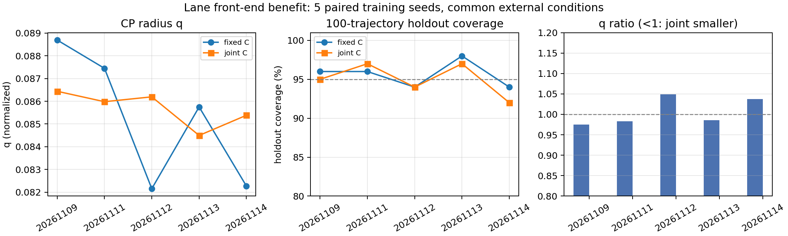

# SPVC 视觉前端替换与安全验证阶段汇报

整理日期：2026-11-12。汇报重点为 11 月 5–11 日的车道、RGB AEBS、联合 C 和收益对照；10 月 29 日灰度 AEBS 与 11 月 3 日停车场结果作为已有基础，11 月 8 日移动机器人作为扩展探索。本文整理已完成工作，不表示这些实验均在整理当日重新运行。

## 1. 总共

目前完成了三类工作：

1. **框架适配：**将图像前端换为冻结 DINO 和低维视觉投影，并把实际观察与状态代理的误差接到控制器及神经鲁棒屏障验证中。
2. **场景验证：**灰度 AEBS、RGB AEBS 和二维车道保持分别获得了规定误差集合下的条件数值证书；停车场通过加入后备机制获得另一种受保护闭环证书；三维移动机器人尚未获得完整证书。
3. **组件与收益分析：**完成前端静态对照、400／10k／24k 图像总包量实验、车道固定／联合 C 五对种子消融，以及共同误差半径扫描。结果说明联合 C 可训练，但没有稳定独立优势；现有前端结果也不支持“DINO 在所有设置下全面更好”。


## 2. 整体框架与原 SPVC 的关系

### 2.1 原方法里 cGAN 的作用

在本项目原 AEBS 实现中，生成器接受状态条件和潜变量，生成 32×32 灰度图，再由距离估计网络 state_net 处理，连接控制器：

```text
状态条件 d + 潜变量 z → 生成器 G → 生成图像 → state_net → PPO
```

这是模型中的视觉生成／代理路径。真实相机输入与生成图像是不同来源，不能把“生成图上的预测很好”直接当作“真实观察误差很小”。这也是本次需要显式处理代理与实际观察误差的原因。

### 2.2 当前前端的两条分支

```text
实际视觉分支：图像 I → 冻结 DINO → 可训练投影 pθ → 低维观察 y
名义代理分支：归一化状态 x → 观察映射 C → 名义观察 Cx
                                               ↓
                                误差 ε = y − Cx
                                               ↓
                   冻结模型 → 完整闭环轨迹 → 轨迹级 CP 集合
                                               ↓
                   神经控制器 + 神经鲁棒屏障 → 连续状态域检查
```

这里“代理”指状态到名义低维观察的映射 Cx。控制运行时仍从图像得到 y；真实位置只用于离线训练、仿真评价、校准和证明。AEBS 额外使用实测速度，车道额外使用已知曲率。

固定 C 版中，视觉头直接预测指定的状态观察；联合 C 版中，视觉投影与 C 一起学习，让两条分支尽量一致：

\[
L(\theta,C)=\frac1N\sum_i\left\|p_\theta(\operatorname{DINO}(I_i))-Cx_i\right\|_2.
\]

各任务对损失和网络做了适配；AEBS 标量观察的 L2 范数等于绝对值。联合 C 每行归一化，车道另限制条件数，避免不可逆或误差过度放大。

### 2.3 每一步做什么

| 步骤        | 输入              | 处理                       | 输出         |
| --------- | --------------- | ------------------------ | ---------- |
| 任务建模      | 状态、动作、目标、危险条件   | 明确动力学、初始范围、时长和额外已知观测     | 统一任务定义     |
| 视觉训练      | 图像、状态标签、冻结 DINO | 学习低维投影，部分版本同时学习 C        | 前端权重和观察接口  |
| 控制适配      | 低维观察、速度或曲率      | 输入 PPO；联合 C 版通过明确的解码接口衔接 | 实际动作       |
| 误差采集      | 冻结视觉和控制器        | 按各自闭环生成完整轨迹，逐步记录 y−Cx    | 轨迹及误差序列    |
| 轨迹 CP     | 每条轨迹的最大误差       | 用独立校准轨迹确定分位数             | 阈值 q 和误差集合 |
| 鲁棒屏障训练与检查 | 动力学、控制器、误差集合    | 学习非负 B，并检查初始、危险与后继条件     | 证书或失败见证    |
| 留出评价      | 未用于校准的新运行       | 统计全程覆盖、危险、成功与超时          | 经验表现及适用范围  |

### 2.4 为什么同时需要 CP 与鲁棒屏障

**CP 回答：实际误差有多大概率整条轨迹落在集合里？** 当前车道分数是各时间、各坐标误差的最大值。199 条轨迹产生 199 个分数，95% 目标对应第 190 小值；不是把一万多帧当成独立样本。

**鲁棒屏障回答：误差在集合里时，控制器能否保证不进入危险集？** B 是用于证明的非负分数，不是距离，也不是碰撞概率。当前常用条件是初始 B≤1、危险处 B≥20、允许后继逐点不增。

通俗解释：从不超过 1 的分数出发，每一步都不增，就到不了一个分数必须至少为 20 的危险状态。证明必须覆盖所有相关状态、允许误差以及可能第一次越界的后继。

因此，**整轨迹覆盖、任务成功、鲁棒屏障通过是三个不同指标**。一条轨迹可以超出误差集合却仍然安全；它的安全表现不能归因于集合内证书。安全证书也不自动证明能按时完成任务。

## 3. 实验地图：各场景的状态、动作和当前状态

| 实验               | 物理状态              | 视觉观察             | 动作／控制结构            | 当前状态               |
| ---------------- | ----------------- | ---------------- | ------------------ | ------------------ |
| 灰度 AEBS 历史版      | 距离 d、速度 v，2 维     | 一维距离，速度实测        | PPO 直接制动；学习式神经鲁棒屏障 | 原状态相关合同和固定库回放数值通过  |
| RGB AEBS 固定 C    | 同上                | RGB 图得到一维距离      | 原语义 PPO；重训神经鲁棒屏障   | 轨迹 CP 与条件鲁棒屏障数值通过 |
| RGB／灰度 AEBS 联合 C | 同上                | 一维可训练观察，结合实测速度解码 | 保留语义 PPO，重新检查误差与证书 | RGB 通过；灰度新常量集合未通过  |
| 车道固定／联合 C        | 横向偏差 e、航向误差 θ，2 维 | 二维观察；曲率已知        | PPO 输出转向；学习式神经鲁棒屏障 | 固定版和联合版通过；五对消融完成   |
| 停车场              | 平面位置、朝向、速度，4 维    | 三维视觉观察＋延迟观测器     | 规划、LQR、残差 PPO、在线后备 | 受保护闭环证书通过，控制结构有变化  |
| 移动机器人            | 平面位置、朝向，3 维       | 三维视觉位姿           | PPO 直接输出线／角速度      | 图像闭环跑通，完整鲁棒证书未通过   |

“数值通过”均指所声明数学模型、状态域和误差集合下的连续域数值审计；不是实车保证，也不是完整浮点程序形式化证明。

## 4. AEBS 实验：从小灰度包到原始 RGB 图像

### 4.1 任务与统一配置

AEBS 是自动紧急制动任务。车辆靠近前方目标，根据视觉估计距离和实测速度输出制动动作。

| 配置   | 当前主实验设置                                 |
| ---- | --------------------------------------- |
| 状态   | d，单位 m；v，单位 m/s                         |
| 初态   | d∈[15,16]，v∈[2.5,3]                     |
| 动作   | a∈[−3,3]，正值制动，负值加速                      |
| 动力学  | d_next=d−0.05v；v_next=clip(v−0.05a,0,3) |
| 危险区域 | d∈[5,6] 且 v∈[0.5,3]                     |
| 视觉量  | 归一化距离；速度不由图片估计                          |
| 主版 C | 固定 [1,0]                                |

“原始 RGB”是 CARLA 保存的 640×640 RGB 渲染图，相对于 cGAN 生成图或预先降成 32×32 灰度图而言；它不是实车摄影。DINO 实际输入为预处理后的 224×224。



图：已有实验的距离、天气和颜色样例，用于说明网络输入，不代表新增采集。

### 4.2 版本一：早期 400 张灰度 AEBS，验证替换是否能跑通

这是 10 月 29 日已有基础。数据为 400 张 32×32 灰度图，240／80／80 划分。图像经冻结 DINO CLS 特征和 384→128→128→1 视觉头预测距离，速度另行输入 PPO。

步骤为：训练视觉头 → 连接 PPO → 用状态相关 Bernstein 误差尺度构建合同 → 配套训练控制器／鲁棒屏障 → 检查误差包络与固定图片回放。

| 项目 | 结果 |
|---|---:|
| 静态 test MAE | 0.129266 m |
| RMSE／最大误差 | 0.165444／0.414889 m |
| 状态相关误差集合检查 | 4,971,398 区间，0 见证、0 未解决 |
| 固定 400 图回放检查 | 105,608 区间，0／0 |
| 名义／全库／留出图任务测试 | 各 1441／1441 成功 |

这一版说明小规模灰度前端能够接回 SPVC 的证书路线。它的图片、状态相关合同和配套策略与后来的 24k RGB 版本不同，不能把 MAE 直接横比为架构收益。旧图复用与新采集图像的交换性也不能混为一谈。

### 4.3 版本二：24k RGB 前端与完整控制实验

数据为 24,000 张 CARLA 保存 RGB 图，包含 4 种天气、3 种颜色和 5–16 m 的距离。按距离 bin 分组：14,172 train、4,908 calibration/validation、4,920 test；视觉头开发选择另按对应训练协议处理。

视觉链路为 RGB → 冻结 DINOv2-S/14 CLS 384 维 → 128→128→1 投影 → 归一化距离。静态测试 MAE 为 0.087415 m，RMSE 为 0.121103 m，最大误差约 0.525 m。

控制实验曾有一条新 PPO 训练支线，约 100k 步；它在部分回放方式下成功，但独立子库回放暴露危险行为，未成为当前证书发布版本。**当前发布版沿用已有语义 actor，重点是前端适配、独立轨迹校准和神经鲁棒屏障重训。**不能把新 PPO 支线和当前证书拼成同一次完整训练。

### 4.4 版本三：修正误差单位、重做轨迹 CP，得到当前 RGB 主证书

这一轮的关键工作不只是增加图片：此前把归一化分位数直接当作米，实际验证范围比宣称范围小；修正后旧候选出现正漂移。因此撤回旧通过说法，训练新鲁棒屏障。

完整步骤：

| 步骤 | 输入和处理 | 输出 |
|---|---|---|
| 1. 固定观察与 actor | 现有 RGB 视觉头、语义 PPO | 冻结闭环 |
| 2. 固定回放规则 | 12 种天气／颜色组，整条外观固定，按距离最近邻查图 | 明确的图片库观察分布 |
| 3. 新采轨迹 | 199 条校准，最长 400 步；保留失败和超时 | 全程最大物理距离误差 |
| 4. 冻结轨迹 q | 第 190 小分数 | q=0.4183585684 m |
| 5. 重训鲁棒屏障 | 固定前端和 actor，用反例反馈训练两轮，每轮 4000 次更新 | 新非负神经屏障 v2 |
| 6. 全域检查 | 对整个观测集合和连续状态盒检查后继不增 | 完整数值通过报告 |
| 7. 留出与行为评估 | 100 条新留出；另做 12 组网格行为回放 | 覆盖与任务结果 |

| 最终指标           | 结果及含义                      |
| -------------- | -------------------------- |
| 校准覆盖           | 190／199，由校准分位数产生           |
| 留出全程覆盖         | 99／100；不是 99% 理论安全率        |
| 校准／留出成功        | 199／199、100／100            |
| 全库与 test 库网格回放 | 各 4800／4800 成功；不是那 100 条留出 |
| 初始 B 上界／危险下界   | 0／25.213636                |
| 连续域检查          | 292,024 区间，0 实际见证、0 未解决    |


这版得到的是冻结图片库回放分布下的轨迹校准和集合内安全证据。真实闭环状态、动作每步更新，但图像来自已保存图片库；不是每一步在线调用 CARLA 拍新图。

另有固定负观测偏差时出现超时的探针，说明不碰撞与完成任务仍需分别考察；不能只用安全证书代替制动性能评价。

### 4.5 版本四：状态相关误差包络

常量半径把所有状态都按同样误差处理。为减少不必要的保守性，在训练残差上拟合随距离变化的正尺度 b(d)，再用轨迹分数 max_t |error_t|/b(d_t) 校准，得到 r(d)=q·b(d)。C 仍固定 [1,0]。

| 指标        |         常量主版 |                    状态相关版 |
| --------- | -----------: | -----------------------: |
| 半径        |   0.418359 m | 平均约 0.3217 m，最大约 0.720 m |
| 同批留出全程覆盖  |       99／100 |                   92／100 |
| 同一鲁棒屏障检查 | 292,024 区间通过 |              41,070 区间通过 |

状态相关版在不同位置分配不同宽度，当前验证更容易完成，但没有同时提高覆盖。它是对照结果，不替换常量主版；这批数据已用于开发和回归，不能称为另一次全新盲测。区间数减少也不能直接等同于总计算时间按相同比例减少。

## 5. 车道保持：把视觉观察和误差从一维扩展到二维

### 5.1 任务、状态与配置

车辆沿道路中心线行驶，控制器根据图像估计的横向偏差与航向误差输出转向。

| 配置       | 设置                                  |
| -------- | ----------------------------------- |
| 物理状态     | e：横向偏差，m；θ：相对道路方向误差，rad             |
| 归一化状态    | x=(e/0.85, θ/0.30)                  |
| 初态       | e∈[−0.25,0.25]，θ∈[−0.06,0.06]       |
| 安全边界     | e∈[−0.85,0.85] m、θ∈[−0.30,0.30] rad |
| 速度／步长／轴距 | 4 m/s、0.1 s、2.6 m                   |
| 曲率       | −0.01、0、0.01；每条固定，作为已知输入            |
| 动作       | PPO 输出归一化转向，裁剪后乘 0.45 rad           |
| 观察时域     | 80 步，8 s                            |

运动采用车道误差坐标下的车辆模型，e 的变化由速度和航向决定，θ 的变化同时受转向与道路曲率影响。它与 AEBS 使用同类 PPO／神经鲁棒屏障方法，但动力学、动作含义和安全集不同。

### 5.2 视觉前端如何适配

车道位置依赖图像的空间信息，因此没有只使用全局 CLS 特征，而是保留 DINO 的 16×16 个 patch token，经卷积和空间读出得到二维观察。

最终视觉数据集为 3600 张 192×192 图，2160 train、540 validation、540 静态预留校准、360 test。固定 C 原版测试横向 MAE 约 0.0211 m、航向 MAE 约 0.0059 rad。



图：已有车道渲染观测；后续联合 C 使用同类图像，不靠改变相机或加入真实状态文字实现预测。

### 5.3 从控制跑通到训练式神经鲁棒屏障

这条支线曾探索不同证书表示。当前主版本最终采用与 AEBS 相同的 NonnegativeSBC 类，结构 2→16→8→1，Tanh 隐层、ReLU 非负输出，从随机初始化训练。

| 步骤 | 做了什么 | 结果 |
|---|---|---|
| 固定原图像 PPO | 保持策略权重，正确恢复完整激活结构 | 统一的控制基线 |
| 训练神经鲁棒屏障 | 第一个种子约 2000 次更新，第二个约 1750 次 | 两个候选均通过对应主审计 |
| 包络内检查 | 起初用每维 ±0.08 的归一化误差 | 初始 B 上界 0.085828，危险下界 23.653496 |
| 数值复核 | 仿射界与更细普通 IBP 检查 | 均完成；粗 IBP 未解决不计通过 |
| 行为回归 | 720 条误差轨迹和 12 条图像轨迹 | 无越界；12 条中仅 10 条全程位于旧包络内 |

这一版没有在线后备，也没有用几何教师代替最终网络。策略反馈模块已实现，但两个主训练运行首次通过，未实际触发策略更新，因此不能宣称交替训练带来收益。

### 5.4 轨迹 CP：解决“单帧覆盖高，但全程漏出”的问题

旧的 12 条图像回归中，有两条各一帧超包络。它们仍然安全，但不能把这两条全程都算作旧包络证书保证。因此新阶段冻结视觉与策略，独立重新生成 199 条校准和 100 条留出，每步根据本闭环当前状态重新渲染。

分数为：

\[
R_j=\max_{t<80}\max\left(\frac{|\hat e_t-e_t|}{0.85},\frac{|\hat\theta_t-\theta_t|}{0.30}\right).
\]

得到 q=0.0900931580，并在这个新集合下重新验证原神经鲁棒屏障。

| 指标                | 结果                      |
| ----------------- | ----------------------- |
| 校准／留出             | 199／100 条完整轨迹           |
| 新半径全程覆盖           | 95／100                  |
| 旧 0.08 对同批轨迹的全程覆盖 | 82／100，尽管单帧覆盖已经很高       |
| 留出实际越界            | 0／100                   |
| 新 q 下鲁棒屏障         | 三个曲率，仿射界与普通 IBP 均完成数值检查 |

这轮工作的意义是把“误差在每一帧通常较小”改为直接校准“整次运行最差误差”。它不要求轨迹内帧独立，但需要完整轨迹的采样协议符合所声明的可交换性前提。

### 5.5 车道状态相关版本

旧 v1 存在报告与代码不一致等问题，已撤回。修复 v2 使用已有 199 条中的前 99 条拟合二维尺度，后 100 条校准，不再截断半径；对原留出做回归评价。

| 指标 | 修复 v2 |
|---|---|
| 平均／观测最大半径 | 0.088393／0.109369 |
| 全域解析最大半径 | 0.235815，不能用观测最大值替代 |
| 回归全程覆盖 | 93／100；同校准常量盒为 94／100 |
| 实际状态相关集合审计 | 13,000 区间、三个曲率通过 |

把全域最大半径在所有状态都施加，会得到更大的集合；该扩大盒验证失败，与实际状态相关集合通过并不矛盾。当前证据没有显示状态相关版明显优于常量版。

## 6. 联合学习视觉投影与 C：是否真正实现、有什么结果

### 6.1 车道联合 C 的接口

联合版的状态代理由固定坐标变为可训练二维矩阵 C。两条分支共同优化，C 的梯度和参数变化均有记录。训练预算为 30 epoch、batch 64、学习率 1e−4，并用开发验证误差选检查点。

为接回原控制器，使用：

\[
\pi_{\rm new}(y,\kappa)=\pi_{\rm old}(C^{-1}y,\kappa).
\]

这样原控制器仍接收同一语义的估计状态。误差使用 δ=C⁻¹(y−Cx) 校准，对应低维空间里的集合 {Cδ：各维 |δ|≤q}，不是直接对 y 每维加同一个 q。

单对历史实验选择第 29 epoch，C 从初始旋转轻微变化，条件数约 1.00158。新闭环 q=0.0843382，留出 93／100 覆盖，原 actor 与 B 在新集合下数值通过。它说明联合训练、误差和验证接口接通，不说明联合 C 比固定 C 更好。

### 6.2 五对训练种子：固定 C 与联合 C 的同预算消融

两边使用相同图像、视觉头、warm start、优化配置、原语义 actor 和同一个 B。固定组保持初始旋转，联合组允许 C 更新。每对外部初始状态与曲率相同，但各自生成完整闭环；每个模型均做 199 条校准和 100 条留出。

| 训练种子     |   固定 C q |   联合 C q |   固定覆盖 |   联合覆盖 | 两侧鲁棒屏障 |
| -------- | -------: | -------: | -----: | -----: | ------ |
| 20261109 | 0.088690 | 0.086439 | 96／100 | 95／100 | 均通过    |
| 20261111 | 0.087447 | 0.085980 | 96／100 | 97／100 | 均通过    |
| 20261112 | 0.082158 | 0.086194 | 94／100 | 94／100 | 均通过    |
| 20261113 | 0.085749 | 0.084497 | 98／100 | 97／100 | 均通过    |
| 20261114 | 0.082272 | 0.085384 | 94／100 | 92／100 | 均通过    |

| 汇总指标 | 固定 C | 联合 C |
|---|---:|---:|
| q 均值 | 0.085263 | 0.085699 |
| 留出覆盖均值 | 95.6% | 95.0% |
| 留出越界 | 0／500 | 0／500 |
| 鲁棒屏障通过模型数 | 5／5 | 5／5 |
| 静态横向 MAE | 0.017927 m | 0.018012 m |
| 静态航向 MAE | 0.005104 rad | 0.005124 rad |

联合版 3／5 对的 q 更小，但平均略大，差异方向不一致。500 条轨迹是五个模型各 100 条的合计，不是 500 个独立训练实验。



**汇报结论：联合 C 已做，完整闭环证据也有；当前没有稳定的独立误差、覆盖或证书获得率收益。**

原因上，一个重要解释是当前 C 为可逆的 2×2 矩阵，控制前又通过 C⁻¹ 解码，很多变化相当于换观察坐标。若同时令 y′=Ty、C′=TC，则 (C′)⁻¹y′=C⁻¹y。不能仅因 C 变成非单位矩阵就称为可观测性提升。

### 6.3 AEBS 联合 C：为什么要结合实测速度

AEBS 图像只有距离标签，一维归一化 C 几乎只能取正负号。因此采用 x=(d/S,v)，学习 C=(C_d,C_v)，仍输出一维视觉 y。静态图像不随瞬时速度变化，同一图片配 0、1.5、3 m/s 的辅助速度训练；这些不是新增图片，也不是真实速度标注。

控制时使用实测速度解码：d_hat/S=(y−C_v v)/C_d。图像不能解释的速度项会倾向变小。

| 版本      | 学到的 C                |      新轨迹 q |   留出覆盖 | 对应鲁棒屏障          |
| ------- | -------------------- | ---------: | -----: | --------------- |
| RGB 联合版 | [1, −0.00000844]     | 0.394521 m | 91／100 | 同一 RGB 新 B 数值通过 |
| 灰度联合 v2 | [0.999998, 0.001931] | 3.515916 m | 95／100 | 旧灰度候选未通过        |

RGB 联合版的静态 test 平均绝对误差约 0.0846 m，是在声明的辅助速度解码评估下统计的。它与固定 C 的 0.0874 m 接近；新 q 更小但留出覆盖也更低，而且两版不是完整配对重复，不能据此宣布改善。

灰度版少量严重预测误差被轨迹访问，使常量 q 很大。独立浅层检查记录了 78 个实际 B 正漂移见证；这说明当前候选不满足对应集合下的不增条件，不等于已经展示初始出发的碰撞，也不否定旧灰度版在另一状态相关合同下的通过结果。

## 7. 前端对照：先说明每张表到底比较什么

### 7.1 同一 4920 张真实图片上的旧权重迁移与灰度／RGB 对照

| 前端 | test MAE，m | 静态经验半径，m | test 覆盖 |
|---|---:|---:|---:|
| 旧 cGAN 配套 state_net 读取真实灰度图 | 2.747 | 5.221 | 87.64% |
| 灰度 DINO 历史版本 | 0.1017 | 0.2656 | 90.47% |
| 灰度 DINO 本轮重训 | 0.1079 | 0.2797 | 90.75% |
| RGB DINO | 0.0874 | 0.2307 | 93.33% |

该表中 RGB 指标较好，但旧 state_net 来自 400 图体系，不能把全部差距归因于 DINO 架构。灰度版先降到 32×32，RGB 保留更多源信息，所以也不是只改变颜色的纯消融。5.221 m 是旧权重迁移到真实图的静态误差半径，不是原生 cGAN 生成闭环的轨迹 q。

### 7.2 原生生成闭环与 RGB 回放系统对照

原生生成闭环在运行中用 G(z=0,d) 生成图，再接原 state_net 和 actor；RGB 版使用保存图像库回放。分别采集完整轨迹，按相同名义覆盖目标校准。

| 指标 | 旧 cGAN 生成闭环 | 固定 C RGB DINO 回放 |
|---|---:|---:|
| 轨迹 q，m | 1.915645 | 0.418359 |
| 留出全程覆盖 | 92／100 | 99／100 |
| 留出任务成功 | 100／100 | 100／100 |
| 另做网格行为测试 | 与本表留出分开统计 | 全库与 test 库各 4800／4800 |
| 本批条件鲁棒屏障 | 未对该原生 q 完成相应新证书比较 | 新 B 在对应 q 下通过 |

数值上两个具体系统的轨迹 q 相差约 4.58 倍，但数据量、图像来源、策略和训练资源不同。这只能作为系统观察，不是严格的前端替换因果效应，也尚不能证明证书获得率提高。

此外，旧生成链路的 q 衡量 state_net(G(x,0)) 与真距离之差；它不直接等于同一状态下 state_net(I) 与 state_net(G(x,0)) 的差。后者才是实际图像与生成代理之间的观察偏差，需要独立对齐评价。

## 8. 400／10k／24k 图像总包量实验

### 8.1 目的与设置

这组探索回答：在不同原始 RGB 图像包规模下，小像素网络和预训练 DINO 观察头各有什么表现。数字指总包量，不是全部用于训练。

| 总包量 | train | validation／经验分位数用集 | test |
|---:|---:|---:|---:|
| 400 | 240 | 88 | 72 |
| 10,000 | 6000 | 2000 | 2000 |
| 24,000 | 14,172 | 4908 | 4920 |

同一档方法共用同一 test；不同档 test 不同。原图来自 RGB 库，原 SPVC 风格网络保留 32×32 灰度处理，DINO 使用 RGB。

三类像素网络结果应区别讲：

1. **生成训练链路：**重训生成器，再用生成图训练 state_net，保留原实现风格。
2. **生成训练后的真实图迁移：**把上面的 state_net 用到真实图。
3. **真实图直接训练的像素头 realhead：**直接用真实图训练 state_net；不经过生成器，是额外感知基线，不能称为原 SPVC 完整方法。

DINO 预算实验采用固定 C 的距离头，不是前面联合 C 版本。两边训练 epoch 不同：像素 realhead 100、DINO 小包 250；24k DINO 复用已有检查点。因此是同图像总包量探索，**没有完成等训练计算预算对照**。

### 8.2 真实图直接训练基线与 DINO

以下 q 均为静态经验校准半径，单位米，不与轨迹 q 混用。

| 总包量 | 像素 realhead MAE | DINO MAE |   像素 q | DINO q |      像素覆盖 |   DINO 覆盖 |
| --: | --------------: | -------: | -----: | -----: | --------: | --------: |
| 400 |          0.6937 |   0.2978 | 4.1690 | 0.8649 |     71／72 |     69／72 |
| 10k |          0.0085 |   0.0205 | 0.0209 | 0.0557 | 1894／2000 | 1893／2000 |
| 24k |          0.0247 |   0.0874 | 0.0307 | 0.2307 | 4382／4920 | 4592／4920 |

在这些具体训练与划分下，400 图 DINO 的平均误差较小；10k／24k realhead 的平均误差更小。24k realhead 的小半径对应较低覆盖，不能只看半径宣布更好。

### 8.3 生成训练链路与真实图的差距

| 总包量 | 生成训练网络处理生成图 MAE | 同一网络处理真实图 MAE | DINO 处理真实图 MAE |
| --: | --------------: | ------------: | -------------: |
| 400 |        1.5978 m |      2.2211 m |       0.2978 m |
| 10k |        0.0308 m |      1.1146 m |       0.0205 m |
| 24k |        0.0240 m |      1.1498 m |       0.0874 m |

生成图上精度很高，不意味着真实图上同样好。这个差距提示生成代理与实际观察之间的分布差异值得重点研究；不能把生成图 MAE 直接放进真实图性能表。

### 8.4 汇报时的准确结论

这组实验的重要发现是：**前端排序依赖数据、输入处理、训练和评价协议；现有结果没有建立单向架构优势。**

还有两个影响结论强度的边界，需要简要说明即可：三档 test 不同，因此不能把数值连起来当作纯数据量收益曲线；400／10k DINO 与 realhead 的 validation 同时参与选模型和取 q，因此这些 q 按经验分位数报告，不直接赋予标准独立 split CP 的 95% 保证。MAE 和实际 test 覆盖仍是该次运行的观测结果。

下一阶段若做正式收益证明，应固定共同评估分布、分开选模与校准、明确计算预算，并比较原生成链路和当前联合 C 框架的实际代理残差。本次汇报先呈现已完成的探索结果。

## 9. 车道共同半径扫描：证书有没有误差余量

这一实验保持同一个 actor、同一个 B、动力学、初始域与验证设置，只改变允许的归一化误差半径。它不改变真实视觉模型，也不重新生成一个 CP 保证。

| 测试半径 | 条件数值审计 |
|---:|---|
| 0.04、0.06、0.08 | 三个曲率均通过 |
| 0.0843382、0.0900932 | 三个曲率均通过 |
| 0.10、0.12 | 三个曲率均通过 |
| 0.16 | 出现实际 B 正漂移见证，未通过 |

已测试通过的最大半径 r_cert=0.12。与固定主版 q=0.090093 的比值约 1.33，与历史联合版 q=0.084338 的比值约 1.42。它们都处于已验证范围内。

0.14、0.15 未测，因此 0.12 不是理论上限；0.16 失败只否定当前候选的相应条件，不证明不存在其他证书或控制器。固定／联合 C 经过共同解码后使用同一语义误差盒，因此共享扫描，不构成 C 的独立收益。

这一实验比只展示“求出了 B”更进一步：它给出当前控制器和 B 已经验证的误差容忍余量。后续扩大初始范围或提高速度，需要另做任务配置、校准和验证。

## 10. 停车场：复杂任务下的一条受保护分支

停车场是 11 月 3 日已有结果，用来说明更高维任务的适配与代价。物理状态为 (p_x,p_y,θ,v)，动作是角速度和加速度；RK4 模型步长 0.15 s，30 步，零过程扰动。视觉为三维观察，延迟观测器估计状态。

旧无后备控制器在原误差集合中可以出现速度越界，因此仅延长 B 的训练不能解决：若初始 B≤1、每步不增，却最终到达要求 B≥20 的危险状态，三条条件彼此矛盾。

新分支加入参考规划、反馈与在线区间后备检查：

```text
启动图像 → 保留全部兼容初态盒
后续视觉 → 延迟估计 → LQR＋残差 PPO 建议
所有兼容盒与后备路径检查 → 选择实际动作
```

| 工作          | 结果                            |
| ----------- | ----------------------------- |
| 初始域         | 原 15 个起点各分量 ±0.02 的连续盒        |
| 启动校准        | 975 次启动采集；每组拟合／校准／审计分开        |
| 启动审计覆盖      | 233／240                       |
| 原中心／新扰动图像运行 | 各 15／15 成功，零碰撞、零越界            |
| 神经鲁棒屏障      | 初始≤0.305、危险≥20、非终端每步变化≤−0.005 |
| 证书表示        | 几何 ReLU 分支＋有界学习头＋时钟           |

启动后安全信念依靠动力学和后备不变性传播，因此后续视觉差也不必直接破坏安全，但可能影响到达。证明针对受保护增广闭环，不是原直接 PPO 的全域证书；学习头在图像运行中作用很小，不能把结果归因于自由神经训练独立解决了任务。

这是安全可行的另一条路线，但偏离了“仅换前端、保留直接神经控制”的目标。主线论文应将其与 AEBS／车道区别说明。

## 11. 移动机器人：再增加一维视觉状态后的边界

### 11.1 配置与方法

| 项目     | 配置                                    |
| ------ | ------------------------------------- |
| 状态／观察  | (x,y,θ)，三维视觉位姿                        |
| 动作     | 线速度 v∈[0,0.6] m/s、角速度 ω∈[−1,1] rad/s  |
| 任务     | 6×4 m 地图，从左侧绕过中间圆障碍，进入 (5,2) 附近并停稳    |
| 模型     | 离散独轮车，步长 0.1 s、120 步                  |
| 图像与视觉头 | 固定俯视 224×224 RGB；DINO patch＋空间读出      |
| 视觉数据   | 2400 train、400 validation、400 开发 test |
| 控制器    | 两个 64 单元 Tanh 隐层的 PPO，初版约 300k 步      |
| 鲁棒屏障    | AEBS 同类非负网络，较大候选为 3→64→32→1           |

训练奖励用离线地图绕障距离帮助学习，部署控制器只读视觉估计，不在线调用规划器。它是固定地图俯视视觉仿真，不是 SLAM 或实物机器人。

### 11.2 做法与结果

先训练视觉位姿 → 训练直接 PPO → 做扰动性能评价 → 训练神经 B → 冻结图像闭环做轨迹 CP → 检查允许误差盒中的反例。

| 检查 | 结果 |
|---|---|
| 视觉位置 MAE | x 约 2.55 cm，y 约 1.86 cm |
| 朝向 MAE | 约 0.0783 rad，即 4.49° |
| 开发图像闭环 | 24／24 安全到达并停稳 |
| 轨迹 CP | 39 条校准、120 步；归一化半宽约 (0.0488,0.0488,0.3254) |
| 独立留出 | 18／20 全程覆盖；20／20 安全到达并停稳 |
| B 初始／危险条件 | 上界 0.179314、下界 20.807036，分离满足 |
| 后继不增 | 未通过；盒内反例重放 28／32 不安全，其中 21 条实体圆重叠 |

问题出在控制器对整个允许误差盒并不鲁棒：实际视觉误差通常有结构，误差盒却允许最不利的时序和坐标组合。图像测试成功不能替代对整个盒的证明。

这项扩展的价值是发现当前方法的困难不只是输入维数增加，而是误差集合、控制恢复能力与验证保守性必须共同适配。下一步需要改控制器或误差集合，不能只训练更久的鲁棒屏障。

## 12. 把各项对照放在同一张结论表里

| 对照 | 已经观察到什么 | 当前能说明什么 |
|---|---|---|
| 历史灰度 AEBS vs RGB AEBS | 各自合同下均得到条件证书，数据／协议不同 | 方法已从早期小灰度包迁移到 RGB 图片库 |
| 旧 state_net、灰度 DINO、RGB DINO | 共同真实 test 上 RGB 误差较低 | 具体检查点的迁移与感知对照；不是纯架构因果 |
| 原生 cGAN 生成闭环 vs RGB 回放 | q 为 1.9156 vs 0.4184 m | 两个具体系统的观察差异；没有完成同证书后端的公平比较 |
| 400／10k／24k | 各配置排序不同 | 需要控制数据划分与训练预算，不能预定 DINO 必胜 |
| 车道固定 C vs 联合 C | 两边 5／5 证书通过，q／覆盖无稳定提升 | 联合学习可行，独立性能贡献未建立 |
| 常量 vs 状态相关集合 | 某些验证更易完成，但覆盖未更好 | 误差几何影响验证；平均半径不能单独定优劣 |
| 共同误差半径扫描 | 0.12 通过，0.16 未通过 | 当前证书有已验证容忍余量，不是理论最优界 |
| 直接 PPO vs 停车场受保护闭环 | 后备分支获得证书 | 控制结构改变可以解决鲁棒性问题，但要披露代价 |
| 二维车道 vs 三维机器人 | 前者通过，后者盒内存在危险反例 | 扩维任务需要更好的误差结构与鲁棒控制 |

## 13. 最后究竟得到了什么保证

对于主线中通过的逐后继证书，先定义 E 为注册时域内全部视觉误差落在已验证集合内，U 为进入危险集。完整的状态域、动力学、初始／危险分离与不增条件成立时：

\[
E\Longrightarrow\text{安全}.
\]

有效轨迹 CP 在冻结模型与注册轨迹可交换等条件下，提供新轨迹 E 的边际覆盖。概率同时涉及校准数据与新运行，不是每个固定状态或固定校准文件下都必然有 95%。若只在校准结果使证书通过时接受，令 A 为接受事件，直接关系是 P(A 且 U)≤α，不能自动改成 P(U|A)≤α。

这条路径不需要再乘一个“鲁棒屏障 95%”。仅期望不增的随机屏障风险界是另一类论证，不能与当前逐后继不增条件混为一谈。

| 实验 | 当前可汇报的保证范围 |
|---|---|
| RGB AEBS 主版 | 冻结图片库回放、注册初态与停止规则；轨迹 CP＋集合内条件数值安全 |
| 车道主版／联合版 | 注册道路渲染、4 m/s、三种固定曲率、80 步；轨迹 CP＋集合内条件数值安全 |
| 早期灰度 | 原状态相关合同与固定图片库规则；不外推新图像分布 |
| 停车场 | 注册初态盒、模型、时域和后备机制下的受保护闭环保证 |
| 机器人 | 当前没有完整鲁棒安全证书，只能报告行为、覆盖与失败证据 |
| 静态前端／数据量对照 | 感知与经验误差结果；不是额外的闭环安全证书 |

所有数值验证仍以区间／仿射界有效为前提，未提供全计算栈向外舍入的严格浮点证明；也不自动覆盖实车、新相机、新天气、过程扰动或无限时域。

## 14. 汇报收尾：完成了什么，下一步为什么这样做

可以直接使用以下收尾：

> 这一阶段已经把 DINO 低维视觉观察、状态代理、轨迹误差校准和神经鲁棒屏障连成了完整流程，并在 RGB AEBS 与二维车道上获得条件数值证书。我们也做了联合 C 和前端数据量对照：联合 C 确实能训练，但五对种子没有显示稳定独立优势；前端误差排序也会随训练和数据协议变化。因此下一阶段重点是更严格地检验代理误差与可认证能力的收益，而不是仅凭网络换了、C 学了就宣称方法更好。停车场和机器人则提示，复杂任务仍需要共同改进误差集合与控制鲁棒性。

后续优先级可以列三项：

1. 完成原生成链路与当前框架的真实观察—代理残差对照，统一评估分布、模型选择／校准分工和计算预算。
2. 在已有车道半径余量基础上研究更有意义的可认证工作范围，例如初始偏差范围；速度变化要同步处理动力学与重新校准。
3. 若继续联合 C，研究控制相关训练目标或真正部分可观测设置；若推进机器人，先解决允许误差下的控制失效。

## 15. 建议的 20–25 分钟讲述顺序

| 时间 | 讲述内容 | 听众应带走的信息 |
|---|---|---|
| 0–3 分钟 | 研究目标、两条观察分支、CP 与 B | 代理误差为什么必须覆盖 |
| 3–8 分钟 | AEBS 灰度背景、RGB 主版、轨迹校准与证书 | 一维视觉任务已接通完整链条 |
| 8–12 分钟 | 二维车道、训练式 B、帧与轨迹覆盖差别 | 相同方法已迁移到二维观察 |
| 12–16 分钟 | 联合 C 五对种子与共同半径 | 区分可训练、证书成立、独立收益 |
| 16–20 分钟 | 前端与数据量对照 | 不同基线各回答不同问题 |
| 20–23 分钟 | 停车场与机器人 | 方法的适用边界和复杂任务困难 |
| 23–25 分钟 | 当前保证与后续方向 | 已完成工作与下一阶段目标清楚分开 |

若时间只有 15 分钟，停车场、机器人与逐种子表放备份，保留框架、RGB AEBS、车道、联合 C 汇总和数据预算结果。

## 16. 材料来源与理论对应

| 内容 | 阅读入口 |
|---|---|
| 当前整体框架 | [逐步流程与安全保证](../framework/SPVC当前框架_逐步流程与安全保证_20261109.md) |
| RGB 主实验 | [完整实验](../experiments/AEBS/AEBS真实RGB图像_完整实验_20261108.md)、[发布包验证报告](../../artical-F122/results/real_aebs_repair_20261109_release/verification_report.json) |
| 车道轨迹主结果 | [轨迹 CP 与鲁棒屏障](../experiments/车道保持/车道保持_轨迹级CP校准与SBC衔接_20261107.md) |
| 视觉与 C 联合训练 | [完整步骤与结果](../experiments/跨实验对照/联合学习视觉投影与C_实验步骤与结果_20261109.md) |
| 五对种子 | [阶段一至二结果](../experiments/车道保持/SPVC前端替换_收益证明_阶段一至二结果_20261110.md)、[原始汇总](../../artical-F122/results/lane_frontend_benefit_20261110/summary_5seed/summary_all.json) |
| 前端对照 | [cGAN／灰度／RGB](../experiments/AEBS/AEBS前端对比_cGAN_灰度_真实RGB_20261108.md) |
| 数据量对照 | [预算实验](../experiments/AEBS/SPVC前端替换_收益证明_AEBS数据预算400_10k_24k_20261110.md)、[结果包](../../artical-F122/results/aebs_budget_scaling_20261110/README.md) |
| 原生生成闭环 | [原 cGAN 对照](../experiments/AEBS/SPVC前端替换_收益证明_原SPVC_cGAN误差对照_20261110.md) |
| 共同半径 | [半径扫描](../experiments/车道保持/SPVC前端替换_收益证明_共同半径扫描_20261110.md) |
| 停车场／机器人 | [停车场专题](../experiments/停车场/停车场神经SBC_构造证明与实验_20261103.md)、[移动机器人专题](../experiments/三维移动机器人/移动机器人_三维视觉实验_20261108.md) |

理论来源可在汇报末页简要列出：SPVC 提供神经控制器与非负屏障的整体路线；VISION-SLS 提供预训练视觉特征、低维观察与状态观察映射的设计思路；CP 提供适当前提下的有限样本覆盖；CP-NCBF 提供把校准思想与神经屏障可信性联系起来的参考。当前方法没有实现完整 SLS 控制综合，也没有直接采用有符号 NCBF／在线 QP 作为 AEBS 和车道的最终控制后端。

参考入口：[项目 SPVC 原论文](../references/720_file_Paper.pdf)、[VISION-SLS](https://arxiv.org/abs/2604.24894)、[CP 基础综述](https://arxiv.org/abs/2107.07511)、[CP 与控制验证综述](https://arxiv.org/abs/2409.00536)、[CP-NCBF](https://arxiv.org/abs/2503.17395v2)。各来源用于解释设计和理论，不代替本项目的实验结果。
