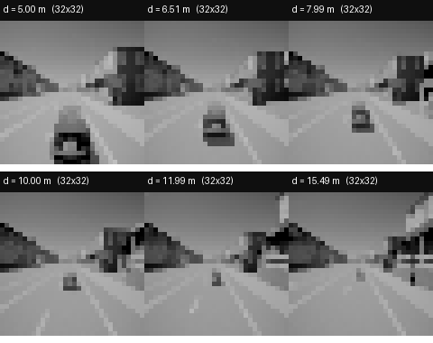
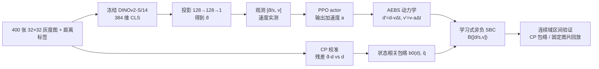
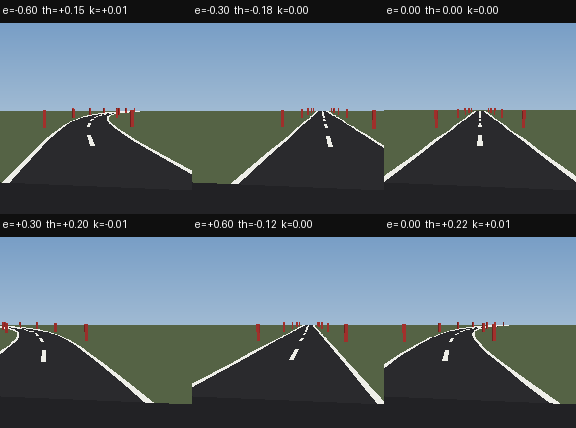
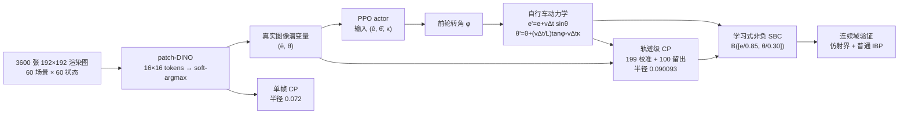
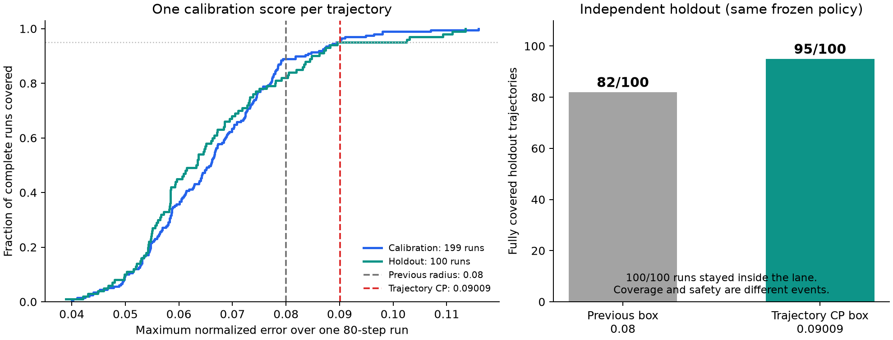

# AEBS 与车道保持：实验对象、逐步流程、数据流与保证

更新：2026-11-09。**本文按当前最新状态写：车道实验已经改为"原图像 PPO + AEBS 同类训练式非负神经 SBC + 轨迹级 CP"，不再是 11 月 5 日的 LQR/构造式证书。**旧包保留为历史对照，不作为当前结论。

- AEBS 结果包：[`vision_sls_spvc_sbc_pass_20261029`](../../artical-F122/results/vision_sls_spvc_sbc_pass_20261029/README.md)
- 车道训练式 SBC 包：[`lane_keeping_20261106_aebs_method_sbc_v1`](../../artical-F122/results/lane_keeping_20261106_aebs_method_sbc_v1/README.md)
- 车道轨迹级 CP 包：[`lane_trajectory_cp_20261107_v1`](../../artical-F122/results/lane_trajectory_cp_20261107_v1/README.md)
- 车道训练流程：[车道保持_AEBS同类训练流程与神经SBC_20261106.md](车道保持_AEBS同类训练流程与神经SBC_20261106.md)
- 车道轨迹 CP：[车道保持_轨迹级CP校准与SBC衔接_20261107.md](车道保持_轨迹级CP校准与SBC衔接_20261107.md)

> 版本范围：下文第 1 节和横向表格的 AEBS 指 2026-10-29 的 400 图灰度发布实验，不能移作 24k RGB 实验的证据。新增 RGB 的单位错误、重跑和当前 SBC 状态见第 1.6 节及链接。车道实验的轨迹级 CP 和双验证结果没有因 RGB 单位修复而失效。

## 0. 两实验一句话对比

| 项目 | AEBS | 车道保持（当前最新） |
|---|---|---|
| 任务 | 自动紧急制动：在撞到目标前把速度降到安全阈值以下 | 沿车道中心行驶：保持横向偏差/航向偏差在车道内 |
| 物理状态 | 2 维 `(d,v)` | 2 维 `(e,θ)` |
| 原始观测 | 32×32 灰度图 | 192×192 前视渲染图 |
| 真实图像潜变量 | 1 维距离 `d̂` | 2 维 `(ê,θ̂)` |
| 控制器输入 | 2 维 `(d̂/s, v)`；速度实测 | 3 维 `(ê,θ̂,κ)`；κ 已知 |
| 动作 | 1 维加速度指令 | 1 维前轮转角 |
| 控制器 | PPO（经 SBC 反馈训练） | **原图像 PPO**（未因新 SBC 改变） |
| SBC | 学习到的非负神经 SBC `[2,16,8,1]` | **同一类学习的非负神经 SBC `[2,16,8,1]`** |
| 误差集合 | 状态相关一维 CP 包络 + 固定图片回放 | 轨迹级 CP 半径 0.090093（单帧参考 0.072/0.08） |
| 验证 | 连续域数值区间 + 固定回放 | 连续域仿射界 + 普通 IBP 双复核 |
| 效果 | 名义/全部/留出图片各 1441/1441 | 100 条独立留出轨迹：95/100 完整覆盖，0/100 实际越界 |

**当前最重要的共同点：两个实验都使用“低维视觉观测 → PPO → 学习式非负神经 SBC → 连续域数值验证”。** 车道不再只靠人工几何构造的证书，而是用 AEBS 的 `NonnegativeSBC` 类从随机初始化训练得到。

## 1. AEBS 实验

### 1.1 任务与动力学

状态 `x=(d,v)`：`d` 为到目标点的距离（米），`v` 为车速（米/秒）。动作 `a` 为加速度指令（米/秒²），环境按代码符号约定更新：

$$
d_{k+1}=d_k-v_k\Delta t,\qquad
v_{k+1}=\operatorname{clip}\left(v_k-a_k\Delta t,\ 0,\ 3\right),
\qquad \Delta t=0.05\text{ s}.
$$

- 动作范围 `a ∈ [-3,3]`；正 `a` 使速度下降（制动方向）。
- 初态：`d ∈ [15,16] m`，`v ∈ [2.5,3] m/s`。
- 不安全：`d ∈ [5,6] m` 且 `v > 0.5 m/s`（到目标距离但还太快）。
- 成功：`d ∈ [5,6] m` 且 `v ≤ 0.5 m/s`。
- 终止：成功/不安全/出域/停住但未到目标；测试另设 400 步上限。
- 网络/控制器使用归一化状态 `[d/s, v]`，`s=3.1827 m` 是训练距离标准差；验证器在物理 `(d,v)` 上检查。

**输入图像示例**（来自 400 张图库，32×32 灰度图，最近邻放大；上方是标签距离）：



### 1.2 数据流



### 1.3 逐步流程

| 步 | 做什么 | 输入 | 处理 | 输出/数据 | 本步得到什么 |
|---|---|---|---|---|---|
| 0 | 固定任务 | 原 AEBS 动力学、初始域、危险集 | 不改阈值、不改动作限幅 | 共同协议 | 可复现的 2D 制动任务 |
| 1 | 数据与划分 | 400 张 32×32 灰度图、距离标签 | 按图像内容分组，60/20/20 划分，防止重复图跨组 | 240/80/80 训练/验证/测试 | 冻结图像库与 split |
| 2 | 视觉前端 | 训练图像 + 距离标签 | 冻结 DINOv2-S/14 CLS → 384→128→128→1 投影；验证误差选模型 | `observation.pt`，1 维 `d̂` | 真实图像 → 低维潜变量；速度仍实测 |
| 3 | CP 校准 | 校准集残差 `d̂-d` 与状态 `d` | 3 阶非负 Bernstein 基拟合 `b0(d)`；算分位数 `q̂` | `perception_contract.json`：系数、`q̂=2.522`、覆盖率 | 状态相关误差包络；均值半径约 0.43 m |
| 4 | 策略预训练 | 观测 `[d/s,v]`、AEBS 动力学、奖励 | PPO 预训练；随后经 SBC 反馈小步更新 | `policy.pt`，2 维输入、1 维动作 | 能完成制动的策略 |
| 5 | SBC 训练/交替 | 状态网格、动作、区域样本、反例 | 非负 MLP `[2,16,8,1]`（Tanh 隐藏、ReLU 输出）；区域 + 后继不增损失；与 actor 交替 | `sbc.pt`；初始上界 0，不安全下界 24.9659 | 学习到的非负 SBC + 经反馈的策略 |
| 6 | 连续域验证 | SBC、策略、CP 包络、固定图片库 | 数值区间传播覆盖状态网格 × 观测包络；区分通过/反例/未知 | 4,971,398 个包络区间；105,608 个回放区间 | 零实际反例、零未解决；初始/危险分离 |
| 7 | 行为与部署复核 | 冻结策略、DINO、测试图 | 名义观测 / 全部图片 / 留出图片三组闭环 | 各 1441/1441；80 张图片重载动作误差 5.8e-6 | 任务行为和保存/加载一致性 |
| 8 | 冻结打包 | 全部 | 记录哈希、配置、验证范围、失败历史 | 结果包 + README | 可复查的 AEBS 条件证书 |

### 1.4 关键数字

- SBC：初始区数值上界 **0**；不安全区数值下界 **24.9659**（要求 ≤1 / ≥20）。
- CP：`q̂=2.522`；校准 39/40、审计 40/40；拟合 240/240；均值半径约 0.43 m。
- 验证：CP 包络 **4,971,398** 个区间；固定图片回放 **105,608** 个区间；零反例、零未解决。
- 行为：名义/全部/留出图片各 **1441/1441**；32 项软件检查；80 张图片重载通过。
- 风险语义：`B0≤1`、危险区 `B≥20`；非负停止过程风险上界 `B0/20≤5%`（95% 目标），前提是 CP 包络/回放模型成立。

### 1.5 保证与边界

**在“观测落在 CP 包络内”或“使用冻结 400 图最近邻回放”的前提下**，验证器覆盖声明的连续状态域；SBC 非负且不增，危险区分数至少 20，因此支持 5% 风险上界。1441/1441 是额外行为证据，不是概率证明。

不覆盖：新采集图像、真实车辆、天气/相机变化、完整浮点执行证明、原始 Softplus/严格 ε=0.1 配置原样通过、cGAN 与 DINO 的同预算公平对照。

### 1.6 RGB 扩展实验：2026-11-09 修复后的步骤

先撤回旧补充中的“0.2307 m tube 已通过”结论。原 RGB 合同的分位数是归一化单位，验证时漏乘 `S=3.18272066116333`，实际只检查了 0.07249 m。修复后旧 SBC 出现正漂移见证，因此不能继续用旧报告证明正确半径下的安全。

| 步骤 | 输入 | 做了什么 | 输出和当前结果 |
|---|---|---|---|
| 1. 前端与数据冻结 | 24k CARLA 保存的 RGB 图片、距离标签 | 项目按距离 bin 划分；DINO 实际输入 224×224，输出 384 维特征，再投影到距离 | RGB test MAE 0.0874 m；不是实车采集或在线渲染 |
| 2. 修复米制误差接口 | 归一化分位数 q=0.072493 | 使用 `r=S*q`；增加合同单位检查；各前端引用自己的统计 | RGB 半径 0.230725 m；旧错误合同被拒绝 |
| 3. 修复外观回放 | 图片库、PPO、400 初态 | 12 种天气/颜色分别运行，单条轨迹外观固定 | 全库 4,800/4,800；test 库 4,800/4,800 成功 |
| 4. 独立轨迹级 CP | 冻结模型、库和采样协议 | 199 条校准，按整条轨迹最大米制误差取第 190 秩；再采 100 条留出 | 半径 0.418359 m，留出 99/100 全程覆盖、100/100 成功 |
| 5. 新神经 SBC 训练 | 原 actor、前端、正确半径和旧候选反例 | 固定 actor/前端，热启动训练非负神经 SBC 两轮，各 4,000 更新 | v2 初始上界 0、危险下界 25.213636；训练输出再交第 6 步验证 |
| 6. 加强连续域验证 | v2、0.418359 m 全集合、全部 live 状态 | 加细动作/速度区间，并用 Tanh 仿射界保留输入相关性；不缩小半径或初态 | 292,024 个区间，0 正漂移见证/0 未解决，完整数值验证通过 |

**状态相关对照：**另按 10/29 的 Bernstein `b0(d)` 做了状态相关 CP：平均半径 0.3217 m、最大 0.720 m，留出覆盖 92/100；同一 SBC v2 在 41,070 个区间上 0/0 通过。它更省验证、危险区更紧，但留出覆盖低于常量版的 99/100，因此不替换常量发布包。见 [状态相关 CP 包](../../artical-F122/results/real_aebs_state_cp_20261109_units_v2/README.md)。

完整解释、最终结果及服务器复现命令见 [AEBS RGB 完整实验](AEBS真实RGB图像_完整实验_20261108.md)；旧/新灰度的证据区别和前端对照见 [前端对比](AEBS前端对比_cGAN_灰度_真实RGB_20261108.md)。

**保证如何分层：**静态距离 bin 残差没有自动建立新图像可交换性；新的轨迹 CP 只对声明的冻结库回放分布提供轨迹边缘覆盖。只有在完整鲁棒不增条件通过后，才能进一步连接到该模型内的安全。训练样本没有违反、有限回放全部成功，都不能替代连续域验证。当前没有实车或任意新图像的无条件安全结论。

## 2. 车道保持实验（当前最新）

### 2.1 任务与动力学

状态 `x=(e,θ)`：`e` 为相对车道中心的横向偏差（米），`θ` 为相对道路切线的航向偏差（弧度）。动作 `φ` 为前轮转角；`κ` 为道路曲率（1/米），作为已知输入。

$$
e_{k+1}=e_k+v\Delta t\sin\theta_k,\qquad
\theta_{k+1}=\theta_k+\frac{v\Delta t}{L}\tan\phi_k-v\Delta t\,\kappa,
$$

`v=4 m/s`，`L=2.6 m`，`Δt=0.1 s`，`φ ∈ [-0.45,0.45]`，`κ ∈ {-0.01,0,0.01}`。

- 初态：`|e|≤0.25 m`，`|θ|≤0.06 rad`；实验运行 80 步。
- 安全：`|e|≤0.85 m` 且 `|θ|≤0.30 rad`；超出即 unsafe。
- 图像：192×192 前视渲染，单车道 3.5 m，实线边线、虚线中心线、路旁灯杆。
- 速度 4 m/s：8 m/s 时边界恢复超调会把 `|e|` 推到 0.8 m 以上，安全盒子难闭合；安全阈值未改。

**输入图像示例**（6 个不同 `(e,θ,κ)` 的渲染图；上方是状态标签）：



### 2.2 数据流



### 2.3 逐步流程

| 步 | 做什么 | 输入 | 处理 | 输出/数据 | 本步得到什么 |
|---|---|---|---|---|---|
| 0 | 固定任务/控制器 | 11 月 5 日 PPO、patch-DINO、车道动力学 | 冻结策略、观测、任务；不改初态/安全阈值 | 固定模型与协议 | 后续 SBC 训练/验证的固定对象 |
| 1 | 数据/视觉 | 60 个名义场景 ×60 状态 | 渲染 3600 张；patch-DINO 16×16 → soft-argmax → 2 维 | `patch_projection.pt`；测试 MAE `e` 0.0211 m、`θ` 0.0059 rad | 2 维真实图像潜变量 |
| 2 | 策略 | 观测 `(ê,θ̂,κ)`、动力学、奖励 | 原 PPO 80k 步，观测误差扰动训练 | `actor.pt`；固定 PPO，本包未重训 | 后续 SBC 训练/验证的对象 |
| 3 | 单帧 CP | 校准集残差 | split CP，max-norm 95% | 半径 0.072；校准 95.2%、测试 93.6% | 单帧误差参考包络 |
| 4 | 轨迹级 CP | 199 条校准轨迹、每条 80 步 | 每条轨迹取 80×2 维最大绝对误差，得到 199 个分数；取 95% 分位数 | 半径 **0.0900931580**；留出 95/100 完整覆盖，帧覆盖 99.9375% | 整条轨迹的误差合同 |
| 5 | SBC 训练 | 真实状态采样、观测误差子盒、后继区间 | 复用 AEBS `NonnegativeSBC` `[2,16,8,1]`，Tanh 隐藏、ReLU 输出；从随机初始化训练；区域 + 后继不增 + 小裕度；无几何教师 | 种子 41：2000 次更新通过；`sbc.pt` | 学习到的非负神经 SBC |
| 6 | 连续域验证（主） | actor、SBC、误差盒 0.08/0.09、三个曲率 | 状态盒 + 观测误差盒 → PPO 动作区间 → 非线性后继盒 → SBC 上下界；无法判定则细分 | 初态上界 **0.08583**，危险下界 **23.65350**；0 unresolved | 主审计通过 |
| 7 | 普通 IBP 复核 | 同上 | 逐层 IBP；误差每维 8 段未解决，直道 47,136 盒；加细到 16 段 | 初态上界 **0.60715**，危险下界 **20.14060**；0 unresolved | 独立验证器复核通过 |
| 8 | 行为回归 | 240×3 条误差轨迹、12 条图像轨迹 | 固定种子/场景；SBC 用真实状态离线计算 | 720 条误差轨迹 0 越界；12 条图像 0 越界；958/960 帧在 0.08 盒内 | 开发回归证据 |
| 9 | 独立留出评估 | 100 条新轨迹，每条 80 步 | 同冻结策略/观测/动力学 | 完整覆盖 95/100；实际越界 0/100；旧 0.08 为 82/100 | 轨迹级 CP 的留出覆盖 |
| 10 | 冻结打包 | 全部 | 记录协议、哈希、审计、失败记录、测试 | 结果包 + 文档 | 可复查的当前证书 |

### 2.4 当前证书到底是什么

- **控制器**：11 月 5 日原图像 PPO，输入 `(ê,θ̂,κ)`，输出前轮转角；本包没有因为新 SBC 改策略。
- **SBC**：`[2,16,8,1]`，Tanh 隐藏层 + ReLU 输出，从随机初始化训练；不是几何构造、不是 LQR、不是教师蒸馏、没有在线后备。
- **输入**：归一化真实状态 `[e/0.85, θ/0.30]`；离线用于证明，不作为部署时动作修正器。
- **条件**：每步两个归一化观测误差都在声明盒内（单帧参考 0.08；轨迹级 CP 0.090093）。
- **主审计**：初态 `B` 上界 0.08583；危险区 `B` 下界 23.65350；三个曲率零未解决区间。
- **IBP 复核**：初态 0.60715；危险区 20.14060；零未解决区间。
- **危险区范围**：验证归一化 `[-1.3,1.3]²` 中的全部越界部分；从安全矩形任意状态一步后继必在该盒内（坐标上界约 1.1391/1.2611），所以首次越界必被覆盖。

**安全论证：**初态 `B≤0.08583`；在误差盒内每个允许后继 `B` 不增；若首次越界，该状态在已检查危险区，`B≥23.65350`，与 `B≤0.08583` 矛盾。因此在这些模型/包络条件下不能越界。

### 2.5 效果

- 轨迹级 CP：199 条校准，半径 **0.0900931580**；100 条独立留出中 **95/100** 完整覆盖；帧覆盖 **99.9375%**；实际越界 **0/100**。
- 旧 0.08 半径在同一批留出轨迹上只有 **82/100** 完整覆盖——单帧覆盖高不代表整条轨迹覆盖。
- 训练式 SBC：种子 41 主审计通过（初态 0.08583 / 危险 23.65350）；种子 42 也通过（0.28215 / 23.81664）；两个种子都没有触发策略反馈。
- 回归：720 条误差轨迹 0 越界；12 条 patch-DINO 图像轨迹 0 越界；958/960 帧在 0.08 盒内，2 帧最大误差约 0.09965，但实测安全。
- 软件：13 项 SBC/训练测试、27 项轨迹 CP 回归通过。



### 2.6 本次服务器同步与回归（2026-11-09）

检查发现服务器的车道代码仍落后于本地已修复版本：加载导出的 PPO 时漏了最后一个隐藏层的 Tanh 激活；旧 LQR 区间的负权重上下界方向、平衡附近的正漂移容差和小样本 CP 的无穷分位数处理，也还是旧代码。已备份服务器文件，并同步本地修复、训练式神经 SBC、轨迹 CP 及校准/证书一致性检查模块。

这一步没有重训或替换已发布的车道 actor/SBC。其目的在于让服务器加载同一个网络，并执行与本地相同的检查。三组车道测试在本地和服务器 `vt` 中均为 **27/27 通过**，包含与 SB3 原策略输出一致性、区间包络、反馈训练、CP 完整轨迹分数及合同衔接。服务器加载旧训练包出现 Python 版本导致学习率/裁剪日程无法反序列化的提示，但本轮冻结推理输出一致性测试通过；没有据此尝试恢复 PPO 优化器训练。

服务器复核结果也已完成：在原轨迹 CP 半径 **0.09009315804748166** 下，主仿射审计与独立 IBP 均通过，三个曲率都为零实际见证、零未解决。主审计初始/危险界为 0.085828/23.653496；IBP 为 0.607153/20.140602。结果分别保存为 [服务器主审计](../../artical-F122/results/lane_repair_20261109_audit/certificate.json) 和 [服务器 IBP](../../artical-F122/results/lane_repair_20261109_ibp/certificate.json)。这些是对同一冻结模型的跨环境复核，不是新增训练种子或新图像样本。[CP 与本轮证书的连接检查](../../artical-F122/results/lane_repair_20261109_audit/bridge.json)也通过了模型、半径与任务一致性核对。

### 2.7 保证与边界

**条件模型安全（轨迹 CP 版）：**在冻结 PPO、当前离散动力学、零过程扰动、三个注册曲率、每步误差在盒内的条件下，SBC 逐后继不增，危险区分数至少 20；初始分数低，因此不能首次越界。轨迹级 CP 把“80 步 ×2 坐标的最大误差”作为一个分数，199 条校准给出 0.090093 半径；100 条独立留出中 95 条完整覆盖。

**概率表述要准确：**CP 控制的是新轨迹的边缘失覆盖概率；若接受事件 A 依赖校准半径，U 是新运行越界，可靠审计可连接为 `Pr(A 且 U) ≤ 0.05`，不能改写成 `Pr(U | A) ≤ 0.05`。5 条留出轨迹超出包络但实测安全，不能把它们的安全归因于包络内 SBC 论证。

不覆盖：实车、新相机/天气、连续曲率、任意固定初态的条件覆盖、无限时域、完整浮点形式证明；也不宣称策略反馈在车道上提高了性能（本轮未触发）。

## 3. 两个实验放在一起看

| 维度 | AEBS | 车道保持（最新） |
|---|---|---|
| 状态维 | 2 | 2 |
| 图像 | 32×32 灰度 | 192×192 RGB 渲染 |
| 真实图像潜变量 | 1 维距离 | 2 维 `(e,θ)` |
| 控制器输入 | 2 维（潜变量+实测速度） | 3 维（潜变量+κ） |
| SBC | 学习式非负 `[2,16,8,1]` | 同一类学习式非负 `[2,16,8,1]` |
| 误差集合 | 状态相关一维 CP 包络 + 固定回放 | 单帧 0.072/0.08 + 轨迹级 0.090093 |
| 验证 | 连续域区间 + 固定回放 | 连续域仿射界 + 普通 IBP 双复核 |
| 证书结果 | 初始 0 / 危险 24.97；4.97M + 105,608 区间 | 初始 0.08583 / 危险 23.65350；两个种子通过 |
| 行为结果 | 1441/1441 ×3 | 100 留出：95/100 完整覆盖，0 越界；12 图像轨迹 0 越界 |
| 主要限制 | 1 维观测、cGAN 公平对照未做、非实车 | 轨迹 CP 边缘覆盖、非实车、连续曲率未证 |

**共同点：**都把“真实图像潜变量 vs 代理潜变量”的误差显式校准为集合，并在该集合上验证学习式非负 SBC；都不把行为成功当成证书；都只做数值区间，不宣称形式化浮点证明。

**不同点：**AEBS 是 1 维视觉观测 + 状态相关包络 + 固定图片回放；车道是 2 维视觉观测 + 轨迹级 CP + 未知曲率作为已知输入。车道的策略没有因为新 SBC 改过；因此不能宣称“联合训练提高了车道性能”。

## 4. 复现入口

```bash
# AEBS
cd artical-F122
../.venv-vision-sls/bin/python -m Aebs.system.combined \
  --artifact-dir results/vision_sls_spvc_sbc_pass_20261029

# 车道：训练式 SBC 主审计
../.venv-vision-sls/bin/python -m Aebs.lane_keeping.verify_learned \
  --actor results/lane_keeping_20261106_aebs_method_sbc_v1/actor.pt \
  --sbc results/lane_keeping_20261106_aebs_method_sbc_v1/sbc.pt \
  --output-dir results/lane_aebs_audit --grid 40 --depth 16 --error-splits 4

# 车道：轨迹级 CP 重验
../.venv-vision-sls/bin/python -m Aebs.lane_keeping.verify_learned \
  --actor results/lane_trajectory_cp_20261107_v1/actor.pt \
  --sbc results/lane_trajectory_cp_20261107_v1/sbc.pt \
  --radius 0.09009315804748166 --grid 40 --depth 16 --error-splits 4 \
  --output-dir results/lane_trajectory_cp_audit_reproduce
```

完整命令、哈希、训练历史和失败记录见结果包 README。

## 5. 状态相关对照的修复更新（2026-11-09）

车道旧 v1 报告继续撤回；修复版采用 99 条拟合、100 条校准、无 cap 和正确留出残差。直接对实际状态相关集合验证，本地/服务器均为 13,000 格、0 见证/0 未解决；原留出回归覆盖 93/100，非新盲测。完整输入输出、对照和保证边界见 [轨迹 CP 文档第 5.2 节](车道保持_轨迹级CP校准与SBC衔接_20261107.md)。此次修复误差集合与实验记录，联合学习 C 的新前端仍未完成。
