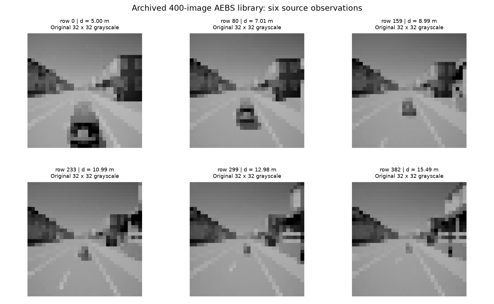
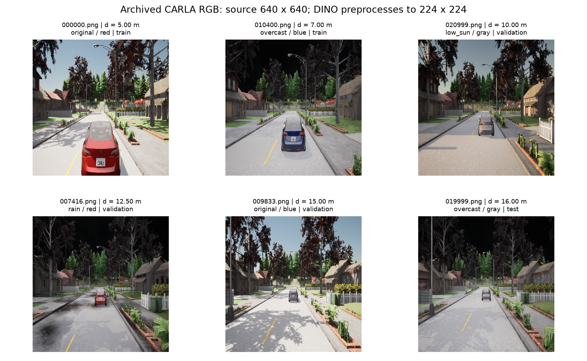
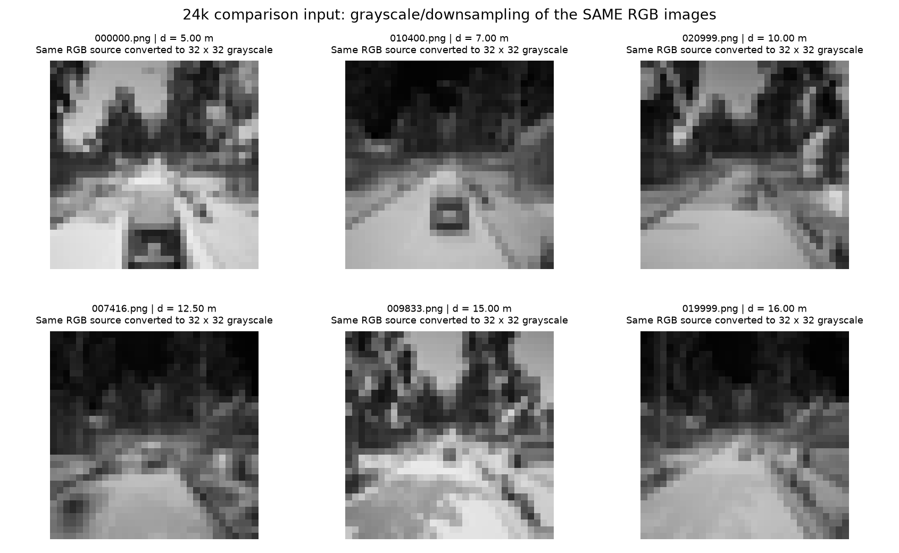
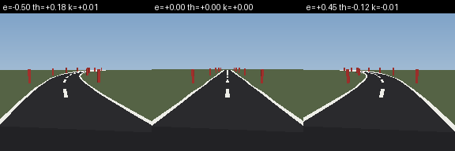
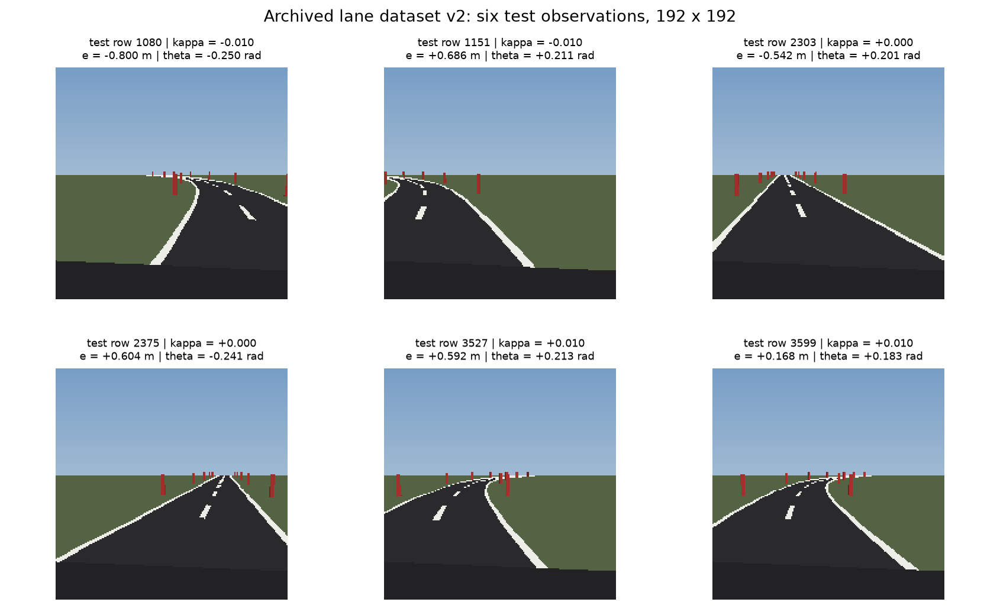
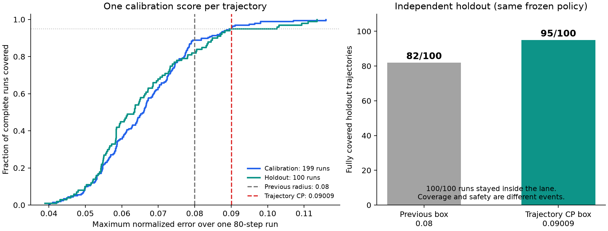
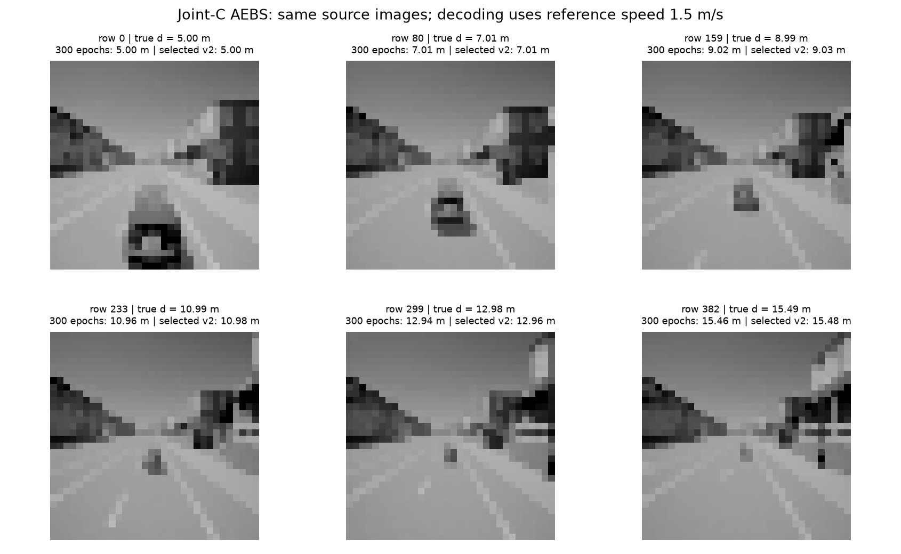
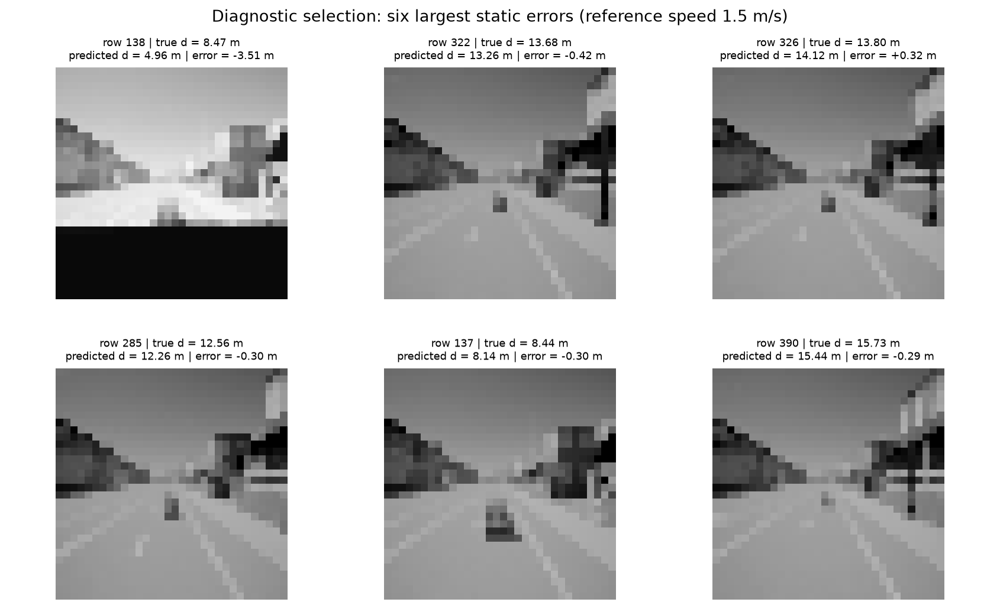
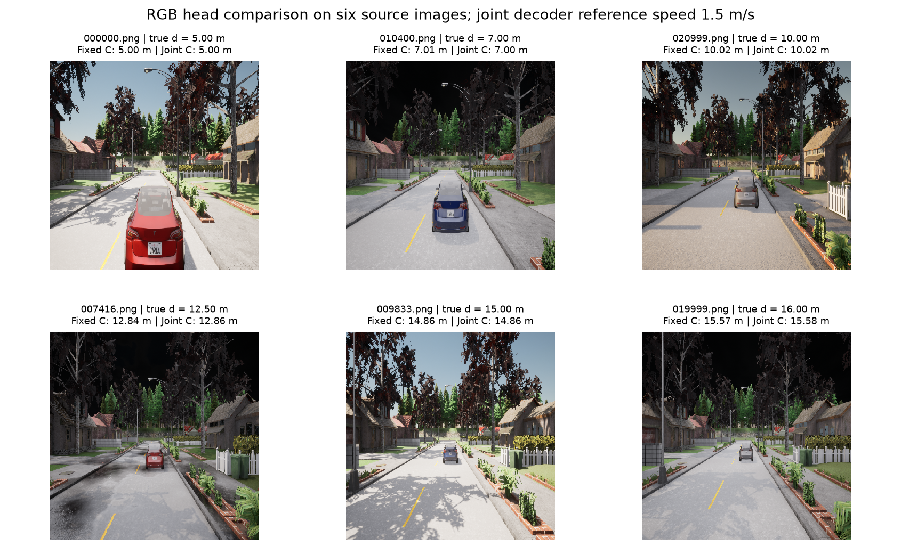

# AEBS 与车道保持实验全版本汇总

**逐版说明：做了什么 → 每步输入与输出 → 为什么这样做 → 结果 → 安全保证 → 实际观测样例。**

更新：2026-11-10（文件名保留建稿日期）。本文以保存的代码、模型、JSON 结果和修复审计为依据；旧文档与后续审计冲突时，以后续审计为准。本文覆盖本轮讨论的灰度 AEBS、RGB AEBS、前端对比、车道保持，以及它们的 CP、SBC、联合学习 C 变体；停车场与移动机器人不混入这两项任务的对比。

**先记住：同一个任务可以有多个前端、多个控制器、多个误差合同和多个 SBC。只有这四项彼此匹配，证书才对应当前运行的系统。**本文件不把某个版本的好结果移到另一个版本，也不删除失败历史。

## 阅读导航

1. [版本总表](#versions)：先找你想看的那次实验。
2. [共同原理与术语](#principles)：不了解 DINO、CP、SBC 时先读这里。
3. [400 图灰度 AEBS 的演进](#gray)：原 cGAN、行为修复、CP-NCBF 支线、首个非负 SBC 发布版。
4. [RGB、扩展灰度与前端对比](#rgb)：探针、新 PPO、错误证书撤回、修复、状态相关 CP。
5. [车道保持的演进](#lane)：CLS/patch、早期失败、构造式证书、训练式 SBC、轨迹 CP、状态相关修复。
6. [联合视觉投影与 C](#joint)：灰度、RGB、车道及固定 C 对照。
7. [最终能保证什么、不能保证什么](#guarantees)。
8. [证据与理论来源](#sources)。

<a id="versions"></a>
## 1. 版本总表：这些名称分别指什么

### 1.1 先分清三个图片来源

| 图片来源 | 实际内容 | 哪些版本使用 | 最容易混淆的地方 |
|---|---|---|---|
| **400 图灰度库** | `Downsampled.h5` 中 400 张 32×32 灰度图，距离约 5–16 m | G0–G3、JG | 不是将后来的 24k RGB 库全部变灰后的数据 |
| **24k CARLA RGB 库** | 24,000 张保存的 640×640 RGB PNG，4 类天气×3 类车色 | R0–R5、JR；R3 另做 32×32 灰度转换 | “真实 RGB”指实际保存并输入网络的 RGB 图，**不是实车照片** |
| **道路渲染图** | 简化车道场景的 192×192 图像；早期 960 图，后期 3,600 图 | L0–L7、JL、JC | 车道在线闭环每步重新渲染，不是 AEBS 的固定库查图 |

### 1.2 按版本索引

| 编号 | 版本 / 时间 | 主要变化 | 当前应如何引用 |
|---|---|---|---|
| G0 | 原 SPVC/cGAN 对照 | 状态和随机变量经 cGAN 生成视觉代理；配套 state_net | 原框架来源、历史迁移基线；本文不声称重新复现原论文全部数字 |
| G1 | 灰度 DINO 行为修复，10/28 | 替换前端，降低破坏策略的更新步长 | 行为成功，SBC 区域条件未通过 |
| G2 | CP-NCBF 在线修正支线，10/28 | 有符号屏障＋在线动作修正＋有限回放统计校准 | 独立历史支线；不是最终原类非负 SBC |
| G3 | 灰度 DINO＋状态相关 CP＋非负 SBC，10/29 | 配套训练策略/SBC并完整检查 | 历史小图库条件数值证书；不能移作新图像保证 |
| R0 | RGB 小规模探针，11/08 | 先检验 RGB→距离是否可用 | 只有感知/静态误差结果，无闭环 SBC |
| R1 | RGB 新 PPO，`artifact_v3` | 新前端配新训练 PPO | 密集回放成功，但稀疏留出库失败；无完整 SBC |
| R2 | RGB 前端移植旧控制器/SBC，`full_v1` | 试图只换前端 | 原 tube 通过结论因单位错误撤回 |
| R3 | cGAN 配套前端 / 扩展灰度 / RGB 对比 | 同 4,920 张测试图比较 | 静态误差及旧 SBC 敏感性对照；非同预算架构胜负 |
| R4 | RGB 修复发布版，11/09 | 修正单位、固定外观、轨迹 CP、重训 SBC v1→v2 | 0.418359 m，292,024 区间 0/0；留出 99/100 覆盖 |
| R5 | RGB 状态相关 CP v1→单位修复 v2 | 只学误差尺度，不学 C | 41,070 区间 0/0；旧留出 92/100，不替换 R4 |
| L0 | 车道 CLS→patch 感知 / 早期候选，11/05 | 改善空间位置观测，尝试 PPO 与神经 SBC | 感知和行为实验；早期神经候选未通过 |
| L1 | LQR＋残差＋解析屏障历史分支 | 改控制器结构，构造证书 | 后续发现旧区间实现问题；旧 passed 不作现行证据 |
| L2 | 原 PPO＋构造式 ReLU 神经 SBC，11/06 | 修复策略重载，构造分段线性证书 | 条件通过；不是 AEBS 同类随机初始化训练结果 |
| L3 | 原 PPO＋AEBS 同类训练式 SBC，11/06 | 真正训练 `[2,16,8,1]` 非负网络 | 两个 SBC 种子通过；控制器未换 |
| L4 | 车道轨迹级 CP，11/07 | 199 条校准、100 条新留出、80 步 | q=0.090093；双数值复核通过；留出 95/100 |
| L5 | 服务器实现同步修复，11/09 | 修复加载/区间/CP边界并跨环境复核 | 同模型复核，不是新训练种子或新数据 |
| L6 | 车道状态相关 CP v1 | 旧拟合和统计实现有错 | **撤回，不引用统计保证** |
| L7 | 车道状态相关 CP 修复 v2 | 99 拟合＋100 校准，无截断，验证实际集合 | 13,000 区间 0/0；旧留出回归 93/100 |
| JG | 灰度联合投影/C，300→1000 epoch | 真正学习 C，加入显式速度解码 | 新常量轨迹半径 3.515916 m；旧 SBC 未通过 |
| JR | RGB 联合投影/C，60 epoch | 学习 C 后重新校准 | 0.394521 m；102,338 区间 0/0；留出 91/100 |
| JL | 车道联合投影/C，30 epoch | 2×2 C、逆坐标接口、新图像轨迹 CP | q=0.084338；新条件 SBC 数值通过；留出93/100覆盖 |
| JC | 车道固定 C 同预算对照 | 只继续训练视觉头 | 平均误差与 JL 接近；没有证明联合 C 显著更优 |

“0/0”统一表示 **0 个实际正漂移见证、0 个未解决区间**，不是“零安全风险”的简称。

<a id="principles"></a>
## 2. 共同原理：先弄清每个模块在做什么

### 2.1 从图像到动作，再到离线证明

```text
运行时：当前图像 → 冻结 DINO → 可训练低维投影 → 控制器 → 动作 → 下一状态
                  例如 384维          例如1或2维

离线：真实状态 → 名义观测 Cx
      图像观测 y 与 Cx 的差 → CP误差集合
      动力学＋控制器＋误差集合＋神经SBC → 连续域数值验证
```

**真实状态是离线训练、打标签和验证的依据。**正常视觉控制路径不读取真实距离或真实横向位置来代替感知。AEBS 的速度、车道的曲率则按实验协议作为额外已知输入；这意味着当前实验不是“仅靠单张图片估计所有状态”。

| 术语 | 易懂解释 | 本项目中的输入 → 输出 |
|---|---|---|
| DINOv2 | 已经预训练好的图像特征提取器；本轮主干权重冻结 | 图片 → CLS 特征或 patch 特征 |
| CLS | 把整张图概括成一个向量 | 一张图 → 384 个数 |
| patch tokens | 保留图像不同空间位置的特征，比单个全局向量更适合定位 | 一张图 → 16×16 个、每个 384 维的向量 |
| 视觉投影 `pθ` | 把高维特征压成控制需要的少量数字的小网络 | DINO 特征 → 1D/2D 观测 y |
| 名义观测 `Cx` | 已知真实状态时，理论上应当看到的低维向量 | 归一化真实状态 x → 低维向量 |
| PPO / actor | 从观测选择动作的神经策略；通过奖励训练 | 低维观测＋已知量 → 制动或转向 |
| CP | 用校准误差为新样本构造覆盖集合的方法 | 独立校准分数 → 分位数 q / 误差范围 |
| SBC | 给状态打非负“证明分数”的屏障网络；不等于碰撞概率预测器 | 真实状态 → 非负 B(x)，离线证明用 |
| 区间验证 / IBP | 把一整片输入区域的可能网络输出包起来检查 | 状态盒、误差盒 → 保守输出上下界 |
| 仿射相关界 | 尽量保留变量关联，减少普通区间界过宽的问题 | 同一待检区域 → 通常更紧的上下界 |
| 反例 / 正漂移见证 | 找到一个具体允许状态和误差，使当前 B 上升 | 点、允许误差 → `B(next)>B(now)` |
| 未解决区间 | 现有上下界还不足以证明，未必真有违例 | 一个区域 → “还不知道” |

DINO、PPO 的论文分别说明特征学习与策略优化；它们本身不提供这里的安全证书。[DINOv2](https://arxiv.org/abs/2304.07193)、[PPO](https://arxiv.org/abs/1707.06347)。

### 2.2 两个任务固定了什么

**AEBS：自动紧急制动。**状态 `(d,v)` 为距离和速度，动作 a 的正号表示制动：

\[
d^+=d-0.05v,\qquad v^+=\operatorname{clip}(v-0.05a,0,3),\quad a\in[-3,3].
\]

初态 `d∈[15,16] m、v∈[2.5,3] m/s`。到达 `d∈[5,6] m` 时速度应不超过 0.5 m/s；太快进入该区域为不安全。验证对危险区域边界采用保守闭集。成功、危险、出域、过早停住以及 400 步超时分开统计。“安全”不自动意味着“成功到达”。停止后使用吸收/停止过程语义，不继续要求停住的车辆严格下降。

**车道：横向保持。**状态 `(e,θ)` 为偏离车道中心的距离与航向偏差：

\[
e^+=e+v\Delta t\sin\theta,\qquad
\theta^+=\theta+\frac{v\Delta t}{L}\tan\phi-v\Delta t\kappa.
\]

主线 `v=4 m/s、Δt=0.1 s、L=2.6 m`，转向 `φ∈[-0.45,0.45] rad`，已知曲率取 `−0.01、0、0.01`，每回合固定。初态 `|e|≤0.25 m、|θ|≤0.06 rad`；安全边界 `|e|≤0.85 m、|θ|≤0.30 rad`。图像轨迹通常长 80 步，即 8 秒。早期 8 m/s 探索与后来 4 m/s 主实验不能混成相同条件。

### 2.3 CP：单帧、轨迹、状态相关是三种不同设置

固定误差尺度时，单帧分数可以是 `|d̂−d|`，车道可用两个归一化误差的最大绝对值。轨迹级分数则在整次运行的所有时间再取最大值：

\[
s_j=\max_t\|y_{j,t}-Cx_{j,t}\|,\qquad
k=\lceil(n+1)(1-\alpha)\rceil,\quad q=s_{(k)}.
\]

例如 n=199、α=0.05，取第 190 小分数。这里 199 条轨迹才是 199 个校准样本，不能把其中的 15,920 帧当成相互独立的 15,920 个样本。若 k 超过 n，标准有限样本处理是无穷阈值，不能强行取样本最大值冒充所需覆盖。

状态相关版本先用另一批数据拟合正尺度 `b(x)`，再校准 `max_t |误差|/b(x_t)`，最终半径为 `q b(x)`。例如允许远处图片误差大一些、靠近危险区误差小一些。**它改变的是“允许误差多大”，不一定改变图像预测，也不等于学习了 C。**Bernstein 基函数非负且和为 1，配正系数容易保证尺度为正，并方便求状态盒上的上界。

标准 split CP 的核心前提是固定评分规则下，校准样本与新样本分数可交换；独立同分布是足够条件之一。“分布无关”不是“允许任意分布变化”。[CP 教程](https://arxiv.org/abs/2107.07511)、[控制与验证中的 CP 综述](https://arxiv.org/abs/2409.00536)。

### 2.4 SBC 为什么能阻止越界

主线要求 `B≥0`、初始 `B≤1`、危险 `B≥20`，并检查允许误差下的后继不增。直观地说：

1. 开始时分数不超过 1。
2. 在所验证的模型、状态域和误差前提内，每走一步分数都不能变大。
3. 如果真的首次进入危险区，分数又必须至少 20。
4. “始终不超过 1”和“至少 20”矛盾，所以满足这些前提的轨迹不能这样进入危险区。

这里的逐后继不增比只检查平均/期望漂移更强。原非负超鞅屏障理论还有 `B(initial)/危险阈值` 形式的风险界；**不能把这个比值、CP 的 95%、回放成功率当成三个可随意相乘的百分数。**本文按每版实际验证条件说明，不把采样训练损失当成全域证明。

### 2.5 “冻结回放”“复用图片”具体是什么意思

AEBS 回放先看模拟状态 d，再在保存的图片库中找距离最近的图片输入视觉网络。因此它有真实的网络预测和控制反馈，但没有重新拍摄或调用 CARLA 渲染当前状态的新图像。误差必须比较图片预测与**当前模拟状态**，不能只和那张图片自己的标签比较，否则漏掉最近邻查图误差。

冻结同一图片库后，按固定规律独立抽初态和外观，仍可定义一个清楚的“固定库随机轨迹分布”，并对它做轨迹 CP。结论只在这个世界内成立。距离 bin 留出、曾被多次查看的测试图片、天气更换，均不能自动当作新的可交换相机样本。

**图片说明：**各节下方均为保存数据中的观测或历史存档渲染预览，不是示意性 AI 生成图。多个版本共用同一个图片库时，会重复展示同一组样例并明确标注；重复出现不算新增样本。图片来源、原始行号/文件名和散列见 [样例来源清单](../assets/experiment_versions_20261109/provenance.json)。

图中英文标签的读法：`true d`是真实距离，`predicted d`是预测距离，`error`是预测减真实值；`e`是横向偏差，`theta`是航向偏差，`kappa`是道路曲率；`row`是图片在数据数组中的行号，**不是一条轨迹的编号**。`reference speed`是为了比较解码而统一设置的参考速度，不是图片里新采集到的速度标签。

<a id="gray"></a>
## 3. 400 图灰度 AEBS：从替换前端到首个 SBC 发布版

### G0｜原 SPVC/cGAN：后续实验替换的是什么

**目的：**说明原框架与迁移参照。cGAN 不是 DINO 的另一种名字：原生成器在状态和随机潜变量条件下生成视觉代理，配套 state_net 从图像估计控制所需信息。

| 步骤 | 输入 | 具体做法与原理 | 输出 |
|---|---|---|---|
| 1. 视觉代理 | 状态条件、随机潜变量、原灰度数据 | 条件生成模型学习状态相关图像 | cGAN 图像生成代理 |
| 2. 感知映射 | 32×32 灰度图 | 展平为 1,024 维，配套 state_net 预测归一化距离 | 1 维距离观测 |
| 3. 策略 | 距离观测、实测速度 | 神经 actor 根据观测输出制动动作 | 下一步动作 |
| 4. 安全学习 | 状态、初始/危险集合、闭环后继 | 训练非负屏障，并用失败状态反馈调整 | 策略和 SBC 候选 |
| 5. 验证 | 固定代理、控制器、SBC和假设 | 检查区域分离及动态条件 | 对特定代理模型的证书或失败记录 |

**本轮实际做的对照：**把旧 state_net 用到新的 24k 图片转换成的灰度图上，测距离误差，见 R3。没有重新同预算训练 cGAN，也没有在此重跑原论文全部安全结果。原论文模型结论不能直接变成新 DINO 前端的证书。

**观测样例：**下面是原 400 图灰度数据中的相机观测，供理解原输入类型；不是本次新生成的 cGAN 图片。



证据：[cGAN 对比代码](../../artical-F122/Aebs/vision_sls/cgan_baseline.py)、[原项目说明](../../artical-F122/README.md)。

### G1｜10/28：灰度 DINO 替换后，先修复“任务做不成”

**目的：**先让前端替换后的 AEBS 能正常到达并制动，避免策略在安全训练过程中被大步更新破坏。

| 步骤 | 输入 | 具体做法与原因 | 输出 |
|---|---|---|---|
| 1. 整理数据 | 400 张灰度图、距离标签 | 固定训练/验证/测试划分，不把测试误差用作训练损失 | 240/80/80 图 |
| 2. 编码与投影 | 训练图、距离 | 灰度复制为 RGB 通道、统一预处理，冻结 DINO CLS，训练低维头 | 384 维特征→1D距离 |
| 3. PPO 预训练 | 低维观测、速度、原动力学和奖励 | 先学会任务，取得可用策略 | 约 30k 步的 PPO 起点 |
| 4. 修复策略更新 | PPO、屏障训练反馈 | 检查发现旧学习率 0.05 会破坏已学行为；改为 0.0003，并保护任务表现 | 101 次接受的 actor 更新；策略和屏障均更新 |
| 5. 行为回归 | 固定策略、441 网格＋1,000 随机初态 | 名义输入与留出图片回放分别测试 | 前后均 1,441/1,441 成功 |
| 6. 证书检查 | 最终 B、初始/危险区域 | 单独核查区域上/下界，不能以成功率替代 | 初始上界约 13.928，危险下界约 10.365，未达 ≤1/≥20 |

**安全结论：没有完整 SBC。**这次解决的是“任务行为”，还没有解决“对整片允许状态与误差都能证明安全”。80 张图像重载检查通过只是软件一致性，不改变这个结论。

**观测样例：**同一 400 图库；这一版换的是处理图片的网络与学习流程。


证据：[G1 原始汇总](../../artical-F122/results/vision_sls_spvc_goalfix_full_20261028/summary.json)。

### G2｜10/28：CP-NCBF 在线动作修正支线

**目的：**探索另一种安全干预方式。这条支线后来没有作为“保留原 SPVC 非负 SBC”的主线发布。

| 步骤 | 输入 | 做法与原理 | 输出 |
|---|---|---|---|
| 1. 定义有符号屏障 | 距离、速度、停止距离结构 | 用 `h≥0` 表示安全，构造状态和后继约束违例 | h 与约束分数；不同于非负风险屏障 B |
| 2. 产生候选动作 | 原视觉观测、PPO | PPO 给出动作建议 | 未修正制动命令 |
| 3. 在线修正 | 建议动作、屏障约束 | 在运行时修正制动，尝试满足离散安全条件 | 实际执行动作及干预/不可行记录 |
| 4. 状态约束检查 | 状态样本、固定分数函数 | 校准采样状态违例 | 状态分布层面的统计结果，不是全域区间证明 |
| 5. 直接校准轨迹 | 固定回放系统、512 条校准运行 | 每条停止轨迹最大违例形成一个样本，使用最大次序统计量 | 有限回放模型的覆盖置信下界 |
| 6. 留出与网格测试 | 1,000 随机运行、441 网格运行 | 不删除干预、不可行或包络外情况 | 三组均到达；另保存异常计数 |

保存结果为：512/1,000/441 条均成功，但在线修正不可行步数分别为 108/272/127，而且每条运行都曾超过当时逐帧感知参考包络。历史统计得到的约 **99.1046% 下界、99% 置信水平**，来自最终固定回放轨迹的直接统计校准，不能解释成逐帧感知包络始终成立。

**安全范围：**有限固定库、固定策略/修正器、注册初态分布和停止时域；没有连续状态全域形式证明，不是原非负 SBC 的结果，不能把 99.1046% 移植到 G3/R4/L4。

**观测样例：**仍是同一灰度输入库，区别发生在动作执行前的修正层。


证据：[G2 统计与异常计数](../../artical-F122/results/vision_sls_cp_ncbf_filtered_20261028/summary.json)。理论启发来自 [CP-NCBF](https://arxiv.org/abs/2503.17395v2)，但本项目支线是离散 AEBS 适配，不直接照搬连续时间导数定理。

### G3｜10/29：灰度 DINO＋状态相关 CP＋原类非负神经 SBC

**目的：**回到用户要求的 SPVC 非负 SBC 路线，形成配套前端、策略、误差合同和证书。

| 步骤 | 输入 | 具体做法与原理 | 输出 |
|---|---|---|---|
| 1. 冻结视觉数据 | 400 图、距离标签 | 固定 240/80/80 划分，按内容分组避免重复图跨组 | 数据与 split 文件 |
| 2. 训练前端 | DINO CLS 384、训练距离 | `384→128→128→1`，选择验证表现较好的第 243 epoch | `observation.pt`；固定 C=[1,0] |
| 3. 拟合误差形状 | 拟合集残差与距离 d | 正系数三阶 Bernstein 拟合 b(d)，允许误差随距离变化 | 米制正尺度 b(d) |
| 4. 校准误差倍率 | 40 个校准分数 `\|d̂−d\|/b(d)` | 取有限样本次序统计量 | q≈2.522199；平均半径约 0.4316 m |
| 5. 配套训练策略/SBC | PPO、区域样本、允许误差后继和反例 | 使用 Tanh 隐藏＋ReLU 输出的非负 `[2,16,8,1]`，训练区域分离与不增；策略使用任务保护 | `policy.pt`、`sbc.pt` |
| 6. 验证误差包络 | 固定权重与整个状态相关集合 | 自适应区间检查所有相关状态/后继，不以采样通过为终点 | 4,971,398 个区间，0/0 |
| 7. 另验固定回放 | 同一策略/SBC、400 图最近邻规则 | 按查图切换边界分别外包络 | 105,608 个区间，0/0 |
| 8. 行为与重载 | 名义、全库、留出库 | 每类 441 网格＋1,000 随机初态；原图重载动作一致性 | 各 1,441/1,441 成功，80 图重载通过 |

静态 80 图 test：MAE≈0.129266 m，最大误差≈0.414889 m。SBC 初始上界为 0，危险下界约 24.965932。这里的“通过”针对对应包络/回放和停止模型；不包括任意新相机图片、任意分布变化或完整浮点形式证明。

**为什么还不能直接说实车 95% 安全：**这一阶段图像被复用，新的图像采集可交换性没有建立，40 个图像级校准分数也不是整条新轨迹的分数。条件数值证书成立与新图像的概率前提成立是两回事。

**观测样例：**仍使用原 400 图。视觉尺度 `S_vis≈3.237806 m` 与屏障状态尺度 `S_B≈3.182721 m` 不同，代码需要显式转换，不能混成一个 S。


证据：[G3 发布说明](../../artical-F122/results/vision_sls_spvc_sbc_pass_20261029/README.md)、[结果汇总](../../artical-F122/results/vision_sls_spvc_sbc_pass_20261029/summary.json)。

<a id="rgb"></a>
## 4. RGB、扩展灰度和前端对比：同样叫 AEBS，但并非同一次实验

### R0｜真实 RGB 感知探针：先看看颜色图像能否预测距离

**目的：**先回答感知是否可用，不急于宣称有控制或安全证书。

| 步骤 | 输入 | 具体做法 | 输出 |
|---|---|---|---|
| 1. 选开发子集 | 24k PNG、距离 bin 标签 | 从项目划分抽取 8,000 训练、1,500 校准、1,500 测试图 | 小规模探针数据；不是后续全 4,920 张 test |
| 2. 编码 | RGB 源图 | 官方冻结 DINOv2，RGB 预处理到 224×224 | 384 维 CLS |
| 3. 训练小头 | CLS、归一化距离 | 特征标准化，MLP `384→128→64→1` | 距离预测器；不同于后续 128→128 头 |
| 4. 误差评价 | 冻结预测器、1,500 测试图 | 计算米制误差；静态残差校准 | MAE≈0.1786 m，静态半径≈0.5667 m |
| 5. 原图检查 | 6 张选定 PNG | 重新跑原图→DINO→头，检查缓存外的端到端路径 | 其中一张低太阳角图误差约 −1.21 m；小样本诊断 |

历史 1,500 图测试覆盖约 96.53%；该数字不能与后续 4,920 图表格当作同一测试条件比较。原旧 README 中“official split”的措辞不准确，本文统一为**项目按距离 bin 划分**。

**安全结论：没有 PPO/SBC 闭环证书。**这些误差说明前端值得继续研究，不证明控制安全。下面展示共同 RGB 源库的输入例子，不冒充该探针恰好选中的全部原图重载记录。



证据：[探针结果包](../../artical-F122/results/real_image_aebs_probe_v2/README.md)。

### R1｜RGB 新 PPO：图像头好，不代表换一个策略就能拿到证书

| 步骤 | 输入 | 具体做法与原理 | 输出 |
|---|---|---|---|
| 1. 固定全库划分 | 24k RGB、距离标签 | 按 0.25 m bin 分出 14,172/4,908/4,920 | 训练/校准/测试图集合 |
| 2. 训练视觉头 | 冻结 CLS、训练图标签 | `384→128→128→1`，训练内部开发选择 | test MAE≈0.0874146 m |
| 3. 静态 CP | 4,908 个校准图残差 | 归一化分位数乘尺度 S 转回米 | 0.230725 m，test 覆盖 93.33% |
| 4. 新训 PPO | 名义/训练图片混合回合、观测＋速度 | 100k 环境步优化任务奖励 | 新策略 `artifact_v3/policy.pt` |
| 5. 切换回放库测试 | 新策略、不同查图库 | 分别使用名义观测、密集全库、稀疏校准/测试库 | 名义与密集全库各 400/400 成功；仅校准库及仅测试库各 400/400 unsafe |
| 6. 尝试 SBC | 新策略、区域和误差后继 | 随机起点/旧 SBC 热启动尝试 | 无完整证书；旧记录存在常数塌缩或大量正漂移 |

**为什么同一前端会这样：**只用被留出的距离 bin 建库会留下较大距离空隙。最近邻图片与当前真实状态可差约 0.878 m（测试库）或 1.003 m（校准库）；这不是图像对自己标签的静态预测误差。策略可能只适应密集库，换查图规则后就失效。历史回放还没有后来 R4 的逐回合固定外观规范，因此这些数字是该历史规则下的行为记录。

**安全结论：新 RGB PPO 未获得完整 SBC。**它不是 R4 使用的旧策略，也不是 JR 的语义策略。`artifact_v1/v2/v3` 属于前端/策略开发工件，不能仅凭名字“complete”就当成完整安全证书；本文把可明确追溯的 v3 独立列出。


证据：[v3 指标](../../artical-F122/results/real_aebs_artifact_v3/metrics.json)、[新 PPO 失败说明](../../artical-F122/results/real_aebs_full_v1/notes_real_ppo.md)。

### R2｜RGB 前端移植旧控制器/SBC：原通过结论为何撤回

**目的：**为了减少变量，使用已知可用的旧 AEBS 策略和屏障，只替换 RGB 前端。它不是 R1 的新 PPO。

| 步骤 | 输入 | 当时做了什么 | 后续审计发现 / 输出 |
|---|---|---|---|
| 1. 换前端 | RGB 低维预测器、旧 actor | 将 RGB 距离预测送入旧策略，保留原动力学 | 能做密集回放 |
| 2. 迁移 SBC | 旧非负 SBC | 使用移植/缩放候选，检查初始与危险区 | 区域分离不等于动态不增通过 |
| 3. 写 CP 合同 | 归一化 q≈0.072493 | 报告写物理半径 q×S≈0.230725 m | 合同系数却为 1，验证器实际只用约 0.072493 m |
| 4. 做 tube 审计 | 错单位合同、旧 actor/SBC | 在过小误差范围验证 | 旧“0.230725 m 已通过”无效 |
| 5. 修正后重验 | 正确物理半径 0.230725 m | 保持原权重，检验真正目标集合 | 212 个实际正漂移见证，未通过 |

**错误的直观大小：**本想允许预测偏差约 23 厘米，实际只检查了约 7 厘米。验证器对小范围通过，不能证明较大范围也通过。增加训练时长或改报告措辞都不能修复这次单位错配。

**安全结论：撤回旧 tube 通过结论。**原文件保留是为了追溯，不是继续认可其中的 claim。有限特定图片库的历史回放检查也不能替代修正误差集合下的证明；新的统一主结果看 R4。


证据：[修复后的对比与审计解释](AEBS前端对比_cGAN_灰度_真实RGB_20261108.md)、[修复状态记录](../../artical-F122/results/real_aebs_repair_20261108_v1/status.json)。

### R3｜同一 24k 图片体系：cGAN 配套前端、灰度 DINO、RGB DINO

**目的：**把输入测试图片统一，比较前端误差，同时检验同一旧 actor/SBC 对不同误差大小的承受能力。

| 步骤 | 输入 | 具体做法与原理 | 输出 |
|---|---|---|---|
| 1. 统一样本 | 同一项目划分，4,920 张测试 RGB | 三条前端在相同测试图及距离标签上评价 | 避免比较不同测试对象 |
| 2a. cGAN 配套 state_net | RGB图转 L，再 BICUBIC 到 32×32 | 像素归一化到 [-1,1]，输入旧 `[1024,256,64,1]` state_net | 旧模型跨库迁移误差；不重新训练 cGAN |
| 2b. 扩展灰度 DINO | 同批 RGB 转32×32灰度 | 再按 DINO 预处理放大，训练距离头 | 新的 24k 灰度前端；不是 G3 的400图模型 |
| 2c. RGB DINO | 原 640×640 RGB | 预处理为224×224，冻结CLS，训练同结构头 | RGB 距离前端 |
| 3. 分别校准 | 每个前端自己的4,908图残差 | 有限样本秩，全部转换为米，不能复制别组覆盖率 | 三组独立静态合同 |
| 4. 固定旧证书比较 | 同一 actor/SBC，各自半径 | 仅改变允许误差半径，做区间检查 | 鲁棒性敏感性结果，不是每种前端最终可达的最佳证书 |
| 5. 补足可重载工件 | 原灰度运行只有指标 | 重训并保存权重、逐图预测、JSON | 历史和重跑两行并存 |

| 前端 | test MAE（m） | 静态半径（m） | test覆盖 | 旧SBC正漂移见证 |
|---|---:|---:|---:|---:|
| 旧 cGAN 配套 state_net | 2.747 | 5.221404 | 87.64% | 624 |
| 24k 灰度 DINO，历史运行 | 0.101720 | 0.265584 | 90.47% | 202 |
| 24k 灰度 DINO，可重载重跑 | 0.107863 | 0.279712 | 90.75% | 179 |
| RGB DINO，固定 C | 0.087415 | 0.230725 | 93.33% | 212 |

**怎样理解结果：**RGB 在这次全测试集平均误差较小，但灰度在某些天气子组更好。灰度/RGB 同时改变了颜色与源分辨率，cGAN 又是不同数据量训练的旧检查点，因此不能把差距全部归因于架构或颜色；179/202/212 也不是碰撞次数，不能用来排列危险程度。

**安全结论：这些正确半径下，同一个旧 SBC 均未通过。**静态距离 bin 划分也没有自动建立新图片/轨迹交换性，不把表中的半径包装成整个新闭环的 95% 安全保证。

**实际样例：**上面一组是 RGB 原图，下面一组是同一文件按实验代码转换的 32×32 灰度图。它们显示前端实际能看到的信息差别，不是两次独立采集。




证据：[完整前端比较](AEBS前端对比_cGAN_灰度_真实RGB_20261108.md)、[灰度重训指标](../../artical-F122/results/real_aebs_repair_20261108_v1/gray_retrained.json)。

### R4｜11/09 RGB 修复发布版：先把实验定义修正，再重训 SBC

**目的：**让“用了多大的误差集合”“如何回放”“究竟哪个 SBC 通过”一致。固定 RGB 前端与迁移的语义 actor，重训的是 SBC。

| 步骤 | 输入 | 具体做法与原理 | 输出 |
|---|---|---|---|
| 1. 修复单位 | 归一化残差与尺度 S | 强制分清无量纲/米；正确半径 r=S×q | 旧错误合同被拒绝；静态 r=0.230725 m |
| 2. 修复外观规则 | 12种天气/车色、图片库 | 每条轨迹固定外观组，组内最近邻查图，避免一帧晴天一帧雨天 | 可解释的回放生成规律 |
| 3. 行为复核 | 400初态×12组 | 全库和仅test库分别跑，保留失败 | 两类均4,800/4,800成功 |
| 4. 冻结并注册 | 前端、actor、库、初态分布 | 固定模型哈希，IID抽初态与整回合外观 | 校准199、留出100的协议 |
| 5. 轨迹校准 | 199条完整停止轨迹 | 取最大米制误差，包括查图偏差；第190秩；不按留出调q | q=0.4183585684 m |
| 6. SBC第一轮 v1 | 旧SBC、正确静态集合/反例 | 固定actor/前端，热启动训练4,000次 | 中间候选，不等于最终轨迹半径证书 |
| 7. SBC第二轮 v2 | v1、新轨迹半径、反例 | 再训练4,000次，保持非负网络类型 | 新 `sbc.pt` |
| 8. 连续域验证 | v2、完整0.418359m集合 | 仿射界＋动作/后继速度细分，覆盖全部活跃域，不缩初态或误差 | 292,024区间，0见证/0未解决 |
| 9. 独立留出 | 冻结阈值和100条新回放 | 逐条判断全程覆盖及任务结果 | 99/100覆盖、100/100成功 |

SBC 初始上界 0，危险下界 25.213636。它回答的是“**修正集合后，重新训练的 SBC 能否证明这套固定策略**”，不是“旧 SBC 不动也能直接迁移”。

**安全保证：**对停止 AEBS 数学模型，若每步观测误差落在 ±0.418359 m 内，数值审计支持不进入危险集。轨迹 CP 的统计对象是注册的固定 RGB 库回放分布，不是新 CARLA 图像或实车。接受证书后的条件概率区别统一见第7节。

**样例：**前端和图像未因 SBC 重训改变，所以这里仍展示同一真实保存 RGB 库。安全修复发生在单位、采集规则与证明网络上。


证据：[R4 自包含发布包](../../artical-F122/results/real_aebs_repair_20261109_release/README.md)、[最终汇总](../../artical-F122/results/real_aebs_repair_20261109_release/summary.json)。

### R5｜RGB 状态相关 CP：只学 b(d)，C 仍然固定

| 步骤 | 输入 | 具体做法与原理 | 输出 |
|---|---|---|---|
| 1. 固定闭环 | R4前端、actor、SBC | 权重均不改变 | 相同预测和控制行为 |
| 2. 拟合尺度 | 5,000张训练图残差及距离 | 非负三阶Bernstein，HiGHS优化，防止尺度变负 | 正尺度b(d)，单位米 |
| 3. 轨迹评分 | 199条校准回放 | 每条取 `max_t \|误差\|/b(d_t)` | 199个无量纲分数 |
| 4. CP校准 | 分数、α=0.05 | 第190秩，不把q当米 | q≈19.702936，半径r(d)=q b(d) |
| 5. 旧留出回归 | 原100条留出 | 用其自身状态/残差计算；不调整q | 92/100全程覆盖 |
| 6. 状态相关验证 | 同一SBC、每个状态盒上的r(d)上界 | 靠近危险区的集合较紧，远处较宽 | 41,070区间，0/0 |
| 7. 元数据修复v2 | v1合同 | 将 `score_units` 从米纠正为无量纲，权重/系数/q不变，再验证新合同哈希 | `units_v2`，相同数值结论 |

样本平均半径约0.3217 m，留出观测到的最大半径约0.7197 m；定义域端点d=16处约0.720 m。**平均值、样本最大值、全域最大值不是同一数字。**留出覆盖92/100低于常量版99/100，不支持“状态相关必然更好”。本轮是沿用已查看数据的变体比较，不算新增盲测。

**安全保证：**原 R4 的同一 SBC 在这个新的、随距离变化的集合下条件通过；它不是对全域处处±0.720 m也通过，更不是学习了新 C。修复元数据没有增加任何新的统计样本。


证据：[状态相关方法与结果](../../artical-F122/results/real_aebs_state_cp_20261109_v1/README.md)、[单位修复包](../../artical-F122/results/real_aebs_state_cp_20261109_units_v2/README.md)。

<a id="lane"></a>
## 5. 车道保持：从早期候选到原类神经 SBC

### L0｜早期 CLS、patch 与失败的神经 SBC 候选

**目的：**把 AEBS 的“图像→低维观测→神经策略→屏障验证”路线迁移到二维横向状态，而非只换一个一维距离例子。

| 步骤 | 输入 | 具体做法与原理 | 输出 |
|---|---|---|---|
| 1. 建立图像环境 | e、θ、曲率、相机参数 | 简化道路渲染器生成192×192图；用车辆动力学闭环 | 可按当前状态重新渲染的任务 |
| 2. 首批CLS数据 | 24场景×40状态 | 生成960图；按场景分600/120/120/120 | 训练、验证、校准、测试数据 |
| 3. CLS读出 | 冻结DINO CLS384、二维状态标签 | MLP `384→128→128→2` | e MAE≈0.044m，θ MAE≈0.0129rad |
| 4. 改用patch与更多数据 | 60场景×60状态，共3600图 | 保留16×16位置特征，空间soft-argmax再线性读出；划分2160/540/540/360 | e MAE≈0.0211m，θ MAE≈0.0059rad |
| 5. 单帧误差参考 | 独立校准图片残差 | 两个归一化误差取最大值做split CP | CLS q≈0.134；patch q≈0.07203 |
| 6. 策略训练 | 语义或带观测扰动的输入、奖励 | 语义PPO约50k步；图像/扰动PPO约80k步 | 可完成若干图像回合的策略 |
| 7. 早期SBC训练 | 状态采样、初始/危险样本、观测扰动 | 尝试 `[2,16,16,1]` Tanh/ReLU网络，约30k更新 | 点采样表现较好的候选 |
| 8. 连续区域检查 | 同一候选、状态盒和误差盒 | 检查整片区域；区别点采样与区间上界 | 初始上界约1.658、危险下界约17.77，未满足1/20阈值 |

**为什么 patch 更适合这次任务：**左右偏移首先体现为车道线在图上的位置变化。全局 CLS 会把空间信息压进一个向量；patch 保留网格位置，再用空间加权中心读出，所以本次误差更小。这是任务和数据上的观察，不意味着 CLS 在所有任务都差。

早期8m/s设定下，边界恢复超调及闭环误差分布更难处理；后续主线固定为4m/s。它是不同任务参数，不能将后来成功归因于前端而忽略速度变化。

**安全结论：早期神经候选未通过。**“11,163个采样点只有1个违例”仍是失败，也不能把大量区间未判定直接称作等量真实反例。训练看过的有限点无法替代连续域条件。

**早期实际渲染预览：**以下三图来自11/05结果包保存的预览。早期960图原始数据本轮未完整取回，因此不把后来的3600图冒充成原960图样本。



**后续patch数据的实际测试图：**从3600图库的test行中等间隔取六张，行号、e、θ、曲率均写在图上。



证据：[11/05历史报告](../../artical-F122/results/lane_keeping_20261105/README.md)。其中历史通过标记的有效性还要结合L1/L2修复审计理解。

### L1｜LQR＋神经残差＋解析屏障：曾探索的另一条控制路线

**目的：**在直接证明原PPO困难时，先构造一个更容易分析的控制器类。它改变了控制器，不能算成“原图像PPO已被证明”。

| 步骤 | 输入 | 做法与原理 | 输出 |
|---|---|---|---|
| 1. 设计基线反馈 | 线性化动力学、e/θ、曲率 | LQR提供稳定化反馈 | 基础转向命令 |
| 2. 构造屏障 | 正定矩阵P、状态 | 使用二次函数或带零平台的 `ReLU(xᵀPx−0.5)` | 解析B及子水平安全区域 |
| 3. 限制神经残差 | PPO残差输出、观测处B | 残差幅度受 `0.5·clamp(B,0,1)·tanh(...)` 限制 | LQR＋有界残差控制器类 |
| 4. 学习残差 | 约100k PPO步、任务奖励 | 改善表现，同时保持预设结构 | 结构化策略的一个实例 |
| 5. 区间检查 | 该控制器类、解析B、误差盒 | 试图对整个有界残差类检查后继 | 历史证书报告 |
| 6. 后续代码审计 | LQR上下界、初态计算、PPO加载 | 发现负反馈权重区间方向、初态数字和加载等问题 | 旧passed标记不再作为当前主线证据 |

**现在应如何引用：**这是一条控制结构设计的历史探索，不能把原文件中的通过数字直接当作现行证书。修复后被接受的原PPO结果是L2/L3及之后版本。历史文件保留以便解释路径，不把它们删掉后伪装成从头一直成功。

**观测样例：**输入仍来自同一道路渲染任务；主要改变的是控制器结构和B的构造方式。


证据：[后续代码问题审计](../../artical-F122/results/lane_keeping_20261106_neural_sbc_certificate_v1/bug_audit.json)。

### L2｜原PPO＋构造式ReLU神经SBC：保留策略，但证书主要靠几何构造

| 步骤 | 输入 | 具体做法与原理 | 输出 |
|---|---|---|---|
| 1. 正确重载策略 | 已训练PPO权重 | 补回最后隐藏层后遗漏的Tanh，并与原策略对照 | 正确的冻结actor；不是重新优化策略 |
| 2. 描述安全几何 | 归一化状态、可用安全区域 | 用32个仿射面构造最大值函数 | 分段线性安全形状 |
| 3. 形成非负B | 32个仿射面 | `B(x)=200 ReLU(max_i a_iᵀx−1)`，max由ReLU网络实现 | 神经网络形式的构造式屏障 |
| 4. 固定误差假设 | patch视觉、单帧参考q≈0.072 | 声明验证两个归一化误差均≤0.08 | 0.08的条件误差盒；不是新的轨迹校准 |
| 5. 双界审计 | 原PPO、构造B、状态/误差盒 | 仿射界主查、普通IBP复核 | 初始上界0，危险下界约28.0829；条件通过 |
| 6. 图像回归 | 720条扰动轨迹、12条渲染轨迹 | 检查行为以及是否真正满足误差前提 | 无越界；12条中仅10条全程在盒内 |

**安全结论：条件证书通过，但不是“和AEBS一样从随机参数训练出的Tanh SBC”。**最大值/仿射面虽然能表达成神经网络，它的构造过程不同。12条图像回合中的另外2条各有一帧超出0.08；它们实际安全，但不能算作全程受该盒证书覆盖的回合。


证据：[构造式神经证书包](../../artical-F122/results/lane_keeping_20261106_neural_sbc_certificate_v1/README.md)。

### L3｜原PPO＋AEBS同类训练式非负SBC：方法主线对齐

**目的：**回应“作为统一论文方法，应让车道和AEBS使用同类控制器/SBC求解流程”的要求。保持图像PPO，换成真正训练得到的非负网络。

| 步骤 | 输入 | 具体做法与原理 | 输出 |
|---|---|---|---|
| 1. 冻结任务与模型 | 原图像PPO、patch头、4m/s任务 | 不替换为LQR，不加入在线过滤器 | 同一待证明闭环 |
| 2. 随机初始化B | `[2,16,8,1]` 网络结构 | Tanh隐藏、ReLU输出，使用AEBS的NonnegativeSBC类 | 可训练非负网络 |
| 3. 区域训练 | 初始区域、危险区域样本与边界 | 惩罚初始B过高、危险B过低 | 学会≤1/≥20的区域分离 |
| 4. 动态训练 | 状态、±0.08观测误差、策略后继 | 惩罚 `B(next)−B(now)`，加入失败反馈 | 不增候选；不是几何教师蒸馏 |
| 5. 连续域主查 | 固定网络和全部允许后继 | 区间细分＋仿射界，不接受未解决盒 | 种子41约2000次更新后主查通过 |
| 6. 独立界复核 | 同一网络、普通IBP | 每维误差细分从8加到16；不改变半径 | 粗IBP未决转为细IBP通过 |
| 7. 第二初始化 | 同一PPO、另一随机SBC | 种子42约1750次更新后再查 | 第二个SBC种子通过；不是第二个PPO种子 |
| 8. 行为回归 | 720条扰动、12条图像回合 | 检查越界、包络前提和任务表现 | 全部未越界；仍有2条图像回合各1帧超盒 |

主仿射界给出初始上界约0.085828、危险下界约23.653496；普通IBP约0.607153/20.140602。两个区间方法给的上下界不同是正常的：它们包住同一个函数，紧致程度不同。

**这次是否进行了控制器/SBC交替更新？**程序支持证书失败后反馈调整actor，但两个种子都在首次主查通过，没有触发策略更新。因此本包证明的是“冻结原PPO后训练出SBC”，不能宣称已经观察到交替更新带来的性能收益。

**安全保证：**在两个归一化误差均≤0.08的条件下，相关连续状态区域通过。危险区覆盖归一化 `[-1.3,1.3]²` 的越界部分；任意安全状态一步后继绝对坐标界约1.1391/1.2611，所以首次越界不会跳出已检查的危险域。它不是对无限平面检查。


证据：[AEBS同类SBC包](../../artical-F122/results/lane_keeping_20261106_aebs_method_sbc_v1/README.md)。

### L4｜轨迹级CP：专门解决“两条轨迹各一帧超包络”

**目的：**0.08盒的条件证书已有了，但“整次视觉运行都在盒里”还需要适当的统计单位，不能用单帧覆盖代替。

| 步骤 | 输入 | 具体做法与原理 | 输出 |
|---|---|---|---|
| 1. 事先注册 | 冻结PPO、视觉头、SBC、DINO、80步协议 | 记录文件/代码散列，固定采样规律和随机种子 | `protocol.json` |
| 2. 新采校准运行 | 199个独立抽取的初态/曲率 | 每步按当前状态重新渲染图，运行DINO和PPO，保存所有帧误差 | `[199,80,2]` 误差，不复用原12条开发回合 |
| 3. 一回合一个分数 | 每回合80步×2维误差 | 取所有时间和坐标的最大绝对误差 | 199个轨迹分数 |
| 4. 冻结分位数 | 199分数、α=.05 | 第190小值；不参考随后留出 | q=0.0900931580 |
| 5. 新采留出运行 | 100个独立新初态/曲率 | 完整80步，不删除失败或超包络运行 | 95/100全程覆盖，100/100未越界 |
| 6. 扩大盒后重验 | 原L3策略/SBC、新q | 仿射主查和普通IBP均重新执行 | 三曲率都0见证/0未解决 |
| 7. 检查连接 | 校准协议、模型散列、验证范围 | 保证CP对应的闭环就是被验证的闭环，半径没有变小 | `bridge.json` |

q换算为物理半宽约：横向 `0.85q=0.07658 m`、航向 `0.30q=0.02703 rad`。在同一100条留出轨迹上，旧0.08盒仅覆盖82/100，新q覆盖95/100；逐帧覆盖分别为99.725%与99.9375%。这就是“帧几乎都覆盖，却很多回合至少有一帧漏掉”的具体例子。

**保证：**CP统计对象是注册名义渲染器下的一条完整80步新运行，允许轨迹内部强相关；SBC证明对象是新q盒内的所有允许后继。剩余5条超盒但未越界的运行是额外行为观察，不由这次盒内论证覆盖全部步骤。没有任意天气/相机/连续曲率/实车或无限时长的保证。

**输入样例：**此图是冻结视觉头使用的存档test图，展示观测类型；不是新CP的100条留出轨迹抽帧，避免把静态图当作轨迹数据。




证据：[L4完整包](../../artical-F122/results/lane_trajectory_cp_20261107_v1/README.md)、[轨迹校准详细解释](车道保持_轨迹级CP校准与SBC衔接_20261107.md)。

### L5｜服务器代码修复与跨环境复核：不是又训了一套模型

| 步骤 | 输入 | 检查与修复 | 输出 |
|---|---|---|---|
| 1. 比对实现 | 本地/服务器代码、冻结权重 | 发现服务器仍有遗漏最后Tanh的旧加载器 | 源码差异清单与备份 |
| 2. 恢复网络语义 | 导出PPO与原SB3策略 | 加载时保留每个隐藏层后的激活，比较动作 | 同一权重表示同一函数 |
| 3. 修复辅助边界 | LQR区间、CP分位数等 | 负权重传播修正；小样本秩超界不能取错分位数 | 正确失败/无穷阈值处理 |
| 4. 运行回归 | 网络、动力学、CP接口测试 | 本地与服务器vt分别检查 | 当时各27项通过 |
| 5. 重验原q | 同一L4模型与0.090093半径 | 仿射界与普通IBP两次服务器复核 | 同一模型的跨环境0/0结果 |

**保证没有凭空变强。**这些检查保证“服务器确实在算同一个网络、同一个合同”。它不是新数据、新PPO种子，也不是另一个独立统计实验。旧SB3训练日程反序列化提示不影响通过检查的冻结动作路径，但没有据此声称已恢复原优化器训练。


证据：[服务器主审计](../../artical-F122/results/lane_repair_20261109_audit/certificate.json)、[服务器IBP](../../artical-F122/results/lane_repair_20261109_ibp/certificate.json)。

### L6｜状态相关CP v1：撤回的到底是哪部分

**原目的：**让误差盒随 `(e,θ)` 改变，避免全域一个大盒。**当前状态：统计和报告不可信，撤回。**

| 当时步骤 | 输入 | 原意 | 审计发现与后果 |
|---|---|---|---|
| 1. 拟合尺度 | 原199条轨迹 | 学b(e,θ) | 报告和附带代码对阶数、系数个数、划分的记载不一致 |
| 2. 校准q | 校准残差 | 得到95%误差尺度 | 报告版本同199轨迹既拟合又校准，不满足所宣称独立分离 |
| 3. 设置半径 | q b(x) | 让集合能被证书覆盖 | `min(q b,0.0992)`截小集合，不能保留原CP覆盖论证 |
| 4. 留出评价 | 100条留出 | 检验独立覆盖 | 评分函数误读全局校准残差，没有使用留出自身errors |
| 5. SBC检查 | 常量0.0992盒 | 检查盒内条件 | 该盒的条件通过不等于状态相关CP正确 |

**现在不能引用其“留出覆盖”“95%视觉安全”等数字。**唯一可单独理解的是某个指定常量盒上的数学网络检查，不能补救错误的统计连接。L7是重新实现与重算，而不是只改文案。


证据：[正式撤回审计](../../artical-F122/results/lane_state_cp_20261109_v1/AUDIT.md)。

### L7｜状态相关CP修复v2：分开拟合和校准，取消半径截断

| 步骤 | 输入 | 具体做法与原理 | 输出 |
|---|---|---|---|
| 1. 固定数据分工 | 原199条完整轨迹 | 前99条拟合、后100条校准；轨迹不拆成独立帧 | 不重叠轨迹索引 |
| 2. 统一坐标 | 物理e/θ | 先除0.85/0.30，再将[-1,1]映到[0,1]；出域有声明的截断延拓 | 一致的二维基函数输入 |
| 3. 拟合正尺度 | 99轨迹误差 | 一阶张量Bernstein、4个正系数、线性优化 | b(e,θ)，不拟合C |
| 4. 正确轨迹校准 | 后100条自身errors与states | `max_t max_dim abs(error)/b(state)`，取第96秩 | q=1.7205338234，无cap |
| 5. 先冻结再回归 | 固定系数/q、旧100条留出 | 从留出文件自身读误差；修改留出数据不能改变q | 93/100覆盖；明确是旧数据回归 |
| 6. 验证实际状态集合 | 每个状态盒、b的4角点值 | 双线性尺度在盒角点取最大外包络，然后验证所有后继 | 13,000区间，三曲率0/0 |
| 7. 对照全域最大盒 | 全域最大r≈0.235815 | 把该最大值强行施加到每个状态 | 失败；它是更大的另一个集合 |
| 8. 同校准规模对照 | 同100条校准、常量分数 | 只改变包络形状，不混用199与100的样本量 | 常量q≈0.0886653，旧留出94/100 |

实际状态相关半径的旧留出平均约0.088393、样本最大约0.109369、全域解析最大约0.235815。三个数字回答三个不同问题，不能互换。

**为什么全域最大盒失败、实际集合却通过？**状态相关模型可能只在容易控制的位置允许0.23，在危险位置只允许0.05；把全域最大值变成处处0.23，会在危险位置新增原集合从未允许的误差。对新增扰动失败，并不反驳原状态相关集合通过。

**安全保证：**同一actor/SBC对实际r(x)集合条件数值通过。本地与服务器均复核；但数据和留出已在前轮查看，本轮是修复回归，不冒充新增独立盲测或新的部署95%保证。当前对照也没有显示状态相关形状必然优于常量。


证据：[L7修复包与复现步骤](../../artical-F122/results/lane_state_cp_20261109_repaired_v2/README.md)。

<a id="joint"></a>
## 6. 联合学习视觉投影与 C：新的独立版本

### 6.1 共同改变：以前只学“图像怎么预测”，现在连“预测哪个坐标”一起学

旧AEBS固定 `C=[1,0]`，图像头预测距离；旧车道在归一化坐标下固定 `C=I`，预测e/θ。新版本将C注册为可训练参数，每一步把其每一行归一化，然后匹配两条低维向量：

\[
y=p_\theta(\operatorname{DINO}(I)),\quad y_{\mathrm{nom}}=\bar Cx,
\quad L=\operatorname{mean}\|y-y_{\mathrm{nom}}\|_2.
\]

真实状态分支是明确的线性名义观测 `Cx`，**没有再偷偷接一个未说明的神经“状态→向量代理”**。误差校准针对两个分支的差，或一个事先冻结的等价变换度量。

这采用了原VISION-SLS代码实际启用的观测匹配损失。其训练文件中的Gramian正则在所用实现中被注释，本轮未启用；后端仍是SPVC风格策略/SBC，不是把VISION-SLS的SLS控制综合器整体换入。[VISION-SLS论文](https://arxiv.org/abs/2604.24894)、[本地原匹配目标](../../VISION-SLS/expe/hardware/train_observability.py)。

**为什么还要适配控制器：**如果y的两个分量不再直接是e、θ，就不能拿旧策略当成它仍是e、θ来输入。新版本必须明确“怎样把y交给旧策略”，再对这个实际闭环重新采集、校准和验证。

### JG｜灰度 AEBS：300 epoch 与 1000 epoch 两轮联合训练

**特殊问题：**单帧灰度图只有距离标签，没有采集速度标签。只学一维标量C再做单位归一化，几乎只剩±1，没有有意义的连续自由度。

本轮沿用两维状态 `x=(d/S,v)`，学习 `C=(C_d,C_v)`，但明确声明静态图像模型 `I=I(d,外观)`。同一图片配辅助速度0、1.5、3m/s，是**人工状态增广，不是新拍到了三张带速度标签的图**。同一图像输出不能同时依赖三个不同速度，训练会推动不可从这张图辨识的速度项趋近零。

| 步骤 | 输入 | 做法与原理 | 输出 |
|---|---|---|---|
| 1. 准备数据 | 原400图、冻结CLS、旧视觉头 | 保留原划分和图像内容，热启动投影 | 与G3同源图片，不是24k灰度 |
| 2. 定义联合目标 | 距离标签＋声明的三个辅助速度 | 预测y，匹配 `C_d d/S+C_v v`；C逐行单位化 | 投影和C都收到梯度 |
| 3. v1训练 | 同一初始化、训练数据 | 300 epoch，内部开发误差选检查点 | 选第300；C≈[0.997221,0.074496]，仍有明显速度项 |
| 4. v2延长预算 | 同一原始设置、训练内部开发规则 | 1000 epoch独立版本，保留v1；不是在CP留出结果后调q | 选第507；C≈[0.99999809,0.00193068] |
| 5. 控制接口 | y、实测速度v、冻结C | `d̂/S=(y−C_vv)/C_d`，再送旧语义actor；要求abs(C_d)≥0.2 | 无真实距离输入的显式解码控制器 |
| 6. 新回放校准 | 新前端输出的固定图库、注册初态 | 199条校准，每条最大 `\|S(y−C_d d/S−C_vv)/C_d\|`；先冻结再留出 | 物理q=3.5159164544m |
| 7. 留出检查 | 100条新随机回放 | 不删坏图、不截q | 95/100全程覆盖；199＋100条全部成功 |
| 8. SBC重验 | 原G3 actor/SBC、新常量误差范围 | 全域点/区间检查，保存实际违例并独立重放 | **未通过**；深度0已有78个见证，74个未解决区间 |
| 9. 原图部署检查 | 4张原始灰度图＋参考测得速度输入 | 原图重新走DINO→联合头→解码→actor，检查缓存一致性 | latent最大差约2.38×10⁻⁶；不是新图像统计验证 |

v1预算结束时开发误差仍下降，因此在校准前扩展到v2；两者都保留。训练内部的开发划分可能已被warm-start旧模型见过，所以这里不把“内部验证”称作全新盲测。

**为什么平均误差不大，轨迹半径却到3.5米？**v2的80图test平均误差约0.073m，但冻结回放使用整个400图库，其中也有validation图片。第138行标签约8.467m，在参考速度1.5m/s时解码只约4.96m，误差约−3.51m；该行属于validation，不在80图test里。完整回放会经过这类坏点，整条轨迹取最大值就被它抬高。静态test均值与全图库轨迹最大误差回答的是不同问题。

**失败的具体含义：**在一个允许的状态 `(d,v)≈(6.078125,0.398438)`，加入集合允许的+3.515916m误差，控制器输出约−1.760951m/s²，即加速。下一状态约 `(6.058203,0.486486)`；B从0变成约2.720629，违反不增。该下一状态本身还不是碰撞反例；它证明的是当前B不符合所需条件，不是所有其他B都不可能存在。

**安全结论：v2新常量合同下没有完整SBC。**299条回放成功不能消除这个全误差集合的正漂移见证；也不撤回G3旧状态相关集合的结论。下一步可研究更合适的尺度/前端/控制器，但必须新建版本，不能删除异常图片后仍称原数据协议有效。

**同源输入与两轮预测：**图上的解码速度统一设为1.5m/s，只为了比较头的输出，不冒充图片中测得的速度。



**诊断样例：**下面刻意选了v2误差最大的六行，因此不是随机或代表性成功样例。第138行下部的大块黑区来自原保存数据；是否为采集异常还需追溯原源，本轮没有擅自修图或删掉它。



证据：[v1训练](../../artical-F122/results/gray_aebs_vision_sls_joint_C_20261109_v1/report.json)、[v2训练](../../artical-F122/results/gray_aebs_vision_sls_joint_C_20261109_v2/report.json)、[新CP与失败报告](../../artical-F122/results/gray_aebs_vision_sls_joint_C_20261109_cp_v2/report.json)、[独立见证重放](../../artical-F122/results/gray_aebs_vision_sls_joint_C_20261109_cp_v2/witness_replay.json)。

### JR｜RGB AEBS 联合 C：新条件证书通过，留出覆盖为91/100

| 步骤 | 输入 | 具体做法与原理 | 输出 |
|---|---|---|---|
| 1. 固定原始数据 | 24k RGB冻结CLS、R4视觉头 | 保留全库划分，原validation bins保留作校准用途 | 训练数据与旧前端起点 |
| 2. 静态图像适配 | 距离＋0/1.5/3辅助速度 | 与JG相同声明的人工速度增广，联合优化MLP与C | 可训练低维观测 |
| 3. 训练与选择 | 60 epoch预算、内部开发数据 | 选择第39 epoch；不使用随后轨迹留出选择 | C≈[1.0,−0.0000084382] |
| 4. 适配旧策略 | 新y、实测v | 解码 `(y−C_vv)/C_d`，沿用R4语义actor | 无新PPO训练的联合前端闭环 |
| 5. 新轨迹校准 | 固定新视觉输出库、12外观组、199回放 | 含查图误差的全程米制最大值，第190秩 | q=0.3945210491m |
| 6. 冻结后留出 | 100条新回放 | 原阈值不再改 | 91/100全程覆盖；100/100成功；校准199条也全部成功 |
| 7. 重新验证 | R4的同一SBC、新q、明确的解码等价关系 | 在对应语义误差集合上重跑仿射区间审计 | 102,338区间，0见证/0未解决 |

初始B上界0、危险下界25.213636，与R4相同，因为SBC未换。这次通过是**重新检查新q后**的结论，不是把旧证书文件直接贴过来。

**如何理解C接近[1,0]：**在声明的静态图库模型下，一张图片主要表达距离，无法仅靠同一帧表达任意变化的速度；优化把速度系数推近零是合理现象，不意味着从图像学到了速度估计。

**与R4相比是不是更好？**q从约0.4184变成约0.3945，但两轮校准/留出轨迹不是同一批，覆盖率又从99/100变成91/100。不能仅凭半径变小或检查区间变少就声称更安全，也不能将91/100写成实测95%。本轮没有查看留出后调整q。

**安全保证：**新解码接口下、误差在新物理范围内的停止模型条件数值证书；CP仍限定固定库回放规律。保留标准边际覆盖与接受事件限制，不给新相机、天气变化或实车无条件保证。

**实际样例与预测：**同一RGB文件比较固定C头和联合C头；联合解码展示统一参考速度1.5m/s。六图并非随机统计评估，不能用来替代4,920图或100轨迹结果。



证据：[JR联合训练](../../artical-F122/results/rgb_aebs_vision_sls_joint_C_20261109_v1/report.json)、[新回放CP](../../artical-F122/results/rgb_aebs_vision_sls_joint_C_20261109_cp_v1/report.json)、[新数值审计](../../artical-F122/results/rgb_aebs_vision_sls_joint_C_20261109_cp_v1/verification/report.json)。

### JL｜车道联合 C：二维名义观测、明确的集合形状、新轨迹与新审计

**最新状态：**上一轮曾因服务器断连停留在“至少112/199校准完成”。连接恢复后已读回完整199校准＋100留出及新SBC报告，下面使用完整结果。

| 步骤 | 输入 | 具体做法与原理 | 输出 |
|---|---|---|---|
| 1. 归一化状态 | 原3600图、e/θ | 定义x=(e/0.85,θ/0.30)，冻结DINO patch缓存 | 2维状态与256×384特征 |
| 2. 配对初始化 | 旧视觉头、一个旋转矩阵C₀ | 视觉头最后一层同步旋转，保持起点表达一致；这一步本身不算学习C | 非单位的共同起点 |
| 3. 真正联合优化 | 2160训练、540验证 | 30 epoch同时更新视觉参数与C；逐行归一化，验证误差选模型 | 第29epoch检查点，C变化非零 |
| 4. 检查不退化 | 学到的2×2 C | 检查奇异值/条件数；事先限制条件数≤10 | 实际条件数1.001578，可稳定求逆 |
| 5. 适配策略 | 视觉y、冻结C、已知曲率 | `π_new(y,κ)=π_old(C⁻¹y,κ)`；不更新PPO | 正确解释新坐标的策略接口 |
| 6. 新图像轨迹 | 冻结前端/策略、注册初态/曲率 | 199校准＋100留出，各80步；每步重新渲染并运行DINO，保存原始latent | 全新闭环图像轨迹，不重打分旧轨迹 |
| 7. 校准特定度量 | 每条轨迹的y与真实x | `s=max_t \|\|C⁻¹y−x\|\|∞`，第190秩后冻结 | q=0.0843381769 |
| 8. 评估留出 | 冻结q、100新轨迹 | 全程覆盖和实际越界分开统计 | 93/100覆盖；0/100越界；校准也0/199越界 |
| 9. 重验原神经SBC | 原L3语义actor/SBC、新q、坐标等价关系 | 仿射界检查三个曲率、初始/危险区及全部允许后继 | 三曲率0见证/0未解决，`passed_numerical` |

学到的矩阵为：

\[
C=\begin{bmatrix}0.86586398&0.50027955\\-0.49891353&0.86665177\end{bmatrix}.
\]

C与初始化的Frobenius距离约0.001295，视觉参数变化L2约0.732333，C的训练梯度非零。因此确实共同更新，但矩阵改变量很小，不夸大成发现了全新的观测结构。

**这次误差集合到底是什么形状？**原latent残差 `r=y−Cx` 满足：

\[
\mathcal E_y=\{C\delta:\|\delta\|_\infty\le0.0843381769\}.
\]

它是把语义误差正方形经C变换后的平行四边形，**不是原始y每一维都取±0.084338的盒子**。通过明确关系

\[
\pi_{\rm new}(Cx+C\delta,\kappa)=\pi_{\rm old}(x+\delta,\kappa),
\]

才能正确调用原语义验证器。这也是为什么能沿用SBC的结构和权重，但必须重新绑定前端/C并检验新集合。

SBC初始上界0.0858280104、危险下界23.65349579；三个曲率均在自适应深度4完成本轮动态审计。逆坐标与语义控制路径的1万点动作回归最大差约4.84×10⁻⁷；latent与解码误差两种计算的浮点差约3×10⁻⁸。这些是实现数值检查，不是向外舍入证明。

**安全保证：**新图像前端在注册名义道路分布下的轨迹级CP＋实际对应集合上的条件SBC数值验证。100条留出实测覆盖为93%，不能改写成实测95%；其余7条未越界，但没有全部满足该集合前提。新的原始RGB路面、噪声、相机变化、连续曲率和更长时域不在结论内。

**实际样例：**以下为已保存3600图库中的六张test图及联合头的缓存特征预测；不是为了做图重新生成的道路，也不是冒充100条新轨迹抽帧。


证据：[训练报告](../../artical-F122/results/lane_vision_sls_joint_C_20261109_v1/report.json)、[完整轨迹与CP报告](../../artical-F122/results/lane_vision_sls_joint_C_20261109_cp_v1/report.json)、[新SBC审计](../../artical-F122/results/lane_vision_sls_joint_C_20261109_cp_v1/verification/certificate.json)。

### JC｜车道同预算固定 C：检验改善是否真的来自“学习 C”

| 步骤 | 输入 | 具体做法 | 输出 |
|---|---|---|---|
| 1. 对齐起点 | 与JL相同旧视觉头、初始旋转C₀ | 使用相同模型初始化和数据 | 共同起点 |
| 2. 控制唯一变化 | 相同训练/验证划分、种子、30epoch预算 | 固定C，只更新视觉参数 | 排除“多训练了一些epoch”的主要混淆 |
| 3. 相同选择规则 | 验证集解码误差 | 选择表现最好的允许检查点 | 第21epoch；C变化0、C梯度0 |
| 4. 相同静态测试 | 同360张test图片 | 比较均值误差与最大误差 | 见下表 |
| 5. 保持主实验冻结 | 已经开始采集的JL模型 | 不因这个对照的测试结果切换主模型 | JC只作消融，不共享JL的CP/SBC结论 |

| 设置 | 横向MAE（m） | 航向MAE（rad） | 最大归一化误差 |
|---|---:|---:|---:|
| 原patch头 | 约0.02111 | 约0.005884 | 原包另记 |
| 固定C，额外训练30epoch | 0.017918 | 0.005139 | 0.118784 |
| 联合C，额外训练30epoch | 0.018018 | 0.005140 | 0.114197 |

固定C的均值甚至略好，联合C的本次最大误差稍小。只有单种子，不能称显著优势，也不能把相对旧头的全部改善归因于学习C。

**原理上也应克制：**当前C是可逆2×2矩阵，控制前又求C⁻¹，名义效果很大部分是换坐标；视觉头与C还存在共同旋转等不唯一性。非单位C本身不是“更好可观测性”的证据。若以后要体现方法优势，需要多种子、同预算完整闭环对照，或真正的降维/部分可观测场景与预先规定的控制相关目标。

**安全结论：JC没有单独做新轨迹CP和SBC组合实验。**不能因为JL通过而给JC也贴通过标签。

**观测样例：**与JL相同的六张实际test输入；这里只展示输入，不把JL预测当作JC输出。


证据：[固定C消融报告](../../artical-F122/results/lane_vision_sls_fixed_C_20261109_ablation_v1/report.json)。

<a id="guarantees"></a>
## 7. 最后的安全保证：把“模型通过”“图像覆盖”“成功到达”分开

### 7.1 当前可引用的主要结果

| 版本 | 连续域条件数值检查 | 视觉误差统计对象 / 实测 | 可以说什么 |
|---|---|---|---|
| G3灰度历史发布 | 状态相关tube与固定回放分别0/0 | 小图库、复用图像参考校准 | 在对应模型/误差前提下通过；未建立任意新图像概率保证 |
| R4固定C RGB修复 | 0.418359m，292,024区间0/0 | 固定库新轨迹CP；留出99/100覆盖 | 注册回放分布的轨迹CP与条件SBC闭合 |
| R5 RGB状态相关 | 实际r(d)，41,070区间0/0 | 原留出回归92/100 | 状态相关条件通过，非新增盲测，不取代R4 |
| L2构造式神经SBC | 0.08盒通过 | 12图像回合中10条全程在盒内 | 构造式网络的条件证书；非训练式Tanh主结果 |
| L3训练式SBC | 0.08盒、两种界、两SBC种子通过 | 旧图像开发回归有超盒帧 | 同类神经网络训练可得条件证书 |
| L4固定C车道轨迹CP | 0.090093盒，仿射/IBP通过 | 新100轨迹95覆盖，全部未越界 | 注册80步模拟器分布的轨迹CP与条件SBC闭合 |
| L7车道状态相关修复 | 实际r(x)，13,000区间0/0 | 旧留出回归93/100 | 修复后集合数值通过，非新盲测 |
| JG灰度联合C | **未通过**，78个已保存见证 | 新回放100轨迹95覆盖，全部成功 | 前端联合训练和统计结果成立；不能宣布新SBC通过 |
| JR RGB联合C | 0.394521m，102,338区间0/0 | 新100回放91覆盖，全部成功 | 新接口下条件证书通过；实测覆盖不是95% |
| JL车道联合C | 0.084338语义度量集合，三曲率0/0 | 新100轨迹93覆盖，全部未越界 | 联合前端→新CP→原SBC重验已闭合；单次表现不证明优于旧版 |

R2错误tube结论、L1旧实现passed、L6错误状态相关CP不列入有效证书表。R0/R1/JC没有独立完整安全证书。

### 7.2 CP 的“95%”与已经发布这一份结果的区别

标准轨迹split CP，在固定模型/规则和可交换分数前提下给出：

\[
\Pr_{D_{\rm cal},\tau_{\rm new}}
\{\text{新轨迹全程误差在校准集合内}\}\ge0.95.
\]

概率同时涉及随机校准集和一条新随机轨迹。它不是“每个固定初始状态都95%”，不是“当前这一份固定校准文件在任何情况下都95%”，也不要求某100条留出恰好95条覆盖。91/100、93/100、95/100、99/100是不同批次的有限样本观测比例，应原样报告。

再令A表示该次校准所得集合的SBC审计通过，U表示新轨迹不安全，E表示全程误差被覆盖。在模型和数值界可靠的前提下：

\[
A\cap U\subseteq E^c,\qquad \Pr(A\cap U)\le0.05.
\]

如果只在审计通过时发布，不能未经进一步论证改写成 `P(U|A)≤0.05`。反复换模型、换校准集或缩小半径直到通过，会产生额外选择问题。要对一份固定发布结果给出覆盖置信下界，需另做校准条件/PAC或容忍区间分析；G2有独立历史统计设计，但不能把它的99%置信数字搬到其他版本。

### 7.3 六个最常见的误读，用本项目的例子解释

| 容易误读的话 | 更准确的说法 |
|---|---|
| “100条都没撞，所以SBC通过” | JG全部回放成功，仍有允许误差下的正漂移见证；有限轨迹不能替代全域检查 |
| “95%的帧在盒内，所以95%的轨迹在盒内” | L4旧0.08盒帧覆盖99.725%，完整轨迹却只有82/100 |
| “测试误差小，所以轨迹CP半径也小” | JG的80图test均值小，但全库回放访问了validation异常行，轨迹最大误差约3.5m |
| “误差集合变小，就说明新方法更好” | 小集合更容易验证，但可能覆盖更少；JR的半径更小，留出覆盖也更低 |
| “SBC有正漂移，就已经有碰撞轨迹” | 正漂移只否定当前候选的这个条件；要证明实际越界还需完整可达运行证据 |
| “原C固定，联合版C不固定，所以论文贡献已成立” | JC同预算对照平均误差几乎相同；必须实证区分额外训练、坐标变换与联合优化的独立收益 |

### 7.4 所有通过结果共同不覆盖的内容

- **实车与任意新图像：**AEBS固定库、车道简化渲染器都不是实车分布。
- **未注册变化：**天气、相机、控制器、C、动力学、速度、曲率范围、过程噪声或时长变化后，旧合同不能自动沿用。
- **浮点程序形式证明：**这里使用数值区间/仿射界，没有全面向外舍入；严谨表述是“数学网络的连续域数值审计”。
- **必然完成任务：**不进危险集不等于一定到达目标、没有超时或性能最优。
- **完全复现原论文算法：**主线借鉴SPVC的非负SBC框架，采用任务适配后的ReLU零平台和停止过程不增；没有声称原Softplus/严格下降参数原样通过，也未整体采用VISION-SLS控制器。

<a id="sources"></a>
## 8. 实验文件与理论出处：每一类工作依据什么

### 8.1 各类工件看什么

| 文件 | 应读出的信息 | 不应把它当成什么 |
|---|---|---|
| `protocol.json` / `config.json` | 数据划分、种子、模型、单位、初态、采集规则和预算 | 不是实际完成结果 |
| `observation.pt` / `joint_observation.pt` | 具体视觉头和C、尺度、DINO来源 | 不是CP覆盖或SBC证书 |
| `actor.pt` / `policy.pt` | 被证明的控制器身份 | 不是与同名旧版本自动相同的网络 |
| `perception_contract.json` | q、误差单位、集合形状、分数、前端/策略绑定 | 不是全域网络证明 |
| `sbc.pt` | 具体非负屏障网络 | 训练好了不代表验证通过 |
| `certificate.json` / 验证`report.json` | 初始/危险界、动态检查、见证与未解决数 | 不自动包含真实感知概率前提 |
| `calibration.npz` / `holdout.npz` | 实际样本和逐轨迹分数 | 不应换名后当新独立数据 |
| `manifest.json` | 文件内容完整性散列 | 文件一致性不是理论正确性 |

正文每个版本末尾已链接其主要证据。旧结果包中的README保留当时措辞时，应同时阅读后续撤回/修复文件，不按文件名里的“certificate”“full”“pass”猜结论。

### 8.2 原理与论文对应

| 模块 | 主要来源 | 本项目实际用了什么 / 没用什么 |
|---|---|---|
| 原SPVC思路 | 本地 *Provably Probabilistic Safe Controller Synthesis for Vision-Based Neural Network Control Systems* | 视觉代理、策略与非负SBC、失败反馈和验证框架；本地匿名稿名称/阈值不能等同正式发表状态 |
| 低维视觉观测 | [VISION-SLS](https://arxiv.org/abs/2604.24894) | 冻结视觉特征、低维投影、名义Cx和误差界；联合版使用作者代码的行归一化匹配目标，未整体移植SLS控制综合 |
| 视觉特征 | [DINOv2](https://arxiv.org/abs/2304.07193) | 使用冻结S/14 CLS或patch，非端到端重训整个视觉主干 |
| 策略学习 | [PPO](https://arxiv.org/abs/1707.06347) | 用任务奖励优化actor；PPO论文不替代安全验证 |
| 有限样本校准 | [Angelopoulos与Bates的CP教程](https://arxiv.org/abs/2107.07511) | 拟合/校准分离、有限样本秩、边际覆盖及交换性边界 |
| 时间相关误差 | [Formal Verification and Control with Conformal Prediction](https://arxiv.org/abs/2409.00536) | 将完整运行最大误差作为样本的同时覆盖思路；不把相关帧当独立轨迹 |
| 约束违例与反馈启发 | [CP-NCBF](https://arxiv.org/abs/2503.17395v2) | G2为单独支线；主线借鉴校准/违例反馈，不把连续时间有符号NCBF定理当成本项目离散SBC证明 |
| 连续区域外包络 | 区间算术、神经网络界传播、本项目仿射界实现 | 外包络全部允许后继；所有未解决区间必须保留，不用采样容差伪装成证明 |

本地原论文见 [SPVC参考PDF](../references/720_file_Paper.pdf)，用户提供的 [CP-NCBF PDF](../references/2503.17395v2.pdf) 及 [VISION-SLS状态误差说明](../../VISION_SLS_状态相关误差界计算.pdf) 是参考资料；其中建议不自动等于本项目已经完成的实验。

### 8.3 样例图的来源和使用限制

本汇总生成/收集了9张图版：每张通常含6幅实际观测，早期车道预览含3幅。正文为便于逐版阅读重复引用共用图版；**9张图版不是9批独立实验数据**。

| 图版 | 原始来源 | 选择方式 / 展示内容 |
|---|---|---|
| `gray400.png` | `Aebs/data/Downsampled.h5` | 选择接近5、7、9、11、13、15.5m的六行，原32×32像素放大显示 |
| `gray_joint.png` | 同六行＋JG两轮预测 | 参考速度1.5m/s下的解码，不声称图片含速度标签 |
| `gray_joint_tail.png` | 同400图库＋JG v2预测 | 明确按最大静态误差选诊断样例，不能用于估计总体准确率 |
| `rgb24k.png` | `carla_data_spvc_expanded/full01/*.png` | 按距离/天气/车色挑六张，保留原文件名与散列 |
| `gray24k.png` | 上述完全相同的RGB文件 | 与代码一致的L通道＋BICUBIC到32×32；不是另一个原始图库 |
| `rgb_joint.png` | 同RGB原图与冻结输出 | 比较固定/联合头；联合解码速度仅为说明用参考值 |
| `lane_early.png` | 11/05结果包`preview/scenes.png` | 原存档三幅预览，不冒充3600图训练集或轨迹抽帧 |
| `lane_v2.png` | `data/lane_keeping_v2/dataset.npz` | 从360张test中等间隔取六行，不按误差好坏选择 |
| `lane_joint.png` | 同六行与JL预测 | 缓存特征输出的物理坐标解码；不同于新轨迹CP数据 |

详细文件名、状态、图像散列和预测来源见 [provenance.json](../assets/experiment_versions_20261109/provenance.json)。制作图版只为可读性做拼版、标签与显示尺寸调整，没有生成或补画图中道路/车辆内容。

### 8.4 写论文或给导师汇报时建议保留的最小结果链

对每个要作为主实验的版本，连在一起报告：**具体前端与C → 控制器身份 → 校准单位和协议 → 误差集合及单位 → SBC来源与验证范围 → 留出覆盖/越界/成功 → 未覆盖的条件。**

R4、L4、JR、JL目前具备较清楚的这条链；G3属于有价值的历史小图库条件结果；JG、R1和已撤回版本应作为限制/失败分析。它们可以帮助解释为什么需要正确的单位、整轨迹评分、明确的接口和独立的连续域检查，但不能被拼接成一次从头到尾全都通过的实验。
