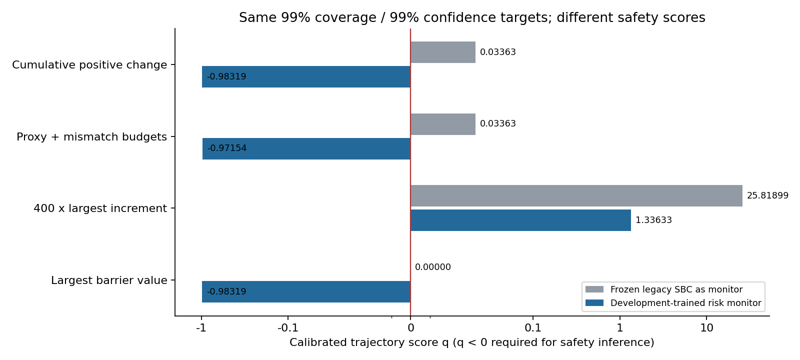
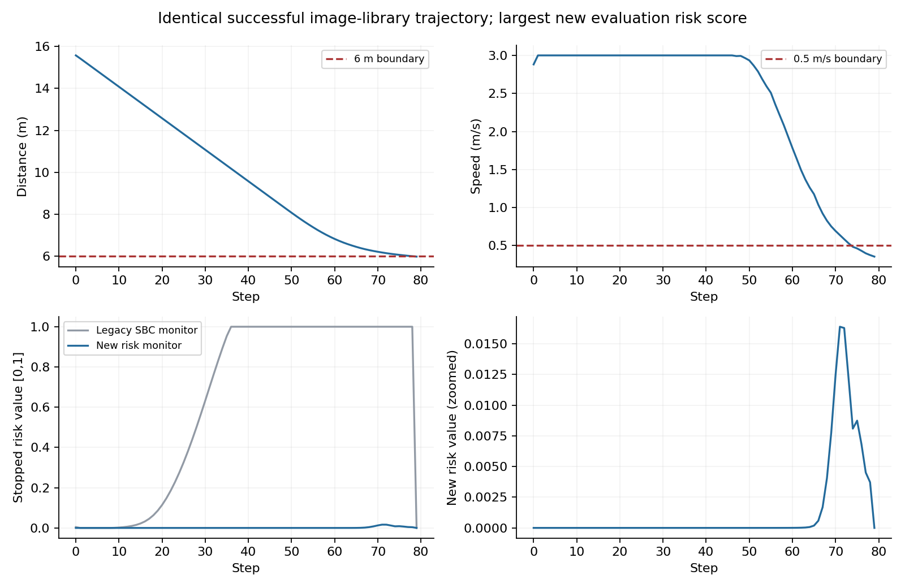
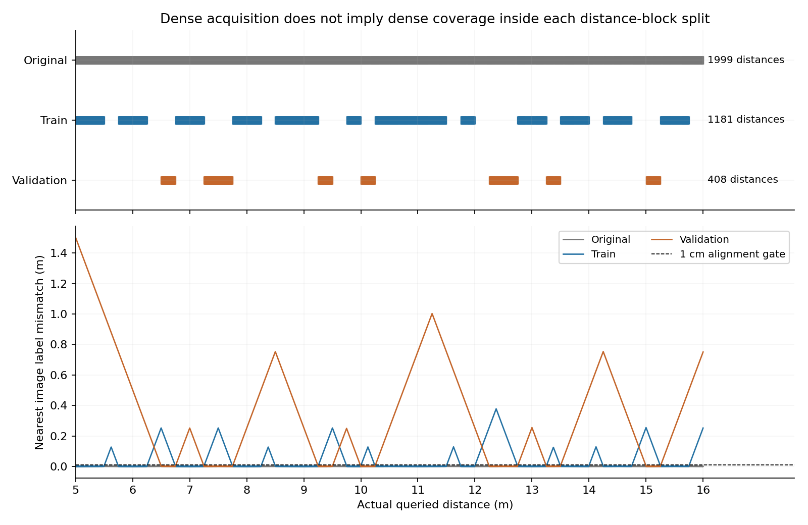

# DINO双路径与Transformer潜在预测方案完整实验说明

更新日期：2026年10月23日。本文合并说明原32维方案、Transformer潜在预测分支、其他潜在表示对照，以及后续SBC和CP实验。相关实验在10.x服务器`vt`环境完成；不同时间、不同模型和不同数据口径分开解释，不把它们拼成一条已经全部成功的流水线。

2026年10月23日状态相关包络实验已完成：固定当前native-R2的DINO、q、PPO和已有SBC，借鉴VISION-SLS式(31)拟合随距离与速度变化的物理下一速度误差上界。93条开发评估轨迹上，全局半径0.076975米/秒，状态CP参考半径的轨迹等权均值0.047821米/秒，平均减小37.87%；但整条记录覆盖从92/93降为91/93，不能称为无损改进。遗漏集中在原始天气白车的7.45至7.54米高车速状态。85项相关测试通过，未更新控制器或SBC；复用旧轨迹，不构成正式CP或无限时域保证。配置、失败点与结果见第十九节。

## 阅读顺序与最新评估更正

建议先读“背景一”理解原32维系统，再读“背景二”理解Transformer究竟增加了什么；“背景三”列出各轮实验及结论。第一至十五节保留10月20日CP实验和评估纠正，第十六节是同步轨迹对照，第十七节是进一步改为分任务、方向明确、轨迹等权和SBC相关的误差评价。

主线目标已明确回到原SPVC式的无限时域概率安全，不用400步安全保证替代。第十八节保留10月20日三个未合格的有限时域结构化候选；其中有限时域神经SBC及累计CP预算是历史候选，不是当前已确定的最终方案。本次先检查能否用状态相关包络替换全局常数，暂不重新训练屏障。概率期望与逐结果最坏情况必须分开；状态相关CP覆盖也不自动成为无限时域SBC。

最新核查确认：**原始采集数据并不稀疏。检索错位主要是距离分段划分与离线最近图片闭环结合以后，人为引入的评估偏差。** 它不等于采集时图片标签错了，也不能用来直接判断真实图像控制器的安全性。

这次已增加独立穷举检索核对和精确图像标签状态评估，并为旧仿真入口增加严格观测对齐门槛。后面“验证库653/1000不安全”和“训练库1000/1000成功”的历史结果保留，但统一限定为近似图片库仿真，不再当成同步真实图像闭环的正反证据。具体测量见第十节新增的准确性审计。

最新同步对照不再查图、不重训模型：在459条已有轨迹上，九个候选分别接入旧、新控制器。当前PPO下一步速度差的平均值，原生q为0.004919米/秒，首轮32维Transformer为0.003714米/秒；但最大值分别为0.084412和0.085299米/秒。384维预测器的平均值为0.004219、最大0.072142米/秒。**平均更小和最坏更小不是同一结论，控制器也显著影响误差尾部。** 这轮结果用于选型，不是新的CP或SBC保证。

评价协议现已进一步修正：不把q一致性与未来预测放在一个总排行榜；以每条轨迹等权的物理误差、单侧代理乐观误差和尾部为主，同时核对动作裁剪、最差外观及现有SBC评分差。新q平均误差比旧q小，但单侧最坏乐观误差从0.072443增至0.084412米/秒，说明“平均更准”不是“安全验证所需余量全面更小”。本轮没有更新模型。具体定义、数据和评价脚本见第十七节。

## 背景一 原来的32维DINO双路径方案

### 1 为什么要替换原SPVC前端

原SPVC图像代理链可以概括为：给定物理状态，通过cGAN生成代理图像，再经原来的图像处理与控制链条决定动作。真实图像与生成图像可能不一致，图像生成还会引入外观细节误差。

我们的改动是，不再要求代理先“画出一张图”。真实图像和物理状态分别变成适合控制的数字表示，再比较或控制。希望删除不必要的图像重建步骤，使代理误差更小、控制相关信息更集中。

这只是方法动机，不是自动成立的误差或安全结论。必须分别测量表示一致性、动作差、物理下一状态差，以及控制任务表现。

### 2 两条路径从哪里来

```text
真实观测路径
RGB图像 → 冻结DINOv2 → 384维图像特征 → 小投影网络 → 32维latent
                                                             ↓ 加当前速度
                                                            PPO → 动作

物理代理路径
真实物理距离 → 小q网络 → 对应的32维latent
                               ↓ 加同一个当前速度
                              同一个PPO → 代理动作

两个动作分别进入相同车辆动力学 → 比较两个下一物理状态
```

latent可以理解为“给控制器看的32个特征数字”。它不是32个明确的人造物理量，也不是生成图片。在当前简单任务中，障碍物距离是最重要的变化因素，但不能因此声称这32个数字已经表示任意驾驶世界。

q只在代理、仿真和验证中读取物理距离；它不是部署时先用真实距离代替图像。图像控制链没有先经过一维距离预测再交给PPO。

### 3 DINO和投影网络具体怎么实现

使用官方DINOv2 ViT-S/14的冻结特征，输入RGB缩放到224×224，做ImageNet均值和标准差处理，再得到384维全局特征。

“全局特征”指整张图片汇总成一个向量，通常称CLS特征。它与把图片分成许多小块、保留每块空间位置的patch特征不同。本项目这些缓存主要保存前者。

DINO本身已经是视觉Transformer，但这里的DINO负责看当前图像。后面另加的时序Transformer负责根据历史预测未来，二者不是同一个模块。

投影网络是`384→128→32`，中间用ReLU非线性。DINO权重不更新，主要训练这个较小的投影网络和q，使它们适合当前控制任务。

### 4 为什么还出现一个距离辅助头

训练时另有`32→32→1`的非线性距离读出头。它用于检查latent是否保留距离信息，并作为训练监督，避免两条路径都输出同一个无意义常数，造成“误差很小”的假象。

它**不进入部署PPO输入**。PPO读取32维latent与速度，而不是读取这个头输出的一维距离。距离MAE只说明一个读出器从特征中能恢复多少距离信息，不能单独代表控制器准确度，更不能替代下一速度残差和安全验证。

### 5 表示训练经历了哪些阶段

早期A/B发现，先分别训练再对齐的方式，一致性明显不如联合训练。随后在扩充的24000张多外观图像上做R0/R1对照，再做R2同距离分组对齐。

R0主要使用原始外观训练样本，R1使用所有允许的训练外观。相同距离的晴天、雨天、红车和蓝车应触发相近控制，因此R2进一步把同一精确距离的多外观样本放在一组训练。

R2每一批抽8个完整距离组。对同组图像计算latent均值，希望各外观接近这个均值，同时保留不同距离的可区分性。主要损失包括：

1. 从图像latent读出的距离应接近真实距离。
2. 从q latent读出的距离也应接近真实距离。
3. 同一物理距离的图像latent与q latent应接近。
4. 同距离不同天气颜色的latent应接近组均值。
5. 相距至少1米的样本不应全部挤到一起，并加入小的数值正则。

分组不变性损失权重为0.2；代码里还有独立的q到组中心项，但本次配置权重为0，不能写成所有可选项都启用了。

R2在R1基础上用AdamW、学习率0.0003训练3000次更新，训练种子7，每100次检查验证指标；保留联合更新第2600步。随后允许400次单独q拟合，但本次最佳仍是第0步，最终没有用更差的后续q覆盖它。

当时保存候选的开发指标为“图像距离RMSE除尺度，再加0.2倍相对latent RMSE”。因此R2用过验证集进行选择，该验证集不能在后续重新称为全项目从未看过的最终测试集。

### 6 扩充数据和分组对齐究竟改善了什么

| 表示版本 | 验证相对latent RMSE | 验证图像距离MAE | 含义 |
|---|---:|---:|---|
| R0 原始外观训练 | 0.788881 | 1.753420 m | 多外观和距离留出下明显不足 |
| R1 所有允许训练外观 | 0.086953 | 0.185920 m | 扩充外观和联合对齐有效 |
| R2 同距离分组对齐 | 0.076329 | 0.165559 m | 进一步压低外观差异和代理失配 |

R2在14172张训练图上的latent RMSE为0.015190，在4908张验证图上为0.055999；验证残差向量L2范数的95分位约0.594848。不同误差定义的数值不能混用：逐坐标RMSE、向量L2范数、米、米/秒不是一个单位。

这些结果支持“现有数据对表示训练有价值”，不支持“数据已经足够覆盖任意部署环境”。它们也不能证明一个固定半径覆盖未来所有图像误差。

R2的具体训练选择、完整分组误差和权重指纹见[原始R2训练记录](../../artical-F122/results/dino_expanded_v1/08_R2_group_alignment/metrics.json)。

### 7 PPO怎样训练 为什么出现多个版本

PPO根据latent和速度选动作，在解析车辆环境中反复运行，根据接近目标、时间代价、成功奖励和危险惩罚更新控制策略。

项目中至少有三种容易混淆的版本：

| 名称 | 表示和q | PPO与SBC状态 | 不能混用的地方 |
|---|---|---|---|
| 早期R2 PPO09 | 原R2坐标和原q | 早期latent控制器，采集过历史参考轨迹 | 它的轨迹和CP数值不能直接继承给之后改动的控制器 |
| minimal DINO-SPVC | 原R2表示接原SPVC后端 | PPO经过SPVC更新，保存模型复查原代码阈值通过；原读数约95.6169% | 仍未把图像q失配纳入端到端保证 |
| 10月19日native R2 | 原R2投影冻结，但使用新的latent标准化和重新拟合q | 从头训练自己的新PPO，再固定PPO训练原口径代理SBC；读数约95.9345% | 不能把旧q或未经标准化的R2 latent直接喂给新PPO |

最新native PPO输入为33维：32维按训练统计标准化的latent，加一个当前速度。物理q输入使用它自己保存的距离均值和标准差，不使用旧q的距离缩放公式。

最新PPO采用两个64单元隐藏层，学习率0.0003，rollout长度2048，batch64，每批做10轮优化，折扣0.99、GAE参数0.95、熵系数0.01。请求训练200000步，实际按完整rollout完成200704步，只训练种子7一组。

训练时一半回合走q代理，一半回合走训练图像库，以减少只在精确代理上训练、面对图像却不适应的问题。这里的图像库仍是近似训练环境，不能把训练时使用的最近图像机制当成真实图像测试。

### 8 原cGAN对照说明了什么

已有4908张相同验证图像的配对比较中，原图像链距离MAE约2.667726米，DINO辅助读出约0.165559米；一组既有配对控制比较的下一速度平均差从约0.074961降至0.006044米/秒。

这些数字有条件：旧对照使用仓库自带基础PPO，而不是已取得原论文最终保证的完整原版控制器；DINO分支也有自己的训练。因此它们支持当前实现的经验改进，不是严格只换一个模块、其他权重完全一致的架构因果证明。

另一个共同32维评价空间实验得到DINO平均差约0.0475、cGAN约0.956。这个共同评价器本身与R2任务训练有关，不能把latent RMS和原生像素RMS直接相比，也不能据此宣布所有视觉任务都优于cGAN。

更重要的是，后来审计发现某些尾部最大误差并未一起改善。项目因此把评价重点转向“米/秒的物理下一状态误差”，并单独检查整轨迹尾部，避免只用平均值或百分比说明安全。

原32维路线目前已有实际控制器、代理SBC和原代码复查结果；它不是没有运行过的概念图。但是图像代理差异与最终安全证明的连接仍未完成。

## 背景二 Transformer潜在预测方案是怎样做的

### 1 它不是把32维换成一个叫Transformer的向量

32维是表示的大小，Transformer是处理数据的网络结构。两者可以同时存在。本项目实际做过：

- 在原32维R2表示上增加时序Transformer。
- 不先压到32维，直接预测384维DINO全局特征。
- 用普通MLP、GRU、随机状态模型等作预测对照。

**这些主要是未来表示预测实验，不是已经把Transformer接入新的PPO、训练出一套新闭环和新SBC。** 10月19日训练的18个新控制器针对静态原生表示，不包含这些带历史的时序Transformer控制器。

### 2 为什么要增加历史预测

静态q只根据当前物理距离给出一个代理latent；它没有读图像历史。时序模型则看最近几帧，以及已经执行或计划查询的动作，学习“画面特征会怎样随运动变化”。

它可能保留静态距离映射缺少的时间信息，适合研究多步预测或控制规划。但历史预测更准，不自动代表对任意新动作可靠，也不自动给出安全证书。

### 3 训练样本从哪里来

使用旧第13步的459条完整开发轨迹，轨迹中保存了每帧DINO特征、真实距离、真实速度和实际动作。先检查相邻状态是否符合原动力学，防止断帧或状态重置被错误拼成时间序列。

首轮按整条轨迹分为367条训练、92条验证，产生28502个训练窗口、7085个验证窗口。每个窗口包含3帧历史及未来3帧目标。窗口不跨轨迹，不跨无效帧。

原时间步长为0.05秒，因此三帧历史从第一帧到第三帧约覆盖0.1秒，向后三步只有0.15秒，十步为0.5秒；不能把这样的短期预测结果外推成400步、20秒的可靠预测。

之后更严格的十步对照改成321条训练、69条模型选择、69条内部检查，分别有22641、4879、4854个有效窗口。两次划分不同，分数应分别展示。

这些旧轨迹在项目中已经反复开发使用，不是最终独立CP数据。也不能把几千个相邻窗口当几千条独立轨迹。

### 4 单个样本的数据流

32维版本的输入和输出如下：

```text
过去三帧真实图像 → 冻结DINO → 冻结R2投影
                            ↓
                 z(t-2)、z(t-1)、z(t)
过去/当前速度 → v(t-2)、v(t-1)、v(t)
动作查询     → a(t-2)、a(t-1)、a(t)
                            ↓
             每个时刻形成一个token，再按时间排列
                            ↓
           线性映射到128维 + 学习时间位置编码
                            ↓
           两层、四注意力头的因果Transformer
                            ↓
             预测下一时刻的32维latent
```

默认拼接速度和动作时，每个token有34个数字：32个latent、一个速度、一个动作。384维版本相应为386个输入数字。这里每一帧是一个全局时间token，不是把图像切成许多空间patch后逐块预测。

速度和动作都除以3调整尺度。输入表示的均值和标准差只从训练轨迹拟合；不从验证或未来目标里取得标准化统计。

### 5 注意力 因果掩码和残差输出是什么意思

注意力让模型学习预测时应该更关注哪一帧、哪一部分历史信息。四个头可以同时计算不同的关注方式，但并不意味着已经有四种可解释物理规律。

因果掩码禁止一个时间位置读取其后的token，防止把未来信息当成历史。模型参数为两层Transformer、宽度128、前馈宽256、GELU、dropout为0。

输出不是从任意随机向量开始，而是“当前表示加上一个预测修正量”：`下一表示≈当前表示+0.1×网络修正`。输出头初始为0，所以初始模型相当于“先假设下一帧不变”，再学习运动造成的变化。

模型有273952个参数；首轮小MLP有33824个参数。因此首轮“Transformer优于MLP”并不是严格排除了参数量影响，后面才补了269984参数的匹配MLP。

### 6 怎样预测三步或十步 有没有偷看未来图片

第一步预测出latent后，把它放回历史队列，去掉最老一帧，再预测第二步。这叫自回归递推：后一步会吃到前一步自己的预测，因此错误可能逐步积累。

预测器不会读取未来真实图像、未来真实距离或未来真实速度。需要的未来速度由当前速度及查询动作通过已知动力学递推。

但多步预测需要未来动作序列。本轮各方法都使用同样的记录动作作为开环查询。这表示“假如接下来采取这一组动作，预测画面如何变化”，不表示部署时已经知道未来PPO会选什么动作。

因此它还不是一个完整的新策略闭环。原数据来自同一个旧策略，动作覆盖有限，不能仅凭开环误差较低就宣布对全新动作计划也正确。

### 7 首轮训练目标和模型选择

三组学习模型分别为32维MLP、32维Transformer和384维Transformer。各训练1200次更新，batch256，AdamW学习率0.0003，weight decay为0.0001，梯度范数上限1，训练种子7。

训练损失是未来三步预测特征与真实特征的均方差。每200步以及首末步在验证窗口评价，按共同R2坐标下的三步RMSE选择权重；初始不训练模型也允许成为候选。

384维模型预测后，为了交给同一个控制器比较，需要先通过冻结R2投影读到32维。这个读出步骤有偏向原R2任务的局限，不能把384维原空间MSE直接和32维MSE数值相比。

距离辅助头只用于测量预测表示保留的距离信息。冻结PPO用于测量：预测latent和目标真实图像latent，在同一个物理速度下，会给出多大的动作差与下一速度差。它们都不在这轮被重新训练。

离线测量时，为了隔离表示预测造成的差异，PPO诊断接口读取目标时刻的真实速度。这是评价所用的共同状态，不是提供给预测器的未来输入，也不能据此声称完成了不读速度的新控制系统。

### 8 首轮到底得到什么

以下是在同一批7085个验证窗口上的一步预测；速度差是把两种目标时刻表示送入相同PPO后，再经过一步动力学得到的差，不是预测器直接输出车速的误差。

| 方法 | 共同latent RMSE | 距离读出MAE | 下一速度差MAE | 下一速度差最大值 |
|---|---:|---:|---:|---:|
| 保持上一表示不变 | 0.052262 | 0.138535 m | 0.012151 m/s | 0.177296 m/s |
| 32维MLP | 0.037494 | 0.077549 m | 0.007574 m/s | 0.175561 m/s |
| 32维Transformer | 0.031966 | 0.072203 m | 0.007026 m/s | 0.177169 m/s |
| 384维全局Transformer | 0.048153 | 0.153791 m | 0.008156 m/s | 0.177169 m/s |

32维Transformer相对小MLP，一步平均下一速度差降低约7.23%；第三步的平均差为0.008976，MLP为0.009627，384维分支为0.011015米/秒。

但最坏误差没有因此更小。给q额外提供目标时刻真实距离时，其最大后继差约0.164149米/秒；它不是同输入预算的预测器，不能据此简单判定谁架构更强，但足以提醒我们不要只看Transformer均值改善。

这里的0.072203米不能与R2静态验证的0.165559米直接相减宣布估距改善：前者是轨迹留出窗口上的未来预测读出，后者是另一组静态图像，任务和样本都不同。

对应的[首轮模型指标](../../artical-F122/results/transformer_pilot_20261018/metrics.json)和[训练配置](../../artical-F122/results/transformer_pilot_20261018/config.json)均保留；这部分使用实际轨迹中保存的同步帧，不用最近图片查找，不受后面距离分段检索缺口的同一种评估偏差影响。

### 9 是否一定要额外拼接速度

做过三类处理：直接拼接速度、不显式输入速度、把速度单独线性编码后加到token中。还做过只用图像历史、既不输入速度也不输入动作的分支。

| 32维预测分支 | 一步下一速度差MAE |
|---|---:|
| 直接拼接速度和动作 | 0.007026 m/s |
| 无显式速度 有动作 | 0.006768 m/s |
| 速度独立编码后相加 有动作 | 0.006987 m/s |
| 仅图像历史 | 0.006814 m/s |

短期预测中不显式给速度也能得到接近甚至略好的均值，可能与图像历史提供运动线索、旧策略数据相关性以及大量高速样本有关。它不能推出整个控制器不需要速度：这些实验的PPO测量接口仍读取真实速度。

也不能因为网络叫Transformer就默认它自动有车速信息。若两张单帧图像看起来相同，但车辆速度不同，安全动作可能明显不同。无速度控制系统需要另行定义历史信息和训练测试，目前没有完成。

### 10 更严格的十步预测和任务辅助目标

十步对照把普通MLP、参数匹配MLP、Transformer、无显式速度Transformer、GRU、简化RSSM、提升坐标线性模型、任务辅助Transformer和PCA表示Transformer放到同一321/69/69轨迹划分中比较。

每组800次更新，batch128，学习率0.0003。任务辅助Transformer结构没有变，只是在特征预测损失上增加两项：预测latent应能由固定辅助头读出正确距离，预测latent送入固定PPO时应给出接近真实图像latent的动作。权重分别为1和0.1。

距离标签只作训练监督；固定PPO不更新，梯度只是经过PPO回到预测器。这个过程不是PPO强化学习联合训练，也不是完整TD-MPC或Dreamer复现。

| 方法 | 一步平均下一速度差 | 第十步平均下一速度差 | 第十步最大差 |
|---|---:|---:|---:|
| 小MLP | 0.006166 m/s | 0.013119 m/s | 0.207102 m/s |
| 参数匹配MLP | 0.006149 m/s | 0.011249 m/s | 0.207102 m/s |
| 普通Transformer | 0.006170 m/s | 0.011872 m/s | 0.207102 m/s |
| 无显式速度Transformer | 0.006070 m/s | 0.009946 m/s | 0.207102 m/s |
| 任务辅助Transformer | 0.005916 m/s | 0.008607 m/s | 0.207102 m/s |
| GRU | 0.007007 m/s | 0.013253 m/s | 0.207102 m/s |
| 简化RSSM | 0.006541 m/s | 0.014868 m/s | 0.207102 m/s |
| 提升坐标线性模型 | 0.006464 m/s | 0.014094 m/s | 0.207102 m/s |
| PCA32加Transformer | 0.011615 m/s | 0.016480 m/s | 0.231077 m/s |

任务辅助目标让同结构Transformer第十步平均后继差降低约27.51%，但最大值没有改善。参数匹配MLP也强于普通Transformer的一部分指标，因此“只要加注意力就必然更准”不成立。

这些分支是核心机制的小型适配：RSSM没有复现完整Dreamer代理；PCA全局特征不是完整patch世界模型；任务辅助损失也不等于训练了奖励、价值或MPC规划器。

完整指标和按轨迹配对统计见[十步潜在预测对照](../../artical-F122/results/latent_methods_benchmark_20261018_run1/metrics.json)。

### 11 Transformer有没有通过之前那个速度半径检查

后来又在共同的459条旧参考轨迹上审计了54个路径与预测长度组合。它们是复用旧策略分布的经验尾部检查，不是每个候选自己运行后的独立CP保证。

| 固定路径 | 平均下一速度差 | 同配方参考半径 |
|---|---:|---:|
| 旧minimal R2 | 0.010053 m/s | 0.178398 m/s |
| 首轮Transformer32 一步 | 0.007638 m/s | 0.190757 m/s |
| 首轮Transformer32 三步 | 0.009279 m/s | 0.199095 m/s |
| 任务辅助Transformer 一步 | 0.007951 m/s | 0.190696 m/s |
| 任务辅助Transformer 十步 | 0.008737 m/s | 0.220587 m/s |
| cGAN经共同R2控制接口 | 0.063647 m/s | 0.300000 m/s |

预测路径跳过无法形成历史窗口的起始时刻；静态q路径可检查所有有效当前状态。因此这张表用于看各路径的尾部范围，不是所有行完全同样本的严格架构消融。cGAN这一行也不是其原生最终控制器。

Transformer均值较小但参考半径仍未优于旧minimal，不能用它直接解决0.15米/秒包络问题。10月19日新native R2的0.084412是新q、标准化和新PPO的整体结果，与本节旧actor下的时序模型不是只差一个编码器的比较。

这部分数据来自[全路径参考误差审计](../../artical-F122/results/all_path_cp_reference_20261018_v1/metrics.json)，不能与前一张不同内部检查划分的表混为同一次测试。

### 12 这条分支做到哪里 还缺什么

已完成历史窗口、因果预测、自回归多步、速度消融、参数匹配、任务辅助目标和物理单位误差评价；没有用Transformer预测器从头训练一套带历史的PPO和SBC，也没有新的在线CARLA闭环证书。

如果将来把它真正放进控制链，需要明确未来动作来自哪里、历史怎样进入控制与验证、预测错误如何覆盖。原二维物理状态屏障不一定自动足以描述带隐藏历史的系统，必须给出相应抽象或误差连接，不能只换一条网络连线。

当前最快主线仍保留32维DINO双路径。Transformer目前是有正面多步预测线索、但尾部误差与安全接口尚未解决的研究分支，而不是已经成功替换32维方案的新系统。

## 背景三 其他已经尝试的路线与当前主线的关系

| 路线 | 曾经要解决什么 | 实际进展与保留边界 |
|---|---|---|
| 单一语义距离前端 | 先删除cGAN，保留原SPVC后端 | 跑通过原口径训练；之后主线转向DINO双latent，不把早期一维语义结果混入当前模型 |
| safety filter 与standalone蒸馏 | 让控制器在误差下更安全 | 一些仿真配置成功，但过滤器可能慢或停滞；当前native PPO运行时没有这个过滤器 |
| 自由神经SBC反复调下降条件 | 直接学习全域安全屏障 | 遇到终止区、不可恢复区、低速边界及误差包络冲突；没有把低训练损失当成证书 |
| 手工可恢复集与有限状态屏障 | 借助当前AEBS物理结构取得局部保证 | 场景专用性强，按用户要求不作为当前通用主线 |
| 可微QP层 | 根据控制器和屏障约束调整动作，并尝试联合学习 | 完成诊断和部分实验；暴露松弛与验证实现问题，当前DINO最小主线没有启用QP |
| MFNBC式安全反馈 | 将采样屏障条件反馈给RL | 做过联合更新和多步对照，未得到稳定优于保留模型的安全收益；不是本轮风险评分器训练 |
| CP全局速度误差盒 | 将图像代理差异纳入鲁棒SBC | 半径允许的持续最坏序列可碰撞，不能靠盲目增加SBC训练解决 |
| 轨迹场景SBC与轨迹级CP | 用实际运行轨迹处理分布安全问题 | 历史版本有正面统计结果，但模型和数据版本不同；本轮重新对固定新PPO明确模拟器范围 |
| PCA AE VAE VICReg 多维表示 | 不预设32维一定最好 | 完成16至128维和DINO384的原生表示及新PPO比较；当前R2综合较好，不是所有任务上的普遍排名 |

这些路线没有全部串在当前框架里。更早的逐项配置、失败和工程修复保存在[完整工作进展](当前主线_完整工作进展.md)；表示与时序模型的完整表格在[潜在表示与世界模型对照实验](Transformer世界模型与32维方案对照实验.md)。

本轮继续推进的是下面的SBC与轨迹风险CP实验，不是同时重启所有分支。下面保留原实验结果，并在第十节补入更准确的距离覆盖和同标签状态审计。

## 一 先看结论和当前进度

本轮没有继续增加CARLA图像，也没有重新训练PPO。我们改变的是安全评估方式：从“所有时刻都允许出现同一个最坏误差”，改成“检查一条完整轨迹实际消耗了多少风险余量，再校准这个整轨迹分数”。目标覆盖率和目标置信度都仍为99%，没有通过降低要求制造通过。

实际结果有好有坏，必须放在一起理解：

| 实验 | 做了什么 | 得到什么 |
|---|---|---|
| 同状态对照 | 固定图像、当前距离和速度，比较图像与q动作造成的下一状态及屏障值 | 37828个旧轨迹状态中，图像额外把“代理不升”变成“图像上升”的情况只有1点；73800个静态审计状态中为0点。这不是全局证明 |
| 原SBC直接用于整轨迹评分 | 不训练任何模型，检查新PPO在训练图像库中的完整轨迹 | 任务全部成功，但累计风险分数校准阈值为`+0.033631`，不满足小于0，不能据此推出安全 |
| 只修正轨迹风险评分器 | PPO、q、DINO全部冻结，只用200条开发轨迹训练一个单独的小网络 | 新的累计风险分数阈值为`-0.983190`；1000条独立评估轨迹全部成功，分数覆盖率99.7%。结论仅限固定图像库仿真分布 |
| 保守程度对照 | 对同一个新评分器，比较实际累计增加和“最大一步增加×400” | 实际累计方法通过；最大一步乘400的阈值为`+1.336335`，仍不通过 |
| 图像库变化压力检查 | 不改变模型、阈值或1000个起点，把检索图像换成验证集图像 | 347条成功、653条不安全；原分数阈值覆盖率为0。原统计保证不能直接迁移 |
| 检索错位反事实 | 不用图像latent，只让q读取检索图片的距离标签 | 1000条都不安全，说明检索错位本身就足以破坏这个仿真闭环，不能把上一行全部归咎于DINO |
| 检索几何与代码独立复核 | 检查原始标签、各子集覆盖，并对82437次检索穷举核对 | 原始数据最大采样间隔约6毫米；分段后验证库最大内部缺口约2.006米。没有发现返回非最近图片的代码错误 |
| 更准确的同标签状态评估 | 不检索，不改标签距离，使用全部训练与验证图像 | 完整验证147240个状态对的速度误差MAE为0.007391、最大0.141350米/秒；新增图像单独一步不安全为0，但不代表多步安全 |

**当前可以说：在固定训练图像库仿真器内，已经跑通“冻结控制器→完整轨迹→风险评分→独立概率校准→独立评估”的最小流程。当前不能说：新控制器已经获得真实CARLA图像闭环的安全证书，或者新小网络满足原SPVC式的全域随机屏障条件。**

进度勾选：

- [x] 不新增采集，复用现有图像和DINO特征。
- [x] 核对新PPO、新q和已保存SBC的版本与哈希。
- [x] 完成同状态的速度误差和屏障影响实验。
- [x] 完成原SBC评分失败的定位。
- [x] 只用开发轨迹训练单独的风险评分器，原SBC保留。
- [x] 用新的随机起点完成459条校准和1000条评估。
- [x] 完成更保守评分方法和分布变化对照。
- [x] 完成检索错位与latent失配的拆分。
- [x] 核查全量采集覆盖、分段缺口和穷举最近邻，默认阻止不合格近似图片库冒充同步观测评估。
- [x] 补齐全部训练与验证图像的精确标签状态评估，补充32维表示及Transformer历史实验。
- [ ] 将这些仿真结论迁移到真实、状态同步的图像闭环。
- [ ] 若要求原SPVC式条件证书，补足相应屏障条件及图像误差连接证明。

## 二 为什么这次不再只盯一个速度误差半径

我们之前衡量的误差是：同一当前物理状态下，图像路径与q代理路径分别给出动作，动作经过车辆动力学以后，两个下一速度差多少。

这个误差有用，但只说明“代理和图像相差多大”，不说明“控制器能不能承受这个差异”。距离障碍物15米时，多一点速度误差可能无碍；距离6米、速度又接近危险阈值时，同样的误差可能决定是否进入不安全区。

旧做法把所有状态、天气和时刻的误差概括成一个对称范围，例如每一步都允许`[-0.0844,+0.0844] m/s`。这样会额外允许一条可能在真实图像中根本不会出现的序列：从开始到结束，每一步都持续取最坏正误差。

这个强要求已经有反例。它否定的是“该误差盒里的每一种序列都安全”，不是直接证明真实图像策略必然碰撞，也不是否定所有概率安全方法。

本轮换一个问题：不要求每一步风险都绝对不增加，而是计算完整运行过程一共增加了多少，再问这种累计增加在目标分布下是否足够小。这样保留了误差出现的位置和时间关系，不把一次偶发的最大增加机械复制400次。

## 三 本轮实际使用了哪些模型

### 3.1 控制链条没有改

图像路径是：

```text
已有CARLA RGB图像
    ↓ 冻结DINO，特征已缓存
384维特征
    ↓ 原R2投影，再使用固定的native标准化
32维latent
    ↓ 拼接当前真实速度，形成33维输入
固定的新PPO
    ↓ 动作限制在[-3,3]
解析车辆动力学
    ↓
下一物理状态
```

代理路径是：

```text
当前真实距离（米）
    ↓ 使用新q训练时保存的均值和标准差归一化
新q网络
    ↓ 输出与图像路径相同坐标定义的32维latent
拼接同一个当前速度
    ↓ 同一个PPO、同样的动作限制和动力学
代理预测的下一物理状态
```

这里没有距离解码头进入PPO。32维latent不是先被压成1维预测距离再控制。真实距离用于仿真状态、q代理和评估标签；图像策略读取的是latent与速度。

速度仍是明确的外部输入。本轮没有训练“只靠单帧图像估计速度”的控制器。

### 3.2 冻结的具体版本

| 部分 | 文件或设置 |
|---|---|
| 原R2投影 | `results/dino_expanded_v1/08_R2_group_alignment/dino_safety_latent.pt` |
| 新q及native标准化 | `results/native_representation_dimensions_20261019_v1/historical_R2.pt` |
| 新PPO | `results/native_controllers_speed_residual_20261019_v1/historical_R2/native_ppo.zip` |
| 原口径SBC | `results/native_R2_sbc_stage2_legacy_20261019_v1/sbc.pt` |
| PPO原训练 | 单个训练种子7，实际200704步；本轮不再更新 |
| 原SBC网络 | 输入2维物理状态，隐藏层16、8，tanh，最后softplus，共193个参数 |

新PPO的SHA256为`01a1173645051eb7e96480bd2a21a948c6fb8b3a860263784d5a10ad8dd4c373`。原SBC的SHA256为`add61cae950cb967ddaa9845cdd37d54b4d877c39d4856442df7f86214f26249`。

原SBC在原代码中的检查结果仍保留：硬违反1/10000、实际窄带检查112点、原代理概率读数95.9345%。它没有因为本轮实验被覆盖，也不能把这个读数移植为本轮图像路径的保证。

### 3.3 这次新训练的究竟是什么

只新训练了一个同样为`2→16→8→1`的小型**轨迹风险评分器**。它接收当前距离、速度，输出一个非负数；数值越高表示评分器认为更靠近风险。

它借用了神经屏障的表达形式，但训练和最终验收方式已经改变。因此本文不把它直接称为“原SPVC定理已经验证的新SBC”。PPO动作不经过这个评分器修正，它不是安全过滤器，也不是QP层。

### 3.4 阅读时遇到这些词怎么理解

| 术语 | 在本实验中的通俗含义 |
|---|---|
| DINO | 预训练的图像特征提取网络，把图片变成384个数字；本轮不重新训练它 |
| latent | 给控制器使用的一组图像特征数字，本轮为32个；它不是一张生成图，也不等于单独一个距离 |
| 投影 | 把384个数字变成32个数字的小网络；不是把图片投到屏幕上 |
| native标准化 | 按这一版本训练时保存的均值、标准差调整数字尺度，不能把旧坐标直接交给新PPO |
| q代理 | 物理距离到latent的小网络，让仿真和验证不必每一步生成图片；不是CP阈值q |
| PPO | 根据latent和车速决定动作的强化学习控制器，本轮保持不变 |
| SBC | 随机屏障证书，通常需要初始区、不安全区及相应期望变化条件共同成立，不只是一个神经网络文件 |
| 风险评分器 | 本轮单独训练的状态打分网络，用于整轨迹统计评分；尚不能直接等同SBC证书 |
| 冻结 | 权重不再更新，不是程序不运行；模型仍会根据输入计算输出 |
| 参数 | 网络训练时调整的权重数字；本轮风险网络只有193个这样的数字 |
| tanh与softplus | 网络中的非线性计算；这里softplus让最终输出非负，不代表因此自动安全 |
| CP | Conformal Prediction，使用独立样本校准分数范围的统计方法；它本身不替控制器刹车 |
| 校准阈值q | 完整轨迹分数的统计上界；与前面的q代理同名不同义，文中用“阈值”区分 |
| 反事实 | 为定位原因构造的对照，例如只保留检索距离错误、去掉图像latent误差；不是实车真实发生过的运行 |
| 分布变化 | 新运行的起点、图像取法、外观等规律与校准时不同；即便天气名字相同也可能发生 |
| 哈希 | 文件的数字指纹，用于确认实验没有悄悄换模型；不是模型质量分数 |

## 四 数据有哪些 各自能回答什么问题

### 4.1 现有静态图像库

原始扩充数据共有24000张图像，来自2000个距离与4种天气、3种颜色的组合。已有划分为训练14172张、验证4908张、测试4920张。

本轮读取冻结DINO缓存中的训练与验证特征，没有编码或评估最终测试集。训练库仿真的图像检索只使用14172张训练图像。验证库压力检查使用4908张验证图像，这些已经属于开发数据，不能重新包装成全新的最终测试集。

### 4.2 旧的459条轨迹

旧参考池有459条轨迹、37828个有效状态和对应DINO特征。轨迹由旧控制器采集，后来已被多次用于开发比较。

我们可以在这些相同状态上计算新PPO的两个动作，回答“新PPO面对同一图像、同一状态会相差多少”。但不能把重新计算后的动作串起来，声称旧轨迹就是新PPO实际运行产生的轨迹。

原因很简单：一旦换了某一步动作，下一状态可能改变，后面的真实图像和状态也应跟着改变。把新动作硬接到旧的下一状态，会打断闭环。

所以本轮旧459条只做逐状态配对诊断，不用它们给新PPO颁发独立轨迹CP结论。

### 4.3 不新增图像 怎样生成新PPO的完整轨迹

我们建立一个明确受限的图像库仿真器：

1. 抽取初始距离`U[15,16] m`、速度`U[2.5,3] m/s`。
2. 从12种训练库天气颜色组合中均匀选一种，一条轨迹内保持不变。
3. 每一步按当前真实距离，在该外观的训练图片中选距离标签最近的一张。
4. 把该图像对应的DINO/R2 latent与当前真实速度交给PPO。
5. 用PPO动作更新解析物理状态，再检索下一张图像。
6. 直到成功、不安全、其他终止，或达到400步。

这生成的是因果上连续的新PPO闭环，而不是在旧轨迹上替换动作。但它不是在线CARLA：图像只是库里最近的一张，并不总是当前距离真正渲染出的画面。

因此，本轮可得到的是**固定图像库仿真器内的统计结论**。它的独立性来自新的起点和外观抽样，不是新增了459张或459条CARLA画面。

## 五 物理状态和安全条件如何定义

状态是`(d,v)`：d为与目标的距离，单位米；v为当前速度，单位米/秒。动作a限制在`[-3,3]`，正动作表示制动。

每一步的动力学保持：

\[
d_{t+1}=d_t-0.05v_t,
\qquad
v_{t+1}=\operatorname{clip}(v_t-0.05a_t,0,3).
\]

本轮没有再注入独立物理过程噪声。天气和颜色通过图像影响控制动作，而不是额外变成一个任意速度扰动。

不安全条件仍是：`d≤6 m`且`v>0.5 m/s`。成功条件为距离在5至6米内、速度不超过0.5米/秒；在6米外完全停住、越界、超时分别单独统计。

“轨迹在400步内没有进入不安全区”和“成功完成任务”不是同一个要求。所有结果均分别记录终止类型；本轮训练库评估确实全部成功，而不是靠远处停车或超时冒充安全完成。

轨迹一旦触发原终止条件就停止。本报告的有限时域安全针对“到终止或400步为止”的停止过程；不声称成功终止后继续驾驶而不控制也能一直安全。

需要特别区分原SPVC中的噪声设置：原代理SBC曾在原代码假设的噪声核下学习和检查。它不等于当前图像失配的真实分布。本轮同状态实验不加该额外噪声，是为了隔离图像与q动作的差异；这里的逐点升降不能直接冒称为原随机期望条件的违反计数。

## 六 实验一 误差到底怎样影响屏障

### 6.1 输入和步骤

输入是相同当前状态s、与该状态匹配的真实图像特征，以及冻结的两个latent路径和同一个PPO。

分别计算图像动作与代理动作，得到下一状态`s_image_next`、`s_q_next`，再把两者送入同一个已保存的原SBC。

我们记录三个量：

- 速度误差：两个下一速度相减，单位米/秒。
- 屏障误差：`B(s_image_next)-B(s_q_next)`，正值表示图像路径让屏障读数更高。
- 是否额外出现上升：代理满足`B(next)≤B(current)`，图像却不满足。

这里报告计数时使用`1e-8`区分数值上升，避免浮点比较混乱；最终CP安全分数的通过条件仍是严格小于0，没有用这个容差放宽安全判据。

### 6.2 结果

| 指标 | 旧参考轨迹的同状态诊断 | 精确匹配的静态内部审计 |
|---|---:|---:|
| 当前状态对数 | 37828 | 73800 |
| 下一速度绝对误差均值 | 0.004740 m/s | 0.007707 m/s |
| 下一速度绝对误差最大值 | 0.084412 m/s | 0.140219 m/s |
| 图像减代理的屏障差均值 | -0.001022 | +0.006796 |
| 图像减代理的屏障差最大值 | +0.235687 | +1.598277 |
| 代理原本不升 图像变成上升 | 1 | 0 |

一个说明问题的静态样本是`d≈12.601 m、v≈2.8 m/s`。代理屏障变化约`-4.0348`，图像屏障变化约`-2.4365`。图像与代理的屏障差约`+1.5983`，看起来不小，但两条路径都在下降，没有因为这个差异发生“下降条件翻转”。

这说明不能简单规定“屏障误差越大就越危险”。必须同时看代理本来的余量。反过来，误差平均很小，也不能排除刚好发生在余量极小的状态上。

这些统计仅覆盖保存状态，不证明所有未来状态、所有图像或条件期望约束。

## 七 实验二 原SBC能否直接当完整轨迹的风险评分器

### 7.1 为什么要做这一步

原SBC通过的是原实现的特定检查。我们现在想用整条图像闭环轨迹进行概率验收，必须先问：原SBC沿这些实际轨迹的取值是否具有合适的含义？不能默认它天然是一个通用的“危险程度仪表”。

本轮先完全冻结它，没有先训练一个容易通过的新网络。

### 7.2 将数值变成统一的风险刻度

原SBC输出并不在0至1之间。第一轮以已保存的域下界`0.271146`和不安全区参考下界`19.833374`作固定线性归一化，再限制在0至1。

此外定义一个停止后的评分规则：进入不安全区，评分明确记为1；安全终止后记为0。这个规则用于离线轨迹评分，不改变PPO，不改变车辆动作。

**这不是宣称原神经网络在所有不安全状态天然都≥1。恰恰相反，我们显式使用已知的不安全状态标签，避免把尚未证明的神经网络区域界当成证明前提。** 后面能得到的是轨迹统计验收，而非因此自动得到传统SBC证书。

### 7.3 四种完整轨迹分数

记停止规则下的风险值为b，轨迹长度不超过H=400。

第一种，也是事先指定的主方法，是**累计正增加**：

\[
S_{\rm sum}=b(s_0)+\sum_t\max\{b(s_{t+1})-b(s_t),0\}-1.
\]

通俗理解：先算出发时已有多少风险；运行过程中只把风险上升的部分记账，下降不抵扣；看合计是否触及1。它允许某一步略有上升，只要整个过程的累计量仍小。

第二种是**代理变化与图像失配分开记账**：

\[
\Delta b_{image}=
\underbrace{b(s^+_q)-b(s)}_{代理本身的变化}
+\underbrace{b(s^+_{image})-b(s^+_q)}_{图像与代理的差异}.
\]

将右边两部分各自取正、沿轨迹相加，再加初始值减1，得到`S_decomposed`。这样可以明确看到图像失配是否已经进入安全评分。由于负项不能相互抵消，这个分数不会比主方法更乐观。

第三种是**最大单步增加乘400**：

\[
S_{Hmax}=b(s_0)+400\max_t\max\{\Delta b_t,0\}-1.
\]

它把最严重的一次上升当成每一步都可能发生，是保守程度对照，不是本轮主方法。

第四种是**整条轨迹最大风险值减1**，用于辅助观察。它记录最高到哪里，不像累计正增加那样对多次上升累计记账。

### 7.4 为什么小于0才可以连接到安全

如果一条轨迹进入不安全区，停止评分规则会让某个时刻的b等于1。从初始值加上所有正增加，至少能达到这次的风险值。因此，任何不安全轨迹都必然满足`S_sum≥0`。

于是得到严格的单向关系：

\[
S_{\rm sum}<0\quad\Longrightarrow\quad
\text{该轨迹没有进入定义的不安全区}.
\]

反过来不一定成立：轨迹明明安全，也可能因为评分器过度敏感或累计记账太保守而分数不小于0。

因此，校准阈值等于0也不能作为通过。本轮程序额外使用`q_strictly_negative`判据。通用CP辅助函数中有一个旧字段会判断“非正”，它不是这里的安全通过标准。

### 7.5 第一次实际结果

第一轮使用不同随机数据流：开发200条、校准459条、评估1000条，另外对相同评估起点运行1000条q代理闭环。

| 项目 | 实际结果 |
|---|---:|
| 开发图像库轨迹 | 200/200成功 |
| 校准图像库轨迹 | 459/459成功 |
| 评估图像库轨迹 | 1000/1000成功 |
| 评估q代理轨迹 | 1000/1000成功 |
| 图像评估平均步数 | 81.022 |
| q代理评估平均步数 | 81.727 |
| 累计正增加的校准阈值 | +0.033630748，不通过 |
| 分解预算的校准阈值 | +0.033630748，不通过 |
| 最大单步乘400的阈值 | +25.818990879，不通过 |
| 最大风险值的阈值 | 0，不通过 |

原SBC沿不少成功轨迹会升到参考不安全值以上，归一化后提前饱和到1。即使最终成功，也无法给整轨迹累计分数留下负余量。

第一轮中，图像与代理的正评分差累计甚至全为0。这不是两条latent完全一致，而是它们在误差发生处的评分经常都被截成1，失去了区分能力。不能拿这个0作为一致性成功的证据。

这说明**原口径代理SBC与这个新的整轨迹评分任务不匹配**。它不单是图像latent不一致的问题，也不能简单推成“原论文所有随机屏障理论错误”。原假设噪声核、原窄带检查与这里的确定性图像库轨迹不是同一个验证对象。

第一轮新图像库轨迹的速度误差半径为`0.074733 m/s`，比旧参考池的`0.084412`更小。但把新半径每一步持续取正，400个起点仍全部进入不安全区。仅把一个半径数字再降低一点，不能解决这里的逻辑缺口。

## 八 实验三 只修正轨迹风险评分器

### 8.1 训练数据如何进入网络

只读取第一轮的200条开发轨迹，共16242个有效转移。每个转移有当前物理状态和真实相邻的下一物理状态。

```text
开发轨迹中的安全占用状态 ──→ 希望评分接近0
明确的不安全区域合成状态 ──→ 希望评分不低于1.2
初始区域合成状态         ──→ 希望评分不高于0.01
开发轨迹的相邻状态对     ──→ 惩罚不必要的风险上升
                          ↓
                  训练单独的193参数网络
                          ↓
                  固定最后一步的网络权重
                          ↓
               再开始新的校准与评估
```

“安全占用状态”只是已经成功的开发运行实际经过的状态，并不是人工推导出来的可恢复集。没有恢复到过去依赖手工制动距离公式的路线。

随机生成不安全状态和初始状态是在已有解析状态空间内取样，不是重新采CARLA图像。

### 8.2 训练目标和配置

本轮固定训练3000步，batch为1024，Adam学习率0.003，训练种子7。网络仍是2、16、8、1的tanh加softplus结构。保存最终第3000步，而不是查看校准结果后挑选最好的一步。

损失由四部分组成：

1. 让开发轨迹上的非负评分尽量低，权重20。
2. 惩罚合成不安全状态评分低于1.2的情况，平方铰链损失，权重20。
3. 惩罚初始状态评分高于0.01的情况，权重10。
4. 惩罚相邻开发状态的评分上升，权重10。

未读取校准或评估轨迹进行训练。未更改PPO奖励、动作、DINO、q、原SBC或原VT后端文件。

### 8.3 训练结果和仍存在的缺口

| 项目 | 结果 |
|---|---:|
| 训练有效转移 | 16242 |
| 开发占用状态的评分均值 | 0.000511843 |
| 开发占用状态的评分最大值 | 0.016088927 |
| 不安全网格检查点 | 10000 |
| 神经网络原始输出低于1的点 | 16 |
| 不安全网格原始输出最小值 | 0.213062689 |
| 训练循环用时 | 9.12秒，不含连接和加载 |

最后两项非常重要：**新神经网络本身还不是满足全域区域条件的SBC。** 我们没有把16点忽略成零，也没有用有限网格替代连续域证明。

后续轨迹评分之所以仍可使用“不安全轨迹分数非负”的推理，是因为评分规则明确把真实不安全状态标为1，而不是因为这个神经网络的全域不安全下界已经被证明。因此这条分支应称为“带神经风险评分器的轨迹级统计验收”。

这个区别不能省略。否则会把一个合法的分布统计结论，误写成尚未取得的传统神经屏障证书。

## 九 实验四 用新的轨迹校准 不沿用第一轮的数字

### 9.1 为什么换随机起点

第一轮结果已经帮助我们决定修改评分器，因此第一轮校准结果不能再作为“修改后尚未查看的独立验收”。第二轮冻结最终评分器后，使用新的数据流：开发种子8101、校准8102、评估8103。

这些不同种子用于区分数据用途，不是做一堆训练随机种子的性能搜索。PPO没有重训，风险评分器也只按预定预算训练了一次。

新生成的第二轮200条开发轨迹只作报告，没有再用于修改网络。新459条用于校准阈值，独立1000条用于检查覆盖和任务表现。

### 9.2 覆盖率和置信度是什么意思

覆盖率目标99%表示：在所登记的仿真轨迹分布中，新轨迹分数落在校准阈值以内的概率至少99%。

置信度目标99%表示：随机抽取校准样本得到上述覆盖结论的可靠程度。它不是每条轨迹自己的安全概率，也不应与覆盖率机械相乘。

本项目沿用的容忍界排序方法，在459条、`epsilon=0.01`、`beta=0.01`时选择最大分数作为阈值，达到的置信度为`0.9900790258`，即约99.008%。程序在生成轨迹前先检查样本量是否足够，没有看到结果以后改变这些参数。

独立性单位是整条轨迹。一条轨迹内部的误差可以随状态变化、可以相关；没有假设每一步误差独立，也没有计算`0.99^400`。

这里的`q=-0.98319`是无单位的风险分数阈值，不是速度半径，不代表“安全概率98.319%”。概率目标来自99%的统计设置，以及分数小于0能推出安全的逻辑关系。

### 9.3 第二轮完整结果

| 项目 | 结果 |
|---|---:|
| 新开发轨迹 | 200/200成功 |
| 新校准轨迹 | 459/459成功 |
| 新评估图像轨迹 | 1000/1000成功 |
| 相同起点q代理轨迹 | 1000/1000成功 |
| 图像评估平均步数 | 81.051 |
| q代理评估平均步数 | 81.756 |
| 图像评估不安全 停车 超时 越界 | 均为0 |
| 图像评估速度误差绝对均值 | 0.005436 m/s |
| 图像评估速度误差绝对最大值 | 0.074755 m/s |
| 校准的整轨迹速度半径 | 0.074762 m/s |

四种风险分数的结果为：

| 方法 | 校准阈值q | q严格小于0 | 独立1000条分数覆盖率 |
|---|---:|---|---:|
| 累计正增加，预先指定的主方法 | -0.983189864 | 是 | 99.7% |
| 代理与图像失配分开记账 | -0.971536661 | 是 | 99.9% |
| 最大单步增加乘400 | +1.336334612 | 否 | 100% |
| 轨迹最大风险值减1 | -0.983189864 | 是 | 100% |

“覆盖100%”并不自动等于“能推出安全”：第三行虽然分数全落在阈值内，但这个阈值仍为正，不能用分数小于0的推理。

主方法预先确定，其他方法是解释性对照，没有在四者中事后挑一个最漂亮的作为唯一主结果，也没有声称四个统计结论共同具有99%的联合置信度。



图中横轴在正负两侧采用对称对数刻度，红线是0。右侧为不能通过安全推理的分数，左侧为满足负阈值条件的分数。不同评分器经过不同固定归一化，不能把数值变化解释成物理速度误差降低了多少倍。

### 9.4 图像误差是否真的进入新分数

进入了。分解预算中，图像与q造成的正屏障差沿轨迹累计，第二轮校准轨迹的均值约0.005118、最大0.021429；评估轨迹均值约0.004960、最大0.022829。它不是直接把图像误差删掉。

包含这部分误差的分解预算阈值仍为负，说明在这个固定仿真分布中，观测到的图像失配没有耗尽该评分方式的余量。

但这不是一个对任意状态误差分布成立的条件期望界，也不是把该统计量直接加到原95.9345%读数上。

### 9.5 和只统计零事故有什么区别

1000条评估轨迹零事故，直接使用单侧精确二项置信界，也可以得到固定仿真分布下99%置信度的事故概率上界约`0.004595`，即0.4595%。这个结论无需神经屏障。

因此不能声称“只有本方法才看到了概率安全”。本轮风险评分提供的是风险变化和图像代理失配的可分解表达，以及一个可校准的连续轨迹指标；它是否能带来超越直接统计的研究价值，还需要后续证明与比较。



这张图在第二轮评估中选取累计风险分数最大的一条轨迹，仅用于展示，不用于选模型。上下各图使用同一条轨迹：距离、速度最终满足任务要求，但原SBC评分很早饱和到1；新评分器主要在制动末期出现小峰值。右下角单独放大，避免把小风险变化画成完全为0。

## 十 实验五 改变图像库以后结论能否保持

### 10.1 为什么还要做压力检查

如果只写“1000条全成功、CP通过”，很容易误以为已经解决真实图像泛化问题。我们因此固定模型、阈值和第二轮评估的1000个起点，只把检索图片池换成验证库。

这是一项分布变化诊断，不是另一份同分布独立验收。没有重新校准阈值，也没有根据失败去修控制器。

### 10.2 实际结果

| 条件 | 成功 | 不安全 | 平均检索距离错位 | 最大检索距离错位 |
|---|---:|---:|---:|---:|
| 训练图像库 | 1000/1000 | 0/1000 | 0.050160 m | 0.378329 m |
| 验证图像库 | 347/1000 | 653/1000 | 0.252977 m | 1.002936 m |

原主方法阈值`-0.983190`在验证库轨迹上的覆盖率为0，负分数轨迹比例为34.7%。所以不能把训练库的统计界直接写成验证库、在线CARLA或任意天气地图的保证。

注意：两边天气颜色仍来自相同12种组合。仅仅天气颜色集合相同，并不代表完整闭环分布相同。图片的距离分布、检索误差和反馈访问状态都可能改变。

### 10.3 不能直接说这是latent表示失败

图像库仿真器选到的是“最接近”的图片，而不是真正当前状态的图像。验证库更稀疏，距离错位更大。因此失败同时可能受到两条因素影响：图片与真实状态不匹配，以及图像latent与其标签对应的q latent不匹配。

下一项实验专门分离这两点。

### 10.4 为什么采了这么多图片 还会有一米错位

2026年10月20日进一步核查后，原因已经具体到原始标签和划分代码，而不是笼统猜测数据不足。

原采集每种外观有2000条距离记录：5至10米一段、10至16米一段，每段1000点。10米被两段各采一次，所以不同距离实际为1999个。4种天气乘3种颜色形成12种外观，因此总量是24000张，不是24000个不同距离。

原始全量每种外观的最大距离间隔约0.006006米，最近图片的理论最坏距离偏差约0.003003米，即3毫米。**全量原始采样并不稀疏。** 本次只读取全量标签核查几何，没有编码、推理或训练最终test图像。

问题出在后续用途：数据准备脚本把5至16米分成44个0.25米区间，按完整距离段分到train、validation和test，分别26段、9段、9段。它保护了训练验证隔离，避免几乎一样的相邻图像泄漏，但也让每个子集缺少完整的距离区间。

同距离的所有天气和颜色都在同一个子集，因此多外观并不能补上被分走的距离。这不是删掉了原图，而是查找时正确地不允许访问其他分组的图像。

每种外观的实际几何为：

| 用于查找的标签池 | 不同距离数 | 最大相邻距离间隔 | 在5至16米全域的理论最坏最近图像错位 |
|---|---:|---:|---:|
| 原始全量，仅做标签几何核查 | 1999 | 0.006006 m | 0.003003 m |
| 训练子集 | 1181 | 0.756757 m | 0.378378 m |
| 验证子集 | 408，409条记录因10米重复 | 2.006006 m | 1.501502 m |

验证库最小标签已经是约6.501502米，最大约15.249249米；全域最坏错位出现在缺乏图像的边缘。它最大内部缺口则位于约10.246246米至12.252253米。比如真实状态为11.25米，验证库只能取约10.246米或12.252米的画面，错位就约1米。

训练库的最大缺口约为11.993994米至12.750751米，因此即使训练库回放1000次成功，也不代表它提供了精确当前图像。



上图每个竖线是一种已保存的距离。原始采集很密；训练和验证子集各自留出整段空白。下图显示把连续真实距离送去查图片时产生的错位。三条曲线只比较标签覆盖，不运行最终测试图像模型。

### 10.5 有没有可能是检索代码或缓存标签写错

对验证库回放的82437个实际查询，另写了一套独立的穷举方法：对当前距离和该外观全部可用图片逐一计算距离差，再直接取最小值，不使用原来的排序查找实现。

结果为：返回非最小距离的次数0，返回不同源图片的次数0。12种外观的距离覆盖情况也一致。

特征缓存中的float32距离与原始清单标签最大差约`0.000000476 m`，只是浮点存储舍入，与0.25米、1米的缺口完全不是一个量级。因此没有发现缓存行顺序、标签数值或最近邻实现造成这次大错位的证据。

这项审计不能替代原始相机位姿的实测；它证明的是保存清单、特征标签和查找结果之间的一致性，不是重新测量了每张截图的真实光学距离。

**需要更正的评估解释是：原距离分段是用于泛化检查的设计；我后来用单个分段子集模拟完整连续闭环，额外引入了图像状态不匹配。这不应被包装成DINO在真实同步画面上的泛化失败，也不能把相反的图库成功当作真实图像闭环成功。**

### 10.6 已经怎样修改 让评估更准确

第一，新增`audit_image_lookup_accuracy.py`，保存每种外观的覆盖间隔、最大缺口、穷举核对、缓存标签误差和精确配对模型指标。

第二，在旧轨迹CP入口增加严格观测对齐门槛：对每种外观检查整个5至16米距离域的覆盖半径，而不是只看已经成功的轨迹有没有遇到缺口。默认上限为0.01米。当前训练子集不满足时，程序在生成校准轨迹之前停止，提示改做精确配对评估。

1厘米是图像与状态对齐的工程质量门槛，不是安全半径、不是把危险边界改宽，也不是安全证明；即使通过该门槛，剩余错位也不能在正式证明中自动忽略。没有采用“只丢掉错位大的危险回合再报告成功率”的做法。

第三，复现旧近似图像库仿真必须显式提供`--allow-approximate-library`。它只是保留研究可复现性，不代表重新认可其为同步图像测试。

第四，主要表示与控制精度评价改为：直接取每一张图像自己的距离标签d，配上同一个速度v，在该状态计算图像动作和q(d)动作，比较下一状态。**没有最近图片查找，也不把物理状态偷偷改成检索标签来维持表面一致。**

### 10.7 新的精确配对结果

使用当前固定的新native R2 PPO，训练图像全部14172张、验证图像全部4908张，各配31个速度值，并排除已终止当前状态。

| 指标 | 全部训练图像 | 全部验证图像 |
|---|---:|---:|
| 有效图像速度状态对 | 371160 | 147240 |
| 下一速度绝对误差MAE | 0.001569 m/s | 0.007391 m/s |
| RMSE | 0.004554 m/s | 0.019073 m/s |
| 绝对误差95分位 | 0.011407 m/s | 0.045630 m/s |
| 绝对误差最大值 | 0.038653 m/s | 0.141350 m/s |
| 绝对误差超过0.15的状态对 | 0 | 0 |
| 代理下一步安全 图像下一步不安全 | 0 | 0 |
| 图像下一步安全 代理下一步不安全 | 5 | 0 |
| 两条路径下一步都不安全 | 5395 | 0 |

训练表中双方都不安全的状态对来自全距离和速度组合，不是初始区域实际运行后有5395条轨迹碰撞；其中一些状态已经过近、过快。程序没有为了让表格好看而删掉这些当前尚未终止但下一步危险的组合。

这次验证最大误差0.141350比此前内部审计子集的0.140220略大，是因为检查从2460张补齐为4908张，模型没有改变，不能把差异包装成训练退步或进步。

正确结论是：**在保存的精确图像标签状态上，新双路径具有较小的平均物理误差，目前没有观察到图像单独新增的一步危险事件。** 但有限静态状态对不能证明连续多步闭环安全，0.141350也不是已经独立校准的最终CP半径。

对应结果：[精确配对与查找几何完整审计](../../artical-F122/results/native_R2_lookup_accuracy_audit_20261020_v1/metrics.json)。本次相关40项回归测试通过，严格入口也实际确认会拒绝当前不完整的训练图片库，且没有创建伪校准输出目录。

## 十一 实验六 把检索错位与latent误差拆开

### 11.1 三个动作在同一当前状态上比较

记当前真实距离为d，检索图片的距离标签为`d_img`。对同一个速度，比较：

1. `q(d)`进入PPO，是真实距离代理动作。
2. `q(d_img)`进入PPO，是只保留检索错位的反事实动作。
3. 图片latent进入PPO，是真实的图像库动作。

三种动作分别通过相同动力学得到下一速度。总误差可以精确拆成：

\[
v^+_{image}-v^+_{q(d)}=
\underbrace{v^+_{q(d_{img})}-v^+_{q(d)}}_{检索错位贡献}
+\underbrace{v^+_{image}-v^+_{q(d_{img})}}_{图像与匹配标签q的贡献}.
\]

这个等式在速度截断以后仍成立，因为它只是三个下一速度之间的加减关系。但两个分量的绝对值不能直接相加，它们可能相互抵消。

### 11.2 同状态误差分解结果

在验证图像库闭环访问的82437个当前状态上：

| 下一速度误差分量 | 绝对均值 | 绝对最大值 |
|---|---:|---:|
| 检索距离错位 | 0.014165 m/s | 0.108815 m/s |
| 图像与匹配标签q的失配 | 0.007716 m/s | 0.100571 m/s |
| 两者合并的总误差 | 0.014343 m/s | 0.124551 m/s |

这里没有凭空把匹配误差当成零。DINO双路径失配仍然存在，但检索错位的平均影响更大；两者在部分状态上还会抵消。

### 11.3 完整反事实闭环结果

不再用图像latent，而是每一步把选中图片的标签`d_img`交给q。这样保持相同的距离检索机制，同时去掉图片latent与标签q之间的差异。

结果是：**1000条全部进入不安全区。** 对比真实图像latent的653条不安全，说明误差并非简单同向相加，图像分支有时还部分补偿了检索带来的偏差。

可以得出的结论是：**在本次验证库仿真中，检索错位单独就足以造成失败，不能把65.3%的不安全率归因于DINO表示本身。** 不能得出“所有错误都来自检索、latent已经完全没问题”。

这也解释了为什么精确同状态审计没有新增一步不安全点，而稀疏图片库的闭环却会失败：后者多了一层“当前状态与取出的图片不一致”的误差，还会通过反馈逐步改变后续状态。

## 十二 本轮安全结论的理论范围

### 12.1 有效的有限时域统计推理

对固定的图像库仿真器、固定模型、固定评分函数，独立抽取完整轨迹，校准得到阈值q。若满足统计前提并且`q<0`，则：

```text
新轨迹分数 ≤ q < 0
        ↓
由停止评分的代数关系，该轨迹没有进入不安全区
```

第二轮主方法在这个有限范围内通过。它是一种对轨迹分布的统计验收，不是对每一个可能状态、每一段任意误差序列作最坏情况证明。

### 12.2 仍未成立的结论

- 不能说真实CARLA图像路径已经达到99%安全，因为本轮没有生成当前状态同步的真实CARLA轨迹。
- 不能说原神经SBC条件已经全域满足，新风险网络在不安全网格上仍有16个低于目标值的点，更没有连续域证明。
- 不能说通过训练让PPO变安全了：PPO从始至终没变，本轮改善的是评分与验收流程。
- 不能把`q=-0.98319`转换成98.319%、198.319%或其他安全概率。
- 不能把原代理读数95.9345%与99%覆盖率直接相乘，二者尚无可用的统一证明前提。
- 不能把天气颜色的平均混合分布保证当成每一种外观、每一个状态的条件保证。
- 不能用验证库失败认定真实图像一定失败；其中图片与当前距离的错位已被实验确认很重要。

### 12.3 这与原SPVC的关系

原SPVC路线学习神经屏障与控制器，并通过规定噪声模型、区域条件和下降或期望条件获得其理论下的保证。本项目保留的原口径代理SBC仍属于这条基线，但有已记录的代码阈值、窄带和区间实现限制。

本轮新增路线不要求先证明每一个状态的屏障条件，而是将完整闭环轨迹映射成一个与不安全事件有关的分数，再做统计校准。它更容易实现有限时域、指定分布的验收，但保证形式、依赖条件和可泛化范围与原SPVC不同。

所以本轮不是“把原SPVC的严格条件略微放宽后取得同样证书”，而是清楚分开的另一种统计验收分支。用户若最终仍要求原SPVC式SBC证书，这一阶段不能算完成该目标。

## 十三 方法分别借鉴了什么

| 部分 | 来源与本轮实际适配 |
|---|---|
| 神经屏障表达和固定代理SBC基线 | 原SPVC代码；旧基线保留，不覆盖 |
| 图像与物理状态通向共同latent | 项目已有semantic+latent建议及已训练R2双路径；本轮不换表示 |
| 完整轨迹作为统计单位 | 项目已有轨迹级CP校准代码；本轮不是将每一步当独立样本 |
| 风险值累计正增加评分 | 项目已有`calibrate_trajectory_sbc_cp.py`中的评分思路；本轮适配新PPO、旧SBC诊断、图像库分布和失配分解，不冒称全新理论 |
| 用规范相关分数进行统计验证 | CP用于形式验证与控制的研究框架；本轮具体分数的安全蕴含关系另作代数说明 |
| 安全占用状态和不安全状态的网络训练 | 借鉴神经屏障和项目此前轨迹场景训练；没有完整复现MFNBC的联合RL算法，也没有在本轮训练PPO |

CP与验证结合不局限于预测误差的欧氏半径，也可以围绕希望验证的性质构造分数。相关综述见[Formal Verification and Control with Conformal Prediction](https://arxiv.org/abs/2409.00536)。场景优化与CP在概率验证中的联系见[Verification of neural reachable tubes via scenario optimization and conformal prediction](https://proceedings.mlr.press/v242/lin24a.html)。

上述论文提供研究背景，不替代本报告中针对当前分数、当前数据和当前模型版本的验证。特别是本文没有将这两篇论文的全部方法复现为当前代码。

## 十四 代码和结果在哪里

### 14.1 本轮新增代码

| 文件 | 做什么 |
|---|---|
| `Aebs/dino_latent/experiment_sbc_risk_cp.py` | 核对冻结模型；同状态配对；生成因果连续的图片库轨迹；计算四种分数；校准、独立评估、全局盒反例检查 |
| `Aebs/dino_latent/train_trajectory_risk_monitor.py` | 只读取第一轮开发轨迹训练193参数风险评分器；不读取校准或评估数组，不更新PPO |
| `Aebs/dino_latent/evaluate_risk_cp_library_shift.py` | 冻结阈值换验证图片库；运行q读取图片标签的反事实；拆分检索和latent误差 |
| `Aebs/dino_latent/plot_sbc_risk_cp.py` | 画阈值对照和同一条轨迹的两个评分器曲线 |
| `tests/test_sbc_risk_cp.py` | 检查分数推理、不安全终止、数据连续性、样本量、严格负阈值和检索反事实 |
| `Aebs/dino_latent/audit_image_lookup_accuracy.py` | 核查全量标签几何和分段缺口，独立穷举最近邻，并在精确图像标签状态评价当前PPO |
| `tests/test_lookup_accuracy.py` | 检查重复外观不能填补距离缺口、独立最近邻对照和全域观测对齐门槛 |
| `Aebs/dino_latent/temporal_world_model.py` | 3帧因果Transformer与MLP预测、速度融合和自回归递推，不是DINO前端本身 |
| `Aebs/dino_latent/run_transformer_comparison.py` | 首轮32维MLP、32维Transformer、384维Transformer以及速度消融实验 |
| `Aebs/dino_latent/benchmark_latent_methods.py` | 十步、多类世界模型核心机制及参数匹配、任务辅助预测对照 |

本轮新增测试与原native控制器、SBC接口测试合计22项，在服务器最终重跑全部通过；本地Python静态编译与`git diff --check`也通过。不以“代码能运行”代替安全证明。

### 14.2 完整结果入口

- [第一轮冻结原SBC的结果](../../artical-F122/results/native_R2_sbc_risk_cp_20261020_v1/metrics.json)。
- [风险评分器训练配置与结果](../../artical-F122/results/native_R2_risk_monitor_20261020_v1/metrics.json)。
- [第二轮新评分器的校准与评估结果](../../artical-F122/results/native_R2_sbc_risk_cp_20261020_v2/metrics.json)。
- [验证库压力检查和误差拆分结果](../../artical-F122/results/native_R2_risk_cp_library_shift_20261020_v2/metrics.json)。

每轮目录都有`config.json`。完整轨迹保存在NPZ中，包含当前和下一物理状态、图像动作、代理动作、有效步掩码、天气颜色索引、风险值和误差。可以追溯到某一条轨迹、某一步，而不是只剩一行成功率。

评分器文件为`results/native_R2_risk_monitor_20261020_v1/risk_monitor.pt`，SHA256为`b90d751e26c49eb9d0322513e8cb09a5e9032ceb1604fcb96a5b955a8ee63c31`。它与旧`sbc.pt`是两个明确分开的文件。

### 14.3 复现命令

以下在服务器项目目录运行。现在优先使用第一条精确评估命令，不再默认继续近似图片库CP。结果目录必须不存在；重跑时改为新的名字。

```bash
cd /root/work_based_on_spvc/artical-F122
/opt/miniconda3/bin/conda run --no-capture-output -n vt \
  python -m Aebs.dino_latent.audit_image_lookup_accuracy \
  --output-dir results/native_R2_lookup_accuracy_audit_reproduce_v1
```

下列四步只用于显式复现前文的近似图片库实验，不用于取得同步真实图像结论；后续输入路径要对应前一步输出。

```bash
cd /root/work_based_on_spvc/artical-F122

# 第一步：原SBC的同状态诊断和图像库轨迹验收
/opt/miniconda3/bin/conda run --no-capture-output -n vt \
  python -m Aebs.dino_latent.experiment_sbc_risk_cp \
  --allow-approximate-library \
  --output-dir results/native_R2_sbc_risk_cp_reproduce_v1

# 第二步：只用第一步的开发轨迹训练评分器
/opt/miniconda3/bin/conda run --no-capture-output -n vt \
  python -m Aebs.dino_latent.train_trajectory_risk_monitor \
  --development-dir results/native_R2_sbc_risk_cp_reproduce_v1 \
  --output-dir results/native_R2_risk_monitor_reproduce_v1

# 第三步：新的校准与评估数据流
/opt/miniconda3/bin/conda run --no-capture-output -n vt \
  python -m Aebs.dino_latent.experiment_sbc_risk_cp \
  --allow-approximate-library \
  --risk-monitor-dir results/native_R2_risk_monitor_reproduce_v1 \
  --seed-offset 1000 \
  --output-dir results/native_R2_sbc_risk_cp_reproduce_v2

# 第四步：固定第三步阈值，检查图片库变化与检索错位
/opt/miniconda3/bin/conda run --no-capture-output -n vt \
  python -m Aebs.dino_latent.evaluate_risk_cp_library_shift \
  --experiment-dir results/native_R2_sbc_risk_cp_reproduce_v2 \
  --monitor-dir results/native_R2_risk_monitor_reproduce_v1 \
  --output-dir results/native_R2_risk_cp_library_shift_reproduce_v1
```

脚本没有覆盖已有输出的选项。校准与评估依赖先冻结模型再抽取新轨迹，不能反复看同一批校准结果、修改模型，再继续宣称那批结果独立。

## 十五 下一步只优先解决什么

现在不优先增加图像总数、不再原样训练全局误差盒，也不因为某个仿真通过就换掉保留基线。

优先解决的是：**用于闭环评估的图像必须与当前状态匹配，或者必须明确覆盖检索错位。** 本轮已经证实，稀疏图片库检索可以单独破坏控制，不能继续拿它的成功或失败直接代表真实图像闭环。

准确性审计进一步表明，原始图像不是不够密，而是距离分段子集不适合直接承载全域连续回放。因此现在不应默认再采一批来填补人为划分的空洞，也不应把test混入验证库、把插值latent称为真实画面，或者把物理距离改成选中图片的标签来制造匹配。

现有PPO训练时的训练库回合也带有这层近似。若下一步需要改训练，可考虑保留物理q环境的连续状态转移，再用精确图像标签状态做图像动作一致性辅助训练；这应是另一个明确登记的新版本，而不是悄悄修改本报告的冻结PPO和旧保证。本轮先完成评价纠正，没有再启动新PPO训练。

最小推进顺序是：

1. 保留本轮模型和结果，先把同步图像误差、检索错位、独立过程扰动三个量分开，不重复计算。
2. 使用现有精确匹配的图像状态对，继续检查相关危险状态的动作与评分，不把不匹配的图片冒充当前观测。
3. 如果要形成真实部署分布的统计验收，再为最终冻结模型准备相应的完整同步轨迹；届时才判断现有未使用数据能否满足前提，确有缺口再安排采集，而不是现在默认扩充全部数据。
4. 如果导师要求原SPVC式SBC证书，则单独开展对应条件与图像误差的连接证明，不能以本轮CP验收代替。

可以对导师这样概括：

> 我们发现问题不只是误差半径偏大，而是把最大误差重复施加到每一步，形成了过强、甚至包含虚假序列的安全要求。本轮保持控制器不变，用实际完整轨迹累计风险，并保留99%覆盖和99%置信要求，在固定图像库仿真分布中跑通了验收流程。但压力测试也暴露了图像库距离检索错位：换一个更稀疏的库，控制表现和校准覆盖都明显下降。因此当前进展是一个边界明确的统计验证流程，而不是已经取得真实图像闭环或全域神经SBC证书。下一步先消除或覆盖评估中的图像状态错位，再谈迁移保证。

## 十六 实验七 不查最近图片的同步轨迹对照

### 16.1 这次只检查现有数据 不重新拼造闭环

本轮继续使用已经保存的459条同步轨迹。每一帧都有当时的DINO图像特征、真实物理距离、速度和实际执行动作，原始有效记录共37828帧。这里只读这些已经存在的帧，不拿另一个距离的图片代替当前图片，也不新增CARLA采集。

这与静态24000张图的精确标签检查互相补充：静态检查回答多天气、多颜色和距离分段留出条件下的误差；同步轨迹检查允许输入真实的前后三帧，回答预测模型能否跟踪后续表示。两类样本分布不同，不能把它们的最大误差直接拼成统一保证。

需要特别区分：这些轨迹由旧PPO09采集，不是当前新PPO重新驾驶得到的轨迹。我们可以在保存状态上比较新旧控制器的局部动作，不能把替换动作后的结果称为新控制器的完整在线闭环。

开始推理前核对了两件事。第一，连续物理状态应满足原AEBS动力学：距离按当前速度前进，速度按实际动作更新；第二，把保存的图像特征交回原采集控制器，应重现记录动作。这是在核对“确实是对应的帧和标签”，不是重新从图库检索一张相似图片。

### 16.2 静态代理与未来预测分别在做什么

对于目标时刻`t+h`，先从保存轨迹读取对应的真实图像特征，经冻结投影得到`真实z[t+h]`。下面的候选给出不同的替代表示：

| 候选 | 实际输入 | 输出和任务 |
|---|---|---|
| 原q32 | 目标时刻的真实物理距离 | 原R2坐标中的32维表示；检查静态双路径一致性 |
| 新q32 | 同一个目标距离 | 新标准化q输出，再转换回原R2坐标；仍是静态一致性 |
| 保持最后一帧 | 时刻t实际图像的32维表示 | 假定未来表示不变；用作不学习的对照 |
| 参数量匹配MLP | 前三帧32维表示、速度和动作查询 | 预测未来表示；检验是否必须使用注意力结构 |
| 普通32维Transformer | 相同历史和动作查询 | 在32维空间预测未来表示 |
| 任务辅助32维Transformer | 相同输入 | 训练时额外关心动作与物理后果；本轮权重冻结 |
| 无显式速度32维Transformer | 前三帧表示和动作查询 | 不向预测器显式输入速度；末端PPO仍读取速度 |
| 首轮32维Transformer | 首轮训练的三帧32维预测器 | 与首轮384维方案保持训练轮次来源一致 |
| 首轮384维Transformer | 前三帧标准化DINO特征、速度和动作查询 | 先预测384维特征，再经冻结R2投影进入同一控制接口 |

静态q使用目标真实距离，预测器没有这个输入。因此这不是“给所有算法相同信息，看谁更聪明”的竞赛。它比较的是不同模块在各自用途中的失配：q用于物理代理，Transformer用于根据历史预测。哪一种能作为控制或验证模块，还要看它部署时能获得哪些输入。

384维预测器的结果最后经过原R2投影。这是为了接入同一冻结PPO，公平检查对这个既有接口的兼容性；不能据此给“384维原生控制系统”和“32维原生控制系统”作最终优劣排名。384维方案自己的PPO、屏障和独立校准没有在本轮训练。

### 16.3 每个误差具体怎么得到

每个候选与参考图像必须使用相同目标时刻、相同真实速度和同一个冻结控制器：

```text
保存的目标图像特征 → 冻结投影 → 真实目标latent → 控制器 → 图像动作
                                                        ↓ 相同动力学
                                                     图像下一速度

q输出 或 历史预测输出 → 替代目标latent → 同一控制器 → 候选动作
                                                        ↓ 相同动力学
                                                     候选下一速度
```

两条支路都拼接目标时刻的真实速度，目的只是隔离latent引起的动作差。预测器自身只看历史速度，递推期间不读取未来真实图像或未来真实速度；未来动作来自已记录的动作序列，是离线给定的预测查询。因此这里测量的是“表示失配经过控制器后造成多大的下一速度差”，不是“从过去凭空预测完整未来物理状态”的总误差。

定义四层指标：

1. **表示误差**：把所有候选转换到同一原R2的32维坐标，计算每个样本32个坐标差的均方根。单位不是米，不能与像素误差或米/秒直接比较。
2. **动作误差**：同一个PPO对真实表示和候选表示给出的动作之差。动作都先按原环境限制到`[-3,3]`。
3. **下一速度误差**：两条动作分别进入`v_next=clip(v−0.05×动作,0,3)`，再相减。报告平均绝对误差、95分位、最大绝对误差，以及超过0.15米/秒的次数。正误差表示候选刹车偏少、下一速度偏高。
4. **轨迹最大误差**：对每条轨迹的可用目标帧取最大绝对速度差，保存459个数，避免平均值掩盖个别轨迹的大误差。

本轮的距离转移在两个动作分支里都是`d_next=d−0.05v`，所以同状态动作比较中的下一距离差为0。这是当前离散动力学的结构，不表示真实视觉距离估计完全准确。

另统计同一目标状态的一步危险分类变化。它只能说明这些局部状态对上有没有新增一步危险，不能作为完整回合成功率。

### 16.4 为什么有两个窗口口径和两个控制器

第一次对照要求每个历史窗口后面都至少还有十帧，因此一步、三步、十步都使用32320个共同起点。这便于固定历史起点比较，但一步预测会漏掉靠近轨迹末尾的部分帧。

鉴于之前的大误差与临近停车有关，主要结果又增加了**按预测长度纳入全部可用窗口**的版本：一步只要求后面有一帧，三步要求三帧，十步要求十帧。每个长度内部，九个候选完全使用相同轨迹和目标帧；不根据误差大小筛样本。首轮只训练到三步的两个预测器，不外推展示十步成绩。

不同长度的目标帧集合不相同，不能把三步和十步指标的差直接解释为纯粹的递推损失。静态q根本不预测未来，但它在不同长度表中的均值仍可能变化，正是因为目标帧分布变了。

控制端分为两块独立结果。第一块接原minimal-SPVC保存的最终actor；第二块接当前native-R2 PPO。候选表示不变，只切换控制器及其规定的标准化接口，观察同样的表示失配会被放大成多大物理误差。

新PPO读取标准化latent；旧PPO读取原R2坐标。代码明确执行坐标转换，不能直接把32个未经转换的数交给另一个版本的PPO。本轮没有更新投影、q、Transformer、PPO或SBC权重，也没有启用安全过滤器、QP或新验证算法。

### 16.5 全部可用窗口的一步结果

主要版本每个候选使用相同的36451个一步窗口、35533个三步窗口、32320个十步窗口，均来自同一459条轨迹。本次没有目标帧因已终止而被排除。下面先看当前native-R2 PPO，速度误差均为绝对值，单位米/秒。

| 候选 | 平均误差 | 95分位 | 最大误差 |
|---|---:|---:|---:|
| 原q32 | 0.010668 | 0.042705 | 0.077306 |
| 新q32 原生基线 | 0.004919 | 0.022575 | 0.084412 |
| 保持最后一帧 | 0.006221 | 0.030137 | 0.093365 |
| 参数匹配MLP32 | 0.004111 | 0.019527 | 0.075756 |
| 普通Transformer32 | 0.004110 | 0.019250 | 0.085299 |
| 任务辅助Transformer32 | 0.003982 | 0.018825 | 0.082713 |
| 无显式速度Transformer32 | 0.003976 | 0.019075 | 0.085299 |
| 首轮Transformer32 | 0.003714 | 0.018176 | 0.085299 |
| 首轮Transformer384 经R2接口 | 0.004219 | 0.020626 | 0.072142 |

可以得出四个有实际意义的结论。

第一，首轮32维Transformer在这组数据的一步平均误差最小，比新q基线低约24.49%；但其最大误差略高，不能说平均误差和最坏误差都改善了。

第二，384维预测器的一步最大误差最低，比新q基线低约14.54%；但它的平均误差和95分位不如32维首轮预测器。此前“32维更好”的判断应限定到当时的平均指标、控制器和样本，不能扩张为384维在任何口径上都更差。

第三，参数匹配MLP的一步平均和最大误差也都低于新q基线，且平均误差几乎等于普通Transformer。不能把“加入时序预测有效”直接等同于“必须使用Transformer”。

第四，本轮新PPO下所有学习候选的一步误差都没有超过0.15米/秒。但0.15不是安全分界线，也不是越过后就必然危险、低于后就取得证书的阈值。这只是与历史大误差对齐的一个检查刻度。

为了避免只看一个均值，还按整条轨迹做配对重采样，重复2000次；并不是重训2000个模型，也不是把相邻帧当独立样本。首轮32维Transformer相对新q的“等权轨迹平均误差差值”为−0.001189米/秒，95%重采样区间约为`[−0.001293, −0.001078]`，82.35%的轨迹平均误差更低。这个区间仅描述当前冻结模型与复用开发轨迹，不能代替新的独立测试或CP覆盖置信度。

### 16.6 同一表示换控制器后会怎样

下面仍使用相同36451个一步窗口，只比较原minimal-SPVC actor与当前native-R2 PPO。每个单元格均为“平均误差 / 最大误差”，单位米/秒。

| 表示路径 | 原minimal-SPVC actor | 当前native-R2 PPO |
|---|---:|---:|
| 原q32 | 0.010432 / 0.178398 | 0.010668 / 0.077306 |
| 新q32 | 0.009535 / 0.181115 | 0.004919 / 0.084412 |
| 保持最后一帧 | 0.012704 / 0.181958 | 0.006221 / 0.093365 |
| 参数匹配MLP32 | 0.008203 / 0.184866 | 0.004111 / 0.075756 |
| 普通Transformer32 | 0.008275 / 0.183176 | 0.004110 / 0.085299 |
| 任务辅助Transformer32 | 0.007951 / 0.190696 | 0.003982 / 0.082713 |
| 无显式速度Transformer32 | 0.008064 / 0.185820 | 0.003976 / 0.085299 |
| 首轮Transformer32 | 0.007638 / 0.190757 | 0.003714 / 0.085299 |
| 首轮Transformer384 经R2接口 | 0.008676 / 0.197696 | 0.004219 / 0.072142 |

这直接回答“之前的大半径究竟是不是latent不够好”。同一批原q输出不变，仅切换控制器与它规定的标准化接口，最大速度差就从0.178398降到0.077306米/秒；首轮Transformer32则从0.190757降到0.085299米/秒。

因此尾部误差来自“表示差异与控制器响应共同作用”，不能只怪表示维度，也不能只因为换了Transformer就预期CP半径自动变小。相反，原q的平均误差在新控制器下略高，说明新控制器也不是对每个候选、每个指标全面改善。

旧控制器下，原q一步有39个窗口的误差超过0.15米/秒，首轮32维Transformer为14个；换到新控制器后这两项都为0。前者说明减少尾部次数和降低尾部最大值是两回事，后者仍限于这些保存状态。

### 16.7 三步和十步没有自动消除尾部误差

这里看当前native-R2 PPO；每个单元格仍为“平均 / 最大速度差”，单位米/秒。

| 候选 | 三步目标 共35533窗口 | 十步目标 共32320窗口 |
|---|---:|---:|
| 新q32 静态基线 | 0.005046 / 0.084412 | 0.005547 / 0.084412 |
| 保持最后一帧 | 0.016228 / 0.157323 | 0.063748 / 0.300000 |
| 参数匹配MLP32 | 0.005305 / 0.084943 | 0.006153 / 0.089755 |
| 普通Transformer32 | 0.004959 / 0.089755 | 0.005741 / 0.089755 |
| 任务辅助Transformer32 | 0.004663 / 0.089755 | 0.005033 / 0.089755 |
| 无显式速度Transformer32 | 0.004684 / 0.089755 | 0.004996 / 0.089755 |
| 首轮Transformer32 | 0.004549 / 0.089755 | 未训练该长度 不报告 |
| 首轮Transformer384 经R2接口 | 0.005734 / 0.095027 | 未训练该长度 不报告 |

保持最后一帧到十步的误差明显变大，说明学习预测确实不只是原样复制历史。任务辅助Transformer比普通Transformer的十步平均误差低约12.32%，但两者最大误差都约0.089755米/秒。这里“十步”指先预测第十步的latent，再在该目标状态上比较一步动作的物理影响；不是报告十步累计速度差。

唯一出现新增一步危险的对照，是旧minimal-SPVC控制器接“保持最后一帧”的十步版本：12个保存目标状态上，候选下一步危险而真实图像支路不危险。其余49项没有这种新增一步危险。它们共享旧参考轨迹，并非50组新闭环成功率。

### 16.8 latent误差更小不必然意味着控制误差更小

以当前PPO的一步样本为例，下面的表示误差是在同一原R2坐标中，先对32个坐标计算每个样本RMS，再对样本平均。不能把它和数据集逐坐标总RMSE混称。

| 路径 | 平均表示RMS | 平均动作绝对差 | 平均下一速度差 米每秒 |
|---|---:|---:|---:|
| 原q32 | 0.026772 | 0.274957 | 0.010668 |
| 新q32 | 0.026862 | 0.157593 | 0.004919 |
| 首轮Transformer32 | 0.026283 | 0.132989 | 0.003714 |
| 首轮Transformer384 经R2接口 | 0.038532 | 0.161966 | 0.004219 |

原q与新q的平均表示RMS几乎一样，新q经当前PPO后的物理误差却明显更小。原因可能是误差发生的方向和状态不同：latent某些方向对动作很敏感，另一些方向影响很小。这组数值支持继续检查任务相关误差，而不是单独追求一个没有物理单位的latent百分比。

动作差也不严格等于速度差除以0.05，因为原动力学把速度限制在0至3米/秒。若两个动作都把速度压到0，动作虽不同，下一速度也可以相同。报告同时保存动作差与裁剪后的物理差，不用一个代替另一个。

### 16.9 本轮解决了什么 还有什么没有解决

已经完成：

- [x] 只使用现有同步特征及其对应状态，不进行最近图片闭环。
- [x] 九个候选、两个控制器、三个长度，共50项冻结对照；短训练模型不外推到十步。
- [x] 一步比较补齐临近停车窗口，避免为了十步交集而漏掉相关尾部。
- [x] 分别保存表示差、动作差、速度差、459条轨迹最大值和一步危险分类变化。
- [x] 全部模型及输入文件哈希在实验前后保持一致；49项相关单元测试通过。

连续状态同步核查的最大距离误差为约`9.54×10^-7`米，最大速度误差约`2.38×10^-7`米/秒；原采集动作最大重放误差约`9.42×10^-6`，通过预定`10^-4`动作一致性门槛。这是保存数据的数值一致性，不是相机光学测距精度的证明。

完成后又逐项读取保存的轨迹编号与目标帧索引：一步18项、三步18项、十步14项各自完全一致，459条轨迹都有有限的最大误差记录。十步交集版本与全窗口版本在重叠帧上的速度误差最大数值差约`1.67×10^-7`米/秒，确认均值变化来自补入样本，而不是换了模型或改了误差公式。

还没有解决：

- [ ] 新PPO自身驾驶产生的完整同步真实图像轨迹验收。本轮仍是旧PPO09采集的参考分布。
- [ ] 图像与q失配如何连接到原SPVC式SBC条件。小误差不能自动继承代理SBC的概率读数。
- [ ] 最终冻结组合的新独立CP校准。旧459条轨迹已经反复参与研究，本轮不为其重新贴上“全新校准集”的标签。
- [ ] Transformer或MLP预测器作为正式闭环模块时的动作查询、训练和安全条件。本轮只冻结比较预测模块与两个既有actor的兼容性。

因此，现在可以说“去掉最近查图偏差后，部分预测器在现有同步数据上的平均或最坏物理失配低于q基线”，不能说“新Transformer安全控制系统已经完成”。0.15以下的实测值也没有消除第七至十一节讨论的全局逐步误差盒问题。

### 16.10 结果位置 复现方式和下一步

主结果与逐帧数据保留在10.x服务器：

```text
results/exact_latent_path_comparison_20261020_v2/
  metrics.json                 50项结果 配对区间及每项样本数
  config.json                  数据与模型哈希 任务区别 坐标和同步核查
  windows_by_horizon.npz       一 三 十步各自共同样本索引
  common_windows.npz           十步交集索引及轨迹ID
  *_predictions.npz            各候选转回原R2的表示
  minimal_SPVC__*.npz          旧actor下逐帧误差和逐轨迹最大值
  native_R2__*.npz             当前PPO下同口径误差和逐轨迹最大值
```

汇总和配置已回传本地：[完整数值](../../artical-F122/results/exact_latent_path_comparison_20261020_v2/metrics.json)、[实验配置](../../artical-F122/results/exact_latent_path_comparison_20261020_v2/config.json)。第一次十步交集版本单独保留于`results/exact_latent_path_comparison_20261020_v1`，不覆盖，也不把较低的交集均值冒充全窗口结果。

实现入口是`Aebs/dino_latent/compare_exact_latent_paths.py`，新测试是`tests/test_exact_latent_paths.py`。复现要使用新输出目录，不会覆盖原模型或本轮结果：

```bash
cd /root/work_based_on_spvc/artical-F122
OMP_NUM_THREADS=1 MKL_NUM_THREADS=1 \
/opt/miniconda3/bin/conda run --no-capture-output -n vt \
  python -m Aebs.dino_latent.compare_exact_latent_paths \
  --window-scope per_horizon \
  --output-dir results/exact_latent_path_comparison_reproduce
```

下一步不再同时更换表示、PPO和证书。保留当前native-R2作为基线；如果继续改善静态双路径，最小新实验应固定DINO、投影和当前PPO，只在允许的训练图像标签状态上对q增加动作或下一速度一致性目标，再用原距离分组验证集检查均值和尾部是否一起改善。这个实验尚未启动，不能写成已取得效果。

这样做的依据是本轮发现：新旧q的latent整体RMS接近，但控制影响明显不同。是否成功应由同状态物理误差和任务检查决定，而不是再增加表示维度。q一旦更新，原代理SBC也需要重新检查，不能沿用旧保存模型的读数。Transformer保留为预测分支候选，暂不因为平均值更小就替换整条主线。

## 十七 误差评价怎样更贴近控制与安全用途

### 17.1 先分清在评价哪件事

第十六节统一了状态、控制器和物理单位，但还不能把全部候选放进一个总排行榜。**q代理的一致性、世界模型的预测能力、控制器对误差的敏感性、安全证书所需的误差覆盖，是四个相关但不同的问题。** 本节重新整理评价协议，并在不改任何模型的条件下复算已有数据。

静态代理的任务是：给定当前物理距离，q是否能代表同一状态下真实图像触发的控制行为。因此只直接比较原q和新q，两者获得相同物理输入。

未来预测的任务是：给定过去三帧及动作查询，预测后面真实图像的特征。首轮32维和384维预测器单独成组；后续同一批训练的MLP、普通Transformer、任务辅助Transformer和无显式速度消融另成一组。两组都保留“保持最后一帧不变”作为不学习的对照。不把获得目标真实距离的q与只能看过去的预测器解释成同输入条件的算法竞赛。

控制兼容性则问：某种替代表示送入现有PPO后，与真实图像支路产生多大动作和物理后继差。这一项允许统一接当前PPO，但结论只能是“适合这个冻结控制接口”，不能扩张成所有潜在表示架构的总体准确性。

这一分法与[世界模型决策导向评价的讨论](https://arxiv.org/abs/2606.15032)一致：应按模型声称承担的任务选择证据，而不是把一种预测分数当成所有控制用途的证明。本项目下面的具体指标是开发诊断设计，并未声称复现该文完整评价体系。

### 17.2 不以latent数值和百分比作为主排名

32维表示与384维表示包含的信息和训练归一化不同。即使都除以维数，两个向量空间里的RMS也不自动具有同样的物理意义。把某个网络的输出整体缩小，latent误差可以变小，但控制器补偿放大后，实际行为不一定改善。

因此评价分两层：

1. **表示内部检查**：每个预测器在自己的特征空间中，与真实目标特征比较。归一化只使用该模型保存的训练统计量，并比较它是否优于在同一空间“保持最后一帧”。这检查预测器是否真的学到了变化，不把384维先压成32维后就宣称已测过其全部信息。
2. **共同物理后果**：两条路径在相同真实状态、相同PPO下，比较动作和下一速度。主单位是动作单位和米/秒，不把像素RMS、latent RMS和米/秒混在一张数值大小排行榜里。

特征检查中的“相对保持不变的改善分数”定义为`1−预测均方误差/保持最后一帧的均方误差`，先给每条轨迹相同权重再汇总。分数大于0表示在**它自己的空间里**优于不预测；小于0表示更差。它仍不能证明某个空间保留的信息比另一个空间更全面，也不代表控制或安全表现一定更好。

### 17.3 绝对误差之外必须分清方向

统一保留残差定义：

```text
r = 候选路径的下一速度 − 真实图像路径的下一速度
```

这里“真实图像路径的下一速度”指真实帧产生的PPO动作代入同一个假定离散动力学后的结果，不是实际车辆的下一速度测量。它隔离的是图像与代理的控制失配，尚未同时测量真实车辆摩擦、执行延迟等动力学误差。原模型中动作越大，刹车越强，因而下一速度越小。

若候选路径是用于安全验证的q代理，最应警惕的是**图像实际更快、代理却预测更慢**，即`r<0`。这会使代理看起来比真实图像控制链更安全。对应的“代理乐观误差”为`max(−r,0)`。

如果未来要直接把预测器接入运行链，另一方向也重要：`r>0`说明候选支路刹车偏少、下一速度更高，对替换后的控制行为可能不利。对应“候选额外速度”为`max(r,0)`。

举个说明方向的例子：下一位置已到6米以内，图像动作得到0.55米/秒，代理却得到0.48米/秒。两者只差0.07米/秒，甚至低于旧的0.15参考值，但按原任务规则，一个危险、另一个不危险。这个例子是解释，不是伪造一条本轮实测反例。

因此两侧方向都报告，另外保留双侧绝对误差。不会为了让半径变小，就删掉某一侧后继续引用原来的双侧CP覆盖结论。

### 17.4 平均表现 尾部和不同环境分别看

现在每条路径都同时报告下列量，不再用一个均值裁定优劣。

| 指标 | 通俗含义 | 防止什么误判 |
|---|---|---|
| 每帧MAE | 所有被评价帧的平均绝对差 | 保留与旧结果的可比性 |
| 每条轨迹等权MAE | 每个驾驶回合先算平均，再让每回合各占一票 | 长回合包含更多帧，不应在回合层面自动占更大权重 |
| 99分位 | 绝大多数样本以下的误差水平 | 平均值掩盖尾部 |
| 最差5%平均值 | 取绝对误差最大的5%样本再平均 | 单个最大值太偶然，均值又过于乐观 |
| 实测最大绝对差 | 当前样本里最极端的双侧差 | 不能仅报分位数就忽略剩余样本 |
| 最大代理乐观误差 | 真实图像比代理更快的最大差 | 对验证而言危险的方向被正负混合掩盖 |
| 每轨迹最大值的分布 | 一回合最坏误差通常多大 | 不能把同一轨迹的相邻帧假设为独立校准样本 |
| 各天气颜色及物理区域 | 每组都有样本数、均值、99分位和最大值 | 易场景数量多，把某个外观或临近停车区的失败平均掉 |

最差5%按“样本量乘以5%，向上取整”固定数量取值，避免分位点处的并列值改变定义。这是经验尾部描述，不是总体风险上界。

物理区域在复算前固定为：距离不超过7米、其中速度0.25至1米/秒的近障碍低速区、速度至少2.5米/秒的高速区，以及下一位置进入原6米危险距离的状态。另按固定距离边界`[5,6,7,10,13,16]`米和速度边界`[0,0.5,1,2,3]`米/秒列出单元格。它们只是分析分层，**没有改变环境的危险、成功、终止条件，也没有新造可恢复集**。

没有数据的区域明确记为没有样本，不记成零误差。外观组等权均值也只是另一种描述，不能假装它就是任意真实部署环境的分布。

### 17.5 速度裁剪会不会让误差看起来特别小

原环境把速度限制在0至3米/秒。这是实际实验动力学，必须保留。但它会使不同动作有相同的下一速度。

例如当前速度已是3米/秒，两个动作分别要求继续加速0.05和0.15米/秒，裁剪后都仍是3。下一速度误差确实为0，但动作并不相同。零物理差在这个时刻是正确结果，不能进一步解释成表示完全一致。

因此新增三个并列指标：实际动作差、按`0.05×动作差`换算但尚未裁剪的速度差、裁剪后的真实下一速度差。未裁剪的量只解释动作分歧，不能拿超出0至3范围的速度冒充真实后继。

还明确统计“动作相差超过0.001，但下一速度差不超过0.0000001”的帧数。这两个门槛是数值诊断分辨率，不是新的安全容忍条件。

### 17.6 用同一目标状态比较不同预测长度

第十六节按长度纳入全部可用帧，解决了临近停车帧不能遗漏的问题。但一步、三步、十步的目标帧分布仍不同，静态q的均值也因此变化。

本次再补一张严格配对表：取不同长度都能评价的同一个`轨迹编号、目标帧编号`，从目标前一帧、前三帧或前十帧各自发起预测，比较对**同一个真实目标状态**的误差。不再以相同历史起点、不同目标状态混合比较。

一个自动检查是：静态q只看目标距离，相同目标状态下，它的误差不应随着标注的一步、三步、十步而变化。代码逐项检查这一点；若不满足，立即停止而不输出通过结果。

### 17.7 安全证书更关心SBC评分差了多少

速度差小，不一定能直接塞进SBC条件。屏障网络对不同位置、不同速度的敏感程度不同：同样0.01米/秒，在一个状态上可能几乎不影响评分，在另一个状态上可能改变下降判断。

因此固定现有SBC，对同一状态计算：

```text
评分差 = B(图像动作得到的下一状态) − B(候选动作得到的下一状态)
```

评分差为正表示代理低估了图像下一状态的SBC评分，原代理下降裕量可能被吃掉。为了让同一屏障上的数值易读，再除以该保存屏障的“不安全下界减全域下界”。不裁剪分数，也不强行把安全终点设成0或危险点设成1来制造好结果。

这项指标只在**同一个冻结actor及其对应SBC**内部比较，不把不同屏障函数的数值当成完全相同的量尺。还分别统计原窄带样本与全部保存样本，避免窄带内没有失配就误认为全域没有失配。

这里是无额外过程噪声的逐点网络诊断，不是原SPVC的噪声期望与区间验证。即使某些点图像支路评分升高，也不能不加区分就宣布原随机SBC条件失败；反过来，几个点不升高更不能当成证书成立。它的用途是定位图像误差需要消耗多少具体的屏障裕量，供后续训练或证明选择目标。

### 17.8 新口径的实际物理误差结果

以下均固定当前native-R2 PPO、同一36451个一步目标状态。MAE改为459条轨迹各占一票；99分位和最差5%仍按被评价帧统计，两种权重明确分开。单位均为米/秒。

先只比较静态代理，不混入未来预测：

| 静态代理 | 轨迹等权MAE | 每帧99分位 | 最差5%平均 | 最大代理乐观误差 |
|---|---:|---:|---:|---:|
| 原q32 | 0.010601 | 0.054533 | 0.050025 | 0.072443 |
| 新q32 | 0.004903 | 0.035787 | 0.030712 | 0.084412 |

新q的平均、99分位和尾部平均明显改善，但安全代理最应关心的单侧极端值变大。因此结论应是“多数样本更准，最坏乐观失配仍需处理”，不能写成“所有安全余量全面改善”。

首轮两个预测器的同任务对照为：

| 首轮预测器 | 轨迹等权MAE | 每帧99分位 | 最差5%平均 | 最大代理乐观误差 |
|---|---:|---:|---:|---:|
| Transformer32 | 0.003714 | 0.031588 | 0.026449 | 0.085299 |
| Transformer384 经R2接口 | 0.004226 | 0.035180 | 0.029909 | 0.069030 |

32维预测在平均和尾部平均方面更好；384维经现有接口后，最坏乐观失配更小。两者不存在本轮所有指标上的统一赢家。此前双侧最大值0.072142与这里单侧最大值0.069030不是矛盾：前者还包含相反方向。

后续同批预测器的对照为：

| 后续预测器 | 轨迹等权MAE | 每帧99分位 | 最差5%平均 | 最大代理乐观误差 |
|---|---:|---:|---:|---:|
| 参数匹配MLP32 | 0.004111 | 0.035530 | 0.028971 | 0.073224 |
| 普通Transformer32 | 0.004112 | 0.034641 | 0.028671 | 0.085299 |
| 任务辅助Transformer32 | 0.003983 | 0.035462 | 0.028513 | 0.082713 |
| 无显式速度Transformer32 | 0.003978 | 0.034946 | 0.028513 | 0.085299 |

参数匹配MLP与普通Transformer的均值近似持平，不能用百万分之一量级的差宣布结构优胜。MLP的单侧最大误差更低；任务辅助目标改善均值和尾部平均，但也未在所有项目上胜出。这里没有新增训练种子实验，不能把一次训练的结果扩张为架构必然性质。

### 17.9 近障碍 外观与裁剪检查发现了什么

只看当前PPO和新q：全体每帧MAE约0.004919米/秒，但距离不超过7米的11100帧中升至0.010913；其中近障碍低速区7381帧为0.011003。高速区23849帧的平均值只有0.002191，却包含0.084412的最大代理乐观误差。

这说明“多数远处帧或高速饱和帧表现好”可以压低全局均值，近障碍状态需要单独检查。区域可重叠，不能把各行数量相加作为总样本数。

新q的最差天气颜色组是雨天红车，该组每帧MAE约0.007510米/秒；首轮Transformer32的最差组变成原天气灰车，约0.005496；384维方案对应最差组同样为原天气灰车，约0.006090。这些组还共享旧采集策略的状态分布，不是严格固定其他所有变量的天气因果实验。

速度裁剪检查表明：新q的动作MAE为0.157593，按时间步长换算、尚未裁剪的速度等效MAE为0.007880米/秒，实际裁剪后的物理MAE为0.004919。在14351帧、约39.37%的被评价帧中，动作有可见分歧，但速度裁剪后下一速度差接近0。

因此“下一速度差很小”是真实的当前动力学结果，但不能据此说动作或latent已经一致。动作一致性、物理后继一致性都要保留，不能选其中数值较好的一项单独汇报。

最大代理乐观误差也保存了具体样本：新q最坏点距离7.539054米、速度2.730196米/秒，图像动作约1.204907、q动作约2.893147。q刹车更重，因而低估图像支路的下一速度约0.084412米/秒。这个点的下一位置仍大于6米，不能把这条误差样本直接称为一次撞车。

### 17.10 原生特征预测检查不再借用32维投影排名

以下预测误差先用各模型自己的训练统计归一化，再在各自原生空间评价；每行只能与同一行的保持不变基线比较。

| 预测器及空间 | 长度 | 自身空间预测RMSE | 保持最后一帧RMSE | 轨迹等权均方误差改善 |
|---|---:|---:|---:|---:|
| 首轮Transformer32 32维R2 | 一步 | 0.055089 | 0.080685 | 53.37% |
| 首轮Transformer32 32维R2 | 三步 | 0.058935 | 0.149338 | 84.42% |
| 首轮Transformer384 DINO特征 | 一步 | 0.305512 | 0.425886 | 48.61% |
| 首轮Transformer384 DINO特征 | 三步 | 0.322330 | 0.627304 | 73.64% |

两种预测器在全部459条轨迹中都优于各自的保持不变基线，说明不是单纯复制前一帧。这里没有用“0.055比0.306小”判断32维架构更准确：32维已经压缩掉很多信息，384维还保留更多外观内容，误差对象和坐标本来就不同。

物理后果仍看17.8节的共同PPO评价，但那一节包含384到32维的接口投影。两张表结合，才分别回答“预测器自己的特征是否预测好了”和“它的输出接到当前控制器后有什么影响”。

原生特征复算还必须精确重现第十六节保存的R2预测输出。此次四组检查的最大重放差均为0；这避免只加载网络结构、没加载权重，误把初始化输出当成训练后的模型。

还需保留历史模型选择的限制：首轮两个检查点当时按共同R2验证读出挑选，不是各自在原生特征空间选出的最优模型。本轮原生检查能纠正“只经过32维投影评价”的信息缺失，不能反过来证明已经公平比较了两种架构各自所能达到的最好能力。

### 17.11 同一目标状态与SBC相关结果

在三种长度都可评价的32320个相同目标状态上，当前新q的轨迹等权MAE在一步、三步、十步都是约0.005528米/秒。它不预测未来，误差应该不随名义长度变化，检查通过。

后续预测器在这批相同目标状态上的结果为：

| 候选 | 一步等权MAE | 三步等权MAE | 十步等权MAE |
|---|---:|---:|---:|
| 新q32 静态参考 | 0.005528 | 0.005528 | 0.005528 |
| 参数匹配MLP32 | 0.004637 | 0.005833 | 0.006147 |
| 普通Transformer32 | 0.004639 | 0.005458 | 0.005730 |
| 任务辅助Transformer32 | 0.004494 | 0.005133 | 0.005026 |
| 无显式速度Transformer32 | 0.004487 | 0.005156 | 0.004994 |

此处可以排除“不同长度换了目标帧”这一混杂因素，但还不能从中推出闭环行为：未来动作查询仍来自记录轨迹，目标速度也只是控制影响比较中的共同给定量。

现有native-R2 SBC下的一步评分差如下。表中评分已按17.7节标准化，不是米/秒。

| 路径用途 | 候选 | 正向评分差99分位 | 最大正向评分差 | 代理不升而图像评分升高的帧数 |
|---|---|---:|---:|---:|
| 静态代理 | 新q32 | 0.002307 | 0.012048 | 1 |
| 首轮预测 | Transformer32 | 0.002864 | 0.011148 | 2 |
| 首轮预测 | Transformer384 经R2接口 | 0.003313 | 0.010866 | 0 |

384维的最大正向评分差较小，但99分位反而更大；速度MAE和证书相关差异的排名也不相同。这里的0、1、2只是无噪声逐点诊断结果，不是证书通过或失败的计数。

这批一步目标帧中有424帧落入当前SBC对应的原窄带函数值范围，其正向评分差最大为0；全部保存状态上却有非零差异。424是轨迹目标帧数，不是先前10000点网格中112个窄带点的分母。窄带比较不能替代其余状态的误差分析。

### 17.12 现在怎样选路线以及怎样继续

本轮能支持的结论是：

1. 新q比原q在多数状态更接近当前图像控制行为，但最坏乐观失配未改善；静态代理主线仍应直接修这个方向，而不是只压latent总RMS。
2. 两种首轮Transformer都学到了有用的预测。32维的平均控制误差更低，384维的单侧极端误差较小；它们不是简单的全胜与全败关系。
3. 后续MLP与Transformer均值近似持平，选择更复杂模型需要由额外预测能力或证书用途支撑，不能只因网络名字更先进。
4. 当前最值得改善的训练目标是与实际任务对应的动作、物理后继及正向SBC评分差；其候选效果必须重新在冻结控制器和未参与训练的数据上检查。这里只完成了评价，没有启动新的训练。

如果之后正式做CP，仍应先冻结最终组合，再定义需要覆盖的是双侧物理残差、单侧屏障差还是整个轨迹分数，并使用满足相应独立性或交换性条件的数据。每帧99分位不是“整条轨迹99%覆盖”，经验最大值也不是未来全域上界。多预测长度的联合覆盖需要专门协议；[ConForME](https://proceedings.mlr.press/v230/galvao-lopes24a.html)研究的正是多长度联合覆盖问题，不能用本轮分位数表代替该类保证。本轮没有实现ConForME，也不因改指标就获得其定理。

### 17.13 实现 测试和结果入口

新增评价入口为`Aebs/dino_latent/evaluate_error_protocol.py`；新增测试为`tests/test_error_protocol.py`。输入是第十六节已保存的预测、真实同步状态和冻结actor/SBC，既不重训也不改原VT后端。

有效结果是`results/error_protocol_safety_aligned_20261020_v2`：[完整指标](../../artical-F122/results/error_protocol_safety_aligned_20261020_v2/metrics.json)、[评价协议和输入哈希](../../artical-F122/results/error_protocol_safety_aligned_20261020_v2/protocol.json)。汇总已回传本地；逐帧速度差、动作差、标准化SBC差与饱和标记保留在10.x服务器同目录。

实现过程有一项已修复问题：第一版原生特征检查漏载了预测器权重，导致误报“与保持不变完全相同”。该版物理误差复算使用的是正确保存预测，不受影响，但第一版不用于本文结论。原文件保留并添加`known_issue.json`，第二版严格加载权重、重现历史预测，还增加了非零权重和错误预测必须被拒绝的回归测试。第二版全部62项相关测试通过，模型及源输入哈希在运行前后不变。

复算命令如下，必须选择一个尚不存在的输出目录：

```bash
cd /root/work_based_on_spvc/artical-F122
OMP_NUM_THREADS=1 MKL_NUM_THREADS=1 \
/opt/miniconda3/bin/conda run --no-capture-output -n vt \
  python -m Aebs.dino_latent.evaluate_error_protocol \
  --comparison-dir results/exact_latent_path_comparison_20261020_v2 \
  --output-dir results/error_protocol_safety_aligned_reproduce
```

这次没有通过减少覆盖率、删除大误差、改变安全阈值或混入测试图片使结果变好。改变的是评价问题的定义和信息呈现：分任务、看方向、看尾部、看具体控制与SBC影响，并明确哪些结论仍不能推出。

## 十八 回到SBC主线 概率条件不是所有转移都下降

### 18.1 用户提出的问题是对的 但需要分清两个所有

**概率SBC不要求每次随机转移都变得更安全。** 比如当前风险刻度为0.5，90%的下一步结果为0.1，10%的结果为1，平均值是0.19。条件期望下降成立，尽管某些随机结果会升高到1。这是说明区别的数学例子，不是本项目实测频率。

但“允许某些随机结果不好”与“任意不检查某些状态”不是一回事：

| 所谓全部通过 | 是否是一般SBC的要求 |
|---|---|
| 每个噪声结果都下降 | 不是；这是更强的逐结果鲁棒要求 |
| 给定同一状态后，按正确随机分布求平均，满足相应动态不等式 | 通常是；应在定理指定的相关状态或历史条件下成立 |
| 某条实际轨迹每一步的B值都下降 | 不是；超鞅允许个别上升 |
| 保存的网格点有99%通过，所以安全概率99% | 不能这样解释；网格点数量不是闭环访问概率 |

假设只漏检状态空间里一块很小的区域，但几乎所有回合都会经过它，该区域就可能决定几乎全部失败。反之，一个很大的未访问区域未必影响指定初始分布。要允许动态条件在某些状态失效，必须控制到达这些状态的概率或在另一套有效证明中处理它们，不能仅按面积、点数或训练违反比例扣除。

原SPVC训练代码在`train_step_l`中，对同一当前状态生成16个噪声后继，先求`mean(l_next)`，再与当前值比较。它不是要求这16个结果分别下降。此前全局CP盒要求任意允许误差都安全、旧轨迹训练要求每条观察转移都下降，都比这个期望条件更强。原验证器允许0.1%网格违反只是实现阈值，不能解释成定理免费允许0.1%的危险状态。

### 18.2 有限时域可以允许期望风险小幅上升

采用危险阈值为1的尺度，常见有限时域充分条件为：

\[
B(x)\geq0,\quad B(x)\geq1\ (x\in U),\quad
B(x_0)\leq\gamma,\quad
\mathbb E[B(X_{t+1})\mid\mathcal H_t]\leq B(X_t)+c.
\]

这里`H_t`表示当前已经知道的状态、环境及必要历史，而不是把不同状态混在一起平均。在对应条件确实成立时，H步内进入危险集合的概率不超过`γ+Hc`。这种允许正漂移的有限时域形式见[Mathiesen等的定义4与命题1](https://arxiv.org/pdf/2206.01463)，本项目并未复现该文完整神经网络验证器。

它允许`c>0`，不再强制零增长或严格下降。但上升要消耗预算。例如希望400步失败概率上界不超过0.05、初始值上界为0.01，那么最多只能给每步期望增长0.0001。不能把c调大后仍沿用旧安全概率，更不能把有限400步结论称为原SPVC无限时域保证。

这里“失败”按本轮证书设计包含进入原unsafe或离开建模距离域。原规则下的安全终止按停止过程处理。这是有限时域安全候选，不额外证明400步必然成功到达目标；停在目标外与任务成功仍要分开。

### 18.3 当前数据的随机性不能凭空制造

本项目保存的物理状态按已知解析AEBS更新，已有核查显示额外过程残差为0。给定物理状态、固定天气颜色和确定性PPO后，当前数据后端的过程结果是确定的；这一条件下，条件期望退化为单个后继值。

概率仍可以来自初始条件、整回合抽取的环境，或者将来真实测得的过程/观测随机性，但不能把固定一回合的天气、颜色每一步重新抽取，再冒称原系统的条件期望。也不能为了让平均条件好看，额外添加一个没有识别依据的均匀或三角噪声。

这轮按天气颜色分别构造`B(x,e)`，e在一回合内固定。PPO仍只读取图像latent和速度，不增加e输入；e用于安全分析和数据分组。平均12种外观的预算只对应“初始均匀选取这12种外观”的明确实验假设，不能直接代表任意真实道路环境分布。

代码保留逐状态按噪声概率加权后继的接口，并有“一种坏结果不妨碍期望条件”的测试，但本轮没有假装获得了新的非零条件噪声模型。

### 18.4 本轮先更换SBC求解方式 不改PPO

采用结构化的Bernstein多项式屏障候选：物理距离和速度映射到标准区间，再通过一组固定多项式特征表示B。它是连续状态函数，不是以前按手工可恢复集分成R、T、U的三值屏障；也不是宣称原神经SBC已经训练成功。

固定特征后，系数、初始上界γ和漂移上界c通过线性规划一起求解，目标是最小化`γ+400c`。这样可以精确区分“给定候选函数族的约束求解结果”与“Adam软损失还没收敛”，不再只加训练轮数。

本轮共同配置为：

- DINO、投影、新q与当前native-R2 PPO全部冻结。
- 每种外观从训练分组中取128个精确距离，保留其图像；不使用最近图片、插值或test图像。
- 每个距离使用预登记的速度网格，包括0.49、0.5、0.5001等原危险速度边界附近的值。
- 距离和速度各12次多项式，共169个系数，加γ、c共171个变量。
- 初始集合仍为15至16米、2.5至3米/秒，不手算或删除物理不可恢复状态。
- 用全部允许的验证图像精确标签状态检查，同一外观有9407个非终止验证状态。

系数非负使B在建模域内全局非负；原unsafe和出域点作为失败吸收态，值定义为1；原规则已安全终止的点值定义为0。这个分段函数在训练的当前状态和后继状态上都参与约束，**下一步撞车的值明确为1，不会被丢掉或记成0**。

初始区域上界不是仅测几个点，而是通过多项式在初始矩形上的系数变换与凸包性质给出。它只解决初始区域界；动态条件仍然只在有限图像状态上训练、验证，不能自动升级为连续图像路径证书。

### 18.5 风险封顶后 一部分状态的动态条件可以自动成立

第三个候选将上述非负函数定义为：

\[
\widehat B(x,e)=\min(B_{raw}(x,e),1).
\]

它仍然全局非负，失败吸收态的值仍为1。如果当前`Bhat=1`，任何后继的`Bhat`都不超过1，所以条件期望不超过当前值。**这些状态无需再施加额外下降约束，是因为不等式已由函数结构保证，不是因为把坏点藏起来。** 初始区域的B值是否足够低依然必须检查。

因此真正需要训练和验证的是风险小于1的区域，并且该区域由学到的屏障决定，不需要人工计算停车距离或可恢复集。这也解释了“不是所有节点都要单独硬压下降”应该怎样通过数学结构实现。

由于输出封顶使优化非线性，本轮使用三次固定分支的保守线性规划细化。下一步截断值的每个分支上界都必须有效；当前值达到1而免去约束的状态，会在新系数中继续被约束为至少1。每轮后重新检查真正截断后的动态不等式，不能只看LP代理损失。

这是一个求候选的算法，不是全局最优性或连续域验证保证。训练、验证与CP校准的角色仍然分开。

### 18.6 三组实际结果 暂时没有得到可替换的新证书

三组均在10.x服务器vt环境实际完成，12种外观分别求解。训练动态状态合计30636个，验证动态状态合计112884个，PPO和表示权重不变。

| 版本 | 唯一主要改动 | 12种外观平均训练预算γ加400c | 验证超过其c的状态数 | 判定 |
|---|---|---:|---:|---|
| 第一组 | 原始系数范围0至1 | 约1.000002 | 0 / 112884 | 平凡解 无有用风险界 |
| 第二组 | 放宽系数上界至20 | 0.857738 | 9448 / 112884 | 比平凡解低 但验证失败 |
| 第三组 | 上界20 再加风险封顶与三轮细化 | 0.802533 | 10257 / 112884 | 训练条件通过 但初始界高且验证失败 |

这些预算不是实测失败率，也不是已经认证的概率。第一组略大于1来自求解器容差，理论上已知的常数1候选预算恰为1；后续代码会在这种情况下直接选择已知可行的平凡基线，避免把数值误差当成改善。

第三组中，训练动态违反为0，LP最大残差约`7.37×10^-8`。最终求解轮中25786个训练状态因截断风险值为1而自动满足动态条件，不是按比例删除它们。但12组初始上界仍在约0.747至0.848之间；即便其他条件全被证明，这种初始界也不足以给出希望的95%安全下界。

第三组验证最大超过c的量约0.076892。若粗暴把验证最坏增长乘以400，平均观察预算会达到21.764522，完全无用；它不是实际失败概率超过100%，只是说明这种最坏全局预算不能给出信息。对应q代理验证仍有9895个状态超过候选c，因此也不能直接跳到“已有合格代理SBC，可以只用CP补误差”。

第一组揭示了一个容易被忽略的问题：**所有观察点都满足动态条件，也可能只因为B几乎恒为1，根本不能证明初始系统安全。** 第三组则说明，只优化训练约束和降低训练预算，还可能在距离分组留出验证上失败。

这些结果只否定当前的固定多项式函数族、采样和求解设置，没有证明当前PPO不安全，也没有证明不存在合适的随机SBC。不会继续原样增加该多项式训练轮数或通过容忍更多违反来制造通过；原神经SBC保留。

### 18.7 CP改进为整轨迹的SBC风险增量预算

后续CP不优先继续覆盖“全局最大速度残差盒”。在冻结B、q和PPO后，更相关的量是同一实际状态上的：

\[
r_t=[B(X^{image}_{t+1},e)-B(X^q_{t+1},e)]_+,\qquad
R_H=\sum_{t<\min(H,\tau)}r_t.
\]

这里两种后继使用同一个物理当前状态及相同的已建模过程噪声实现；比较的不是两条已经跑向不同位置的轨迹。`τ`按原失败/安全终止规则停止，导致失败的最后一步也必须纳入。r的单位是屏障风险刻度，不是米/秒；只有对安全评分不利的图像失配进入这个预算。

将一整条实际部署策略轨迹作为一个CP样本，校准`R_H<=Q`的覆盖，保留天气在轨迹内持续存在和误差随状态变化的结构。这样不再假设“某处最大的速度差可以连续出现400次”，也不要求每个图像失配都为0。

但**不能只凭这一分数就宣布随机SBC成立**。还需要一个在正确定理区域内有效的代理条件：

\[
\mathbb E[B(X^q_{t+1},e)\mid\mathcal H_t]\leq B(X_t,e)+c.
\]

这是本轮候选还没有解决的条件。若它也只有有限散点通过，CP不能把这个缺口自动变成已证明的全域动态界。

### 18.8 一个需要继续核验前提的风险预算转移充分条件

下面给出拟采用的数学连接，说明如何让CP与随机SBC真正接起来；**不是这轮实验已获得的证书，也不声称这一标准超鞅补偿思路是新的定理贡献**。

假设：

1. B非负，失败时B至少为1，初始B上界为γ。
2. 对实际历史下正确的条件过程分布，代理的期望漂移上界c在所需区域真实有效；B已封顶为1的状态可按18.5节自动处理。
3. 实际和代理后继可以按同一过程噪声进行合法耦合，图像失配用上节r定义。
4. 最终全部模型冻结后，用有效的独立轨迹校准，得到`P(R_H>Q)<=α`。若采用带置信度的校准，这一总体覆盖结论还带单独的校准置信度。

则一个保守的有限时域转移目标是：

\[
P(\text{H步内失败})\leq
\min(1,\gamma+Hc+Q+\alpha).
\]

不能用“先条件在CP覆盖事件上，然后继续原样引用超鞅”来省略证明，因为条件化可能改变噪声分布。可用一个带剩余预算的停止过程解释：令累计已花预算为`R_t`，在首次失败、预算超过Q、安全终止或H步时停止，考虑

\[
Y_t=B(X_t,e)+(Q-R_t)+c(H-t)
\]

在上述停止规则下的版本。停止前`B(image_next)−r_t<=B(q_next)`，所以它的条件期望不增加。预算首次超支时也仍非负：因为`r_t<=B(image_next)`，而上一步剩余预算非负。未超支就失败时Y至少为1。因此这部分失败概率最多为`γ+Q+Hc`，再加预算超支的概率α。

这就是CP允许少量轨迹偏离预算、SBC约束平均风险变化，两者分别付出代价的方式。γ、c、Q太大时界仍然无用，不能靠形式上相加就制造95%的结果。

这一结论属于登记的初始状态与环境分布下的有限时域概率目标。普通边际CP不提供逐个初始状态的条件覆盖，因此它不自动等价于原SPVC对每个允许初始点的保证；校准置信度也不是每步事故概率。

当前解析采集后端的过程残差为0时，耦合可以使用相同已知动力学。若改为实际CARLA车辆动力学、执行延迟或带噪车速，需要额外识别相应过程条件，不能把当前动作差的评估当作已经覆盖全部真实物理误差。

其中的过程噪声也不能直接照搬旧SPVC中用于抽象感知不确定性的人工噪声，再同时加上图像失配r；两者可能重复描述同一来源。新的代理动态条件必须与所选过程模型重新对应，不能因为旧legacy读数通过就默认满足本节前提。

### 18.9 10月20日历史候选路线

本节记录当时提出的计划，10月23日起由第十九节的状态相关包络实验优先替代。最终目标仍是无限时域SBC；以下有限时域设计不是等强度替代，也尚未实施为新合格证书。

现在优先保留现有DINO与PPO，回到表达能力更强的**有限时域神经SBC**。候选设计为显式加入剩余时域，保留非负与风险封顶结构；训练真正的条件期望或其可信上界，而不硬压每条随机边都下降，也不要求神经函数拟合某个手工可恢复集。

这轮固定多项式族已经暴露出初始上界过松和验证不稳定，不再继续堆同一设置的迭代数。也不能保证换成时间相关神经网络就会成功：仍须依次验证以下条件，而不是把它们省掉。

- [x] 区分逐结果鲁棒、条件期望、状态覆盖和轨迹概率。
- [x] 保持PPO不变，完成三个有限时域结构化SBC候选实验，保留负面结果。
- [x] 测试风险封顶后高风险状态自动满足动态条件的逻辑，不随意删除坏点。
- [ ] 训练并筛出初始风险上界低、动态预算小、验证不退化的有限时域神经候选。本轮尚未启动该新神经训练。
- [ ] 在代理路径完成可信的所需连续状态动态验证，不直接引用legacy的1/10000通过读数。
- [ ] 冻结候选后，再用当前最终PPO的完整同步真实图像开发轨迹，判断累计SBC失配预算是否有希望；未明确缺口前不默认扩充全部数据。
- [ ] 有希望才开展独立正式CP校准，检查`γ+Hc+Q+α`等所选定理预算是否满足目标。

旧459条真实同步轨迹由PPO09采集，又已反复参与开发；不能因本轮B改变了，就把它们重新当成当前native-PPO的新独立部署校准。不能把新动作直接替换进旧轨迹、保留旧后续状态而冒充新闭环。

如果绕过代理SBC、直接对全部实际风险上升做轨迹CP，也可以作为单独的统计轨迹证书研究，但那不是传统随机SBC已通过。本项目主线仍保留SBC动态条件，不把一个评分器或零事故统计换个名字称为SBC。

### 18.10 代码 结果与复现

新增入口为`Aebs/dino_latent/train_finite_horizon_sbc_lp.py`，测试为`tests/test_finite_horizon_sbc_lp.py`。本轮与已有相关模块合计74项测试通过。

三份结果都保留，并回传本地汇总：

- [第一组 窄系数范围](../../artical-F122/results/finite_horizon_image_sbc_20261020_v1/metrics.json)。
- [第二组 放宽系数范围](../../artical-F122/results/finite_horizon_image_sbc_20261020_v2/metrics.json)。
- [第三组 风险封顶和有限细化](../../artical-F122/results/finite_horizon_image_sbc_20261020_v3_clipped/metrics.json)。

服务器每个目录还保存各外观系数、训练状态和后继、验证状态和后继；没有覆盖原SBC或PPO。第三组复现命令为：

```bash
cd /root/work_based_on_spvc/artical-F122
OMP_NUM_THREADS=1 MKL_NUM_THREADS=1 \
/opt/miniconda3/bin/conda run --no-capture-output -n vt \
  python -m Aebs.dino_latent.train_finite_horizon_sbc_lp \
  --clip-sbc --refinement-rounds 3 --coefficient-upper 20 \
  --output-dir results/finite_horizon_image_sbc_reproduce
```

本轮结论不是“概率方法不需要验证”，而是：**不要求每个随机结果下降；只在正确的条件分布与必要状态区域约束平均变化，并把允许的偏离明确计入失败概率。** 当前尚无新的合格图像SBC，不能将这三个候选上线或用于安全承诺。

## 十九 状态相关误差包络替换全局半径

### 19.1 本轮只改误差上界 不改控制器

目标是把所有位置共用的半径，改成由当前距离d和速度v计算的半径b(d,v)。相同物理状态分别送入真实图像路径和q代理路径，经过同一冻结PPO及解析AEBS动力学，得到两种下一速度。本轮残差定义为“图像下一速度减代理下一速度”，单位为米/秒；拟合其绝对值。正残差表示真实图像路径比代理预测更快，是需要特别留意的代理乐观方向。

数据流为：

```text
同步真实图像的DINO特征 → 冻结投影与PPO → 图像动作 → 图像下一速度
相同距离 → 冻结新q与相同PPO → 代理动作 → 代理下一速度
                                                ↓ 两者相减
精确标签距离与速度 + 绝对速度残差 → 凸软包络拟合 → 状态相关半径
```

不训练DINO、q、PPO或SBC；不启用QP、安全过滤器、最近图像检索或新CARLA采集。距离只用于离线误差建模及验证，不给部署PPO增加距离输入。

### 19.2 借鉴VISION-SLS的哪一部分

参考[本地论文](../../VISION-SLS-%20Safe%20Perception-Based%20Control%20from%20Learned%20Visual%20Representations%20via%20System%20Level%20Synthesis.pdf)第VI-C2节式(31)：通过非负松弛xi允许少量样本超出包络，但对超出量加惩罚，避免每个位置都被全局大误差撑大。松弛用于包络拟合，不用于放过SBC安全约束。

论文拟合表示空间无穷范数误差，本轮为了对接已有速度契约，改拟合物理下一速度残差。采用论文允许的gamma=0设置，目标是`sum(w*b)+20*sum(w*xi)`，约束为`b+xi>=abs(residual), xi>=0`。这是凸线性规划，用SciPy已有HiGHS求解，无需Drake、Gurobi或新装CVXPY。

输入域固定为距离[5,16]米、速度[0,3]米/秒。各坐标二次的张量Bernstein多项式共9个系数，是多项式线性基的具体选择。基函数非负且和为1，系数限制在[0.001,0.3]米/秒，使原始包络在整个登记域内非负并有正下限。域外不做多项式外推，退回0.3米/秒物理差值界；此界仅对应dt=0.05、动作[-3,3]及速度裁剪的解析后端，不涵盖额外真实动力学偏差。

每条拟合轨迹的总权重相同，长轨迹不能因为帧数多而占更大权重。求解后检查原始线性约束残差，并保存实际超出包络的样本量和最大松弛。

### 19.3 数据划分和为什么不是新正式CP

输入是已有459条完整同步轨迹，37828个有效帧。采集策略为旧PPO09；本轮使用当前native-R2冻结PPO在这些精确图像及物理状态上计算动作。它是公共状态上的离线比较，不能把旧轨迹后续状态当成当前PPO的新闭环。

固定种子7，仅用于可复现划分，不做多随机种子实验。整条轨迹随机划分为183条拟合、183条参考校准、93条开发评估；同一轨迹的不同帧不跨组。拟合与模型选择不读参考校准或评估残差。既有图像训练/验证/测试划分不变，原图像测试集不编码、不评估。

这459条数据已被反复用于历史开发，因此即使本轮内部按轨迹隔离，也不能重新称为全新独立校准。所有CP数字明确标为参考计算，不能发布正式当前PPO部署覆盖结论。

### 19.4 全局半径与状态相关CP参考怎样公平比较

两种方法都只在同样183条参考校准轨迹上计算99%名义边际覆盖的分位数，使用有限样本修正`ceil((n+1)*0.99)`，不是随意取百分位。

- 全局方法：每条轨迹分数为所有记录帧的最大绝对速度残差。
- 状态相关方法：每条轨迹分数为所有记录帧的最大`abs(residual)/b(d,v)`。
- 最终状态半径为`q*b(d,v)`，并以解析物理界0.3米/秒封顶；这里q是无量纲比例，不是又让各状态使用同一个半径。

归一化计算保留整条轨迹最坏帧，是为了对应整条记录的覆盖事件，不等于把全局最坏半径施加在每个状态上。包络不提供误差分布，不能因此假设每步误差均匀或独立。

183条参考校准在该配方下可计算有限分位数，但不足以支持99%覆盖同时99%置信度的高置信要求；即便满足独立同分布假设，使用最大顺序统计量的置信度也只有`1-0.99**183`。程序保留原99%覆盖目标，明确记录99%置信目标未满足，不悄悄改为95%。真实正式结论还因旧数据复用及策略不匹配而不成立。

### 19.5 评价指标和输出

在拟合组、参考校准组和未用于本轮拟合/校准的93条开发评估轨迹上，分别输出全局半径、原始状态包络、状态CP参考修正包络的：

- 单帧覆盖率与整条记录轨迹覆盖率，后者要求该轨迹全部有效帧都覆盖。
- 半径均值、中位数、95分位、最小值、最大值，以及每轨迹等权平均半径。
- 未覆盖帧数、未覆盖轨迹数和最大超出量。
- 12种天气颜色组合及4x4距离速度分层结果；这些是诊断，不是逐状态条件覆盖保证。
- 真实图像动作、q动作和物理残差重放误差，以及所有输入文件运行前后哈希。

减小半径但降低覆盖是权衡，不标为无代价改进。即使半径和记录覆盖都改善，也不自动排除新的允许误差序列碰撞；本轮不启动新的鲁棒SBC训练或无限时域认证。

### 19.6 执行记录和复现

- [x] 实现`Aebs/dino_latent/fit_state_residual_envelope.py`，保留旧文件和模型。
- [x] 新增13项测试，验证整轨迹隔离、CP有限样本秩、非负包络、域外回退、物理单位和裁剪等，服务器`vt`环境全部通过。
- [x] 同步新增代码及测试至原10.x服务器，经跳板连接。
- [x] 首轮真实数据对比和同参数重放完成，结果已回读，本地与服务器均保存。
- [ ] 如果有正面效果，再单独检查状态包络可行性及所需统计条件；不把本轮包络直接插进原SBC宣布证书。

```bash
cd /root/work_based_on_spvc/artical-F122
OMP_NUM_THREADS=1 MKL_NUM_THREADS=1 \
/opt/miniconda3/bin/conda run --no-capture-output -n vt \
  python -m Aebs.dino_latent.fit_state_residual_envelope \
  --output-dir results/state_residual_envelope_reproduce
```

再次运行应换一个不存在的新结果目录，不覆盖旧结果。输出包括`config.json`、`envelope.npz`、`samples.npz`、`calibration_reference.json`、`metrics.json`、`state_radius.png`和自动打印的`summary.txt`。

### 19.7 首轮结果 半径减小但尾部覆盖仍有损失

首轮183条拟合轨迹包含15058个精确状态，183条参考校准含15051帧，93条开发评估含7719帧。使用9个多项式系数与15058个非负松弛，LP最大约束残差为1.39e-17。该值仅说明优化问题求解正确，不是经验误差全部已被覆盖。

以下半径均值按每条轨迹等权计算，所有方法使用同一冻结模型、同一参考校准组和同一评估组：

| 方法 | 平均半径 米/秒 | 半径95分位 米/秒 | 整条记录覆盖 | 单帧覆盖 | 最大超出量 米/秒 |
|---|---:|---:|---:|---:|---:|
| 全局CP参考半径 | 0.076974511 | 0.076974511 | 92/93，98.9247% | 7718/7719，99.9870% | 0.004660797 |
| 仅软拟合状态包络 | 0.015752391 | 0.030248886 | 7/93，7.5269% | 7456/7719，96.5928% | 0.056385751 |
| 状态包络加CP参考修正 | 0.047820977 | 0.091829316 | 91/93，97.8495% | 7717/7719，99.9741% | 0.004982912 |

归一化参考校准系数为3.035792，校准后的状态半径在评估帧上范围为[0.003035800,0.093335077]米/秒。相对于本轮公平全局基线，平均半径减小37.8743%，但95分位和最大半径更大，因此不是每个状态都缩小。不能拿历史旧PPO的0.150685米/秒与本轮新PPO半径直接比较并归功于包络拟合。

仅软拟合包络的单帧覆盖看起来有96.59%，但整条轨迹覆盖只有7.53%，说明少量帧遗漏会分布在大多数轨迹中。不能把“允许少数训练点松弛”直接解释为整条运行可靠。

两种CP参考方法在各自校准组都是183/183覆盖，因为183条参考分数的99%有限样本秩正好取最大值。这是算法结构带来的校准组现象，不是独立安全测试。即便假设新数据独立同分布，此样本量对应的99%覆盖高置信水平也只有84.1057%，没有达到99%置信要求；实际还存在旧策略和数据复用限制。

### 19.8 遗漏发生在哪里 解决了什么

状态相关CP参考包络的两个评估遗漏如下，都在`original|220,220,220`外观。正残差表示图像路径的下一速度高于代理预测；这些是误差覆盖遗漏，不是已观察到碰撞或SBC违反。

| 记录轨迹 | 帧 | 距离 米 | 速度 米/秒 | 实际绝对残差 米/秒 | 状态半径 米/秒 | 超出 米/秒 |
|---|---:|---:|---:|---:|---:|---:|
| calibration_seed91009_000031 | 51 | 7.454157 | 2.575094 | 0.081635308 | 0.076652396 | 0.004982912 |
| calibration_seed91009_000139 | 53 | 7.542824 | 2.699964 | 0.076305676 | 0.074799104 | 0.001506571 |

第一处也超出全局半径，第二处原全局半径能覆盖，因此状态包络多遗漏了一条轨迹。不能依据这两个评估点再把同一评估组调到通过后称为独立验证。未来若据此开发新模型，这93条轨迹应继续明确标为已使用的开发数据。

已经解决：

- [x] 误差半径已能按当前距离与速度计算，不再只有一个全局常数。
- [x] 松弛拟合和参考校准分离；每条轨迹等权且各组整轨迹隔离。
- [x] 图像动作、q动作和物理残差均逐帧重放，最大差为0；没有用最近图片或错误q坐标。
- [x] 新增13项单元测试，加上相关回归共85项通过，DINO/q/PPO/SBC及所核查原后端文件运行前后哈希不变。

尚未解决：

- [ ] 评估整轨迹覆盖略降，尚非同覆盖下的无损缩小。
- [ ] 没有证明高风险状态的半径足够小，不能从平均半径下降推断旧鲁棒盒不可行已解决。
- [ ] 未访问连续状态区域仍只有多项式预测，不具备实际误差覆盖证据。
- [ ] 当前策略独立闭环轨迹、正式校准与无限时域SBC连接仍未完成。

因此本轮停在包络模块，不自动进入SBC训练，不改最终控制器。也没有降低99%覆盖目标或按评估结果重选超参数。

### 19.9 结果文件和同参数复跑核查

主结果使用[完整指标](../../artical-F122/results/state_residual_envelope_20261023_v1_audited/metrics.json)、[拟合配置与来源哈希](../../artical-F122/results/state_residual_envelope_20261023_v1_audited/config.json)、[自动摘要](../../artical-F122/results/state_residual_envelope_20261023_v1_audited/summary.txt)和[状态半径图](../../artical-F122/results/state_residual_envelope_20261023_v1_audited/state_radius.png)。代码入口为[fit_state_residual_envelope.py](../../artical-F122/Aebs/dino_latent/fit_state_residual_envelope.py)，测试为[test_state_residual_envelope.py](../../artical-F122/tests/test_state_residual_envelope.py)。

首份结果`state_residual_envelope_20261023_v1`也保留。随后仅补充失败帧导出、无需pickle读取的外观标签和终端置信度提示，以完全相同模型、划分、超参数复跑为`v1_audited`；多项式系数最大差为0，全部半径及覆盖结论一致。这不是根据评估组挑出的第二个优化配置。最终源码与审计结果匹配，服务器和本地均保存。
