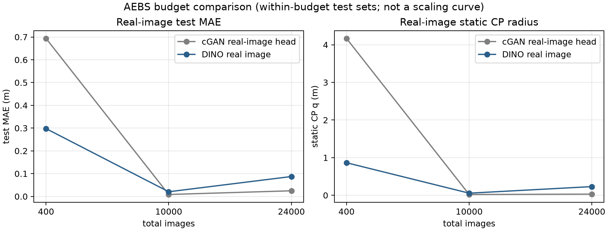

# AEBS 数据预算 400 / 10k / 24k：真实图 cGAN vs 当前 DINO

更新：2026-11-10。按严格总包量执行：400、10k、24k 各自划分 train/val/test；同一档内 cGAN/DINO 共用同一 test；不同档 test 集不同。

先给结论：

> **不是 DINO 全面胜。400 图 DINO 更好；10k/24k 真实图训练的 cGAN 头 MAE/q 反而更低，但 24k 的 test 覆盖只有 89.1%，低于 DINO 93.3%。结果随预算交叉，没有单向赢家。**

---

## 1. 协议

| 总包 | train / val / test | 说明 |
|---:|---:|---|
| 400 | 240 / 88 / 72 | 按距离 bin 分层抽样；60/20/20 取整 |
| 10k | 6,000 / 2,000 / 2,000 | 同上 |
| 24k | 14,172 / 4,908 / 4,920 | 沿用项目现有 24k split |

- **cGAN realhead（主）**：`state_net` 在真实 32×32 灰度图上训练；generator 不用于这个头；
- cGAN generated-trained real（旧迁移）：`state_net` 只在 cGAN 生成图上训练，再读真实图；
- cGAN native：生成图→state_net，不是真实图输入；
- DINO：RGB→冻结 DINOv2-S/14→384→128→128→1；
- 每档训练预算固定：cGAN state_net 100 epoch；DINO 投影 250 epoch；
- CP：validation 残差取有限样本 95% 秩；test 只评估，不裁剪、不删样本；
- 同一档内 cGAN/DINO 使用同一 test 文件清单。

---

## 2. 主结果：真实图 cGAN 头 vs DINO

| 总包 | test n | cGAN realhead MAE / q / 覆盖 | DINO real MAE / q / 覆盖 | 结论 |
|---:|---:|---:|---:|---|
| 400 | 72 | 0.6937 / 4.1690 / 71/72 | **0.2978 / 0.8649 / 69/72** | DINO MAE/q 更低；cGAN 覆盖略高 |
| 10k | 2,000 | **0.0085 / 0.0209 / 1894/2000** | 0.0205 / 0.0557 / 1893/2000 | cGAN MAE/q 更低；覆盖相近 |
| 24k | 4,920 | **0.0247 / 0.0307 / 4382/4920** | 0.0874 / 0.2307 / 4592/4920 | cGAN MAE/q 更低；DINO 覆盖更高 |

### 怎么读

- **400 图：DINO 胜。** MAE 0.298 vs 0.694 m；q 0.865 vs 4.169 m。
- **10k：cGAN 胜 q/MAE。** MAE 0.0085 vs 0.0205 m；q 0.0209 vs 0.0557 m；覆盖 94.7% vs 94.65%，基本持平。
- **24k：cGAN q/MAE 更低，但覆盖低。** MAE 0.0247 vs 0.0874 m；q 0.0307 vs 0.2307 m；覆盖 89.1% vs 93.3%。
- **没有单向赢家。** 数据预算改变排序，不能写“DINO 架构全面更好”。
- **覆盖必须和 q 一起看。** 24k cGAN q 更小但 test 尾部更大，覆盖反而更低；只报 q 会误判。

---

## 3. 三种 cGAN 口径

| 口径 | 10k MAE / q / 覆盖 | 24k MAE / q / 覆盖 | 解释 |
|---|---:|---:|---|
| **cGAN realhead** | **0.0085 / 0.0209 / 94.7%** | **0.0247 / 0.0307 / 89.1%** | 真实图训练；主基线 |
| cGAN generated-trained real | 1.1146 / 2.6634 / 94.2% | 1.1498 / 2.7190 / 95.2% | 生成图训练后迁移到真实图；不能当真实图训练结果 |
| cGAN native | 0.0308 / 0.0474 / 94.85% | 0.0240 / 0.0473 / 90.5% | 生成图→state_net；不是真实图输入 |

**关键：** 旧 `cgan_<N>/report.json` 的 `real` 字段是 generated-trained 迁移，不是真实图训练的 cGAN 头。新 `cgan_realhead_<N>/report.json` 才是这次要求的 cGAN 真实图基线。

---

## 4. 为什么 400 图会出现方向变化

之前另有一组 400 图旧协议：cGAN q=1.9156、旧 DINO 检查点 q=4.0205，结论是 cGAN q 更小。这次严格 400 重新训练 DINO，得到 DINO q=0.8649、cGAN realhead q=4.1690，方向又相反。

说明 400 图对以下因素非常敏感：

- 抽到哪 400 张图；
- train/val/test 划分；
- 训练预算/初始化；
- 用哪个旧检查点。

因此：

- 不能用单个 400 pair 宣布架构胜负；
- 400 图只能作为“小数据预算点”；
- 10k/24k 的交叉更有信息量，但仍需多种子。

---

## 5. 支持与不支持

### 支持

- 在 400/10k/24k 每一档内部，cGAN realhead 与 DINO 都是真实图输入，同一 test；
- 排序随预算变化：400 DINO 好；10k/24k cGAN 的 MAE/q 更好；
- 24k cGAN q 更小但覆盖更低，q 和覆盖存在 trade-off；
- cGAN realhead 是从零训练的像素 MLP，DINO 是冻结预训练 ViT；DINO 没有表现出全面优势。

### 不支持

- 不能跨三档画 scaling 曲线：三档 test 集不同；
- 不能把 cGAN native 的低误差当真实图性能；
- 不能用一个 400 pair 定架构胜负；
- 不能说是纯架构因果：cGAN 32×32 灰度、从零训练；DINO RGB、冻结预训练；输入/预训练不同；
- 不能说是实车/新相机安全，只是保存图像静态误差。

---

## 6. 下一步：要判架构胜负还缺什么

1. **固定 common test**：三档都评估同一批图（哪怕 test 小一些）；
2. **多种子**：每档至少 3–5 个训练种子；
3. **同输入口径**：两边都用灰度，或两边都用 RGB；
4. **同预训练/同从零训练**：否则只能说“预训练 DINO 前端包”；
5. **轨迹 CP/SBC + 同一 actor**：静态误差不等于证书；
6. **成本表**：训练、推理、显存。

当前最稳妥的论文表述：

> 在 400 图小数据下 DINO 的静态误差/CP q 更低；到 10k/24k，从零训练的真实图 cGAN 头在 MAE/q 上反超，但 24k 的留出覆盖更低。排序随数据预算变化，尚无单向架构胜者；需要固定 common test、多种子和同输入口径才能定论。

---

## 7. 文件

- [结果包](../../artical-F122/results/aebs_budget_scaling_20261110/README.md)
- [汇总 JSON](../../artical-F122/results/aebs_budget_scaling_20261110/summary/summary_all.json)
- [汇总表](../../artical-F122/results/aebs_budget_scaling_20261110/summary/report.md)
- [误差图](../../artical-F122/results/aebs_budget_scaling_20261110/summary/error_by_budget.png)
- cGAN realhead：`cgan_realhead_400/`、`cgan_realhead_10000/`、`cgan_realhead_24000/`
- DINO：`dino_400/`、`dino_10000/`、`dino_24000/`
