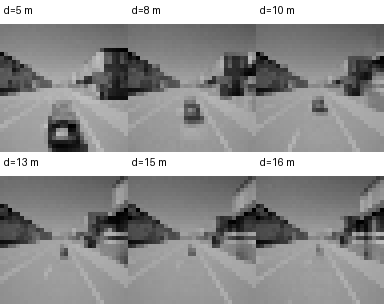
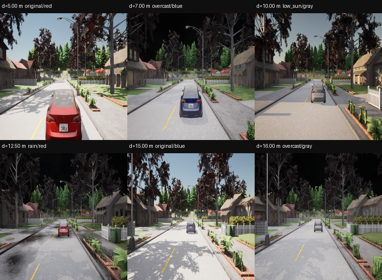
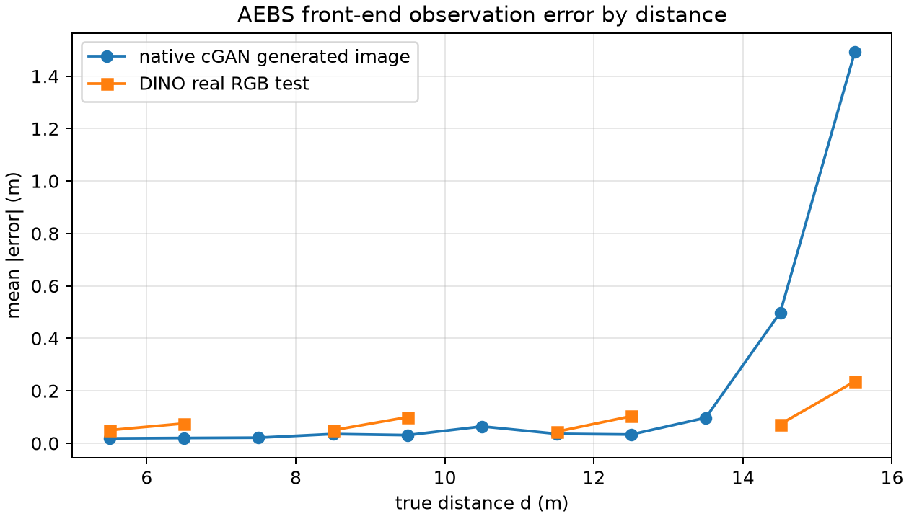

# SPVC 前端替换：相对原 SPVC cGAN 的误差与覆盖收益

更新：2026-11-10。本文只回答一个问题：

> **把原 SPVC 的 cGAN 视觉前端换成 DINO 前端后，观测误差和轨迹误差覆盖到底改善了多少？**

先给结论：

> **原生 cGAN 前端的轨迹 CP 半径是 1.9156 m、留出覆盖 92/100；新 DINO 是 0.4184 m、留出覆盖 99/100。q 缩小约 4.58 倍，覆盖提高 7 个百分点。两边任务行为都成功（100/100 与 4800/4800），所以收益主要是误差包络/可认证性，不是“任务从失败变成功”。**

这是**整体系统级对照**，不是只换前端的架构因果实验：cGAN 用旧 400 图生成体系训练，DINO 用 24k 真实图；actor/SBC 也不同。下一节先把三种 cGAN 数字分开，避免再一次把 5.221 m 当成原生 q。

---

## 1. 原 SPVC 的 cGAN 到底是什么

原 SPVC 的视觉链路是：

```text
状态 d（和随机潜变量 z）
  → cGAN 生成 32×32 灰度图
  → state_net 预测归一化距离
  → 原 PPO 输出制动
```

它不是“拿旧 state_net 去读新 RGB 图”。后者只是迁移检查。



图注：原生 cGAN 在 d=5, 8, 10, 13, 15, 16 m 生成的 32×32 灰度观测（确定性 z=0，上采样显示）。这是原生成链路实际给 state_net 看的图，不是新 DINO 的真实 RGB 图。



图注：新 DINO 前端使用的真实保存 RGB 图（6 个距离/天气/颜色组合）。两边的输入分布不同，后面所有比较都必须带这个前提。

---

## 2. 三种 cGAN 数字，不能混用

| 口径 | 输入 | q / 覆盖 | 能否代表原 SPVC 原生 |
|---|---|---|---|
| cGAN 旧 state_net 迁移到 24k 真实灰度图 | 真实 RGB→32×32 灰度 | q=**5.221 m**；test 覆盖 **87.64%** | **不能**；这是跨库迁移 |
| **原生 cGAN 生成图闭环** | cGAN generator→32×32→state_net→原 PPO | q=**1.9156 m**；留出 **92/100** | **可以**；这是原生生成链路 |
| 原生 cGAN 观测 + 新 actor | 同上，接到新 `policy.pt` | q=1.9156 m；留出 92/100；行为 100/100 | 受控适配；不是原 actor |

**关键：5.221 m 不是原生 cGAN 的 q。**它回答的是“旧 cGAN 配套 state_net 能否直接读新真实图”；原生 cGAN 自己生成图闭环的 q 是 1.9156 m。把 5.221 m 当成原方法，会高估新旧差距约 2.7 倍。

---

## 3. 静态观测误差

### 3.1 原生 cGAN 与 DINO 真实图

- 原生 cGAN：在 5–16 m 均匀取 5,000 个距离，生成图像经 state_net 预测；
- DINO：24k test 的 4,920 张真实图，冻结 DINO + 投影头；
- 两者都对比真实距离标签，单位米。

| 指标 | 原生 cGAN 生成图 | DINO 真实 RGB test |
|---|---:|---:|
| MAE | **0.2219 m** | **0.0874 m** |
| RMSE | 0.5090 m | 0.1211 m |
| P95 | 1.5084 m | 0.2614 m |
| max | 1.9839 m | 0.5250 m |



图注：按真实距离分箱的平均绝对误差。原生 cGAN 在 5–13 m 很小，但 14.5 m 后迅速变大；DINO 在整个 5–16 m 都保持较小误差。cGAN 的总体 MAE 被近距离大量小误差拉低，**单看平均值会掩盖远距离尾部**。

### 3.2 远距离尾部

| 距离 bin | 原生 cGAN MAE | DINO test MAE |
|---|---:|---:|
| 13.5 m | 0.0970 m | —（无 test 图） |
| 14.5 m | 0.4983 m | 0.0724 m |
| 15.5 m | **1.4916 m** | 0.2358 m |

这解释了为什么 cGAN 的**轨迹** q（1.9156 m）远大于它的平均帧误差（0.1328 m）：轨迹 CP 取 400 步里的最大值，远距离尾部决定了半径。

---

## 3.3 同 400 图预算、同 actor：架构胜负并不成立

为了把“数据规模”和“前端架构”分开，补了一组 **400 图同预算、同 actor** 对照：

- cGAN 400：cGAN 生成图 + state_net + 新 actor；
- DINO 400：与 cGAN 同一批 400 图训练的 DINO 投影 + 新 actor；
- 两边同样的 199 校准 + 100 留出，同初始种子。

| 项目 | cGAN 400 | DINO 400 |
|---|---:|---:|
| 轨迹 q | **1.9156 m** | **4.0205 m** |
| 留出覆盖 | 92/100 | **94/100** |
| 留出行为 | 100/100 | 100/100 |
| 静态 test MAE | 0.2219 m（生成图） | 0.1293 m（80 张 test） |

**这组旧 400 图协议的结论是：cGAN q 更小；DINO 只有覆盖高 2 个百分点，行为相同。但 400 图结果对 split/初始化很敏感。**

**新增的严格总包 400/10k/24k 实验不是单向：**400 图 DINO q=0.8649 < cGAN realhead 4.169；10k/24k 则 cGAN realhead q/MAE 更低（10k .0209 vs .0557；24k .0307 vs .2307，但 24k cGAN 覆盖 89.1% vs DINO 93.3%）。详见[数据预算实验](SPVC前端替换_收益证明_AEBS数据预算400_10k_24k_20261110.md)。

因此：

- 不能用旧 400 pair 宣布 cGAN 架构胜；
- 也不能用新 400 pair 宣布 DINO 架构胜；
- 400 图是协议敏感区，需要多种子/固定 common test；
- 24k DINO 的 q=0.4184/99 仍主要是数据规模收益，不能当纯架构收益。

## 4. 轨迹 CP 与覆盖

设置：

- 同一 AEBS 动力学、初态 `[15,16]×[2.5,3]`、400 步、同一终点规则；
- 每个版本 199 条校准 + 100 条留出；轨迹分数为全程最大物理距离误差；
- cGAN 用原生生成图；DINO 用真实保存图最近邻回放；
- 两边都保留失败/超时，不裁剪阈值。

| 项目 | 原生 cGAN | 原生 cGAN + 新 actor | 新 DINO |
|---|---:|---:|---:|
| 轨迹 q | **1.9156 m** | 1.9156 m | **0.4184 m** |
| 校准覆盖 | 190/199 | 190/199 | 190/199 |
| 留出覆盖 | **92/100** | 92/100 | **99/100** |
| 留出成功 / unsafe / timeout | 100 / 0 / 0 | 100 / 0 / 0 | 4800 / 0 / 0（12 组） |
| 留出帧误差均值 | 0.1328 m | 0.0829 m | — |
| 留出帧误差最大 | 1.9754 m | 1.9754 m | 0.5250 m（静态 max） |
| 旧 400 图协议 q / 覆盖 | 1.9156 m / 92 | — | 4.0205 m / 94（旧 DINO-400 检查点） |

- q：**1.9156 / 0.4184 = 4.58 倍**（24k DINO）；
- 留出覆盖：92/100 对 99/100；两个 100 条样本的二项区间分别约 [0.848,0.965] 和 [0.966,0.998]；
- 行为：cGAN 原生 **100/100 成功**，DINO **4,800/4,800 成功**；**没有“任务从失败变成功”的收益**；
- 因此收益定义要写准：**误差包络更小、尾部更短、留出覆盖更高，因而更容易接条件 SBC**。

### 4.1 为什么 cGAN + 新 actor 的 q 不变

q 是观测路径（生成图→state_net）的轨迹最大误差。换 actor 改变了访问状态，但本次样本的最大误差仍由远距离尾部支配，所以 q 仍为 1.9156 m；行为仍 100/100。帧均值从 0.1328 降到 0.0829，但这只是访问分布变化，不能写成“前端误差变小”。

---

## 5. 安全证书层面的位置

- 新 DINO：同一新 SBC 在 **0.418359 m** 下 **292,024 区间，0 见证/0 未解决**；这是条件数值审计；
- 原生 cGAN：本文只做误差/覆盖/行为，**没有**把新 SBC 直接套到 1.9156 m 上宣称通过；原 cGAN 自己的 SBC 也没有在这批中重新验证；
- 所以当前能写的是：**cGAN 的误差包络更大、更难接证书**；
- 不能写：**原 cGAN 已被证明不安全**，也不能写：**新 DINO 在实车上安全**。

---

## 6. 收益到底有多大

用同一任务、同一轨迹覆盖目标（95%）比较：

| 问题 | 原 cGAN | 新 DINO | 变化 |
|---|---:|---:|---:|
| 需要覆盖的轨迹最大误差 q | 1.9156 m | 0.4184 m | **缩小 4.58×** |
| 100 条留出覆盖 | 92/100 | 99/100 | **+7 个百分点** |
| 静态 test MAE（真实图迁移） | 2.747 m | 0.0874 m | 缩小 31.4× |
| 静态 CP 半径（真实图迁移） | 5.221 m | 0.2307 m | 缩小 22.6× |
| 任务成功 | 100/100 | 4800/4800 | 都成功 |

**可以支持的主张（限定在 24k 数据部署系统）：**

> 在这个 AEBS 实现和这批评估协议下，24k 数据训练的 DINO 前端相对 400 图原 SPVC cGAN 显著降低了需要覆盖的观测误差（轨迹 q 从 1.9156 m 降到 0.4184 m），提高了留出轨迹的 CP 覆盖（92/100 到 99/100）；任务成功率没有下降。

**不能支持的主张：**

- 不能说是“同预算架构胜负”：cGAN 400 图生成体系 vs DINO 24k 真实图；400 图旧协议 cGAN q=1.9156 < DINO-400 q=4.0205，新严格 400 DINO q=0.8649 < cGAN realhead 4.169；10k/24k 排序再变；400 图协议敏感；
- 不能说是“只换前端的因果效应”：actor/SBC/输入分布都不同；
- 不能把 5.221 m 当成原生 cGAN q；
- 不能把行为成功写成安全证书；
- 不能外推到新相机/实车/新天气。

---

## 7. 还缺什么才能写成“整体优于原 SPVC”

1. **同预算重训原 cGAN**：同一批允许训练数据、同测试分组、同调参次数；
2. **A-matched 完整证书**：同一 actor/SBC 下分别校准 cGAN/DINO，并完成审计；
3. **配对轨迹**：同初始状态、同曲率/外观，分别闭环；
4. **多种子**：至少 5 对训练种子，报告 q/覆盖分布；
5. **任务指标**：成功/危险/超时之外，加入停车距离、制动平顺性、推理延迟；
6. **公平的输入消融**：固定源分辨率/颜色，只改变前端。

在这些补齐前，本文的结论是**系统级误差/覆盖收益**，不是“架构因果优势”。

---

## 8. 证据文件

- [原生 cGAN 结果包](../../artical-F122/results/aebs_cgan_frontend_error_benefit_20261110/README.md)
- [原生 cGAN 报告](../../artical-F122/results/aebs_cgan_frontend_error_benefit_20261110/native_cgan/report.json)
- [DINO-400 同预算报告](../../artical-F122/results/aebs_cgan_frontend_error_benefit_20261110/dino400_matched/report.json)
- [cGAN + 新 actor 报告](../../artical-F122/results/aebs_cgan_frontend_error_benefit_20261110/matched_cgan_new_actor/report.json)
- [误差-距离图](../../artical-F122/results/aebs_cgan_frontend_error_benefit_20261110/error_by_distance.png)
- [新 DINO 验证报告](../../artical-F122/results/real_aebs_repair_20261109_release/verification_report.json)
- [前端对比文档](AEBS前端对比_cGAN_灰度_真实RGB_20261108.md)
- [收益证明计划](SPVC前端替换_收益证明与对照实验详细计划_20261110.md)
