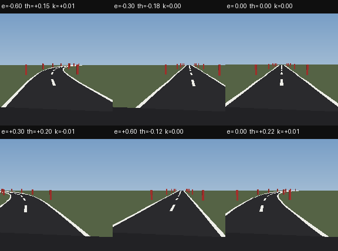
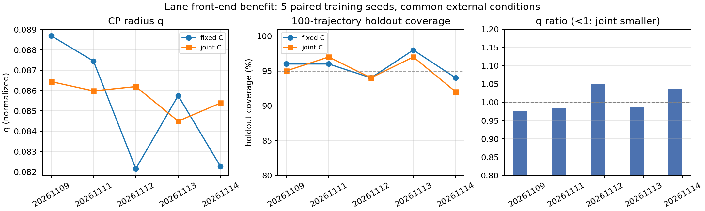

# SPVC 前端替换收益证明：阶段一至二执行结果

更新：2026-11-10。本文是对[收益证明计划](SPVC前端替换_收益证明与对照实验详细计划_20261110.md)阶段一、阶段二的执行记录。

**先给结论：**

> **固定 C 与联合 C 的 5 对训练种子对照已经完成。两边各 5/5 通过数值 SBC，但联合 C 没有稳定收益：q 均值略大 0.5%，留出覆盖均值低 0.6 个百分点，只有 3/5 对 q 更小。当前证据不支持“学习 C 带来可观测性/证书收益”。**

这不等于“整个前端替换没有收益”。本批只回答了 **C 组件消融**；整体替换相对原 SPVC 的收益另见[原 SPVC cGAN 误差对照](SPVC前端替换_收益证明_原SPVC_cGAN误差对照_20261110.md)：原生 cGAN q=1.9156 m、留出 92/100；DINO q=0.4184 m、留出 99/100；两边行为都成功。该对照是系统级、非同预算，仍不能写成架构因果胜负。

---



图注：固定 C 与联合 C 使用同一批 192×192 车道渲染图（不同 `(e,θ,κ)`）；变化只在视觉投影和 C 的训练方式，不换相机、不换场景分布。

## 1. 这次实际执行了什么

### 1.1 版本与预算

| 项目 | 固定 C | 联合 C |
|---|---|---|
| 训练种子 | 20261109, 11, 12, 13, 14 | 同左，逐对配对 |
| 数据 | 3,600 张车道渲染图；同一 split | 同左 |
| 视觉主干 | 冻结 DINOv2-S/14 patch | 同左 |
| 视觉头 | patch 空间读出 | 同左 |
| C | 固定旋转 `C0=[[0.8660254,0.5],[-0.5,0.8660254]]` | 同初始化，但可训练、逐行归一化 |
| 训练预算 | 30 epoch；batch 64；lr 1e-4 | 同左 |
| 控制器 | 原语义 PPO + `C^{-1}` 坐标适配 | 同左 |
| SBC | 同一 `sbc.pt` | 同左 |

固定 C 的视觉头最后一层同步旋转到 C0 坐标；因此这是一个**同坐标、同预算消融**，不是原始未旋转 `C=I` 的 SPVC 复现。

### 1.2 新配对闭环

- 两个版本使用**同一组新外部条件种子**：校准 `202611100101`，留出 `202611100102`；
- 每个版本各自重新渲染、DINO 推理、闭环生成 199 条校准 + 100 条留出，80 步；
- 初始状态、曲率、每条轨迹种子逐对相同；**轨迹本身不共享**；
- 冻结 q 后再采留出；不裁剪、不删除失败轨迹；
- 同一 actor、同一 SBC、同一验证器；证书在各自 q 下独立审计。

配对检查：5 对的初始状态、曲率、episode seeds 全部一致；每对只有 C/视觉头不同。

### 1.3 与阶段一的关系

- 阶段一先导：第一对种子 20261109 + 新外部条件；结果见下方第一行；
- 阶段二：再补 4 对训练种子，共 5 对；
- 没有把同一模型的 100 条轨迹当成 100 个独立训练实验；统计单位是训练种子对。

---

## 2. 结果

### 2.1 逐对结果

| 训练种子 | 固定 C q | 联合 C q | q 比 | 固定 C 留出 | 联合 C 留出 | 固定证书 | 联合证书 |
|---|---:|---:|---:|---:|---:|---|---|
| 20261109 | 0.088690 | 0.086439 | 0.9746 | 96/100 | 95/100 | pass | pass |
| 20261111 | 0.087447 | 0.085980 | 0.9832 | 96/100 | 97/100 | pass | pass |
| 20261112 | 0.082158 | 0.086194 | 1.0491 | 94/100 | 94/100 | pass | pass |
| 20261113 | 0.085749 | 0.084497 | 0.9854 | 98/100 | 97/100 | pass | pass |
| 20261114 | 0.082272 | 0.085384 | 1.0378 | 94/100 | 92/100 | pass | pass |

### 2.2 汇总

| 指标 | 固定 C | 联合 C |
|---|---:|---:|
| q 均值 / 中位数 | **0.085263 / 0.085749** | **0.085699 / 0.085980** |
| 留出覆盖均值 | **95.6%** | **95.0%** |
| 留出 unsafe 轨迹 | 0/500 | 0/500 |
| SBC 通过 | **5/5** | **5/5** |
| 平均 \|action\| | 0.084837 | 0.083737 |
| 平均 \|Δaction\| | 0.115240 | 0.113763 |
| 静态 test e MAE | 0.017927 m | 0.018012 m |
| 静态 test θ MAE | 0.005104 rad | 0.005124 rad |
| C 变化 / 条件数 | 0 / 1.000000 | 0.001382 / 1.001649 |

- q 差（联合−固定）均值 **+0.000435**，中位数 **−0.001252**；联合更小的对数为 **3/5**；
- 留出覆盖差均值 **−0.006**；5 对合计的配对覆盖：
  - both = 461
  - fixed-only = 17
  - joint-only = 14
  - neither = 8
- 两边各 5/5 数值 SBC 通过；所有留出无 unsafe。



图注：左：5 对的 q；中：100 条留出覆盖；右：联合/固定 q 比（<1 表示联合更小）。q 差异方向不一致，幅度很小。

---

## 3. 这批结果支持什么、不支持什么

### 3.1 支持

- 固定 C 与联合 C 都能在**同一组新外部条件**下完成 199 校准 + 100 留出闭环；
- 两边各 5/5 在各自 q 下通过数值 SBC 审计；
- 联合 C 确实更新了（C 变化约 0.00138），不是“完全没训”；
- 联合 C 的 q 并没有稳定更小：3/5 对更小，均值反而略大；
- 留出覆盖没有显示联合 C 更好（均值低 0.6 个百分点）；
- 控制动作幅度/变化略低，但这只是描述性差异，不能证明整体控制更好。

### 3.2 不支持

- 不能写“联合 C 显著提高了可观测性”；
- 不能写“联合 C 提高了证书获得率”；
- 不能写“联合 C 改善了留出覆盖”；
- 不能写“整个新前端优于原 SPVC”——本批没有车道 A-native / A-matched 基线，也没有任务完成率/到达指标；
- 不能把 q 的小差异归因于 C 学到了更好的方向；C 仍非常接近初始旋转；
- 不能把 5 对当成有统计功效的总体证明；这是小样本先导。

### 3.3 最合理的解释

联合 C 在当前设置下**几乎是坐标重参数化**：C 只轻微偏离初始旋转，控制接口又通过 `C^{-1}` 解码，名义行为高度接近固定 C。q 的小差异更像训练/采样波动，而不是可观测性提升。

因此：

> **“学习 C”不是一个已建立的独立收益来源。主贡献若存在，应放在“DINO 低维观察 + 代理误差 CP + 神经 SBC 的连接”上，而不是 C 的联合训练上。**

---

## 4. 与计划原目标的差距

计划要证明的是“前端替换相对原 SPVC 的整体收益”。本批只完成了其中的 **C 组件消融**（阶段一/二）。

还缺：

1. **A-native 原 SPVC 车道基线**：同一任务、同一数据预算、完整部署链路；
2. **A-matched 受控适配基线**：如果原方法无法直接接当前误差审计，需要明确适配口径；
3. **任务性能**：车道没有到达指标，当前只报告 unsafe、横向误差、动作变化；
4. **共同 r_cert 扫描**：在预登记半径网格上找已验证容许半径；
5. **5 对以上的统计功效**：当前 5 对是可行性/一致性评估；
6. **RGB AEBS 的固定/联合对称闭环**：本批只做了车道；
7. **原 cGAN 公平重训**：现有旧检查点只能作历史迁移参考；
8. **运行时成本**：DINO 在线推理、训练、验证、采集的独立计时还没有完整表。

在这些补齐前，论文只能写：

> 在所考察车道任务、5 个训练种子和配对先导中，联合 C 没有显示稳定的 q 或覆盖优势；固定 C 与联合 C 都能通过当前条件 SBC 数值审计。整体前端替换的收益仍需原方法基线和任务指标支持。

不能写“新方法整体优于原 SPVC”。

---

## 5. 复现入口

```bash
cd /root/work_based_on_spvc/artical-F122
conda activate vt

# 5 对训练（固定/联合；每个 seed 各一次）
python -m Aebs.lane_keeping.train_joint_observation ... --seed <seed> [--fixed-C]

# 每对的 199 校准 + 100 留出 + SBC 审计
python -m Aebs.lane_keeping.joint_trajectory_cp \
  --joint <checkpoint> --actor <shared actor> --sbc <shared sbc> \
  --output-dir <new dir> --calibration-episodes 199 --holdout-episodes 100 \
  --calibration-seed 202611100101 --holdout-seed 202611100102 --verify

# 汇总
python -m Aebs.lane_keeping.aggregate_frontend_benefit \
  --root results/lane_frontend_benefit_20261110 \
  --output results/lane_frontend_benefit_20261110/summary_5seed
```

完整结果包：[lane_frontend_benefit_20261110](../../artical-F122/results/lane_frontend_benefit_20261110/README.md)

---

## 6. 结论

**本批收益证明的答案是“C 组件没有收益证据”，不是“前端替换没有收益”。**

- 联合 C：5/5 证书通过，但 q/覆盖没有稳定优势；不能作为独立贡献。
- 固定 C：同样 5/5 通过；当前更简单、可解释，作为主基线保留。
- 整体前端替换：仍需原 SPVC 基线、任务指标和共同 r_cert 扫描；当前不能下总体结论。

这符合计划中“结果如何解释”的第二种情形：**固定 C 与联合 C 没有稳定差异 → 联合训练可行，但独立性能贡献未建立；主贡献应回到观察抽象与误差衔接。**
