# 当前 SPVC / VISION-SLS 框架：一步步流程与安全保证

更新：2026-11-09。本文按当前代码重写，目标是让不熟悉这个项目的人也能看懂：**输入是什么、每一步做了什么、输出是什么、最后到底保证了什么、哪些话不能讲**。

**版本补充：**本文下面的数值表与“C 固定”的说明针对原发布版本。11/09 随后新增了实际联合学习视觉投影与 C 的独立实验，详见 [新版本完整步骤与结果](联合学习视觉投影与C_实验步骤与结果_20261109.md)。原版继续保留；新前端不继承旧 CP/SBC 结果。当前 RGB 联合版新条件 SBC 通过但留出覆盖 91/100，灰度联合版新 SBC 未通过；车道联合版单对历史结果为 93/100，新增 5 对训练种子配对结果为 q 无稳定优势、覆盖 95.0% 对 95.6%。完整跨版本步骤与样例见 [全版本汇总](AEBS与车道实验全版本汇总_步骤原理结果与观测样例_20261109.md)。

> **本文读法：**第 0–6 节的主体是**固定 C 原版**；第 **4.7 节**单独写联合学习 C 的新实验。两套结果不能混用 CP、SBC 或控制器证书。

---

## 0. 先给结论

当前框架做的事情可以压缩成一句话：

> **把原来 SPVC 的 cGAN 视觉前端，换成“冻结 DINO + 学习低维观测”的前端；再用 CP（Conformal Prediction）给出观测误差包络；最后用非负 SBC 和区间验证，证明“只要观测误差在包络内，控制器就不会让 SBC 变大”。** 这是原固定 C 版的主线；11/09 新增的联合学习 C 版单独见 4.7。

它得到的是一个**条件安全证书**，不是“真实世界 95% 安全”的无条件保证。

## 目录

- [0. 先给结论](#0-先给结论)
- [1. 一张图看懂数据流](#1-一张图看懂数据流)
- [2. 记号：每个符号到底指什么](#2-记号每个符号到底指什么)
- [3. 总体流程：从任务到证书的 9 步](#3-总体流程从任务到证书的-9-步步骤-08)
- [4. 每个实验的完整实例](#4-每个实验的完整实例)
  - [4.1 AEBS RGB](#41-aebs-rgb24k-真实图像--一维距离观测)
  - [4.2 原 10/29 灰度](#42-aebs-原-1029-灰度400-张-32×32-图的早期实现)
  - [4.3 车道](#43-车道保持2d-观测--80-步轨迹)
  - [4.4 停车场](#44-停车场4d-车辆--3d-视觉--在线后备)
  - [4.5 移动机器人](#45-移动机器人3d-视觉任务跑通但证书未通过)
  - [4.6 前端误差横向比较](#46-前端误差的横向比较正确口径)
  - [4.7 联合学习视觉投影与 C](#47-联合学习视觉投影与-c1109-新增的独立实验)
- [5. 安全保证链条](#5-安全保证链条从条件到风险上界)
- [6. 状态相关 CP](#6-当前状态相关-cp-的准确结论)
- [7. 常见误解](#7-常见误解这些说法都不对)
- [8. 代码地图](#8-代码地图想改哪里看哪里)
- [9. 复现顺序](#9-复现顺序简版)
- [10. 一句话总结](#10-一句话总结)

> **看图提示：**第 4 节的图都是实际保存的观测图/结果图；图注会说明它是不是当前主包、是否只是早期开发图。不要只看曲线，先看“这张图代表哪个前端、哪个数据划分、哪个证明域”。

三个必须分开的东西：

| 东西 | 回答的问题 | 不是 |
|---|---|---|
| **前端误差** | 图像预测离真实状态有多远？ | 不是安全概率 |
| **CP 包络** | 新样本的误差有多大概率落在某个集合内？ | 不是每个状态都 95% |
| **SBC 证书** | 若误差一直在集合内，控制器是否满足不增条件？ | 不是实车/新图像保证 |

把三者接起来，才有当前的条件结论；任何一环单独拿出来，都不能当成完整安全证明。

---

## 1. 一张图看懂数据流

```text
真实图像 I
   │  冻结 DINOv2
   ▼
视觉特征 z = φ(I)
   │  只训练一个小投影头 p
   ▼
低维观测 y = p(z)          ← 部署时真正给控制器看的视觉量
   │
   │  同时：真实状态 x 经过已知映射 C 得到 Cx
   ▼
观测误差 e = y − Cx        ← CP 要包住的东西
   │
   ├──────────────► CP：q 或 q·b(x)，得到误差集合 E
   │
   ▼
控制器 π(y, 其他已知量) → 动作 u
   │
   ▼
真实动力学 x' = f(x,u)
   │
   ▼
SBC B(x)：检查 B(x') ≤ B(x) 是否对所有 x'∈E 都成立
```

对应到 AEBS：

```text
图像 I → DINO → 投影 → 预测距离 d̂
真实状态 x=(d,v) → Cx = d/S
误差 e = d̂ − d/S
控制器输入 = (d̂, v)  → 制动动作 a
SBC 输入 = (d/S, v)
```

对应到车道：

```text
图像 I → patch-DINO → (ê,θ̂)
真实状态 x=(e,θ) → Cx=(e/0.85, θ/0.30)
误差 e=(ê−e/0.85, θ̂−θ/0.30)
控制器输入 = (ê,θ̂,κ) → 前轮转角 φ
SBC 输入 = (e/0.85, θ/0.30)
```

---

## 2. 记号：每个符号到底指什么

| 符号 | 含义 | 例子 |
|---|---|---|
| `I` | 一张真实/渲染图像 | AEBS 640×640 RGB；车道 192×192 |
| `φ` | 冻结视觉主干 | DINOv2 ViT-S/14；参数不更新 |
| `z` | 视觉特征 | AEBS CLS 384 维；车道 16×16 patch tokens |
| `p` | 学习的小投影头 | 384→128→128→1；或 patch→2D |
| `y` | 部署时控制器看到的低维观测 | 预测归一化距离；预测 `(ê,θ̂)` |
| `x` | 真实物理状态 | AEBS `(d,v)`；车道 `(e,θ)`；机器人 `(x,y,θ)` |
| `C` | 已知的“状态→标称观测”映射 | AEBS `[1,0]`；车道 `diag(1/0.85,1/0.30)` |
| `Cx` | 标称观测，也叫 proxy latent | 理想情况下 `y` 应等于 `Cx` |
| `e` | 观测误差 `y−Cx` | CP 的校准对象 |
| `E` | CP 给出的误差集合 | 一维区间、二维盒、状态相关盒 |
| `B` | 非负 SBC | 输出非负标量 |
| `B0` | 初始状态的 SBC 值 | 要求 `B0≤1` |
| `B_unsafe` | 危险状态的 SBC 值 | 要求 `≥20` |
| `α` | CP 允许的失败率 | 通常 0.05，目标 95% |
| `q` | CP 分位数/半径乘子 | 有限样本秩计算，不是普通百分位 |
| `b(x)` | 状态相关误差尺度 | 先拟合，再乘 `q` |
| `K` | 区间验证的盒/单元 | 不是真实样本，是连续状态盒子 |

**最重要的一点：**要区分两套前端：

- **固定 C 原版（本文 4.1–4.6）：**`C` 已知且固定；AEBS 写死为 `[1,0]`，车道是固定缩放；新增的 `b(x)` 只学习误差大小。
- **联合 C 新版（本文 4.7）：**`C` 是可训练矩阵，和视觉投影一起优化；它有自己的 CP、控制器坐标适配和 SBC 重验证，**不能继承**固定 C 版的证书。

所以“C 固定”只描述原版，不是全部当前代码。

---

## 3. 总体流程：从任务到证书的 9 步（步骤 0–8）

下面每一步都按“输入 → 做什么 → 输出 → 为什么”写。

### 步骤 0：先固定任务和协议

**输入：**任务需求。

**做什么：**

- 固定状态、动作、动力学、初态集合、危险集合、时间步长、时域；
- 固定数据划分规则；
- 固定 CP 的 α、校准/留出数量；
- 固定 SBC 的阈值：初始 `≤1`、危险 `≥20`、后继不增；
- 先写协议和文件哈希，再采数据/看结果。

**输出：**协议 JSON、阈值、数据划分。

**为什么：**安全证书最怕“看到结果后再改阈值”。协议先冻结，后面的数字才有意义。

对应代码/文件：

- AEBS：`Aebs/vision_sls/run.py`、`Aebs/vision_sls/env.py`、结果包 `config.json/protocol.json`
- 车道：`Aebs/lane_keeping/core.py`、`trajectory_cp.py` 的 `make_protocol`
- 停车场：`Aebs/vision_sls_parking/calibrate_startup.py`
- 机器人：`Aebs/mobile_robot/core.py`、`trajectory_cp.py`

### 步骤 1：准备数据和划分

**输入：**图像 + 标签/状态。

**做什么：**

- AEBS：24,000 张 640×640 CARLA RGB；按 0.25 m 距离 bin 分组；train/validation/test = 14,172/4,908/4,920；同一 bin 不跨集合；
- 车道：60 个场景 ×60 状态 = 3,600 张 192×192 渲染图；按**场景**划分，避免同一场景泄漏；
- 原 10/29 灰度：400 张 32×32 灰度图；240/80/80；
- 停车场：15 个注册起点组；每组单独拟合/校准/审计；
- 机器人：2,400 训练 / 400 验证 / 400 开发测试，224×224。

**输出：**固定 split、数据哈希、数据集元信息。

**为什么：**如果同一场景/同一张图同时进训练和校准，CP 覆盖率会虚高。

### 步骤 2：训练视觉观测 `y=p(φ(I))`

**输入：**训练图像和标签。

**做什么：**

1. 冻结 DINO 主干，不更新；
2. 只训练小投影头；
3. AEBS 用逐样本距离损失，输出一维归一化距离；
4. 车道保留 16×16 patch tokens，用卷积 + 空间 soft-argmax 得到二维 `(ê,θ̂)`；
5. 训练完冻结投影头；后续不因 SBC/控制器改动而更新前端；
6. 保存权重、逐图预测、数据/权重哈希。

**输出：**`observation.pt` / `patch_projection.pt`；逐图观测；test MAE/RMSE/P95/max。

**为什么：**DINO 特征本身不是安全保证；它只是把高维图像压成低维、可校准、可接动力学的量。真正的保证从 CP 和 SBC 开始。

### 步骤 3：训练/固定控制器

**输入：**训练观测、动力学、奖励。

**做什么：**

- AEBS：原已认证 PPO；输入 `(d̂/S, v)`，输出制动，clip 到 `[-3,3]`；
- 车道：原图像 PPO；输入 `(ê,θ̂,κ)`，输出前轮转角，clip 到 `[-0.45,0.45]`；
- 证书验证时固定 actor，只对**确定性均值动作**做区间界，不采样。

**输出：**`policy.pt` / `actor.pt`。

**为什么：**控制器和证书必须绑定同一个 actor；换 actor 后旧 SBC 证书不能直接复用。

### 步骤 4：用 CP 构造观测误差集合

这是整个框架最容易被误解的一步。

#### 4.1 单帧 CP 和轨迹 CP 不是一回事

- **单帧 CP**：一个样本是一张图，分数是 `|e|`；
- **轨迹 CP**：一个样本是**一整条闭环轨迹**，分数是 `max_t |e_t|`；
- 轨迹 CP 的 95% 是“新的一条完整轨迹的**最大误差**有 95% 概率不超过半径”，不是“每一帧都 95%”，也不是“每个状态都 95%”。

AEBS 主结果用的是**轨迹 CP**，半径 `0.418359 m`，包含 DINO 误差和最近邻查图误差。车道的 `0.090093` 也是轨迹 CP。

#### 4.2 有限样本分位数

给定 n 个校准分数，取秩

```text
rank = ceil((n+1)(1−α))
q = 第 rank 个最小分数
```

不是 `np.quantile(scores, 0.95)` 的插值。若 `rank>n`，分位数是无穷大，不能宣称有限半径。

AEBS 主结果：199 条校准，取第 190 个，`q=0.418359 m`。
车道主结果：199 条校准，取第 190 个，`q=0.090093`。

#### 4.3 状态相关 CP

普通 CP 是一个全局半径 `q`。状态相关 CP 把它改成

```text
r(x) = q · b(x)
```

其中 `b(x)>0` 是状态相关尺度。分数变成

```text
score = max_t |e_t| / b(x_t)
```

再对分数取 CP 分位。

这能表达“近距离误差小、远距离误差大”或“某些状态更难”。但它有两个代价：

1. `b(x)` 需要独立拟合；如果同一批数据既拟合 `b` 又取 `q`，标准 split CP 保证不成立；
2. `q·b(x)` 可能在某些状态更大；平均半径更小不等于覆盖更好，也不等于 SBC 更容易验证。

AEBS 状态相关版本（只学 `b(d)`，`C` 仍固定）：

- 平均半径 0.3217 m，最大 0.7189 m；
- 校准 190/199，留出 92/100；
- 同一 SBC 41,070 区间 0/0 通过；
- 因为远距离 SBC 在零平台，所以验证反而更省；但**不替换**常量主结果。

车道状态相关 v2：

- 99 条拟合 + 100 条校准，第 96 秩，无 cap；
- 校准 96/100，旧留出回归 93/100；
- 实际状态集合 13,000 区间 0/0；
- 这是旧数据回归，不是新盲测；旧 v1 已撤回。

#### 4.4 单位：最容易出错的地方

AEBS 的归一化距离分数是**无量纲**，物理半径必须乘 `S=3.18272066 m`：

```text
r_physical = S · q_normalized
```

旧 RGB 合同把归一化 `q=0.072493` 直接当米，实际只验证了 0.07249 m，不是 0.230725 m。修复后旧 SBC 在正确半径下有 212 个见证，旧 tube 通过结论已撤回。

当前状态相关 AEBS 合同的 `score_units` 已修正为 `dimensionless`。

#### 4.5 CP 到底保证什么

在“校准样本和新样本可交换、评分规则固定、模型/协议不变”的前提下：

```text
Pr(新样本的分数 ≤ q) ≥ 1−α
```

这是**边缘覆盖**，不是：

- 对每个固定状态都 95%；
- 对每一帧都 95%；
- 对分布变化后的新相机/新天气 95%；
- 对“观测误差一定在集合内”的确定性保证。

SBC 验证需要更强的条件：**所有允许观测误差都在集合内**。这个条件不能只由边缘 CP 推出，必须显式作为假设。

### 步骤 5：训练非负 SBC

**输入：**真实状态、动力学、CP 误差集合、控制器。

**做什么：**

- SBC 是一个神经网络 `B(x)`；
- 输出层用 ReLU（或非负激活）保证 `B(x)≥0`；
- 训练目标：
  - 初始区域 `B≤1`；
  - 危险区域 `B≥20`；
  - 对允许后继 `B(x')≤B(x)`；
  - 用反例反馈、区域采样、漂移惩罚训练；
- 当前 AEBS RGB/车道证书包：固定 actor 和视觉前端后，只训练/选择 SBC；原 10/29 是 actor/SBC 交替训练后验证最终 pair；停车场是改闭环（在线后备）后验证。

**输出：**`sbc.pt`，包含结构、激活、坐标尺度、actor/视觉哈希。

**为什么用非负 SBC：**非负 + 初始低 + 危险高 + 条件不增，才能用非负超鞅的停止论证给出风险上界 `B0/20`。有符号 NCBF 是另一套对象，不能混用。

### 步骤 6：连续域区间验证

**输入：**SBC、固定 actor、CP 合同、状态域、动作界。

**做什么：**

1. 把连续状态域切成盒子；
2. 对每个盒子，用区间/仿射界给出：
   - 当前 `B` 的下界/上界；
   - actor 输出的动作区间；
   - 所有允许后继状态的盒子；
   - 后继 `B` 的上界；
3. 检查：
   - 初始区域：`B_upper≤1`；
   - 危险区域：`B_lower≥20`；
   - 活跃区域：`B_next_upper≤B_current_lower`；
   - 若 `B_lower≥20`，该盒子已被危险阈值排除；
4. 未能证明的盒子继续细分；同时用真实点检查是否找到实际反例；
5. 只有 **0 实际反例 + 0 未解决** 才算通过。

**输出：**`verification_report.json` / `certificate.json`，含：
- checked cells；
- proved cells；
- threshold excluded；
- actual witnesses；
- unresolved；
- 半径、actor 界、哈希、范围。

**关键区分：**

- `unresolved` 是“界不够，没证明”，不是“一定违反”；
- `actual witness` 是“真的找到正漂移”，比 unresolved 更强；
- 0 witness 但 unresolved>0，仍然不能算通过。

### 步骤 7：行为回放/图像闭环

**输入：**冻结模型、图片库/渲染器、初态。

**做什么：**

- AEBS：12 组天气/颜色 ×400 初态；最近邻查图回放；记录成功/危险/超时；
- 车道：6 个测试场景 ×2 回合图像闭环；
- 停车场：15 起点 ×2 组图像仿真；
- 机器人：24 条开发图像闭环。

**输出：**行为统计、轨迹图。

**为什么：**行为结果是“实际跑了多少条”，不是概率证书。1441/1441、4800/4800 都是行为证据，不是“所有状态安全”的证明。

### 步骤 8：报告和边界

**输出：**结果包 + 文档 + 网站。

**必须同时写：**

- 证书通过的具体半径/状态域；
- CP 覆盖是校准/留出/回归；
- 是否新盲测；
- 数值区间不是浮点形式证明；
- 不是实车；
- `C` 是否固定；
- 旧结论是否撤回。

---

## 4. 每个实验的完整实例

这一节不再只列指标，而是按“任务 → 实际观测图 → 前端 → 控制器 → CP → SBC/验证 → 结果 → 边界”逐个实验讲。每个实验的图都是实际保存的观测图或实际结果图，不是示意图。

### 4.1 AEBS RGB：24k 真实图像 + 一维距离观测

#### 任务是什么

车辆在直道上接近前方车辆，控制器只输出制动。状态是 `(d,v)`：距离和速度；动作是 `a∈[-3,3]`，正值为制动。

| 项目 | 设置 |
|---|---|
| 动力学 | `d'=d−0.05v`，`v'=clip(v−0.05a,0,3)`，Δt=0.05 |
| 初态 | `d∈[15,16]`，`v∈[2.5,3]` |
| 危险区 | `d∈[5,6]`，`v∈[0.5,3]` |
| 数据 | 24,000 张 640×640 CARLA RGB；4 天气 ×3 颜色；距离 5–16 m |
| 划分 | train 14,172 / validation 4,908 / test 4,920；按 0.25 m 距离 bin 分组 |

#### 实际观测图

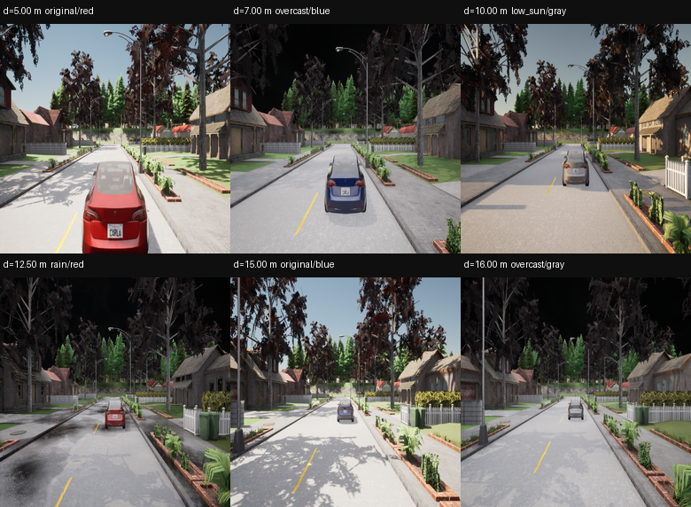

图注：6 个不同距离/天气/颜色组合的真实保存图像。上方是 `d=5.00, 7.00, 10.00, 12.50, 15.00, 16.00 m` 和天气/颜色标签。网络看到的不是这一整张 640×640 图，而是先缩放到 DINO 的 224×224 输入。

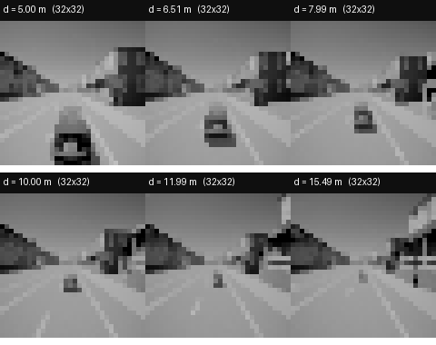

图注：32×32 灰度对照输入（6 个距离）。它和上面的 RGB 图不是同一个前端：灰度版本先把图降到 32×32，再放大到 224；因此同时改变了颜色和源分辨率。

#### 前端做了什么

```text
640×640 RGB
  → DINOv2-S/14 预处理（224×224）
  → 冻结 CLS 特征 384 维
  → 384→128→128→1 投影头
  → 归一化距离 d̂ = y
```

- `C=[1,0]` 是**固定**的；`Cx=d/S`，`S=3.18272066 m`；
- 速度 `v` 不是视觉量，直接来自车辆测量；
- 训练目标为 `d/S`，测试时再乘 `S` 回米；
- 当前 test：MAE **0.0874 m**，RMSE **0.1211 m**，P95 **0.2614 m**，max **0.5250 m**。

#### 控制器和 CP

- 控制器：原 AEBS PPO，输入 `(d̂/S, v)`，输出制动；
- 静态 CP：图片级，半径 **0.230725 m**，test 覆盖 **93.33%**；
- 轨迹 CP：一整条 400 步回放轨迹一个分数，半径 **0.418359 m**，199 校准 / 100 留出，留出 **99/100**；
- 轨迹 CP 的误差包含：DINO 预测误差 + 最近邻图片查询误差。它不是“纯 DINO 误差”。

#### SBC 和验证

- 新 SBC v2：非负 `[2,16,8,1]`，ReLU 输出；固定 actor/前端训练；
- 初始上界 **0**；危险下界 **25.213636**；
- 连续域：**292,024 区间，0 实际见证，0 未解决，深度 29**；
- 行为：全库 **4,800/4,800**，test 库 **4,800/4,800**。

#### 结果图

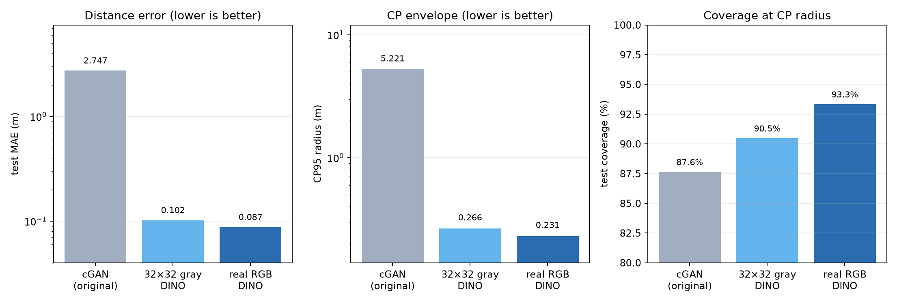

图注：cGAN / 32×32 灰度 / 真实 RGB 的距离误差、静态 CP 半径和 test 覆盖。注意这是**静态图片级**比较，不是轨迹 CP 0.418359 m。

#### 这个实验保证了什么

在以下条件同时成立时：

1. 每次用于控制的观测误差都在轨迹 CP 集合内；
2. 动力学、离散化和控制器与验证包一致；
3. 数值区间界有效；

SBC 满足非负、初始低、危险高、后继不增；停止过程风险上界为 `B0/20`。初始 `B0=0`，因此形式风险上界是 0；但这是**条件数值结论**，不是“真实世界 0 风险”。

#### 不能说的话

- 不能说“24k 真实图像训练后，实车也安全”；
- 不能说“轨迹 CP 99/100 就是 99% 安全”；
- 不能说“新 SBC 通过，所以灰度/cGAN 也通过”；
- 不能说“静态 CP 0.2307 m 就是轨迹 CP 0.418359 m”；
- 不能说“C 是联合学习出来的”；`C` 固定为 `[1,0]`。

### 4.2 AEBS 原 10/29 灰度：400 张 32×32 图的早期实现

这是原 AEBS 的灰度链路，不是 4.1 的 24k 灰度对照。它只有 400 张图、80 张 test，使用状态相关 CP，SBC 与策略配套训练。

#### 实际观测图


图注：32×32 灰度输入，6 个距离。图像分辨率很低，距离主要靠前车/道路几何的粗粒度变化判断。

#### 配置和流程

| 项目 | 设置 |
|---|---|
| 数据 | 400 张 32×32 灰度；240 train / 80 validation / 80 test |
| 前端 | 冻结 DINOv2 ViT-S/14 CLS 384 → 128 → 128 → 1；投影最佳 epoch 243 |
| test 误差 | MAE **0.129266 m**；RMSE **0.165444 m**；max **0.414889 m** |
| CP | 状态相关 Bernstein `b0(d)`；q=**2.522199**；均值半径约 **0.4316 m**；40 条校准 |
| SBC | 非负 `[2,16,8,1]`；初始 0；危险下界 **24.965932** |
| CP tube | **4,971,398** 区间，0 反例/0 未解决 |
| 回放 | 400 图冻结回放 **105,608** 区间，0/0 |
| 行为 | 名义 / 全图 / 留出各 **1441/1441** |
| 软件 | 32 项测试 |

#### 为什么不能和 4.1 横比

- 数据量 400 vs 24,000；
- test 80 vs 4,920；
- CP 是状态相关，不是全局轨迹 CP；
- SBC 与策略配套训练，不是固定 actor 后重训 SBC；
- 它的 `24.9659` 危险下界、`1441/1441` 行为，不能套到当前 RGB 包。

它的价值是证明“灰度 DINO + 状态相关 CP + 非负 SBC”在早期小数据包上能闭合，是历史基线，不是当前前端排名的一行。

### 4.3 车道保持：2D 观测 + 80 步轨迹

#### 任务是什么

车辆沿车道行驶，状态是横向偏差 `e` 和航向偏差 `θ`；控制器输出前轮转角 `φ`；曲率 `κ` 是已知外部输入。

| 项目      | 设置                                       |     |        |     |            |     |        |     |        |
| ------- | ---------------------------------------- | --- | ------ | --- | ---------- | --- | ------ | --- | ------ |
| 动力学     | `e'=e+vΔt sinθ`，`θ'=θ+(vΔt/L)tanφ−vΔtκ`  |     |        |     |            |     |        |     |        |
| 参数      | v=4 m/s，L=2.6 m，Δt=0.1，H=80              |     |        |     |            |     |        |     |        |
| 初态 / 安全 | `                                        | e   | ≤0.25, | θ   | ≤0.06` / ` | e   | ≤0.85, | θ   | ≤0.30` |
| 曲率      | `κ∈{−0.01,0,0.01}`，每条轨迹固定                |     |        |     |            |     |        |     |        |
| 数据      | 60 场景 ×60 状态 = 3,600 张 192×192 渲染图；按场景划分 |     |        |     |            |     |        |     |        |

#### 实际观测图

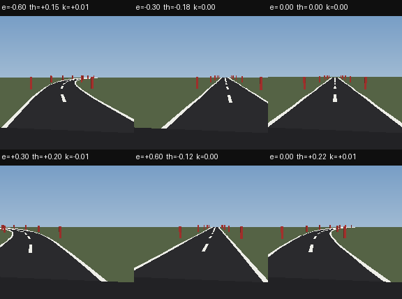

图注：6 个不同 `(e,θ,κ)` 的 192×192 渲染图。上方标签给出横向误差、航向误差和曲率；弯道、车道线偏移和车辆朝向都能直接看到。

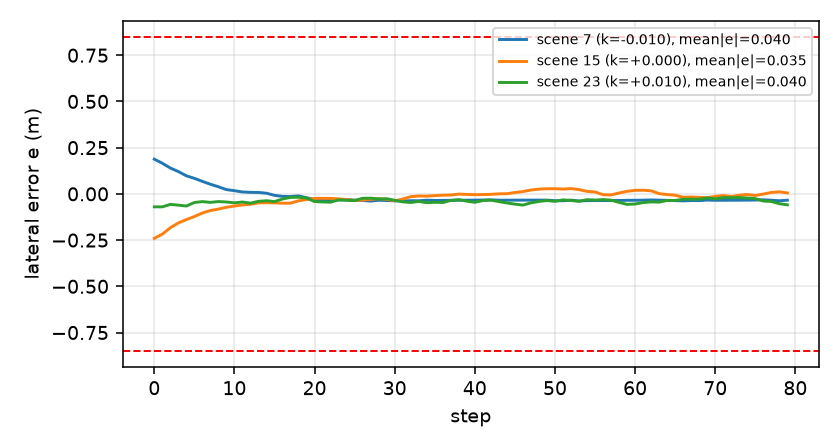

图注：3 个曲率下的闭环横向误差曲线；虚线是安全边界 `|e|≤0.85`。三条轨迹都保持在边界内并收敛到中心附近。

#### 前端做了什么

```text
192×192 渲染图
  → 冻结 DINOv2-S/14
  → 16×16 patch tokens
  → 1×1/3×3 卷积 + 空间 soft-argmax
  → 2 维 (ê,θ̂)
```

- patch 保留空间信息；全局 CLS 不足以区分细小的横向位置；
- `Cx=(e/0.85, θ/0.30)`；误差是二维归一化误差；
- 当前 test：e MAE **0.0211 m**，θ MAE **0.0059 rad**。

#### 控制器、CP、SBC

- 控制器：原图像 PPO；输入 `(ê,θ̂,κ)`，输出归一化转角，clip 到 `[-1,1]`，再乘 `0.45`；
- 轨迹 CP：每条 80 步轨迹一个分数 `max_t max(|e_t|,|θ_t|)`；199 校准 / 100 留出；半径 **0.0900931580**；留出 **95/100**；
- SBC：AEBS 同类非负网络；初始 **0.085828**，危险 **23.6535**；
- 连续域：三个曲率，**0 实际见证/0 未解决**；
- 图像闭环：**12/12** 成功；CP 覆盖 98.1–100%。

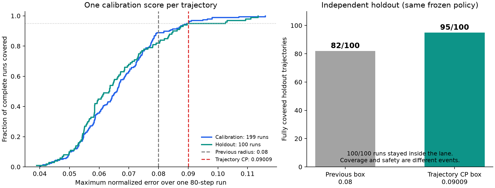

图注：校准/留出轨迹的最大误差与覆盖；半径 `0.090093` 是冻结阈值。

#### 状态相关 v2（修复对照）

- 前 99 条拟合 `b(e,θ)`，后 100 条校准；第 96 秩；无 cap；
- 校准 96/100；旧留出回归 93/100；
- 实际状态集合 **13,000 区间，三曲率 0/0**；
- 平均半径 0.0883927，观测最大 0.1093692，全局解析上界 0.2358151；
- 同一 100 条校准常量对照：0.0886653，旧留出 94/100；
- **旧数据回归，不是新盲测；没有明显优于常量；v1 仍撤回。**

#### 保证边界

- 只验证三个固定曲率，不是连续曲率；
- 只覆盖注册名义渲染分布，不是新相机/新天气/实车；
- 轨迹 CP 是整条轨迹的边缘覆盖，不是每个状态条件覆盖；
- 数值区间不是形式化浮点证明；
- 不证明目标到达。

### 4.4 停车场：4D 车辆 + 3D 视觉 + 在线后备

#### 任务是什么

车辆从 15 个注册起点出发，绕过障碍停入目标。状态是 4D 车辆状态；视觉观测是 3D；控制器是“参考规划 + 延迟观测器 + LQR/残差 PPO + 在线后备检查”。

#### 实际观测图

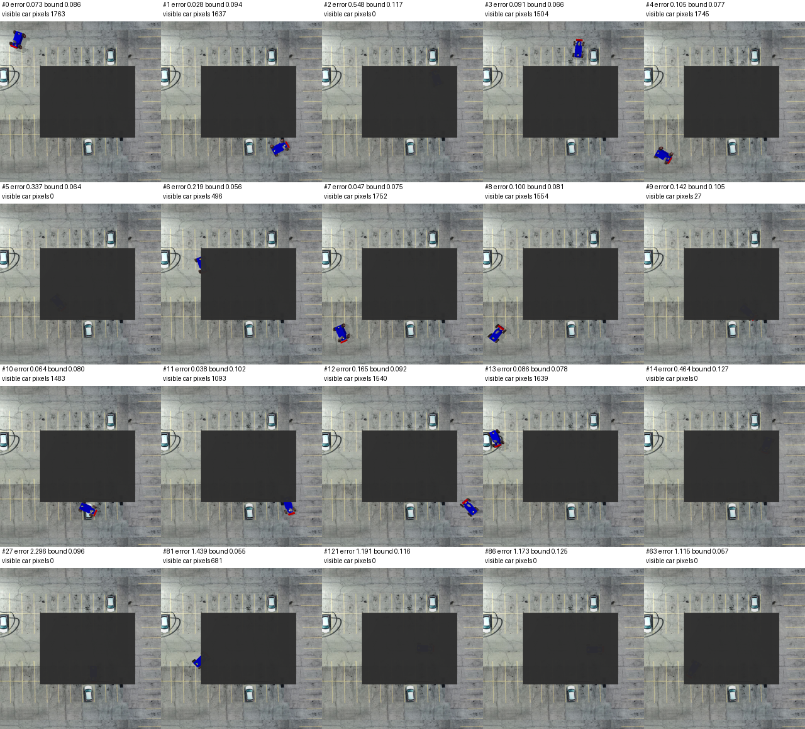

图注：开发期保存的 20 张同状态俯视观测图。每张图上方标了误差、当前 CP 半径和可见车辆像素数；黑色区域是渲染中的遮挡/未渲染区域。该图用于展示实际图像长什么样，最终数值以 2026-11-03 证书包为准。

#### 启动 CP 和信念

- 每个起点组单独采：16 拟合 / 32 校准 / 16 审计；
- 启动 CP 是**组条件**的，不是整条轨迹 CP；
- 初始信念保留“能解释当前观测”的起点组；控制器不能看真实组；
- 启动审计覆盖 **233/240**。

#### 后备和 SBC

- `BackupGovernor` 用区间信念检查动作；只有满足安全/目标后备的动作才执行；
- SBC 是“几何 ReLU 网络 + 有界学习头 + 线性时钟”的结构化非负网络；
- 初始 SBC **≤0.305**；危险 **≥20**；非终端漂移 **≤−0.005**；
- 证明域是**增广可达不变域**，不是原无过滤器 SPVC 的任意 8D 域。

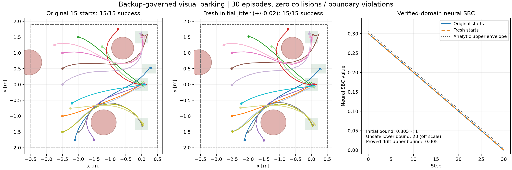

图注：左/中是原始 15 起点和 ±0.02 扰动起点的轨迹；右是 SBC 随时钟的解析上包络。30 条图像仿真全部成功，0 碰撞/0 越界。

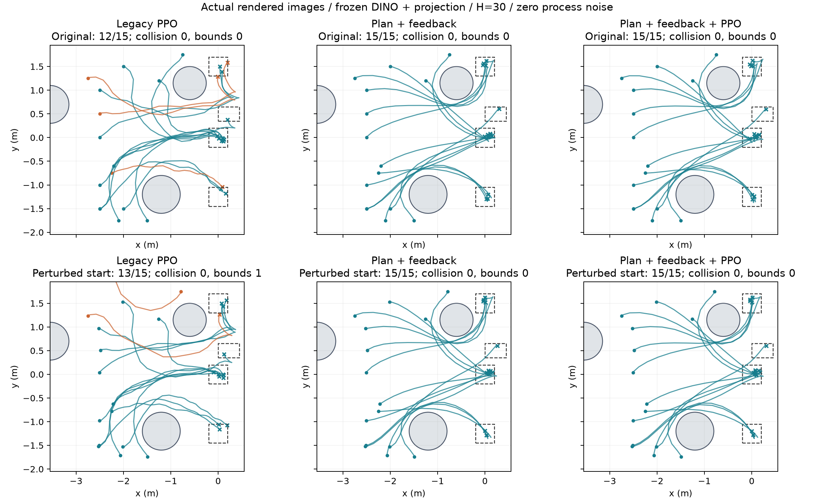

图注：Legacy PPO / 规划+反馈 / 规划+反馈+PPO 的轨迹对比；这是行为结果，不是新的概率证书。

#### 保证边界

- **必须使用在线后备**；只加载 PPO/SBC 权重不提供该包闭环保证；
- 不是原无过滤器 SPVC 的任意八维安全状态域；
- 初始抖动 ±0.02、30 步、零过程扰动；不是实车；
- 启动 CP 覆盖的是“同组新起点一次抽样”，不是固定状态条件覆盖；
- 启动之后的视觉误差可任意变化，但任务到达不保证。

### 4.5 移动机器人：3D 视觉任务跑通，但证书未通过

#### 任务是什么

机器人在 6×4 m 地图中绕过中央障碍到达目标；状态 3D `(x,y,θ)`，动作 2D（线速度、角速度）；120 步。

#### 实际观测图

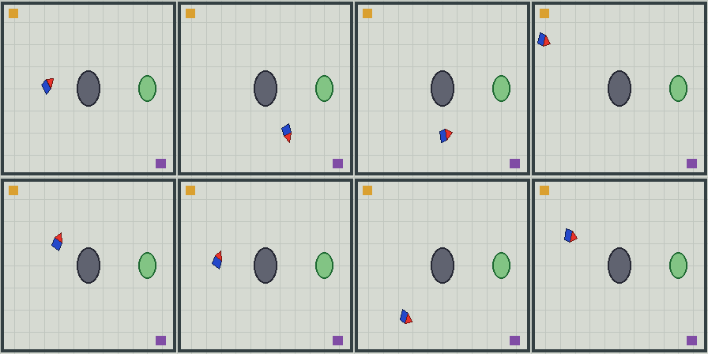

图注：8 张 224×224 实际渲染观测；橙色方块是目标，灰色椭圆是障碍，红/蓝三角是机器人位置和朝向。视觉输入没有真值坐标。

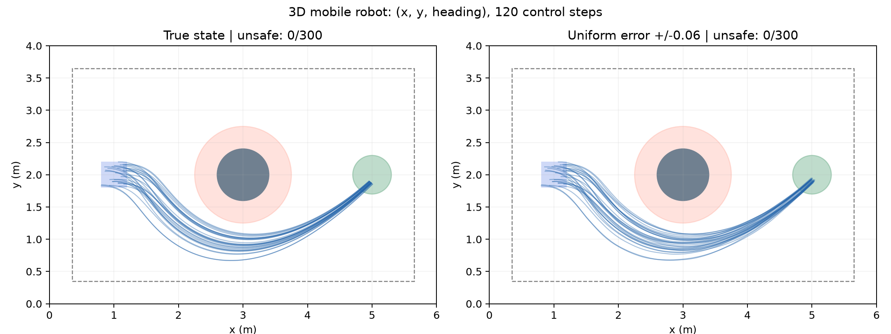

图注：左为真实状态，右为 ±0.06 均匀观测误差；300 条轨迹均无越界。行为成功不等于 SBC 证书通过。

#### 前端和 CP

- DINO patch tokens → 卷积 + 双空间注意力 → 3D 位姿；
- 轨迹 CP：39 校准 / 20 留出；半宽约 **(0.0488, 0.0488, 0.3254)**；留出覆盖 **18/20**；
- 24/24 开发图像闭环安全到达并停稳。

#### 为什么证书没通过

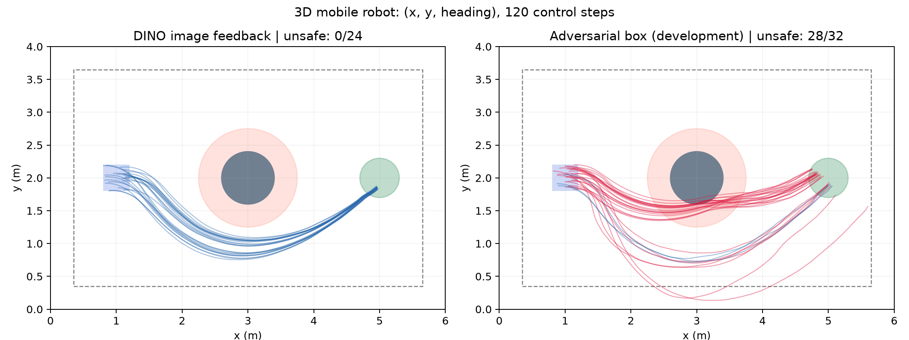

图注：左为 DINO 图像反馈（0/24 越界）；右为 CP 盒内对抗扰动（28/32 越界）。这不是“图像任务失败”，而是“固定控制器 + CP 盒”的鲁棒条件被实际反例否定。

- 初始 SBC 0.179、危险 20.807，但后继不增条件未通过，7,360 未解决；
- CP 盒内反例 28/32，21 条机器人/障碍物圆重叠；
- 结论：继续只训 SBC 不够；需要改控制器、误差表示或加在线后备。

### 4.6 前端误差的横向比较（正确口径）

同一 4,920 张 24k test：

| 方法 | test MAE | RMSE | 静态 CP95 | test 覆盖 |
|---|---:|---:|---:|---:|
| cGAN + state_net（旧 400 图检查点） | 2.747 m | 3.320 m | 5.221 m | 87.64% |
| 32×32 灰度 DINO（历史） | 0.1017 m | 0.1842 m | 0.2656 m | 90.47% |
| 32×32 灰度 DINO（重训，可重载） | 0.1079 m | 0.2010 m | 0.2797 m | 90.75% |
| **真实 RGB DINO** | **0.0874 m** | **0.1211 m** | **0.2307 m** | **93.33%** |

注意：

- 这是**静态图片级** CP，不是轨迹级的 0.418359 m；
- cGAN 是旧检查点，不是同预算重训；
- 灰度同时改了颜色和源分辨率（32×32→224）；
- rain 分组灰度 MAE 约 0.0725 m，反而低于 RGB 约 0.0967 m；
- 旧 `real_aebs_baselines/README.md` / `comparison.json` 的 “gray/RGB tube 通过” 是旧验证口径；正确修复版见 `real_aebs_repair_20261108_v1/status.json`：旧 SBC 对 RGB/灰度/cGAN 都不通过。前端误差数字仍可用，**tube 字段不要引用**。

### 4.7 联合学习视觉投影与 C：11/09 新增的独立实验

这一节是新增实验，不是把 4.1–4.6 的 `C` 改成可训练后重贴旧证书。它有自己的训练、CP、控制器接口和 SBC 验证。

#### 它到底改了什么

```text
图像 I → 冻结 DINO → 可训练视觉投影 pθ → y
真实状态 x → 可训练、逐行归一化的 C → Cx
训练：让 y 接近 Cx
冻结后：CP 校准 y−Cx 的误差
```

- 参考原 VISION-SLS 的 `SupervisedDinoObservability` 和 `loss_uni`：`C` 可训练，但每行做单位归一化；
- 原文件中的 Gramian 可观测性正则被注释，本轮没有启用；因此不能称为完整 VISION-SLS 的 SLS 综合或论文全部设计；
- 车道保留 patch 空间读出；AEBS 保留 CLS MLP，这是任务适配，不是逐层复制。

#### 实际观测图

联合实验复用同一批实际图像，没有新相机：


图注：AEBS 联合 C 版本仍使用这些真实 RGB 图像；变化在于视觉投影和 `C` 一起训练，而不是换数据。


图注：车道联合 C 版本仍使用这些渲染图；变化在于 `C` 可训练，并用 `C^{-1}` 做控制器坐标适配。

#### 车道联合 C：单对历史 + 5 对训练种子配对（11/10 更新）

- 2,160 训练 / 540 验证 / 540 静态校准 / 360 测试；
- 初始 `C0` 是旋转矩阵；视觉头最后一层同步旋转，避免初始预测错位；
- 视觉参数与未归一化 `C` 联合优化 30 epoch；第 29 epoch 选中；
- 学到的 `C`：

```text
[ 0.86586398  0.50027955
 -0.49891353  0.86665177 ]
```

- 与初始化 Frobenius 距离 0.00129498；最小奇异值 0.999211；条件数 1.001578；
- 控制器接口：`π_new(y,κ)=π_old(C^{-1}y,κ)`；不重新训练 PPO；
- 同预算静态消融：

| 设置 | e MAE | θ MAE | 最大归一化误差 |
|---|---:|---:|---:|
| 原视觉头 | 0.02111 m | 0.005884 rad | — |
| 额外 30 epoch，固定初始旋转 C | 0.017918 m | 0.005139 rad | 0.118784 |
| 额外 30 epoch，联合 C | 0.018018 m | 0.005140 rad | 0.114197 |

固定 C 与联合 C 平均误差非常接近，固定 C 甚至略好；联合 C 只在这一次测试的最大误差较小。**单对结果不足以证明联合 C 更优。**

- **单对历史闭环：**199 条校准和 100 条留出已完成，q=**0.0843381769**，校准 190/199，留出 93/100 全程覆盖，299 条均未越界；原神经 SBC 在新集合下三曲率 0/0。见 [旧单对报告](../../artical-F122/results/lane_vision_sls_joint_C_20261109_cp_v1/report.json)。

- **新增 5 对训练种子配对：**每对固定 C/联合 C 使用同一组新外部条件（校准 202611100101、留出 202611100102），各自重新生成 199+100 条闭环。结果：
  - q 均值：固定 **0.085263**，联合 **0.085699**（联合略大 0.5%）；
  - 留出覆盖均值：固定 **95.6%**，联合 **95.0%**；
  - 两边各 **5/5** 通过数值 SBC；所有留出 `unsafe=0`；
  - 联合 q 更小的对数 **3/5**，配对覆盖 `both=461, fixed-only=17, joint-only=14, neither=8`。
  - **结论：联合 C 没有稳定收益。** 不能写“学习 C 提高了可观测性或证书获得率”。详见[阶段一至二结果](SPVC前端替换_收益证明_阶段一至二结果_20261110.md)。

#### RGB AEBS 联合 C：通过数值 SBC，但留出只有 91/100

- 两维状态 `x=(d/S,v)`；1×2 `C=(C_d,C_v)`；图像头仍只输出一维 y；
- 静态图片没有速度标签，因此训练时对同一张图配辅助速度 `0、1.5、3 m/s`；这是**静态图片库适配**，不是声称单帧能观测速度；
- 部署：`d̂/S=(y−C_v v_measured)/C_d`；要求 `|C_d|≥0.2`；
- 学到的 `C≈[1.0, −8.4382×10⁻⁶]`，速度项接近零；
- 新回放轨迹 CP：q=**0.3945210491 m**；校准 **190/199**；留出 **91/100**；299 条均成功；
- 新半径下 SBC 数值验证：**102,338 区间，0 见证/0 未解决**，通过；
- **但留出覆盖 91/100，不到 95%**；不能写成“留出实测 95%”，也不能说联合版全面优于旧版。

#### 灰度 AEBS 联合 C v2：新 SBC 未通过

- 学到的 `C≈[0.99999809, 0.00193068]`；视觉尺度 S=3.2378063202 m，旧 SBC 状态尺度 3.1827206612 m，两者不混用；
- 新回放轨迹 CP：q=**3.5159164544 m**；校准 190/199；留出 **95/100**；299 条均成功；
- 新半径下 SBC：深度 0 的 4,096 个区间中 **78 个实际正漂移见证 + 74 个未解决**；**未通过**；
- 具体一步见证：`d=6.078125, v=0.398438`，在允许 `+3.515916 m` 误差下，控制器输出约 `−1.760951 m/s²`（负值加速），下一状态 `6.058203, 0.486486`，SBC 从 0 增到 2.720629，违反不增；
- 这只是一步条件反例，不等于已经展示从初始集合出发的碰撞，也不证明其他 SBC 不存在。

#### 联合 C 的保证边界

- 车道新轨迹CP与条件SBC数值审计已完成，留出全程覆盖93/100；条件与边际概率口径仍须分开；
- RGB 联合 SBC 通过，但留出覆盖 91/100；这是两个不同层面，不能互相抵消；
- 灰度联合 SBC 明确未通过；
- `C` 的可逆性/坐标适配有明确前提；若降维到一维，`C^{-1}` 接口不适用；
- AEBS 联合版是冻结图片库回放，不是在线 CARLA/实车；
- 没有重新训练 PPO；联合训练的是视觉投影和 C；
- 单种子；没有证明联合 C 的统计显著优势；
- 不继承固定 C 版任何 CP/SBC 证书。

---

## 5. 安全保证链条：从条件到风险上界

### 5.1 需要同时成立的四件事

1. **SBC 非负**：`B(x)≥0`；
2. **初始低**：对所有初始状态 `B(x)≤1`；
3. **危险高**：对所有危险状态 `B(x)≥20`；
4. **条件不增**：对活跃状态和所有允许后继，
   `B(x')≤B(x)`（或其期望不增）。

这里的“允许后继”包含：

- 动力学；
- 控制器；
- 观测误差集合 `E`；
- 有时还包括离散化/区间误差。

如果 1–4 都成立，并且过程在成功/危险时停止（停止后吸收），则非负超鞅停止论证给出：

```text
Pr(在停止前进入危险区) ≤ B(x0)/20
```

若初始 `B(x0)≤1`，则风险上界为 `1/20=5%`。

### 5.2 这是条件保证

完整表述应是：

> **在声明动力学、声明状态域、声明 CP 误差集合、声明离散化和数值模型下，若每次观测误差都在集合内，则 SBC 条件成立，风险上界为 `B0/20`。**

不能省略“若观测误差在集合内”。

### 5.3 CP 覆盖率不能替代这个条件

CP 说的是“新样本以 95% 概率落在集合内”，不是“对每个状态、每一帧都落在集合内”。SBC 验证需要后者。因此：

```text
CP 95% + SBC 通过
≠ 真实世界 95% 安全
```

正确说法是：

```text
CP 提供边缘覆盖；
SBC 提供“集合内”的条件安全；
两者拼接后仍依赖“集合内”这个假设。
```

### 5.4 数值区间不是形式化证明

当前验证器使用 float64 数学网络区间/仿射界，没有做全面的向外舍入，也不是 IEEE 浮点程序的形式化证明。因此准确说法是：

> **连续域数值区间检查通过；条件于观测 tube 支撑。**

不能写成“形式化验证通过”或“实车安全”。

### 5.5 结论、假设、证据三者对照

| 我们想说的 | 必须依赖的假设 | 当前证据 |
|---|---|---|
| 新轨迹的观测误差有约 95% 概率落在 CP 集合内 | 校准/新轨迹可交换、协议固定、模型未变 | AEBS 轨迹 CP 199 校准/100 留出；车道 199/100 |
| 若误差落在集合内，控制器满足 SBC 不增 | 声明动力学、固定 actor、误差盒覆盖、区间界有效 | AEBS 292,024 区间 0/0；车道 0/0；均为数值区间 |
| 初始风险 ≤ B0/20（B0≤1 时 ≤5%） | SBC 非负、初始≤1、危险≥20、停止过程/条件不增 | 区域界 + 连续域验证；不是实车统计 |
| 图像闭环能完成任务 | 冻结模型、渲染器、初态分布 | AEBS 4,800/4,800；车道 12/12；停车场 30/30 |
| 实车/新相机/新天气安全 | 需要新的数据、新的 CP、新的模型验证 | **没有**；当前不能这样说 |

**读法：**上行是概率/统计，中行是条件数值证书，下行是行为证据。三行不能互相替代。

---

## 6. 当前状态相关 CP 的准确结论

### 6.1 AEBS 状态相关

- 只学 `b(d)`，`C=[1,0]` 固定；
- 5,000 张 train 静态残差拟合 `b(d)`；
- 199 条轨迹取 q；
- 平均半径 0.3217 m，最大 0.7189 m；
- 校准 190/199，留出 92/100；
- 同一 SBC 41,070 区间 0/0；
- 不替换常量 0.418359 m 主结果。

### 6.2 车道状态相关 v2

- 前 99 条拟合 degree-1 Bernstein `b(e,θ)`；
- 后 100 条校准，有限样本秩 96；
- 无 cap；
- 校准 96/100，旧留出回归 93/100；
- 平均半径 0.0883927，观测最大 0.1093692，全局解析上界 0.2358151；
- 实际状态集合 13,000 区间，三曲率 0/0；
- 统一最大盒 0.235815 的扩大盒验证失败，这**不**等于实际状态集合失败；
- 旧 v1 仍撤回；
- 旧数据回归，不是新盲测；
- 没有明显优于常量盒（同校准常量 0.0886653、旧留出 94/100）；
- `C` 仍固定，不是联合学习。

---

## 7. 常见误解：这些说法都不对

| 错误说法 | 为什么不对 |
|---|---|
| “CP 95%，所以系统 95% 安全” | CP 只覆盖观测误差；SBC 还需要条件不增和初始/危险条件 |
| “SBC 验证通过，所以实车安全” | 只对声明动力学/状态域/数值模型成立，不是实车 |
| “0 见证就是通过” | 若还有 unresolved，仍未证明；必须 0 witness **且** 0 unresolved |
| “unresolved 就是反例” | unresolved 是界不够，可能是证明器太松，不是实际违反 |
| “平均半径更小，所以状态相关更好” | 还要看最大半径、覆盖、验证域；车道 v2 平均更小但旧留出更低 |
| “轨迹 CP 95% 等于每帧 95%” | 轨迹 CP 是整条轨迹最大误差的边缘覆盖，不是逐帧/逐状态条件覆盖 |
| “新 SBC 通过，所以灰度/cGAN 也通过” | 新 SBC 是对 RGB 轨迹半径训练的；其他前端需要各自验证 |
| “原 10/29 灰度 24.9659 可以套到当前 RGB” | 数据、SBC、CP、策略都不同 |
| “`C` 是联合学习出来的” | 固定 C 原版不是；4.7 的联合 C 版是另一个实验，有自己的 CP/SBC，不能把两者混用 |
| “旧 0.2307 m tube 通过” | 单位漏乘，旧结论已撤回 |
| “车道 v1 状态相关 93/100 可用” | v1 脚本/报告不一致、留出残差错误，已撤回；v2 是另一次修复回归 |

---

## 8. 代码地图：想改哪里看哪里

| 功能 | 文件 |
|---|---|
| AEBS 观测投影、固定 `C`、图像部署 | `Aebs/vision_sls/model.py` |
| AEBS 图像控制器加载 | `Aebs/vision_sls/deploy.py` |
| AEBS 动力学/回放 | `Aebs/vision_sls/env.py`、`rollout.py` |
| AEBS CP 分位/状态相关 `b(d)` | `Aebs/vision_sls/conformal.py` |
| AEBS 轨迹 CP | `Aebs/vision_sls/replay_trajectory_cp.py` |
| AEBS 状态相关 CP | `Aebs/vision_sls/state_dependent_aebs_cp.py` |
| AEBS 非负 SBC/区间界 | `Aebs/vision_sls/sbc_cp.py` |
| AEBS 连续域验证 | `Aebs/vision_sls/verify_sbc_cells.py` |
| 车道任务/动力学/安全集 | `Aebs/lane_keeping/core.py` |
| 车道 patch-DINO 观测 | `Aebs/lane_keeping/patch_perception.py` |
| 车道轨迹 CP | `Aebs/lane_keeping/trajectory_cp.py` |
| 车道状态相关 v2 | `Aebs/lane_keeping/state_dependent_cp.py` |
| 车道 SBC/区间界 | `Aebs/lane_keeping/learned_sbc.py` |
| 车道连续域验证 | `Aebs/lane_keeping/verify_learned.py`、`verify_state_cp.py` |
| 停车场启动 CP | `Aebs/vision_sls_parking/calibrate_startup.py` |
| 停车场后备/信念 | `Aebs/vision_sls_parking/backup_governor.py` |
| 停车场几何+学习 SBC | `Aebs/vision_sls_parking/geometric_neural_sbc.py` |
| 机器人观测 | `Aebs/mobile_robot/perception.py` |
| 机器人轨迹 CP | `Aebs/mobile_robot/trajectory_cp.py` |
| 机器人 SBC 审查 | `Aebs/mobile_robot/certify.py` |
| 车道联合 C 训练/接口 | `Aebs/lane_keeping/train_joint_observation.py`、`joint_observation.py` |
| AEBS 联合 C 训练/回放 | `Aebs/vision_sls/train_joint_observation.py`、`joint_observation.py`、`joint_replay_cp.py`、`joint_deploy.py` |

---

## 9. 复现顺序（简版）

AEBS：

```bash
conda activate vt
cd artical-F122

# 1) 前端/观测
python -m Aebs.vision_sls.run --data Aebs/data/Downsampled.h5 \
  --output-dir results/my_vision_sls

# 2) 轨迹 CP（已有主包时通常直接复用）
python -m Aebs.vision_sls.replay_trajectory_cp \
  --artifact-dir results/real_aebs_full_v1 \
  --output-dir results/my_replay_cp

# 3) 新 SBC（先确认 actor/前端/合同绑定）
python -m Aebs.vision_sls.train_sbc_cp \
  --artifact-dir results/real_aebs_full_v1 \
  --perception-contract results/real_aebs_replay_cp_20261108_v1/perception_contract.json \
  --output-dir results/my_sbc

# 4) 连续域验证
python -m Aebs.vision_sls.verify_sbc_cells \
  --artifact-dir results/real_aebs_full_v1 \
  --barrier-dir results/my_sbc \
  --perception-contract results/real_aebs_replay_cp_20261108_v1/perception_contract.json \
  --output-dir results/my_verify
```

车道：

```bash
python -m Aebs.lane_keeping.trajectory_cp ...   # 轨迹 CP
python -m Aebs.lane_keeping.verify_learned ...  # 常量盒 SBC 审查
python -m Aebs.lane_keeping.state_dependent_cp ... --output-dir results/my_state_cp
python -m Aebs.lane_keeping.verify_state_cp ... --contract ... --output-dir ...
```

具体参数以结果包 README 和协议 JSON 为准；不要用已存在的输出目录覆盖证据。

---

## 10. 一句话总结

> 当前框架是：**DINO 把图像变成低维观测，CP 把观测误差包成集合，非负 SBC 在“误差在集合内”的条件下证明控制器不把风险推高；最后得到的是声明模型/声明分布下的条件数值证书，不是无条件实车安全。**  
> 状态相关 `b(x)` 只是把误差包络做得更细；它不学习 `C`，也不自动让覆盖或证书更好。  
> 11/09 新增的联合 C 版是独立实验：它把视觉投影和 `C` 一起训练，但必须重新做 CP/SBC；目前 RGB 联合版通过数值 SBC 但留出 91/100，灰度联合版 SBC 未通过；车道单对历史 93/100，5 对种子配对没有显示联合 C 的稳定 q/覆盖优势。  
> 原 10/29 灰度、固定 C 当前 RGB、联合 C RGB/灰度、车道、停车场、机器人各有自己的数据和证明域，不能用一个数字横比。

---

## 11. 证据入口

- [当前方案与验证结果](当前方案与验证结果.md)
- [AEBS RGB 完整实验](AEBS真实RGB图像_完整实验_20261108.md)
- [AEBS 前端对比（含原 10/29 灰度）](AEBS前端对比_cGAN_灰度_真实RGB_20261108.md)
- [车道轨迹 CP 与 SBC](车道保持_轨迹级CP校准与SBC衔接_20261107.md)
- [停车场神经 SBC 专题](停车场神经SBC_构造证明与实验_20261103.md)
- [移动机器人三维视觉实验](移动机器人_三维视觉实验_20261108.md)
- [联合学习视觉投影与 C 专题](联合学习视觉投影与C_实验步骤与结果_20261109.md)
- [RGB 联合 C 结果](../../artical-F122/results/rgb_aebs_vision_sls_joint_C_20261109_cp_v1/report.json) · [灰度联合 C 包](../../artical-F122/results/gray_aebs_vision_sls_joint_C_20261109_cp_v2/README.md) · [车道联合 C 合同](../../artical-F122/results/lane_vision_sls_joint_C_20261109_cp_v1/perception_contract.json)
- 网站方法对比：`site/compare.html`
