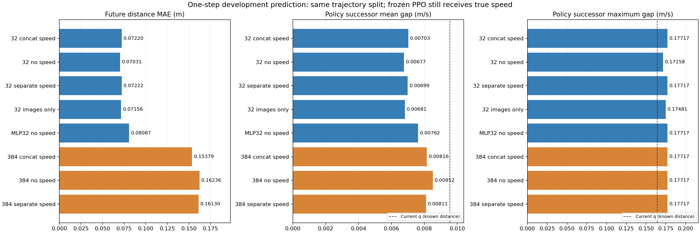
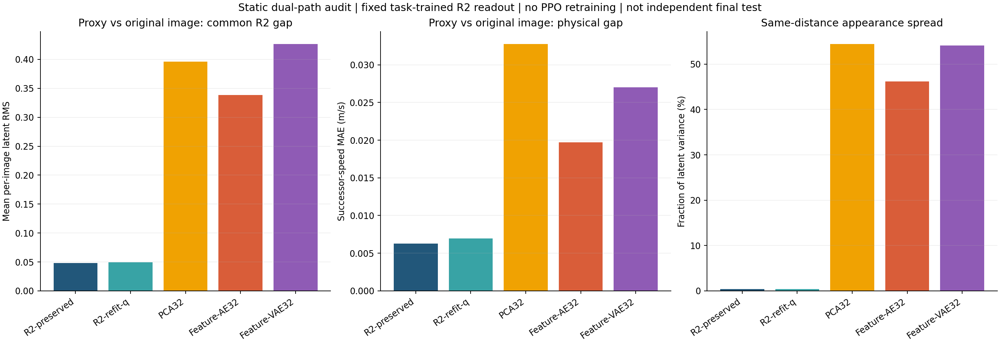
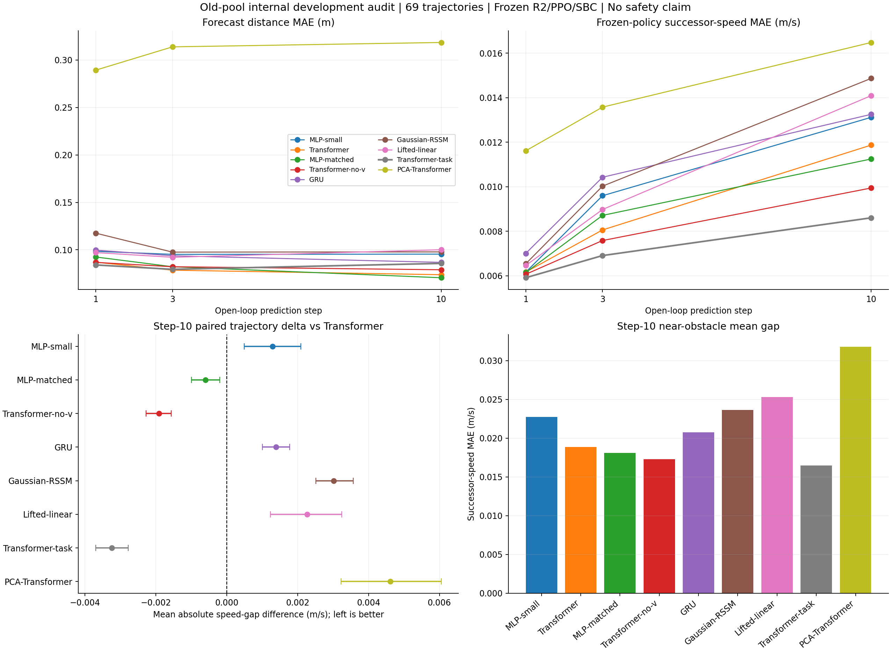
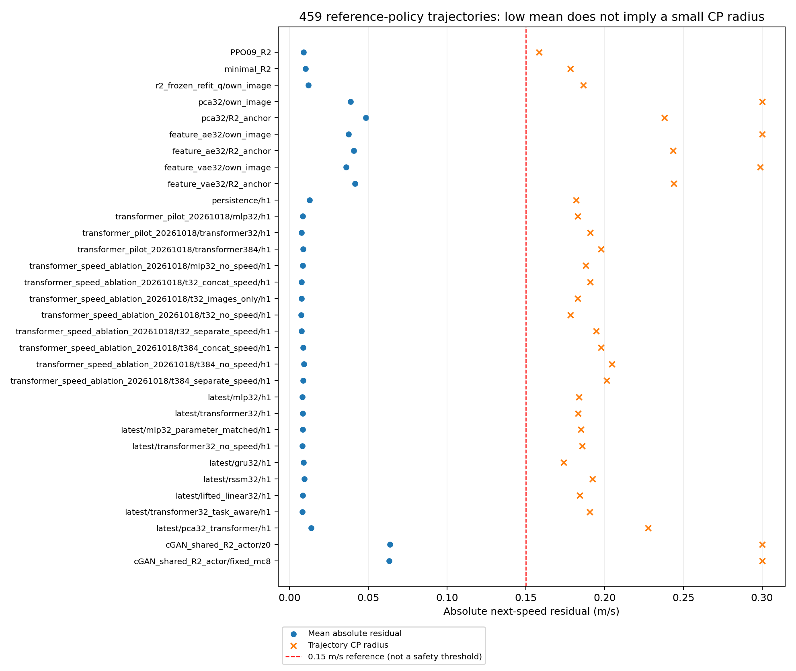
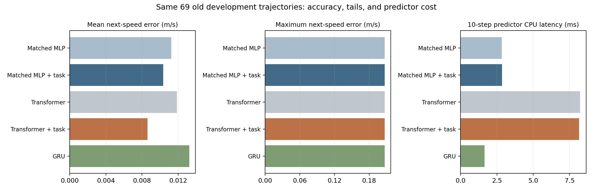

# 潜在表示与世界模型对照实验

2026年10月20日评价协议继续修订：静态一致性、未来预测和既有控制接口兼容性分开。原生32维/384维预测分别对比自身空间的保持不变基线；物理后继差报告轨迹等权均值、99分位、最差5%、双侧极值与单侧代理乐观误差，并补齐同一目标状态多长度对照和SBC评分差。不能把共同R2读出的排名称为原生架构总体排名，也不能以均值下降宣称证书余量全面改善。[新定义、全部结果及限制见第十七节](CP与SBC安全余量实验_逐步说明.md#十七-误差评价怎样更贴近控制与安全用途)。

2026年10月20日最新同步比较：已用现有459条真实同步轨迹完成九个候选分别接旧、新两个冻结控制器的50项检查；一步36451、三步35533、十步32320窗口，同长度内目标帧完全一致，不使用最近查图。当前PPO下一步速度差：原生q平均0.004919/最大0.084412，首轮32维Transformer平均0.003714/最大0.085299，首轮384维预测经R2接口平均0.004219/最大0.072142米/秒。不能再将旧actor上的尾部排名解释成与控制器无关的表示结论。首轮32维均值最好、384维一步最大值最好，但后者仍经R2投影，不是384维自有PPO完整系统。详见[同步对照完整说明](CP与SBC安全余量实验_逐步说明.md#十六-实验七-不查最近图片的同步轨迹对照)，保留旧实验作为历史，不宣称独立CP或新安全证书。

2026年10月20日准确性审计：全量原采集最大距离间隔约6毫米；按距离段划分后，单独训练/验证库有大空洞，因此旧最近图片闭环统计不等于同步真实图像性能。独立穷举82437次查找无算法错误，新增全量精确图像标签评估与严格观测对齐门槛。[完整通俗报告](CP与SBC安全余量实验_逐步说明.md)现包含原32维表示训练和控制、Transformer的token构造/因果掩码/递推/任务辅助损失、各轮结果和当前CP尝试。时序预测本身使用保存的同步轨迹帧，不受这类最近图片回放偏差影响；其旧策略分布、有限动作覆盖和未形成新控制证书的限制仍保留。

2026年10月20日后续主线实验已单独整理为[从误差半径到轨迹安全余量的实验说明](CP与SBC安全余量实验_逐步说明.md)。本轮没有换latent或重训PPO，而是比较全局速度盒与整轨迹风险CP；训练图像库内通过，验证库变化检查未通过，并用反事实分离了检索错位。该报告包含每一步配置、数据流、模型训练范围、全部正负结果和概率保证边界。下文保留此前表示选型与SBC基线历史。

2026年10月19日选型范围更新：不再将32维当作前提。新增第十九节，把表示维度、表示学习目标、未来预测器、完整控制算法分开比较；新增DINO-WM完整patch路线、JEPA-WM、V-JEPA、TD-MPC2、Dreamer和控制相关不变表示的论文与代码调研。旧静态PCA/AE/VAE结果经过R2读出，有利于R2，不能作为这些表示本身的最终排名。本轮新增原生坐标、独立测量头、多维度对比，结果与执行状态见第十九节。

最新比较目标和结果：距离MAE只作表示信息量的辅助检查，不作为控制或安全误差的主要排名。按用户要求，18组原生表示各自从头训练PPO，并完成统一米/秒残差评价。新R2组合的同配方参考半径为0.084412米/秒，静态审计最大0.140220米/秒，图片库1200回合全部成功；在本轮兼顾残差和任务表现最优。这里没有距离头或安全过滤器，仍不是新的独立CP或SBC证书。全部配置和结果见第二十节。

SBC阶段最新结果见第二十一节：新R2的每步全局±0.0844米/秒盒仍存在400个起点全部危险的允许序列，因此没有盲目训练该不可行强规格。另在固定新PPO、q不变的条件下完成原SPVC口径的代理SBC基线：保存模型硬违反1/10000、实际检查112点，原概率读数95.9345%，同一保存模型已复查，后端未改。这个代理读数不包含CP图像误差，不能称为端到端图像安全保证。

2026年10月19日补充：已完成原cGAN绝对误差审计、旧CP残差复现，以及全部54个已登记路径和预测步长组合的参考轨迹CP校准。当前minimal R2半径为0.178398米/秒，cGAN共享接口为0.300000米/秒；没有候选把半径降到0.15以下。平均误差改善不等于尾部误差已解决。定义、结果和限制见第十五、十六节，[全54项数值表](../../artical-F122/results/all_path_cp_reference_20261018_v1/全路径CP残差结果.md)。原PPO/SBC及候选权重未改。

同日继续审查见第十七节：现有检查适合做固定参考分布下的误差审计，不等于完成最终图像闭环验证。新增误差来源实验定位到6至7米、低速刹车切换和少数外观；还发现原单独actor更新中平滑惩罚的反向图断开。下一步优先修任务相关代理失配，并改用与安全约束相对应的结构化契约，而不是继续只换编码器或追求把数字压到0.15以下。

同日整体选型见第十八节：已补一组参数匹配任务MLP，并完成21条模型记录、19组不同预测器权重的统一状态及成本审计。表示与预测器分开选择；当前主线建议保留R2，不将世界模型直接替代前端。任务Transformer适合继续研究多步预测，任务MLP在一步精度接近时更便宜，但新候选尚无自己的PPO/SBC或独立CP保证。[完整选型数值表](../../artical-F122/results/route_selection_20261019_audit_v1/潜在路径整体适用性对照.md)。

## 一 本轮要回答什么

问题不是“Transformer一定比32维latent好不好”。Transformer是网络结构，latent是网络中的表示，两者不是同一类概念。现有DINO本身也是视觉Transformer。

用户提供论文的主要变化是：保留DINO特征，另训练一个因果Transformer，根据历史图像特征、动作和自身运动信息，预测下一时刻的图像特征。它用这个预测模型辅助学习屏障和控制器。

本轮先隔离检验预测部分：不经过原32维投影瓶颈的384维DINO特征预测，是否比32维空间上的预测误差更小？同时比较现有q代理与真实图像的差异。原表示、最终minimal控制器和SBC全部保留，不因新实验覆盖旧模型。

结果概括：已经在10.x服务器vt环境完成首轮3组训练，以及追加8组速度输入/融合消融。32维预测整体优于本轮384维全局特征方案；追加实验中，32维无显式速度版本的一步指标较好，速度独立注入版本的第三步平均物理误差较好。一步最坏物理误差仍未优于当前q代理，因此不替换保留模型，不把预测结果称为新安全闭环。追加对照见第十节。

同日进一步完成9组十步时序对照和4组静态候选/控制：在旧R2共同读出口径中，静态PCA、AE、VAE没有优于保留R2；这不是独立原生表示准确度排名。同距离外观变化分解支持继续检验任务对齐目标。时序任务辅助目标使第十步平均物理偏差降低27.51%，但最大偏差未改善，参数匹配MLP也有竞争力。调研、严格比较设置、完整结果和下一步见第十一至十四节。当前仍不替换原模型，也没有新闭环或安全证书。

## 二 论文和仓库调研

论文为Mehul Anand、Shishir Kolathaya的《Safety Certification in the Latent space using Control Barrier Functions and World Models》，arXiv:2507.13871v1，2025年7月18日。

本地论文：[原文](../references/Safety%20Certification%20in%20the%20Latent%20space%20using%20Control%20Barrier%20Functions%20and.pdf)。网络原文：[arXiv](https://arxiv.org/abs/2507.13871)、[HTML正文](https://arxiv.org/html/2507.13871v1)。

### 论文实际采用的结构

- 冻结DINOv2-small，使用16×16个patch、每个384维的特征。
- 因果Transformer接收历史特征、动作和自身运动信息，预测后继特征。
- 上下文长度3，训练时自回归预测3步。
- 论文使用随机动作生成约50000条转移，训练世界模型；随后使用约250条参考控制器轨迹学习屏障和控制器。
- 控制器和屏障是后续单独训练的网络，不是Transformer直接输出安全证书。

原文结论明确说明目前不提供形式化安全保证，主要鼓励更安全行为。因此不能把更换这个模型视为自动解决原项目的安全证明缺口。

### 找到了什么代码

截至本次检索，未找到能明确核实属于本篇论文作者的公开实现。检查了arXiv条目、正文链接、论文标题及编号的GitHub相关搜索；GitHub仓库搜索编号和相关标题返回0项。这不是断言代码永远不存在。

找到了论文引用的基础方法DINO-WM的[官方仓库](https://github.com/gaoyuezhou/dino_wm)和[官方项目页](https://dino-wm.github.io/)。它是被引用工作的代码，不是本篇屏障论文的官方复现。

已经下载官方DINO-WM供源码核对：

```text
tmp/dino_wm_reference_20261018
commit 0a9492fa12044b852ae9e001cc74604b79c8bb0c
```

核对了models/dino.py、models/vit.py和models/visual_world_model.py，包括DINO特征接口、时间因果注意力和动作/速度条件。未运行第三方安装脚本，未修改服务器的vt环境。当前试验使用自编小型适配实现，不冒称逐行使用了本篇官方代码。

## 三 本轮做的适配和没做的部分

完整patch特征包含每帧256×384个数，现有缓存只有每帧一个384维全局特征，通常称为CLS特征。

因此本轮是**全局特征版本的因果世界模型先导实验**。它保留论文的时间上下文、动作条件、速度条件和三步自回归机制，但不是完整patch-token复现。

```text
原表示：图片 → DINO全局384维 → 原投影32维

32维预测：历史32维表示 + 历史速度和动作 → MLP或Transformer → 预测未来32维

384维预测：历史DINO全局特征 + 历史速度和动作 → Transformer → 预测未来384维
```

384维分支的预测目标不经过原32维压缩。为先比较对当前任务的影响，评价时才将其预测结果送入冻结的原32维投影、距离辅助头和最终控制器。该读出只用于共同口径比较，不表示已经训练了一个完全不使用32维接口的新控制闭环。

本轮没有重训384维PPO，没有新SBC，没有CP，没有运行新CARLA回合。若后续要完全移除32维控制接口，仍须训练对应输入的新控制器和屏障，不能直接搬用原权重。

## 四 数据和防止混入未来信息的处理

使用服务器旧第13步轨迹：

```text
results/dino_expanded_v1/13_spvc_calibration_trajectories_v1/trajectories.h5
```

这批459条轨迹此前已经用于后续场景SBC开发。本轮继续将它视为开发数据，不再将它当作新模型的独立正式CP校准集。没有读取第20步新校准数据，也没有编码或评价保留的RGB test集。

按整条轨迹固定seed7划分367条训练、92条验证，同一回合的相邻帧不能跨到两边。表示本身仍是原R2，不能称它对这批轨迹分布是全新未见表示。

每个窗口包含连续3个历史观测，预测其后3个观测。程序检查有效帧掩码和物理状态相邻关系，不跨回合、不越过缺帧、不把自动重置后的起点当作下一帧。

学习预测器的输入不含真实距离，也不含未来真实latent或未来真实速度。未来速度上下文由已知解析速度更新和所查询动作计算。

实际得到28502个训练窗口、7085个验证窗口。每个窗口预测3步，窗口相互重叠，不能将21255个验证目标当作彼此独立的轨迹。回合末端没有足够未来帧的起点未纳入，尤其不能据此声称最后终止动作已被完整验证。

三步预测都给定同一段记录动作。这相当于“如果按这段动作运行，会看到什么”的开环查询，不是声称在线运行时预先知道未来自主决策。它只检验已有行为轨迹上的条件预测，尚无随机动作或新策略下的全面覆盖。

## 五 五组对照各自是什么

| 名称 | 作用 | 使用哪些信息 |
|---|---|---|
| persistence32 | 简单基线：把最后一帧32维表示原样当未来 | 当前表示，无训练 |
| current_q_known_distance | 当前q代理的一致性参照，不是可比的未来预测器 | 额外给定目标时刻真实距离 |
| mlp32 | 新训练的32维历史预测对照，不是原来就有的预测器 | 同一历史、动作和速度 |
| transformer32 | 区分“加时间注意力”与“取消32维瓶颈”的影响 | 同一历史、动作和速度 |
| transformer384 | 不经32维瓶颈预测DINO全局特征 | 同一历史、动作和速度 |

current_q_known_distance使用了未来真实距离，它代表当前物理代理已知状态时的表现。不能将它与预测器的距离标签误差作同信息预算的排名；可以同时展示，但必须分列解释。

三组学习模型均1200次更新、batch256、AdamW学习率0.0003、seed7，3帧上下文、3步预测。Transformer宽128、2层、4头、前馈宽256、dropout为0；这些是先导实验自定参数，不是论文公布的完整超参数。

输出采用相对上一表示的残差，从“保持上一帧”初始化，避免随机输出尺度决定初始结果。三组使用相同采样窗口顺序和预算，但参数数量不同，不是严格参数量匹配消融。

每200步在验证集评价，保存共同32维预测RMSE更小的候选；初始不更新模型也作为候选。这是开发选择，不是独立最终测试。每个模型训练空间的标准化统计仅从训练轨迹有效帧计算。

## 六 怎样公平比较误差

不能将384维本空间MSE与32维本空间MSE直接比较大小。本轮主要使用三种共同口径：

1. **共同表示误差**：全部预测读出为同一个冻结R2的32维坐标，与目标帧真实图像的R2表示比较。坐标和维数一致，但评价器与现有方案有关，不是中立通用视觉质量指标。
2. **目标时刻距离误差**：使用同一个冻结辅助距离网络读取预测表示，与实际距离标签比较，单位米。还单列相对真实图像读出的距离差，避免把原辅助头本身的偏差全部算成预测器误差。
3. **控制后继误差**：在目标帧同一物理状态、同一速度下，将预测表示与真实图像表示分别输入同一个最终minimal动作网络；比较动作差，以及由动作造成的下一速度差，后者单位米/秒。

第三项的下一速度是“预测观测所在时刻再执行一次动作”的后继，不是Transformer直接输出的下一速度。真实目标速度仅供这项固定控制器诊断使用，不进入预测器。

本轮原始时刻的图像编码器和距离辅助头都没有改变，所以不能据此声称“当前静态图像估距能力已经提高”。改进对象是给定历史动作后的未来观测预测。

所有误差保留平均绝对值、RMSE、绝对误差P95和最大值。均值改善而最大值恶化时，不直接选成安全版本。

## 七 实验结果

### 实际运行条件

服务器通过原跳板连接，使用原vt环境和RTX 4090。三组训练与模型选择耗时分别约14.39秒、46.06秒、45.64秒，合计106.09秒；不包括输入准备及各组最后的完整评价。

结果保存在新的results/transformer_pilot_20261018目录。本轮最终动作诊断加载的是minimal已复查的最终actor，不是静默退回第09步旧actor：其SHA256为2aafb6b35f4d521d01f72ed1981fbe4ce7b1cf1b914ae225965b1c8439fc481d。

### 一步预测的共同口径结果

共同latent列报告同一个R2坐标下的全局RMSE，不是各模型本空间训练损失。动作与后继列均相对目标时刻真实图像路径计算。

| 方法 | 共同latent RMSE | 距离标签MAE 米 | 动作差MAE | 后继速度差MAE 米每秒 | 后继差P95 米每秒 | 后继差最大 米每秒 |
|---|---:|---:|---:|---:|---:|---:|
| 保持上一图像表示 | 0.052262 | 0.138535 | 0.286537 | 0.012151 | 0.070728 | 0.177296 |
| 当前q代理，额外给定目标真实距离 | 0.036838 | 0.003949 | 0.212781 | 0.009549 | 0.058243 | 0.164149 |
| 32维MLP预测 | 0.037494 | 0.077549 | 0.175536 | 0.007574 | 0.044779 | 0.175561 |
| 32维Transformer预测 | 0.031966 | 0.072203 | 0.161124 | 0.007026 | 0.044778 | 0.177169 |
| 384维Transformer预测 | 0.048153 | 0.153791 | 0.193657 | 0.008156 | 0.048818 | 0.177169 |

额外给真实距离的q有信息优势，不能因为它的距离标签误差仅0.003949米，就说预测器在同样信息下输给了它。它仍有图像动作差，是因为“重建输入距离准确”不等于“与图像表示或图像控制相同”。

### 三步内误差是否积累

| 方法 | 第1步共同RMSE | 第2步共同RMSE | 第3步共同RMSE | 第3步后继速度差MAE 米每秒 |
|---|---:|---:|---:|---:|
| 保持上一图像表示 | 0.052262 | 0.079762 | 0.108890 | 0.036368 |
| 32维MLP | 0.037494 | 0.040298 | 0.042045 | 0.009627 |
| 32维Transformer | 0.031966 | 0.032302 | 0.033212 | 0.008976 |
| 384维Transformer | 0.048153 | 0.055060 | 0.057673 | 0.011015 |

在这3步范围内，32维Transformer较稳定，384维全局特征分支误差更明显积累。不能将3步结果外推到400步。

### 怎样解释好处和失败

1. **时间预测机制有正面线索。** 32维Transformer相对32维MLP，一步平均物理后继差下降约7.23%；这支持在已有低维表示上增加时序建模，而不是一定要去掉32维。
2. **不能说直接换384维更好。** 384维分支在共同表示、距离标签、平均动作差和平均后继差上均不如32维Transformer。它针对更广视觉信息训练、预算有限，且没有使用完整patch输入；目前不能把原因唯一归为某一种因素。
3. **相对当前q的平均后继差也有改善，但信息条件不同。** 32维Transformer的0.007026比q代理的0.009549小约26.42%。前者有真实图像历史，后者有目标真实距离；这是两种代理在同参考上的结果，不是同输入架构消融。
4. **最坏误差没有改善。** 32维Transformer最大后继差0.177169，比q的0.164149大约7.93%。P95变好不表示所有样本更好，不能直接据平均值下降沿用或提升原安全结论。
5. **不是静态估距从0.166降到0.072米。** 旧0.166来自4908张静态验证图；本轮0.072来自轨迹留出窗口上的未来表示读出。样本、时间任务和指标对象不同，不能直接作前后改进百分比。

验证选择的最佳更新次数：MLP为1200，32维Transformer为1000，384维Transformer为1200。参数量分别33824、273952、364416，因此MLP对照不是参数量相同的证明。

### 工程核对

三组权重和完整指标均已保存。本轮最初在最后指纹检查时出现str路径未转Path的类型错误；训练及逐组评价已完成，不涉及模型计算错误。修复后只运行finalize-only，重新核验固定输入并补写完成状态，没有再次训练、挑选模型或改动评价数值。

原R2表示、基础PPO、最终minimal actor、SBC和最终复查记录的文件指纹均与运行前一致。新模型与原文件分开保存。原SBC本轮没有被重新验证，文件未变不等于新预测模型自动继承它的结论。

主要结果：[metrics.json](../../artical-F122/results/transformer_pilot_20261018/metrics.json)；配置：[config.json](../../artical-F122/results/transformer_pilot_20261018/config.json)；轨迹划分：[split.json](../../artical-F122/results/transformer_pilot_20261018/split.json)。这些文件和3组预测权重已回传本地。

## 八 代码和检查

- [因果预测模型及窗口规则](../../artical-F122/Aebs/dino_latent/temporal_world_model.py)
- [训练与共同口径评价入口](../../artical-F122/Aebs/dino_latent/run_transformer_comparison.py)
- [预测与收尾检查测试](../../artical-F122/tests/test_temporal_world_model.py)

训练前服务器vt环境7项预测测试通过，覆盖整轨迹划分、缺帧窗口、因果注意力、未来动作不能影响较早预测、32/384维梯度、速度裁剪和非法输入。收尾另补MAE不能用有符号偏差代替、字符串路径指纹复核两项测试。

最终9项本分支测试加5项已有minimal接入测试，共14项通过。一次扩展检查还引用了服务器没有同步的旧测试模块，报模块不存在；最终按实际存在的上述两个测试模块重跑，14项全部通过，未改测试断言。

首次测试因模型文件尚未同步完成而未找到模块；完成同步后重跑7项全部通过。没有为通过测试而放宽时序或输入检查。

复现需在项目目录和原vt环境下执行，使用新的输出目录：

```bash
/opt/miniconda3/bin/conda run --no-capture-output -n vt \
  python -m Aebs.dino_latent.run_transformer_comparison \
  --steps 1200 --device cuda \
  --output-dir results/transformer_pilot_20261018_repeat
```

服务器经既有跳板连接：

```bash
ssh -J ab@frp-put.com:13409 -p 20020 root@10.11.154.191
```

## 九 决策原则

本轮决策是保留当前32维方案及原模型，不以384维全局Transformer替换。可以把32维Transformer作为有正面预测线索的研究分支，但尚未接入新闭环。

若继续，应优先在固定数据上核对大误差窗口和更接近论文的patch特征是否有额外信息；原数据缺少随机动作覆盖，也需要在更改控制策略前补齐。不能仅通过再加训练预算直到验证均值更好来宣布原方案被替代。

如果下一阶段确实改成完整patch或384维控制输入，需要重新训练匹配的控制器，再做同起点闭环对照；原SBC和CP结论都不能直接迁移到新的时序状态。本文没有宣称该阶段已经完成。

## 十 速度是否必须提供以及八组追加对照

### 论文并不是所有模块都只看图像

**直接回答：论文使用图像之外的运动信息。倒立摆实验明确把图像latent和角速度堆叠；Dubins车实验堆叠的是朝向角，前进车速固定为1。不能把它理解为完全不用运动状态的纯图像方案，也不能说它在所有任务中都拼接了变化的车速。**

论文第III.A节式6、式7中的p表示自身运动信息；历史图像特征、动作和p共同进入世界模型。第III.C节也明确说控制器使用当前latent与p。这里“自身运动信息”指机器人能额外获取的运动状态，不一定都是速度。

#### 原文哪里说明了输入和堆叠方式

| 原文位置                    | 明确说明的内容                                      | 能得出的结论                            |
| ----------------------- | -------------------------------------------- | --------------------------------- |
| PDF第3页，第III.A节，式6和式7    | 转移Transformer以历史latent、历史动作和历史p为条件预测后继latent | 世界模型不只看图像；公式本身没有交代内部具体如何融合p       |
| PDF第3页，第III.C节          | 控制器读取当前latent和当前p，输出动作                       | 控制器也使用额外运动信息，并非仅靠视觉latent         |
| PDF第5页，倒立摆实验式13之后       | 观测是RGB图像latent与当前角速度的堆叠，原文用词为stack           | 此实验明确采用视觉表示加角速度的组合观测；角速度不是车辆前进速度  |
| PDF第5页，Dubins车动力学及式15之后 | 车辆前进速度固定为v=1；观测是RGB图像latent与当前朝向角的堆叠         | 额外运动输入是朝向角，不能据此声称作者额外输入了一个变化的前进车速 |

“角速度”是转动快慢，“朝向角”是车头指向哪里，“前进车速”是向前移动多快。这三个量不能因为都属于运动信息就混称为速度。

还应区分两个层次：原文在实验中明确写了观测的stack，但没有由此完整交代转移Transformer内部的张量排列、速度是否单独成为token、或者是否先经过独立编码。因此，“观测包含运动信息”有直接依据；“Transformer内部一定把一个速度标量直接concat到每个视觉token后面”则不能从正文确定。

来源：[用户提供论文](../references/Safety%20Certification%20in%20the%20Latent%20space%20using%20Control%20Barrier%20Functions%20and.pdf)，PDF第3、5页。上面的输入说明属于该论文；前文找到的DINO-WM是其引用工作的代码，不是已核实的本文实现，不能用DINO-WM的可选融合配置反推本文一定采用哪种实现。

#### 对应到当前AEBS时哪些是我们的选择

当前AEBS车辆速度在变化，而Dubins实验的前进速度固定。我们让AEBS的p对应车辆速度，是面向制动任务的适配，不是照搬原文车辆实验中的输入变量。

| 模块 | 当前项目实际输入 | 速度如何进入 | 与论文的关系 |
|---|---|---|---|
| 视觉编码器 | 当前RGB图片 | 不输入速度，输出32维视觉latent | 保留视觉表示与运动状态的区分 |
| 保留的minimal PPO | 32维视觉latent或q latent，以及车速 | 拼成33维观测 | 本项目的控制接口；不是论文规定的唯一融合形式 |
| 本轮Transformer预测器 | 图像表示历史、动作，以及按分支选择的速度 | 直接拼接、独立编码后相加，或不输入 | 本项目新增对照，不是本文官方实现 |
| 保留的原SPVC SBC | 物理距离和速度 | 二维物理状态输入 | 沿用SPVC，不能与参考论文的latent屏障混为一谈 |

所以，“Transformer不一定要直接拼接速度”说的是融合方式可以改变；“完全不提供速度是否可行”说的是信息来源改变。两者不是一个问题。已有实验比较了速度输入与融合方式对短期预测的影响，没有把整套控制器改成不读速度。

容易混淆的是第III.B节：作者没有要求给屏障网络额外加p。这是在说屏障的输入，不是在说世界模型和控制器都不需要p。

我们现有的DINO和32维图像投影本来就只看图片，速度不参与生成这32维视觉表示；是在原PPO读取观测时，才把速度作为第33个输入。因此，“视觉表示需要32维”和“控制器另读一个速度”也应分开讨论。

因此，有两个不同问题：

- **速度一定要拼在视觉向量末尾吗？不一定。** 可以单独编码速度，再在网络隐藏层中融合；视觉表示本身仍保持32维或384维。
- **可以完全不给速度信息吗？有可能通过图像历史推断运动，但必须实验。** Transformer不会自动获得没有输入的信息。单帧看起来同样远的一辆车，速度不同，应该制动多少也不同。

当前任务的危险定义还直接依赖速度。若真的让控制器不读速度，需要训练匹配的历史观测控制器，并重新做任务及安全检查，不能直接从原33维PPO删掉最后一个输入就说等价。

例如同样距离7米的单帧图像，车辆速度0.4和2米/秒时，图像可能相同，但需要的动作不同。历史图像可以提供接近障碍物的快慢信息，这也是无速度预测器可能有效的原因；它依赖连续观测、已知时间间隔及足够视觉分辨率，不能凭Transformer名称认定这些条件自动满足。

### 本轮改变的是预测器 不是静默修改PPO

本轮仍是预测误差对照：预测器可以完全不使用速度；评价时，为了只比较预测表示对动作的影响，原最终PPO两边仍给相同真实速度。

因此“无速度预测器误差较小”最多说明：在这批轨迹和该预测任务上，历史图像与动作可能已提供足够信息。它不等于整条部署系统已经不需要车速传感器。

代码测试直接改变甚至将速度输入置为NaN，确认无速度预测分支的三步输出完全不受影响；仅图像分支还测试了改变动作不影响输出。没有通过保留一条隐藏速度输入来冒称“无速度”。

### 三种速度处理分别是什么

```text
拼接速度：图像特征、速度、动作放在同一输入数组，再编码。

不提供速度：只输入图像特征与动作；预测器不读取速度数值。

独立注入速度：图像特征与动作先编码，速度另外经过小网络，
              两者在128维隐藏特征上相加，再做因果注意力。
```

独立注入不是删除速度，而是删除“在原始视觉向量后拼接速度”的形式。当前实现是相加融合，不是一个独立注意力token，不能把两者叫成同一个结构。

### 八组方案和公平设置

| 实验名 | 图像表示 | 速度进入预测器的方式 | 动作进入预测器 | 用途 |
|---|---|---|---|---|
| t32_concat_speed | 32维 | 直接拼接 | 是 | 重跑上轮32维基线 |
| t32_no_speed | 32维 | 完全不提供 | 是 | 直接检查速度贡献 |
| t32_separate_speed | 32维 | 独立编码后相加 | 是 | 检查是否必须拼接 |
| t32_images_only | 32维 | 完全不提供 | 否 | 仅历史图像能做到多少 |
| mlp32_no_speed | 32维 | 完全不提供 | 是 | 不用注意力的无速度对照 |
| t384_concat_speed | DINO全局384维 | 直接拼接 | 是 | 重跑上轮384维基线 |
| t384_no_speed | DINO全局384维 | 完全不提供 | 是 | 高维下检查速度贡献 |
| t384_separate_speed | DINO全局384维 | 独立编码后相加 | 是 | 高维下检查融合方式 |

全部继续用原来的367条训练轨迹、92条验证轨迹，以及相同的28502/7085个训练/验证窗口；每组1200次更新、batch256、seed7、上下文3帧、预测3步。没有根据某组效果临时增加预算。

两组拼接速度基线重新训练，方便核对代码扩展是否改变上轮默认行为。原两轮目录分开保存，不覆盖第一轮结果。

除了全体平均、RMSE、P95和最大值，本轮还按目标观测时刻速度分0至0.5、0.5至1.5、1.5至3米/秒三组，检查总体平均是否掩盖某个速度段的误差。分组只用于结果解释，不进入模型选择。

一步预测的三组数量分别为711、1009、5365个窗口，约75.72%处于高速度组；第三步分别895、1009、5181个窗口。数据来自同一个旧策略，距离、速度、动作之间可能具有较强相关性，因此无速度模型的好结果也不能直接推广到任意策略或随机动作。

不直接输入速度，也不等于数据中没有速度线索。历史图像的接近速度和旧策略输出的动作都可能间接反映运动状态。因此还保留“仅图像历史”对照，但不能将去掉显式速度后的平均得分改善直接解释为速度信息没有价值。

还要注意当前三步只有0.15秒。在原动力学中，本步动作先改变下一速度，本步的下一距离由当前速度决定。因而动作对随后图像距离的影响有延迟。仅图像模型若在这个短期任务上得分接近，不足以说明它能够预测改变动作后的反事实运动；它甚至可能主要学到旧策略的轨迹规律。真正用于新动作规划前，还需更长预测范围和变化动作的数据。

预测与minimal接入检查共18项通过。保留的R2、PPO与SBC不更新，fresh CP和RGB test继续不读取。

### 追加结果

8组已在原vt环境完成，训练和选择累计约333.63秒。结果目录为results/transformer_speed_ablation_20261018，配置、划分、完整指标和8组权重均已回传本地。固定模型与输入文件指纹均未变化。

#### 一步预测的全体误差

以下仍在同一个冻结R2坐标、同一个距离辅助头和同一个最终minimal控制器下评价。距离列是预测的目标时刻距离标签MAE；速度差列是将预测/真实图像表示分别送入同一PPO后造成的物理后继差，不是预测器直接输出速度。

| 方案                       | 共同latent RMSE |  距离MAE 米 |   动作差MAE | 后继速度差MAE 米每秒 | 后继差P95 米每秒 | 后继差最大 米每秒 |
| ------------------------ | ------------: | -------: | -------: | -----------: | ---------: | --------: |
| 32维 Transformer 拼接速度     |      0.031966 | 0.072203 | 0.161124 |     0.007026 |   0.044778 |  0.177169 |
| 32维 Transformer 无速度，有动作  |      0.030616 | 0.070307 | 0.154842 |     0.006768 |   0.041728 |  0.171580 |
| 32维 Transformer 速度独立注入   |      0.033057 | 0.072224 | 0.161364 |     0.006987 |   0.042974 |  0.177169 |
| 32维 Transformer 仅图像历史    |      0.031340 | 0.071565 | 0.156487 |     0.006814 |   0.042493 |  0.174808 |
| 32维 MLP 无速度，有动作          |      0.037974 | 0.080867 | 0.177007 |     0.007624 |   0.046617 |  0.177169 |
| 384维 Transformer 拼接速度    |      0.048153 | 0.153791 | 0.193657 |     0.008156 |   0.048818 |  0.177169 |
| 384维 Transformer 无速度，有动作 |      0.050410 | 0.162363 | 0.202676 |     0.008523 |   0.051218 |  0.177169 |
| 384维 Transformer 速度独立注入  |      0.050909 | 0.161302 | 0.193936 |     0.008107 |   0.049150 |  0.177169 |

32维无速度版本相比32维拼接速度：共同表示RMSE下降约4.22%，距离MAE下降约2.63%，动作MAE下降约3.90%，平均后继差下降约3.68%，最大后继差下降约3.15%。这些是本轮固定seed和预算的开发数值，不是已证实的普遍架构优势。

它的一步最大后继差0.171580，仍大于当前q代理在同组窗口上的0.164149。不能只因比上轮Transformer更好，就说已经解决最坏误差或完成安全覆盖。

384维分支中，去掉速度后，一步共同误差、距离误差及平均动作/后继误差均变差；速度独立注入的平均后继差略好，但距离和共同表示指标更差。因此高维分支也没有“一删速度就更好”的规律。

#### 第三步的误差

| 方案 | 第3步共同RMSE | 第3步距离MAE 米 | 第3步后继差MAE 米每秒 | 第3步后继差最大 米每秒 |
|---|---:|---:|---:|---:|
| 32维 拼接速度 | 0.033212 | 0.070031 | 0.008976 | 0.177169 |
| 32维 无速度，有动作 | 0.031773 | 0.067838 | 0.008500 | 0.161387 |
| 32维 速度独立注入 | 0.035278 | 0.065804 | 0.007882 | 0.177169 |
| 32维 仅图像历史 | 0.033415 | 0.073131 | 0.008667 | 0.160382 |
| 32维 MLP 无速度，有动作 | 0.042210 | 0.075923 | 0.008948 | 0.174477 |
| 384维 拼接速度 | 0.057673 | 0.181864 | 0.011015 | 0.190915 |
| 384维 无速度，有动作 | 0.059504 | 0.188012 | 0.010983 | 0.192123 |
| 384维 速度独立注入 | 0.060134 | 0.189058 | 0.011051 | 0.167661 |

第三步的距离和平均后继差是32维独立注入速度更好；第三步共同表示误差是32维无速度更好，最大后继差则仅图像历史略小。没有一个方案在全部指标和全部时刻都最好。

这也表明，“latent误差更小”不总是等于“控制动作或物理后继更好”。目前用共同latent RMSE选择开发模型，不代表它已经是最适合安全控制的最终选择标准。

#### 分速度段看平均物理后继差

| 方案 | 低速0至0.5，711窗口 | 中速0.5至1.5，1009窗口 | 高速1.5至3，5365窗口 |
|---|---:|---:|---:|
| 32维 拼接速度 | 0.021386 | 0.028781 | 0.001032 |
| 32维 无速度，有动作 | 0.020623 | 0.027410 | 0.001050 |
| 32维 速度独立注入 | 0.021172 | 0.028653 | 0.001033 |
| 32维 仅图像历史 | 0.020625 | 0.027819 | 0.001033 |
| 32维 MLP 无速度，有动作 | 0.023065 | 0.031702 | 0.001049 |
| 384维 拼接速度 | 0.023197 | 0.030340 | 0.001990 |
| 384维 无速度，有动作 | 0.023833 | 0.032201 | 0.002041 |
| 384维 速度独立注入 | 0.023921 | 0.030091 | 0.001876 |

表中单位均米/秒，区间左闭右开，最后一组包括速度3。32维无速度版本在低速和中速平均更好，高速平均略差；总体平均的改进不是每个速度段都改进。

高速段后继差较小也不等于高速更安全。当前动力学会把速度裁剪到0至3，相同裁剪结果可能压小动作差在下一速度上的表现。分组指标是偏差度量，不是事故概率。

#### 直观图和结果文件



图中蓝色为32维分支，橙色为384维分支；左为预测距离MAE，中间为平均后继速度差，右为最大后继速度差。虚线为当前q代理，仅作同参考偏差比较，q有额外真实距离输入，不能当成相同信息量的预测器。

- [完整误差指标及速度分组](../../artical-F122/results/transformer_speed_ablation_20261018/metrics.json)
- [配置及每组输入方式](../../artical-F122/results/transformer_speed_ablation_20261018/config.json)
- [训练验证轨迹身份](../../artical-F122/results/transformer_speed_ablation_20261018/split.json)

另外对两组重跑的拼接速度基线进行了核对：32维和384维的全部权重张量与上轮相同，三步主要评价指标最大差为0。这说明本轮扩展未悄悄改变原默认模型行为。新消融的输入维数不同，初始化与参数数量也不完全相同，不能说它们逐张量受控相同。

#### 对速度问题的结论和下一步

**不必须在视觉向量后拼接速度，但不能把论文理解为完全没有自身运动信息。** 在当前32维、短时预测和旧策略数据上，无显式速度的版本有正面结果；在384维上去掉速度却没有整体改善。

向导师解释时可以这样说：“参考论文并没有完全取消运动信息：倒立摆用角速度，车辆用朝向角且车速固定。我们的AEBS车速会变，所以原控制器仍额外读取车速。这次只在世界模型中比较了速度的三种处理方式；32维不显式输入速度的预测器一步平均误差略低，但还没证明控制器可以不读速度，也没有由此取得新的安全保证。”

当前最值得保留两个预测候选：32维无显式速度，以及32维独立注入速度。前者一步多项指标较好，后者第三步平均物理误差较好。原minimal闭环继续保留，不用其中任意一个直接覆盖原控制器。

若目标是整套系统不读车速，下一步必须把控制器输入也改成图像历史和过去动作，训练匹配的新PPO；它的运动信息来自历史，而不是从原33维控制器中直接删除速度。之后再在相同起点检查完成率、末端危险、超时，以及更广速度与动作组合。

在这之前，不将本轮结果写成“纯视觉PPO已经成功”或“可以删除速度传感器”。完整patch模型、长时预测和随机动作泛化也仍未验证。

追加实验复现命令如下，仍需全新结果目录：

```bash
/opt/miniconda3/bin/conda run --no-capture-output -n vt \
  python -m Aebs.dino_latent.run_transformer_comparison \
  --suite speed_ablation --steps 1200 --device cuda \
  --output-dir results/transformer_speed_ablation_20261018_repeat
```

## 十一 扩展调研和更有说服力的对比设计

2026年10月18日追加。本轮把两个不同问题拆开：一是当前图像与距离代理能否在latent中更一致；二是给定图像历史和动作后，能否更准确预测未来。前一个直接对应导师关心的双路径误差，后一个检验世界模型能否提供帮助。预测任务的改善不能替代双路径一致性证据。

### 调研了哪些论文以及实际借鉴了什么

| 方法和一手来源 | 通俗理解 | 本轮实际做法 | 不能冒称的内容 |
|---|---|---|---|
| [DINO-WM](https://arxiv.org/abs/2411.04983)，[作者仓库](https://github.com/gaoyuezhou/dino_wm) | 不生成像素图片，直接根据动作预测视觉特征 | 冻结DINO，比较32维特征上的因果Transformer；另以PCA压缩的32维特征作对照 | 缓存不是空间patch，不能称完整DINO-WM；没有运行其动作规划器 |
| [PlaNet](https://arxiv.org/abs/1811.04551)，[作者仓库](https://github.com/danijar/planet)；[DreamerV3作者仓库](https://github.com/danijar/dreamerv3) | 用循环记忆保存过去，并用随机隐变量表示不确定性 | 普通GRU对照，以及含高斯先验、后验、重参数化采样和KL训练项的RSSM适配 | 不是完整DreamerV3。DreamerV3使用类别随机表示；本轮没有奖励预测、想象中的策略训练或在线规划 |
| [TD-MPC](https://proceedings.mlr.press/v162/hansen22a.html)、[TD-MPC2](https://arxiv.org/abs/2310.16828)，[作者仓库](https://github.com/nicklashansen/tdmpc2) | latent应保留做任务需要的信息，不必重建全部视觉细节 | 同一Transformer增加冻结距离读出和冻结PPO动作的一致性损失 | 这是本项目的任务敏感辅助目标，不是TD-MPC2算法；没有训练其价值网络、奖励模型或MPC |
| [DeepKoopman](https://arxiv.org/abs/1712.09707)，[作者仓库](https://github.com/BethanyL/DeepKoopman)；[可控Koopman线性预测](https://arxiv.org/abs/1611.03537)，[作者仓库](https://github.com/MilanKorda/KoopmanMPC) | 学一个坐标变换，使动力学在新坐标里尽量像线性系统 | 从历史观测编码出64维隐状态，再作线性递推和速度/动作输入，最后读回32维视觉表示 | 只是借鉴提升坐标和受控线性递推，没有证明Koopman不变子空间，也没有线性模型的安全定理 |
| [Auto-Encoding Variational Bayes](https://arxiv.org/abs/1312.6114) | 用分布而不是一个固定点编码观测，通过重建和KL正则训练 | 在冻结384维DINO特征上训练32维特征VAE，与普通AE、PCA及原R2比较；评价使用后验均值 | 不是从RGB重新训练完整视觉VAE；高斯分布和KL本身不是误差覆盖保证 |
| [V-JEPA 2](https://arxiv.org/abs/2506.09985)，[官方仓库](https://github.com/facebookresearch/vjepa2) | 用视频学习表示，再学习动作条件的预测 | 本轮完成调研，暂不放进已完成结果表 | 现有缓存只是DINO单帧全局特征，不是该模型的视频输入。不能给现有预测器换个名字就声称跑过V-JEPA 2 |

以上来源的“论文方法”和“本轮实际做法”分列，是为了避免把某篇完整算法的名字贴到一个小网络上。现阶段是在当前任务上筛选机制，不是给这些论文做综合排行榜。PCA和普通GRU/AE还作为简单基线，检查复杂机制是否真的必要。

“都尝试”在本轮落实为先运行数据支持的小型适配：9组时序预测，以及PCA、AE、VAE和等预算q重拟合等静态对照。完整patch DINO-WM和V-JEPA 2需要不同输入和训练流程，列为待补数据的独立实验，不算已做过，也不当成失败路线。

### 为什么需要比此前更严格

1. 此前3步只覆盖0.15秒，本轮预测10步，即0.5秒，检查误差是否随时间累积。这仍不是400步闭环。
2. 此前同一个验证集选择权重又报告最终分数。本轮另分模型选择集和结束后才检查的内部检查集，避免本轮逐次挑权重直接针对最后展示的样本。
3. 以前MLP参数量明显小于Transformer。本轮额外加接近参数量的MLP，减少“只是网络更大”的解释。
4. 平均值可能被大量高速度、速度裁剪后的简单样本主导。本轮同时检查低/中/高速、离障碍物较近的位置，以及天气颜色组合。
5. 相邻窗口高度相关，不能把几千个窗口当几千次独立实验。本轮按整条轨迹重采样，计算配对差值的区间；静态图片则把同一小段距离内的全部外观放在同一重采样组。
6. 不同latent的数值尺度不同，原始MSE不能直接排名。本轮使用同一冻结R2读出和同一物理单位，并单列各自坐标内的相对误差和读出适配自身的误差。

### 两类实验具体比较什么

静态双路径实验：

```text
同一张真实图像的冻结DINO特征 → 编码器 → 图像latent
同一张图像的真实距离          → q网络  → 代理latent

先比较同一方案内的两条latent，再经统一读出比较动作及下一速度差。
```

PCA、AE和VAE先把各自32维latent解回384维特征，再经原R2投影读到共同32维空间。这样旧PPO不必更换，但这条评价链带有额外读出误差，且评价器与R2有任务训练关系。因此既报告“新图像路径与新代理路径之差”，也报告两条新路径分别偏离原真实图像R2表示多少，防止两条路径同时失真却看上去很一致。

时序预测实验：

```text
相同3帧历史图像表示、速度和记录动作 → 各预测器 → 未来1至10步表示
未来真实图像表示                            → 共同参考

同一冻结距离读出和PPO → 米、动作差、米/秒等共同单位。
```

无速度分支是显式消融，其他分支输入信息相同；PCA分支用不同视觉坐标，所以是“表示与动力学组合”的对照，不能只归因为注意力结构。所有分支都只得到相同记录动作序列，不得到未来真实图像、距离或速度。任务辅助训练的未来距离只作为训练标签；其动作诊断所需的未来速度由当前速度和已查询动作解析计算。

q参照额外得到未来真实距离，单列为“已知状态的代理一致性参照”，不是同输入的未来预测竞争者。

### 数据隔离的确切边界

时序实验继续用旧第13步459条开发轨迹，按整条轨迹、split seed71分为321条训练、69条选择、69条内部检查。上下文3帧、预测10步，窗口只能来自同一条连续有效轨迹。所有方法用相同窗口和训练批次抽样规则，单个训练seed7，不增加多随机种子实验。

静态实验继续用既有19,080行非test特征缓存。训练只使用原train；原validation按完整精确距离组再分为选择组和内部检查组，同一距离的不同天气颜色不能拆到这两边。PCA只在训练数据拟合；AE/VAE编码器和新q的权重只用选择组挑选。

这里的“内部检查”只是本轮预测器或新编码器没有用来更新/选择权重。旧轨迹、旧validation以前都参与过项目开发，R2也曾用旧validation选择，因此不能包装成全项目从未接触的独立test。全新RGB test和新CP校准集仍不读取。

### 训练设置和模型选择

时序模型均800次更新，batch128，AdamW学习率0.0003、weight decay0.0001，梯度范数上限1。每200次及首末次在选择集评价，以10步共同R2 RMSE选择权重；初始模型也可被保留。不给任何单组追加训练直到胜出。

| 分支 | 机制 | 额外说明 |
|---|---|---|
| mlp32 | 128宽的普通前馈历史预测 | 保留小型基线 |
| mlp32_parameter_matched | 456宽MLP | 与128宽两层Transformer的总参数差控制在2%以内；FLOPs和墙钟时间不完全相同 |
| transformer32 | 原32维、速度拼接的因果Transformer | 本轮统一参照，不直接用上轮不同划分的分数 |
| transformer32_no_speed | 去掉显式速度 | PPO诊断仍读取目标真实速度，不是无速度控制器 |
| gru32 | 128维循环记忆 | 历史编码后自由递推，不用未来真实表示纠正 |
| rssm32 | 128维确定性状态和16维高斯随机状态 | 训练采样，评价作均值递推；KL权重0.001、额外重建权重0.1 |
| lifted_linear32 | 64维提升坐标、受控线性递推 | 当前状态重建辅助项权重0.1；没有强制稳定性谱约束 |
| transformer32_task_aware | 与transformer32相同结构，加任务辅助目标 | 距离标签损失权重1，动作一致性损失权重0.1；不是TD学习或PPO联合更新 |
| pca32_transformer | DINO特征用训练集PCA压缩至32维，再用同类Transformer | 评价经PCA反变换后进入固定R2；压缩损失也是该组合误差的一部分 |

除专门的MLP参数对照外，其他结构没有逐一匹配参数量；逐组保存参数数目和耗时，不能据一次短预算说某一论文系列本质更弱。RSSM均值递推分数也不能代表其完整概率预测质量。

静态AE/VAE各训练1200次、batch256、AdamW学习率0.001；AE以特征重建训练，VAE另外加0.001倍KL。新q各训练1500次，拟合编码后的训练图像表示，目标坐标按训练统计标准化；选择组决定保留哪次q更新。另给冻结R2同样的1500次新q拟合，帮助区分表示质量和代理拟合预算。原R2整套模型仍另列为保留基线，它历史训练预算和任务监督不同，不是全流程等预算基线。

### 怎样看配对区间和危险邻域

配对差值始终是“候选绝对误差减参照绝对误差”，负数表示候选更小。对每条轨迹先平均其窗口，再按整条轨迹有放回抽样2000次，报告95%百分位区间。它只刻画固定训练模型在当前开发分布上的轨迹差异，不涵盖重复训练的随机性，也不是CP契约或安全置信度。多组多指标区间没有作多重比较校正，不宜据一个刚低于零的区间宣布算法胜出。

“近障碍物”分组定义为目标距离不大于8米且速度至少0.5米/秒，只是便于定位误差的分析切片，不是重新定义安全集或人工计算可恢复集。天气颜色分组使用原采集标签，没有额外宣称未见天气泛化。各组必须显示样本数；最差位置保存轨迹编号、时间、物理状态和外观，便于复查。

本轮不以某个单一总体均值决定换主线。至少同时看共同误差、物理平均/P95/最大偏差、近障碍物误差、跨外观最差分组，以及新读出是否已经损坏原图像信息。

### 目前没有覆盖的部分

没有用这些新表示重新训练PPO/SBC，没有新CARLA闭环，所以本轮不能回答新控制任务成功率或证书是否保留。现有轨迹来自同一旧策略，不能验证任意动作序列的反事实预测；同一分布的开环预测较准也不足以保证新策略运行时不漂移。静态损失还没有给新表示额外加R2的同距离多外观约束；如果它们较差，说明该简单版本不足，不代表给其同样任务约束后仍必然较差。

代码：

- [时序模型和轨迹配对统计](../../artical-F122/Aebs/dino_latent/latent_method_models.py)
- [九组预测对照入口](../../artical-F122/Aebs/dino_latent/benchmark_latent_methods.py)
- [静态双路径表示对照入口](../../artical-F122/Aebs/dino_latent/benchmark_static_latents.py)
- [新增回归检查](../../artical-F122/tests/test_latent_method_models.py)

实际结果、解释和保留决策见第十二至十四节。

## 十二 静态双路径结果以及误差来自哪里

### 实际运行范围

已经在原10.x服务器vt环境完成，不需要用户再次手动跑才能得到这里的数值。训练图像14,172张；选择集2,448张、204个精确距离组；内部检查集2,460张、204个精确距离组。同距离的外观样本整体保留：检查集中203组各有12行，另1组有24行重复距离采样，所以总行数不是204乘12。该组没有跨选择/检查拆分；逐图均值会给予这个组较高权重，距离分组统计另行报告。同一张检查图像配31个速度值，去掉已停止状态后共73,800个非终止图像/速度组合。

原R2表示和原q作为保留参照；另训练一个等1500步预算的新R2 q、PCA的q、AE及其q、VAE及其q。全部没有更新PPO/SBC。第一次三种编码器对照完成后追加等预算R2 q控制；使用新目录重跑候选，三种候选的结果与追加前一致，不覆盖前一轮记录。

最终文件：[静态完整指标](../../artical-F122/results/static_latent_benchmark_20261018_qcontrol/metrics.json)、[配置](../../artical-F122/results/static_latent_benchmark_20261018_qcontrol/config.json)、[同距离误差分解](../../artical-F122/results/static_latent_benchmark_20261018_qcontrol/decomposition.json)。

### 结果表

共同latent差是每张图像32维RMS的平均值，不是物理单位。后继速度差是在相同状态、相同最终PPO下，代理与原真实图像路径动作造成的下一速度之差。

| 表示方案         | 本坐标相对latent RMSE | 新图像与新代理共同latent差 | 代理与原真实图像共同latent差 | 后继速度MAE 米每秒 | 后继速度P95 米每秒 | 后继速度最大差 米每秒 |
| ------------ | ---------------: | ---------------: | ----------------: | ----------: | ----------: | ----------: |
| 保留原R2和q      |         0.078004 |         0.047945 |          0.047945 |    0.006291 |    0.046962 |    0.235078 |
| 冻结R2，等预算重拟合q |         0.080755 |         0.049571 |          0.049571 |    0.006959 |    0.053122 |    0.240569 |
| PCA32        |         0.803043 |         0.368916 |          0.396380 |    0.032775 |    0.218507 |    0.300000 |
| 特征AE32       |         0.736769 |         0.325027 |          0.338171 |    0.019731 |    0.155446 |    0.296369 |
| 特征VAE32      |         0.839035 |         0.406734 |          0.426822 |    0.027011 |    0.195564 |    0.300000 |

这些是同一2,460张内部检查图上的数值，不能用与此前4,908张全validation不同的样本量制造前后改善百分比。静态P95和最大值是全部73,800个速度组合上的统计；配对bootstrap则先对每张图片的速度组合求平均，再按距离小段分组，两个统计单位不同。

当前R2没有被这些简单通用编码器替代。等预算q控制也说明，至少在本轮条件下，三种新表示的劣势不能只归为原q拟合得更久。不过R2本身接受过估距、双路径对齐和多外观监督，新AE/VAE主要学重建，而且共同评价器与R2有关。因此准确结论是“当前任务适配的R2优于这些简单适配候选”，不是“所有AE/VAE或其他潜在空间方法都不如R2”。

新图像编码路径自身经共同读出后的距离MAE，R2为0.167307米、PCA为0.384397米、AE为0.312485米、VAE为0.326997米。它们在成为代理之前，压缩加读出就已损失部分任务信息；不能把全部劣势都算成距离q网络的问题。

### 为什么重建得好不一定能让两条路径一致

同样距离的红车、蓝车、雨天、晴天图片并不相同。只输入距离的q网络不知道这一张究竟是哪种天气和颜色。如果编码器把这些变化都保留在latent里，q无法只凭距离给出每种外观各自的latent，只能学某种平均表示。

本轮利用同距离12种外观，进行下面的有限样本恒等分解：

```text
图像latent与q的平均平方差
  = 同距离不同外观围绕组中心的平方变化
  + 组中心与q预测的平方差
```

通俗地说，左边可能一部分来自“q没学好”，另一部分来自“让只知道距离的q猜天气颜色，本来就缺信息”。组中心只用于训练结束后的解释，没有输入部署、没有用于挑权重。这个分解针对已采样外观，不是对未来全部图像的数学误差下界。

| 表示方案 | 同距离外观变化占整体latent变化 | 外观变化占图像与q平方误差 |
|---|---:|---:|
| 保留R2 | 0.40% | 66.36% |
| PCA32 | 54.47% | 84.47% |
| 特征AE32 | 46.18% | 85.07% |
| 特征VAE32 | 54.11% | 76.86% |

第一列分母是该方案内部的图像latent总方差，不是跨坐标比较原始MSE。它显示在这组数据上，R2的变化主要随距离变化，而普通PCA/重建编码器中约一半变化来自同距离外观差异。第二列并不是说R2比其他方案更差：R2总体误差很小，小误差里的多数仍可能来自残余外观差异。

这给出一个比“换更大的网络”更具体的方向：**继续压低与控制无关的外观变化，同时保留与距离和制动有关的信息。** 只增加q训练步数并不能让一个只输入距离的网络恢复没有给它的天气颜色。若把天气颜色输入q，又会改变当前验证代理的定义，需要另行论证，并非免费修补。

配对检查以0.25米距离小段为组，共9组。三种新编码器相对保留R2的平均物理偏差差值95%区间分别为：PCA约[0.006852, 0.041941]、AE约[0.002396, 0.021914]、VAE约[0.004752, 0.033629]米/秒，均为正。只有9个距离组且数据已开发使用，区间应理解为当前开发数据上的一致线索，不是正式测试或安全保证。



## 十三 九组时序预测结果及其可信边界

### 实际运行范围

已完成9组训练。训练窗口22,641个，选择窗口4,879个，内部检查窗口4,854个，分别来自321、69、69条轨迹。每个窗口预测10步，但仍有重叠；统计配对以69条轨迹为单位。9组训练和选择累计约388.74秒，不含最终各组检查、基线计算、数据准备和文件回传。

结果：[完整指标和配对区间](../../artical-F122/results/latent_methods_benchmark_20261018_run1/metrics.json)、[预先写下的配置](../../artical-F122/results/latent_methods_benchmark_20261018_run1/config.json)、[轨迹划分](../../artical-F122/results/latent_methods_benchmark_20261018_run1/split.json)。每组权重及逐窗口误差均已保存。

所有模型最后选择第800次更新；不能因此认定它们已充分收敛。这一轮是同预算快速筛选，未给表现差的结构单独调参或延长训练。

### 一步和第十步的主要结果

| 方法 | 一步距离MAE 米 | 一步后继MAE 米每秒 | 一步后继最大差 米每秒 | 第十步距离MAE 米 | 第十步后继MAE 米每秒 | 第十步后继最大差 米每秒 |
|---|---:|---:|---:|---:|---:|---:|
| 保持当前表示 | 0.148516 | 0.011005 | 0.196913 | 1.166294 | 0.091462 | 0.300000 |
| q参照，额外给未来真实距离 | 0.004084 | 0.008252 | 0.174257 | 0.004333 | 0.012719 | 0.174257 |
| 小型MLP | 0.098455 | 0.006166 | 0.192809 | 0.095483 | 0.013119 | 0.207102 |
| Transformer | 0.087012 | 0.006170 | 0.191367 | 0.073838 | 0.011872 | 0.207102 |
| 参数量接近的MLP | 0.092494 | 0.006149 | 0.193573 | 0.070643 | 0.011249 | 0.207102 |
| 无显式速度Transformer | 0.086829 | 0.006070 | 0.193180 | 0.079039 | 0.009946 | 0.207102 |
| GRU | 0.099718 | 0.007007 | 0.183707 | 0.086816 | 0.013253 | 0.207102 |
| 高斯RSSM | 0.117607 | 0.006541 | 0.201308 | 0.097848 | 0.014868 | 0.207102 |
| 提升坐标线性模型 | 0.097125 | 0.006464 | 0.192447 | 0.100110 | 0.014094 | 0.207102 |
| 加任务辅助目标的Transformer | 0.084103 | 0.005916 | 0.196477 | 0.085735 | 0.008607 | 0.207102 |
| PCA32加Transformer | 0.289205 | 0.011615 | 0.180780 | 0.318378 | 0.016480 | 0.231077 |

这里“一步”指预测下一帧，“后继”则是在预测帧对应的同一物理状态上再执行动作后的下一速度，不能把两者都称为直接速度预测。q参照额外得到未来真实距离，不参与同信息量的预测器排名。

最重要的新发现不是“Transformer总是赢”。参数相近的MLP有269,984个参数，Transformer为273,952个，差约1.45%；前者第十步的距离和平均物理偏差反而稍低。原Transformer共同latent预测RMSE较好，但不能据此说注意力结构在控制相关指标上必然胜过同规模前馈网络。

### 最有价值的正面线索是任务辅助目标

任务辅助版本与基准Transformer同结构、同初始化规则、同批次抽样、同预算，仅改变训练目标。第十步平均物理偏差由0.011872降至0.008607米/秒，下降约27.51%；P95由0.063471降至0.047520。一步平均偏差也由0.006170降至0.005916。

但它不是所有指标都更好：第十步距离MAE由0.073838增至0.085735米；一步最大物理偏差由0.191367增至0.196477米/秒；第十步最大偏差仍为0.207102，没有下降。也就是说，它更贴近固定PPO的多数动作，不代表每个极端状态更准确或更安全。

相对于基准Transformer，69条轨迹中约94.20%的第十步平均物理偏差更小。按整条轨迹配对重采样，第十步平均差为-0.003239米/秒，95%区间约[-0.003699, -0.002782]；一步平均差约-0.000254，区间[-0.000369, -0.000141]。这些区间针对固定的训练模型和旧数据分布，不能外推成训练算法的普遍优势。

无速度Transformer第十步平均差为-0.001914米/秒，区间约[-0.002274, -0.001569]；一步差的区间则跨过0，因此不能只凭一步均值略好就说稳定优于有速度版本。参数匹配MLP第十步差约-0.000598，区间[-0.000997, -0.000195]，也反对“Transformer结构天然最好”的简单说法。

### 改善是不是只来自简单样本

| 切片 | 样本数 | 基准Transformer后继MAE 米每秒 | 任务辅助Transformer后继MAE 米每秒 |
|---|---:|---:|---:|
| 一步，近障碍物 | 1460 | 0.018365 | 0.017351 |
| 第十步，近障碍物 | 1504 | 0.018858 | 0.016485 |
| 第十步，低速小于0.5 | 717 | 0.040365 | 0.022830 |
| 第十步，中速0.5至1.5 | 746 | 0.031157 | 0.027749 |
| 第十步，高速至少1.5 | 3391 | 0.001605 | 0.001388 |

第十步三个速度段的平均物理偏差都改善，近障碍物切片也改善，因此总体收益不只是由高速样本比例制造。不过一步低速组反而从0.020218增至0.021656，仍有退化位置。

第十步最差天气颜色组，基准和任务辅助版都是雨天红车，该组290个窗口的平均物理偏差从0.014734降至0.011155。这里只是现有天气组合的分组，不是新天气、新地图泛化实验。

两个模型第十步最大物理偏差出现在同一条轨迹calibration_seed3701_000253，目标距离约6.605686米、速度约1.207526米/秒，雨天蓝车。两者最大差都为0.207102米/秒，这个难点没有被平均指标改善消除，应作为下一次数据与损失分析的具体对象。

### 不值得立即扩大的分支

GRU、高斯RSSM和提升坐标线性模型在本次统一预算下，没有取得优于基准的第十步平均物理误差。PCA保留约88.57%的标准化DINO特征方差，但PCA加Transformer的共同任务误差明显较大，说明保留总体视觉方差不等于保留最关键的控制信息。

这不是判定这些论文路线失败：循环模型的参数更少、RSSM概率质量没有完整评价、线性模型没有专门调参，完整论文训练流程也没有运行。当前只是不优先投入更多预算，更不拿它们覆盖保留的R2/PPO/SBC。



## 十四 当前判断以及下一步顺序

### 已经完成的工作

- [x] 核对6类相关论文及公开实现来源，明确核心机制适配和完整复现的边界。
- [x] 完成9组十步预测训练，使用分开的选择集与内部检查集。
- [x] 完成PCA、AE、VAE三种静态表示，以及等预算R2 q控制。
- [x] 保存全部候选权重、配置、划分、逐样本误差、配对区间和图。
- [x] 对静态误差作同距离外观变化与q拟合偏差的分解。
- [x] 原R2、原最终PPO、原SBC及最终复查文件哈希保持不变。
- [ ] 新候选接入真正闭环并检查任务表现：尚未进行。
- [ ] 重新获得覆盖新候选的SBC或图像路径安全保证：尚未进行。
- [ ] 完整patch DINO-WM、完整V-JEPA 2与随机动作泛化：需要相应输入和独立实验，不算已完成或已经失败。

### 最快而不把主线打乱的方向

**保留当前R2双路径，不因为别的论文用了新latent就直接更换。优先借鉴任务敏感的训练目标，而不是再堆一种更大的编码器。** 静态对照支持保留R2的外观抑制与对齐机制；时序对照支持在误差目标中加入动作影响，但没有解决极端误差。

如果首要目标仍是减小当前图像与q两条路径之差，下一轮应在R2的训练分支中保留原来的距离、对齐和同距离多外观目标，再单独加入固定控制器下的动作一致性项，检查是否在不牺牲估距和外观不变性的前提下减小物理后继偏差。这里是由本轮结果得到的下一步假设，尚未实施；不能把本轮“未来预测的任务辅助收益”直接写成“静态双路径已进一步改善”。

下一轮只做一个原R2对照和一个新增目标候选，先看本轮已定位的雨天蓝车、低速和近障碍物大误差，再决定是否进入闭环。这样每次改变的原因和效果都能解释，避免更换表示、控制器、证书和验证口径同时发生。

若主线最终决定加入时序世界模型，再保留任务辅助Transformer和参数匹配MLP作候选。需要让新控制接口、历史状态和验证代理真正一致后，才能训练或检查相应屏障。当前原SBC不会自动变成对十步预测器的证书。

### 工程检查和复现

新增11项检查全部通过，覆盖整轨迹三分、输入窗口与动作长度、未来动作因果性、未来目标不进入RSSM预测、各结构梯度、VAE均值评价、按轨迹配对统计、误差分解恒等式，以及近似参数量和任务辅助对照的同初始化控制。另重跑原时序13项、最小SPVC接入5项，共29项通过。一次检查使用了没有匹配文件的测试模式，实际运行0项，未计入通过数；改用存在的test_minimal_latent_spvc.py后，5项确实执行通过。首次扩展入口在动作长度检查处停止，尚无正式模型训练；修复并补测试后，用新run1目录完成全部训练，没有放宽约束、删除失败记录或改旧模型。

复现入口如下；必须换新输出目录，不能覆盖现有结果：

```bash
cd /root/work_based_on_spvc/artical-F122

/opt/miniconda3/bin/conda run --no-capture-output -n vt \
  python -m Aebs.dino_latent.benchmark_latent_methods \
  --steps 800 --batch-size 128 --horizon 10 \
  --output-dir results/latent_methods_benchmark_repeat

/opt/miniconda3/bin/conda run --no-capture-output -n vt \
  python -m Aebs.dino_latent.benchmark_static_latents --device cpu \
  --output-dir results/static_latent_benchmark_repeat

/opt/miniconda3/bin/conda run --no-capture-output -n vt \
  python -m Aebs.dino_latent.audit_static_decomposition \
  --directory results/static_latent_benchmark_repeat

/opt/miniconda3/bin/conda run --no-capture-output -n vt \
  python -m Aebs.dino_latent.plot_latent_methods \
  --temporal results/latent_methods_benchmark_repeat \
  --static results/static_latent_benchmark_repeat
```

这些命令重现的是开发对照，不会重新训练原PPO/SBC，也不使用正式RGB test或新CP校准轨迹。

## 十五 原cGAN绝对误差与旧CP半径复现

### 不再只看百分比

百分比回答“比原来少多少”，但不能说明剩下的误差能否被证书接受。本轮同时列平均绝对误差MAE、均方根误差RMSE、95%和99%样本以内的绝对误差P95/P99、最大误差，以及超过指定半径的样本数。单位分别为距离的米和速度的米/秒。像素误差、latent误差、米和米/秒不能直接比数值大小。

静态审计固定同样2460张开发图片、每张的物理距离，以及73800个非终止图像速度组合。原cGAN分别检查固定零噪声和32个均匀生成噪声；生成抽样带来的重复组合不是独立轨迹，也不是新增测试集。所有模型冻结，没有训练或任务闭环回合。

“原生cGAN链路”指真实图像或生成图经过原state_net和仓库提供的基础PPO。“共享R2接口”指真实图像和cGAN生成图都经过同一个冻结R2编码器及minimal最终actor，以排除换控制器造成的混淆。前者不是已核实的最终原SPVC训练模型，后者受任务训练的R2评价空间影响；两种口径分别保留，不能合并冒称架构本身普遍胜出。

| 同样静态状态上的物理下一速度偏差 | MAE 米每秒 | RMSE | P95 | P99 | 最大值 | 超过0.15的组合数 |
|---|---:|---:|---:|---:|---:|---:|
| 当前R2图像与q路径 | 0.006291 | 0.023153 | 0.046962 | 0.122073 | 0.235078 | 376/73800 |
| 原生cGAN，图像0到1，零噪声 | 0.073249 | 0.086959 | 0.156212 | 0.200201 | 0.215179 | 4745/73800 |
| 原生cGAN，图像0到1，MC32 | 0.073380 | 0.087062 | 0.156138 | 0.200202 | 0.215180 | 151608/2361600 |
| 原生cGAN，图像负1到1，MC32敏感性检查 | 0.074120 | 0.097332 | 0.185823 | 0.217099 | 0.230592 | 372046/2361600 |
| cGAN共享R2接口，零噪声 | 0.019230 | 0.047703 | 0.115210 | 0.229539 | 0.292151 | 2637/73800 |
| cGAN共享R2接口，MC32 | 0.018898 | 0.047173 | 0.113329 | 0.229339 | 0.295729 | 83058/2361600 |

**正面结论是R2多数样本更准确，负面结论是最大误差并非在所有口径下更小。** R2的最大0.235078反而高于原生cGAN主口径的0.215180。因此不能写“DINO各项误差都更低”。固定R2接口时，cGAN最大偏差约0.295729，又高于R2，说明比较接口会改变结论，必须标清楚。

当前距离也检查了：同2460张真实图片，原state_net在0到1图像上的距离MAE为2.561474米、RMSE为3.164004米、最大7.818040米；R2图像距离MAE为0.167307米、RMSE为0.217069米、最大0.972061米。给定真实距离再通过代理恢复距离，原cGAN MC32的MAE为0.137832米，R2 q为0.004155米。这后两项是“已知距离的代理一致性”，不是视觉测距性能。

完整数值和逐样本数组：[原cGAN与CP尾部审计](../../artical-F122/results/cgan_latent_cp_tail_audit_20261018/metrics.json)。这是此前4908张验证图中已有审计子集2460张的补充检查，不能把它写成同一完整样本下替代先前4908张结果。

### 旧0.150685468到底是什么

旧CP取的是“同一物理当前状态下，真实图像路径与q代理路径动作造成的下一物理速度差”。不是两条latent的欧氏距离，也不是直接把距离预测误差当速度误差。

```text
图像动作 a_img = actor(image_latent, v)
代理动作 a_q   = actor(q(d), v)
下一距离      = d - 0.05 * v
下一速度      = clip(v - 0.05 * clip(a, -3, 3), 0, 3)
速度残差 r    = 图像动作的下一速度 - 代理动作的下一速度
轨迹分数 S    = 该轨迹所有被检查时刻的 max |r|
```

两支使用相同当前d、v，因此这一物理更新下的“下一距离残差”恰好为0。速度残差包含图像差异通过控制动作产生的影响，不等于又发现了独立动力学过程噪声。早期对照有用相反符号存储误差的文件，本轮统一按上式处理；绝对值不受符号翻转影响，正负扰动解释会受影响。

在第13步旧459条轨迹、37882个有效状态上，早期PPO09的最大残差精确复现为0.1506854683160781米/秒，与原契约一致。当前minimal最终actor在相同旧状态上的最大值却为0.174257287米/秒，有47/459条轨迹超过旧精确半径。原因至少包括控制器已被SPVC更新：同一个latent偏差经不同actor可能放大不同，旧契约不能自动跟随新权重。

这批旧轨迹已用于新预测模型拟合，所以这些重算结果只能作开发诊断，不能据此给新模型宣称独立CP保证。下一节另用未参与本轮模型拟合的第20步轨迹。

### 原来不是CP没给出半径 而是全局扰动盒太强

旧CP确实给出了覆盖半径，但后续鲁棒SBC要求在每一步都容忍盒内任意残差。它把“真实轨迹大多数时候误差小、偶尔误差大”，扩大成“每一步都可以出现最坏同号误差”。这不是同一个要求。

本轮对400个初始状态、400步重复压力测试。旧PPO09和当前minimal在零残差时均400次安全终止；当人为每步都加+0.150685468米/秒时均400次不安全。最大制动3米/秒平方、每步0.05秒，最多抵消0.15米/秒；持续更大的正残差可以抵消制动。更小半径也不自动保证成功：给当前actor每步+0.05或+0.10，仍找到不安全结果；最大制动对照在这两个扰动下是超时而非碰撞。因此0.15只是有物理解释的参考线，不是“低于它就获得安全证书”的通用门槛。

这是允许任意残差连续出现的合成压力测试，不是新跑出的真实CARLA事故率。“安全终止”也包括安全停住但未到目标，不等于全部控制任务成功。下一步不能只靠增加SBC训练轮数去解决已经存在反例的全局盒约束。

## 十六 全部路径的参考轨迹CP残差校准

### 用了哪批数据 为什么现在能做什么

10.x服务器vt环境已运行完。保留第20步的459条轨迹、37828个有效当前状态，数据文件为`20_trajectory_sbc_cp_calibration_v1/trajectories.h5`。它由PPO09、原SPVC全屏截图方式采集，初始距离15到16米、速度2.5到3米/秒，含已有4天气和3颜色。CARLA提供渲染，车辆物理更新仍是解析AEBS模型，不是验证了CARLA完整动力学。

这批数据没有参与本轮候选模型拟合。读取本批数组前已登记所有候选和文件哈希，没有依据本批分数训练或选择权重。它此前用于另一个冻结轨迹SBC的校准，不能称为刚采集、从未查看的全新最终测试集。**本次全路径检查后，这批数据已消耗；之后若按这些结果调参，不能重复当独立校准集。**

本轮覆盖当前已保存的全部静态表示、最初3组预测器、8组速度消融、后续9组时序机制适配、不同预测步长、保持上一帧不变的基线，以及cGAN共享接口零噪声/固定MC8，共54个“路径与步长组合”。其中有重复基线权重，不是54种独立算法。原cGAN原生逐轨迹RGB链路无法补出：轨迹H5只存DINO特征，没有原RGB，故只做了原生静态对照和共享R2接口的逐轨迹对照，未用最近图片冒充原图。

### 半径怎么算

每条路径对每条轨迹取上节定义的最大绝对速度残差，再按照目标轨迹覆盖99%、置信度99%的秩规则确定半径。459条时秩为从大到小第1，故本批半径就是最大轨迹分数，达到的单路径置信度约99.0079%。这解释了为什么均值很低、半径仍偏大：少数难点不会被平均掉。

准确含义是：在轨迹独立同分布、固定模型、校准独立等假设下，为同一参考轨迹生成分布给出轨迹残差覆盖界；不是“未来所有场景都覆盖”，也不是“99%的时间步安全”。这些轨迹由旧PPO09采集，新预测器并未自己驱动车辆，所以不能把本结果称为每个新候选自身部署分布的闭环CP保证。

静态路径检查全部37828个状态。时序模型需要3帧历史，h1/h3/h10分别有36451、35533、32320个可用窗口。表中h表示先预测第h帧表示，再在目标帧真实物理状态上比较动作造成的下一速度差，并非直接模拟了h步物理误差。预测所需未来动作查询使用参考轨迹记录，未偷用未来图像作输入，但也不是新候选自主动作闭环。

### 主要结果

| 路径 | MAE 米每秒 | P95 | CP半径 米每秒 | 超过0.15的轨迹数 |
|---|---:|---:|---:|---:|
| 早期PPO09的R2双路径 | 0.008710 | 0.053972 | 0.158391 | 1/459 |
| 当前minimal最终actor的R2双路径 | 0.010053 | 0.061632 | 0.178398 | 39/459 |
| 后续基准Transformer，一步 | 0.008275 | 0.048522 | 0.183176 | 12/459 |
| 后续GRU，一步 | 0.008879 | 0.050132 | 0.174008 | 10/459 |
| 后续任务辅助Transformer，一步 | 0.007951 | 0.046936 | 0.190696 | 13/459 |
| 后续基准Transformer，第十步 | 0.011718 | 0.062739 | 0.210345 | 13/459 |
| 后续任务辅助Transformer，第十步 | 0.008737 | 0.047971 | 0.220587 | 24/459 |
| cGAN共享R2接口，零噪声 | 0.063647 | 0.238929 | 0.300000 | 459/459 |
| cGAN共享R2接口，固定MC8 | 0.063272 | 0.238517 | 0.300000 | 459/459 |

**本轮没有任何候选的CP半径低于0.15米/秒。** 当前R2对共享接口cGAN的平均与最大残差均更低，这是正面证据；但与早期PPO09相比，当前最终actor反而放大了双路径残差。任务辅助Transformer第十步均值改善，半径却从0.210345增到0.220587，且超过0.15的轨迹数增加，直接说明“平均更好”不能替代尾部检查。

早期PPO09在新批次有1/459条超过旧精确半径0.150685468。这一非零超界本身不等于推翻旧99%覆盖陈述，因为覆盖允许少量轨迹超界；但39/459条当前actor轨迹超旧界，且权重已经改变，确实不能无条件继承旧契约。

当前actor超过0.15的39个状态组合中，37个为负残差、2个为正残差；它们分属39条轨迹。“超界”不是“碰撞”，也不能把这些数字写成不安全轨迹数。正负方向和实际时间相关性均被对称全局盒丢掉了，但不能仅凭多数为负就删去可能危险的正误差。

各路径分别99%置信，不等于全部同时99%置信。本轮另对每条轨迹先取全部登记路径、步长、固定cGAN抽样的最大分数，再校准，得到共同半径0.300000米/秒、置信度99.0079%。它是这组参考分布残差的共同界，不是安全概率，且仅覆盖登记的固定生成噪声，不是所有连续噪声值。

全部54行的MAE、RMSE、P95/P99、最大值、超界组合数、超界轨迹数见[全路径CP残差结果](../../artical-F122/results/all_path_cp_reference_20261018_v1/全路径CP残差结果.md)。原始[完整JSON](../../artical-F122/results/all_path_cp_reference_20261018_v1/metrics.json)、[模型登记与哈希](../../artical-F122/results/all_path_cp_reference_20261018_v1/frozen_methods.json)、[逐轨迹分数](../../artical-F122/results/all_path_cp_reference_20261018_v1/all_trajectory_scores.npz)均已保存。



### 对主线的影响

- [x] 原cGAN绝对误差、尾部误差和不同图像归一化敏感性已补齐。
- [x] 旧0.150685468半径精确复现，当前actor不能继承旧半径的问题已定位。
- [x] 全部已登记路径与步长的参考轨迹CP残差已测试，含预测末端可用的一步状态。
- [x] 重测全局盒反例；没有把CP覆盖当成安全通过。
- [ ] 新候选自身闭环表现和相应独立校准仍待做；本轮没有新增这类结论。
- [ ] 当前图像路径到SBC的完整安全证明仍未完成。

**现在不建议因为均值好看就换成Transformer，也不建议扩大同一个全局误差盒继续硬训SBC。** 最小的下一步是从开发数据分析当前最终actor放大残差的位置：同一个R2、同一批状态，先分离“表示不一致”和“actor对不一致过敏”，再只做一个保留旧目标的动作一致性或尾部损失候选。该训练尚未进行，不能使用本批第20步数据拟合后再复用它校准。新候选先做自己的图像闭环、保留任务表现，再用另批独立轨迹确定契约，之后才讨论可行的SBC连接。

### 新增入口与运行记录

`audit_cgan_cp_tails.py`负责同图绝对误差、旧半径复现和合成全局盒压力检查；`calibrate_all_path_residuals.py`负责登记模型后逐路径计算第20步残差与CP半径；`error_tail_metrics.py`提供有单位的尾部统计；`report_all_path_residuals.py`只把已完成结果转成表格和图，不重新训练。新增7项针对残差符号、广播、阈值端点、轨迹最大值及校准半径解释等检查通过；并重跑原时序13项、机制对照11项、最小SPVC5项，合计36项通过。原模型文件哈希复查未变。

复现需要新输出目录，**不要为重复得到相同数值而再次把已消耗的校准集称为新独立验证**：

```bash
cd /root/work_based_on_spvc/artical-F122
/opt/miniconda3/envs/vt/bin/python -m Aebs.dino_latent.calibrate_all_path_residuals \
  --device cuda --output-dir results/all_path_cp_reference_repeat
/opt/miniconda3/envs/vt/bin/python -m Aebs.dino_latent.report_all_path_residuals \
  --directory results/all_path_cp_reference_repeat
```

本轮原cGAN和全路径计算均在原10.x服务器完成；没有更换conda环境或依赖，没有改动原R2、PPO、SBC和既有验证器，没有读RGB test，也没有宣称新安全证书。

## 十七 CP检查适用性和解决大残差的路线审查

### 先纠正问题的说法

**不是CP无法覆盖0.15米/秒，而是覆盖所需的集合太大，当前“任意逐步误差盒加SBC”的安全要求无法成立。** CP可以给出0.178398甚至0.300000的半径，但不会同时承诺控制器能承受它。继续把半径计算得更准确，也不自动解决控制能力、任务完成和证书可行性。

因此需要同时回答三个问题：真实误差能否减小；同样的真实误差能否用更符合其结构的集合覆盖；控制器和SBC是否能对该集合证明所需安全。不能把所有失败都归结为32维表示或者Transformer不够强。

### 现有检查合适在哪里 不够在哪里

| 检查 | 适合回答的问题 | 不能据此回答的问题 |
|---|---|---|
| 同一当前物理状态上比较两条路径的下一速度 | 图像代理失配通过固定actor产生多大控制后果 | 两条各自滚动的物理轨迹会相差多远 |
| 459条参考轨迹逐条取最大值再校准 | 固定候选在参考轨迹生成分布上的有限时域残差覆盖 | 当前新策略自主运行时的覆盖或所有状态的覆盖 |
| 各候选使用同一最终actor诊断 | 表示变化对保留actor的影响 | 每个表示重新训练到最佳控制器后的优劣 |
| 时序预测器读取历史和记录动作 | 给定这些条件时的预测一致性 | 与只输入当前距离的q有完全相同信息量的公平排名 |
| 原cGAN共享R2评价接口 | 固定任务接口下的物理后果 | 原生cGAN最终SPVC完整系统的闭环CP结果 |
| 固定对称盒最坏扰动压力测试 | 已知所定义的强鲁棒问题是否存在反例 | 真实图像闭环会以该频率遭遇这种误差 |

前两项的残差计算和秩公式本身适用，但它们只覆盖相应统计对象。代码能检查模型哈希、轨迹是否连续、同一输入能否回放，不能仅凭H5里写了“独立”就证明现实采样满足独立同分布。换actor、改变终止方式、改截图处理、改初始或天气分布，都需要重新核对部署分布。

还需收紧上一轮结果的解读：第20步数据在历史上已被查看并用于其他实验，本轮“先登记权重再读取数组”不能恢复整个研究过程的独立性。表中的CP半径是按规定秩准确算出的参考数据半径；候选设计是否间接受过这批数据影响、与最终部署是否同分布，尚未完整核实。因此不能把99.0079%的公式置信度写成已经无条件成立的最终系统契约。正式收尾要用未参与模型、方法选择的新轨迹。这也是[CP基础教程](https://arxiv.org/abs/2107.07511)中训练、校准与部署假设在本项目里的具体要求。

原CP-NCBF论文的定理4.1对独立状态采样上的屏障约束违反分数给概率界；本项目第十六节则对整条轨迹上的速度残差最大值做校准。这是不同统计对象，不能把本文中的正残差半径误当成原论文所需非正的屏障违反分数。论文里的连续时间CBF-QP也不等于本项目离散时间SBC。见[CP-NCBF原文第4节及定理4.1](https://arxiv.org/html/2503.17395v2#S4)。

加权CP对分布漂移也有条件，例如需要适当的分布比信息，不能用它一句话解决换策略导致的状态分布变化。本项目目前最直接的办法仍是冻结最终控制链，再收集相应图像闭环校准轨迹。[Conformal Prediction Under Covariate Shift](https://arxiv.org/abs/1904.06019)讨论了加权方法的前提。

还有一个容易误读的指标：54项共同半径0.3，是为了同时覆盖包括较差候选在内的全部已登记路径。最终系统只使用一个固定候选时，应校准那个候选，不必把其他失败方法的最坏值也装进去。54项也不是54次独立重复实验。

### 新增实测 误差主要来自哪里

新增只读入口`diagnose_residual_sources.py`已在服务器运行。它只读旧第13步459条开发轨迹、37882个状态，不读第20步校准池，不训练模型，不更新原始权重。首版结果：[误差来源审计](../../artical-F122/results/residual_source_audit_20261019_v1/metrics.json)；追加相同状态多外观下限的完整结果：[来源审计第二版](../../artical-F122/results/residual_source_audit_20261019_v2/metrics.json)。

#### 同一个表示 控制器不同 残差就不同

| 旧开发数据上的指标 | 早期PPO09 | minimal最终actor |
|---|---:|---:|
| 物理下一速度MAE 米每秒 | 0.008975 | 0.010386 |
| 最大速度残差 米每秒 | 0.150685 | 0.174257 |
| 两支动作差的最大绝对值 米每秒平方 | 3.013709 | 3.485146 |
| 观测到的动作差除以latent距离 P95 | 10.475184 | 11.612980 |

两种actor读取完全相同的图像latent和q latent，因此这个变化不可能由本轮更换表示造成。SPVC actor更新后对已有失配的反应变大，是当前误差增加的直接组成部分；但不是说整个actor在所有地方都更差。

这里最后一行只是样本对上的有效放大率，不是经过证明的全局Lipschitz常数，不能拿它直接给连续域安全界。

最差样本：距离6.363042米、速度0.678055米/秒、低太阳光红车。图像动作是制动2.604584米/秒平方，q代理动作却是加速-0.880561；两支latent的L2差只有0.355406，但它通过actor跨过了刹车切换区，产生-0.174257米/秒的下一速度差。这个样本的负号表示图像支路下一速度更低，不等于图像支路撞车。关键问题是代理没有正确反映真实图像控制行为。

另做了一个只用于定位原因的插值检查：把每个图像latent沿着它与真实距离q之间的差向q拉近25%，保持当前actor不变，旧开发集最大速度残差从0.174257降到0.147739；拉近50%时为0.113482。它说明有针对性的输入对齐确实能影响尾部，不必先更换DINO架构。但该插值直接用到真实距离q，不是可部署方法，也未测其闭环任务表现，不能把这两个数当成已经修好系统或新CP结果。

#### 大误差集中在任务切换位置

- 所有51个超过0.15米/秒的状态都在距离6至7米，而不是全距离均匀发生。
- 其中42个在速度0.5至1米/秒，6个在1至1.5，3个在0.5以下。
- 40个属于低太阳光红车，其他来自原天气白车、阴天白车、雨天白车和雨天蓝车。
- 这些是状态数，不是独立事故次数；这批数据是开发数据，不能据此给新天气泛化保证。

所以优先补“近障碍物、低速、刹车切换、特定光照”的配对约束，比再平均增加很多远距离重复样本更有针对性。但不能只保留这些点训练，也要用其他状态检查是否发生退化。

#### 平均误差还受到速度和动作裁剪影响

在当前actor的37882个状态中，17850个至少有一支原始动作超过执行限幅；10309个状态的下一速度裁剪让物理速度差小于`0.05×动作差`。远距离数据中有大量处于最大速度附近的样本，速度上限可能掩盖动作或表示差异。

这不是说物理残差算错了：部署确实执行这些裁剪。但它意味着“总体MAE很低”可能同时包含“表示很一致”和“当前动作差被限幅暂时遮住”两种情况。后续要继续报告latent差、动作差、物理残差，以及近障碍物低速切片，而不是只报一个总体均值。

#### 相同状态不同外观造成点代理的误差下限

第二版审计还对同样2460张静态开发图、6120个共同距离速度点比较不同外观。每个距离有12至24张观测图，含已有天气颜色组合和少量重复距离观测。令同一d、v下图像支路下一速度的最小和最大值为lo和hi，那么任何只按d、v输出一个数的确定性代理，其覆盖所有这些观测的最大误差至少是`(hi-lo)/2`。这是简单的区间中点性质，不依赖代理网络有多少层。

实测这个不可消除半宽的最大值为0.127377米/秒，出现在约7.537538米、1.9米/秒；P95为0.076683米/秒。意味着在该状态，仅靠换一个更强的点代理，不能把对所有已观测外观的误差压到0.05甚至接近0。要继续缩小这一部分，就必须让图像控制器更少受外观影响，或用明确表示外观不确定性的集合代理。

但这个数不是轨迹CP半径的数学下界：静态网格与真实轨迹分布不同，CP还允许规定比例的轨迹不被覆盖。它也没有证明q(d)加固定actor一定能达到0.127377；任意点代理(d,v)比现有接口自由得多。结论只是：单改q有改善空间，但不能期待它消除图像支路本身的外观分歧，第二条actor路线有实际必要性。

### 控制器平滑项有一个已确认的实现问题

原`VT/train.py`的`train_step_p`在第287行附近使用：

```python
controller_grad = torch.autograd.grad(
    acc, controller_input, create_graph=False, allow_unused=True
)[0]
lip_loss_p = relu(norm(controller_grad) - p_lip).mean()
```

这项损失想惩罚“输入变化一点，动作就变太多”。但优化它需要对输入梯度再对网络参数求导，即二阶反向传播。`create_graph=False`切断这条图，因此`lip_loss_p`会增加日志中的总loss，却不会通过这项惩罚直接推动actor参数更新。其他训练损失仍可更新actor，不能说整个训练没有梯度。

实测同4096个q观测，旧actor的该惩罚值6.557921，当前actor为7.898221，两者在原设置下均`requires_grad=False`。仅把相同计算改为`create_graph=True`做梯度诊断，参数梯度范数分别为11.435462和18.172634，说明存在可用于优化的信号。另有专门单元测试复现“惩罚非零但不更新参数”的问题。

另一条`train_step_joint`路径在第396行附近已经使用`create_graph=True`；原交替循环调用`train_step_p`，所以不能拿联合版本正确的代码掩盖单独actor更新的问题。原屏障平滑项也用了`True`，本次没有发现同一个问题。

原actor优化器学习率为0.05，初始PPO入口为0.0003；较大的步长、仅在q输入上更新、缺少图像与q动作配对约束，都可能放大控制失配。代码检查确认这些机制存在，尚不能把学习率单独认定为已经实验证明的根因。修复平滑项也不保证所有残差自动消失，必须做独立消融。

本次只新增诊断，没有直接修改原`VT/train.py`，因此原SPVC基线的训练、验证与结果仍可复现。

### 影响CP半径的不止表示方法

未发生速度裁剪时，有一个直接关系：

```text
速度残差 = 0.05 × (代理动作 - 图像动作)
```

发生裁剪时，其绝对值不超过右侧绝对值。如果还能够证明actor对latent输入的敏感性上界为L，那么：

```text
|速度残差| ≤ 0.05 × L × ||图像latent - q latent||
```

所以至少有以下几类因素。

还要明确残差的覆盖对象。当前速度r只覆盖“同一假定物理模型下，图像和q两种动作造成的差”，不是系统全部误差。总误差可分为“真实物理下一状态减假定模型在图像动作下的下一状态”以及“该假定下一状态减q代理下一状态”。本轮只测了后者；前者在采集脚本里因采用解析更新而被设为零，不能据此宣称真实CARLA车辆或现实道路没有动力学误差。车速测量误差、执行延迟、丢帧、制动响应、坡度和摩擦变化，也没有被这个单一残差自动覆盖。若以后改成真实车辆动力学或噪声车速，下一距离残差也不一定再为0，必须重定义契约与采样协议。

| 因素 | 为什么会影响结果 | 有意义的改进 |
|---|---|---|
| 图像与q表示偏差 | 两支输入不同 | 保留距离意义和外观不变性，同时优化任务方向的对齐 |
| actor敏感性与训练目标 | 相同输入偏差可产生完全不同动作 | 真实配对动作一致性、有效的梯度惩罚、保留任务行为 |
| q只按latent均方误差拟合 | 各维视觉误差不一定同等影响控制 | 固定真实图像actor，按多速度下的动作及物理后继误差训练q |
| 光照、颜色、截图同步与预处理 | 可能引入条件分布变化或离群点 | 优先查大误差原图和时间对应，定向补配对数据，不擅自换采集协议 |
| 状态位置和控制切换 | 刹车切换处动作函数变化快 | 分层检查近障碍低速，降低这些位置的尾部而非只降总体均值 |
| 校准的置信度、覆盖率、样本数和时域 | 决定取轨迹分数的哪个秩 | 保持目标不变研究采样效率，不能通过降要求“修好”结果 |
| 误差盒的形状与中心 | 固定对称盒把有结构误差变成任意扰动 | 学习状态相关的偏置、正负尺度，再做独立轨迹校准 |
| SBC的裕量与约束对象 | 同样速度差对不同状态的风险不同 | 比较它实际消耗多少屏障裕量，并检查相应条件是否可证 |

#### 单纯增加数据有两种完全不同的意义

增加训练数据可能减小真实误差，尤其是针对上面的大误差位置。增加校准数据主要改善半径估计，并不会修复模型本身。

维持99%轨迹覆盖、99%置信度时，代码秩计算为：459条取最大，1000条取第3大，2000条取第10大，5000条取第34大。更多校准数据有机会避免仅由一个极端样本决定半径，但不保证半径变小；它也可能暴露更大的误差。当前actor在第20步有39/459条超过0.15，并不只是一个偶发最大值的问题，不能把希望只放在增加校准样本上。

#### 单纯改单位或时域不能算改进

诊断中把同批状态的dt从0.05改到0.025，最大速度残差立即从0.174257变为0.087129，但除以dt后的最大等效动作误差仍约3.485146米/秒平方。这里只是换了每一步的时间长度；如果仍跑相同20秒，步数也应变化，原CP和SBC都需重建。因此不能靠减小dt、缩短时域、缩放latent坐标、换标准化尺度或者放宽覆盖率来声称原问题已解决。

### 第一优先路线 先修代理的任务相关误差

**先不换DINO、不重新训练图像投影，也不先破坏真实图像策略。冻结R2投影和minimal最终actor，只训练一个新的q候选，让它学会复现真实图像路径的控制后果。**

理由是最差样本中真实图像支路已经制动，而代理还在加速。此时先让代理更准确地描述现有真实控制行为，比先改掉真实控制器更容易隔离原因，也不会在这一步改变真实图像闭环动作。

这与此前失败的“重拟合q”不同：此前主要按latent均方误差拟合，本轮拟加入同一物理状态、多速度下的动作一致性和尾部物理误差。不是简单把同一个损失多训几轮。

训练目标应包含：

```text
损失 = 原latent/距离保持项
     + 图像动作与q动作一致性项
     + 当前batch最大一部分物理残差的惩罚
     + 必要的q沿物理距离变化的平滑约束
```

“最大一部分”就是对难点多给权重，例如最差10%的样本，但它只是开发阶段训练技巧，不是新的CP覆盖率。多速度检查是必要的：同一对latent在高速动作饱和时可能看不出差别，低速切换时才暴露问题。若只用硬裁剪后的下一速度损失，饱和处可能无梯度，需要配合合适的动作辅助目标，而不是只盯一个残差loss。

这个q依然不能以真实图像、真实残差或未来状态为输入。默认先保留`q(d)`接口；若单一q(d)无法表达同距离下各外观导致的行为差异，再讨论`q(d,v)`或显式有界环境变量。每次改变都要单独记录，不能把额外真实信息偷偷算成架构改进。

这一步只安排一个小规模候选，不把它变成新一轮无止境拟合。若目标是在最难静态状态覆盖全部观测且误差小于已测0.127377的外观半宽，现有图像actor不变的点代理路线已经有下限，不应再靠增加q训练轮数追求不可能的目标，需进入下一条actor路线。轨迹99%覆盖的可行性则仍需按其实际分布另行评估。

主要检查四件事：开发近障碍低速尾部是否下降；同图同状态下的动作是否更一致；latent距离意义和其他外观是否退化；重新接入SBC后是否可验证。只把代理和图像都变成不响应输入，或者让q进入缺乏物理意义的latent位置，不算成功。

**即使这一支成功，旧SBC也不能直接继承。** 图像actor没变，但q验证路径变了，仍须对新的actor、q、SBC配套重训或复查，并使用真正对应最终图像策略的独立校准轨迹。

### 第二优先路线 修控制器的更新方式

如果q任务对齐后仍有大的不可压缩误差，再训练一个保留旧基线的actor候选，而不是继续轮换编码器。

最小消融顺序是：首先只修正单独actor更新中平滑项的反向图，确认它确实有参数梯度；然后再单独加入真实图像与q配对的动作/后继一致性。两步不要混成无法归因的一轮。为防actor为了“一致”而永远制动或永远加速，要保留任务回报、unsafe、timeout和安全停在目标外的结果。

更有针对性的正则方向是“图像与q的实际残差方向”，而不是要求控制器对所有输入都不敏感。沿距离语义变化的方向仍需及时刹车，沿颜色光照变化的方向才希望动作稳定。这个区分有望避免过强全局平滑导致迟钝，但属于待实验的设计，不是已证明结果。

相关依据：SA-MDP/鲁棒PPO工作研究了观测误差下的策略正则，支持把控制器鲁棒性作为独立训练对象；CAPS研究了策略映射的平滑正则。两者都不能被直接称为本项目安全证书。[Robust Deep Reinforcement Learning](https://arxiv.org/abs/2003.08938)，[CAPS](https://arxiv.org/abs/2012.06644)。

### 第三条必要工作 改契约的形状而不降低要求

前面的修改减少真实误差；这一部分减少“把真实误差过度放大”的建模损失。两者应分别评价。

旧对称盒允许大误差在远距离、强制动、每一个时刻自由出现。开发数据已经显示误差高度依赖距离、速度和外观，因此考虑一个固定后再校准的结构：

```text
中心 m(s)：估计该状态常见的有符号偏差
负向尺度 σ-(s)、正向尺度 σ+(s)：估计该状态两侧误差大小
轨迹分数：全程 max max((r-m)/σ+, (m-r)/σ-)
校准后区间：[m - q_CP × σ-, m + q_CP × σ+]
```

中心和尺度只用开发训练数据拟合，设定正尺度下限；冻结后再用独立最终策略轨迹求一个全程校准乘子。它不会要求每个小状态格子都重新拥有459条轨迹，但给出的仍是轨迹生成分布上的联合覆盖，不是对每个固定状态的无条件保证。

这借鉴CQR适应不同输入误差大小的思想，不是声称逐步直接套CQR就自动覆盖整条相关时间序列。本项目需要明确采用轨迹最大分数及相应秩规则。[Conformalized Quantile Regression](https://arxiv.org/abs/1905.03222)。

评价时必须比较米/秒单位下各状态的真实区间宽度和安全条件可行性，不能只说新无量纲q比0.15小。中心修正后验证的名义转移也必须同步改变；不能报告一个新残差，却让SBC继续用旧名义模型。

原来仅按动作分箱已经找到反例，不值得原样重跑。这次要检验的是同时与距离、速度有关的结构，而且要先做可行性分析：如果新结构仍允许初始状态出发的持续不安全序列，就停在这里，不再投入大量神经SBC训练。

正负方向不能随意删除。对AEBS，图像多刹车往往减小碰撞风险，却可能造成停滞；对自由形状SBC，速度降低也未必让B值单调降低。只有证明相应安全指标的单调性，或直接计算它对屏障裕量的影响后，才有理由用更紧的一侧误差约束。不能因为负残差占多数，就忽略那几个正残差。

相关感知安全控制论文采用“感知误差集合加测量鲁棒CBF”的接口，为这种分工提供参考；不是先假定一个均匀过程噪声就能覆盖感知误差。[Safe Perception-Based Control](https://arxiv.org/abs/2304.00194)。

### SBC真正需要的是误差不超过安全裕量

速度误差不是越小越能自动保证安全；它要与当前安全裕量相比较。以确定性离散非增屏障条件作说明，令：

```text
名义裕量 M(s) = B(s) - B(f_q(s))
误差消耗 E(s,I) = B(f_image(s,I)) - B(f_q(s))
```

若在需要检查的状态上能保证`E ≤ M`，才得到`B(f_image) ≤ B(s)`。在B很平缓或车辆离危险很远时，较大速度差也可能不重要；在裕量很小处，0.01米/秒也可能足以破坏条件。

这只是说明应如何把误差和证书接口对齐，不是说当前已得到确定性屏障。若继续使用原SPVC的随机SBC，就需要相应的条件期望和噪声模型，而不是拿上述逐样本不等式替代原定理。

源码还显示原学习器用三角分布噪声采样，验证器的积分函数按均匀噪声单元体积计算；当前误差轨迹采集则采用确定性的解析AEBS转移，CARLA负责图像。这些对象不能默认为同一真实噪声过程。此处记录为证明前需要解决的模型一致性问题，本轮没有修改原基线来掩盖差异。

若将“CP不覆盖事件概率”和“原SBC失败概率”组合，也必须先证明两部分适用于同一最终系统及事件；不能因为数字好看就直接相乘。当前没有完成这条组合证明。

### 不再重复的路径与最小推进顺序

不优先继续：全局固定对称盒加更多SBC轮数、原样动作分箱、只按latent均方误差重拟合q、继续堆编码器、只增加远距离重复图片、只报平均百分比，以及用降覆盖率或缩短时域“做出通过”。这些要么已有负面结果，要么不能解决本次定位到的原因。

建议一次只做以下一项，按门槛决定是否进入下一项：

| 步骤 | 唯一主要改变 | 需要看到的结果 | 不通过时怎么办 |
|---|---|---|---|
| 0 本轮已完成 | 冻结模型的来源审计和代码梯度检查 | 定位actor放大、近障碍低速尾部和平滑项断图 | 不用猜测代替原因 |
| 1 下一轮首选 | 只训练任务敏感q，图像表示和actor固定 | 近障碍低速尾部、动作差降低，距离/latent意义保留 | 不用均值掩盖尾部失败 |
| 2 条件分支 | 只修actor平滑梯度，再独立试配对约束 | 控制任务不退化，实际配对残差下降 | 保留原actor，拒绝候选 |
| 3 契约可行性 | 开发数据上冻结状态相关结构并查反例 | 物理宽度更合理，未发现原全局盒式必然失败 | 先改建模，不继续硬训SBC |
| 4 最终闭环校准 | 冻结选定完整链，另采独立图像轨迹 | 获得该最终策略及设定分布的契约 | 分析覆盖失败，不能复用已看过的数据冒称新校准 |
| 5 连接SBC | 对新契约、新代理、新actor配套验证 | 规定域、噪声、终止及区域条件真正成立 | 仅报告有限时域统计证据，不宣称SPVC等价证书 |

这个顺序不承诺一定得到原SPVC同强度的证书，但每一步都能明确判定取得了什么。尤其不要先收一大批“最终校准轨迹”，再继续改控制器，那会再次遇到契约对应错版本的问题。

### 本轮工程记录

新增8项检查通过，验证动作到速度残差的精确关系、裁剪上界、同动作零残差、float32输入按统一float64检查、平滑惩罚是否真正有参数梯度，以及多外观点代理的区间半宽下限。诊断首次运行在float32动作上界与float64残差比较处停止；统一同一精度并增加随机输入回归检查后通过，没有放松物理界、改训练模型或修改旧结果。

本轮进行了源码核查、相关原论文调研和冻结模型的开发数据实验；尚未训练任务敏感q、修复版actor或状态相关新契约。原R2、PPO、SBC、VT后端哈希保持不变。研究结论的可信度分别是：反向图问题已复现，误差位置在开发数据上已测，下一轮训练收益和最终证明可行性仍需实验，不能给一个没有依据的成功率数字。

## 十八 潜在路径整体选型和收敛计划

- [x] 新增一组参数匹配任务MLP，原模型未改。
- [x] 完成21条模型记录的统一状态、关键切片与预测成本审计。
- [x] 补查69条同划分和16条共同未拟合轨迹，并标明历史模型选择影响。
- [x] 明确表示层与预测器层的选型建议；51项检查通过。
- [ ] 针对保留R2主线实施任务敏感q或actor修复。
- [ ] 若要更换表示，完成候选各自的匹配PPO与真实图像闭环评价。
- [ ] 冻结最终完整链后重新获得独立校准与配套安全证据。

### 先给当前选择

**当前主线保留冻结DINO加32维R2表示，不因为某个预测器的一项误差较低就直接换前端。若确实需要未来预测，则保留任务Transformer和任务MLP作两个用途不同的候选；不继续把所有路线同时扩展到PPO和SBC。**

这是针对“现有AEBS数据、尽快形成可解释闭环、后续接安全验证”的工程选择，不是证明R2在所有任务上最优。当前没有哪条路线已经解决真实图像路径的完整安全保证，选择R2也不代表上一节的尾部和训练问题消失了。

### 表示和世界模型不是同一个选项

| 要选择的模块 | 输入和输出 | 当前试过的路线 | 它决定什么 |
|---|---|---|---|
| 当前图像表示 | 当前图片到当前latent | R2、PCA32、特征AE32、特征VAE32 | 图片中哪些信息保留，哪些颜色光照差异被压掉 |
| 当前验证代理 | 当前物理距离到当前latent | 原R2 q、重拟合q、各静态编码对应的q | 验证器能否准确代替真实图像路径 |
| 未来表示预测器 | 历史latent、动作、可选速度到未来latent | MLP、Transformer、GRU、RSSM、提升线性模型等 | 根据历史和动作能否预测未来 |
| 控制器与证书 | 当前观测到动作，配套安全条件 | 原R2 PPO及minimal SPVC链 | 是否完成任务，以及能对什么系统给保证 |

多数新MLP、Transformer、GRU、RSSM仍在预测R2的32维坐标。把它们当成和R2竞争的“新图像编码器”，会误判实验意义。384维分支预测的是DINO全局特征，之后仍通过R2读出接到现有actor；也不是已经训练了一个直接读取384维的完整新控制系统。

参考世界模型论文也把视觉表示、未来预测、控制器和屏障区分为不同模块。DINO-WM官方方案还使用空间patch特征，而本项目缓存只有全局384维特征，不能把当前小型适配的结果直接当成完整patch方法的结论。[潜在空间屏障与世界模型论文](https://arxiv.org/abs/2507.13871)，[DINO-WM官方方法](https://dino-wm.github.io/)。

### 整体选型不使用随意加权的总分

首先检查是否符合所选框架的输入和信息条件，再检查任务表现、近危险状态及尾部误差，最后比较推理成本与验证成本。不存在一个可信的公式能把“毫秒、米、米每秒、成功率和证明缺口”随意加权成总分，就决定所有路线的优劣。

本项目采用以下门槛：

1. 输入在实际使用时能得到，不暗中读取未来图像、未来真距离或者真实误差。
2. 控制目标不变，不靠永远制动、停在目标外或超时换取小误差。
3. 两条路径的动作和物理后继一致性不能只看均值，要看最坏值、近障碍低速与不同外观。
4. 能解释如何接入配套PPO和SBC，不能把预测器检查当成它自己的闭环性能。
5. 最后冻结完整候选，用相应图像闭环的新独立轨迹校准；已有开发CP数值不充当新候选的最终保证。

满足相同任务和证据门槛的候选，再比较精度、开销和验证可行性的取舍，而不是把未知项记为“通过”。

### 本轮补了什么 而不是重新训练全部方法

此前普通参数匹配MLP与任务Transformer同时改变了结构和目标，不足以判断收益来自哪里。本轮只新增一组**参数匹配任务MLP**：269984个参数，与Transformer的273952个接近；使用相同初始化规则、800步、batch128、学习率0.0003，以及相同距离和动作辅助权重。初始网络与普通参数匹配MLP一致，只改变训练目标。

原R2、原PPO、原SBC和旧候选权重均冻结。新候选使用旧第13步开发轨迹，不读取第20步H5或RGB test。新训练用时约30.37秒，按原选择集的全预测步长R2误差选checkpoint，没有用本次内部审计结果选权重。

同时统一检查21条模型记录，对张量权重去重后为19组。最早的Transformer基线与后续速度消融的concat基线有重复，不能把重复记录当成独立方法或独立重复训练。

### 不同实验划分的公平性补查

后续9组模型和新增任务MLP使用相同321条训练、69条模型选择、69条内部审计轨迹。该面板可在同一训练预算和状态集合上比较。

早期实验的367条训练轨迹与后续321条不同。本轮另取“后续69条内部审计”与“早期92条验证”的交集，共16条未用于这些预测器权重拟合的轨迹，用于跨批次对照。但它们所在的早期验证池曾用于选checkpoint，因此不是独立测试。早期预算1200步、batch256也大于后续800步、batch128，不能把跨批次差异全部归因于结构。

每个预测步长使用相同目标状态。后续69条的第1、3、10帧分别有5475、5337、4854个可用窗口；共同16条的第1、3帧为1242、1210个。一步评价不再强制要求后面还存在十帧，从而保留临近终止的困难样本。不同步长的样本集合并不相同，不能把两列变化直接解释成误差随时间的增长曲线。

### 同划分结果和成本取舍

表中MAE和最大值单位均为米/秒。“第十帧误差”指先预测第十帧表示，再在目标帧物理状态上比较动作造成的下一速度差，不是完整十步物理轨迹累计误差。CPU开销为单线程、batch1、预热后单次预测调用的中位毫秒，不含DINO、截图、投影读出或actor。

| 预测器 | 一步MAE | 一步最大值 | 十帧MAE | 十帧最大值 | 十帧CPU毫秒 |
|---|---:|---:|---:|---:|---:|
| 普通小MLP | 0.008006 | 0.192809 | 0.013119 | 0.207102 | 2.219 |
| 参数匹配普通MLP | 0.008079 | 0.193573 | 0.011249 | 0.207102 | 2.843 |
| 新参数匹配任务MLP | 0.007806 | 0.194265 | 0.010346 | 0.207102 | 2.848 |
| 普通Transformer | 0.008161 | 0.191367 | 0.011872 | 0.207102 | 8.233 |
| 任务Transformer | 0.007838 | 0.196477 | 0.008607 | 0.207102 | 8.157 |
| 无显式速度Transformer | 0.007956 | 0.193180 | 0.009946 | 0.207102 | 8.064 |
| GRU | 0.008855 | 0.183707 | 0.013253 | 0.207102 | 1.643 |
| 高斯RSSM | 0.009461 | 0.201308 | 0.014868 | 0.207102 | 2.501 |
| 提升坐标线性模型 | 0.008277 | 0.192447 | 0.014094 | 0.207102 | 1.535 |
| PCA32加Transformer | 0.014353 | 0.180780 | 0.016480 | 0.231077 | 8.167 |

**新MLP不是新的全面赢家。** 它的一步均值与任务Transformer接近，CPU一步预测0.306毫秒对0.843毫秒，约便宜2.75倍；十帧预测约便宜2.86倍。但十帧平均误差高于任务Transformer，最大误差也没有改善。这些只是预测模块开销，不是整个视觉控制系统加速了2.86倍。

按整条轨迹配对比较，新任务MLP相对任务Transformer的一步平均差约-0.000029米/秒，95%区间约[-0.000106, 0.000057]，跨过0，不能宣布一步精度稳定更优。第三帧和第十帧差分别约+0.000894、+0.001763，区间均在0以上，支持任务Transformer在这组旧数据上的多步平均误差优势，而非所有任务上的普遍优势。

任务目标对MLP也有收益：相对同结构普通MLP，新任务MLP十帧总体MAE从0.011249降到0.010346，约改善8.03%。因此“控制相关目标值得加入”并非只能依靠Transformer。完整数值和按轨迹配对区间见[整体选型表](../../artical-F122/results/route_selection_20261019_audit_v1/潜在路径整体适用性对照.md)。



### 危险位置的结果为什么会改变选择

| 第十帧的近障碍低速切片 | MAE 米每秒 | 最大值 米每秒 | 状态组合数 |
|---|---:|---:|---:|
| 参数匹配普通MLP | 0.034542 | 0.152701 | 492 |
| 新参数匹配任务MLP | 0.039739 | 0.171684 | 492 |
| 普通Transformer | 0.035657 | 0.144269 | 492 |
| 任务Transformer | 0.031712 | 0.160552 | 492 |
| 无显式速度Transformer | 0.030978 | 0.141731 | 492 |

切片固定为距离6至7米、速度0.5至1米/秒。新任务MLP虽然总体均值改善，这里却相对普通参数匹配MLP退化约15.0%。任务Transformer在这里的均值改善，最大值却由0.144269增到0.160552。因此无论选哪个，都不能只拿总体均值宣布“更安全”。

还检查了匹配状态的一步危险分歧：在该69条参考轨迹面板的一步5475个、十帧4854个目标状态上，十组模型的image-only、proxy-only、both-next-unsafe均为0。这个指标在这批数据上没有区分能力，不能据此说十组方法都已安全。它只说明这些已访问状态上未看到立即跨入危险区，不覆盖各候选自己运行后的累积偏离或新动作分布；后续仍需真正配套的闭环任务评估。

GRU的一步最坏误差较小，若研究目标改为一步尾部控制，值得保留作小对照；但它的多步平均误差不占优。无显式速度Transformer的某些切片较好，但原诊断actor仍读取物理速度，因此并没有完成无速度闭环，也不能据此删去主线的速度输入。

### 静态表示层面的选择仍然偏向保留R2

复用相同2460张静态开发图，R2的共同接口后继MAE约0.006291米/秒；PCA、AE、VAE分别约0.032775、0.019731、0.027011。其相对原生latent误差约为0.803、0.737、0.839，R2约0.078。当前证据没有支持它们替换R2，但不能宣称这些算法在公平原生控制实验中已经失败：它们尚未各自训练PPO和SBC，当前仍通过R2评价接口，有利于R2。

384维全局特征预测在共同16条非拟合子集上也未显示优势：早期32维Transformer第三帧MAE约0.008233，384维约0.011428；各速度融合分支详见完整表。这个子集小，且早期模型选择曾使用其所在池，结论只能用于开发优先级。也没有等目标的384维任务辅助对照，不能断言高维或完整patch方法本身不可行。

原cGAN继续作为历史参考保留。此前原生cGAN的静态最大速度偏差在某口径下低于R2，而平均误差较大；共享R2接口与原生接口也不同。因此不是“DINO所有指标都赢了cGAN”。本次选择R2的依据是现有任务对齐、数据、控制接线和验证接口的综合成熟度，不是挑一列就证明绝对领先。

### 各条路线目前适合做什么

| 路线 | 当前建议 | 主要原因和剩余缺口 |
|---|---|---|
| DINO加R2双路径 | 保留为主线 | 有配套actor、数据与原SPVC接线；重点修图像q失配，图像端到端证书仍缺 |
| R2加任务Transformer预测器 | 多步预测研究首选候选 | 第三帧、第十帧平均误差较好；成本高，尾部未解，未训练其自己的闭环与屏障 |
| R2加任务MLP预测器 | 低成本预测候选 | 一步均值相近且便宜；多步精度及关键切片有取舍，不能自动替代主线 |
| R2加GRU | 一步尾部的小对照 | 一步最大误差较低，长预测均值较差；不立即扩成完整新系统 |
| PCA、AE、VAE | 保留结果，暂不优先扩大 | 当前共同任务接口较差；原生PPO/SBC比较缺失，不能下普遍否定结论 |
| 高斯RSSM、提升线性模型 | 保留机制对照 | 在本轮预算下没有兼顾多步误差与尾部的明显优势，不是完整论文复现 |
| 384全局特征预测 | 暂不替换32维主线 | 本轮没有性能收益证据，任务敏感目标与完整patch方法仍未充分测试 |
| 原cGAN | 历史参考 | 原生最终模型与逐帧RGB链路证据不全，不能用共享接口冒充完整旧系统 |

世界模型如果进入运行链，不是简单在当前PPO前多插一个模块。历史、动作查询、预测目标、控制器训练分布和SBC状态都需要一致；旧的物理状态q代理证书不自动验证这个历史依赖系统。这一额外成本是当前不立即换整条框架的重要原因。

### 下一步只推进一条主线

选型阶段到这里先收敛，不再同时训练所有路线的PPO和SBC。

1. **主线选择：R2保留。** 回到第十七节的任务敏感q小实验，必要时修actor平滑更新和图像q配对约束。新预测器的好均值不会自动降低当前图像到q的误差。
2. **若要证明替换表示值得投入：只比较R2与一个替代表示。** 同样数据、同样PPO预算、各自原生latent接口重新训练，再做相同物理状态与任务结果检查。未做这一步前，不把当前偏向R2的共同读出诊断称为表示算法终局排名。本轮没有额外启动这些PPO训练。
3. **若目标明确需要世界模型：只保留任务Transformer与任务MLP。** 先以同目标的任务表现与成本门槛决定候选，再补随机动作或必要的新策略数据、完整因果闭环，以及相应误差与屏障分析；不先把所有历史模型都接进主线。
4. **校准顺序不变：完整链冻结后，再独立采图像轨迹。** 新任务MLP本轮没有正式CP结果，旧54项参考CP表不包含它；本轮也没有把69条内部审计的最大值称为其新CP保证。

如果目标是最快向导师展示一个可解释的成功系统，优先R2主线是当前证据最充分、改动最少的选择。如果目标改为更通用的视觉世界模型方法，那是另一条需要新数据和新验证接口的研究路线，不能用本次几列预测误差替代它的完整可行性评估。

### 本轮文件和检查

新增`train_matched_task_mlp.py`只训练一个预测器对照；`audit_route_selection.py`统一目标状态、划分、切片和CPU成本；`report_route_selection.py`生成表格、配对分析和图。新增7项测试通过，覆盖任务MLP初始化不变、速度只由上下文和查询动作递推、辅助目标能通过冻结读出反传、严格配对目标、共同非拟合集和重复权重识别；连同原时序、误差来源、CP尾部及最小接入检查，本轮合计重跑51项通过。原模型和来源文件哈希复查未变。

结果：[新模型训练记录](../../artical-F122/results/route_selection_20261019_task_mlp_v1/metrics.json)、[整体审计JSON](../../artical-F122/results/route_selection_20261019_audit_v1/metrics.json)、[目标与结构配对分析](../../artical-F122/results/route_selection_20261019_audit_v1/objective_comparisons.json)。本轮只用单一固定seed7做开发对照，没有把一组训练结果解释为已证明训练稳定性；没有更换原模型、放宽安全要求或新开多种子实验。

## 十九 不固定维度的表示与世界模型选型

更新日期：2026年10月19日。

### 先明确这次真正要比较什么

目标是找出适合当前图像控制任务的潜在表示或潜在世界模型，不预设32维最好，也不要求所有候选都压成32维。前文“保留R2”主要是工程接线成熟度建议，不是已经公平证明R2表示准确度最高；这里更新选型范围和比较口径。

需要分清三个部件。

| 部件 | 通俗解释 | 本项目中的例子 |
|---|---|---|
| 视觉表示 | 把当前图像中的信息整理成数字，回答现在看到了什么 | DINO全局384维、投影16至128维、局部patch特征、视频表示 |
| 物理代理q | 已知物理距离时，生成与图像那条路对应的表示 | 距离到latent的网络；它不是时间预测器 |
| 世界模型 | 根据历史观察和动作，推测未来会看到什么 | MLP、GRU、Transformer、随机潜在动力学 |

例如“16维还是128维”是表示容量的比较；“同一表示上MLP还是Transformer”是预测结构的比较；“DINO-WM还是Dreamer”则包含表示、动力学、训练目标乃至控制机制的整体差异。可以最终比较整体方案的任务表现，但不能把三种问题混成一张没有说明的latent MSE排行榜。

### 新调查的论文和公开代码

以下是候选机制和适配建议，不是声称已在CARLA完整复现这些论文。

| 方案 | 和当前方案真正不同的地方 | 公开来源 | 本项目中的实施优先级 |
|---|---|---|---|
| 同距离外观不变表示与VICReg | 同一距离、不同天气颜色的表示应接近，同时避免所有状态变成同一个向量 | [VICReg论文](https://arxiv.org/abs/2105.04906)、[官方代码](https://github.com/facebookresearch/vicreg) | 本轮先做DINO特征上的配对适配，维度可变 |
| DINO-WM | 保留图像局部patch特征，并在动作条件下预测未来patch，而不重建原图 | [论文](https://arxiv.org/abs/2411.04983)、[项目](https://dino-wm.github.io/)、[作者仓库](https://github.com/gaoyuezhou/dino_wm) | 完整世界模型路线优先候选；当前全局CLS预测不能冒充完整patch版本 |
| JEPA-WM | 系统比较表示、动作注入、上下文和多步训练；包括逐层注入动作的AdaLN结构 | [论文](https://arxiv.org/abs/2512.24497)、[官方代码与权重](https://github.com/facebookresearch/jepa-wms) | 先借鉴动作注入与多步训练，之后再补完整patch输入 |
| V-JEPA 2及2.1 | 编码连续视频而不仅是单帧；动作条件版本另学习动作如何改变未来表示 | [论文](https://arxiv.org/abs/2506.09985)、[官方代码与权重](https://github.com/facebookresearch/vjepa2) | 有价值但需要连续RGB和单独环境；不从头预训练大模型 |
| TD-MPC2 | 为控制任务学习潜在动力学、奖励和价值，并在潜在空间规划；不是单纯图片压缩 | [论文](https://arxiv.org/abs/2310.16828)、[官方代码](https://github.com/nicklashansen/tdmpc2) | 可以先借鉴任务相关表示或SimNorm；完整算法会改变PPO主线，另列比较 |
| DreamerV3 | 用随机潜在世界模型生成想象轨迹，再训练控制器 | [官方代码](https://github.com/danijar/dreamerv3) | 长期完整系统参照；此前高斯RSSM小实验不等于DreamerV3 |
| DBC行为等价表示 | 在奖励和后续行为相近时让表示接近，弱化无关背景 | [论文](https://arxiv.org/abs/2006.10742)、[官方代码](https://github.com/facebookresearch/deep_bisim4control) | 与天气干扰问题契合，但需要奖励和转移配对，不能只给静态编码器改名 |

VICReg的方差、不变性、协方差约束用于防止表示退化；这里将它适配为同距离实拍外观配对，配对需要已有距离标签，因此不是原论文完全无标签训练的原样复现。[原论文](https://arxiv.org/abs/2105.04906)

JEPA-WM是本轮新增的重要参照：它本来就把编码器、动作条件方式和训练目标分开研究，比简单“把MLP换成Transformer”更适合指导这次选型。论文中AdaLN的效果也随任务变化，不应先假定它必然胜出。[论文正文](https://arxiv.org/html/2512.24497v4)

V-JEPA官方仓库还提供2.1版本和预训练权重，但官方运行说明采用新的Python环境；当前vt为Python3.8，不应直接升级主实验依赖。视频编码器与机器人动作条件权重也不能不加适配就当成CARLA车辆模型。[官方说明](https://github.com/facebookresearch/vjepa2)

DBC的原论文还研究了天气、云和时间等视觉干扰，因而值得作为控制相关不变表示的依据。它利用行为相似性，而不是要求颜色天气的每个像素都被重建准确。[论文](https://arxiv.org/abs/2006.10742)

### 本轮先完成的公平静态筛选

新增入口为[benchmark_native_representations.py](../../artical-F122/Aebs/dino_latent/benchmark_native_representations.py)。它不加载旧R2距离头或actor进行排名，也不改变部署接口。

固定比较矩阵为18组：历史R2一组、未压缩DINO全局384维一组，以及PCA、AE、VAE、配对VICReg各自的16、32、64、128维。维度只是本轮低成本覆盖范围，不是规定未来只能使用这些维度。完整patch表示是token数乘每个token维度，不能简单记成“另一种32维”。

数据仍来自已有DINO缓存：训练14172张，模型选择2448张，内部审计2460张。划分沿用同距离组隔离的固定文件，禁止同距离的不同颜色天气跨这三个子集。R2历史训练曾使用所在验证池，整个审计仍属于开发比较，不宣称新独立测试。

每个表示先固定，随后使用两种独立测量工具。

1. **线性测量头。** 直接读出表示中的距离，用来查看信息是否容易被简单模型利用。
2. **相同隐藏宽度的MLP测量头。** 每个候选重新训练一个输入维度对应、隐藏宽度32的网络，避免旧R2读出偏好。它只用于测量，不会把部署latent改成1维距离。

二者都只在训练图像上拟合距离，输出恢复成米。不同维度的输入层参数量必然不同，逐项保存参数量；这是固定读出架构和优化预算，不是严格等参数对照。

另外，每个固定表示都新训练一个对应维度的q代理。报告图像距离误差、q距离误差、图像与q的距离读出差，以及自身相对latent差。历史R2的原q没有被覆盖；本轮新q只是统一代理拟合预算的对照。

配置为单一seed7，AE/VAE/VICReg表示800次更新，q和MLP测量头各1000次更新，batch256，AdamW学习率0.001。AE/VAE是DINO特征重建版本；VICReg使用同距离不同外观的真实特征对。DINO和历史R2保持固定，PPO/SBC没有参与训练。PCA用训练集拟合，没有迭代训练；历史R2的训练历史更长且任务监督不同，所以这18组是当前方案与固定预算候选比较，不是架构唯一变量的证明。

测量指标包括MAE、RMSE、P95、P99和最大值，全部用米；再看每种天气颜色。相对latent误差仅作辅助，不将不同坐标尺度下的原始MSE硬比较。有效秩和同距离组内方差用于排查“所有图像编码得一样”的伪改进；当前距离任务本身接近低维，秩低也不能直接判失败。

执行状态和实际结果在本节末尾补充，不把已启动或只调研的方法记成已测成功。

### 世界模型接下来怎样比较

第二阶段比较的不是“32维对Transformer”，而是多个表示分别配同类预测器，再逐步检验完整方案。

| 阶段 | 比较对象 | 回答什么问题 | 不顺带改什么 |
|---|---|---|---|
| 表示筛选 | 多维度投影、PCA、AE/VAE、不变表示、原始DINO | 当前图像保留距离信息和消除外观干扰的能力 | 不同时重训PPO/SBC |
| 动力学筛选 | 筛出的两种表示分别加MLP、GRU、Transformer | 哪种表示和预测器组合更容易准确预测未来 | 同历史、同速度信息、同动作、同窗口和训练预算 |
| 新机制小对照 | 同一表示下普通Transformer与AdaLN动作注入 | 是否是动作条件处理，而不是维度本身，导致预测差异 | 不同时更换视觉骨干 |
| 完整patch路线 | DINO-WM或JEPA-WM适配 | 全局向量是否丢失重要的空间细节 | 没有patch缓存时不伪造patch或拿CLS冒充 |
| 控制验证 | 准确度和尾部筛出的少数候选 | 表示误差是否真的导致控制偏差更小、任务表现更好 | 每个新接口训练自己的控制器，不直接复用旧32维权重 |

一步、三步、十步都报告与真实目标距离的米制误差，区分模型自己递推与用真实中间帧纠正。线性测量头和MLP测量头在真实图像上训练并固定后再用于预测表示。真实目标距离只作评价标签，不输入预测器；当前q额外知道距离，应单列为状态代理参照，不能假装是同信息预算的未来预测器。

速度信息另作清楚的开关对照：一组允许使用当前可测速度，一组只用图像历史和动作。Transformer不自动知道速度，不能因为有注意力层就声明不需要速度。后续即使预测器不输入速度，若控制器仍读取真实速度，也必须标为“预测器无显式速度”，不能称“全系统纯视觉”。

新的不同表示不能直接套旧R2 actor计算原生控制误差。接上各自控制器后，才比较同一当前物理状态下的图像动作与代理动作造成的下一速度差，单位米/秒。此前的0.15米/秒CP问题属于这个控制后继残差，不等同于潜在世界模型的特征MSE或估距误差。

### 当前数据能做什么和还缺什么

现有静态RGB足够重新提取局部patch特征以评价当前表示。已有轨迹H5只保存DINO全局特征，不能从384维全局向量逆推出原来的局部patch或完整连续视频。要运行完整DINO-WM、JEPA-WM或V-JEPA视频路线，需先找到对应的逐帧RGB；若未保存，需要重采或确定性回放记录，不能用最近距离图片替换后宣称相同视频。

保留原RGB test集不参与本轮开发选型。旧CP池已被多次比较使用，不能继续当作最终盲校准。真正选出完整控制链并冻结后，再用新轨迹进行独立校准和图像闭环评估。

### 怎样决定哪种方案更合适

不预设单一总分，也不要求某个方法每一项都最好。至少分别报告：当前图像读出准确度、图像q一致性、未来多步准确度、关键区域尾部误差、任务成功率和计算开销。

一个方案当前估距更准、但q难以模拟，可能不适合原SPVC双路径；一个时序模型多步预测更好、但单次最坏误差大，也不能直接用于更强安全结论。最终选择应针对研究目的：若保留原SPVC代理验证，重点是可由物理状态模拟的任务表示；若改成世界模型和规划，则要评价历史依赖、模型误差和新的控制验证接口。

原cGAN继续保留为历史物理单位参照，但它的原生图像接口、共享R2接口和当前18组的辅助测量头并不相同，不能把不同口径的数字拼成一张声称完全公平的优胜榜。

本轮先把比较做对，不同时启动所有论文的整套强化学习训练，也不先宣布R2、Transformer或高维方案胜出。

### 本轮十八组实际运行结果

18组已在10.x服务器vt环境完成，包含训练、选择和评价共132.56秒；8项新增测试通过。读取与归一化使用训练数据，审计固定为相同2460张图；没有读取保留的RGB test，也没有训练PPO/SBC。本轮源缓存、划分与R2文件哈希复查未变。

表中“图像准确度”是新MLP测量头从该候选图像表示读出距离的MAE。“双路径读出差”是同一新测量头分别读取图像表示和新q表示，两者距离之差，不是图像距离预测误差，也不是米/秒的控制CP残差。

| 方案          |  维度 |  图像MAE 米 |  图像P95 米 | 图像最大误差 米 | 线性测量头MAE 米 | 双路径读出差MAE 米 |
| ----------- | --: | -------: | -------: | -------: | ---------: | ----------: |
| 历史R2        |  32 | 0.170854 | 0.424398 | 0.903416 |   0.158631 |    0.171895 |
| 未压缩DINO全局特征 | 384 | 0.147857 | 0.412618 | 0.794869 |   0.196331 |    0.246883 |
| AE          |  16 | 0.226547 | 0.552883 | 1.016820 |   0.360729 |    0.508938 |
| AE          |  32 | 0.206612 | 0.522331 | 0.775820 |   0.327188 |    0.273981 |
| AE          |  64 | 0.174970 | 0.432488 | 0.750336 |   0.315729 |    0.277678 |
| AE          | 128 | 0.149715 | 0.376969 | 0.696877 |   0.247421 |    0.252003 |
| VAE         | 128 | 0.170201 | 0.395631 | 0.612605 |   0.276822 |    0.254144 |
| 配对VICReg    | 128 | 0.182070 | 0.451104 | 0.909948 |   0.173326 |    0.176058 |

完整18组包括全部PCA、AE、VAE、VICReg维度，见[原生表示准确度对照](../../artical-F122/results/native_representation_dimensions_20261019_v1/原生表示准确度对照.md)和[原始JSON](../../artical-F122/results/native_representation_dimensions_20261019_v1/metrics.json)。逐图误差、测量头、q和候选权重均在同一目录，旧模型未覆盖。

这次能得出的结论是：

1. **不能坚持只有32维才合适。** 在同样的新MLP测量协议下，384维DINO和128维AE的图像MAE均小于历史R2；128维VAE的最大图像误差更小。它们值得留下，而不是因为旧R2共同读出较差就淘汰。
2. **维度增大并非始终有益。** 本轮AE从16增加到128维，图像MAE由0.226547降到0.149715；但PCA在MLP头下从0.239757变到0.449275。另一方面，PCA的线性头随维度增大却变好，说明读出模型、优化与监督目标都会影响排名，不能将结果解释为“高维本身更差”。
3. **图像更准不等于两条路更一致。** DINO384的双路径距离读出差为0.246883米，AE128为0.252003米，均高于R2的0.171895米。R2在自身原生空间的相对图像q误差约0.0801，DINO384约0.8293，AE128约0.8144。后两者可能保留了距离q无法确定的外观信息；这是与实验相容的解释，不是已经定位全部原因。
4. **测量头也会改变结论。** R2线性头的MAE为0.158631米，优于DINO384的0.196331米；换成相同宽度MLP后则DINO384更好。因此应写“在指定读出协议下信息可用性如何”，不写“某个latent在任何控制器下必胜”。
5. **不以低latent误差单独判优。** R2的有效秩约1，虽然保存32个坐标，但变化主要对应当前一维距离任务；不是全常数崩塌，也不证明它保留了通用场景信息。如果目标转向更一般的世界模型，就要额外检验其他物理量、动态和空间布局，不能只用距离重建决定所有信息都够用。

这些结果改变了候选保留策略：后续表示对照至少保留任务对齐R2、未压缩DINO和AE128，而不是预先锁死32维。是否进一步训练更高维的任务对齐投影，需要单独的等预算实验；本轮没有声称已完成16至128维R2监督投影的完整消融。

### 和已测时序方案怎样放在一起理解

现有统一69条内部审计轨迹上，任务Transformer第十帧控制后继差MAE为0.008607米/秒，参数匹配任务MLP为0.010346，GRU为0.013253。这三组主要仍使用同一R2表示，只回答不同未来预测器在共同读出下的表现，不是上表新AE128或DINO384已经拥有这些结果。

因此下一步最有信息量的新增实验不是再堆十个名称，而是用本轮保留下来的不同原生表示，分别训练同预算的MLP和Transformer，并使用各自冻结的新测量头看未来距离误差；先补齐“表示”和“预测器”两个维度的交叉比较。随后优先补真正的DINO-WM或JEPA-WM局部patch分支，才能回答用户关心的“换一种潜在世界方案是否更好”。

本轮状态：

- [x] 不固定维度的18组原生表示实验。
- [x] 同一图像、独立相同架构测量头、图像q一致性和尾部结果。
- [x] 新增论文与官方代码调研，区分完整方法与轻量适配。
- [ ] 新保留表示与MLP、Transformer的交叉未来预测对照。
- [ ] 连续RGB及patch缓存补齐，完整DINO-WM或JEPA-WM适配。
- [ ] 候选各自控制器、相同场景任务表现和最终独立误差校准。

可复现命令如下；输出目录必须未存在，不能覆盖本轮结果。

```bash
cd /root/work_based_on_spvc/artical-F122
/opt/miniconda3/bin/conda run --no-capture-output -n vt \
  python -m Aebs.dino_latent.benchmark_native_representations \
  --dimensions 16 32 64 128 \
  --families pca ae vae vicreg \
  --device cuda \
  --output-dir results/native_representation_dimensions_new_run
```

## 二十 各潜在表示独立训练控制器后的速度残差比较

日期：2026年10月19日。用户要求改用此前CP的米/秒误差口径，而不是用距离读出准确度代替控制准确度。

### 这次不再让距离测量头决定优劣

控制器不需要先预测一个标量距离。每个方案的实际输入是自己的图像latent加当前可测速度，PPO直接输出动作。第十九节的线性和MLP距离测量头只帮助了解表示保留了什么信息，这次既不加载这些头，也不拿它们的输出驱动车辆。

需要同时区分两件事：一种表示能否支持好的控制；图像控制和物理代理控制是否足够一致。前者看任务成功、危险、超时、提前停住；后者看相同物理状态下的下一速度差。小误差不能代替成功完成任务。

### 精确复用历史CP残差定义

对每个固定方案j，在同一真实图像I、真实距离d和车速v上，分别计算：

```text
图像路径：I → 冻结DINO → 方案j的原生latent → 新PPO_j → 图像动作a_image
代理路径：d → 方案j自己的冻结q → 同一个新PPO_j → 代理动作a_q

两条路径的PPO都额外输入相同的当前速度v。
速度后继：v_next = clip(v - 0.05 × clip(a, -3, 3), 0, 3)
速度残差r = v_next_image - v_next_q
一条轨迹分数 = 该轨迹所有有效步的 |r| 最大值
```

这里每一步都用相同的当前真实状态重新比较，不是让两辆车分别运行很多步后再比较最后的速度。这个定义和既往0.150685468米/秒契约、后来的0.178398米/秒参考半径一致。

当前解析动力学的距离后继只依赖当前距离和当前速度，所以这项配对的一步距离残差为0。并不表示实际CARLA全部动力学误差为0；这里只测图像和代理引起的动作差所带来的速度残差。

0.15是历史结果和诊断参照，不是放之四海皆准的允许误差。即使新的参考半径小于0.15，也还要看任务是否成功、误差覆盖的分布、以及屏障能承受多少扰动。

### 每种方案都得到自己的新PPO

覆盖上一轮18组：历史R2表示、原始DINO384，以及PCA、AE、VAE、配对VICReg各自的16、32、64、128维。所有组从头初始化新的PPO；不加载已有R2的PPO或最终SPVC actor。历史R2在这里指冻结表示的来源，不是继续使用它原来的控制器。

| 项目 | 固定设置 |
|---|---|
| PPO输入 | 本方案原生latent的训练集标准化坐标，加当前物理速度 |
| 表示及q | 冻结上一轮各自权重，不用残差结果回头调q |
| PPO训练 | 每组请求200000步，按完整2048步rollout执行 |
| 结构 | actor和value各两层64单元，默认Tanh；输入维度随方案变化 |
| 优化 | 学习率0.0003，batch64，每次rollout更新10轮，gamma0.99，GAE0.95，熵系数0.01 |
| 随机性 | 固定单一seed7，不增加多种子训练 |
| 训练观测 | 每回合50%用本方案q，50%用训练图片库；图片回合固定一种天气颜色 |
| 物理环境 | 直接调用现有AebsEnv，动力学、奖励、动作界限、终止和400步上限不改 |
| 模型选择 | 保存预定训练步数后的最终PPO，不按参考残差挑最佳checkpoint |
| 不加入的模块 | 距离测量头、SBC训练、QP、安全过滤器、CP损失 |

虽然隐藏层宽度相同，384维等输入会增加第一层参数量，逐组记录。输入标准化只使用上一轮训练集统计；没有把新latent送回旧R2坐标后再接旧actor。

### 三层评价各自回答什么

**共同参考轨迹上的主误差。** 固定第20步459条历史PPO09采集轨迹，共同真实图像DINO特征和物理状态完全相同，所有新PPO都在同一批状态上计算图像动作和自己的q动作。报告速度残差MAE、RMSE、P95、P99、最大值、超过0.15及旧0.150685468的步数和轨迹数，并保存最差状态及两边动作。

每组再对459个轨迹最大分数应用旧的epsilon0.01、beta0.01统计配方；在这个样本量下选中最大分数。结果名称为“同配方参考半径”，不叫新的正式部署CP保证。数据已被多轮研究复用，且轨迹由旧PPO09而非每个候选自己的策略采集，因此只用于共同分布下的开发比较。原始计量单位、0.05秒步长和动作界限不改。

**精确图像与物理状态的单步检查。** 使用14172张训练图像及固定2460张内部审计图，每张图配31种速度，排除本来已经终止的当前状态。图像标签距离与物理状态精确一致，没有最近图片查找误差。这部分报告同样的米/秒残差和危险分歧，但静态图片不是459条独立轨迹，不伪造轨迹CP半径。

**各自控制器的任务能力。** 在15至16米、2.5至3米/秒的10乘10起点网格上评价自己的q闭环；再对12种训练图片外观分别跑同一100个起点，共1200个图片库闭环。报告成功、危险、超时、目标外停住、出域、回报和步数。图片库使用最近距离查找，其距离差单独记录，明确不是新的在线CARLA截图实验，也不把稀疏验证图图片库假装成真实连续闭环。

开发性能标记要求代理与图片库两组均成功率至少95%、危险率最多1%、超时率最多1%。这个标记只用于防止把退化控制器当赢家，不更改原SPVC验证规则，也不是安全证书。所有原始事件比例仍完整保留。

### 接线检查和执行进度

新增[控制器实验入口](../../artical-F122/Aebs/dino_latent/benchmark_native_controllers.py)与[6项测试](../../artical-F122/tests/test_native_controllers.py)。检查包括可变维度q的输入标准化、最近图只访问训练集、观测不包含距离测量头、批量评估和原AebsEnv的转移奖励终止一致、残差符号及速度截断一致。

先用R2和DINO384各训练2048步做接线检查，两者任务成功率均为0%，但参考速度半径分别只有约0.002896和0.015629米/秒。这不是候选最终结果，而是一个清楚的反例：几乎不会做任务的策略也可能产生很小的双路径残差，所以后续必须同时报告任务表现。

- [x] 18组原生表示及各自q冻结，训练集和评价来源登记。
- [x] 6项代码测试及两组完整接线检查通过。
- [x] 18组各自200000步PPO训练及全部评价完成。
- [x] 汇总相同米/秒口径、任务表现与原最小系统历史参考。
- [ ] 选型之后另外采集最终策略的新独立图像轨迹，进行正式校准。

完整世界模型的历史状态控制器不混入这18组静态表示实验；它们另有动作历史、预测目标及多步误差定义。当前动作相关误差比较优先补齐这18组各自原生PPO，避免为了加入世界模型名称而改变计量对象。

实际运行目录为`results/native_controllers_speed_residual_20261019_v1`。训练使用6个受限单线程进程并行，每组预算相同；不是额外训练种子。

可复现命令如下，输出必须是新目录：

```bash
cd /root/work_based_on_spvc/artical-F122
OMP_NUM_THREADS=1 MKL_NUM_THREADS=1 OPENBLAS_NUM_THREADS=1 \
  /opt/miniconda3/bin/conda run --no-capture-output -n vt \
  python -m Aebs.dino_latent.benchmark_native_controllers \
  --timesteps 200000 --eval-grid-size 10 --workers 6 \
  --output-dir results/native_controllers_speed_residual_new_run
```

### 十八组控制器实际结果

18组全部训练和评价完成，没有运行失败。每组实际执行200704步，为预定200000步向上完成整批2048步rollout的结果；合计3612672步，不包括短接线检查。6进程训练和评价总墙钟约658.52秒，不含最初文件登记、参考面板准备和结果回传。原生表示与q保持冻结，没有按参考误差挑选训练checkpoint。新增控制器6项测试与原生表示8项测试一起重跑，共14项通过；18个保存控制器的SHA256均与评价记录一致。

全部方案的q代理闭环在100个初始网格点上均成功，但真实训练图片库路径表现差异很大。这里的“图片库成功率”分母为12种外观各100个初始状态，总计1200回合；不是在线CARLA碰撞率。

| 表示及原生新PPO  |  维度 | 参考速度残差MAE 米每秒 | 同配方参考半径 米每秒 | 静态审计最大 米每秒 |  图片库成功率 | 图片库危险率 | 开发任务筛选 |
| ---------- | --: | ------------: | ----------: | ---------: | ------: | -----: | ------ |
| 历史R2表示     |  32 |      0.004740 |    0.084412 |   0.140220 | 100.00% |  0.00% | 通过     |
| 原始DINO全局特征 | 384 |      0.040595 |    0.235666 |   0.300000 |  11.50% | 53.50% | 未通过    |
| PCA        |  16 |      0.027722 |    0.205805 |   0.293915 |  99.08% |  0.00% | 通过     |
| PCA        |  32 |      0.033240 |    0.205730 |   0.258459 |  71.42% |  0.00% | 未通过    |
| PCA        |  64 |      0.048210 |    0.236940 |   0.300000 |  24.83% | 58.92% | 未通过    |
| PCA        | 128 |      0.054793 |    0.286357 |   0.300000 |  10.75% | 76.33% | 未通过    |
| AE         |  16 |      0.014752 |    0.179435 |   0.213706 | 100.00% |  0.00% | 通过     |
| AE         |  32 |      0.019636 |    0.235283 |   0.208379 |  96.75% |  3.25% | 未通过    |
| AE         |  64 |      0.026310 |    0.221482 |   0.286628 |  51.75% | 21.17% | 未通过    |
| AE         | 128 |      0.033423 |    0.272428 |   0.290060 |  48.17% | 11.58% | 未通过    |
| VAE        |  16 |      0.017289 |    0.149672 |   0.229232 |  64.50% |  0.00% | 未通过    |
| VAE        |  32 |      0.017346 |    0.132019 |   0.261460 |  92.58% |  3.42% | 未通过    |
| VAE        |  64 |      0.025391 |    0.237901 |   0.300000 |  49.50% | 13.58% | 未通过    |
| VAE        | 128 |      0.034229 |    0.244218 |   0.261076 |  55.50% | 16.58% | 未通过    |
| 配对VICReg   |  16 |      0.013837 |    0.157276 |   0.203017 | 100.00% |  0.00% | 通过     |
| 配对VICReg   |  32 |      0.015459 |    0.150508 |   0.156487 | 100.00% |  0.00% | 通过     |
| 配对VICReg   |  64 |      0.015940 |    0.195096 |   0.238537 | 100.00% |  0.00% | 通过     |
| 配对VICReg   | 128 |      0.019112 |    0.180495 |   0.287590 |  50.67% |  0.00% | 未通过    |

参考残差在相同37828个有效当前状态、相同459条参考轨迹上计算。静态审计为相同2460张精确标签图像与非终止车速配对，共73800组，是另一组更广速度检查，不是另一批轨迹CP。表中两列最大值分开保留，不按较好看的那一个汇报。

完整结果：[统一速度残差表](../../artical-F122/results/native_controllers_speed_residual_20261019_v1/原生控制器速度残差对照.md)、[总JSON](../../artical-F122/results/native_controllers_speed_residual_20261019_v1/metrics.json)、[任务限定的排序与模型核验](../../artical-F122/results/native_controllers_speed_residual_20261019_v1/selection_summary.json)。每个子目录保存自己的`native_ppo.zip`、逐步参考残差、逐图车速配对数据、天气分组任务表现和进度记录。

### 这次实验回答了什么

**第一，用户要求的米每秒口径已经真正测量，不再用距离MAE代替。** 输入的latent可以有16、32、64、128或384维，但评价落在相同物理单位和相同状态上。

**第二，当前最值得保留的是新训练的R2原生PPO组合。** 它的参考半径0.084411967米/秒，静态审计最大0.140219525米/秒，两个面板都小于0.15；代理100回合、图片库1200回合均成功，没有危险、超时或目标外停住。它没有用距离读出头，也没有运行时安全过滤器。

该组合在37828个参考状态上的残差MAE为0.004739538米/秒，P95为0.022311525米/秒，P99为0.035599908米/秒；超过0.15的步数为0，超过0.15的参考轨迹数也为0。最差参考状态为距离7.539054米、车速2.730196米/秒，图像动作1.204907、q动作2.893147。静态训练面板最大残差为0.038652503米/秒，内部审计面板最大0.140219525米/秒；两者单步image-only-next-unsafe计数均为0，但不能据此推出连续未来全安全。

任务上，代理闭环平均81.7步、回报20.933464；图片库闭环平均81.0108步、回报20.935196。图片库按12种外观分别评价，而不是只挑一种天气或颜色。

同一第20步参考轨迹上，原最小SPVC最终actor的历史半径为0.178398085米/秒，当前新R2组合为0.084411967米/秒。不过新组合使用上一轮新拟合q、训练集latent标准化和从头PPO，没有做原SPVC后续actor/SBC交替更新；不能把这个下降唯一归因于“表示更好”，也不能说旧SPVC证书自动转移到了新模型。

**第三，距离读出更准不等于双路径控制更一致。** 第十九节DINO384和AE128的图像距离MAE低于R2，但本轮各自新PPO的参考半径分别达到0.235666和0.272428米/秒，图片库任务表现也明显较差。这是反对用估距MAE作为最终控制选型指标的直接实验依据。此处仍有固定训练预算和不同预训练目标的限制，不能扩大为对这些方法的普遍否定。

**第四，半径低于0.15也不能单独选中。** VAE32的参考半径0.132019米/秒较小，但图片库危险率3.42%，静态配对最大残差仍达0.261460米/秒；VAE16的参考半径0.149672米/秒，但图片库只成功64.50%。这些候选不因参考半径较小而获推荐。

**第五，外观不变目标仍是值得保留的替代机制。** 配对VICReg16、32、64的图片库任务均100%成功；其中32维参考半径0.150508米/秒，静态最大0.156487米/秒。它没有超过本轮R2，但比只保留原始DINO特征或只做特征重建的一些组合更适合继续小规模研究。这个结论针对当前特征级适配，不冒称VICReg论文的完整RL实验。

### 仍不能声称什么以及最小下一步

不能声称这18组都已得到新的正式CP契约，不能声称R2已获全连续状态的安全证书，也不能用新PPO的文件替换旧SPVC actor后继续引用旧SBC概率。当前成功只说明在明确的开发任务与误差面板上，这个新组合兼顾了控制表现与较小图像q残差。

最小下一步是冻结新R2组合：本轮R2表示、标准化参数、新q和新PPO必须一起固定版本。随后用它而不是PPO09采集新的同步图像闭环轨迹，独立检验任务表现并重新校准轨迹残差；再决定怎样进入SBC训练和验证。如果新数据仍出现大残差，应按状态、速度、外观分解，不把旧459条参考轨迹继续当作新的盲校准集。

## 二十一 新R2控制器进入SBC阶段

日期：2026年10月19日。本轮只推进SBC接线、必要的可行性检查和一个固定控制器的代理SBC基线，不重新更新PPO，不扩展新的表示方案。

### 使用的不是旧控制器或旧q

本轮固定第二十节选出的新R2组合。PPO文件为`results/native_controllers_speed_residual_20261019_v1/historical_R2/native_ppo.zip`，SHA256为`01a1173645051eb7e96480bd2a21a948c6fb8b3a860263784d5a10ad8dd4c373`；q及训练集标准化参数来自`results/native_representation_dimensions_20261019_v1/historical_R2.pt`。

新增[物理状态接口与可行性入口](../../artical-F122/Aebs/dino_latent/native_sbc_stage.py)，把米制距离按新q的均值、标准差处理，经过新q再接新PPO。没有误加载原R2检查点中的历史q，也没有通过距离测量头输入控制器。接口在4096个物理状态上与保存的PPO直接推理逐项比较，最大动作差为0。

### 首先检查全局误差盒是否允许危险轨迹

先检查一种很强的规格：在每一步，附加速度误差可以任取`[-q, q]`，并要求所有这样的误差序列都不能从初始区到危险区。这不是说真实感知误差每一步都会取最坏值，而是这种全局鲁棒盒把它也包括进来了。

使用15至16米、2.5至3米/秒的20乘20起点网格，共400个起点，每个最多400步。控制器始终固定；没有图像最近邻查找或额外过程噪声。附加误差在名义速度后继后加入，再限制到0至3米/秒。

| 每一步的附加速度误差 | 成功 | 危险 | 超时 |
|---|---:|---:|---:|
| 0 | 400 | 0 | 0 |
| -0.084411967米/秒 | 0 | 0 | 400 |
| +0.084411967米/秒 | 0 | 400 | 0 |
| -0.140219525米/秒 | 0 | 0 | 400 |
| +0.140219525米/秒 | 0 | 400 | 0 |

参考半径的首个正向误差反例从距离15米、车速2.763158米/秒开始，第62步到达距离约5.999139米、车速约2.100736米/秒，已经进入危险区。进入危险区前，控制器的制动动作已是最大值3。该轨迹用双精度动力学重放仍在第62步进入危险区，排除了仅由浮点边界误差造成反例的解释。

这说明：**虽然新组合的实际开发残差比以前小，直接要求“任意逐步全局盒残差都安全”仍不可行。** 这不是新真实图像策略出现400次事故，也不是所有随机SBC都不可能；它只否定当前控制器下这项强鲁棒盒规格。若初始屏障值低于危险区且沿每条允许转移都不增加，就不允许存在这样的初始到危险路径，所以不能靠增加训练轮数同时满足这组条件。

因此没有启动这个规格下的长时间鲁棒SBC训练，也没有把0.0844改小后假装仍覆盖同一误差。结果及可重放反例保存在[阶段一目录](../../artical-F122/results/native_R2_sbc_stage1_feasibility_20261019_v1/metrics.json)。

### 再训练明确分开的代理SBC基线

为了区分“屏障能否学出来”和“图像误差能否被覆盖”，新增[固定控制器代理SBC训练](../../artical-F122/Aebs/dino_latent/train_native_sbc_legacy.py)。这一步沿用原VT的屏障网络、损失、网格、噪声和窄带检查；只训练SBC，不执行PPO或actor更新。它不包含CP感知残差。

| 配置 | 本轮设置 |
|---|---|
| 控制器及q | 固定第二十节的新R2组合 |
| SBC网络 | 原VT的2、16、8、1网络，Tanh隐藏层及原非负输出实现 |
| 训练预算 | 最多80轮，每轮10个SBC epoch，单一seed7 |
| 优化及区域目标 | 原VTLearner设置，初始区目标低值、不安全区目标高值 |
| 物理网格 | 原100乘100网格 |
| 噪声 | 原Aebs因子0.05；不是把CP误差假装成均匀噪声 |
| 验证 | 原VT窄带筛选、原区间实现、原0.1%阈值全部保留 |
| 提前结束 | 实际检查带非空，区域值分开，硬违反为0且原读数至少0.9 |
| 模型保存 | 保存候选、最后模型和最终被重新检查的SBC；不覆盖旧文件 |

每次验证使用当前屏障的冻结副本，避免验证旧权重，且不让验证包装意外冻结正在优化的屏障。最后对保存的模型重新检查；逐张量核对新q、控制器和标准化参数从未变化，同时核对原VT后端文件哈希未变。

这个基线不是原SPVC的完整交替训练复现，因为本轮有意不再更新控制器。它保留原SBC学习与检查规则，用于回答固定新PPO的代理路径是否容易得到原口径的屏障。即使通过，也不能覆盖第一阶段已经发现问题的任意残差盒，不能直接转成图像闭环安全概率。

5项新增测试已通过，涵盖新q标准化、速度误差方向和截断、终止事件区分、允许残差反例以及VT坐标适配；连同表示和控制器的14项测试，本轮合计重跑19项全部通过。阶段二的实际结果另附于本节末尾。

### 本轮进度

- [x] 新R2组合固定，物理接口与保存PPO动作完全一致。
- [x] 全局盒前置检查完成，保存并双精度重放危险反例。
- [x] 停止该不可行规格的盲目鲁棒训练，不缩小半径掩盖问题。
- [x] 固定PPO、仅训练SBC的原口径代理基线已实现并完成。
- [x] 完成基线训练和最终保存模型复查。
- [ ] 最终策略新真实图像轨迹及独立校准。
- [ ] 将误差的有效覆盖与可信SBC条件连接成端到端保证。

复现使用新目录：

```bash
cd /root/work_based_on_spvc/artical-F122
/opt/miniconda3/bin/conda run --no-capture-output -n vt \
  python -m Aebs.dino_latent.native_sbc_stage \
  --output-dir results/native_R2_sbc_feasibility_new_run

/opt/miniconda3/bin/conda run --no-capture-output -n vt \
  python -m Aebs.dino_latent.train_native_sbc_legacy \
  --rounds 80 \
  --output-dir results/native_R2_sbc_legacy_new_run
```

### 固定控制器的SBC基线实际结果

80轮、每轮10个SBC epoch已完成，共800个epoch，用时86.37秒。没有额外训练种子、PPO更新或损失权重搜索。预先定义的候选排序优先区域分离且检查带非空，再优先更少硬违反、同硬违反时更高原读数；按此选中第76轮候选。第80轮最后模型另存，不拿不同模型的数字混用。

最终保存的`sbc.pt`已重新构建验证包装并复查，结果为：

| 项目           |                  实际结果 |
| ------------ | --------------------: |
| 原代码阈值通过      |                     是 |
| 硬违反          |           1/10000，不是0 |
| 实际窄带检查点      |             112/10000 |
| 初始区上界        |           1.066446185 |
| 不安全区下界       |          19.833374023 |
| 域下界          |           0.271145612 |
| 原概率读数        | 0.959345093，即95.9345% |
| 与保存模型对应      |                     是 |
| 新PPO与新q逐张量不变 |                     是 |
| 屏障更新张量数      |                     6 |
| 原VT后端文件哈希不变  |                     是 |
| 图像q误差被纳入     |                     否 |
| 新正式CP或图像安全证书 |                     否 |

屏障模型SHA256为`add61cae950cb967ddaa9845cdd37d54b4d877c39d4856442df7f86214f26249`。最终模型和完整80轮记录见[阶段二结果](../../artical-F122/results/native_R2_sbc_stage2_legacy_20261019_v1/metrics.json)及[训练历史](../../artical-F122/results/native_R2_sbc_stage2_legacy_20261019_v1/history.json)。

这里的95.9345%是原实现按区域界值算出的代理系统读数，保留其窄带、少量违规阈值和区间实现限制。本轮未把原验证代码修正成另一种验证器，也没有将“1/10000符合原阈值”写成“全域零违反”。训练早期还出现过检查带为空时的0/10000，那些模型明确不作为成功候选。

本阶段可以明确汇报：**新PPO无需再被SBC训练改动，就能学习出一个满足原代码阈值的代理屏障候选；但同一控制器还不能承受每步任取全局感知误差盒的强要求。** 前者是屏障学习和原接口接通的正面结果，后者定位了误差覆盖仍需要解决的环节，二者不矛盾。

下一步不应无条件沿用95.9345%到图像路径，也不应继续原样训练±0.0844全局盒。应先为这个固定新组合采集自己的真实图像轨迹并独立校准，再研究与状态、动作约束和误差出现位置相匹配的有效包络；误差只在最终统计与屏障条件真正连接后才谈端到端概率界。此时不承诺新的独立半径仍是0.0844。
