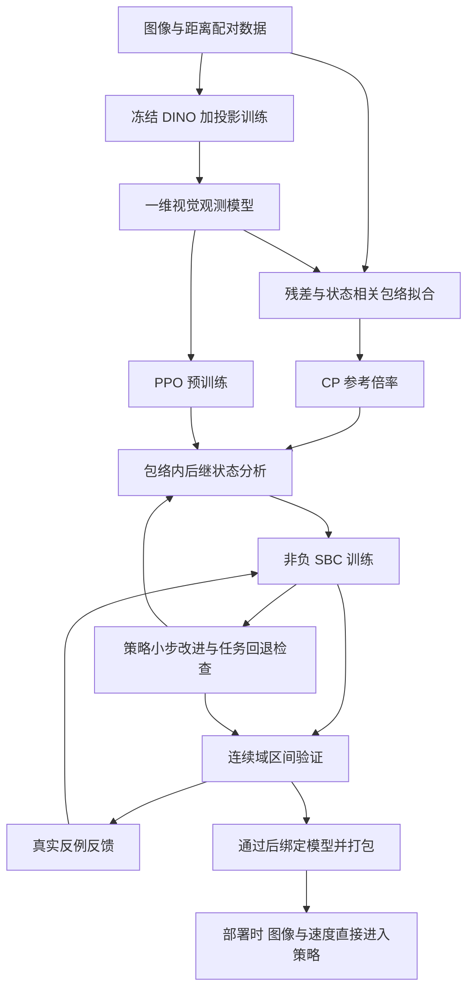

# VISION-SLS 与 SPVC SBC 当前框架说明

**内容：完整流程、实现步骤、理论依据、实验结果与安全保证**  
**核对日期：2026 年 10 月 29 日**  
**解释补充：2026 年 10 月 30 日，新增数据使用与统计前提的通俗说明、术语表；实验版本和结果不变。**  
**对应发布模型：`vision_sls_spvc_sbc_pass_20261029`**

本文以当前代码、保存的模型和实验报告为依据，解释把 SPVC 的 cGAN 视觉部分替换为 VISION-SLS 风格视觉观测后，系统实际怎样工作。历史试验用于解释设计选择；历史候选、CP-NCBF 分支和最终 SBC 模型的结论分别列出。

本文是现有结果的整理与核对，没有为撰写文档重新训练模型。已重新核对发布包中五个主要文件的 SHA-256，均与 `summary.json` 一致。文中的测试数量和连续域验证耗时来自已保存的实验记录。

## 阅读导航

1. [当前完成了什么](#current)
2. [实验场景与数学模型](#task)
3. [整体框架与模块分工](#framework)
4. [步骤一 数据整理与划分](#data)
5. [步骤二 DINO 与低维视觉观测](#vision)
6. [步骤三 PPO 预训练与任务保留](#ppo)
7. [步骤四 状态相关误差界与 CP](#cp)
8. [步骤五 把感知误差传播到闭环](#propagation)
9. [步骤六 非负 SBC 与安全推导](#sbc)
10. [步骤七 SBC 与策略交替训练](#training)
11. [步骤八 连续状态域验证](#verification)
12. [实验配置与实际结果](#results)
13. [获得了什么安全保证](#guarantees)
14. [运行与复查步骤](#reproduction)
15. [论文与理论对应关系](#references)
16. [术语表与常见误读](#glossary)

第一次阅读时，可先看 [4.4—4.8 的数据与统计前提解释](#data-assumptions)，再读 [7.8 的概率术语举例](#probability-examples)。遇到缩写或数学术语，可查第 16 节。

<a id="current"></a>

## 1 当前完成了什么

### 1.1 当前系统的准确名称

当前实现可以称为：

> **采用 VISION-SLS 风格低维视觉观测、CP 状态相关感知误差参考包络，以及 SPVC 非负 SBC 离线训练和验证的 AEBS 控制框架。**

部署时的链路为：

```text
当前图像 I
   ↓ 灰度转三通道 224×224 预处理
冻结 DINOv2 ViT-S/14
   ↓ 384 维特征
可训练投影网络 pθ
   ↓ 1 维视觉观测 y
拼接实测速度 v
   ↓ 2 维控制输入 [y, v]
经过 SBC 反馈微调的 PPO 策略
   ↓ 限幅到 [-3, 3]
制动动作 a
```

SBC 与 CP 包络主要用于离线训练和验证。最终控制器不在线求解 QP，不依靠在线 NCBF 过滤器修改动作，也不把真实距离作为图像推理分支的输入。

这里借鉴 VISION-SLS 的是“预训练视觉特征 → 低维观测 → 与状态观测模型匹配 → 状态相关误差描述”。没有把原论文的 SLS 响应优化、Riccati 求解器和停车场规划器整体移植进 AEBS。后端控制器和安全分析路线仍来自 SPVC/PPO/SBC。[R1][r1] [R2][r2]

### 1.2 当前结果一览

| 项目 | 当前结果 | 应怎样理解 |
|---|---:|---|
| 初始集 SBC 上界 | 0 | 满足要求的上界 1 |
| 不安全集 SBC 下界 | 24.9659319147 | 满足要求的下界 20 |
| CP 包络连续域检查 | 4,971,398 个区间；0 反例；0 未解决区间 | 对包络内所有允许观测的数值区间检查通过 |
| 固定图片回放连续域检查 | 105,608 个区间；0 反例；0 未解决区间 | 对冻结 400 张图片的确定性最近邻回放模型通过 |
| 名义观测任务测试 | 1441/1441 成功 | 有限初态测试，不是目标可达性定理 |
| 全部图片回放任务测试 | 1441/1441 成功 | 同一冻结图片库下的行为结果 |
| 留出图片回放任务测试 | 1441/1441 成功 | 旧 test 划分上的回归结果，不是新场景试验 |
| 原始图像重新加载 | 80 张；动作路径最大差约 5.78×10⁻⁶ | 检查真实图像推理路径与缓存路径一致性 |
| 软件回归测试 | 32 项通过 | 软件正确性检查，不替代安全论证 |

证据：[最终汇总][e-summary]、[CP 包络验证][e-tube]、[固定回放验证][e-replay]、[扩大任务测试][e-task]、[重新加载评估][e-reload]。

**最准确的完成状态是“连续状态域数值区间检查通过”。** 不能据此改写成“新场景真实车辆已经获得无条件 95% 安全形式证书”。原因不是结果无效，而是结果针对明确的观测模型、终止语义和数值计算口径，详见第 13 节。

### 1.3 保留和适配的部分

| 层次 | 保留内容 | 当前适配 |
|---|---|---|
| 任务 | AEBS 动力学、动作范围、目标和不安全判定 | 为评估显式区分目标到达、提前停车、越域和超时 |
| 控制 | PPO 策略网络；SBC 反馈更新策略 | 输入改成一维视觉观测与实测速度；增加任务回退检查 |
| 屏障 | 非负 SBC、初始值 ≤1、不安全值 ≥20 | Softplus 输出改为 ReLU；适配为停止过程的不增条件 |
| 训练结构 | 训练、验证、反例反馈、策略与屏障交替改进 | 包络内后继界、区域保护、关键边界样本和小步策略更新 |
| 不确定性 | 视觉误差影响闭环行为这一问题 | 使用状态相关观测包络；不再直接套用旧的固定加性状态噪声 |
| 验证 | 需要覆盖连续状态区域 | 使用显式区间运算和自适应细分；额外验证固定图片回放 |

所以，“保留原 SBC”指保留非负随机屏障的结构与安全阈值，而不是声称原实现的所有配置、噪声假设和严格下降条件都没有改变。

<a id="task"></a>

## 2 实验场景与数学模型

### 2.1 AEBS 的状态和动作

AEBS 是这里的自动紧急制动实验。状态为：

$$
x_t=\begin{bmatrix}d_t\\v_t\end{bmatrix},
$$

其中 $d_t$ 为与前方目标的距离，单位米；$v_t$ 为车辆速度，单位米/秒。建模范围为：

$$
\mathcal X=[5,16]\times[0,3].
$$

要求检查的初始集合为：

$$
\mathcal X_0=[15,16]\times[2.5,3].
$$

动作 $a_t\in[-3,3]$ 的单位为米/秒²；**正数表示制动，负数表示加速**。时间步长为 $\Delta t=0.05$ 秒。离散动力学是：
$$
\begin{aligned}
d_{t+1}&=d_t-0.05v_t,\\
v_{t+1}&=\operatorname{clip}(v_t-0.05a_t,0,3).
\end{aligned}
$$

距离更新使用当前速度，动作首先影响下一时刻速度。因此，在同一个当前真实状态下，两种视觉观测引起的**一步后继距离差为零**，后继速度才会因动作变化而改变。多步以后速度差再累积成距离差。

依据：原 SPVC 的 AEBS 实验与本地环境实现；动作和终止逻辑见 [环境代码][c-env]、[终止事件定义][c-outcomes]、[回放实现][c-rollout]。[R1][r1]

### 2.2 目标和失败事件

| 事件 | 判定 |
|---|---|
| 成功到达目标 | $5\le d\le6$ 且 $v\le0.5$ |
| 不安全 | $d\le6$ 且 $v>0.5$ |
| 提前安全停车 | $d>6$ 且 $v\le10^{-6}$ |
| 超出建模距离范围 | $d<5$ 或 $d>16$，按代码的事件优先级判定 |
| 测试超时 | 400 步内未出现终止事件 |

SBC 的不安全区域验证采用闭矩形：

$$
\mathcal X_u^{\mathrm{check}}=[5,6]\times[0.5,3].
$$

它比环境的严格不安全判定多检查 $v=0.5$ 的边界，因此是保守检查，不能把两者边界关系写反。目标和该检查区域在边界接触，不意味着物理不安全事件也把 $v=0.5$ 算作失败。

**安全与到达目标不同。** 车辆在 $d=9$ 米时完全停住，可能没有进入不安全区域，但没有完成到达目标的任务。训练中必须同时关注安全约束和任务保持。

### 2.3 奖励与时间尺度

回放保留的每步奖励为：

$$
r_t=2(d_t-d_{t+1})-0.001,
$$

成功时额外加 2；不安全时额外减去 $3(v_{t+1}-0.5)$。本轮没有靠修改成功阈值或奖励来让失败试验“通过”。

400 步对应最多 20 秒的经验测试。后面的 SBC 停止过程论证不以 400 步为数学时域上限，但会在原终止事件处吸收。它不描述“已到达目标后车辆继续运动”的另一套系统。

<a id="framework"></a>

## 3 整体框架与模块分工

### 3.1 离线流程和在线流程



离线阶段可以使用真实距离标签，因为需要监督视觉模型、生成模拟状态和验证约束。在线控制分支只接收图像与测得的速度。用于仿真查图的真实距离属于“环境如何产生观测”，不是策略读到的额外传感器。

### 3.2 三种观测模型必须分清

| 观测模型 | 形式 | 用途 | 对图像真实性的含义 |
|---|---|---|---|
| 名义观测 | $y=d/s_{\mathrm{vis}}$ | 预训练混合分支、诊断与对照 | 假设视觉误差为零 |
| CP 观测包络 | $y\in[(d-b_{\mathrm{CP}}(d))/s_{\mathrm{vis}},(d+b_{\mathrm{CP}}(d))/s_{\mathrm{vis}}]$ | 鲁棒 SBC 训练与验证 | 需要实际观测位于包络内这一假设 |
| 固定图片回放 | $y=\hat y_{j(d)}$，$j(d)=\arg\min_j\lvert d-d_j\rvert$ | 可运行闭环评估与独立连续域检查 | 仅描述已保存图片的最近邻环境 |

真实图像部署接口另行执行 $y=p_\theta(\psi(I))$。80 张原始图像重新加载检查，验证这条接口与缓存结果一致；它不把固定图片回放变成在线 CARLA 仿真。

### 3.3 统一符号和尺度

| 符号 | 含义 | 当前值或维度 |
|---|---|---|
| $I$ | 单张图像 | 原始 32×32 灰度 |
| $\psi(I)$ | DINO 特征 | 384 维 |
| $p_\theta$ | 投影网络 | 384→128→128→1 |
| $y$ | 归一化视觉距离观测 | 1 维 |
| $s_{\mathrm{vis}}$ | 视觉和 PPO 的距离尺度 | 3.2378063201904297 米 |
| $s_B$ | SBC 的距离尺度 | 3.18272066116333 米 |
| $C$ | 状态到理想视觉观测的映射 | $[1,0]$，作用于 $[d/s_{\mathrm{vis}},v]$ |
| $\pi_\eta$ | 制动策略 | 输入 2 维，输出 1 维 |
| $B_\omega$ | 非负随机屏障 | 输入 $[d/s_B,v]$，输出标量 |
| $b_0(d)$ | 拟合的误差尺度 | 单位米 |
| $q_{\mathrm{CP}}$ | CP 排序得到的放大倍率 | 约 2.522198953，无量纲 |
| $b_{\mathrm{CP}}(d)$ | 最终参考误差半径 | $q_{\mathrm{CP}}b_0(d)$，单位米 |

两个距离尺度不相等是实现事实。旧 SPVC/SBC 坐标与新的训练集归一化必须显式转换；把两者混用会同时改变策略输入和屏障区域，导致错误结果。实现见 [视觉模型与坐标适配][c-model]。

<a id="data"></a>

## 4 步骤一 数据整理与划分

### 4.1 使用哪批数据

本轮使用 [Downsampled.h5][e-data] 中的 400 张已保存图像及对应距离标签。文件字段仍叫 `X_train` 和 `y_train`，但当前实验会在读入后重新划分训练、验证和测试集，不能根据字段名把 400 张全部当作本轮训练集。

| 划分 | 数量 | 用途 |
|---|---:|---|
| train | 240 | 拟合特征归一化、训练投影、拟合误差尺度；训练图片回放 |
| validation | 80 | 选择投影网络 checkpoint |
| test | 80 | 留出图片评估；后续又拆为 40 个 CP 参考校准样本和 40 个参考审计样本 |

划分种子为 7。先按图像内容哈希分组，再按组划分，避免完全相同图像跨集合。距离标准差、特征均值和特征标准差只使用训练集计算。

本轮的 400 张数据不是其他历史路线中的 24,000 张数据，也不是 VISION-SLS 原论文的停车场、无人机或实机数据。不同路线的样本数量和结论不能合并。

### 4.2 独立性应怎样表述

最初 test 集没有参与视觉投影的梯度训练和 checkpoint 选择；策略更新的任务回退面板只用 train 图片。但经过多轮方案比较、误差分析和 CP 参考校准，这批图片已经是开发过程中反复观察的数据。

因此应使用以下表述：

- “留出图片回归评估”表示仍沿用最初的图片划分。
- “新的随机初态”表示新采样状态，不等于新场景、新图像或新采集轨迹。
- “CP 参考校准”表示计算了 CP 分位数，但没有建立一批未被开发使用、与未来目标数据可交换的新校准集。

这是统计结论的前提区分，不否认对冻结图片库做确定性验证的意义。固定库验证把这些图片当作已知系统的一部分，不以图片独立性作为条件。

### 4.3 数据缓存和可追溯性

训练缓存保存 DINO 特征及来源记录，包括数据哈希、DINO 权重哈希和预处理描述。加载已有缓存时必须匹配这些记录。发布包另外保存 `splits.npz` 与 `observations.npz`，使“哪些图片用于哪个集合”和“回放究竟用了哪个视觉输出”可以追查。

实现依据：[run.py 中的数据划分、缓存和投影训练][c-run]。分组划分、缓存校验属于本项目的工程措施，不是 VISION-SLS 或 CP 的额外安全定理。

<a id="data-assumptions"></a>

### 4.4 图片复用是什么意思 哪些复用没有问题

**图片复用就是同一批图像在不止一次计算或不止一个实验阶段中被使用。复用本身不等于错误。** 关键是它被用来做什么，以及最后声称的结论是什么。

| 使用方式 | 通俗解释 | 对结论的影响 |
|---|---|---|
| 同一张 train 图片参与多个训练 epoch | 用同一道练习题反复练习 | 正常训练，不因此构成测试泄漏 |
| 保存 DINO 特征，之后加载缓存 | 把同一计算结果存下来避免重算 | 正常缓存；不能把每次加载算成一个新样本 |
| 固定模型后重复跑同一测试 | 检查程序是否仍给出一致结果 | 可以用于回归检查；重复次数不增加独立测试证据 |
| 看 test 结果后挑模型、调参数，再报同一 test 的成绩 | 看过考题和成绩后继续针对这套考题准备 | test 参与了开发选择，不再是从未参与选择的最终评估 |
| 用同一批数据反复调整评分函数和 CP 半径，再套普通独立校准公式 | 看校准结果好不好，再改变“如何打分” | 原有 split CP 的固定评分与数据使用前提需要重新论证 |
| 在完整冻结图片库上验证查图控制模型 | 检查这个已知输入库定义的系统 | 可以成立；结论针对这个固定库，不自动扩展到新图像 |

当前已经确认的事实是：最初的 80 张 test 图像后来被拆成 40 张参考校准和 40 张参考审计；这个图片库及其评估结果也在开发过程中被反复检查。它们没有因此自动进入视觉投影的梯度训练，但已经不能笼统地被称为“一批整个研究过程都未使用过的新测试图片”。

这里也要避免另一种过度解释：**仅仅查看或重新计算一次固定分数，不会自动使 CP 失效。** 必须追查模型、误差尺度、评分规则、样本选择或报告选择是否依据这批结果发生过适应性改变。当前没有足够的隔离协议与记录，支持把整套最终系统当作经过全新独立校准的系统，所以采用保守的“参考校准”表述。

还有一个细节：当前图像残差分数只依赖观察器、距离标签和尺度函数。若这些对象都不变，单纯更新 actor 不会改变同一张图片的该分数；但是 actor 会改变车辆停留在哪些状态、看到哪些图像，从而可能改变**闭环访问分布**。因此，图片分数不变并不意味着轨迹安全统计可以原样沿用。

### 4.5 独立 同分布 可交换分别是什么意思

先把一张图像及其标签记为一个样本 $Z_i=(I_i,d_i)$。如果研究对象改成整条轨迹，那么一个 $Z_i$ 就应是整条轨迹，而不是其中的一帧。

**独立：**一个样本的随机结果不会给另一个样本的随机结果提供额外信息。例如，独立重新采样场景并运行两次制动任务，可以被设计为独立试验；同一次行驶的相邻两帧通常共享场景、光照和运动状态，不能仅凭文件名不同就按独立试验处理。

**同分布：**样本来自相同的概率生成规则。例如，校准和测试都按同一规则随机选天气、初态和车辆外观。它不要求所有图片长得一样；反而允许多种场景，只要求各场景被抽到的机制一致。只有相同距离范围或相同摄像头尺寸，并不足以证明同分布。

**IID：**independent and identically distributed，独立同分布，同时满足上述两个条件。许多简单的有限样本置信界采用这个假设。

**可交换性：**exchangeability，指样本的**联合概率分布**在任意重新编号后不变。形式上，对任意排列 $\sigma$：

$$
(Z_1,\ldots,Z_n,Z_{n+1})
\overset{d}{=}
(Z_{\sigma(1)},\ldots,Z_{\sigma(n+1)}).
$$

符号 $\overset{d}{=}$ 表示“分布相同”，不是“这两组数组逐项相等”。直观地说，在联合生成规则里，哪个位置被指定为校准样本、哪个位置被指定为那个未来样本，不应享有特殊待遇。标准 CP 用这种对称性控制新样本分数在排序中的位置。[R5][r5]

**IID 是可交换性的充分条件，但不是必要条件。** 某些相关样本也可能可交换，所以不能把“相关”一概等同于“不能用 CP”。然而，时间序列往往具有先后关系，闭环还会根据过去观测改变未来状态，不能直接默认其逐帧可交换。本文第 7.6 节的 Beta 容忍界另外采用 IID 次序统计量条件，应与一般 CP 边际覆盖所用的可交换性区分。

也不要把可交换性理解成“把现有文件随机打乱就满足了”。打乱文件可以消除某些人为顺序，但不会让重复帧变成新试验，也不会把晴天采集与雨天部署变成相同生成机制；CP 需要考虑校准样本与**未来样本共同**的关系。

### 4.6 采集可交换性未建立在本项目里具体指什么

这句话的准确含义是：**当前材料尚不足以支持“用于校准的数据与拟声称保证的未来数据满足所需联合采样假设”这一结论。它不是已经证明这些数据一定不满足可交换性。**

现有代码可以确认图片数量、标签、分组划分和实际计算出的误差；但仅凭这些文件，不能充分回答：

1. 原始样本以什么规则采集？是独立重新设置场景，还是沿同一次运行连续取帧？
2. 哪些图片共享一次采集、同一个场景或同一组随机环境参数？
3. 最终希望保证的未来输入，是这个固定图片库的随机抽样，还是新天气、新外观下的真实闭环图像？
4. 校准时的距离与场景比例，是否与最终策略实际访问的比例一致？
5. 是否根据已观察到的误差筛选过样本或选择过最终评分方式？

这些是需要核实的采集与选择信息，不是本文已查实的全部缺陷。当前“按图像哈希分组”只防止完全相同内容跨划分，不能单独证明近邻帧、场景或采集批次之间独立。

举一个**教学假设，并非本项目已发生的事实**：如果校准数据全部来自晴天，而部署时多数图像来自大雨，那么即使二者的距离都在 5—16 米，视觉误差的分布也可能变化。再如，按距离均匀采图，不等于车辆运行时按距离均匀取样：车辆在低速区域停留更久，那里会贡献更多帧。使用同样的距离区间，不保证同样的样本权重。

要补强这一前提，应事先明确目标运行分布，记录场景和轨迹标识，按所需随机机制采集，保留数据用途与模型选择记录。一次“两个误差直方图看起来相近”的检验只能作为诊断，不能单独证明未来所有样本都可交换。

### 4.7 这些问题具体影响什么 不影响什么

| 说法 | 当前能否这样说 | 理由 |
|---|---|---|
| 这 40 张参考审计图片有 40 张落入包络 | 可以 | 对已保存样本的直接统计事实 |
| 同一批 40 张每次都通过，重复 100 次就等于 4000 个新样本 | 不可以 | 重算没有增加独立信息 |
| 在固定 400 图片查图模型中，连续域数值检查通过 | 可以，保留其模型和数值限定 | 不依赖这些图片是否代表未来真实场景 |
| 所有未来新图像都有至少 95% 覆盖 | 当前依据不足 | 目标分布、校准协议与可交换性连接未建立 |
| 从每个状态出发，每一步都以 95% 概率落入包络 | 不能从普通边际 CP 直接推出 | 边际覆盖不等于逐状态条件覆盖 |
| 已保存的 1441 次回放成功都是假的 | 不对 | 数据使用前提限制的是外推结论，不抹去已观察到的运行结果 |

“参考结果”因此不是“没用的结果”，而是“可以用于开发、对照和已知模型验证，但不能附加尚未满足前提的泛化保证”。

### 4.8 独立校准和最终测试应该怎样安排

对于计划新增的实验，一个易解释的协议是：

```text
训练数据：拟合观察器、误差尺度、策略和屏障
    ↓
开发数据：调结构、调参数、找反例、选择候选
    ↓ 冻结最终模型、基础评分规则和评估协议
独立校准数据：按事先规定的方法计算 CP 倍率或统计界
    ↓ 按事先规定的流程检查对应安全条件
最终测试数据：报告未用于调参的新运行表现
```

“冻结”就是不再根据后面的数据更改待评估对象。计算 CP 分位数本来就需要校准数据，这属于协议允许的使用；问题在于看完结果后反复改变模型或评分规则，却继续把相同数据当作未使用过的校准数据。

若校准或测试失败并反馈再训练，这批数据可以转为开发数据，但下一轮最终统计评估应使用新的独立数据，或采用专门处理自适应选择的有效方法。对于“只发布通过者”、反复尝试直到通过等选择，也应在协议与保证口径中明确处理。

整条轨迹作为一个样本时，轨迹内部可以有时间相关性，关键变成不同轨迹及未来轨迹是否满足所用方法的采样前提。这是改变统计单位，不是简单地把图片数换个名字。以上是建议补充的实验协议，当前报告不声称已经执行完这些新采集工作。

<a id="vision"></a>

## 5 步骤二 DINO 与低维视觉观测

### 5.1 为什么先提取 DINO 特征

直接在像素空间学习和验证控制器成本很高。DINOv2 提供预训练视觉特征，本轮冻结其参数，仅训练后面的小型投影网络。DINOv2 的来源是 Oquab 等人的视觉表示学习工作；其预训练特征本身不提供距离误差上界或闭环安全定理。[R3][r3]

图像处理顺序如下：

1. 接受 `[B,H,W]`、单通道或三通道批量图像；部署接口接受 uint8，或范围在 `[0,1]` 的浮点图像。
2. 单通道图像复制为三个通道。
3. 使用带抗锯齿的双三次插值缩放至 224×224。
4. 使用 ImageNet 均值和标准差归一化。
5. 送入冻结的官方 DINOv2 ViT-S/14，获得 384 维 CLS 特征。

实现：[FrozenDinoV2][c-dino]。DINO 权重不重复打包在最终小模型目录中，加载时检查外部权重文件的哈希。

### 5.2 一维向量究竟学什么

VISION-SLS 的重要思想是让图像表示与一个可用于控制分析的低维状态观测模型对应。AEBS 已有速度测量，而图像数据提供距离标签，所以当前选择：

$$
\tilde x=\begin{bmatrix}d/s_{\mathrm{vis}}\\v\end{bmatrix},
\quad C=\begin{bmatrix}1&0\end{bmatrix},
\quad y=p_\theta(\psi(I))\approx C\tilde x=d/s_{\mathrm{vis}}.
$$

这里的“低维向量”实际上是一维，含义明确：视觉网络输出归一化距离相关观测，乘回 $s_{\mathrm{vis}}$ 后可解释为米制距离估计。它不是任意无物理意义的 latent，也不是需要再学一个状态到 latent 的代理网络才能解释的编码。

固定 $C=[1,0]$ 有两个作用：与 AEBS 的现有传感器配置一致，并避免投影与可学习 $C$ 同时缩小导致的表示塌缩。视觉分支只负责距离，速度从外部测量输入。本文没有声称一张静态图像估计了完整动态状态。

**适配关系：** VISION-SLS 原论文讨论学习低维观测模型与可观测性；当前使用其观测匹配思路，针对 AEBS 固定 $C$。没有照搬原任务的多维观测矩阵，也没有在本轮单独优化原论文的完整可观测性损失。[R2][r2] 原作者实现参考：[train_observability.py][c-upstream]。

### 5.3 投影网络和真实训练损失

特征先用训练集统计量标准化：

$$
\bar h=(\psi(I)-\mu_{\mathrm{train}})/\sigma_{\mathrm{train}},
$$

代码把每维标准差下限设为 0.01。网络结构为：

$$
384\xrightarrow{\mathrm{Linear}}128\xrightarrow{\mathrm{GELU}}
128\xrightarrow{\mathrm{Linear}}128\xrightarrow{\mathrm{GELU}}
128\xrightarrow{\mathrm{Linear}}1.
$$

等价地，三个线性层的尺寸是 384→128、128→128、128→1，前两个线性层后接 GELU。

**训练损失实际为逐样本欧氏距离的均值：**

$$
\mathcal L_{\mathrm{obs}}
=\frac1N\sum_i\left\|p_\theta(\psi(I_i))-d_i/s_{\mathrm{vis}}\right\|_2.
$$

当前输出一维，所以它等价于平均绝对误差，不能写成训练使用均方误差。验证选模指标才是平方误差均值。

训练采用 Adam，学习率 $10^{-3}$，batch size 64，预算 250 个 epoch，随机种子 7。最终保存验证误差最优的第 **243** 个 epoch。DINO 全程冻结；训练结束后投影也冻结，后面的 SBC/策略改进没有更新这份视觉模型。

### 5.4 感知结果及其含义

| 集合 | 图片数 | RMSE 米 | MAE 米 | 最大绝对误差 米 |
|---|---:|---:|---:|---:|
| train | 240 | 0.085846 | 0.065777 | 0.245333 |
| validation | 80 | 0.467653 | 0.150050 | 4.009601 |
| test | 80 | 0.165444 | 0.129266 | 0.414889 |

来源：[perception_metrics.json][e-perception]；其中 `residual_linf_max` 是归一化观测单位，表中最大误差已乘回 $s_{\mathrm{vis}}$。

验证集存在约 4 米的极端误差，不能只用测试 RMSE 约 0.165 米来描述感知可靠性。CP 包络也没有因为训练集和参考审计集覆盖较好就覆盖这类所有误差。最终固定图片回放验证直接处理实际保存的观测值，是对另一种已知观测模型的检查。

<a id="ppo"></a>

## 6 步骤三 PPO 预训练与任务保留

### 6.1 策略如何学习

PPO 的输入是 $[y,v]$，输出制动动作。预训练使用 Stable-Baselines3 的 `MlpPolicy`，策略部分为两层 64 单元 Tanh MLP 后接动作输出层，部署提取确定性策略输出并限幅。[R4][r4]

其基本思想是通过与环境交互优化回报，并用裁剪的策略比率目标限制每次策略更新幅度：

$$
\mathcal L^{\mathrm{clip}}(\eta)
=\mathbb E_t\left[
\min\left(r_t(\eta)\hat A_t,
\operatorname{clip}(r_t(\eta),1-\epsilon_{\mathrm{PPO}},1+\epsilon_{\mathrm{PPO}})\hat A_t\right)
\right].
$$

这里 $r_t$ 是新旧策略的动作概率比，与上一节的感知残差不是同一个量。PPO 提升控制表现，不直接给出 SBC 意义的概率安全保证。

当前预训练请求 30,000 个环境步，`n_steps=256`、`batch_size=64`、种子 7。PPO 按 rollout 批次收集数据，因此“30,000”是请求预算，不应误称精确的每条历史执行计数。

### 6.2 为什么训练时混合两种观测

每个 episode 以约 50% 概率使用名义观测，以约 50% 概率使用训练图片最近邻回放。这样策略既看到理想 $Cx$，也接触当前视觉模型的实际输出偏差。

PPO 训练重置范围为整个 $[5,16]\times[0,3]$；目标评估初态范围才是 $[15,16]\times[2.5,3]$。训练状态范围与待保证的初始集合不能混淆。[ObservationEnv 实现][c-observation-env]

### 6.3 为什么最初替换后不能到达目标

早期问题不只是“换了输入数据”。视觉输入语义和分布改变后，旧 SBC 引导策略更新仍采用较大的学习率 0.05。诊断中，已能完成任务的 PPO 经该更新后出现过度制动、提前停车等退化。

先做的修复是把该阶段 actor 学习率降为 $3\times10^{-4}$，并增加训练用任务保留面板：

1. 固定 32 个训练初态，分别运行名义观测和 train 图片回放。
2. 策略更新前保存策略权重和 Adam 状态。
3. 更新后比较每个初态是否丢失已有成功，或新增不安全事件。
4. 若退化，恢复策略权重及 Adam 动量；保留独立的屏障训练进展。

这个面板是工程上的经验验收条件，不是安全证书。其作用是避免屏障优化把控制器改成“更容易满足某种损失，但已经不能完成任务”的策略。

成功基线 `vision_sls_spvc_goalfix_full_20261028` 完成 101 次接受的 actor 更新，名义和留出图片评估各 1441/1441 成功，但当时的 SBC 区域条件仍失败。后面最终策略又以更小的学习率继续更新，不能把这份基线的策略直接称为最终发布策略。[基线汇总][e-baseline] [任务保留实现][c-retention]

<a id="cp"></a>

## 7 步骤四 状态相关误差界与 CP

### 7.1 CP 在这里解决什么问题

视觉模型的平均误差不足以用于鲁棒验证。需要给每个状态一个参考误差半径，描述该状态附近允许视觉观测偏离名义观测多少。

当前分两步构造：

$$
\text{拟合状态相关尺度 }b_0(d)
\quad\longrightarrow\quad
\text{用 CP 排序确定倍率 }q_{\mathrm{CP}}.
$$

最终半径为 $b_{\mathrm{CP}}(d)=q_{\mathrm{CP}}b_0(d)$。状态相关形状来自 VISION-SLS 误差建模思路，有限样本倍率来自 split conformal prediction。它们不是同一个定理。[R2][r2] [R5][r5] [R6][r6] [R10][r10]

### 7.2 第一步 计算米制感知残差

对配对样本 $(d_i,I_i)$：

$$
r_i=\left|s_{\mathrm{vis}}p_\theta(\psi(I_i))-d_i\right|.
$$

该残差比较视觉输出和**同一张图像的真实距离标签**，单位米。不能拿名义规划位置代替真实标签，否则会把轨迹偏差与感知误差混在一起。

由于只存在一维视觉观测，$\ell_2$ 和 $\ell_\infty$ 残差范数在此等于绝对值；不代表原论文所有多维问题中的这两种范数都相同。

### 7.3 第二步 拟合正的状态相关尺度

令 $t=(d-5)/11\in[0,1]$，使用三次 Bernstein 基：

$$
m_k(d)=\binom3k t^k(1-t)^{3-k},\quad k=0,1,2,3,
$$

$$
b_0(d)=\sum_{k=0}^3\beta_km_k(d).
$$

在 240 个训练样本上求解：

$$
\begin{aligned}
\min_{\beta,\xi}\quad&
\frac1N\sum_i b_0(d_i)+20\frac1N\sum_i\xi_i,\\
\text{s.t.}\quad&b_0(d_i)+\xi_i\ge r_i,\\
&\xi_i\ge0,\qquad \beta_k\ge0.01.
\end{aligned}
$$

这是 VISION-SLS 式 (31) 的状态相关包络和松弛变量思想在当前一维问题上的适配：取正则项参数 $\gamma=0$，采用上述基函数与系数约束，最终是由 HiGHS 求解的线性规划。[R2][r2] [状态相关误差界技术说明][r10]

为什么这个形式始终为正？因为在 $[0,1]$ 上，所有 Bernstein 基函数非负，且它们之和为 1；因此 $b_0$ 是系数的凸组合，满足：

$$
b_0(d)\ge\min_k\beta_k\ge0.01.
$$

这保证归一化残差的分母不为零，并保证全距离范围内尺度为正。**它只证明正性，不证明全状态、全图像误差都被覆盖。**

实际拟合系数为：

$$
\beta=\begin{bmatrix}
0.053076426667\\
0.162763484794\\
0.319369648667\\
0.168921132496
\end{bmatrix}.
$$

实现：[conformal.py][c-conformal]；数值：[perception_contract.json][e-contract]。

### 7.4 第三步 用 CP 确定放大倍率

从原 test 的 80 张图像中划出 40 张参考校准图像，另 40 张用于参考审计，划分种子为 20261028。对校准样本计算：

$$
s_i=\frac{r_i}{b_0(d_i)}.
$$

给定 $\alpha=0.05$、$n=40$，选择从小到大排序后的第：

$$
k=\left\lceil(n+1)(1-\alpha)\right\rceil
=\lceil41\times0.95\rceil=39
$$

个分数，得到：

$$
q_{\mathrm{CP}}=2.5221989529224533,
\qquad b_{\mathrm{CP}}(d)=q_{\mathrm{CP}}b_0(d).
$$

一般情况下，如果 $k>n$，有效的有限样本约定是取无穷大，不能悄悄截断成校准样本最大值后仍宣称原覆盖目标。当前实现明确处理这一情形。

### 7.5 当前覆盖数字

| 数据用途 | 样本数 | 被包络覆盖 | 平均半径 米 | 最大观测误差 米 |
|---|---:|---:|---:|---:|
| 尺度拟合 train | 240 | 240 | 0.431608 | 0.245333 |
| 参考校准 | 40 | 39 | 0.434902 | 0.400993 |
| 参考审计 | 40 | 40 | 0.456253 | 0.414889 |

这些数字说明当前参考包络在相应样本上的表现。验证集 80 张不在此表中，不能把 40/40 审计覆盖扩大解释为所有 400 张都满足 CP 半径。

### 7.6 95% 覆盖与 99% 置信是两种不同陈述

标准 split CP 在模型与打分函数固定、校准样本和新样本可交换等条件下，对一个新随机样本提供边际覆盖：

$$
\Pr\{r_{\mathrm{new}}\le q_{\mathrm{CP}}b_0(d_{\mathrm{new}})\}\ge1-\alpha.
$$

该概率同时考虑随机校准集与新样本，并不等于每个固定状态、每个固定校准集都达到 95%。若额外用 IID 次序统计量分析固定校准集的覆盖水平，连续分数下 $F(S_{(k)})$ 服从 $\mathrm{Beta}(k,n+1-k)$；有并列分数时相应下界可保守使用。[R5][r5] [R6][r6]

当前数值为：

$$
\mathrm{Beta}^{-1}(0.01;39,2)
=0.8452669289.
$$

所以，即使这些独立同分布前提成立，也不能把“目标边际覆盖 95%”直接写成“以 99% 置信保证这一个固定包络覆盖至少 95%”。这里相应的覆盖下置信界约为 84.53%。

本项目中的图片库已在开发中复用，且尚未建立校准数据与未来目标输入的采集可交换性，因此当前 contract 自身标记为 **reference only**，意为“仅作参考”。具体含义、已确认事实与尚待核实的问题见 [4.4—4.8](#data-assumptions)。复用本身不必然使每一次 CP 计算失效；当前限制是还不能为最终新图像闭环主张完整的统计前提。本文保留上述数学解释，但不把数值计算冒充已经满足前提的现实保证。

### 7.7 CP 为什么不能直接给整条轨迹的安全概率

逐状态的边际覆盖：

$$
\Pr\{r(X,I)\le b_{\mathrm{CP}}(X)\}\ge0.95
$$

不等于逐状态的条件支持集：

$$
\Pr\{r(X,I)\le b_{\mathrm{CP}}(X)\mid X=x,\text{历史信息}\}=1.
$$

闭环策略会改变访问状态的分布，连续帧还可能相关。即使每一步都恰好有同样的边际覆盖，也不能未经证明地相乘成 $0.95^T$，更不能把单步 95% 直接当作无限时域 95% 安全。

当前用 CP 定义一个可计算的参考误差模型，再验证“误差模型内部是否安全”；从实际图像过程到这个误差模型的连接仍有条件。这一限制在最终发布结果中显式保留。

<a id="probability-examples"></a>

### 7.8 用例子区分覆盖率 条件覆盖 置信水平和安全概率

下面的分组数字是**教学示例，不是本项目实验结果**。

**经验覆盖率**是“手头这批数据有多少比例落入包络”。例如 40 张审计图片全部落入，就是经验覆盖率 100%。它没有直接告诉我们下一张图片是否落入，更没有证明总体覆盖率为 100%。

**边际覆盖**是按指定样本分布平均之后的覆盖。假设容易场景占 90%，其覆盖为 100%；困难场景占 10%，其覆盖为 50%，则总体覆盖为：

$$
0.9\times1+0.1\times0.5=0.95.
$$

因此总体 95% 完全可以与某一类困难场景只有 50% 同时成立。这个例子只解释“平均”与“分组”的差别；标准 split CP 的边际保证还对随机校准集取平均，不额外保证任意一次固定校准结果都达到目标。

**条件覆盖**是在指定条件下再问覆盖，例如“给定距离接近 6 米时”“给定雨天时”或“给定完整历史时”。它比不区分条件的平均覆盖要求更细，普通 CP 的边际结论不会自动提供这些逐条件保证。[R5][r5]

**状态相关包络**是半径随状态改变，例如 $b_{\mathrm{CP}}(6)$ 和 $b_{\mathrm{CP}}(15)$ 不同。这是一种适应不同难度的设计；**半径依赖状态，并不等于已经证明逐状态条件覆盖。**

**条件支持集**要求更强：在给定状态与历史下，实际观测分布不会在所声明集合之外产生事件，允许概率零的例外。若某种失效图像虽然很少见，但发生概率仍大于零且在包络外，就不能称该包络包含全部支持。当前 tube 验证的含义是“只要观测在包络里，允许的每个后继都满足条件”；40 张中覆盖 39 张不足以建立全支持假设。

**尾部事件或超界事件**就是误差超过所用半径，例如允许误差 0.4 米而实际误差 1 米。这里“尾部”不意味着已假定高斯分布，也不意味着只是可以忽略的小数值误差。它可能对应遮挡、视觉歧义等较少出现但后果较大的情况。

**置信水平**描述统计程序在反复重新采集校准数据时，所给覆盖下界有多可靠。例如“99% 置信下覆盖率至少为 $L$”中，99% 是关于校准程序的可靠性，$L$ 才是它给出的覆盖水平；99% 不是车辆安全率。当前 $n=40,k=39$ 计算出 $L\approx84.53\%$，也不是说已经测得未来真实覆盖率恰好为 84.53%。

**轨迹同时覆盖**要求一次运行的所有相关时刻都落在包络内。若一条 200 帧轨迹有 199 帧落入、1 帧超界，逐帧经验覆盖率是 99.5%，但这条轨迹的“全部时刻都覆盖”事件不成立。取整条轨迹的最大分数，就是为了直接评价这种同时事件。

**安全概率**问的是控制系统会不会进入不安全状态。感知超界并不必然造成事故；反过来，即使感知没有超界，若策略和动力学对应的安全条件没有成立，也不能仅靠覆盖率宣布安全。必须把“观测事件”与“闭环不安全事件”用明确的分析连接起来。

原文中的概率句子可以这样逐层阅读：

```text
这批图片覆盖了多少                  → 已观察到的比例
一个新的随机样本是否被覆盖          → 边际预测保证
某一特定状态或场景下是否被覆盖      → 条件覆盖
一次运行的所有观测是否都被覆盖      → 轨迹同时覆盖
这些观测驱动的系统是否进入危险区域  → 闭环安全
```

这五个问题相互关联，但不能把其中一个比例直接移到另一个问题上。

<a id="propagation"></a>

## 8 步骤五 把感知误差传播到闭环

### 8.1 从米制半径变成策略输入区间

给定离线真实状态 $(d,v)$，CP 参考模型允许：

$$
y\in\mathcal Y(d)
=\left[\frac{d-b_{\mathrm{CP}}(d)}{s_{\mathrm{vis}}},
\frac{d+b_{\mathrm{CP}}(d)}{s_{\mathrm{vis}}}\right].
$$

这里的真实 $d$ 供离线验证器确定区间，不意味着部署时能用未知真实距离在线计算同一个误差半径。

将 $[y,v]$ 输入策略网络，通过逐层区间传播得到：

$$
a\in[\underline a(d,v),\overline a(d,v)].
$$

这个范围覆盖包络内所有观测导致的动作，包括网络非线性和最终动作限幅。不是只把观测取两个端点运行一下就假定已经得到动作极值。

### 8.2 从动作区间得到后继集合

对一个固定当前状态：

$$
d'=d-0.05v,
$$

$$
v'\in\left[
\operatorname{clip}(v-0.05\overline a,0,3),
\operatorname{clip}(v-0.05\underline a,0,3)
\right].
$$

对一个状态盒 $d\in[\underline d,\overline d]$、$v\in[\underline v,\overline v]$，使用：

$$
d'\in[\underline d-0.05\overline v,\overline d-0.05\underline v],
$$

$$
v'\in[\operatorname{clip}(\underline v-0.05\overline a,0,3),
\operatorname{clip}(\overline v-0.05\underline a,0,3)].
$$

由此得到包络模型下的后继集合 $\mathcal F(x)$ 或状态盒外包络，再要求屏障对所有这些后继不增。

### 8.3 为什么不沿用旧加性噪声分布

旧实现中训练噪声为三角分布，验证噪声为均匀分布；二者已经不是同一个概率模型。更关键的是，把固定大小的距离、速度扰动直接加到物理状态上，并不等价于新的视觉观测误差经过策略和动力学后的影响。

当前采用最坏情况关系：

$$
\sup_{y\in\mathcal Y(d)}B(f(x,\pi(y,v)))\le B(x).
$$

若真实条件观测分布的支持确实位于 $\mathcal Y(d)$，则任何这样的分布都满足相应的条件期望不增。无需假定包络内部均匀分布，也不要求其在不同状态下具有相同密度。

这比对一个指定分布计算期望更保守，但避免用一个没有依据的分布替代真实误差。尚未解决的是包络外的观测尾部，不是包络内部应该选哪种方便的分布。

依据：区间传播的标准原理 [R9][r9]；本项目的动力学与区间组合见 [连续域验证器][c-verify]、[SBC 区间工具][c-sbc]。

<a id="sbc"></a>

## 9 步骤六 非负 SBC 与安全推导

### 9.1 SBC 的含义

SBC 即 stochastic barrier certificate，随机屏障证书。当前屏障 $B(x)$ 始终非负，初始区域应有较小值，不安全区域应有较大值，闭环演化则不应使其条件期望增加。

可以把它理解为一个经过数学约束的风险尺度，但 **$B(x)$ 本身不是直接预测的碰撞概率**。它通过阈值与超鞅不等式产生风险上界。

当前网络为：

$$
B_\omega(d,v)=\operatorname{ReLU}
\left(W_3\tanh\left(W_2\tanh(W_1[d/s_B,v]^T+b_1)+b_2\right)+b_3\right),
$$

隐藏结构是 2→16→8→1，隐藏层 Tanh。ReLU 保证全域非负。该函数连续且 Lipschitz；本离散时间不增论证不要求它在所有点可微。

### 9.2 原 SPVC 理论与当前适配

本地原 SPVC 论文 Theorem 2.2 要求四类条件：[R1][r1]

$$
\begin{array}{ll}
\text{非负性：}& B(x)\ge0,\\
\text{初始集：}& B(x)\le1,\quad x\in\mathcal X_0,\\
\text{不安全集：}& B(x)\ge\frac1{1-p},\quad x\in\mathcal X_u,\\
\text{下降：}& B(x)\ge\mathbb E[B(x_{t+1})\mid x_t=x]+\epsilon,
\quad \epsilon>0,
\end{array}
$$

最后一个条件作用于论文指定的非不安全、屏障值不超过阈值的状态。原论文还使用与状态独立的加性后继扰动假设。

本轮保留 $p=0.95$，故阈值保持：

$$
\lambda=\frac1{1-0.95}=20.
$$

**当前没有逐字满足原论文的全套条件。** 改为在原终止事件处停止，并使用非负停止超鞅的非增条件：

$$
\mathbb E[B(x_{t+1})\mid\mathcal F_t]\le B(x_t)
$$

在停止前且 $B(x_t)<20$ 的相关状态成立；终止后值保持不变。$\mathcal F_t$ 表示截至时刻 $t$ 的历史信息。其依据是经典非负超鞅最大不等式与随机屏障论证，而不是把原论文中的严格 $\epsilon$ 条件删掉后仍原样引用 Theorem 2.2。[R7][r7] [R8][r8]

### 9.3 为什么必须说明严格下降的改变

旧训练参数 $\epsilon=0.1$ 若被解释为当前确定性或逐观测鲁棒模型中每一步都必须下降 0.1，则从 $B(x_0)\le1$ 出发，超过 10 步就与 $B\ge0$ 冲突。当前任务通常需要上百步，最终评估约 190–219 步；停止后的吸收状态也不可能永远严格下降。

该解释针对本轮采用的停止模型和逐观测条件，不能扩大为“所有随机系统都不能使用严格下降”。一般随机系统中的期望下降与随机停止时间需要另行分析。

当前 $10^{-4}$ 只是 SBC **训练裕度**：希望优化尽量留余量。最后验收的是不增 $B(x')\le B(x)$，不是要求 $B=0$ 的安全区域仍每步下降 $10^{-4}$。训练报告中 `positive_training_margin` 可以非零，必须与实际非增违例 `positive` 区分。

### 9.4 为什么把 Softplus 改为 ReLU

原实现的 `square_output=True` 实际走 Softplus 非负输出，不能仅凭变量名把它解释为“输出平方”。Softplus 总是严格大于零，使已经安全的吸收区域难以形成精确零值平台。

最终采用 ReLU 后，屏障可在一片安全区域上精确为零，仍对不安全区域维持高值。这有利于表达“安全轨迹留在零值区域”的不增条件。改变输出激活属于明确的模型适配，不是单纯换了一份数据。

最终 checkpoint 保存激活名称。相同权重若被误加载为 Softplus，会定义另一个屏障函数，不能继承当前验证结果。部署包加载器对此作了检查。[SBC 定义与加载器][c-sbc]

### 9.5 安全概率上界的完整推导

下面是当前适配的数学依据。它描述在精确满足条件时可以推出什么；第 11 节说明当前数值实现与严格计算证明之间的差别。

设 $\tau_{\mathrm{term}}$ 为原环境终止时间，终止后状态吸收。再令：

$$
\tau_\lambda=\inf\{t\ge0:B(x_t)\ge\lambda\},\qquad\lambda=20,
$$

$$
Z_t=B\left(x_{t\wedge\tau_\lambda\wedge\tau_{\mathrm{term}}}\right).
$$

假设：

1. 屏障非负，$B(x_0)\le1$，所有相关不安全状态满足 $B\ge20$。
2. 所有未终止且 $B<20$ 的状态，实际闭环条件转移满足屏障期望不增。
3. 所有转移都在所分析模型中；终止前后没有未经建模的额外扰动或动作。

则 $Z_t$ 是非负超鞅。对任意有限 $T$：

$$
\mathbb E[Z_T]\le B(x_0),
$$

而在停止前或终止当步到达阈值的事件上，$Z_T\ge20$，所以：

$$
20\Pr\{\tau_\lambda\le T,\ \tau_\lambda\le\tau_{\mathrm{term}}\}
\le\mathbb E[Z_T]\le B(x_0).
$$

令 $T\to\infty$，得到到达阈值的概率上界。到达不安全集必然在当时或此前达到阈值，因此：

$$
\Pr_{x_0}\{\text{在该停止系统中进入不安全集}\}
\le\frac{B(x_0)}{20}\le0.05.
$$

这就是保持初始上界 1 和不安全下界 20 的意义。报告字段 `reach_probability_target=0.95` 应按本论证解释为**避免不安全事件的目标下界**，不能因为字段含 `reach` 就解释成“到达目标概率 95%”。

停止在 $B\ge20$ 并非忽略不安全状态：到达该阈值本身就是被概率上界约束的坏事件。因此验证器可排除整个盒子下界已不小于 20 的区域，而必须检查所有仍可能包含 $B<20$ 状态的盒子。

当前数值检查给出初始屏障上界 0。在理想精确数学模型、支持假设和不增条件全部成立时，代入上述不等式会得到更强的零风险结论；**本报告不把浮点区间得到的 0 转写成真实车辆 100% 安全**。当前正式报告口径仍是指定模型中的数值检查通过。

### 9.6 为什么原来的证书不能自动沿用

证书属于一个确定的“策略、观测模型、动力学、噪声、区域、终止语义”组合。视觉替换使动作分布和闭环后继发生变化，即使网络接口仍是两个数字，旧条件也必须重新验证。

对 10 月 28 日成功控制基线的审计发现：

| 项目 | 要求 | 当时修正区间后的结果 |
|---|---:|---:|
| 初始区域上界 | ≤1 | 14.322957 |
| 不安全区域下界 | ≥20 | 9.544867 |
| 训练和验证噪声分布一致 | 一致 | 三角分布与均匀分布不一致 |
| 新视觉残差纳入原验证器 | 是 | 当时没有 |

此外，旧 LiRPA 调用把上下端点当作普通输入，未构成预期的扰动盒。有一个示例中，它给出 `[13.76824,13.76824]`，却不能覆盖另一个端点的 11.08826 和中心的 12.35758；修正区间为 `[8.33694,19.04405]`。这说明旧数字不足以证明整个区域。[审计报告][e-audit]

这些发现针对所审计的本地候选和调用方式，不能据此断言原论文所有实验都不成立。但它们足以说明：当前替换任务没有一张可直接继承的已成立证书。

<a id="training"></a>

## 10 步骤七 SBC 与策略交替训练

### 10.1 训练和验证怎样配合

训练负责寻找一个可能满足条件的网络；验证负责检查它是否真的满足条件。一个训练损失接近零的模型，仍可能在未采样区域失败。当前流程是：

```text
已有可完成任务的 PPO
   ↓ 生成训练状态和可能导致失败的状态
训练非负 SBC 并建立区域分离
   ↓ 区域条件通过后保护它们
在 CP 后继界下训练屏障不增
   ↓ 固定 SBC，小步更新策略，保护任务表现
固定新策略，再训练 SBC
   ↓ 更大随机状态集与连续域验证
真实反例加入开发数据
   ↓ 重新训练并重新验证
两种观测模型均通过后发布
```

反例驱动的控制器与证书交替改进来自 SPVC 的主要框架。任务回退、具体状态选择、Bernstein 包络、激活选择及连续区间细分是本项目结合 AEBS 的实现设计。[R1][r1]

### 10.2 先产生具有物理意义的开发状态

`prepare_sbc_training.py` 在完整活动域中采样 16,384 个状态。每步在 CP 包络内取 9 个观测候选，选择产生最小制动的候选，模拟至终止或 400 步。

这是一种寻找危险轨迹的启发式：它能找到实际允许观测下的失败见证，但不保证找到所有最坏轨迹。初始基线下曾发现 2060 个失败起始状态；这些状态来自完整活动域，不是说指定初始集中的 2060 次任务失败。

发现失败的状态用于训练屏障较高值；其余完成停止的状态作为安全进展训练样本。初始特征预训练预算 20,000 个更新步，状态种子 44、特征种子 52。策略改变后重新生成相应状态，避免把旧策略的失败标签直接当成新策略的确定结论。

证据与输入：[开发输入保存目录][e-inputs]、[策略更新后的开发输入][e-actor-inputs]；实现：[prepare_sbc_training.py][c-prepare]。

### 10.3 SBC 损失怎样设计

训练损失包含三类主要项：

1. **区域分离。** 压低初始状态的屏障值；把不安全状态和已发现危险前驱的屏障值推高。训练目标可使用 25 等更强余量，但验证阈值仍为 20。
2. **安全进展。** ReLU 版本把已采样的安全进展状态推向零值平台。
3. **闭环不增。** 对允许后继的屏障上界 $U_B(x)$，惩罚 $[U_B(x)-B(x)+\epsilon_{\mathrm{train}}]_+$。

最终阶段的不增损失可概括为：

$$
\mathcal L_{\mathrm{drift}}
=\operatorname{mean}_{i\in\mathcal A}[U_B(x_i)-B(x_i)+10^{-4}]_+
+\max_{i\in\mathcal A}[U_B(x_i)-B(x_i)+10^{-4}]_+.
$$

总体还包含区域损失，r14 的不增损失权重为 10。早期使用平方 hinge；r13、r14 改为线性 hinge，使小的正违例仍有明显的优化梯度。这个损失形式是寻找候选的工具，真正通过与否仍看验证条件。

训练还加入初始和不安全矩形的全部边界顶点，特别是容易漏掉的 $(d,v)=(6,0.5)$。仅随机采样，或者只加矩形的两个对角点，不能覆盖所有关键角点。

### 10.4 区域保护如何工作

一旦初始区和不安全区已经通过区间检查，后续每一段更新后重新检查。如果下降损失把区域分离破坏，就回退该段屏障权重及优化器状态。

这防止训练把屏障推向近似常数。一个常数屏障很容易满足“不增”，但不可能同时满足初始 ≤1 与不安全 ≥20；所以区域和动态条件必须同时成立。

当前源代码还扩大训练活动带到 $B\le22$，避免只在阈值附近移动网络值来逃避训练。**r14 的保存日志来自这一后续停止规则改动之前**，因此不应声称用今天的训练脚本和同名配置能逐比特重现全部历史优化过程。当前加强的训练带也不是把最终证明阈值从 20 改为 22。

### 10.5 策略怎样接受 SBC 反馈

固定 r9 的 SBC，对已经能够完成任务的 PPO actor 做小步更新。使用包络内动作区间和后继屏障上界，并保留模仿原策略的损失：

$$
\mathcal L_{\mathrm{actor}}
\approx \operatorname{mean}[U_B-B+0.001]_+
+\max[U_B-B+0.001]_+
+0.02\,\mathbb E\left[(\pi_\eta(y,v)-\pi_{\mathrm{old}}(y,v))^2\right].
$$

模仿样本来自实际 train 图片回放路径，使安全更新不会轻易丢失已有控制行为。梯度穿过策略网络区间界，SBC 在此阶段冻结。

最终采用 `vision_sls_sbc_actor_20261029_r1`：学习率 $3\times10^{-5}$，80 轮，每轮 100 个更新步。保存历史中仅 1 轮提案被任务保留面板接受，其余导致任务退化的提案被回退；发布的是选中的已接受策略，不是最后一个被拒绝的提案。

actor 阶段本身仍有 748 个开发状态正违例，最大漂移约 0.173981，并没有单独完成证书。随后固定这个 actor，继续训练 SBC 才逐渐消除违例。[actor 配置与报告][e-actor] [实现][c-refine]

### 10.6 最终候选形成过程

| 阶段 | 主要变化 | 观察到的结果 | 当时是否完成最终验证 |
|---|---|---|---|
| 成功任务基线 | 视觉替换、PPO、较小 actor 学习率、任务保护 | 控制任务成功；SBC 区域分离失败 | 否 |
| 早期 SBC 候选 | 区域分离、边界、危险前驱和不同下降损失 | 一些候选区域通过，但仍有动态违例 | 否 |
| r9 | ReLU 输出、安全进展目标取零 | 为下一步 actor 改进提供非负屏障 | 否 |
| actor r1 | 固定 r9 SBC，小步更新 PPO | 任务保留，开发违例下降但未消除 | 否 |
| r11 | 固定 actor r1，SBC 学习率 $10^{-4}$，预算 60,000 | 保存候选有 4 个开发违例，最大约 0.011160 | 否 |
| r12 | 学习率 $5\times10^{-5}$，区域网格 96，预算 80,000 | 1 个开发违例，最大约 0.002176 | 否 |
| r13 | 学习率 $10^{-5}$，线性 hinge | 1000 个更新后开发集零违例，但更大检查失败 | 否 |
| r14 | 加入 r13 新发现的实际反例 | 1000 个更新后开发检查通过，再通过两条连续域检查 | 是，限本报告的数值模型范围 |

这些 SBC 脚本的 `epochs` 字段中，每次循环实际进行随机小批次梯度更新，不等同于把整个 16,384 状态集完整遍历一次。配置中的最大预算也不等于实际执行步数。

r13 的失败尤其重要：固定的 8192 状态开发面板已有零正违例，但新采样 65,536 状态发现 30 个违例，初次连续域验证又找到 158 个实际反例和 86,329 个未解决区间。因此没有把 r13 当作成功。合计 188 个实际状态加入 r14 开发输入后重新训练。

r14 配置最大预算为 50,000，实际日志停止在 1000 个更新；不是跑满 50,000。其新 65,536 状态检查中，60,719 个满足活动条件，零正违例；随后才进行最终连续域验证。[r13 验证报告][e-r13] [r14 配置与报告][e-r14]

<a id="verification"></a>

## 11 步骤八 连续状态域验证

### 11.1 验证对象与覆盖区域

验证器检查三个方面：

1. 整个初始矩形的屏障上界不大于 1。
2. 整个不安全检查矩形的屏障下界不小于 20。
3. 所有相关活动状态和相应允许后继满足屏障不增。

活动域为：

$$
d\in(6,16],\qquad v\in(10^{-6},3].
$$

实现使用包含端点的盒子覆盖，相应边界可能被保守地多检查。$d\le6$ 的状态按成功或不安全事件终止；$d>6,v\le10^{-6}$ 按停车终止。

该域内一步距离满足 $d'>5.85$，速度经限幅留在 $[0,3]$，距离也不增加；因此终止前后的一步转移不会凭空跳出所分析距离下界 5。此处依赖当前动力学和步长，没有额外过程噪声。

### 11.2 网络区间界怎样计算

对线性层 $z=Wh+b$，已知 $h\in[\ell,u]$，记 $W^+=\max(W,0)$、$W^-=\min(W,0)$，则：

$$
z\in[W^+\ell+W^-u+b,\ W^+u+W^-\ell+b].
$$

Tanh 和 ReLU 都单调，直接对两端施加激活即可得到外包络。对 SBC 还计算区间导数：只有导数符号在整个盒内得到确认，才利用该坐标的单调性选择极值角点；无法确认时继续使用一般区间界。

这与“观察到几个点看起来单调就选角点”不同。实际目标是包住盒内所有点，而非仅拟合样本极值。区间传播理论可参考 [R9][r9]；单调性增强和细分逻辑见 [sbc_cp.py][c-sbc] 与 [verify_sbc_cells.py][c-verify]。

### 11.3 CP 包络模式怎样覆盖整盒观测

对一个状态盒，先用 Bernstein 导数上界包住盒内最大感知半径。三次基对应的全局 Lipschitz 上界可取：

$$
L_b=q_{\mathrm{CP}}\frac3{11}\max_k|\beta_{k+1}-\beta_k|.
$$

令距离中点 $d_m=(\underline d+\overline d)/2$，则盒内半径不超过：

$$
R=b_{\mathrm{CP}}(d_m)+L_b(\overline d-\underline d)/2.
$$

接着依次：

1. 覆盖整个观测区间 $[\underline d-R,\overline d+R]/s_{\mathrm{vis}}$。
2. 将观测轴细分为 32 段，逐段传播 actor 区间界，再取并集外包络。
3. 传播到后继距离、速度盒。
4. 将后继速度区间细分成 16 段，降低屏障后继上界的保守性。
5. 比较所有后继屏障的上界与当前盒的屏障下界。

第 4 步有必要：即使当前状态盒无限缩小，感知不确定性仍产生非零的后继速度宽度，仅细分当前状态不能消除这部分区间过估计。

### 11.4 自适应细分如何判定通过

对当前盒 $Q$，得到 $\underline B(Q)$ 和后继上界 $\overline B^+(Q)$：

- 若 $\underline B(Q)\ge20$，整盒处于停止阈值之外，记录为阈值排除。
- 否则，若 $\overline B^+(Q)\le\underline B(Q)$，整盒不增条件通过。
- 否则，在盒中心检查实际观测候选以寻找真实正漂移见证；找到即记为失败反例。
- 没找到见证但区间仍未通过，则按归一化宽度最大的坐标二分，继续验证。
- 达到深度或计算预算仍不能证明的盒子记为未解决；**未解决不等于通过**。

CP 模式从 64×64 个状态盒出发，最大预算 5,000,000 个累计检查区间，深度上限 28。最终在深度 25 完成。

中心处 17 个观测候选仅用于发现反例，不用于证明盒子通过。真实见证筛选的微小数值容差也不是允许最终存在小违例：最终通过判定仍要求区间不等式成立，且没有遗留盒子。

### 11.5 固定图片回放为什么另做一条验证

CP 包络没有覆盖全部实际图片误差，且支持集假设未建立。因此另行验证固定回放环境：

$$
j(d)=\arg\min_j|d-d_j|,\qquad y(d)=\hat y_{j(d)}.
$$

此映射在相邻图片距离中点处跳变。验证器先按这些最近邻 Voronoi 分界切割距离轴，每个区间内视觉观测固定；再切分速度轴并验证。

重复距离使用原数组中的第一个索引，与回放代码的 `argmin` 行为一致。在分界点以闭区间覆盖两侧候选，保守包含边界行为。这样无需假装最近邻查图是光滑函数，也无需借 CP 半径覆盖实际图片残差。

该模式从距离分区与 64 个速度段开始，最大预算 2,000,000，深度上限 24；实际在深度 14 完成。它验证的是 **400 张完整冻结库的回放选择规则**，并不自动验证只使用 80 张留出图像的另一个查图规则。留出图片的 1441 次结果仍属于行为测试。

### 11.6 最终连续域结果

| 指标 | CP 包络模式 | 400 图片回放模式 |
|---|---:|---:|
| 初始区域上界 | 0 | 0 |
| 不安全区域下界 | 24.9659319147 | 24.9659319147 |
| 累计检查区间 | 4,971,398 | 105,608 |
| 不增条件通过的叶区间 | 2,463,948 | 60,781 |
| 阈值排除区间 | 23,799 | 3,511 |
| 实际反例 | 0 | 0 |
| 未解决区间 | 0 | 0 |
| 完成深度 | 25 | 14 |
| 保存的运行耗时 | 393.933 秒 | 4.894 秒 |
| 额外观测支持假设 | 需要，当前尚未由 CP 建立 | 对该冻结确定性回放模型不需要外部尾部假设 |

“累计检查区间”包含被继续二分的父区间，并非独立测试样本数量。不能把 497 万个区间写成“497 万条独立图像轨迹”。

区域验证使用更密的划分和单调性增强，所以下界 24.9659 比训练阶段报告的约 22.012 更紧；它们是同一候选的不同外包络，不是训练中把安全阈值偷偷换了。

### 11.7 数值检查与形式证明的边界

当前把网络权重转为 float64 后做区间数学运算，没有实现向外舍入，没有证明每次浮点运算的舍入误差都被包含。实际回放又使用 float32 状态存储，并在每步产生舍入。

因此：

- 在实数算术下，上述区间推导是标准的外包络思路。
- 当前输出是这一思路的浮点数值执行结果。
- 没有得到 IEEE 浮点执行意义的严格形式证明。
- 80 张图像加载一致性、32 项软件测试和哈希检查是重要补充，但不能补成缺失的舍入证明。

这正是发布报告把 `floating_point_formal_proof` 和 `real_world_image_certificate` 都设为 `false` 的原因。

<a id="results"></a>

## 12 实验配置与实际结果

### 12.1 当前主线实验配置

| 项目 | 配置 |
|---|---|
| 任务 | 原 AEBS 离散制动模型；步长 0.05 秒 |
| 图像 | 400 张 32×32 灰度图，240/80/80 分组划分 |
| DINO | 官方冻结 ViT-S/14，384 维 CLS |
| 投影 | 384→128→128→1，GELU，固定 $C=[1,0]$ |
| 投影训练 | Adam，学习率 0.001，batch 64，250 epoch，选择 epoch 243 |
| PPO 预训练 | 请求 30,000 步，混合名义与 train 图片观测 |
| 初始 VT actor 更新 | 学习率 0.0003，32 初态任务保护 |
| 最终 actor 微调 | 学习率 0.00003，80×100 更新预算，模仿权重 0.02 |
| SBC | 2→16→8→1，Tanh 隐藏层，ReLU 输出 |
| SBC 阈值 | 初始 ≤1，不安全 ≥20；安全目标 0.95 |
| CP | 三次正 Bernstein 尺度，40 参考校准，$\alpha=0.05$，rank 39 |
| 动作生成 | 策略直接输出并限幅，无在线 QP |
| 经验测试 | 每条轨迹最多 400 步；441 网格初态与 1000 随机初态 |
| 保存软件版本 | PyTorch 2.3.1，NumPy 1.26.4，SciPy 1.17.1，Stable-Baselines3 2.3.2 |

### 12.2 最终任务表现

扩大评估使用 $21\times21=441$ 个初态网格点，另加 1000 个随机初态，随机种子 20261029。三种模式使用对应的初态集合进行比较。

| 观测模式 | 成功 | 不安全 | 提前停车或超时等非成功 | 到达步数范围 | 平均步数 |
|---|---:|---:|---:|---:|---:|
| 名义 $Cx$ | 1441/1441 | 0 | 0 | 194–202 | 198.076 |
| 全 400 图片回放 | 1441/1441 | 0 | 0 | 190–199 | 194.067 |
| 原 test 80 图片回放 | 1441/1441 | 0 | 0 | 209–219 | 213.511 |

全部图片模式最大查图距离偏差约 0.015075 米，留出图片模式约 0.301508 米。这个偏差是当前状态到被选图片标签的距离，与图片自身的视觉估计误差不是同一个指标。[扩大任务测试报告][e-task]

三行共 4323 条运行，但它们共享初态设计、模型和图片来源，不能视为 4323 个独立场景样本。当前结果没有包含新采集天气、新摄像头、实车执行或在线 CARLA 闭环。

### 12.3 原始图像路径重新加载

最终包重新加载后，对 80 张原始图像实际运行 DINO、投影与 actor。与缓存观测接入同一 actor 的结果相比，动作最大差为：

$$
5.781650543212891\times10^{-6}.
$$

这项检查通过，说明图像部署接口与保存的视觉缓存基本一致。它是路径一致性检查，不是对任意图像扰动的鲁棒证明。[重新加载报告][e-reload]

### 12.4 CP-NCBF 分支做过什么

为结合用户指定的 CP-NCBF 论文，曾另外实现有符号屏障与在线动作修正分支。论文使用 $h\ge0$ 表示安全，通过安全区、不安全区和连续时间导数约束构造违例分数：

$$
q_1=-h,\qquad q_2=h+\delta,
\qquad q_3=-\nabla h\cdot(f+gu)-\kappa(h),
$$

并对最大约束违例做 CP 量化和裕度反馈。具体集合指示函数、定理和训练步骤见论文式 (8)、式 (10)、Theorem 2 与 Algorithm 2。[R6][r6]

本项目历史分支将其适配到离散 AEBS，尝试形如：

$$
h(d,v)=d-6-[g(v)-g(0.5)]-0.02
$$

的单调结构和单动作最小制动修正。它不是把连续时间 Lie 导数定理直接用于离散更新。

加入在线修正后，历史分支在固定回放世界中，以整条停止轨迹最大违例作为一个样本，使用 512 条校准轨迹的最大分数。取 $k=n=512$，得到：

$$
\mathrm{Beta}^{-1}(0.01;512,1)=0.9910458562.
$$

在固定模型、IID 初态和 400 步停止轨迹定义等前提下，这对应 99% 置信水平的约 99.1046% 覆盖下界。校准 512 条、随机测试 1000 条、网格 441 条均到达目标。

但该分支记录了 QP 不可行步数分别为 108、272、127，而且三组中的每条轨迹都曾出现感知参考包络超界。因此其统计结果来自**直接校准最终有限回放轨迹**，不能说是逐帧 CP 包络已处处成立而推出的结论。[历史分支汇总][e-ncbf]

用户随后要求保留原 SPVC 的 SBC，最终主线转回非负 SBC 和离线策略训练。当前发布包没有部署这一在线过滤器，**99.1046% 不是当前 SBC 模型的安全概率数字**。

### 12.5 CP-NCBF 思想怎样影响最终方案

最终保留的启发包括：明确构造约束违例分数、区分训练和校准、区分覆盖水平与置信水平、用发现的违例推动再训练，以及不把随机状态验证自动解释成轨迹保证。

但当前最终 SBC 的验收依据是连续区域区间不等式，不是 CP-NCBF 的随机状态分位数。包络倍率、SBC 阈值和历史轨迹容忍界分别属于不同问题，不能叠加成一个没有推导的“综合安全概率”。

### 12.6 软件测试与版本绑定

保存记录为 32 项软件测试通过，覆盖坐标转换、环境语义、区间包含关系、CP 排序边界、策略与 Adam 回退、SBC 激活加载及模型绑定等。测试文件列在第 14 节。

最终模型包主要身份如下；这里给出 SHA-256 前 16 位供快速识别，完整值见汇总：

| 文件 | SHA-256 前 16 位 |
|---|---|
| `policy.pt` | `e2a2f3566e49590a9` |
| `observation.pt` | `6a9767a737d3551c8` |
| `sbc.pt` | `8a6ad2258013bdd79` |
| `observations.npz` | `bf46e4e640fba645` |
| `perception_contract.json` | `a2c19b2bb0306f7d` |

验证报告中的原始 SBC 权重文件哈希以 `e270efb5952ea962` 开头，发布包 `sbc.pt` 以 `8a6ad2258013bdd79` 开头：后者是加入结构、激活、尺度和模型身份元数据后的结构化 checkpoint，文件序列化内容不同。打包时核对参数和报告绑定，不能只比较这两个不同格式文件的整文件哈希就认为网络不同，也不能任意替换权重后沿用报告。

<a id="guarantees"></a>

## 13 获得了什么安全保证

### 13.1 保证分层

| 层次 | 当前有什么 | 依赖什么 | 不能外推为什么 |
|---|---|---|---|
| 模块运行 | 图像、投影、策略、动力学链路已跑通并重新加载 | 已保存输入与依赖权重 | 不代表安全 |
| 任务表现 | 三路各 1441/1441 成功 | 指定初态集合与相应观测模式 | 不代表所有初态必达目标 |
| CP 感知参考 | 状态相关尺度、校准倍率和覆盖统计 | 冻结观察器及当前参考样本 | 当前没有新的独立校准与条件支持保证 |
| CP 包络 SBC | 全相关连续状态和包络内观测的数值不增检查通过 | 每一步观测落在包络内；指定动力学与终止语义 | 无法控制包络外新图像尾部 |
| 固定回放 SBC | 全 400 图片查图模型的连续状态域数值检查通过 | 冻结图片库、查图规则、策略、停止系统 | 不覆盖其他图片库、选择规则或现实成像分布 |
| 严格浮点形式证明 | 尚未完成 | 需要可靠的舍入误差外包络等工作 | 当前 float64 区间没有向外舍入 |
| 新场景现实安全 | 尚未建立 | 新数据、模型连接、传感器与执行误差等验证 | 不能由离线固定回放直接推出 |

### 13.2 可用于汇报的准确结论

> 在原 AEBS 动力学、任务阈值和指定初始域下，已用冻结 DINOv2 与一维 VISION-SLS 风格观测替换 cGAN 视觉路径，并通过非负 SBC 与策略交替训练形成可运行的最终控制器。初始集上界 0、不安全集下界约 24.966，分别满足 1 和 20 的阈值。CP 参考观测包络模型和冻结 400 图片最近邻回放模型均通过完整相关连续状态域的数值区间检查，零实际反例、零未解决区间。对应的非负停止超鞅条件在精确成立时支持风险上界 $B(x_0)/20$；当前结果保留观测模型与数值计算限制，不宣称新场景图像或真实硬件的无条件形式安全证书。

### 13.3 “已经通过”和“没有现实完整证书”为什么不矛盾

通过的是已明确定义的验证任务：两个模型下的区域和动态不等式检查。没有建立的是从任意真实图像、传感器误差和执行器误差到这些模型的全面连接，以及严格浮点算术保证。

固定库模型自身的观测转移已知，因而该模型内不再需要猜测未知图像尾部；CP 模型的观测支持仍是前提。两条结果各有意义，但不能把它们拼成“固定库已经通过，所以任意新图像也自动落入 CP 包络”。

### 13.4 安全保证不包含目标必达

非负 SBC 可以证明或约束进入不安全集的风险，同时允许提前停车或无限期停留在安全区域。当前目标到达靠经验测试检查，尚未构造独立的 reach-avoid、排名函数或进度证书。因此应说“安全约束的数值验证通过，目标到达测试全部成功”，不能说“同一个 SBC 已证明必然完成制动目标”。

### 13.5 再向现实保证推进需要补什么

以下为尚未完成的工作，不是本报告中已经取得的结果：

1. 冻结最终模型与评估规则后，采集新的独立图像或独立轨迹，明确目标运行分布。
2. 选择匹配目标的统计单位：单帧、固定状态条件观测，或整条闭环轨迹；不能互换。
3. 对包络外事件建立与闭环相关的尾部风险分析，或提供可证明的观测支持集合。
4. 纳入速度测量误差、动力学偏差、时延和动作执行误差，并重新验证。
5. 对区间计算加入可靠向外舍入，覆盖实际浮点执行与图像推理路径的误差。
6. 如需保证到达而不仅避免不安全，额外建立进度或 reach-avoid 条件。

<a id="reproduction"></a>

## 14 运行与复查步骤

### 14.1 文件入口

| 目的 | 入口 |
|---|---|
| 当前最终模型与结论 | [发布包 README][e-readme]、[summary.json][e-summary] |
| 图像输入与观测映射 | [model.py][c-model]、[DINO backbone][c-dino] |
| 数据划分、投影、PPO 初始训练 | [run.py][c-run]、[env.py][c-observation-env] |
| 状态相关误差与 CP | [conformal.py][c-conformal]、[perception_contract.json][e-contract] |
| 屏障结构与区间界 | [sbc_cp.py][c-sbc] |
| 开发状态和危险前驱 | [prepare_sbc_training.py][c-prepare] |
| SBC 训练 | [train_sbc_cp.py][c-train] |
| 策略更新 | [refine_sbc_actor.py][c-refine]、[training.py][c-retention] |
| 连续域验证 | [verify_sbc_cells.py][c-verify] |
| 模型打包和检查绑定 | [package_sbc.py][c-package] |
| 部署与回放 | [deploy.py][c-deploy]、[rollout.py][c-rollout] |
| 发布时相关源码快照 | [source_snapshot 目录][e-snapshot] |

`cp_ncbf.py` 中部分通用动作区间函数被 SBC 代码复用，这是代码组织方式；不表示最终在线系统调用 NCBF/QP。

### 14.2 运行已发布控制器

在项目根目录进入 `artical-F122`：

```bash
cd /Users/johann/project/work_based_on_spvc/artical-F122

../.venv-vision-sls/bin/python -m Aebs.system.combined \
  --artifact-dir results/vision_sls_spvc_sbc_pass_20261029
```

加载原始图片推理接口：

```python
from Aebs.vision_sls.deploy import VisionSLSController

controller = VisionSLSController(
    "results/vision_sls_spvc_sbc_pass_20261029"
)
action = controller(images, measured_speed)
```

`images` 是批量原始图像张量，`measured_speed` 是对应实测速度。该接口不需要传真实距离。不要把 CP-NCBF 分支的 `--certificate-dir` 参数附到当前 SBC 主线命令上。

外部 DINO 代码和权重仍需存在；模型加载器会核对权重来源，最终包不重复保存 DINO 大文件。

### 14.3 重新验证固定图片回放

选择一个尚不存在的新输出目录：

```bash
../.venv-vision-sls/bin/python -m Aebs.vision_sls.verify_sbc_cells \
  --artifact-dir results/vision_sls_spvc_sbc_pass_20261029 \
  --barrier-dir results/vision_sls_spvc_sbc_pass_20261029 \
  --perception-contract results/vision_sls_spvc_sbc_pass_20261029/perception_contract.json \
  --observation-model replay \
  --max-cells 2000000 \
  --max-depth 24 \
  --output-dir results/sbc_report_recheck_replay
```

验收至少看：

```text
region_pass = true
actual_witnesses = 0
unresolved_cells = 0
continuous_state_numerical_interval_pass = true
```

仅看到 `actual_witnesses=0` 不够；如果仍有未解决区间，检查就没有完成。

### 14.4 重新验证 CP 包络

```bash
../.venv-vision-sls/bin/python -m Aebs.vision_sls.verify_sbc_cells \
  --artifact-dir results/vision_sls_spvc_sbc_pass_20261029 \
  --barrier-dir results/vision_sls_spvc_sbc_pass_20261029 \
  --perception-contract results/vision_sls_spvc_sbc_pass_20261029/perception_contract.json \
  --observation-model tube \
  --max-cells 5000000 \
  --max-depth 28 \
  --output-dir results/sbc_report_recheck_tube
```

已保存该项运行耗时约 6.6 分钟；不同机器和软件环境可能不同。重新训练或修改任一模型后，都必须重新验证，不能因为文件名相同就复用本次结论。

### 14.5 重新运行相关软件测试

```bash
../.venv-vision-sls/bin/python -m pytest -q \
  tests/test_vision_sls_original_sbc.py \
  tests/test_vision_sls_cp_ncbf.py \
  tests/test_vision_sls_spvc.py \
  tests/test_minimal_latent_spvc.py
```

本报告引用的 32 项通过是保存的既有运行记录。文档整理没有重复启动长训练，也没有把未执行的复查命令描述成已重新完成的试验。

### 14.6 从头训练的依赖顺序

若需要重新训练，按以下顺序使用各阶段脚本和已保存配置：

1. `run`：生成数据划分、视觉投影、PPO 与初始 VT 候选。
2. `conformal.py` 对应的误差拟合和校准流程：冻结观察器后生成其匹配的 contract；历史 contract 首次由 `run_cp_ncbf` 流程产出，其中视觉误差部分可供 SBC 使用。
3. `prepare_sbc_training`：为当前 actor 生成开发状态与失败见证，必要时做屏障特征预训练。
4. `train_sbc_cp`：先得到区域分离并进行包络内不增训练。
5. `refine_sbc_actor`：固定 SBC 改进策略，保留训练任务表现。
6. 更新 actor 身份绑定，并为新 actor 重新生成开发状态；视觉模型不变并不意味着策略身份可以不更新。
7. 再次运行 `train_sbc_cp`，把新检查发现的实际反例反馈训练。
8. 运行 `verify_sbc_cells` 的 tube 和 replay 两种模式，直到无反例且无未解决区域。
9. `package_sbc`：检查通过报告、模型身份和参数对应，再生成发布包。
10. 重新加载包，运行原始图像路径和任务回归检查。

该列表是执行依赖，不保证任意重新训练都会收敛到同样结果。现有 r11→r14 配置和日志提供具体历史参数；代码在开发过程中演化，保存的最终验证包及其身份绑定是当前结果的复查依据，不能伪称所有探索轮次都有逐比特可重放的代码快照。

<a id="references"></a>

## 15 论文与理论对应关系

### 15.1 每个模块参考了什么

| 模块或结论 | 论文或理论来源 | 本项目采用的部分 | 本项目适配或限制 |
|---|---|---|---|
| 原 AEBS、PPO 与 SBC 合成框架 | [R1 原 SPVC][r1]，第 2、3 节及 AEBS 实验 | 非负 SBC、区域阈值、训练验证交替 | 替换视觉与误差模型；不宣称原严格下降定理原样适用 |
| 冻结视觉基础特征 | [R3 DINOv2][r3] | 官方 ViT-S/14 特征 | 用于 32×32 灰度 AEBS 输入；特征本身无安全保证 |
| 低维视觉观测 | [R2 VISION-SLS][r2]，VI-C1 | 预训练特征后学习小型观测映射，与状态模型匹配 | 固定 $C=[1,0]$，一维视觉量，速度实测；没有使用完整 SLS 后端 |
| 状态相关误差尺度 | [R2][r2]，VI-C2、式 (31)；[R10 技术说明][r10] | 残差、多项式尺度、松弛拟合 | 正 Bernstein 基、三次一维尺度、$\gamma=0$、HiGHS LP |
| 归一化残差 CP | [R5 CP 教程][r5]；[R6 CP-NCBF][r6] 的有限样本思路 | 次序统计量与有限样本分位数修正 | 当前是复用图片参考校准，未建立新图像交换性 |
| 置信水平与覆盖水平区分 | [R6][r6] Theorem 2、Appendix A；次序统计量理论 | Beta 下容忍界 | 40 校准样本对应 99% 置信下约 84.53%，不是 95% |
| 违例分数与再训练 | [R1][r1]；[R6][r6] 式 (8)、式 (10)、Algorithm 2 | 显式量化约束违例并反馈改进 | 最终 SBC 用离散后继不增；没有照搬连续时间 Lie 导数条件 |
| PPO | [R4 PPO][r4] | 裁剪策略优化，先学习完成任务 | 其后 SBC 微调不是继续原封不动地优化 PPO 损失 |
| 非负 SBC 的安全概率 | [R7 随机屏障][r7]；[R8 离散神经屏障][r8] Theorem 2 | 非负超鞅、停止过程、到达概率上界 | 本文给出阈值 20 与终止吸收的直接推导 |
| 神经网络区间传播 | [R9 IBP][r9]；标准区间算术 | 线性正负分解和单调激活的外包络 | 自实现 float64 区间，尚无向外舍入；不等于调用完整认证工具自动得到形式证明 |
| Bernstein 正性与半径导数界 | Bernstein 基非负、和为 1；多项式求导 | 全域正分母与盒内半径外包络 | 属于标准数学性质；不提供未知图像全覆盖 |
| 关键角点、区域回退、actor 任务保护 | 本项目工程实现，受反例驱动训练思想启发 | 防止区域退化和任务丢失 | 不应包装成已存在论文直接证明的算法定理 |
| 最近邻回放验证 | 分段常值映射、Voronoi 划分与区间细分 | 精确处理固定库的查图切换 | 仅对该库与规则有效；不是视觉感知的全局形式验证 |
| checkpoint 身份校验 | 软件可追溯性与工件完整性检查 | 权重、尺度、激活、策略与视觉绑定 | 防止错用结论，不替代数学或统计前提 |

### 15.2 参考文献

**[R1] 原 SPVC 本地论文。** Anonymous Author(s). *Provably Probabilistic Safe Controller Synthesis for Vision-Based Neural Network Control Systems*. 本地文件页眉为 DAC ’26，正文框架名称使用 SafePVC；本文按项目习惯称 SPVC。重点：Assumption 1、Theorem 2.2、Theorem 3.1 与训练验证框架。匿名版本不据此推定正式发表身份或作者。[本地 PDF][r1]

**[R2] VISION-SLS。** Antoine P. Leeman, Shuyu Zhan, Melanie N. Zeilinger, Glen Chou. *VISION-SLS: Safe Perception-Based Control from Learned Visual Representations via System Level Synthesis*. arXiv:2604.24894v1, 2026。重点：VI-C1 低维观测学习、VI-C2 感知误差校准、式 (31)；其 SLS 控制合成部分没有被当前后端整体采用。[论文][r2]；[作者代码](https://github.com/trustworthyrobotics/VISION-SLS)。

**[R3] DINOv2。** Maxime Oquab et al. *DINOv2: Learning Robust Visual Features without Supervision*. arXiv:2304.07193，2023，v2 更新于 2024。用于预训练视觉表示来源。[论文][r3]；[官方实现](https://github.com/facebookresearch/dinov2)。

**[R4] PPO。** John Schulman, Filip Wolski, Prafulla Dhariwal, Alec Radford, Oleg Klimov. *Proximal Policy Optimization Algorithms*. arXiv:1707.06347, 2017。用于策略预训练原理。[论文][r4]

**[R5] CP 基础。** Anastasios N. Angelopoulos, Stephen Bates. *A Gentle Introduction to Conformal Prediction and Distribution-Free Uncertainty Quantification*. arXiv:2107.07511，2021，v6 更新于 2022。用于 split CP、分位数修正与边际覆盖的解释。[论文][r5]

**[R6] CP-NCBF。** Manan Tayal, Aditya Singh, Pushpak Jagtap, Shishir Kolathaya. *CP-NCBF: A Conformal Prediction-based Approach to Synthesize Verified Neural Control Barrier Functions*. arXiv:2503.17395v2，2025 年 5 月 17 日。重点：式 (8)、式 (10)、Theorem 2、Algorithm 2 和 Appendix A。[在线论文][r6]；[用户提供的本地 PDF](/Users/johann/project/work_based_on_spvc/docs/references/2503.17395v2.pdf)。

**[R7] 随机屏障基础。** Stephen Prajna, Ali Jadbabaie, George J. Pappas. *A Framework for Worst-Case and Stochastic Safety Verification Using Barrier Certificates*. 使用作者公开手稿中的随机屏障与非负超鞅最大不等式论证。其原系统包含连续/混合时间情形，本文没有直接把连续时间生成元条件冒充离散更新条件，而是在第 9.5 节给出离散停止过程推导。[作者公开稿][r7]

**[R8] 离散时间神经屏障参考。** Dapeng Zhi, Peixin Wang, Si Liu, C.-H. Luke Ong, Min Zhang. *Unifying Qualitative and Quantitative Safety Verification of DNN-Controlled Systems*. CAV 2024，LNCS 14682，401–426。重点：Theorem 2 的无限时域安全下界、非负超鞅与 Ville 不等式证明思路。本文不采用该文所有其他定理或 k-inductive 扩展。[论文][r8]

**[R9] 区间界传播。** Sven Gowal et al. *On the Effectiveness of Interval Bound Propagation for Training Verifiably Robust Models*. arXiv:1810.12715，2018，修订版 2019。用于神经网络区间外包络的通用方法背景；当前 AEBS 验证器的状态划分和停止过程逻辑为本项目组合实现。[论文][r9]

**[R10] 用户提供的技术说明。** *VISION-SLS 状态相关误差界计算*。用于理解残差、状态相关尺度、凸拟合和 CP 组合；这是解释性资料，不将其标为独立同行评审论文，也不把其中建议视作本项目已完成的结果。[本地 PDF][r10]

### 15.3 使用本文结果时的引用规则

引用实验时同时写明发布版本、观测模型、初始域、终止语义和保证范围。理论来源说明“为什么这样的条件能推出结论”；实验报告说明“当前实现检查到了什么”。二者都需要，不能只引用一篇安全论文就替代对当前模型的验证，也不能只列通过次数就代替理论前提。

<a id="glossary"></a>

## 16 术语表与常见误读

本节按用途解释正文中的主要术语。各表的“本文中怎样理解”对应当前实现，不能代替这些概念在其他论文中的完整定义。数据使用问题的详细例子见 [4.4—4.8](#data-assumptions)，概率层次的例子见 [7.8](#probability-examples)。

### 16.1 场景 感知与控制术语

| 术语 | 通俗解释 | 本文中怎样理解 |
|---|---|---|
| AEBS | 自动紧急制动系统；这里是简化制动实验 | 状态为距离和速度，不是包含所有实车因素的完整驾驶系统 |
| SPVC | 本项目对原视觉安全控制合成框架的称呼 | 原论文正文使用 SafePVC；本文沿用项目名称 |
| cGAN | conditional generative adversarial network，条件生成对抗网络 | 原路线用状态等条件生成代理视觉输入；当前主线已替换其作用 |
| VISION-SLS | 从学习视觉表示进行安全输出反馈控制的方法 | 本项目采用其低维观测与误差描述思路，不使用完整 SLS 控制求解器 |
| SLS | System Level Synthesis，系统级综合 | 通过设计闭环响应来合成控制器；不是当前 PPO 网络的另一个名字 |
| DINOv2 | 预训练视觉特征模型 | 在这里固定参数，把图像变成可供小网络学习的特征 |
| ViT-S/14 | 一种小型 Vision Transformer，patch 尺寸为 14×14 | “S”表示 small；“14”不表示输出 14 维 |
| CLS 特征 | Transformer 用于汇总整张图像信息的向量 | 本轮为 384 维，不是 384 个物理状态 |
| 特征 feature | 从数据提取的数值描述 | DINO 输出特征，后续网络再把它变成有任务含义的观测 |
| latent 低维表示 | 图像压缩后得到的少量数字 | 当前是一维且具有归一化距离含义，不是任意无物理解释的编码 |
| 投影网络 projection | 把较高维特征映射到较低维输出的网络 | 384→128→128→1 的可训练 MLP，不是普通线性矩阵投影 |
| 观测 observation | 控制器实际接收到的信息 | 当前是视觉输出和实测速度，与完整真实状态不同 |
| 名义 nominal | 选定的参考、理想模型 | 名义视觉观测 $Cx=d/s_{\mathrm{vis}}$；“名义”不表示真实误差已消失 |
| 状态 state | 描述系统当前物理情况的变量 | $x=(d,v)$；离线仿真知道它，图像部署分支不读取真实 $d$ |
| 归一化 normalization | 改变数值尺度，使学习或计算方便 | 距离除以尺度后不再以米直接表示，比较物理误差时必须乘回尺度 |
| 残差 residual | 输出与其参考值之间的差 | 图像观测减去同一图像标签对应的理想观测；可以再取绝对值 |
| 包络 envelope | 随状态给出的允许误差范围 | $b(d)$ 是半径函数；函数存在不代表未知误差必然在其中 |
| tube | 本文指状态相关观测包络模型 | 沿轨迹看是一串允许观测区间；不应与原 VISION-SLS 的状态可达管束完全等同 |
| policy 策略 | 从输入信息决定动作的函数 | $a=\pi(y,v)$ |
| actor | 产生动作的策略网络部分 | 当前离线由 SBC 反馈微调，运行时直接输出制动动作 |
| critic | 强化学习中估计回报或价值的网络部分 | 用于 PPO 学习，不是这里的安全屏障 $B$ |
| 闭环 closed loop | 动作改变状态，新状态产生观测，观测再影响下一次动作 | 视觉误差会改变后续访问状态，因此不能只分析孤立图片 |
| 最近邻回放 replay | 从已保存图像中选择标签距离最接近当前状态的一张 | 是可复查的替代观测环境，不等于实时渲染当前场景 |
| 实测速度 | 来自假定可用的速度测量通道 | 当前模型将其作为无误差输入；速度噪声需要另行建模 |
| 在线与离线 | 在线是每步控制执行时，离线是训练、分析或验证时 | 当前 SBC 主要在离线起作用，在线没有 QP 修正器 |
| QP | quadratic program，二次规划 | 优化一个二次目标并满足约束；历史分支用它修正动作，当前主线不使用 |
| MPC | model predictive control，模型预测控制 | 根据模型向未来预测并优化动作的控制方法；当前后端是 PPO |

### 16.2 训练 数据与评价术语

| 术语 | 通俗解释 | 本文中怎样理解 |
|---|---|---|
| train 训练集 | 用于学习模型参数的数据 | 当前视觉训练 240 张 |
| validation 验证集 | 用于选择模型或训练设置的数据 | 当前 80 张，用于投影选模；不要与数学验证器混为一谈 |
| calibration 校准集 | 模型和基础评分规则固定后，用来确定统计阈值的数据 | 当前为 40 张参考样本；不自动属于完全独立的新校准 |
| audit 审计集 | 用来额外检查当前结果的一组样本 | 当前 40 张参考审计；名字叫 audit 本身不赋予独立性 |
| test 测试集 | 用来评估选定模型的数据 | 是否可作最终测试取决于使用历史，不只取决于文件夹名字 |
| held-out 留出 | 在某个指定训练阶段没有用于拟合的数据 | 不等于整个研究中从未查看、使用或参与选择 |
| 开发集 development | 用来调参、诊断和挑选方案的数据 | 一旦反例用于再训练，就应视为开发信息 |
| 数据泄漏 leakage | 本应隔离的信息进入了模型或方案选择过程 | 包括直接用测试标签训练，也包括针对测试成绩反复选方案；不是所有复用都叫泄漏 |
| 回归测试 regression test | 修改后检查原有行为是否仍正常 | 此处不是“距离回归预测”的 regression，两个词义不同 |
| 超参数 hyperparameter | 训练前或开发时选择的配置 | 学习率、网络宽度、损失权重、CP 目标水平等 |
| batch 小批次 | 一次梯度计算使用的一小组样本 | 例如视觉训练每批 64 张 |
| epoch | 通常表示完整遍历一次训练数据 | 当前部分 SBC 脚本用此字段表示一次随机小批次更新，需按实现解释 |
| episode rollout trajectory | 一次从初态开始到终止或截断的运行；分别常译为回合、展开、轨迹 | 多帧属于同一次运行，不能直接当作很多独立轨迹 |
| seed 随机种子 | 用于重现伪随机抽样和初始化的起点 | 换 seed 但仍用同一图片库，不等于采到了新的现实图像 |
| 冻结 freeze | 停止更新某个模型或规则 | 冻结 DINO、冻结投影和冻结最终评估方案是不同层面的冻结 |
| 微调 refinement fine-tuning | 从现有模型继续小幅更新 | 当前 actor 微调有 SBC 损失和任务保护，不是从头重新训练 |
| hinge 损失 | 只惩罚违反阈值的部分，常写作 $[z]_+=\max(z,0)$ | 不违反时为零；平方 hinge 则把该值平方 |
| imitation 模仿项 | 要求新策略不要过分偏离参考策略动作 | 帮助保留任务表现，但本身不保证安全 |
| rollback 回退 | 不接受一次更新，恢复先前状态 | 需恢复权重及 Adam 动量，不能只恢复其中一项 |
| checkpoint | 保存的模型状态与相关信息 | 应包含或能确定网络结构、激活、尺度和权重版本 |
| 消融 ablation | 去掉或替换一个模块，与完整方法比较 | 用来回答某个设计是否真的产生收益 |
| baseline 基线 | 为比较而设定的参考方法 | 应尽可能统一数据、任务与预算，才能解释差异来自哪里 |
| RMSE | 均方根误差，对较大的误差更敏感 | 与 MAE 一样是平均表现，不能代替最大误差界 |
| MAE | 平均绝对误差 | 把每个误差的绝对值平均；不会保证每个误差都小于这个数 |
| 泛化 generalization | 模型在未用于选择的新数据上的表现 | 固定库多次成功不自动证明新天气、新视角下泛化 |

### 16.3 统计和 CP 术语

| 术语 | 通俗解释 | 容易误读的地方 |
|---|---|---|
| CP | conformal prediction，共形预测 | 校准预测集合的统计方法，不是自动保证控制系统安全的模块 |
| split CP | 用一部分数据训练、另一部分数据校准的 CP 形式 | 需要符合其数据划分和评分规则条件，不能只复制分位数公式 |
| 非一致性分数 score | 衡量一个样本与模型预期有多不一致的数 | 当前 $s_i=r_i/b_0(d_i)$，越大表示相对尺度的误差越大；分数不是概率 |
| 分位数 quantile | 排序后用于划定某个比例位置的阈值 | CP 使用有限样本修正秩，不总是直接取软件默认的 95% 插值分位数 |
| 次序统计量 order statistic | 排好序的第 $k$ 个数 | 当前 $n=40,k=39$，取第 39 小的校准分数 |
| $\alpha$ | 目标未覆盖水平 | $\alpha=0.05$ 对应目标覆盖 95%，不直接等于事故率 5% |
| 分布 distribution | 数据各种取值及组合出现的概率规则 | 相同取值范围不保证相同分布 |
| IID | 独立同分布 | 既要求独立，也要求同分布；不能仅凭随机打乱数组建立 |
| exchangeability 可交换性 | 样本联合分布在重新编号后不变 | IID 是常见充分条件；可交换性不等于必须独立 |
| distribution-free 分布无关 | 不要求预先指定高斯等具体分布形式 | 不表示完全没有假设；可交换性等条件仍然重要 |
| empirical coverage 经验覆盖率 | 已观察样本中落入预测集合的比例 | 40/40 是样本事实，不等于总体覆盖率已证明为 100% |
| marginal coverage 边际覆盖 | 对相关随机样本与校准随机性平均的覆盖 | 不自动保证某一状态或某一次固定校准结果达到同样水平 |
| conditional coverage 条件覆盖 | 在指定状态、场景或历史条件下的覆盖 | 状态相关半径不自动提供这种更细的保证 |
| simultaneous coverage 同时覆盖 | 多个时刻或多个量一起被覆盖 | 整条轨迹每一帧都覆盖，比平均逐帧覆盖要求更强 |
| confidence level 置信水平 | 重复采集数据时，统计下界方法成立的可靠程度 | 与覆盖水平、任务成功率、车辆安全率不是同一概率 |
| Beta 分布与容忍下界 | 描述 IID 连续分数次序统计量所对应概率质量的工具 | 当前 Beta 计算是有限样本覆盖下界，不是在拟合图像误差为 Beta 分布 |
| support 支持集 | 概率分布能够产生取值的范围，严格定义考虑邻域概率 | 全支持包含比“覆盖绝大多数样本”更强 |
| tail 尾部 | 超过所关注阈值的那部分概率事件 | 不要求误差是高斯；少见也可能对安全重要 |
| distribution shift 分布变化 | 评估或部署的数据生成规则与参考数据不同 | 可由天气变化引起，也可由策略改变访问状态引起 |
| OOD | out of distribution，分布外 | 指相对参考分布明显不同的输入；不只是距离超出建模区间 |
| selection bias 选择偏差 | 由于挑选样本或模型，报告对象不再代表原本随机抽样对象 | 例如只保留表现好的测试子集；这里是概念示例，不声称项目已做此操作 |
| reference only | 仅作参考 | 当前可追查计算结果，但尚不附加未成立的现实统计前提 |

### 16.4 SBC 与验证术语

| 术语 | 通俗解释 | 本文中怎样理解 |
|---|---|---|
| SBC | stochastic barrier certificate，随机屏障证书 | 非负函数配合区域和条件期望约束，产生不安全到达概率上界 |
| CBF NCBF | 控制屏障函数、神经控制屏障函数 | 常用安全集合符号约定和动作约束；不能把其符号直接套到当前非负 SBC |
| 屏障值 $B(x)$ | 用于安全论证的非负数值 | 不是模型直接预测的事故概率；阈值 20 也不是 20% |
| 初始集 | 被指定为任务起点的状态集合 | 这里是 $[15,16]\times[2.5,3]$，不同于完整训练域 |
| 不安全集 | 任务定义中需要避免进入的区域 | 当前主要由距离不大于 6 米且速度大于 0.5 米/秒定义 |
| 活动域 | 系统尚未按终止规则停止的相关状态范围 | 验证不增条件的区域，不等于初始集 |
| 条件期望 | 在已知当前信息或历史时，对下一步随机结果取平均 | 需要对应实际采用的条件转移模型，不能随意换噪声分布 |
| 非负超鞅 | 非负随机过程，下一步的条件期望不超过当前值 | 一般允许个别随机轨迹上升；当前逐观测鲁棒条件更强 |
| drift 漂移 | 屏障随一步演化的变化，或其条件期望变化 | 正漂移是增加；具体报告可能使用后继上界减当前值 |
| 非增与严格下降 | 非增允许保持不变；严格下降要求降低正的量 | ReLU 零平台可满足非增，不能持续降低正数 |
| 停止时间 | 是否已停止能由当前及过去信息确定的随机时刻 | 到达目标、停车或首次到达屏障阈值等 |
| 吸收 absorbing | 一旦进入终止状态，数学模型不再继续演化 | 不是声称真实车辆会自动物理冻结；它是本任务的终止语义 |
| 几乎必然 almost surely | 以概率 1 成立，允许概率零例外 | 不自动表示对每个想象得到的确定性扰动序列都成立 |
| 鲁棒 robust | 对指定允许集合内的所有扰动或观测都成立 | 必须说明允许集合；不表示对任意现实变化都成立 |
| reach-avoid | 到达目标，同时避免不安全区域 | 比单独避免不安全多一个到达要求，当前没有完整到达证书 |
| 区域分离 | 屏障在初始集低、在不安全集高 | 常数函数不能同时满足 ≤1 与 ≥20 |
| training margin 训练裕度 | 优化时额外希望留出的余量 | 当前 $10^{-4}$ 不是最终要求每个零值状态严格下降的量 |
| 反例 counterexample witness | 一个实际输入或状态，使待检查条件不成立 | 需要对应真实允许转移；保守上界太松本身不一定是真反例 |
| 未解决 unresolved | 当前计算尚不能证明，也没找到真实反例 | 必须保留为未通过；不能与“已证明安全”合并 |
| 数值区间 interval | 包住一组可能数值的上下界 | 目标是覆盖区间内所有点，不是只检查端点 |
| 外包络 over-approximation | 用更大的可计算集合包含真实可能集合 | 有助于保证不漏状态，但可能因过宽而无法证明 |
| 保守 conservatism | 为包含全部可能性而多算一些不一定会发生的情况 | 可能使安全模型难以通过，不能因此直接判定真实系统不安全 |
| IBP | interval bound propagation，区间界传播 | 逐层传播上下界的方法；算法原理与浮点实现是否严格可靠是两个问题 |
| 单调性 | 某输入增加时，输出始终不减或始终不增 | 需在整个盒内确认才能据此选择极值角点 |
| Lipschitz | 用一个常数限制输入变化引起的输出变化幅度 | 描述变化速率上界，本身不是安全概率 |
| Voronoi 分界 | 哪个已知样本最近的区域分界 | 一维最近距离查图时，分界通常为相邻不同标签距离的中点 |
| 自适应细分 | 对难判断的状态盒继续拆小 | 并非预先均匀采样很多点；父盒也计入累计计算量 |
| 向外舍入 outward rounding | 下界舍入得不偏高，上界舍入得不偏低 | 用于防止浮点误差让区间漏掉真实值；当前尚未完整实现 |
| float32 float64 IEEE | 不同精度的浮点数及其算术规范 | float64 更精细，但不等于没有舍入误差 |
| 形式证明 formal proof | 在明确语义与可靠推理规则下，对所有指定情况建立结论 | 需要说明是实数数学模型、浮点程序还是其他对象 |
| 数值检查 numerical check | 使用数值计算检验相应条件 | 当前全连续域区间检查不同于有限采样，但仍缺少严格舍入保证 |
| SHA-256 哈希 | 文件内容的摘要，用于识别是否为同一个文件 | 能检查工件身份，不能证明文件中的模型是安全的 |

### 16.5 读公式时需要的符号

| 写法 | 怎样读 | 本文中的例子 |
|---|---|---|
| $x\in\mathcal X$ | $x$ 属于集合 $\mathcal X$ | 当前状态在所建模区域内 |
| $\forall$ 与 $\exists$ | 对所有；存在至少一个 | 对所有允许观测都成立，比存在一个安全观测强 |
| $\Pr(E)$ 或 $\mathbb P(E)$ | 事件 $E$ 发生的概率 | $E$ 可以是超界，也可以是不安全到达，两者不同 |
| $\mathbb E[Z]$ | 随机量 $Z$ 的平均值 | 不是每一次运行都恰好取这个值 |
| $\mathcal F_t$ | 截至时刻 $t$ 可用的历史信息集合 | 用于条件期望和停止过程定义 |
| $\sup$ | 上确界，所有允许值的最小上界 | 在观测包络中寻找后继屏障最坏值 |
| $\arg\min_j$ | 使表达式最小的索引 $j$ | 找最近图片，返回的是索引，不是距离值 |
| $\lVert z\rVert_2$ | 欧氏范数，向量长度 | 当前一维时等于绝对值 |
| $\lVert z\rVert_\infty$ | 向量分量绝对值的最大值 | 多维时通常与欧氏范数不同 |
| $[z]_+$ | $\max(z,0)$ | 只保留正的约束违例 |
| $\operatorname{clip}(z,a,b)$ | 把数值限制在区间 $[a,b]$ 内 | 速度限制到 $[0,3]$ |
| $\lceil z\rceil$ | 向上取整 | $\lceil38.95\rceil=39$ |
| $\underline B$ 与 $\overline B$ | 屏障下界与上界 | 与某个点上直接计算出的 $B(x)$ 不同 |
| $t\wedge\tau$ | 两个时刻中较小的一个 | 停止后一直使用停止时刻的值 |
| $\theta,\eta,\omega$ | 不同网络的参数集合 | 本文分别用于视觉投影、策略和屏障，不是新的物理状态 |
| $\beta$ | 依上下文而变的符号 | 包络公式中是系数向量；其他论文也可能用它表示置信失败概率 |

### 16.6 常见结果句子怎样翻译

| 原句或数字 | 应怎样理解 | 不应怎样理解 |
|---|---|---|
| 参考审计覆盖 40/40 | 这批样本全部落入参考包络 | 未来图像误差不可能超界 |
| 目标 CP 覆盖 95% | 对应方法在前提成立时要控制的覆盖水平 | 已证明每一步车辆有 95% 安全概率 |
| 当前置信下界约 84.53% | 在所需 IID 等前提下算出的固定包络覆盖下界 | 实测车辆安全率是 84.53% |
| 新随机初态 1000 个 | 换了一批起始距离与速度 | 新采集了 1000 个独立视觉场景 |
| 留出图片 | 在指定训练阶段未用于拟合的图像 | 整个研究从未查看过它们 |
| 零反例 | 没记录到实际违反条件的见证 | 即使有未解决区间也已证明安全 |
| 497 万个检查区间 | 对连续域划分产生的计算量，包括父盒 | 497 万条独立真实图像轨迹 |
| 初始屏障上界为 0 | 当前数值区间模型中算出的初始值界 | 已获得真实硬件永不出错的保证 |
| 固定库验证通过 | 该库与查图规则定义的模型通过指定检查 | 所有新图片、所有查图规则都通过 |
| 安全条件通过 | 满足避免不安全事件的相应约束 | 必定及时到达目标，且性能没有代价 |

最后阅读任何一个“保证”时，都可以检查四件事：**针对哪个系统、对哪些数据或初态、在什么假设下、保证的是哪一个事件。** 只要这四项清楚，就能避免把实验成绩、统计覆盖和安全证明混成同一个结论。

<!-- 论文与代码链接均指向核对时的实际来源；本机绝对路径便于直接打开。 -->

[r1]: /Users/johann/project/work_based_on_spvc/docs/references/720_file_Paper.pdf
[r2]: https://arxiv.org/html/2604.24894v1
[r3]: https://arxiv.org/abs/2304.07193
[r4]: https://arxiv.org/abs/1707.06347
[r5]: https://arxiv.org/abs/2107.07511
[r6]: https://arxiv.org/abs/2503.17395v2
[r7]: https://web.mit.edu/~jadbabai/www/papers/TAC05-Barrier.pdf
[r8]: https://link.springer.com/chapter/10.1007/978-3-031-65630-9_20
[r9]: https://arxiv.org/abs/1810.12715
[r10]: /Users/johann/project/work_based_on_spvc/VISION_SLS_状态相关误差界计算.pdf
[e-data]: /Users/johann/project/work_based_on_spvc/artical-F122/Aebs/data/Downsampled.h5
[e-readme]: /Users/johann/project/work_based_on_spvc/artical-F122/results/vision_sls_spvc_sbc_pass_20261029/README.md
[e-summary]: /Users/johann/project/work_based_on_spvc/artical-F122/results/vision_sls_spvc_sbc_pass_20261029/summary.json
[e-tube]: /Users/johann/project/work_based_on_spvc/artical-F122/results/vision_sls_spvc_sbc_pass_20261029/verification/tube.json
[e-replay]: /Users/johann/project/work_based_on_spvc/artical-F122/results/vision_sls_spvc_sbc_pass_20261029/verification/replay.json
[e-task]: /Users/johann/project/work_based_on_spvc/artical-F122/results/vision_sls_spvc_sbc_pass_20261029/verification/expanded_task_check.json
[e-reload]: /Users/johann/project/work_based_on_spvc/artical-F122/results/vision_sls_spvc_sbc_pass_20261029/evaluation_reload.json
[e-contract]: /Users/johann/project/work_based_on_spvc/artical-F122/results/vision_sls_spvc_sbc_pass_20261029/perception_contract.json
[e-snapshot]: /Users/johann/project/work_based_on_spvc/artical-F122/results/vision_sls_spvc_sbc_pass_20261029/source_snapshot
[e-perception]: /Users/johann/project/work_based_on_spvc/artical-F122/results/vision_sls_spvc_goalfix_full_20261028/perception_metrics.json
[e-baseline]: /Users/johann/project/work_based_on_spvc/artical-F122/results/vision_sls_spvc_goalfix_full_20261028/summary.json
[e-audit]: /Users/johann/project/work_based_on_spvc/artical-F122/results/vision_sls_certificate_audit_20261028/audit.json
[e-inputs]: /Users/johann/project/work_based_on_spvc/artical-F122/results/vision_sls_sbc_training_inputs_20261029_initial
[e-actor-inputs]: /Users/johann/project/work_based_on_spvc/artical-F122/results/vision_sls_sbc_inputs_20261029_actor_r1
[e-actor]: /Users/johann/project/work_based_on_spvc/artical-F122/results/vision_sls_sbc_actor_20261029_r1
[e-r13]: /Users/johann/project/work_based_on_spvc/artical-F122/results/vision_sls_sbc_verify_20261029_r13/report.json
[e-r14]: /Users/johann/project/work_based_on_spvc/artical-F122/results/vision_sls_sbc_retrain_20261029_r14
[e-ncbf]: /Users/johann/project/work_based_on_spvc/artical-F122/results/vision_sls_cp_ncbf_filtered_20261028/summary.json
[c-env]: /Users/johann/project/work_based_on_spvc/artical-F122/Aebs/system/env.py
[c-outcomes]: /Users/johann/project/work_based_on_spvc/artical-F122/Aebs/system/outcomes.py
[c-rollout]: /Users/johann/project/work_based_on_spvc/artical-F122/Aebs/vision_sls/rollout.py
[c-model]: /Users/johann/project/work_based_on_spvc/artical-F122/Aebs/vision_sls/model.py
[c-run]: /Users/johann/project/work_based_on_spvc/artical-F122/Aebs/vision_sls/run.py
[c-dino]: /Users/johann/project/work_based_on_spvc/artical-F122/Aebs/dino_latent/backbone.py
[c-upstream]: /Users/johann/project/work_based_on_spvc/VISION-SLS/expe/hardware/train_observability.py
[c-observation-env]: /Users/johann/project/work_based_on_spvc/artical-F122/Aebs/vision_sls/env.py
[c-retention]: /Users/johann/project/work_based_on_spvc/artical-F122/Aebs/vision_sls/training.py
[c-conformal]: /Users/johann/project/work_based_on_spvc/artical-F122/Aebs/vision_sls/conformal.py
[c-sbc]: /Users/johann/project/work_based_on_spvc/artical-F122/Aebs/vision_sls/sbc_cp.py
[c-prepare]: /Users/johann/project/work_based_on_spvc/artical-F122/Aebs/vision_sls/prepare_sbc_training.py
[c-train]: /Users/johann/project/work_based_on_spvc/artical-F122/Aebs/vision_sls/train_sbc_cp.py
[c-refine]: /Users/johann/project/work_based_on_spvc/artical-F122/Aebs/vision_sls/refine_sbc_actor.py
[c-verify]: /Users/johann/project/work_based_on_spvc/artical-F122/Aebs/vision_sls/verify_sbc_cells.py
[c-package]: /Users/johann/project/work_based_on_spvc/artical-F122/Aebs/vision_sls/package_sbc.py
[c-deploy]: /Users/johann/project/work_based_on_spvc/artical-F122/Aebs/vision_sls/deploy.py
