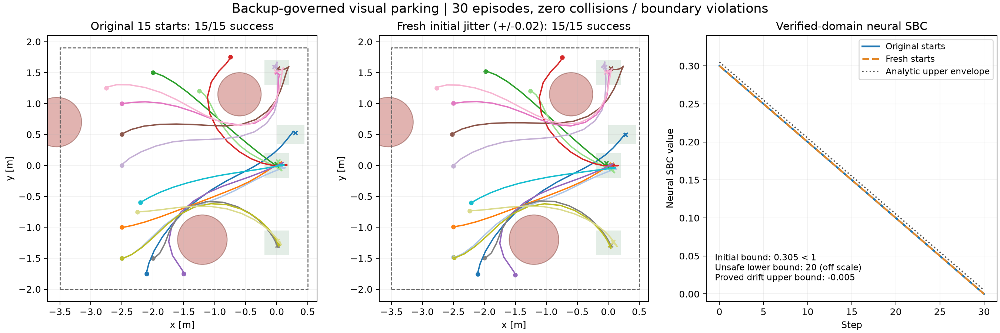

# 停车场神经 SBC：构造、证明域与实验

> 文档定位：停车场证明专题。[文档导航](../README.md) · [当前结果总览](./当前方案与验证结果.md) · [工作汇报](./VISION-SLS_SPVC_SBC_20261030.md)。文件名日期保留原版本含义，更新范围以正文说明为准。

本文件记录 2026-11-03 继续求解停车场 SBC 的新方案。最终对象仍是神经网络表示的非负 SBC，但控制器增加了在线区间后备检查，网络也改成有结构的表示。原来不带后备检查的 SPVC 神经候选仍未通过，原有失败记录保留。

**必须区分三个结论：**神经函数的解析不等式、连续初态区间的数值外包检查、有限次数的真实图像仿真实验。后两者的实际结果在证书包中逐项记录；不能仅凭轨迹全部成功宣称全域神经网络验证完成。

**易读解释补充：2026-11-04。**本次补充讲解，不新增实验，不改变冻结结果包。第一次读可以按以下顺序：第 1 节弄清旧证书为什么不可能同时满足；第 4—5 节看新控制器怎样避免旧问题；第 6—7 节看新 SBC 怎样成立；第 8 节看概率结论的条件。标为“教学例子”的数字用于解释，不能当成实验数据。

## 1. 为什么这次需要改控制器

下面从“谁负责开车、谁负责证明”讲起，再把反例中的每一步摊开。无需先理解神经网络训练细节。

<a id="contradiction-explained"></a>

### 1.1 先分清：车辆怎么走，与我们怎样证明它安全，是两件事

**控制器负责开车。**它根据视觉观测和自己的状态估计，输出转向、加速或减速动作。动作进入车辆模型后，产生下一时刻的真实位置和速度。

**SBC 负责给状态赋一个用于证明的数值。**可以先把 $B$ 理解成我们设计的“安全证明分数”。这个分数不是车速，不是距离，也不直接等于碰撞概率。我们希望找出一个函数，让所有需要检查的状态都遵守下面三条规则。

| 规则 | 数学写法 | 不看公式时怎样理解 |
|---|---|---|
| 起点分数低 | $B_0\le1$ | 所有纳入证明的出发状态，分数最多为 1 |
| 危险状态分数高 | $B\ge20$，当状态危险时 | 任何碰撞或越界状态，都必须被这个函数标为至少 20 |
| 允许的每一步都不能涨分 | $B_{t+1}\le B_t$ | 按被验证的控制器和误差模型走一步，下一时刻的分数不能大于现在 |

这里 1 和 20 是证书设计的分隔阈值；2.001 则是这个实验的速度安全判定值，单位为米/秒。**不是因为“2.001 大于 1、小于 20”才发生矛盾，这三个数字不能直接那样比较。**

为了写得短，把第 $t$ 个时刻整个闭环状态上的网络输出记为 $B_t$。即使网络还输入观测器记忆、参考编号和时间，$B_t$ 仍是那一时刻的一个确定数值。写“$B_4\le1$”时，是在说第 4 步的证书分数，而不是第 4 步的车速。

三条规则为什么有用？从最多 1 分出发，每次只能保持或变小，就永远到不了一个必须至少 20 分的状态。**若真的找到了满足全部规则的函数，它便证明了所考虑的路径进不了危险区域。**这不是声称所有安全状态的分数都低于 1；只有出发状态有这项要求。

### 1.2 “原 CP 误差集合允许的扰动”究竟是什么

图像网络的输出不完全等于理想观测。写成 $y=h(x)+e$ 时，$h(x)$ 是这个真实状态应对应的理想低维量，$y$ 是感知输出，$e$ 是它们之间的差。

**教学简化例子，不是本次实验数据：**如果一个观测分量的理想值是 1.00，误差范围规定为 $[-0.20,0.20]$，那么验证模型要考虑 0.80 到 1.20 之间的所有观测。例如观测 0.85 对应误差 −0.15，属于范围；观测 0.70 对应误差 −0.30，不属于范围。实际停车场是三个分量一起组成误差盒子。

本轮所说的“允许”，含义是**验证模型把这种误差列入了必须处理的情况**。它不是说这种观测一定会被真实 DINO 产生，也不是说 CP 给出了盒内每一种误差序列的发生概率。将 CP 集合用于旧鲁棒验证时，我们额外要求控制器对集合内全部误差都安全；这是强于平均意义的要求。

误差通过下面这条链影响车速：

```text
视觉观测有偏差
  → 观测器对车辆状态的估计发生偏差
  → 反馈/PPO 选择了不同的加速度
  → 车辆按这个加速度运动
  → 真实速度可能超过上限
```

没有把视觉误差直接加到真实速度上，也没有人为往车辆方程里加入另一个过程噪声。这条反例使用的是零过程扰动模型。

### 1.3 用真实记录逐步看：危险状态究竟在哪里出现

保存的场景 0、原误差半径比例 1.0 的反例，速度如下。第 0 步是出发时刻，之后每步间隔 0.15 秒。原速度上限为 2，检查容差是 0.001，因此超过 2.001 就属于速度越界。

| 时刻 | 保存的真实速度，米/秒 | 速度判定 | 假如三条证书规则都成立，该时刻必须满足什么 |
|---|---:|---|---|
| 出发，第 0 步 | 0.000000 | 没有超速 | 初始规则要求 $B_0\le1$ |
| 第 1 步 | 0.591974 | 没有超速 | 不增规则要求 $B_1\le B_0\le1$ |
| 第 2 步 | 1.183921 | 没有超速 | 不增规则要求 $B_2\le B_1\le1$ |
| 第 3 步 | 1.775593 | 没有超速 | 不增规则要求 $B_3\le B_2\le1$ |
| 第 4 步 | **2.367292** | **超过 2.001，已经危险** | 不增规则仍要求 $B_4\le1$，危险规则同时要求 $B_4\ge20$ |

表中速度来自保存的反例，不是为了讲解编出的。右列是“如果存在合格证书，就必须满足的约束”，**不是某个已训练网络实际输出的测量值**。证据为 [反例轨迹数组](/Users/johann/project/work_based_on_spvc/artical-F122/results/vision_sls_parking_20261103_sbc_error_search_v1/witness_scale_1.0.npz) 和 [搜索记录](/Users/johann/project/work_based_on_spvc/artical-F122/results/vision_sls_parking_20261103_sbc_error_search_v1/summary.json)。

因此，单看同一个数 $B_4$：

$$B_4\le1\qquad\text{同时又要求}\qquad B_4\ge20.$$

一个实数不可能既不大于 1，又不小于 20。例如给它赋值 0.8，会违反危险状态规则；赋值 20，会违反从低分出发逐步不增的规则；赋值 5，则两边都不满足。**矛盾就在同一个状态的同一个分数无法同时满足这两个要求。**

### 1.4 到危险状态就停止证明，能否避开第 4 步

不能。危险发生后可以冻结理论过程，不要求第 4→5 步继续下降，但第 3→4 步仍是从安全状态走向下一状态的转移，必须检查。不能看到下一步危险，就把恰好导致事故的那一步从证明中删掉。

本例中首次危险是第 4 步，所以检查至少必须包括 $B_4\le B_3$。否则“安全证明”会漏掉最需要排除的转移。

### 1.5 为什么不是再训练久一点就能解决

这要区分两类失败。

| 失败类型 | 含义 | 增加网络训练是否可能有用 |
|---|---|---|
| 还没学好分数函数 | 控制器可能安全，但当前网络在某些地方没有满足条件 | 有可能。可换网络、改善样本、调整优化方法，再验证 |
| 要证明的控制器在允许情形下确实会进入危险 | 已经存在上述从合法起点走到危险的路径 | 固定路径和三条规则时，不存在能同时满足它们的函数；训练分数网络无法消除矛盾 |

旧停车场遇到了第二类问题。训练 SBC 只改变“怎样给状态打分”，不会自动改变固定控制器在这条路径上施加的加速度。可以把它类比成给一条已经超速的行驶记录写合规证明：修改评分方法，不能让这条行驶记录中的实际超速消失。

准确说法是：**固定旧控制器、原初态、该误差集合和逐误差不增要求时，单独延长 SBC 训练不能让全部条件成立。**如果同时训练并改变控制器，使上述危险路径不再允许发生，就改变了待证明的问题，当然可能重新找到证书。本轮增加在线后备检查正是在做这种改变。

### 1.6 SBC 不是允许小概率失败吗，为什么一条反例就不行

因为“每一种误差都不涨分”和“分数的条件平均值不增长”是两种不同要求。旧检查使用前一种较强的条件。

**教学用的一步例子，不是停车场噪声概率：**设当前分数为 1，下一步以 99% 概率变成 0，以 1% 概率变成 20。那么平均分为 $0.99\times0+0.01\times20=0.2\le1$。这可以满足这一步的期望不增，却没有满足“每个后继都不增”，因为那个 20 分的分支涨分了。

因此，一条合法盒内危险路径足以否定本轮要求的**全误差鲁棒证书**，但不能单凭它断言所有概率型 SBC 都不存在。要改走期望路线，需要说明真实采用的误差概率规律，并重新核查其理论条件，不能随意给反例安上一个很小的概率。CP 误差盒本身不提供盒内各路径的概率。

### 1.7 为什么不能把误差盒缩小，或者提高速度上限

缩小误差集合可能排除反例，但也改变了需要覆盖的感知误差。原来支持较大集合的校准结论，不能自动支持被人为缩小后的集合。提高速度上限，则改变了任务安全要求。这些都不能被写成“原问题已经通过”。

本轮做法是：在明确的启动分布上新采集数据并重新校准；同时修改在线动作执行规则，使后续建议即使不可靠，也必须保留经过验证的安全后备。新的证明适用于这个新闭环。旧闭环的反例记录仍然成立。

### 1.8 误差盒太宽，为什么还会影响能否到达车位

**教学场景：**同一张观测既可能表示“车离上边界很近”，也可能表示“车还在下方”。向上走，对下面那种可能位置有利，却可能让上面那种位置越界。只选一个位置猜测，就可能对另一种真实情况执行危险动作。

所以，要保证对全部可能位置都安全，动作必须同时兼顾它们；有时可选动作会很保守，甚至无法保证两种情况都按时到达目标。它不是说“有误差就永远停不了车”，而是说歧义、任务几何和时域结合后，可能限制共同可行的动作。

本次场景 7 仍保留两个初态假设。它在实际图像下能成功，在极端后续观测测试中安全但未到达。这就是为什么文档要把“避免碰撞越界”和“按时到达”分开报告。

## 2. 实验对象和保证范围

**先把“状态”说具体。**每一时刻要记录车的横坐标、纵坐标、车头方向和速度，合起来就是四个数。动作则是“车头每秒转多少”和“每秒把速度改变多少”，不是直接指定车下一步的位置。控制器用图像估计这四个数；仿真器知道真值，用来计算车辆运动、检查是否超速及评价证书。

“场景 0”是代码给第一个起点/目标任务起的编号，不是“零误差场景”。它从 $(-2.1,-1.75,\pi/2,0)$ 出发，即某个平面位置、车头朝向约 90 度、初速为零。

物理状态为 $x=(p_x,p_y,\theta,v)$，动作为角速度和加速度，使用原 RK4 离散模型，$\Delta t=0.15$，时域 $H=30$，本轮过程扰动为零。原状态边界、动作边界、圆形障碍物和目标集合保持不变。

初始化域为原 15 个起点各自的四维盒子：

$$X_0^j=\{x:|x-x_0^j|_\infty\le0.02\}.$$

这里四个分量分别沿用米、米、弧度和米/秒的单位；不是一个空间距离球。例如场景 0 的初始速度不再只取精确的 0，而允许在 −0.02 到 0.02 米/秒之间；位置和朝向也分别允许小范围变化。检查整块盒子，就是这些范围内的连续取值都要被包住，而不是只测试几个随机点。它包含原 15 个精确起点，但**不覆盖此前 ±0.04 的完整扰动域**。

安全含义仍是原实验的采样时刻车辆中心点与圆形障碍物不碰撞，以及四维状态不越界。保留原碰撞阈值 $r^2+10^{-4}$ 和状态边界容差 $10^{-3}$。没有证明整车外形或采样间连续运动无碰撞，也没有证明真实车辆的模型误差安全。

## 3. 第一步：独立的启动图像 CP

**这一步只回答“启动时，图像误差要留多大的范围”，不直接回答“车以后会不会撞”。**已有视觉网络被冻结；重新采集启动图像，是为了用匹配本轮启动条件的数据描述它的误差，不是把这些图像再拿去训练 DINO。

可以先把每组数据理解成三种不同职责：拟合数据用于决定怎么量误差，校准数据用于决定把范围开多大，审计数据用于独立查看这个范围的实际表现。若先看审计数据再调整半径，这些数据就不能继续被当成从未参与设计的审计证据。15 个中心检查又是单独一项，不计入 240 个独立随机审计样本。

输入是启动图像，冻结的 DINO-G 和低维投影输出 $y_0\in\mathbb R^3$。理想低维量仍是 $h(x)=C(x+[3,0,0,0]^T)$。DINO、投影和场景渲染没有根据本轮校准结果重新训练。

对每个起点组 $j$，独立抽取四维均匀初态 $x\sim\mathrm{Unif}(X_0^j)$，重新渲染图像。每组 16 个拟合样本、32 个校准样本、16 个独立审计样本，另加 1 个确定性的中心检查，共 $15\times65=975$ 张图像。图像使用服务器 CPU 推理；随后的图像闭环也使用相同后端。

拟合集估计偏差 $b_j$ 和各维正尺度 $s_j$。校准分数是三个观测分量的联合分数：

$$R_i=\max_k\frac{|y_{i,k}-h_k(x_i)-b_{j,k}|}{s_{j,k}}.$$

取 $\alpha=0.05$，$n=32$，次序位置 $\lceil(n+1)(1-\alpha)\rceil=32$，得到 $q_j$ 和向外舍入的半径 $r_j=q_js_j$。这是每组一次联合校准，不是把三个 95% 分量区间当成一个 95% 联合区间。

**一个三维教学例子。**假设某组偏差 $b=0$、尺度 $s=(0.2,0.3,0.4)$。一个样本的误差是 $(0.1,-0.2,0.3)$，逐维除以尺度得到约 $(0.5,0.667,0.75)$，联合分数就是最大值 0.75。假如独立校准得到 $q=1$，半径便是 $(0.2,0.3,0.4)$，这个样本三个分量都在里面。如果第三分量变成 0.5，最大比值变成 1.25，整个样本就算未覆盖；不能因为前两个分量正确而称为联合覆盖。

偏差和半径也不是同一个量：偏差 $b$ 表示网络可能整体偏向哪里，半径 $r$ 表示扣除这种偏向后还要预留多少不确定性。实际数据中的这两个量都来自各自规定的数据阶段。以上小数只演示计算方法。


模型输出是每组的 $b_j,r_j$。240 个独立审计样本中 233 个被覆盖，15 个确定性中心全部覆盖。审计结果没有用于调小半径；本轮也没有用中心结果扩大半径。233/240 是审计覆盖比例，不是新估计出来的理论置信水平。

**可交换性在这里是什么意思？**校准初态和未来初态必须来自同一组的同一抽样协议，视觉映射、场景和渲染设置保持一致。独立同分布抽样使样本顺序不携带特殊信息，满足 split CP 所需的可交换性。旧的闭环帧、重复图片、控制器挑选出来的状态不能自动满足这一要求。本轮校准单位是一段实验的一个独立启动样本，后续闭环帧不参与校准。

## 4. 第二步：启动时保留全部可能的初态

**控制器看到的是图像，不知道自己一定属于哪一个起点编号。**它需要检查：“如果车实际上在候选区域 A，考虑图像误差后，能不能看到现在这个观测？”能解释得通就保留；解释不通才排除。

下面先用一维观测说明，数字均为教学例子，实际代码是三维观测和四维状态盒子。假设误差范围为 ±0.15，偏差为零，实际收到的观测为 1.10：

| 候选起点区域 | 该区域的理想观测范围 | 加上误差后可能看到的范围 | 1.10 能否解释得通 |
|---|---|---|---|
| A | 0.98—1.02 | 0.83—1.17 | 能，所以保留 A |
| B | 1.48—1.52 | 1.33—1.67 | 不能，所以排除 B |
| C | 1.18—1.22 | 1.03—1.37 | 能，所以也保留 C |

只凭这次观测不能确定是 A 还是 C。可以选更合适的参考来跟踪，但安全检查仍要考虑 A、C 两种可能。否则一旦猜错起点，就可能用“对 A 安全”的动作伤害实际处于 C 的车。

控制器只接收 $y_0$ 和任务给定的目标位置。它对同一目标对应的每个候选起点计算

$$Y_0^j=h(X_0^j)+b_j+[-r_j,r_j],$$

并保留满足 $y_0\in Y_0^j$ 的所有初态盒子。集合是若干盒子的并，称为“状态信念”：它表示车可能在哪里，并非任意指定的概率分布。

只要真实启动误差在其 CP 集合内，就有真实起点组没有被删除，而且 $x_0$ 位于保留的信念集合内。代码不把真实场景编号或真实状态交给控制器。候选参考轨迹的选择只用目标和偏差校正后的启动视觉量。

**本轮启动之后不再用图像删除状态假设。**后续图像仍更新观测器、影响 PPO 的建议动作，但不能破坏安全信念。因此安全证明不需要假设后续 30 帧误差独立，也不需要将逐帧 95% 相乘。

原场景 7 的启动图像仍保留假设 7、8；代码如实同时维护两者，没有偷偷指定真实编号。

**“以后不再删假设”不等于“以后不看图像”。**后续图像继续影响点估计和 PPO 建议；只是它不再决定把哪个安全盒子删掉。例如一张错误的新图像很像 C，我们不能在没有后续覆盖证明时因此删掉 A。保留 A、C 再共同检查动作，保证链条就不需要每一帧都重新满足 CP。代价是控制可能更保守。


## 5. 第三步：保留反馈控制，逐步验证后备

**先区分“建议”和“实际执行”。**原控制器给出“我想这样转弯、这样加速”的建议。新增检查要问：对目前所有可能的真实状态，这个动作是否安全，而且执行后还有没有一条安全的后续走法？通过才执行；否则减小建议与后备之间的差异，必要时执行后备。

**为什么只看点估计不够：一个速度教学例子。**假设真实速度只知道在 1.80—1.90 米/秒之间，控制器点估计取中点 1.85。如果建议加速度为 1，持续 0.15 秒，则速度区间变成 1.95—2.05。只按中点算会得到 2.00，看起来没有超过 2.001；但真实速度如果靠近区间上端，就会超速。因此必须对整个区间检查。这与本模型的 $v_{t+1}=v_t+0.15a_t$ 一致；本例初态区间只是教学取值。

若把本步加速度改为 0，速度仍在 1.80—1.90，速度这一项可通过。但位置仍会移动，所以还要检查会不会碰障碍、是否越出位置边界及后续是否安全，不能仅凭“没超速”宣布整个动作通过。

**为什么检查剩余后备：**某个加速动作可能下一步还没撞，但已经让车离障碍太近，之后即便最大减速也来不及。只检查下一步会放过它；把剩余后备也检查一遍，才能排除“这一步暂时安全，下一步已经无路可退”的动作。

建议动作仍来自“参考轨迹＋时变反馈＋延迟观测器＋有界 PPO 修正”。新增的动作检查输入为当前信念盒子、建议动作和已经验证的后备动作序列，输出为实际执行的动作。

检查依次尝试建议动作与后备动作的混合比例 $1,0.75,0.5,0.25,0$。每个候选都必须同时满足：下一步全部状态盒子安全；从下一步开始，余下整段后备轨迹全部安全。若初始化时还确认了所选假设的到达性质，则同时保持后备终点包含于目标区域。

区间传播包含 RK4 的各个中间阶段，基础运算向外舍入，三角函数使用区间计算，每步另加 $10^{-12}$ 的数值余量。原动作归一化接口会产生浮点往返，执行前将动作处理为该往返的固定点，并在审计中检查实际动作一致。

**递归可行是什么意思？**今天接受动作后，明天还保留一条已检查的安全后备。明天即使新的视觉建议完全错误，执行后备的第一步仍能留下它的剩余后缀。每一步都能重复这个论证，不是只看一步安全。

例如当前已验证的后备是“动作 A、动作 B、动作 C”。控制器想先执行新动作 P，必须检查“P 后接 B、C”整段仍安全，才允许替换第一步。下一时刻即使图像彻底不可信，B、C 这段已经检查过的后备仍在。实际代码有 30 步，原理相同。这个例子说明“后备后缀”的意思，不代表后备一定是固定三次制动。


初始化时先检查已有参考轨迹；没有合适参考时，使用经区间验证的制动后备。对全部 15 个 ±0.02 初态盒子的联合集合，30 步制动后备也成立，因此覆盖任何保留假设的子集。因为各假设的初始速度区间相同，且经历相同加速度，删除假设不改变这条制动序列。速度估计来自该区间和已执行动作，不读取仿真真实速度。

## 6. 第四步：构造神经 SBC

**这个网络的三个部分，各自只承担一项清楚的任务。**先理解下表，再看后面的公式。

| 部分 | 用途 | 数值上知道什么 |
|---|---|---|
| 几何项 $G(x)$ | 让危险状态获得足够大的分数 | 危险处至少 20；在线检查维持的内部区域里为 0 |
| 时钟项 $0.01(30-t)$ | 给每一步提供确定的下降量 | 每走一步减少 0.01；第 30 步降到 0 |
| 学习项 $0.005\sigma(N)$ | 保留神经网络对状态和估计的响应 | 始终介于 0 和 0.005，所以一步最多增加 0.005 |

**教学算例。**第 10 步若 $G=0$、学习项为 0.001，总分为 $0+0.20+0.001=0.201$。第 11 步仍有 $G=0$，即使学习项涨到 0.004，总分也只有 $0+0.19+0.004=0.194$，仍下降 0.007。最不利时学习项从 0 涨到 0.005，时钟仍下降 0.01，所以总分至少下降 0.005。

这里最关键的前提是**前后两步 $G$ 都为零**。它来自在线区间后备检查，不是时间过去就自动成立。如果取消检查让车驶入危险，$G$ 可跳到至少 20，时钟下降的 0.01 完全抵消不了；因此不能只给任意旧控制器加一个倒计时，就宣称它安全。

交付的神经函数为

$$B_\theta(s,j,t)=G(x)+0.01(30-t)+0.005\,\sigma(N_\theta(s,j,t)),\qquad 0\le t\le30.$$

这里 $s=(x,\hat x)\in\mathbb R^8$；$j$ 为所选参考编号；$N_\theta$ 保留此前训练得到的 24→64→64→1 的 Tanh 网络参数，将输出改为 Sigmoid 有界头；$\sigma\in[0,1]$。离散参考的 one-hot 和时间特征与此前候选一致。真实 $x$ 只用于离线证书评价，在线控制器不使用真实状态。

$G$ 是由仿射层、ReLU 和最大值构成的固定权重几何网络。最大值用 $\max(a,b)=\mathrm{ReLU}(a-b)+b$ 实现。它编码原状态边界和障碍物，不需要学习边界位置。

具体取 $m=0.005$，$\ell,u$ 为包含原容差的状态边界。32 个二维方向 $n_k$ 描述障碍物的外包多边形，$\rho_i$ 为包含原碰撞容差和方向范数误差的向外半径：

$$G(x)=20\,\mathrm{ReLU}\!\left(\max\left\{1+\frac{\ell_d-x_d}{m},\ 1+\frac{x_d-u_d}{m},\ 1+\frac{\rho_i-\max_k n_k^T(p-c_i)}{m}\right\}_{d,i}\right).$$

因此 $G\ge0$，原危险集合上 $G\ge20$。在线检查使用一个保守的连续盒子条件保证整个信念内 $G=0$：状态距边界留有 $m$ 裕量，且对每个障碍物存在一个方向，在整个盒子上都满足支持函数值至少为 $\rho_i+m$。这是更保守的允许执行区域，不是放宽原安全要求。

**为何仍是神经 SBC？**函数由 ReLU、Tanh、Sigmoid、仿射层组成，导出了实际网络权重，保留了学习参数；不是把“安全则 0、危险则 20”的解析指示函数当成最终模型。但这也不是原 SPVC 完全不变的网络：新增了固定几何分支和有界输出结构。安全证明依赖结构与后备不变性，不能声称靠本轮额外训练独自发现了屏障。

## 7. 第五步：说明证明域，并证明三个 SBC 条件

### 7.1 增广状态与证明域

**“不变”指保证条件一直成立，不是车停着不动。**位置、速度、盒子和剩余动作都可以变化；要求保持的是“真实车在盒子里、整个盒子安全、还留着可执行的安全后备”。

“增广”表示把控制器的记忆也算进去。同一辆车处于同一个位置，如果它选了不同参考、估计速度不同或留了不同后备，下一步动作可能不同。只写四个物理状态，不能完整描述这些未来行为。

可以把有效域理解为满足一张条件清单的全部闭环状态。它不是只从测试结果里挑出成功点：我们必须证明车一开始满足清单，而且每执行一次允许动作，清单继续成立。缺少任一项，都不能把未检查的状态说成已经覆盖。

完整闭环状态除物理状态和观测器之外，还包括信念盒子、所选参考、后备序列和时钟。网络可以不显式使用全部记忆，但转移证明必须包含它们。

定义 $\mathcal I_t$ 为以下有效增广状态：真实 $x$ 属于信念并集；全部信念盒子处于 $G=0$ 区域；剩余后备序列经区间外包验证安全；参考、观测器和时钟有效。若保持到达检查，它也是记忆不变式的一部分。

**神经 SBC 的下降结论在 $\mathcal I_t$ 上成立。没有证明它在任意拼接的全八维安全状态盒子上都下降。**这不是遗漏条件：必须先证明初始化进入该域、该域对实际受保护的转移闭合，才能把它作为有效闭环状态空间。将危险状态并入停止过程的状态空间；一旦危险或时域结束，完整增广状态（包括网络所读时钟和观测器）冻结。危险状态上的停止后继屏障值不变。

### 7.2 初始化

在启动 CP 覆盖事件 $E_0$ 上，真实初态在保留盒子内。全部初始盒子有安全制动后备；初始化只接收已验证的参考后备或该制动后备。因此初始增广状态在 $\mathcal I_0$ 内，且

$$0\le B_\theta(s_0,j,0)\le0.3+0.005=0.305<1.$$

### 7.3 不变性

**先读一遍不用符号的归纳过程。**

1. 出发时：在启动误差被覆盖的前提下，真实车在保留盒子里，并且已有安全后备。
2. 假设现在还满足这两点：检查器只接受能把所有盒子带到安全区域、并留下安全后备的动作。
3. 执行这个动作：真实车的下一状态被区间传播包住，因此也落在检查过的安全区域。
4. 下一时刻又回到与第 2 点同样的情形，于是可再重复一次，一直重复到第 30 步。

第 2 点不是未经证明地假定“以后一定安全”，而是利用第 1 点和上一步已经建立的事实，证明再走一步仍成立。这就是本章“递归可行”和“不变性”的具体逻辑。

若当前状态在 $\mathcal I_t$ 内，区间一步传播包住实际模型后继。被接受的动作保证下一步盒子仍在 $G=0$ 区域并具有完整安全后备。至少后备第一步可用。启动后不删假设，观测器更新不影响真实状态被包含这一事实，因此

$$z_t\in\mathcal I_t\ \Longrightarrow\ z_{t+1}\in\mathcal I_{t+1}.$$

该论证对任意后续视觉输出成立；无效数值输入会触发模型预测或后备建议，不使用它来缩小安全集合。它仍以动力学和区间计算假设为前提。

### 7.4 非负性、危险分离和下降

所有项非负，故 $B\ge0$。原危险集合上 $G\ge20$，故 $B\ge20$。在有效非终端闭环状态上，前后 $G=0$，而神经头一次最多增加 0.005，时钟项下降 0.01，所以

$$B_\theta(z_{t+1})-B_\theta(z_t)\le-0.01+0.005=-0.005<0.$$

这比条件期望不增更强，直接蕴含该有效域内的非负超鞅条件。终止后使用冻结的停止过程，不再要求严格下降。区间验证和后继包含性负责证明实际轨迹留在证明域，不能用抽样下降值替代这一环节。

可选的解析指示屏障和分段延拓函数在代码中保留为辅助诊断，不是本轮最终神经 SBC。

## 8. 最终安全保证如何连接到 CP

**先将两部分的工作分开。**启动 CP 负责“别在一开始把真实起点排除掉”；后备控制负责“真实起点一旦被保留，就在后续每一步把它包在安全范围里”。因此只需要把这两个环节接起来，而不是给每帧都乘一个 95%。

| 启动情况 | 后续可以推出什么 |
|---|---|
| 真实启动误差在其校准集合内，并满足模型等其余前提 | 真实起点被保留；后备不变性保证注册时域内不碰撞、不越界 |
| 真实启动误差不在集合内 | 这条保证链不再自动适用；不意味着一定出事故，仍可能安全 |

因此，安全失败若发生，只可能落在“启动覆盖没成立”的那些情形中，或者违反了声明的模型/实现前提。在固定其余前提时，安全失败的概率不会超过启动未覆盖的概率。这叫事件包含关系，不需要把两个概率相乘。

**95% 的准确读法。**把“随机抽一份校准集、再随机抽一次同协议启动”看成一次完整统计试验。理论约束的是这些完整试验总体中的未覆盖概率。它没有证明“手里这份已经固定的校准文件，对每个位置都至少 95%”；要得到针对固定校准文件的另一种高置信度结论，必须另做相应分析。本轮 233/240 是一次独立审计观察到的覆盖数量，也不是理论给每辆车指定的事故频率。

在注册的模型、初始域和时域内，若 $E_0$ 成立，前述不变性给出路径逐点安全，后续图像可以任意偏差。即

$$E_0\Longrightarrow\{x_t\notin\mathcal U,\ t=0,\ldots,30\}.$$

对预先指定的起点组，若未来初态与该组校准集遵循同一独立均匀抽样、固定感知及渲染协议，split CP 给出 $\Pr(E_0)\ge0.95$，从而该模型下单次新实验的安全概率至少 95%。同样适用于与校准集独立的预先指定组混合分布。

**这个概率的边缘化对象包含校准集和未来启动样本。**它不是对已经固定的这份校准集给出逐初态 95% 保证，不是每个固定中心点的频率保证，不是 15 次同时安全的 95% 保证，也不是实车概率。本文不把审计 233/240、SBC 的 1/20 比值和 CP 的 95% 相乘。这里用的是“启动覆盖蕴含条件下全程安全”的直接连接。

安全与到达必须分开。只要启动条件成立，后备不变性覆盖安全；当保留多个起点假设或参考识别错误时，不能一概保证到达真实场景的目标。实际测试的成功率另行报告。

## 9. 数值验证和实验记录

**读结果时先分清三类证据。**“30/30 成功”说的是这 30 条试验轨迹；“整块初态盒子检查通过”说的是区间算子包住的一片连续状态，而不只是盒子里的几个点；“SBC 不等式成立”还需要网络结构、初始化和不变性推导。它们互相支持，但谁也不能冒充另一个。

本例中的“安全”只统计避开碰撞和状态越界。车安全地停在车位外，也可能是“安全但任务失败”。这就是下面极端观测测试 15/15 安全、却只有 14/15 到达的含义。

最终汇总以 `artical-F122/results/vision_sls_parking_20261103_neural_sbc_certificate_v1/certificate.json` 为准。核查项目包括：

- 全部 15 个连续初态盒子联合制动的区间安全。
- 每个起点自身参考轨迹的连续盒子安全与目标包含。
- 两组图像实验的实际动作、信念传播、完整后备后缀和真实轨迹包含性。
- 实际神经值的非负、初始上界、后继下降，以及理论上的危险分离。
- 原失败误差序列在新受保护控制器中的回放。

证书与区间外包针对注册的数学离散模型；逐步 $10^{-12}$ 数值余量及跨环境回放检查不是整个平台的浮点程序形式化证明，也不是对所有 libm 实现的误差定理。在线检查耗时也需独立测量，当前不宣称硬实时车载部署。

| 项目 | 结果 | 结论范围 |
|---|---|---|
| 15 个连续初态盒子的联合制动后备 | 全部区间检查通过 | 支持任意保留假设子集的安全初始化 |
| 15 条各自参考的连续盒子传播 | 15/15 全程安全且终点盒子在目标内 | 参考对应的初态盒子；不等于任意视觉识别都正确 |
| 原 15 个起点，CPU 实际图像闭环 | 15/15 成功，0 碰撞，0 越界 | 固定中心性能实验 |
| 新抽取 ±0.02 初态，seed=920731，CPU 实际图像闭环 | 15/15 成功，0 碰撞，0 越界 | 预先固定种子的独立扰动实验 |
| 两组归档的独立区间重算 | 30/30 通过，每步盒子完全一致、真实状态被包含、完整后备后缀安全 | 930 个状态时刻、900 个实际转移的实施审计；连续域证明另有不变性论证 |
| 神经值（两组图像实验） | 初始值 0.300；最大单步变化约 −0.010 | 实测；理论使用保守上界 0.305 和 −0.005 |
| 场景 0 的旧负角点误差规律，比例 1、0.5、0.25、0.1 | 4/4 安全到达，SBC 下降 | 启动使用真实中心图像；后续沿用旧反例误差规律，非原闭环轨迹原样复制 |
| 15 个起点，后续交替极大误差及 NaN/Inf | 15/15 安全、14/15 到达，最大单步 SBC 变化约 −0.005 | 对抗回归；场景 7 未到达，明确区分安全与任务成功 |

原起点组共 137/450 步修改了 PPO 建议，扰动组共 193/450 步修改了建议。因此结果不能归因于原 PPO 已经独立安全。两组中各有 14 个场景保持了所选假设的后备到达检查；场景 7 的两个初态假设共享安全后备，但没有全程到达证书。实际图像下场景 7 成功，极端误差下则未到达。



图中左、中为两组实际图像轨迹；右为网络实际输出及解析上界。危险阈值 20 超出右图纵轴范围，不能误读为危险阈值只有 0.3。

本轮图像轨迹上的学习头数值接近零，屏障曲线主要由时钟项决定；对抗观测下学习头变化仍满足幅度限制。**有界头保留了神经表示，但安全证明对其权重并不敏感。**如果用于论文，必须将“几何结构和后备不变性带来的保证”与“神经学习带来的增益”分开，通过消融检验后者，不能声称训练本身解决了原来的全域证书困难。


## 10. 参考了什么，哪些是本项目的新增适配

| 来源 | 本轮使用方式 | 没有继承的结论 |
|---|---|---|
| [VISION-SLS](https://arxiv.org/abs/2604.24894v1) | DINO 后低维视觉映射、观测误差显式建模、四维停车任务 | 没有直接使用其完整 SLS 求解器或直接继承其闭环安全证明 |
| [Split conformal prediction 教程](https://arxiv.org/abs/2107.07511) | 固定拟合分数、独立校准集、有限样本修正分位数；本轮按预定义起点组分别校准 | 没有固定状态条件覆盖或任意分布偏移保证 |
| [CP-NCBF v2](https://arxiv.org/abs/2503.17395v2) | 借鉴校准与训练/违例评估分离的思路；本轮 CP 用在启动视觉误差 | 没有原样实施其 NCBF/QP 算法、没有用它的结论替代 SBC 动态条件证明 |
| 原 SPVC 非负 SBC 路线 | 非负性、初始上界、危险阈值、停止过程和超鞅不增条件 | 没有宣布原无过滤器神经候选通过，也没有复用 AEBS 权重的证书结论 |
| [Predictive safety filter，Wabersich 与 Zeilinger](https://arxiv.org/abs/1812.05506v4) | “接受动作时保留可行安全后备”的递归可行思想 | 本轮是有限候选动作加区间外包，不是该论文完整 MPC 优化器的复现 |
| 本项目构造 | 启动后保留多假设、几何 ReLU 分支＋有界学习项＋有限时钟、可达不变域上的神经 SBC 证明 | 这是有结构的证书与受保护闭环适配；不能仅凭构造存在就声称学术创新已充分成立 |

## 11. 复现入口

在 `artical-F122` 下使用项目 Python 环境。图像实验需要服务器的 DINO-G 权重、VISION-SLS 渲染依赖及虚拟显示。完整参数和输入散列见各结果目录的 `config.json`；最终包保存代码快照、网络、参考、投影、PPO 和文件散列。

主要实现文件：`calibrate_startup.py` 负责独立启动校准；`backup_governor.py` 负责受保护动作；`interval_backup.py` 负责区间传播；`geometric_neural_sbc.py` 定义最终神经函数；`certify_backup_neural.py` 导出证书包并审计归档轨迹；`evaluate_backup.py` 运行实际图像闭环。

例如复查本地证书（输出目录必须不存在）：

```bash
../.venv-vision-sls/bin/python -m Aebs.vision_sls_parking.certify_backup_neural \
  --candidate results/vision_sls_parking_20261103_planned_candidate \
  --learned-sbc results/vision_sls_parking_20261103_sbc_nominal_planned_v2/sbc.pt \
  --startup-model results/vision_sls_parking_20261103_startup_cp_v2/startup_model.json \
  --evaluation results/vision_sls_parking_20261103_backup_images_v1 \
  --evaluation results/vision_sls_parking_20261103_backup_images_fresh_v1 \
  --output-dir results/parking_neural_sbc_recheck
```

再次运行服务器图像实验时，使用 `evaluate_backup`，候选目录可以直接指定最终证书包，传入包内 `startup_model.json`，并设置 `--sensor images --bound .02 --device cpu --threads 8`。加入 `--jitter .02 --seed 920731` 可重现本轮扰动协议；再次使用同一种子属于复现，不新增独立实验数量。
