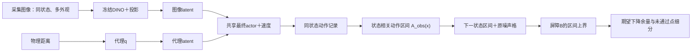

# 当前DINO双路径框架：架构、环境误差、SBC检查与理论依据

更新日期：2026-10-14。独立NBC、单步联合、保留修正与五步反馈均已运行；所有新NBC提议仍被拒绝，尚无控制器安全改善，旧SPVC模型保留。全部历史路线、配置、效果和术语通俗详解见[完整报告](当前主线_完整工作进展.md)。本篇保留较集中的框架与理论讨论；逐轮记录见[R2实验记录](R2_DINO原版SPVC最小替换实验.md)，方法审计见[证书路线说明](SBC证书路线澄清_SPVC与语义双路径方案对照.md)。

**模块的论文/建议来源见第4.5节，完整来源条目见第4.6节。** 表中区分沿用原方法、借鉴设计建议、本项目具体实现和未来候选；“参考过某篇论文”不表示当前已运行其算法或获得其定理保证。

## 1. 先回答：现在是否形成了完整框架？

**主体框架已经形成，且“观测环境影响→动作区间→下一状态区间→SBC检查”的离线链条已经运行。具有端到端概率安全保证的理论链条尚未闭合。**

这里“形成框架”有三个不同层次：

| 层次 | 当前状态 | 准确含义 |
|---|---|---|
| 模块与数据流 | 已形成 | DINO、投影、q代理、最终控制器、物理状态屏障及环境区间检查可以对应起来 |
| 开发实验接线 | 已运行 | 当前最终模型的图像与代理动作已经在同物理状态上比较；所观测环境的动作区间已经进入屏障计算 |
| 完整安全证书 | 尚未取得 | 误差对未来图像的覆盖、连续状态条件、出域与噪声假设仍需补齐 |

已有原截图协议下的图像闭环采集和30回合成功记录，但使用的是历史第09步控制器。当前最小最终actor经过SPVC更新，不能把旧控制器的30回合结果直接归给它。本轮新增的是最终actor的精确图像单步分析及环境区间检查，没有新增实时截图闭环回合。

### 开头进度清单

- [x] 原采集方式扩充到24,000张图像，完成审计和按距离分组划分。
- [x] 冻结DINO提取384维特征，训练32维投影与物理状态代理q。
- [x] 同距离多外观的R2表示对齐，训练与之适配的PPO。
- [x] 用DINO＋latent替换cGAN＋旧state_net，复用原SPVC训练和检查后端。
- [x] 核对最小最终actor/SBC与最终复查对应。
- [x] 完成共同任务语义空间和物理量的旧系统配对误差比较。
- [x] 在10.x服务器完成观测环境转移诊断与动作区间自适应检查。
- [x] 2026-10-14真正接入Model-Free NBC单步屏障学习，完成平均损失与训练难点加权两轮。
- [ ] 新NBC候选验证通过：尚未达到，第二轮边界越过与最差验证余量变差。
- [x] NBC概率比安全反馈进入完整PPO，训练图像库回放有序在策略采样8192步，完成首轮联合实验。
- [x] 保留原模型，完成同起点任务对照、精确匹配验证及最终NBC/轨迹审计。
- [x] 加入旧训练转移回放、区域难点损失和NBC/Adam回退；与无安全反馈PPO各跑8192步。
- [ ] 保留修正让NBC成功适应新策略：尚未达到，4轮NBC提议全部拒绝，权重仍是原预训练C。
- [ ] 安全反馈优于普通PPO：尚无证据，修正版验证14583违反，对照14508，原模型13863。
- [x] 1～5步NBC反馈/当前轨迹损失及终止mask，完成同预算训练和22项测试。
- [ ] 五步安全收益：未达到，14617违反，对照14508；C更新0/4保留，不部署。
- [ ] 联合候选验证合格：未达到，固定C验证违反增加，最终C的unsafe符号错误16个。
- [ ] 真实CARLA在线联合训练与多步NBC：尚未实现。
- [ ] 建立当前最终策略对应、对未来图像有效的状态相关误差契约。
- [ ] 完成理论必要区域内的连续物理状态与环境覆盖验证。
- [ ] 完成噪声出域、终止语义和完整安全概率推导。
- [ ] 当前最终模型的独立图像闭环性能评价与最终test结果。

历史轨迹CP与NBC候选研究不自动成为上面最后几项的证明。后文解释为什么。

## 2. 研究问题：为什么要这套框架？

车辆需要根据视觉输入决定如何制动。训练和数学验证又需要以物理距离、速度为条件，检查大量状态。我们希望：

1. 图片经过一个有效的视觉表示网络，能保留与制动有关的信息。
2. 小代理网络在给定物理状态时，产生接近图片表示的latent，降低验证成本。
3. 承认两条路径存在差异，将该差异造成的动作变化纳入安全分析。
4. 通过屏障条件论证安全，而不是仅由“这批回合没有事故”作判断。

原SPVC用cGAN生成图像来构造可处理的观测代理。当前用DINO特征和低维latent构造代理，把两条路径的比较和环境影响建模作为前端替换之后的重点。

## 3. 任务与变量：先把物理量说清楚

状态是`x=(d,v)`，其中d为距离，单位m；v为速度，单位m/s。环境因素记为η，例如天气、光照、颜色。现有数据覆盖4种天气/光照和3种颜色，共12组观测外观。

动作`a∈[-3,3]`。本任务中正数为制动、负数为加速。每一步0.05秒，确定性动力学为：

$$
f(x,a)=
\begin{bmatrix}
d-0.05v\\
\operatorname{clip}(v-0.05a,0,3)
\end{bmatrix}.
$$

`clip`把数值限制在给定区间。初始区域是`d∈[15,16]`、`v∈[2.5,3]`；回合上限400步，约20秒。

运行任务的unsafe条件是`d≤6且v>0.5`。目标区间内低速到达、目标外停止、出域、超时分别记录。unsafe是实验约束事件，不天然等于实体碰撞。

原VT屏障检查使用闭矩形`d∈[5,6]、v∈[0.5,3]`作为不安全区域。它与运行任务在v=0.5边界上的语义并不完全相同；区域界、任务成功率和理论证明必须说明各自集合。

CARLA提供与原SPVC采集协议一致的画面。当前状态更新使用上述AEBS公式；天气图片没有自动引入路面摩擦变化、执行延迟或真实车辆动力学误差。

## 4. 当前完整架构：运行控制与离线检查

### 4.1 图像控制路径

```text
CARLA原截图方式得到RGB
          ↓
冻结DINOv2-S/14
          ↓
384维视觉特征
          ↓
训练时固定的特征标准化＋小投影网络P
          ↓
32维图像latent z_img
          ↓ 与当前速度v拼接
33维控制输入
          ↓
最终PPO actor → 动作裁剪[-3,3]
          ↓
AEBS动力学 → 下一物理状态
          ↓
下一时刻图像
```

DINO使用预训练权重并冻结。我们训练投影网络和代理q；辅助距离decoder仅用于表示训练/测量，不是当前控制器输入的一维距离头。速度由状态/测量提供，当前没有从单张图像估计速度的声明。

### 4.2 物理代理路径

```text
物理距离d → 按表示训练尺度归一化 → 小网络q → 32维z_q
                                                       ↓ 拼接速度v
                                                   同一个最终actor
                                                       ↓
                                                  动作a_q、后继f(x,a_q)
```

q是小代理网络的名字，不是强化学习的Q函数。它目前只读距离，没有显式天气/颜色输入。跨外观的差异在对齐训练中尽量缩小，剩余变化由后续动作集合描述。

### 4.3 环境影响怎样接入SBC



图中后半段是离线分析。B不直接输出车辆动作，动作区间也不在运行时修改PPO。当前主线没有在线QP或Safety Filter。

图中来源对应：DINO骨干来自R3；投影与q来自R2；PPO算法来自R4、其SPVC更新来自R1；状态相关控制集合的动机来自R2，观测min/max和自适应检查由本项目实现；B和噪声期望框架来自R1，区间传播使用已有IBP技术。R1～R7的论文和材料见第4.6节。该图画的是冻结原SPVC＋误差检查链；2026-10-14新增的R5独立NBC与联合候选另见第11节和14.6～14.7，不代表旧主模型已被替换。

DINO本体没有被放进区间验证。验证器使用小网络和已经记录的动作区间；这降低了计算成本，也意味着图像到动作区间之间的覆盖关系需要另外论证。

### 4.4 模块构成、训练与冻结状态

| 模块 | 输入→输出 | 当前作用与状态 |
|---|---|---|
| 冻结DINO | RGB→384维 | 提取视觉特征，权重冻结 |
| 特征标准化 | 384维→384维 | 使用表示训练的均值/标准差，评价时固定 |
| 投影P | 384维→32维 | 学习任务相关表示；R2阶段训练，当前冻结 |
| 代理q | 归一化距离→32维 | 与图像表示对齐；当前冻结 |
| 辅助decoder | 32维→距离标量 | 训练监督与测量，不参与运行控制 |
| PPO actor | 32维latent＋速度→1维动作 | 第09步训练、SPVC阶段更新；本轮冻结最终版本 |
| 奖励价值网络 | PPO训练输入→价值 | 用于PPO训练，当前确定性动作检查未运行它 |
| SBC网络 | VT坐标下的距离、速度→非负标量 | 原SPVC训练；本轮只检查冻结权重 |
| 环境动作区间 | 同状态的图像/q动作→上下界 | 由观测记录构造，不是新神经网络 |
| 区间与噪声检查 | 动作区间、状态、B→上界/余量 | 本轮新增，离线自适应检查 |

最终保存的是SPVC actor参数，不是重新训练过的完整PPO概率分布。因此本轮使用确定性actor均值并裁剪；未来移植PPO概率比安全更新时，需要初始化完整PPO、保存实际采样动作与旧log-prob，再按在策略流程采样。

### 4.5 每个部分的灵感和方法来自哪里？

下面R1～R7对应第4.6节的来源条目。这里的“来源”包含论文、用户提供的设计建议和源码，不把一份设计建议当作已经发表并完成证明的论文。

| 框架部分 | 主要来源 | 具体借用了什么 | 当前实现及本项目选择 |
|---|---|---|---|
| 视觉控制任务、物理动力学、初始/不安全区域 | R1：原SPVC论文与仓库 | 图像控制AEBS及以物理状态定义安全的任务 | 复用原动力学与区域；当前运行终止分类和VT矩形边界的区别另行记录 |
| 原截图采集方式 | R1仓库的`spvc_carla.py`，用户明确要求保持 | 用原地图/构图及截图协议取得视觉数据 | 原方法保留；2000距离记录、4天气×3颜色及元数据属于数据扩充实现 |
| 同状态、多外观配对数据 | R2：semantic＋latent建议，第3节 | 同一物理状态产生多种环境观测，学习外观不变性 | 以距离组保留配对并划分train/validation/test；具体组分配为本项目协议 |
| 冻结视觉骨干 | R3：DINOv2论文/官方权重；R2第5节建议选择骨干 | 使用预训练通用视觉特征，冻结大型编码器 | 实际加载`dinov2_vits14`，输出384维；本项目未重新训练DINOv2预训练算法 |
| 特征与距离标准化、H5缓存 | 通用工程处理，本项目实现 | 保持训练/评价尺度一致，复用冻结特征 | 没有指定某篇论文作为这些存储/数值处理的独创来源 |
| 小投影网络P | R2第6～8节 | 将大视觉特征投影为安全相关低维latent，建议384→128→32 | 采用该维度和小MLP形式；不是直接采用DINOv2官方预训练投影头 |
| 物理状态代理q | R2第10～13节；R1提供可验证观测代理的整体动机 | 以物理状态映射到共同latent，避开大型视觉网络的直接验证 | AEBS具体化为距离→64→64→32；q当前不显式输入η，速度单独交给控制器 |
| 辅助距离decoder | R2第8节的安全信息保留/可解码物理量建议 | 用物理信息监督表示，使latent含有控制所需信息 | 增加辅助距离监督与测量；decoder不进入运行控制路径 |
| 图像与q对齐损失 | R2共同表示与映射拟合建议 | 使同状态的图像latent和代理latent接近 | 使用MSE及冻结后q拟合；具体损失组合属于本项目训练实现 |
| R2同距离分组损失 | R2外观不变性和避免塌缩建议 | 同状态不同天气的表示应一致，不同距离应可分 | 图像latent向组均值对齐、q向组均值对齐、远距离间隔项和权重是本项目具体写法；不是照抄某篇已指定论文的完整损失 |
| PPO策略与奖励价值训练 | R4：PPO原论文；R1使用PPO的控制器预训练流程 | 通过采样和裁剪策略目标学习任务控制 | 实现依托Stable-Baselines3，控制输入改为32维latent＋速度；具体训练数据和超参数按本项目记录 |
| 最终确定性actor推理 | R1仓库SPVC actor保存/更新方式，本项目适配 | 控制器经过SPVC更新后执行动作 | 使用保存的均值网络及动作裁剪；它与完整PPO概率分布训练状态分开说明 |
| 非负随机屏障B及区域条件 | R1的Theorem 2.2和仓库后端 | 初始区低、unsafe区高、非负性及动态期望条件 | 原`[2,16,8,1]`网络/后端复用；当前代码的`square_output=True`实际使用Softplus，不是本轮新设计的NBC |
| 独立有符号NBC候选C | R5 Definition 2、IV-B及官方srlnbc裕量实现 | 初始负、unsafe正、C(next)≤(1−λ)C(current)，从转移样本学习 | 已运行两轮单步预训练及一轮PPO概率比反馈；未接多步、未获证书；难点加权与联合最小设置为项目选择 |
| 新分支PPO＋NBC安全反馈 | R5第V节概率比反馈；R4/SB3 PPO更新 | 记录当前策略动作概率，以屏障违规作为策略安全成本 | 已运行8192步训练图像回放；单步居中成本与有上限递增系数为项目简化，不是完整作者算法 |
| 控制器与SBC交替更新 | R1第3.2节、Algorithm 1及`VT/train.py` | 用屏障约束控制更新，用当前控制器更新候选屏障 | 最小替换实际沿用该训练循环；不是Model-Free NBC概率比更新的移植 |
| 参考扰动与噪声概率质量 | R1 Assumption 1、Remark 1及仓库`env.py` | 用后继扰动模型进入SBC条件期望 | 当前复现为固定factor支持和均匀检查质量；三角分布训练采样、原论文数据估计与真实噪声校准分别说明 |
| 初始/unsafe区域界、网格邻域补偿 | R1 Theorem 3.1及仓库验证器；R7为界计算工具背景 | 通过区域界和Lipschitz补偿将点检查扩展至相关状态域 | q代理路径沿用原机制；新的动作集合连续扩展尚待完成 |
| latent→动作→后继三层误差 | R2第18～22节 | 把高维视觉误差转成更贴近控制安全的低维误差 | 按当前最终actor和同物理状态精确计算；误差公式与裁剪后继遵循当前动力学 |
| 状态相关观测动作区间`A_obs(x)` | R2第21节的控制空间集合`U_α(x)`提供灵感 | 用1维动作集合表示环境对控制的影响，降低验证维度 | 本项目以12种观测动作及q动作的min/max构造经验区间；尚无α覆盖声明，不能称为实现了建议中的保形契约 |
| 屏障的区间传播 | 标准区间传播；R6是神经网络IBP的代表性现代参考，R7是原工具背景 | 逐层传播输入集合的输出上下界 | 本轮手写线性/Tanh/Softplus区间传播，复用同一冻结B；没有迁移R6的完整分类鲁棒训练算法 |
| 动作集合＋噪声格的期望上界 | R1的噪声格积分与SBC期望；R2的集合式后继验证 | 同时处理控制集合与噪声概率，检查屏障上界 | 将两者接成新的离线模块，条件推导见第8节；并非直接从某篇论文取得本项目端到端保证 |
| 噪声10→20→40→80自适应细分 | R1网格/反例迭代的总体动机，标准区间细分思路 | 对粗界未通过点加强界计算 | 分辨率和仅重查未通过点的规则是本项目实现；尚未确认是独立学术创新 |
| 共同冻结空间的cGAN/DINO对照 | 本项目评价设计，基于R2共同表示及R3特征 | 用同一参照和同一坐标系比较两种代理 | 不是DINOv2论文规定的评价指标，不是独立LPIPS指标；评价器参与过q训练的偏向须披露 |
| 模型哈希、最终pair复查、结果归档 | 本项目实验可复核性实现 | 绑定表示、actor、B、数据和检查结果 | 工程证据与实验管理，不据此宣称理论贡献 |

表里把“本项目实现”与“学术原创”分开：写出了新模块、选择了某种损失或组合方式，不等于已经证明它没有先行工作。未来论文的新贡献应由充分相关工作对比、消融和完整理论/效果证据支持。

### 4.6 来源目录：论文、建议、代码分别是什么？

**R1．原SPVC / SafePVC。** 用户提供的《Provably Probabilistic Safe Controller Synthesis for Vision-Based Neural Network Control Systems》，现存本地文件[720_file_Paper.pdf](/Users/johann/project/work_based_on_spvc/docs/references/720_file_Paper.pdf)。本文沿用项目称呼SPVC，论文正文框架名称为SafePVC。主要位置：Assumption 1、Remark 1、Theorem 2.2、Theorem 3.1及Algorithm 1。作者和最终发表版本信息应以正式版本核对，不由当前匿名稿页眉推定。当前“沿用原实现”指本项目提供的仓库后端，不能据此断言所有作者代码版本一致。

**R2．semantic＋latent设计建议。** 本地文件[设计建议PDF](/Users/johann/project/work_based_on_spvc/semantic+latent%E6%96%B9%E6%A1%88.pdf)。它提出冻结视觉编码器、小投影、物理到latent映射、外观不变性、误差校准和物理状态安全分析。定位：第3节配对数据；第5～8节编码与安全latent；第10～13节q与误差；第18～22节动作/后继集合与验证。**这份材料是用户提供的设计建议，不标成已发表论文，也不赋予它未提供的作者、DOI或证明。**

**R3．视觉骨干的论文来源。** Maxime Oquab等，2023，[*DINOv2: Learning Robust Visual Features without Supervision*](https://arxiv.org/abs/2304.07193)，官方实现[facebookresearch/dinov2](https://github.com/facebookresearch/dinov2)。当前使用其官方预训练ViT-S/14特征；将这些特征投影成控制用32维表示的方案来自R2并在本项目训练，不是R3提供了AEBS安全定理。

**R4．控制学习算法来源。** John Schulman、Filip Wolski、Prafulla Dhariwal、Alec Radford、Oleg Klimov，2017，[*Proximal Policy Optimization Algorithms*](https://arxiv.org/abs/1707.06347)。它是PPO采样/策略目标的算法来源；R1把PPO用于视觉控制预训练，本项目用Stable-Baselines3实现接入当前观测。PPO本身不提供本项目SBC或感知误差保证。

**R5．单步候选与安全联合训练来源。** Yujie Yang、Yuxuan Jiang、Yichen Liu、Jianyu Chen、Shengbo Eben Li，2023，[*Model-Free Safe Reinforcement Learning Through Neural Barrier Certificate*](https://doi.org/10.1109/LRA.2023.3238656)，IEEE RA-L 8(3):1295–1302；[本地论文](/Users/johann/project/work_based_on_spvc/Model-Free_Safe_Reinforcement_Learning_Through_Neural_Barrier_Certificate.pdf)、[作者项目页](https://jjyyxx.github.io/srlnbc/)、[官方srlnbc仓库](https://github.com/jjyyxx/srlnbc)。第IV节提供样本/多步屏障训练，第V节提供PPO安全反馈，第VII节说明局限性。2026-10-14已用PyTorch运行IV-B单步训练，并借鉴V节运行概率比安全反馈；未迁移完整作者框架或多步项，项目简化与验证退化见14.7。

**R6．IBP的代表性参考。** Sven Gowal等，2018，[*On the Effectiveness of Interval Bound Propagation for Training Verifiably Robust Models*](https://arxiv.org/abs/1810.12715)；后续版本以*Scalable Verified Training for Provably Robust Image Classification*发表于ICCV 2019。用于说明神经网络区间传播这一已有技术；这里不主张该文首次发明区间算术，也没有移植它的图像分类训练任务。

**R7．原界计算工具的参考。** Kaidi Xu等，2020，[*Automatic Perturbation Analysis for Scalable Certified Robustness and Beyond*](https://arxiv.org/abs/2002.12920)，对应自动LiRPA框架。原SPVC仓库调用auto_LiRPA的`BoundedModule`并使用IBP等接口；本轮环境模块则显式实现小MLP区间规则。不能因为引用该工具论文，就把当前float64普通算术称为已经采用向外舍入的严格数值证书。

### 4.7 独立候选与历史论文：哪些已实现、哪些未进入运行控制？

| 模块/思路 | 灵感来源 | 状态与归属 |
|---|---|---|
| 图像转移驱动的NBC训练 | R5第IV节 | 已运行独立单步候选两轮，验证未通过；旧SBC未改 |
| 单步＋多步不变性损失 | R5式（6）、（8）～（11） | 独立NBC的单步已实现，多步未实现；旧SBC损失未改 |
| 动作概率比＋乘子安全更新 | R5第V节与srlnbc策略损失 | 候选，当前最终actor不能直接当作完整在策略PPO采样记录 |
| 状态相关保形latent/动作契约 | R2第12、21、22节 | 待独立覆盖设计；本轮min/max观测集合没有调用CP |
| 有限时域屏障风险预算 | 超鞅概率工具与R1安全框架的联系 | 第10.2节是本文件给出的条件推导草案，不引用成R5现成定理，尚未落实校准/验证 |
| QP可微层 | 历史阅读的BarrierNet、Opt-ODENet | 属于历史方案，当前DINO＋原SPVC及环境区间检查未接入 |
| hard-constraint/scenario方案 | 历史《Training with hard constraints…》及轨迹场景实验 | 独立历史分支；当前新检查不能冒用其scenario/PAC结论 |

这些候选与历史资料的源码/阅读可供后续研究，但不应画成当前已经执行的模块。当前框架的主干是**R1的控制/证书后端＋R2的双路径表示与控制误差抽象＋R3/R4的现成视觉和RL算法＋本项目的环境动作集合及检查实现**。

## 5. 数据和训练顺序

### 5.1 数据口径

保持原`spvc_carla.py`截图方式，扩充距离和外观，共24,000张。按距离组划分，使同距离多外观配对不跨集合：

| 集合 | 距离组 | 图片 | 当前用途 |
|---|---:|---:|---|
| train | 26 | 14,172 | 表示与控制开发 |
| validation | 9 | 4,908 | 选模型和开发诊断 |
| test | 9 | 4,920 | 保留；本轮未读取或评估 |

冻结DINO缓存train＋validation，共19,080行384维特征，保存为H5。H5是文件格式，不是降维算法。降到32维由投影P完成。

所谓“真实图像”指采集图相对于生成图，不是现实道路照片。validation已参与开发，不能包装成独立最终测试；多外观、速度网格和随机抽样的重复也不能算作独立场景。

### 5.2 R2表示怎样训练

同一距离下12种外观的latent尽量一致，同时让q接近这组图像表示。代码还使用辅助距离监督和不同距离的分离项，避免所有状态输出同一个常数。

可将目标理解为：

$$
\text{图像—代理对齐}
+\text{同距离外观一致}
+\text{距离信息保留}
+\text{不同距离可区分}.
$$

这是一组训练目标，不是误差上界定理。实际证据是R0→R1→R2的开发指标改善，R2相对latent误差约7.63%；不同指标的定义见[配对误差报告](DINO与原cGAN同场景配对误差验证报告.md)。

### 5.3 当前最终模型的训练来历

先冻结R2表示，训练第09步PPO；再把q路径接入原SPVC的`VTLearner/Loop/VTVerifier`，交替更新控制器和SBC。本轮环境分析使用其最终保存pair，并核对最终复查哈希。

此前“所有后端都没变”指这次最小替换训练保留原后端代码与参数口径。最新环境动作区间检查是额外的分析模块，使用自己的明确区间传播；不能说它就是原VTVerifier内部实现，或把两种检查输出混成同一次原复查。

## 6. 误差到底是什么，环境影响又是什么？

对图像`I=h(x,η)`，记冻结图像编码为`E=P∘DINO`（包含固定标准化）：

$$
z_{\mathrm{img}}=E(I),\quad z_q=q(d/\sigma_q),
$$

$$
a_{\mathrm{img}}=\operatorname{clip}(\pi(z_{\mathrm{img}},v),-3,3),\quad
a_q=\operatorname{clip}(\pi(z_q,v),-3,3).
$$

三层误差分别是：

| 层次 | 定义 | 含义 |
|---|---|---|
| 表示误差 | `e_z=z_img−z_q` | 两条latent是否接近 |
| 动作误差 | `e_a=a_img−a_q` | 这些差异是否改变控制动作 |
| 后继误差 | `δx=f(x,a_img)−f(x,a_q)` | 同一动力学下下一状态改变多少 |

当前一步中距离更新不依赖动作，因此后继距离差为0；速度差可能非零。因速度裁剪，动作差非零也可能得到相同后继。不能用`δv=−0.05e_a`无条件替代实际裁剪后的公式。

天气、颜色可以改变图像表示，但某些变化对动作没有影响。另一些小latent差会被控制器放大。因此“latent更一致”是前端证据，安全分析还需要动作和后继层的检查。

**过程扰动**是物理动力学的其他误差，概念上区别于感知造成的动作差。当前原噪声在模型里被作为后继加性扰动；它尚未被独立校准成真实过程噪声，也未证明与视觉误差的关系。不能既把它说成已经包含视觉误差，又无解释地叠加同一误差声称保证增强。

## 7. 状态相关动作集合：怎样把环境误差放进去？

### 7.1 当前已经实现的观测集合

在同一精确物理状态x上，保留12种外观和所有重复采集记录的图像动作，同时加入q动作：

$$
A_{\mathrm{obs}}(x)=
[\min\{a_q,a_{\mathrm{img},1},\ldots\},
 \max\{a_q,a_{\mathrm{img},1},\ldots\}].
$$

它是一个动作区间。与代理动作的差可以等价写成：

$$
U_{\mathrm{obs}}(x)=
[a_{\min}(x)-a_q(x),\,a_{\max}(x)-a_q(x)].
$$

`A_obs`直接约束执行动作，`U_obs`描述相对q的动作误差。二者来自相同数据，不能再把它们作为两份独立误差重复叠加。

一个真实例子：验证最小余量点为d≈10.042m、v=2.9m/s，观测动作区间约为[-2.851825,-2.706393]。这些负动作都表示加速，未裁剪的下一速度约3.035～3.043m/s，裁剪后全部为3m/s。因此这个点的动作不同，但确定性下一状态相同；这解释了“动作误差非零、环境屏障差异为0”，不代表视觉表示已经没有误差。

目前只对已有图片的精确距离标签、61个速度点计算集合。没有训练连续的`A(x)`预测器，没有把最近图片距离错配放进数据，也没有给该集合统计覆盖率。

### 7.2 为什么这种表示比全局速度盒保留更多信息？

旧全局盒允许在任何状态、任何动作之后反复施加同一个正速度极值，包含了与当前实际制动动作不一致的转移。最大制动减速0.15m/s，却可被+0.150685m/s残差抵消，压力测试400/400不安全。

新集合先在当前状态上确定可能动作，再由动力学和裁剪得到后继。它保留状态相关性、动作限制和饱和关系。这可能缩小不必要的抽象范围；并不保证新的集合在所有状态都可认证。

同一回合天气固定时，可以在所有时刻保持相应环境条件。若对区间内动作作逐状态最坏检查，它在集合覆盖成立时也能容许区间内时变选择；前提是整个轨迹上每个相关状态均覆盖和满足条件，当前有限点结果还没有完成这件事。

### 7.3 “观测区间”什么时候才能称为“契约”？

当前只能叫`A_obs(x)`：它按构造包含已有观测动作。

未来契约`A_α(x)`需要给出范围、采样协议、独立校准数据及覆盖声明，例如某种明确意义下：

$$
\Pr(a_{\mathrm{img}}\in A_\alpha(x))\ge1-\alpha.
$$

这句话还必须说明是总体边际覆盖、逐组覆盖、逐状态条件覆盖，还是整条轨迹覆盖。它们强度不同。

采到12种外观，不代表每一种外观的所有未来画面都被覆盖；固定相机下仍有图像细节、截图时间和表示误差。普通边际CP也不自动给出每个状态或每段历史的条件覆盖。

## 8. 区间检查的理论依据：为什么它能处理动作和噪声？

### 8.1 从动作区间到下一状态区间

对固定x，速度更新随制动动作单调不增，因此：

$$
v^+\in
[\operatorname{clip}(v-0.05a_{\max},0,3),
 \operatorname{clip}(v-0.05a_{\min},0,3)].
$$

下一距离固定为`d−0.05v`。它给出了整个动作区间诱导的后继集合，不需要只挑几个中间动作。

实际代码的B输入是`s=(d/σ_VT,v)`；`σ_VT=3.18272066116333m`。本文的物理状态屏障记为：

$$
\mathcal B(d,v)=B_{\mathrm{checkpoint}}(d/\sigma_{\mathrm{VT}},v).
$$

代理q有自己的训练尺度。适配器负责在VT尺度和q尺度之间转换，不能直接混用两个归一化距离。

下文记`F_VT(x,a)=(f_d(x,a)/σ_VT, f_v(x,a))`，即把物理后继转换为屏障网络的坐标，再加同坐标下的噪声。

### 8.2 噪声划分和上界积分

本轮保留原`factor=0.05`的均匀后继噪声假设，作用于VT归一化距离和速度。噪声在确定性动力学裁剪后相加，代码没有再次把含噪速度裁剪回[0,3]，所以会有出域后继。

已在服务器读取本次环境：归一化距离噪声约±0.172808、速度噪声±0.15m/s；前者换回物理距离约±0.55m。原训练代码以三角分布采样候选训练噪声，原检查器按均匀分布分配质量。本轮沿用的是均匀检查模型；训练采样分布与最终建模分布需要分别记录，不能称为完全相同。

把噪声空间分成格`W_i`，概率质量为`p_i`，且总和为1。对每格与整个动作区间的组合，用神经网络区间传播得到屏障上界：

$$
U_i(x)\ge
\sup_{a\in A_{\mathrm{obs}}(x),\,w\in W_i}
B(F_{\mathrm{VT}}(x,a)+w).
$$

于是，在这些集合与噪声质量正确的前提下：

$$
\sup_{a\in A_{\mathrm{obs}}(x)}
\mathbb E_w[B(F_{\mathrm{VT}}(x,a)+w)]
\le \sum_i p_iU_i(x).
$$

右侧还容许不同噪声格内分别取最不利动作，通常比固定一个动作再取期望更保守。因此它没有把12个天气的概率人为设成平均后忽略最差天气。

计算下降余量：

$$
m(x)=B(s)-\sum_i p_iU_i(x).
$$

`m(x)>0`表示在给定采样状态与集合下，计算得到的期望上界小于当前B。余量单位是屏障函数单位，不是米、速度或概率。

### 8.3 为什么细分噪声格会有帮助？

区间传播把整个矩形里的可能输出都包住。格较大时，包得过宽，上界可能过高。细分后每格更小，上界通常更紧，积分更接近真实期望。

当前自动流程先用10×10格，只对未通过点细分到20×20，必要时可继续到40×40、80×80。模型、动作区间和阈值都不变。粗格未通过而细格通过说明计算保守性被减小，不能解释为重新训练成功。

区间传播中线性层用正负权重分别作用于上下界，Tanh和Softplus用单调性传播。实际代码用float64计算，并给float32后继输入留数值余量；尚未采用向外舍入的严格数值算术。

## 9. 与原SPVC随机SBC定理是什么关系？

### 9.1 SBC的作用

SBC是用来论证动态安全的函数。非负、初始区低、不安全区高，再加上正确的动态期望条件，才可能推出不安全概率界。它不是训练出来后天然等于碰撞概率的预测器。

原论文Theorem 2.2的一种尺度是：

$$
B(s)\ge0,\quad B(s)\le1\ (s\in S_0),\quad
B(s)\ge\frac1{1-p}\ (s\in X_u),
$$

并在定理指定的安全状态、屏障值不超过阈值的区域，要求存在正ε，使：

$$
\mathbb E[B(s^+)\mid s]+\epsilon\le B(s).
$$

论文另假设由环境造成的后继偏差服从不依赖当前状态的固定分布。该假设不能由少量图片误差直方图自动推出。状态相关动作集合是对环境影响的另一种表示，需要自己的集合覆盖及动态论证。

### 9.2 本轮检查与定理必要区域不相同

原代码先归一化B，再只检查接近不安全区域下界的一条带。本轮按同一规则固定选择：

$$
b_{\min}+0.95(b_u-b_{\min})<B(s)<b_u.
$$

最终复查给出`b_min=0.314659923`、`b_u=20.141101837`，因此本轮带约为：

`19.149779741 < B(s) < 20.141101837`。

这是一条B值带，不是预先固定的距离带。**论文定理要求的动态区域不等于只检查不安全下界附近最高5%的这一条带。** 本轮还没有补齐带外必要状态的下降条件、连续扩展补偿或统一ε条件。

原实现的95.62%来自区域界的读数，不是最新446个状态通过后重新得到的安全概率。原实现接受不超过0.1%的硬违反，也不同于理论要求处处成立。保留原口径便于复现，但它不能替代定理条件审计。

### 9.3 为什么会出现“窄带通过，宽域失败”？

屏障值在窄带内有足够下降余量，不代表离开窄带仍有余量。宽域中的网络形状、接近终止区的行为、噪声影响或控制动作都可能使动态条件不成立。

本轮的数据明确包含这类违反。因此后续不能用“窄带全部通过”解释为“剩余区域无关紧要”；需要按最终选择的定理和停止过程明确必要域，再检查或训练。

### 9.4 出域为什么是理论问题？

含噪后继可能有v>3或d超出[5,16]。网络在这些点仍能计算，区间上界也可以传播，但这只表示函数有值；登记的状态域、区域界和不安全集合没有自动扩展。

闭合证明时必须明确后继集合、域外状态及失败/成功吸收语义，并重新验证相应条件。简单把出域格删除或把噪声裁回域内，会改变所分析的随机系统，需重新登记和评价。

### 9.5 原SPVC怎样处理这三个点？当前究竟继承了什么？

**不能把“完整保证未闭合”理解为当前没有继承原SPVC的方法。** 最小替换继承了原代理训练、网格检查、区域界和补偿机制。新增环境动作集合需要进一步建立覆盖和连续扩展；原实现自身也有需要审计的地方。

| 问题 | 原论文的处理 | 当前仓库后端 | 当前DINO框架 |
|---|---|---|---|
| 未来环境/感知误差 | cGAN/蒸馏代理；计算扰动前后闭环后继差，用样本估计分布；Assumption 1假设偏差服从状态无关固定分布μ | `factor`规定固定噪声支持，`integrate_noise`按均匀体积赋概率；该段代码没有给新图像误差统计覆盖定理 | 继承固定噪声模型；增加精确图像误差测量与A_obs动作集合。新图像仍在集合内的覆盖尚未建立 |
| 连续状态 | Theorem 3.1以网格距离τ和B/f/策略/代理的Lipschitz常数，给网格点留补偿K，再扩展到邻域 | 有状态网格、初始/unsafe区域界、K补偿；局部B梯度范数并不天然是整格有效常数上界 | q代理路径继承原检查机制；A_obs只定义在已观测状态，最新环境检查尚没有对状态格扩张动作集合和完整K条件 |
| 后继出域与终止 | 定义闭环映射到S，讨论在所建模状态空间中持续演化的随机系统；依赖状态模型和集合语义成立 | 名义后继先clip速度，再加噪声；在已检查的VT路径没有找到含噪再投影、域外吸收状态或域外安全界 | 继承同一问题，最新检查还定量显示有噪声格触及域外；不能把B能计算域外值当作域处理完成 |

原论文Remark 1明确说，从多个状态/环境扰动计算后继差，估计扰动分布；Algorithm 1在策略更新后也有分布重新估计步骤。因此它并非完全忽略环境误差。**但从有限样本估计分布，与证明未来真实观测的条件分布等于该估计，是不同事情。** 当前论文理论通过明确假设μ来连接这两者，不能描述成原SPVC已经用CP或其他独立校准完成未来图像覆盖。

连续扩展的通俗解释是：网格中心有1单位下降余量，而一格内移动最多消耗0.2单位，则格内还剩至少0.8。论文的K用于控制这类变化，需要常数在整段相关区域有效。当前环境版本不仅B和策略会变，动作区间的上下端点也会随状态变；这一额外变化没有被旧代理路径的K自动包住。最新“噪声格细分到20×20”只细分了噪声，物理状态仍是固定样本，不能当作连续状态验证。

关于实现审计：`VTVerifier.compute_local_lipschitz_batch`计算网格点的B梯度范数，不能仅凭函数名把它当成整个格的梯度上界；原窄带筛选、容许硬违反和区间输入处理也仍需区分原口径复现与有效全称验证。这些观察针对当前提供的仓库实现，不直接推导原论文定理错误，也不声称已审计所有原作者版本。

如果研究目标是**沿用原SPVC的建模假设和代码口径做前端替换**，这个最小基线已经完成，新增环境检查进一步支持了部分观测状态。若要写出更强结论——**当前真实图像误差已被显式覆盖并保持某个安全概率**——则需要把新动作集合覆盖、格间扩展和后继域补齐。CP只是可选的覆盖工具，不是所有SBC方法必须增加的一层。

对照位置：原论文Assumption 1、Remark 1、Theorem 3.1及Algorithm 1；仓库`Aebs/system/env.py`的`noise_bounds/integrate_noise/v_next`，`Aebs/VT/verify.py`的网格生成、`compute_local_lipschitz_batch`与`_check_dec_batch`；最新模块`check_environment_action_envelope.py`。本节为阅读与理论对照，没有修改模型或重跑实验。

## 10. 从误差契约到安全保证：理论还需要哪几环？

下面是拟建立的理论结构，不是当前已完成的定理认证：

```text
未来图像动作被 A_α(x) 覆盖
             ↓
动作集合经动力学包住实际后继
             ↓
正确噪声质量＋可靠区间界
             ↓
所有理论必要状态上的屏障期望条件
             ↓
初始/不安全区域界＋非负性＋停止/出域处理
             ↓
对应时间范围和环境分布下的安全概率
```

当前已经验证其中的“观测动作集合→后继区间→屏障期望上界”在部分采样状态上的接线。缺的关键环节如下：

| 环节 | 当前已有证据 | 还需要什么 |
|---|---|---|
| 动作覆盖 | 所采12组动作按构造在区间内 | 独立数据下、适用域内明确的覆盖结论 |
| 连续状态 | 精确距离标签＋速度网格 | 对距离/速度格间的集合和B条件进行有效扩展 |
| 噪声模型 | 原代码均匀后继噪声假设 | 解释与视觉误差的关系、条件分布与出域处理 |
| 必要动态区域 | 原B值窄带的有限点通过 | 定理真正需要的区域、统一下降裕量和区域条件 |
| 数值可靠性 | 输入余量＋float64＋区间包含测试 | 与所声称证明等级匹配的数值保证 |
| 模型绑定 | 最终actor/B哈希与复查对应 | 之后每次策略更新都重新绑定数据、契约和检查 |

### 10.1 契约外风险怎样进入数学条件？

如果未来能证明**给定当前状态/历史**动作落在集合内的概率至少为1−α，并且所有相关后继的屏障都有适用上界M（包括契约内、契约外和出域后继），则可考虑：

$$
\mathbb E[B(s^+)\mid\mathcal F_t]
\le(1-\alpha)\overline E_{\mathrm{in}}(x)+\alpha M.
$$

`\mathcal F_t`表示到当前时刻的已知历史；`\overline E_in`必须上界给定契约内事件的后继条件期望，且M≥该上界。若右侧仍低于B(s)，才可能接到对应SBC条件。若感知事件与过程噪声相关，不能直接把原无条件噪声积分当作这里的条件期望。

这里只给出理论结构。普通总体CP覆盖不能直接填入这个逐历史条件概率；M还要覆盖契约外与域外后继，不能只取开发样本最大B。α的分组、时域和模型冻结条件都需明确。

### 10.2 允许少量动态误差时的有限时域推导

另一种可研究的形式是：

$$
\mathbb E[B(s_{t+1})\mid\mathcal F_t]\le B(s_t)+\delta,
$$

假设δ≥0，条件在正确停止过程上成立，B非负，初始B≤β，不安全B≥b_u>0，且所有转移和出域处理满足条件。τ表示按已登记安全/不安全终止规则停止的时刻。对长度H的有限时域，可以构造非负超鞅`B(s_{t∧τ})+\delta(H-t)`并得到一种风险上界：

$$
\Pr(\text{H步内不安全})\le
\min\left(1,\frac{\beta+H\delta}{b_u}\right).
$$

推导原因是：若H步内进入不安全区，停止过程的B至少达到b_u；相应非负超鞅也至少达到b_u。超鞅最大值不等式以初始期望β+Hδ控制这件事的概率。

这是给出未来预算设计方向的条件推导；当前没有校准δ、没有证明所需条件，也不能把最新最小余量代入当作δ或安全概率。该有限时域预算与原文无限时域式结论不同，不能同名混报。

一拍1%的失覆盖率并不等于400步仍只有1%风险。最简单的逐步并合界可到`400×0.01=4`，成为无效界。轨迹级覆盖可以处理另一种时间口径，但仍需与该轨迹上的安全推理匹配。

## 11. 与Model-Free NBC论文的关系

参考论文用非正区域`C(x)≤0`表示认证区域，要求：

$$
C(x_{t+1})\le(1-\lambda)C(x_t).
$$

负值状态允许有限上升而保持在非正区；它与当前非负随机SBC的期望条件不同。论文还组合多步损失，并用动作概率比将屏障违规反馈给PPO。

我们已做方法与代码分析，当前可借用的方向是：

- 让图像路径产生的实际转移参与屏障训练，环境影响随转移进入目标。
- 用多步损失传播未来风险，但要保存回合顺序和末步。
- 当固定PPO无法满足安全条件时，用屏障反馈更新策略，再重新采样/检查。

**截至10-13只是方法分析与旧SBC环境检查；10-14已运行两轮独立NBC及首轮PPO＋NBC联合更新。** 新C从图片动作的记录后继学习，不经代理动力学反向传播；联合分支在训练图像库回放中重新采样，使用完整PPO动作概率比传递违规信号。不是CARLA在线训练，尚无多步损失或完整作者算法，也没有安全通过。它是并列候选，不替换原B，原95.62%不能沿用。两轮预训练及联合结果见14.6～14.7。

代码中的人工TTC标签、动作符号和时间步与本项目不同，不能直接照抄。论文也明确承认神经网络近似可能破坏部分状态的安全条件，鲁棒部署仍需进一步处理。详细源码阅读见[论文与代码说明](../references/Model-Free_NBC_论文与代码详解.md)。

## 12. 当前实测效果：三类证据分开看

### 12.1 前端一致性证据

共同冻结任务语义空间，4908张开发图像，旧生成器32次随机抽样全部计入：

| 共同空间指标 | 原cGAN图像代理 | DINO物理代理q |
|---|---:|---:|
| 平均gap | 0.956242 | 0.047500 |
| P95 | 1.987169 | 0.105193 |
| 观测最大值 | 2.117835 | 0.243756 |

平均gap相对降低95.03%。这里gap是32维坐标均方根距离，没有m的单位。4908张图均满足“新gap小于该图32次旧gap的平均”，不是未来安全率100%。

评价空间参与过q训练，且输入制式、训练数据量不同。真实RGB按旧方式降为32×32后的平均gap达到1.395570，说明输入处理本身影响很大；不能把全部95%变化因果归于生成器。

物理量对照中，图像当前距离MAE为`2.667726→0.165559m`；代理—图像单步下一速度MAE为`0.074961→0.006044m/s`，但下一速度观测最大偏差`0.215180→0.235957m/s`反而增大。表示空间最大值改善不能覆盖这个例外。

### 12.2 原SPVC实现口径复查

当前最小最终pair：

| 指标 | 值 |
|---|---:|
| 原网格分母 | 10000 |
| 实际选中窄带状态 | 82 |
| 硬违反 | 1/10000，或在被检点中1/82 |
| 补偿后违反 | 2 |
| 原≤0.1%规则 | 通过 |
| 零硬违反 | 否 |
| 初始区上界 | 1.183673739 |
| 不安全区下界 | 20.141101837 |
| 登记域下界 | 0.314659923 |
| 原区域界概率读数 | 0.9561689475 |

这是原实现下的复查结果，模型与检查对应。不能写成10000点全检查零违反，也不能写成真实图像路径95.62%安全已经证明。

### 12.3 环境影响接入后的新检查

本轮服务器`root@10.11.154.191:20020`、conda `vt`。结果根目录`results/environment_nbc_20261013_001`。

逐图诊断：训练742320对、验证294480对非终止样本；窄带分别4044/1308对，q与图像路径在原lower-corner口径均为零硬违反。

合并12种外观后，窄带对应337个不同训练状态、109个不同验证状态。全非终止数据的不同状态为61860/24480，因此本轮窄带只占约0.54%/0.45%；不是检查了全部这些不同状态的区间条件。

| 区间迭代 | 检查状态 | 未通过 | 最小保守余量 |
|---|---:|---:|---:|
| 训练，10×10噪声格 | 337 | 24 | −0.095326 |
| 训练，24点细分到20×20 | 24 | 0 | 0.763919 |
| 验证，10×10噪声格 | 109 | 0 | 2.059613 |

成功输出状态为`sampled_environment_envelope_pass`。6项服务器测试通过，最终模型及原后端未修改。失败的分组版本保留，修复后允许同状态重复采集24条记录并保留全部观测。

宽域原lower-corner口径仍有图像路径`14095/742320`和`4596/294480`违反。噪声中点口径有图像额外违反228/342例。中点是积分估计，原lower-corner是复现口径，本轮新增真正的集合区间传播又是另一种口径，三者不能混为同一个检查结果。

含噪区间会出域；训练细分的24点平均55%噪声格触及域外。该比例是计算格的占比，不是实测车辆出域概率；它揭示了当前理论域处理还需完善。

## 13. 当前能对导师说什么？

可以说：

> 我们已经构建了图像路径与物理代理共享控制器的DINO双路径框架，并使用原SPVC训练控制器和屏障。两条表示路径的平均一致性与物理单步偏差相较现有旧系统改善。进一步，把同一物理状态下观测到的多种外观影响转成状态相关动作区间，再通过动力学和噪声区间传播检查屏障。原窄带采样状态上的该检查已经通过。当前仍需证明动作集合对未来图像的覆盖，并补齐必要域的连续状态、噪声和出域条件，才能形成端到端安全概率结论。

不宜写成“所有环境下已经安全”“当前已有完整SBC证书”“95.62%就是图像控制安全率”或“完整复现Model-Free NBC联合算法”。可以说：已实现单步NBC及概率比安全反馈的联合开发分支，但验证尚未改善。

现阶段研究价值是：视觉任务表示、可处理的物理代理、环境影响到控制集合的连接，以及相应可复核的屏障检查。最终论文若要用“provably safe”等强结论，需要把第10节的条件落实，而不能只堆积平均误差和仿真成功率。

## 14. 下一步的最小实施顺序

1. 固定当前模型与结果，明确下一次保证的环境范围、时域和必要物理状态域。
2. 定义状态相关动作集合的生成/扩展方法；现有离散`A_obs`不能直接查询任意新距离。先检验连续扩展和可行性，避免复用已失败的全局残差盒。
3. 通过独立校准建立明确的误差覆盖，区别有限天气组合内的图像变化与未见环境；策略变化后重新校准。
4. 将集合与B一起扩展到连续状态，验证所选择定理要求的动态域、区域条件和后继域。
5. 如必要域内持续违反，再用图像环境转移、NBC多步训练或策略安全反馈改进候选。每轮保存独立模型、数据、契约与检查身份。
6. 补当前最终模型的独立图像闭环任务评价，报告成功、unsafe、超时、安全停住及回报，作为任务效果证据。

这套顺序让“集合能否覆盖”和“被覆盖的转移能否安全”分别得到检验。改变网络或更换证书类型时，要重新建立两者的对应关系。

### 14.1 下一次最小改进：动作误差模型，而非直接重训整套网络

当前优先工作是让离散`A_obs`成为有明确生成规则、可评价覆盖的状态相关动作集合。灵感来自R2第21～22节的控制空间误差抽象；具体误差网络与实验分支属于项目选择，不冒称R5的NBC算法已经接入。2026-10-13已在10.x服务器完成第一步和第二步的首次开发拟合；新上下界模型覆盖未合格，独立校准及连续检查仍未开始。

**第一步，审计噪声归因并建立对照。** 原SPVC论文μ用于环境造成的后继偏差；当前动作集合已经包含所观测视觉差异。没有依据把原μ自动称为独立过程噪声。因此明确三种模型口径：q动作＋原噪声作为原实现对照；环境动作集合＋原噪声作为已有假设敏感性检查；环境动作集合＋有依据的过程误差作为拟分析的图像闭环模型。对于“CARLA提供视觉、AEBS解析公式更新状态”的实验定义，解析动力学本身可设过程误差为零；这只适用于这个建模系统，不表示真实CARLA车辆或道路车辆无误差，也不能把新分支读数写回原95.62%。

**第二步，拟合小的动作误差上下界模型。** 使用已保存的训练配对数据，输入(d,v)，目标为`e_a=a_img-a_q`；保留12种外观，拟合状态相关的下界l(d,v)与上界u(d,v)。不更新DINO、投影、q、actor或B。候选执行集合为`clip(a_q+[l,u],[-3,3])`，其生成规则可明确包含名义q动作。模型只用于离线安全分析，不成为新的运行时控制器，也不把前端改成距离预测头。

先用现有train拟合、validation做开发诊断，报告区间外样本比例、区间宽度、各外观组与距离/速度区域的最差表现。validation已被反复用于开发，这一步不能称为独立CP校准。即使预测函数连续，也不能由此直接证明真实图像动作在格间被覆盖。

**第三步，先做集合可行性开发检查，再准备正式校准。** 用候选集合重查已通过的窄带，查看为覆盖更多误差而扩大区间后是否破坏屏障余量，定位最差状态。确认某个固定方案有希望后，再冻结模型与适用范围、用当前最终actor的新独立数据校准。避免先大量采新数据，最后发现集合规格仍不可验证。

正式校准可以考虑按完整回合取最大归一化动作误差评分，保留天气的时间相关性；其结论是登记轨迹分布下的覆盖，不能直接改称逐状态条件覆盖。数据不能直接复用已开发的旧459条轨迹，也不能把第09步策略的数据当作当前final actor的在策略校准。

**第四步，把集合与B扩展到状态格，并处理必要域。** 利用小模型/集合规则的界计算处理格间变化，再核对所选SBC定理需要的动态域、正裕量、区域界及终止/出域。物理状态格细分与噪声格细分是两个独立操作。若出现真实动态反例，再决定改策略/屏障；只有粗区间界不足时，先收紧界，不能一概通过加训练轮数处理。

每个阶段停止条件如下：

| 阶段 | 本轮要产出的证据 | 转向条件 |
|---|---|---|
| 噪声审计 | 原噪声与视觉差异的角色、三口径结果明确 | 仍不能区分时，只报告假设模型，不发布真实过程结论 |
| 误差模型开发 | 新状态上可查询；逐组覆盖/宽度与最差例可追溯 | 区间过宽或开发覆盖差时改误差模型/数据，不先改actor |
| 可行性复查 | 扩大后的集合仍有足够屏障余量，或发现具体反例 | 有反例时区分集合过度保守与策略问题 |
| 独立覆盖与连续检查 | 校准范围/时域有效，理论必要域条件满足 | 必要域持续违反时才进入NBC候选或PPO安全反馈实验 |

这一步的直接目标是把当前“观测环境动作已经计入”的结果，推进为“可在新状态生成动作集合，并能评价其覆盖与验证代价”。最终安全概率要等第10节条件闭合后再计算。

### 14.2 逐步执行记录：噪声归因对照已完成

按用户要求一次只推进一步。本次仅完成14.1第一步：冻结当前模型，原窄带相同337/109个训练/验证状态上，用统一20×20噪声区间计算比较三口径。未训练表示、PPO、SBC或误差模型，未使用test。

| 模型 | 训练最小余量 | 验证最小余量 | 两侧未通过数 |
|---|---:|---:|---:|
| q动作＋原噪声 | 0.763919482 | 2.954101066 | 0/0 |
| 观测环境动作区间＋原噪声 | 0.763919482 | 2.954101066 | 0/0 |
| 观测环境动作区间，无附加噪声 | 0.852584753 | 3.338916579 | 0/0 |

名义/环境两行最小值相同，但训练39点的余量受到环境影响，最大下降0.071416711。验证动作变化经速度上限clip后下一状态相同，不能解释为latent已经无误差。

原噪声的物理范围约为距离±0.55m、速度±0.15m/s，来自状态范围×5%的代码设置，非本批数据的独立动力学扰动估计。对照不能证明两个扰动独立或已经重复计入真实噪声；无附加噪声分支仅是解析AEBS模型，不作为真实车辆保证。含原噪声时，去掉数值padding仍有域外噪声格；无附加噪声时几何出域为0，而JSON中非零出域格比例是浮点padding触及v=3边界。因此原JSON域外标记不能直接读成车辆出域次数。

模型身份核对通过，8项服务器测试通过。详细结果、未解决问题与复现命令见[R2逐步记录](R2_DINO原版SPVC最小替换实验.md)。当时的下一步是动作误差上下界模型开发，首次结果现已列在14.3；独立校准和联合训练仍未开始。

### 14.3 最新逐步执行：误差模型拟合完成，覆盖不合格

仅训练新的离线上下界模型2→64→64→2，物理(d,v)输入，输出含0的误差区间l≤0≤u。目标来自训练集同状态全部已观测外观的`a_img−a_q`最小/最大值。原DINO、q、actor、SBC均未更新，未减少实际latent误差。固定120轮，仅最终保存模型，验证不用于挑选；`vt`服务器实际耗时31.38秒。

| 覆盖开发结果       |       训练 |       验证 |
| ------------ | -------: | -------: |
| 全非终止样本对覆盖    | 99.1800% | 90.9322% |
| 同状态所有观测外观均覆盖 | 96.0766% | 81.0580% |
| 原窄带样本对覆盖     | 96.4144% | 85.1682% |
| 全样本平均误差区间宽度  | 0.213530 | 0.320754 |

软损失没有保证训练硬覆盖，训练最大漏出0.613189；验证存在动作差+4.832334、超过训练全局上端1.914269的样本，验证最大漏出4.193371。故当前区间不能当成契约，不能直接送入后续SBC作安全保证。上一轮真实样本最小/最大动作区间通过与本轮预测漏覆盖是不同问题，不矛盾。

本轮保存`results/environment_nbc_20261013_001/06_action_bounds_train_v1/{action_error_bounds.pt,metrics.json}`。新脚本`fit_environment_action_bounds.py`与4项新测试已同步；包括旧测试在内服务器12项相关测试通过，源模型和配对数据身份未变。

当时的下一小步是分析漏覆盖状态与邻近训练标签；该诊断现已完成，结果见14.4。不自动追加epoch、不动PPO/SBC、不运行独立CP。完整失败例、口径、基线及复现见[R2逐步记录](R2_DINO原版SPVC最小替换实验.md)。

### 14.4 漏覆盖定位完成：优先检查完整执行动作范围，不再盲目拟合

10.x服务器`vt`只读诊断耗时4.68秒。训练6087对漏覆盖属于已有标签未被拟合区间包住。验证26703对漏覆盖中，5127对已经超出训练全局误差极值；同速度、左右最近训练距离的全部外观标签范围只包含其中2092对，另外24611对超出局部观测范围。

验证到最近训练距离的中位间隔0.115115m、最大0.378378m。最差例d=7.522522m、v=1.85m/s，雨天红车动作差+4.832334；最近训练距离7.247247m/7.752753m在同速度的全部外观差异范围仅[-0.481236,0.546763]。局部训练标签不支持中间误差峰值，不代表该峰值物理不可能。该诊断尚不能单独归因于DINO、q或actor。

因此下一次先冻结模型，在同一原窄带检查完整执行动作区间[-3,3]。它按执行器截断规则必然包含任何图像产生的执行动作，不需要预测误差网络的统计覆盖；若该范围的动态条件仍通过，所查窄带不必继续依赖本轮失败的区间预测器。若不通过，再看具体状态决定是否需要局部误差模型或表示改进。原噪声仍是登记假设，不新宣称独立过程扰动；不改变原VT的阈值或后端。

当时仅完成定位，完整动作范围实验的最新结果现已列在14.5。该压力检查不是新安全证书，不覆盖整域/格间或任务完成率。定位时源模型与数据身份未变，3项新增测试通过。脚本`diagnose_action_bound_misses.py`，结果`results/environment_nbc_20261013_001/07_action_bounds_miss_diagnosis/metrics.json`；详细计数及原窄带例子见[R2逐步记录](R2_DINO原版SPVC最小替换实验.md)。

### 14.5 完整动作范围检查未通过：必须回到策略相关误差集合

在10.x服务器`vt`冻结当前模型，对相同337/109个训练/验证窄带状态检查完整动作[-3,3]、原均匀噪声。动作分32段取最坏上界，不对动作求平均；噪声格20→40→80自动细分，范围和模型没有改变。运行8.06秒，9项相关测试通过。

80×80时训练337/337、验证109/109均未能证明下降，最差保守余量分别−4.870091、−4.834634。状态为`sampled_full_actuator_unresolved`，不代表所有点一定有真实动态反例，更不等于车辆全部碰撞。

只在两个最差状态补查17个固定动作，两侧各9个动作的余量上界也为负。例如训练d=10.408408m、v=2.85m/s，+3动作余量区间[-4.788491,−4.516996]；验证d=10.150150m、v=2.9m/s，+3为[-4.748663,−4.470754]。中点积分同样为负。这显示部分固定动作令当前B期望上升，不只是粗区间松弛。该浮点诊断仍不是向外舍入形式证明。

正动作是制动，B却未必随制动单调降低；它是当前策略的候选证书，不是物理危险度排名。不能由B上升直接推出碰撞，不能为了让B下降而要求PPO加速。当前观测动作接近−3，先前该局部动作区间通过与任意动作规格失败并不矛盾。

捷径被排除：不能让完整执行器范围代替当前误差集合。下一次只检验q附近±0.2动作差的简单开发候选，分别核对真实窄带样本覆盖和屏障余量，保持PPO/SBC冻结。0.2来自开发信息，是候选而非独立CP阈值；必须实测漏覆盖与最大误差，若通过仍需独立覆盖及连续/必要域条件，不可更新原概率读数。

结果`results/environment_nbc_20261013_001/08_full_actuator_band/{metrics.json,fixed_action_cases.json}`，本地/服务器均已保存；主检查权重哈希未变。当时拟做的±0.2动作差检查未运行，现按用户要求暂停，优先真正借鉴NBC，见14.6。细节、口径、反例和复现见[R2逐步记录](R2_DINO原版SPVC最小替换实验.md)。

### 14.6 2026-10-14：NBC单步训练部分实质接入，两轮自动实验

新增`train_image_transition_nbc.py`：冻结DINO/q/actor/原SBC，直接读取742320个训练、294480个验证图像单步转移，用有符号C训练初始区、unsafe区和单步条件。λ=0.1、ε=0.01；损失/裕量借鉴R5 IV-B和官方实现，32×32区域标签、41×41开发区域检查属于本项目选择，不是人工可恢复集。没有额外噪声盒；生成这些后继的环境仍是解析AEBS，不是CARLA车辆动力学。

第一轮200epoch平均损失，用时158.05秒；第二轮热启动、强化每批最差10%动态样本120epoch，用时104.74秒。第二种加权是开发修正，不冒称作者算法原样实现。两轮数据/源模型完全相同，原权重与输入哈希未变，六项服务器测试通过。

| 指标 | 首轮 | 第二轮 |
|---|---:|---:|
| 初始/unsafe区违反 | 0/0（每区1681点） | 0/0 |
| 训练单步违反 | 246/742320（0.03314%） | 21/742320（0.002829%） |
| 训练C≤0到C>0越界 | 6 | 0 |
| 验证单步违反 | 13863/294480（4.70762%） | 13001/294480（4.41490%） |
| 验证C≤0到C>0越界 | 1009 | 2324 |
| 验证最差余量 | −0.180871 | −0.287532 |

两个状态均为`development_nbc_constraints_violated`。第二轮训练拟合改善，但验证越界和最差值更差，不认定为更安全，不替换原SPVC。C≤0候选区域大小也变化，不能仅凭违反总数变少主张改进。越界不是碰撞，验证数据单步后继本来就没有unsafe；没有新闭环成功率或回报证据。

**这一阶段只实现NBC屏障学习，没有策略更新。** 当时确定性散点不能直接充当多步/在策略PPO数据。随后实际进行的有序采样与联合更新见14.7，不能将之后的新结果倒写成此阶段已完成。

本轮没有降低实际latent误差，也没有建立未来图像覆盖或连续证明。原95.62%读数与新C无关。详尽口径、反例、命令见[R2最新实验](R2_DINO原版SPVC最小替换实验.md)；真实结果根目录`results/environment_nbc_20261014_001`，两轮模型及comparison.json均已回传。

### 14.7 2026-10-14：PPO＋NBC联合安全更新首轮已完成

固定DINO/q，以最终SPVC均值初始化完整PPO；价值网络/探索方差继承第09步、优化器重新建立。继承探索标准差1.4175，仅在模拟器试验。12训练外观、每回合外观固定，初始[15,16]m×[2.5,3]m/s；采8192步有序在策略图像库回放转移，四批各2048步，保存原始采样动作/log-prob、裁剪动作及真实终止后继。

采用单步NBC违规的居中缩放值作为已detach成本，经动作概率比进入PPO；安全系数0.05起小幅递增，上限1；PPO lr=1e−5、每批4epoch，随后NBC lr=3e−4拟合记录后继10次。这是借鉴R5第V节的最小实现，不是完整多步作者算法。原奖励、动力学、动作范围不改，无QP/CP/test。回放查图距离最大偏差0.378105m，不能称为真实CARLA在线图像或已覆盖误差。

| 同口径指标 | 联合前 | 联合后 |
|---|---:|---:|
| 12外观×3×3起点确定性回放成功 | 108/108 | 108/108 |
| 回放unsafe / timeout | 0 / 0 | 0 / 0 |
| 平均回报 / 步数 | 20.940843 / 76.3519 | 20.938536 / 77.2870 |
| 固定首轮C、294480精确匹配验证单步违反 | 13863 | 14616 |
| 同一C的候选边界越过 | 1009 | 1059 |
| 图像/q动作MAE | 0.121097 | 0.120240 |

安全项对actor的梯度实测四轮均非零（0.018321～0.112876），参数实际更新，旧log-prob重算最大差2.3842e−6。原模型/数据哈希保持不变。**训练探索不是上表确定性评估：109个已终止模拟回合中94成功、15unsafe。**

最终NBC独立41×41区域审计：初始违反0，unsafe符号错误16、最小C=−0.169136；最终policy/C自己的精确验证违反19559。它已破坏区域分离，不是合格候选。不能用变动后的C或不同采样批次评分宣称安全改善，更不能沿用旧SPVC概率。轨迹重算物理误差≤4.7684e−7，同回合连续误差0，说明记录链条正确；不构成安全证明。

**结论：联合流程已经跑通，任务开发表现保持，但验证安全性退化，保留旧主模型。** 下一小步是给NBC更新增加旧约束回放与区域保留门槛，避免仅拟合新访问样本而遗忘；再以同预算普通PPO对照区分安全项贡献，不能只加训练步数。这些尚未实施。详细方法、全部数值、复现及实际结果链接见[R2文档最新节](R2_DINO原版SPVC最小替换实验.md)。

结果目录`results/environment_nbc_20261014_001/03_joint_replay_pilot`，主要运行15.57秒；`metrics.json`、`joint_history.json`、`postrun_audit.json`、完整PPO和NBC已回传。旧原SPVC验证器/模型没有变化。本次是一个开发试验，不是上线部署或证书成功。

### 14.8 2026-10-14：旧约束保留修正及普通PPO对照

只修正NBC遗忘：每次优化加入2048个原训练转移，新/旧动态损失等权；区域均值之外增加最大违反项。固定16384个旧训练转移和81×81区域网格做余量/旧损失/旧违反/旧越界保留门槛。坏提议恢复NBC和Adam，不回退PPO。不使用validation/test挑候选，不调整原SPVC、不加入CP/QP、多步或新采集。

`04_joint_retained`开启安全反馈，`05_reward_only_control`关闭反馈（NBC仅影子更新），均8192步、4批、seed7、lr=1e−5，分别15.78/15.94秒。逐张量验证两组及首次试验的完整初始策略相同，第一批观测/动作/旧log-prob/物理转移数组完全相同。之后策略不同，轨迹自然不同，不能冒称逐回合配对。

| 同一冻结首轮C/同一验证组合 | 原控制器 | 无保留联合 | 保留联合 | 无安全项PPO |
|---|---:|---:|---:|---:|
| 验证动态违反/294480 | 13863 | 14616 | 14583 | 14508 |
| 候选边界越过 | 1009 | 1059 | 1056 | 1049 |
| 最终NBC unsafe符号错误/1681 | 0 | 16 | 0 | 0 |
| 确定性回放成功/108 | 108 | 108 | 108 | 108 |

随机训练109个已结束模拟回合：无保留unsafe15、保留unsafe13、无安全项unsafe14；一次差一个不能证明安全收益。保留组和对照的四轮NBC提议全部拒绝：区域已分离，但旧训练保护点的原始违反7→26～29、平均动态损失变差。最终两组C与预训练C逐张量相同，不是成功学到了新NBC。

**实现了候选保护，没有取得更安全控制器的证据。** 验证仍比原控制器差，保留联合也未优于普通PPO；不降低门槛放行、不替换基线。15项测试通过，源模型及数据哈希未变。下一小步建议先分析已保存有序轨迹的安全反馈时间范围，再实现正确终止掩码的短多步NBC对照；尚未开展。误差契约与连续证明依然未补齐。

详细计划、原因、所有数值、复现见[R2最新记录](R2_DINO原版SPVC最小替换实验.md)。[对照汇总](../../artical-F122/results/environment_nbc_20261014_001/retention_comparison.json)、两组JSON和模型已回传，原始轨迹留服务器。

### 14.9 短五步反馈已运行 仍没有安全收益

先读旧轨迹：13次unsafe前52个提前位置，正信号单步14、五步27。随后固定1～5步、8192步，保持原模型初始化、PPO超参和保留门槛；新版当前转移C损失和PPO成本都使用多步，旧散点仍单步回放。终止后继保留，不跨回合/rollout，部分窗口按实际权重归一化。与作者多步公式有关，但仍是PyTorch/SB3项目适配。

07五步反馈固定C验证14617违反、边界越过1060，对照08普通PPO14508/1049，原控制器13863/1009；双方确定性回放108全成功。07随机训练15unsafe/94success，对照14/95。四轮C提议均拒绝，unsafe区域0错误来自保留旧C，不是新C已学会。22项测试通过，源文件未变；08PPO与上一05普通PPO最终逐张量相同。

粗格覆盖和末步只读分析进一步显示：大部分违反在至少访问过的粗格，不能只怪缺数据；94成功末步中37被hinge罚，15unsafe末步仅7有正hinge，训练判据和任务停止事件仍不完全一致。下一步先核对反馈语义，不加规模或放宽门槛。详细参数、数值与各路线历史见[完整报告第26章](当前主线_完整工作进展.md)。

## 15. 代码和结果在哪里？

代码根目录：`/Users/johann/project/work_based_on_spvc/artical-F122`；服务器根目录：`/root/work_based_on_spvc/artical-F122`。

| 用途 | 代码入口 |
|---|---|
| 原方式扩充图像 | [collect_spvc_expanded.py](/Users/johann/project/work_based_on_spvc/artical-F122/Aebs/connect/collect_spvc_expanded.py) |
| 冻结DINO与预处理 | [backbone.py](/Users/johann/project/work_based_on_spvc/artical-F122/Aebs/dino_latent/backbone.py) |
| 视觉特征H5缓存 | [cache_expanded_features.py](/Users/johann/project/work_based_on_spvc/artical-F122/Aebs/dino_latent/cache_expanded_features.py) |
| 投影、q与辅助decoder | [models.py](/Users/johann/project/work_based_on_spvc/artical-F122/Aebs/dino_latent/models.py) |
| R2同距离外观对齐 | [train_expanded_r2_group_alignment.py](/Users/johann/project/work_based_on_spvc/artical-F122/Aebs/dino_latent/train_expanded_r2_group_alignment.py) |
| 物理代理接原SPVC | [spvc_policy.py](/Users/johann/project/work_based_on_spvc/artical-F122/Aebs/dino_latent/spvc_policy.py) |
| 最小替换训练入口 | [run_minimal_spvc.py](/Users/johann/project/work_based_on_spvc/artical-F122/Aebs/dino_latent/run_minimal_spvc.py) |
| 最终pair原口径复查 | [recheck_minimal_spvc.py](/Users/johann/project/work_based_on_spvc/artical-F122/Aebs/dino_latent/recheck_minimal_spvc.py) |
| 最终actor加载 | [spvc_saved_actor.py](/Users/johann/project/work_based_on_spvc/artical-F122/Aebs/dino_latent/spvc_saved_actor.py) |
| 共同语义空间对照 | [compare_common_latent.py](/Users/johann/project/work_based_on_spvc/artical-F122/Aebs/dino_latent/compare_common_latent.py) |
| 环境逐图转移诊断 | [diagnose_environment_barrier.py](/Users/johann/project/work_based_on_spvc/artical-F122/Aebs/dino_latent/diagnose_environment_barrier.py) |
| 环境动作区间与自适应噪声IBP | [check_environment_action_envelope.py](/Users/johann/project/work_based_on_spvc/artical-F122/Aebs/dino_latent/check_environment_action_envelope.py) |
| 状态相关动作误差上下界开发拟合 | [fit_environment_action_bounds.py](/Users/johann/project/work_based_on_spvc/artical-F122/Aebs/dino_latent/fit_environment_action_bounds.py) |
| 漏覆盖与邻近训练标签定位 | [diagnose_action_bound_misses.py](/Users/johann/project/work_based_on_spvc/artical-F122/Aebs/dino_latent/diagnose_action_bound_misses.py) |
| 图像转移驱动的单步NBC候选训练 | [train_image_transition_nbc.py](/Users/johann/project/work_based_on_spvc/artical-F122/Aebs/dino_latent/train_image_transition_nbc.py) |
| PPO＋NBC在策略联合更新/保存后审计 | [train_joint_nbc_ppo.py](/Users/johann/project/work_based_on_spvc/artical-F122/Aebs/dino_latent/train_joint_nbc_ppo.py) |
| NBC旧约束回放与候选/优化器回退 | [nbc_retention.py](/Users/johann/project/work_based_on_spvc/artical-F122/Aebs/dino_latent/nbc_retention.py) |

当前模型资产（服务器路径相对代码根）：

- 表示：`results/dino_expanded_v1/08_R2_group_alignment/dino_safety_latent.pt`。
- 基础PPO：`results/dino_expanded_v1/09_R2_ppo/latent_ppo.zip`。
- 最终actor与SBC：`results/dino_spvc_minimal_v1/latent_ppo_spvc.pt`、`sbc.pt`。
- 最终原口径复查：`results/dino_spvc_minimal_v1_final_recheck/metrics.json`。

本次新结果已回传本地：

- [第1轮环境诊断JSON](/Users/johann/project/work_based_on_spvc/artical-F122/results/environment_nbc_20261013_001/01_frozen_diagnostic/metrics.json)。
- [第2轮分组失败记录](/Users/johann/project/work_based_on_spvc/artical-F122/results/environment_nbc_20261013_001/02_action_envelope/metrics.json)。
- [修复后的动作区间成功记录](/Users/johann/project/work_based_on_spvc/artical-F122/results/environment_nbc_20261013_001/02b_action_envelope_groupfix/metrics.json)。

最终actor SHA256：`2aafb6b35f4d521d01f72ed1981fbe4ce7b1cf1b914ae225965b1c8439fc481d`。
SBC SHA256：`157c8adc769ef3c17945c3b9cc6d4f9c0b2c93648cb58d18f6df4de29e03daae`。

## 16. 历史分支与当前主线的边界

| 分支 | 已做的事 | 与当前主线的关系 |
|---|---|---|
| 旧Safety Filter/QP、人工可恢复集 | 有历史代码与开发结果 | 当前运行与本轮检查没有接入 |
| 全局/动作分箱CP残差盒 | 取得覆盖阈值，鲁棒压力测试失败 | 保留反例，不重新把极值盒当成可行规格 |
| 轨迹SBC v1～v3＋第21步轨迹CP | 有旧策略下开发和校准摘要 | 独立策略/屏障分支，不能转移为当前最终actor保证 |
| 第22步旧SPVC pair | 有窄带/宽域比较与匹配诊断 | 历史模型，不能与当前minimal最终pair混用 |
| 当前minimal pair | 已核对原复查、配对误差及环境动作区间 | 本文的当前主模型 |
| Model-Free NBC | 两轮离线候选、首次联合、保留修正和普通PPO对照 | 流程/保护机制已运行，尚无安全收益，不替换旧模型；多步/端到端证书未完成 |

旧文档中的“下一步”应按实验日期理解。当前入口以本文和[R2逐轮记录](R2_DINO原版SPVC最小替换实验.md)为准。

## 17. 当前文档如何组织、先读什么？

| 文档 | 用途 | 阅读时的口径 |
|---|---|---|
| 本文 | 当前架构、数据流、理论链条与缺口 | 最新以2026-10-14联合试验状态为准，旧节保留日期 |
| [R2最小替换实验](R2_DINO原版SPVC最小替换实验.md) | 最新逐轮计划、勾选进度、代码与服务器结果 | 当前minimal最终pair及本轮环境区间结果 |
| [DINO/cGAN配对误差报告](DINO与原cGAN同场景配对误差验证报告.md) | 解释误差指标、分组、尾部例外与公平性 | 共同空间、物理量和历史actor明确分开 |
| [SBC证书路线说明](SBC证书路线澄清_SPVC与语义双路径方案对照.md) | 原SPVC、语义建议、CP与NBC的理论区别 | 已运行、候选方案与待证明条件分开 |
| [完整工作进展](当前主线_完整工作进展.md) | 阅读过去开展了哪些工作、为何换路线 | 主体为截至10-10的历史记录；最新状态读本文 |
| [通俗进度与问题总结](DINO双路径方案_当前进度与问题总结.md) | 详细历史实验和问题解释 | 注意每节策略与屏障版本，不能迁移概率 |
| [Model-Free NBC详解](../references/Model-Free_NBC_论文与代码详解.md) | 阅读参考论文与srlnbc实现 | 属于文献/源码分析，未运行候选训练 |

汇报建议先讲第4节架构，再用第12节三个证据组展示结果，最后用第9～10节解释理论边界。实现下一步时优先按第14节及R2逐轮记录推进。

## 18. 术语速查

| 词 | 通俗解释 |
|---|---|
| latent | 网络内部的一组数字表示；当前为32维 |
| 双路径 | 图像经DINO与物理距离经q，两者共享控制器 |
| 代理 | 便于训练/验证的小模型，用来近似图像控制输入 |
| 环境外观η | 天气、光照、颜色等影响图片的因素 |
| 状态相关 | 误差/集合随距离、速度变化，不是一把全局固定尺子 |
| 动作区间 | 给定状态下允许动作的上下界 |
| SBC | 满足特定条件后用于概率安全推理的随机屏障 |
| NBC | 用非正区域不变性等条件学习的神经屏障；当前参考论文采用此类 |
| IBP | 用神经网络各层的上下界传播，包住所给输入集合的输出 |
| 噪声格 | 为计算期望而划分的扰动小区域，不是新的环境图片 |
| 保守上界 | 可能比真实值大，但在条件和数值有效时不能漏掉集合内真实值 |
| 下降余量 | 当前B减去下一步B期望上界；本轮正值表示该局部检查通过 |
| 窄带 | 按B值选中的接近不安全下界的一小部分状态 |
| 连续验证 | 处理采样点之间所有状态，不只检查离散点 |
| 契约 | 带适用范围和明确覆盖结论的误差集合；当前观测区间尚未达到这一层 |
| CP | 保形预测，可校准某种覆盖；覆盖口径和安全条件还需匹配 |
| 超鞅 | 给定历史，下一步条件期望不超过当前值的随机过程 |
| 端到端保证 | 把图像、误差、动作、动力学、噪声和安全事件都接入同一有效论证 |

## 19. 理论与证据来源

模块级灵感、来源性质和实现状态已经集中列在第4.5～4.7节；这里保留理论/证据的核对入口。R3、R4、R6、R7的题名和作者已核对其原始论文页面，具体采用方式仍以本项目代码为准。

- 原论文`720_file_Paper.pdf`：Assumption 1的固定偏差分布，Theorem 2.2的SBC区域与期望条件。当前代码检查口径与这些理论条件分别说明。
- `semantic+latent%E6%96%B9%E6%A1%88.pdf`：共同表示、小物理代理、latent/动作/后继三层误差抽象。它是设计建议，不是当前工程的现成证明。
- `Model-Free_Safe_Reinforcement_Learning_Through_Neural_Barrier_Certificate.pdf`：第III–V节不变性、样本训练、多步与PPO反馈；第VII节局限性。
- 当前代码及第15节真实JSON：模块状态、模型身份和本轮数值依据。
- [配对误差报告](DINO与原cGAN同场景配对误差验证报告.md)：比较定义、相同样本、评价器限制与尾部例外。
- [证书路线审计](SBC证书路线澄清_SPVC与语义双路径方案对照.md)：原实现与完整理论保证、CP与轨迹训练分支的区别。

本文第8节是集合上界关系的条件推导，第10节是拟建立保证链与有限时域预算的条件说明。它们说明方法如何具有理论依据，不声称当前实验已经验证其全部前提。
