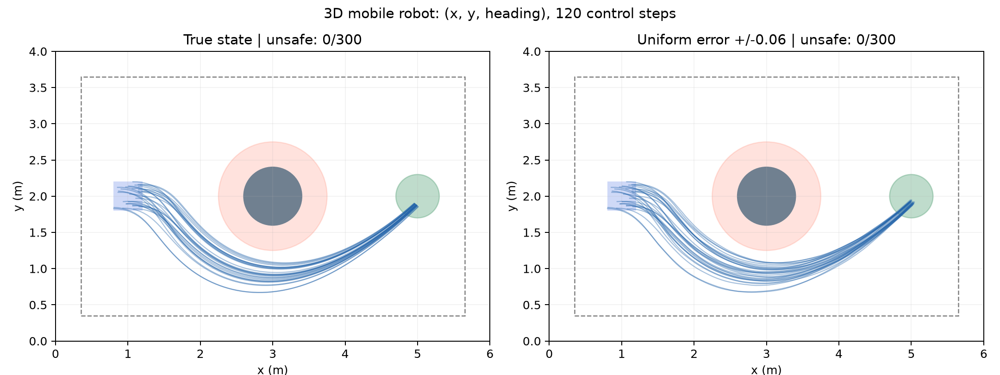

# 移动机器人：三维视觉闭环实验与服务器运行记录

更新日期：2026-11-08。本文记录已经实现的实验和指定服务器上的运行结果。图像闭环已经跑通，轨迹 CP 阈值已经算出，但 CP 集合内发现真实动力学越界反例，当前控制器不能获得所要求的全误差鲁棒 SBC 证书。

## 1. 这次新增的维数是什么

状态是机器人在平面上的位置与朝向：

\[
s=(x,y,\theta)\in\mathbb R^3.
\]

控制器收到的是图像网络估计的三维位姿，不直接读取真实位姿。相较于车道实验的两个视觉误差坐标，这个实验有三个视觉误差坐标；两个动作分别是线速度和角速度。

相机是固定俯视相机，观察整个地图。它不是车载相机，也不是未知地图上的 SLAM。当前版本是二维图形渲染的视觉仿真，需要明确这一实验范围。

## 2. 场景与任务

| 项目 | 当前注册值 |
|---|---|
| 地图 | 6 m × 4 m |
| 初始位置 | x∈[0.8,1.2]，y∈[1.8,2.2] m |
| 初始朝向 | θ∈[−0.1,0.1] rad |
| 目标 | (5,2) m，目标圆半径 0.3 m |
| 障碍物 | 圆心 (3,2) m，实体半径 0.4 m |
| 机器人 | 用半径 0.25 m 的圆包住实体 |
| 额外安全距离 | 0.1 m |
| 障碍物排除半径 | 0.4+0.25+0.1=0.75 m |
| 位置安全范围 | x∈[0.35,5.65]，y∈[0.35,3.65] m |
| 朝向运行范围 | θ∈[−1.2,1.2] rad；超出也记作不安全 |
| 控制周期 | 0.1 s |
| 每条轨迹 | 120 个动作，12 s，记录 121 个状态 |
| 动作范围 | 线速度 [0,0.6] m/s，角速度 [−1,1] rad/s |

任务是从左侧出发，绕开圆形障碍物，进入右侧目标区域并停稳。到达目标不会使环境自动停止，后续仍执行同一个控制器，避免用“碰到目标就结束”掩盖停不住的问题。

这里的“停稳”统计定义是：最后十个记录状态都在目标圆内，且最后十个动作对应的最大线速度小于 0.08 m/s；它是性能指标，不是安全定理。

## 3. 第一步：建立动力学与安全判定

输入：当前真实状态 s 和控制器动作 a=(a₁,a₂)∈[−1,1]²。

先转换成速度 v=0.3(a₁+1)、ω=a₂，再按离散独轮车模型计算：

\[
\begin{aligned}
x_{t+1}&=x_t+0.1v_t\cos\theta_t,\\
y_{t+1}&=y_t+0.1v_t\sin\theta_t,\\
\theta_{t+1}&=\theta_t+0.1\omega_t.
\end{aligned}
\]

输出：下一时刻真实状态，以及是否越过边界、朝向范围或进入障碍物排除圆。

这是直接速度控制模型，没有电机滞后、加速度状态或过程噪声。当前审查针对上述离散模型的采样时刻；尚未证明两个采样时刻之间的连续运动安全，也不等于实物安全。

代码：[core.py](../../artical-F122/Aebs/mobile_robot/core.py)。

## 4. 第二步：从图片估计三维位姿

输入：224×224 RGB 图片。图中包含机器人、障碍物、目标和固定地图标记，不包含真实状态文字标签。

处理流程：

1. 冻结官方 DINOv2 ViT-S/14。
2. 提取 16×16 个空间 patch 特征，每个特征 384 维。
3. 用卷积和两个空间注意力头提取位置与局部形状信息。
4. 输出三维归一化位姿：z=((x−3)/3,(y−2)/2,θ/1.2)。

保留空间特征是为了分辨“机器人在哪里、朝向哪里”；原车道视觉头的二维瓶颈不适合直接承载这里的三维位姿。

训练数据为 2,400 张随机位姿图片，验证集 400 张，开发测试集 400 张。三组按独立随机位姿生成；训练数据覆盖地图和朝向范围，也包含靠近危险区域的可见位置。验证集用于选择权重，开发测试只用于本轮开发诊断，不能冒充最终轨迹 CP 校准数据。

第一版视觉头训练 200 轮后，开发测试集的归一化平均绝对误差为：

| 坐标 | 归一化 MAE | 换算成物理量 |
|---|---:|---:|
| x | 0.008513 | 约 2.55 cm |
| y | 0.009295 | 约 1.86 cm |
| θ | 0.065228 | 约 0.0783 rad，4.49° |

开发测试上的单帧联合误差 95% 经验分位数约 0.1769，最大绝对误差约 0.5456。朝向误差明显大于位置误差。因此，后面 SBC 试算使用的 0.03 半径只是控制/验证开发参数，不能说它已经覆盖真实视觉误差。

证据：[视觉指标](../../artical-F122/results/mobile_robot_20261108_perception_r1/metrics.json)；实现：[perception.py](../../artical-F122/Aebs/mobile_robot/perception.py)、[train_perception.py](../../artical-F122/Aebs/mobile_robot/train_perception.py)。

## 5. 第三步：训练直接输出动作的 PPO

输入：三维归一化观测。输出：线速度、角速度对应的两个归一化动作。

第一版 PPO 使用两个 64 单元 Tanh 隐层，训练约 30 万步。训练时一部分回合从宽范围安全状态开始，提高恢复能力；最终测试和拟认证初始范围仍使用第 2 节注册的小初始盒。

奖励包括：向目标接近、到达后减速、动作变化惩罚和越界惩罚。为了避免仅靠直线距离使机器人撞向中央障碍物，训练奖励使用离线网格计算的绕障距离。这个距离只参与训练奖励，部署时控制器只读三维视觉估计，不调用路径规划器。

这项奖励设计必须在论文中披露。它是任务训练辅助，不应被宣传为完全没有地图知识的强化学习。正式对比时应让相关基线获得相同的训练辅助。

第一版开发测试结果如下，每组 300 条完整轨迹：

| 观测方式 | 不安全轨迹 | 安全到达目标 | 安全到达且停稳 |
|---|---:|---:|---:|
| 真实状态，无观测误差 | 0/300 | 300/300 | 300/300 |
| 每步均匀误差 ±0.03 | 0/300 | 300/300 | 275/300 |
| 每步均匀误差 ±0.06 | 0/300 | 300/300 | 90/300 |

这些模拟误差都在归一化坐标下施加。它们不是 DINO 的实际误差分布，也不是 CP 的结果。它们说明控制器初步能绕障，但误差会影响停稳。

服务器上额外完成两组 PPO 尝试：从头加入 ±0.06 误差训练 50 万步的版本，虽然测试没有越界，但 300/300 都没进入目标圆，因此不接受为改进；从第一版权重出发、加入 ±0.03 误差继续训练 20 万步的版本，能到达目标，但 ±0.03 下停稳为 255/300，低于第一版的 275/300。因此本轮的正式图像 CP 仍冻结第一版控制器，没有悄悄换策略。



证据：[PPO 报告](../../artical-F122/results/mobile_robot_20261108_ppo_r1/report.json)；代码：[env.py](../../artical-F122/Aebs/mobile_robot/env.py)、[train_ppo.py](../../artical-F122/Aebs/mobile_robot/train_ppo.py)。

## 6. 第四步：训练 AEBS 同类的神经 SBC

输入：真实状态的归一化坐标，用于离线证书训练和验证。SBC 不给部署控制器提供真实状态。

输出：一个非负数 B(z)。沿用 AEBS 的 `NonnegativeSBC`：Tanh 隐层、ReLU 非负输出。权重由训练得到，没有用手写圆形函数直接替代最终神经 SBC。

想满足的条件是：

- 初始区域内 B≤1。
- 所有可能在下一步进入的危险区域内 B≥20。
- 对规定误差盒中的每一个误差，相关安全状态的后继 B 不大于当前 B。

前两轮使用 B≤20 的区域作为不增条件检查范围。第三轮另外测试局部条件：只要求安全状态中 B≤1 的区域满足不增。两者的检查范围不同，不能混写成同一个条件。

局部条件为什么也足以证明鲁棒安全？因为初始 B≤1；如果每一步从 B≤1 出发都不增，那么归纳可得所有后继一直 B≤1。危险状态必须 B≥20，所以轨迹不能进入危险状态。这个推理需要每一个相关状态和每一个允许误差都通过验证；少检查几个区域就不能成立。它是局部鲁棒不变性论证，不能直接冒充原文所有随机噪声假设下的同一概率定理。

第三轮保存的最佳候选为 3→64→32→1 网络。在服务器的 float64 连续区域数值审查中：

| 条件 | 结果 |
|---|---|
| 初始区 B 上界 | 0.179314，满足 ≤1 |
| 危险区 B 下界 | 20.807036，满足 ≥20 |
| 所有允许后继不增 | 未通过；细分 8 层后仍有 7,360 个未解决区域 |
| 完整证书 | **未通过** |

“未解决区域”是验证器没能证明条件的盒子，可能来自网络真实不满足，也可能来自区间过宽。它不是“已经找到了 7,360 次碰撞”。本轮已经把这些区域回送给更小学习率的继续训练。

反馈训练做了两次实现迭代：第一次数值梯度异常，不能当作有效训练结果；定位到 Tanh 仿射界极值点选择器的奇异导数后，保留相同数值包络、稳定反向传播，并增加非有限损失/梯度立即停止的检查。修复后继续训练仍没有获得更好的完整证书。候选选择也补上了与继续训练前权重的比较，避免只在新轮次间选“最佳”却比原候选更差。

证据：[审查报告](../../artical-F122/results/mobile_robot_20261108_server_audit_r3/certificate.json)；代码：[train_sbc.py](../../artical-F122/Aebs/mobile_robot/train_sbc.py)、[certify.py](../../artical-F122/Aebs/mobile_robot/certify.py)。

## 7. 第五步：验证如何覆盖连续状态与误差

把连续状态区域划成小长方体。验证器计算整个长方体上的网络输出上下界，而不是只检查中心点。三维误差盒再划成 8 个子盒，逐个传播到控制器和动力学。

圆形障碍物不能只检查网格中心：只要一个盒子与危险圆相交，就需要把对应危险部分覆盖进去。当前实现保守地检查整个相交盒子。外部边界还覆盖一次动作可能到达的越界带，防止下一步越界后掉到验证域之外。

每次细分保留体积账本，避免漏掉盒子后误报通过。实际计算使用 float64 和数值余量，尚未采用严格向外舍入的形式化算术，准确表述是“连续区域数值审查”。

另外做了半径 0.03 下的梯度扰动搜索：32 条初始轨迹、120 次优化，没有找到越界。但搜索未找到反例不等于证明，不能代替 SBC 审查。

## 8. 第六步：图像闭环与轨迹级 CP

真实图像闭环的每一步是：真实状态→渲染图像→DINO→三维估计→PPO→两个动作→下一状态。真实状态仅用于环境演化、记录误差和离线评估，不接进策略输入。

服务器完成的 24 条开发图像轨迹全部安全到达并停稳，距离障碍物排除边界的最小余量约 0.153 m。三个坐标的最大归一化误差分别为 0.05496、0.04847、0.28447。特别是朝向误差不在此前试算的 ±0.03 盒内。

额外微调视觉头 200 轮没有改善预先使用的验证集 MSE，程序保留原权重。再次跑同一开发轨迹得到相同结果，这是复核，不算新增独立测试。

本轮轨迹 CP 固定第一版控制器与第一版视觉头，采用 39 条新校准轨迹和 20 条独立留出轨迹。两组都从注册初始盒独立采样，运行完整 120 步，不因越界或误差大而删去轨迹。推理批量固定并填充尾批，阈值在留出测试之前冻结。

每条轨迹的分数为：

\[
R_i=\max_{t,j}\frac{|\hat z_{i,t,j}-z_{i,t,j}|}{a_j},\qquad a=(0.03,0.03,0.2).
\]

尺度 a 根据开发阶段对位置、朝向误差量级的认识，在本轮校准采集之前固定。取 α=0.05，n=39，秩 k=ceil((n+1)(1−α))=38。校准得到 q=1.6268814326784709，因此三个坐标的误差半宽为：

| 坐标 | 归一化半宽 q·a | 物理量半宽 |
|---|---:|---:|
| x | 0.048806443 | 0.146419 m |
| y | 0.048806443 | 0.097613 m |
| θ | 0.325376287 | 0.390452 rad，约 22.37° |

39 条校准轨迹有 38 条全程覆盖，且 39 条均未越界。20 条独立留出轨迹有 18 条全程覆盖，即经验覆盖率 90%；20 条均安全到达并停稳。两条未覆盖轨迹仍然安全，是观测结果，不能据此把超出误差集合的部分计入证书保证。

这里不能把 90% 写成“95% 测试通过”。20 条测试样本较少，其覆盖率的双侧 95% 二项置信区间约为 [0.6830,0.9877]。CP 的 95% 理论边缘覆盖，也不保证任意一批 20 条测试都至少有 19 条覆盖。本轮保留原阈值，没有看完留出后再调大阈值并重复宣称独立测试。

CP 的覆盖概率是校准样本与新轨迹联合随机性下的边缘结论，不是对每个固定初始状态、每个固定校准集都分别保证 95%。更换控制器或视觉头后，闭环数据分布可能改变，需要重新采集匹配的校准轨迹。

只有在“轨迹误差合同成立”和“同一合同下 SBC 完整通过”都建立后，才能连接成相应的概率安全结论。本轮已经完成阈值计算，但第二项未成立。

实现：[trajectory_cp.py](../../artical-F122/Aebs/mobile_robot/trajectory_cp.py)。证据：[冻结协议](../../artical-F122/results/mobile_robot_20261108_server_trajectory_cp_r1/protocol.json)、[校准结果](../../artical-F122/results/mobile_robot_20261108_server_trajectory_cp_r1/calibration.json)、[独立留出与汇总](../../artical-F122/results/mobile_robot_20261108_server_trajectory_cp_r1/report.json)。

### 8.1 为什么现在确认不能只继续训练 SBC

用上述精确 CP 半宽重新审查第三轮候选，初始区和危险区仍分离，但后继不增检查未通过，细分后仍有 7,373 个未解决区域。

更关键的是，扰动搜索找到了具体不安全轨迹。搜索先用可微动力学寻找扰动，再把扰动严格截断在 CP 盒内，使用部署时的 float64 动力学独立重放确认。32 条搜索初始轨迹中：

- 28 条至少违反一项安全条件。
- 21 条进入障碍物排除区，并且这 21 条都发生了半径 0.25 m 的机器人圆与半径 0.4 m 的障碍物圆重叠。
- 2 条违反 y 边界，7 条违反朝向范围；这些计数可以重叠。

具体例子：编号 7 的轨迹从 (1.1389,2.1987,−0.00462) 出发，第 35 步到达约 (3.0933,1.6812,0.25284)。此时机器人中心到障碍物中心只有 0.3322 m，小于两个实体半径之和 0.65 m。整条误差序列都位于 CP 盒内，最大误差/半宽比值为 1.0。

如果这时还假设“初始 B≤1、危险 B≥20、允许误差下逐步不增”，就会得到：沿这条允许轨迹，B 从 ≤1 出发一直 ≤1；但进入危险区域时又必须 ≥20。同一个数不能同时满足这两件事。因此，**固定当前控制器、当前动力学与当前 CP 盒时，不能通过增加证书训练轮数让这三个鲁棒条件全部成立。**

这里没有声称上述任意扰动序列都能由真实相机产生。CP 的最大残差盒保留了误差大小，却放开了坐标、时间与状态之间的关系。盒内可能包含真实图像不会产生的“最坏组合”。所以这个反例否定的是当前“对盒内所有误差”的充分条件，不是否定 CP 覆盖定理，也不自动否定其他带条件噪声模型的随机 SBC。

证据：[精确 CP 盒下的审查](../../artical-F122/results/mobile_robot_20261108_server_audit_cp/certificate.json)、[独立重放反例](../../artical-F122/results/mobile_robot_20261108_server_attack_cp/report.json)、[具体反例坐标](../../artical-F122/results/mobile_robot_20261108_server_attack_cp/witness_summary.json)。

## 9. 与此前实验的关系

| 项目 | 本实验 |
|---|---|
| 与 AEBS 共用 | DINO 低维感知、PPO、非负神经 SBC 结构及训练/验证思路 |
| 比车道增加的内容 | 三维视觉误差、双动作、非线性位置动力学、圆形障碍物、到达并停稳 |
| 与受保护停车场不同 | 当前 PPO 直接输出动作；没有在线后备控制、动作安全过滤器或轨迹跟踪器 |
| VISION-SLS 的借鉴 | 视觉特征转低维观测、显式建模感知误差；这里没有采用 SLS 控制器求解 |
| CP-NCBF 的借鉴 | 用统计校准的不确定集合连接神经安全条件；不是把其连续时间 CBF-QP 原样搬来 |
| 目前可以写进论文的事实 | 新三维任务和实现、开发性能、失败诊断及待解决的证书条件 |
| 目前不能写的结论 | 本任务已获得完整 CP＋神经 SBC 概率安全保证 |

理论来源索引沿用项目已有的[论文与实验对照](../references/论文实验与迁移分析_20261107.md)、[车道 AEBS 同类流程](车道保持_AEBS同类训练流程与神经SBC_20261106.md)和[轨迹 CP 说明](车道保持_轨迹级CP校准与SBC衔接_20261107.md)。上文中的局部鲁棒归纳论证是本实现明确列出的条件，不把它归为未经核对的论文原定理。

## 10. 服务器位置与运行方式

用户指定服务器：`ssh root@10.11.154.191 -p 20147`。

本次独立目录：`/root/work_based_on_spvc_robot_20261108`。Python 使用已有 `/opt/miniconda3/envs/vt/bin/python`，没有修改服务器旧实验目录和环境依赖。

连接时两张 RTX 4090 的显存都被其他任务占用，CUDA 初始化实际报 OOM。因此本次作业显式使用 CPU，每个进程 4 个计算线程。不是已经在 GPU 上训练。

| 作业 | 实际阶段 | 状态文件 |
|---|---|---|
| visual | 初版图像闭环→视觉头微调 200 轮→再次图像闭环 | `work/visual_status.json` |
| controller | 误差半径 0.06 的新 PPO 50 万步→神经 SBC→审查 | `work/controller_status.json` |
| audit | 第三轮候选连续区域审查，已完成但未通过 | `work/audit_status.json` |
| SBC 反馈继续训练 | 第五轮数值异常；第六轮修复后 4,000 轮，仍未通过 | `work/sbc_r5.log`、`work/sbc_r6.log` |
| 轨迹 CP | 冻结第一版网络，39 条校准＋20 条留出 | `work/trajectory_cp_r1.log` |
| 精确 CP 盒复核 | 连续区域审查与独立动力学反例重放 | `work/audit_cp.log`、`work/attack_cp.log` |

这些是有限阶段的后台作业，SSH 断开后可以继续运行。作业状态 `finished` 只表示程序正常退出，**不表示安全证书通过**；必须读取对应 `certificate.json` 的 `passed`。

本地运行源代码：[mobile_robot](../../artical-F122/Aebs/mobile_robot)。部署记录：[server_deployment.json](../../work/mobile_robot_20261108/server_deployment.json)。迁移时本地与服务器的 7 项基础测试均通过，后续加入了仿射界梯度、三维轨迹 CP 与不同坐标误差盒覆盖测试。本地合并相关车道回归测试共 37 项通过。

查看服务器进展：

```bash
ssh -p 20147 root@10.11.154.191 \
  'cat /root/work_based_on_spvc_robot_20261108/work/visual_status.json; cat /root/work_based_on_spvc_robot_20261108/work/controller_status.json'
```

## 11. 本阶段实际得到的安全保证

**尚未得到本实验的完整安全保证。** 已有直接图像控制的开发成功结果、轨迹 CP 阈值，以及初始区/危险区分离通过数值审查的神经候选。但当前控制器在 CP 允许的误差盒内存在实际越界反例，因此不能报告完整鲁棒 SBC 或由其导出的概率安全保证。

下一阶段应该优先改进误差表示和控制器：改进朝向识别；研究带偏差中心、状态相关尺度或坐标相关性的误差集合；把已找到的误差反例用于控制器训练。新的误差形状应先用开发数据固定，再独立校准；改变策略或视觉网络后也应重新采集校准轨迹。不能在看到不安全反例后，仅缩小 CP 盒而仍声称保持原覆盖保证。

继续完成的标准仍是：冻结视觉和控制器，完整轨迹校准，验证同一误差集合下的神经 SBC，独立测试任务成功与覆盖。当前结果适合作为新三维任务的第一轮实验和保守性诊断，尚不适合作为“方法在该任务已取得安全证书”的正面结论。
