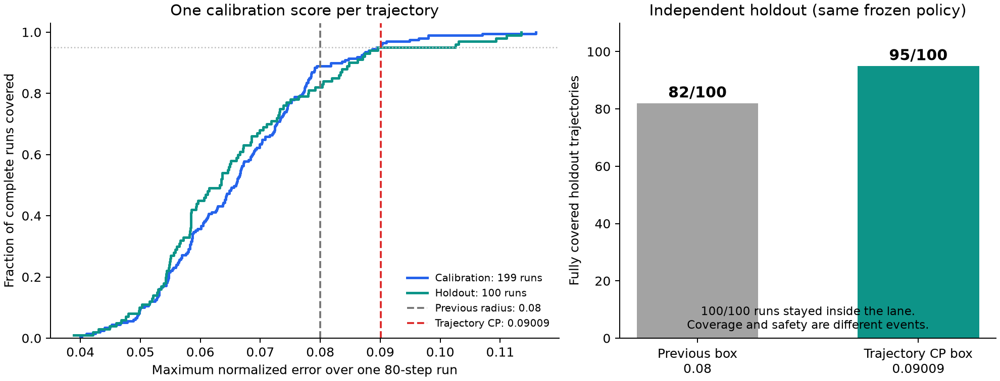

# 车道保持：轨迹级 CP 校准与 SBC 衔接

日期：2026-11-07。**已完成真实渲染图像闭环的轨迹级校准：199 条校准轨迹、100 条独立留出轨迹，每条 80 步。新半径 0.0900931580；原控制器和原学习式 SBC 在该半径下通过两种连续域数值验证。**

这里的“真实图像闭环”指逐步渲染图像并运行 DINO，不是实车采集。范围是明确注册的名义模拟器分布。

结果包：[lane_trajectory_cp_20261107_v1](../../artical-F122/results/lane_trajectory_cp_20261107_v1/README.md)。此前训练流程见 [AEBS 同类训练式 SBC](./车道保持_AEBS同类训练流程与神经SBC_20261106.md)。

## 1. 先看结果：单帧和整条轨迹确实不同

下面两列使用同一批新采集的 100 条留出轨迹，不是换了更容易的数据：

| 指标 | 旧验证半径 0.08 | 新轨迹 CP 半径 0.0900931580 |
|---|---:|---:|
| 完整覆盖的轨迹 | 82/100 | 95/100 |
| 被覆盖的图像帧 | 99.725% | 99.9375% |
| 实际未越界的轨迹 | 100/100 | 100/100，同一批轨迹 |
| 区间验证 | 旧包已有通过记录 | 本轮仿射界、普通 IBP 都通过 |

旧半径的单帧覆盖已超过 99%，但全程覆盖只有 82%，正好说明不能用单帧覆盖率替代全轨迹覆盖率。

图左是每条轨迹最大误差的经验累积分布；右图是 100 条留出轨迹的完整覆盖数量。新半径只由校准轨迹确定，未根据右图调整。

## 2. 冻结了什么，独立采样又指什么

采集之前写入 protocol.json，绑定策略、视觉头、DINO 权重及采集代码的散列。采集结束再次检查一致性。

- 策略：11 月 6 日发布的原 PPO，未更新。
- SBC：AEBS 同类训练式 [2,16,8,1] Tanh/ReLU 网络，未更新。
- 感知：冻结的 patch-DINO 投影和 DINOv2-S/14，未更新。
- 每条轨迹的初态：独立均匀采样横向 [-0.25,0.25] 米、航向 [-0.06,0.06] 弧度。
- 曲率：每条轨迹独立等概率选择 -0.01、0、0.01，运行中保持该值。
- 固定条件：速度 4 米/秒、步长 0.1 秒、名义光照和相机、无像素噪声或过程扰动。
- 校准和留出使用不同伪随机流；未插入固定角点，也未删除误差大的轨迹。
- 不复用先前 12 条开发图像轨迹；运行完整 80 步，不能只保存成功或低误差的部分。

“独立”指按同一冻结生成规律重新抽取整条运行的初态和曲率，不表示同一条轨迹内相邻帧独立。本实验把一条轨迹的全部时间依赖保留在同一个样本内。

这使拟采用的独立同分布/可交换性假设与实际采集单位一致。它仍只针对该模拟器规律，不覆盖其他相机位置、天气、连续曲率、任意固定初态的条件覆盖或实车分布。

## 3. 每步输入、处理和输出

### 步骤一：注册协议

输入：固定模型包、199/100 的样本数、80 步时域、alpha=0.05、预设采样种子和模拟器配置。

处理：把这些设置及模型/源码散列写入协议；配置变动时禁止继续使用原校准记录。

输出：protocol.json。这里没有根据新轨迹的误差选半径。

### 步骤二：采集 199 条校准轨迹

每一步执行：

~~~text
真实车辆状态
→ 渲染当前图像
→ 冻结 DINO 与投影头给出两个观测分量
→ 原 PPO 输出转向
→ 原车辆动力学更新状态
~~~

同时保存真实状态、视觉观测、动作和误差，形成每条 80 步的完整记录。误差使用归一化坐标：

$$\delta_{j,t}=(\hat e_{j,t}/0.85-e_{j,t}/0.85,\ \hat\theta_{j,t}/0.30-\theta_{j,t}/0.30).$$

实际投影网络直接输出归一化观测，代码因此直接减去归一化真实状态。

输出：calibration.npz，误差张量形状 [199,80,2]，以及可恢复的逐批数据、每条图像序列的散列。

### 步骤三：把一条轨迹变成一个分数

$$R_j=\max_{t=0,\ldots,79}\max_{k=1,2}|\delta_{j,t,k}|.$$

也就是“这次运行最差的一帧、最差的一个坐标有多大误差”。199 条轨迹产生 199 个分数，而不是把 15,920 帧当成 15,920 个独立校准样本。

对时间和坐标同时取最大值，可以把一个分数的覆盖转换成整条运行全部观测的覆盖；该构造及其同时覆盖原理见 [Formal Verification and Control with Conformal Prediction](https://arxiv.org/html/2409.00536v2)。

### 步骤四：计算有限样本校准分位数

$$k=\lceil(n+1)(1-\alpha)\rceil=\lceil200\times0.95\rceil=190.$$

将 199 个分数升序排列，取第 190 个：

$$q_{\mathrm{traj}}=0.09009315804748166.$$

对应物理误差范围是横向约 ±0.07658 米、航向约 ±0.02703 弧度（约 ±1.549°）。

输出：calibration.json。该文件在开始采集留出集之前写入并冻结；后续不看留出覆盖来重新调半径。

校准集自身有 190/199 条在范围内。这是选取分位数带来的结果，不应当作独立测试证据。

### 步骤五：采集并评估 100 条留出轨迹

输入：同一冻结闭环、同一采样规律、已经固定的 q，以及独立于校准的伪随机流。

输出：holdout.npz 和 report.json。

- 新包络完整覆盖 95/100 条轨迹；另 5 条存在超包络帧。
- 100/100 条轨迹实际未越界，包括这 5 条超包络轨迹。
- 留出最大轨迹误差约 0.113519，校准最大轨迹误差约 0.115929；95% CP 本来就不要求包住全部校准和测试误差。
- 95/100 是这批数据的观测比例，其二项比例双侧 95% 区间约为 [88.72%,98.36%]。不能把“观察到 95/100”写成“以 95% 置信度确定总体覆盖至少 95%”。

### 步骤六：对新半径重新验证原策略与 SBC

本轮没有缩小初态、放宽危险边界、降低速度，也没有重训策略、感知或 SBC。仅将验证器的观测误差盒扩大到新的 q。

| 检查 | 仿射相关界 | 普通 IBP |
|---|---:|---:|
| 初态 SBC 上界 | 0.08582801 | 0.60715254 |
| 危险 SBC 下界 | 23.65349579 | 20.14060243 |
| 三个曲率的动态条件 | 全部通过 | 全部通过 |
| 未解决区间 | 0 | 0 |

两种方法共享动力学和审计框架，不是完全无共享代码的形式化工具。它们验证的是新误差盒内所有相关状态和后继，不能用留出轨迹数量替代这项检查。

输出：audit/certificate.json、audit_ibp/certificate.json，以及校验策略身份、半径和模型一致性的 bridge.json。

## 4. “95%”现在到底指什么

本轮 CP 的理论对象是：对同一固定闭环和注册生成规律，一份新的随机校准集与一条新的随机轨迹，有

$$\Pr_{D_{\rm cal},\tau_{\rm new}}\{R(\tau_{\rm new})\leq q(D_{\rm cal})\}\geq0.95.$$

它是**整条 80 步轨迹的边缘覆盖**，不再只是单帧覆盖。标准 split CP 的边缘概率与条件概率区别可参见 [Angelopoulos 与 Bates 的 CP 介绍](https://arxiv.org/abs/2107.07511)。

但它不表示：

1. 这份已经固定的校准数据，在所有条件下都恰好具有 95% 覆盖。
2. 每个固定初态、每一种固定曲率或每个新相机条件都分别有 95% 条件覆盖。
3. 剩余 5% 的轨迹一定不安全，或者已观测到的超包络轨迹也由原包络论证保证。
4. 从多个校准结果中反复挑一个能通过验证的结果，仍自动保留原概率口径。

## 5. 与 SBC 连接时，还要区分接受事件

本项目的确定性模型推理是：如果所有时刻误差都在已验证盒内，初态出发的闭环就不越界。这里仍以数值区间界可靠为前提，不是完整 IEEE 浮点形式证明。

令 E 表示全程误差在包络内，U 表示轨迹越界，A 表示该次校准所得半径的 SBC 审计通过。则相应数学模型下有：

$$A\cap U\subseteq E^c,\qquad\Pr(A\cap U)\leq\alpha.$$

这是本次方法连接的直接推导。**如果是否接受结果依赖校准数据，不能再不加说明地改写成 Pr(U | A)≤alpha。** 本轮记录并发布单次注册采集的全部结果，不重新抽样挑选通过者，也没有根据留出数据重训闭环。

因此当前适合写入论文的表述是：

> 在注册的名义模拟器轨迹分布下，使用整条运行的最大观测误差进行 95% 边缘覆盖的 split-conformal 校准；固定的 PPO 与学习式神经 SBC 对得到的误差盒通过连续域数值审计。100 条独立留出运行中，95 条全程被包络覆盖，100 条未越界。概率口径为校准样本与新轨迹的联合随机性，不声称实车或接受条件下的无条件安全率。

若论文需要“对已发布这一份固定校准结果，以明确置信度保证总体覆盖不低于 95%”，需要额外的校准条件/PAC 或容忍区间分析，不能把标准 CP 的 95% 直接换个名字使用。本轮未把这一更强主张算作完成。

## 5.1 状态相关 CP 盒：已撤回（不可引用）

2026-11-09 审计发现，`lane_state_cp_20261109_v1` 的状态相关对照存在**代码与报告不一致**：

- 附带脚本实际是 degree-2、9 系数、99 条拟合 + 100 条校准、无 cap；报告写 degree-1、4 系数、199 条、cap 0.0992；
- `score()` 没有使用传入的留出数据，实际始终读取校准残差 `res[idx]`，所以“留出覆盖 93/100”不是留出评估；
- 同一批 199 条轨迹既拟合 `b` 又取分位数，缺少独立校准；`min(qb,0.0992)` 还会缩小集合，原覆盖保证不能自动保留；
- SBC 在常量 0.0992 盒上通过，只证明盒内安全，不证明视觉误差有足够概率落入盒内。

**因此该状态相关包标记为 `withdrawn / unverified`，不作为 CP 或安全结论引用。** 当前车道主结果仍是常量轨迹 CP **0.0900931580** + 原 SBC 审计。详见[审计记录](../../artical-F122/results/lane_state_cp_20261109_v1/AUDIT.md)。

## 5.2 状态相关包络修复版 v2：重新拟合、校准与验证

旧 v1 继续撤回，不以改写旧数字的方式恢复它。本轮新增独立结果目录，原常量 CP 主结果保留。此处仍使用固定状态观测映射，**没有联合学习视觉投影和 C**。

| 步骤 | 输入 | 处理 | 输出 |
|---|---|---|---|
| 1. 固定协议 | 已保存的 199 条轨迹、模型与数据哈希 | 前 99 条仅拟合，后 100 条仅校准；提前固定 degree=1、floor=0.005、alpha=0.05，无 cap | protocol.json，明确两组索引互斥 |
| 2. 拟合尺度 | 前 99 条的真实状态与两维视觉残差 | 物理状态→归一化→映射到 [0,1]；用四个非负 Bernstein 系数拟合正尺度 | b(x)，系数顺序 00、01、10、11 |
| 3. 轨迹校准 | 后 100 条轨迹及冻结 b(x) | 每条取所有时刻、两维误差的最大 abs(error)/b(x)，取第 96 秩 | q=1.7205338234，半径 r(x)=q*b(x)，不截断 |
| 4. 回归评估 | 原 100 条留出数据 | 用该数据自身的 errors 计算分数；不再修改系数或阈值 | 新代码实算覆盖 93/100；这是已看过的数据回归，不是新增盲测 |
| 5. 连续域验证 | 原 actor/SBC、新状态相关合同 | 每个状态盒以四个顶点的尺度最大值覆盖盒内所有允许误差；验证全部后继 | 本地及服务器 vt 均通过，三曲率 0 见证/0 未解决 |

新校准覆盖为 **96/100**，回归平均半径 **0.0883927266**，回归中最大半径 **0.1093691536**；整个状态域的解析最大半径为 **0.2358150583**，不能把样本最大值当成全域最大值。旧 0.0992 上限已取消。

按实际状态相关集合验证，总检查 **13,000** 个区间，初始上界 **0.0858280104**、危险下界 **23.6534957924**，完整数值通过。将全域最大半径 0.235815 在每个状态都使用，会扩大集合；这一路对照验证失败，其反例不自动是原状态相关集合内的反例。两份报告分别保留。

公平对照使用同一后 100 条校准轨迹，常量半径为 **0.0886652919**，原留出覆盖 **94/100**。本轮状态相关包络没有显示明显优于常量盒，不能从通过证书推断性能提高。

**统计边界：**数据索引已经分离，留出错误和校准后截断已修复；但本轮复用的是此前已经查看过的数据。它是可复现的修复/回归结果，不能冒充新的盲测或新的独立 95% 部署安全结论。正式概率主张仍需冻结所有选择后新采集校准与留出数据，并满足所声明的轨迹可交换性。SBC 结果是给定集合内的条件数值安全，仍不包含实车或严格浮点证明。

新增回归检查覆盖了留出数据来源、全部时间步、坐标转换、正尺度、精确 CP 秩、无 cap、修改留出误差不改变阈值，以及状态盒半径包含关系。连同已有车道测试，本地和服务器 vt 各 **31/31 通过**。

完整报告、代码快照、数据索引和复现命令见 [修复结果包 v2](../../artical-F122/results/lane_state_cp_20261109_repaired_v2/README.md)。

## 6. 本轮修复与工程核查

- 修复分位数边界：当所需秩超过样本数时返回无穷大，而不是把秩强行截到最大样本。旧 540 帧、alpha=0.05 的校准秩 514 不受该修复影响。
- 校准样本数量按轨迹计；最大值同时跨时间和两维误差。
- 协议、数据和模型散列绑定，恢复采集时不允许换模型、换采样规则。
- 未根据误差或成功结果筛选轨迹；无效数值使采集报错，而不是悄悄删样本。
- 留出集的二项置信区间只用于独立留出数据，不对使用自身分位数的校准覆盖错误套用。
- 连接检查拒绝更小验证半径、错误策略、不同动力学、未解决区间或缺少曲率的证书。
- 新增与既有回归共 27 项通过。

## 7. 复现入口

[采集与轨迹 CP 实现](../../artical-F122/Aebs/lane_keeping/trajectory_cp.py)、[证书连接检查](../../artical-F122/Aebs/lane_keeping/compose_trajectory_cp.py)、[统计与连接回归测试](../../artical-F122/tests/test_lane_trajectory_cp.py)。

完整运行命令、冻结模型、数组、审计、图表与源码散列见[结果包 README](../../artical-F122/results/lane_trajectory_cp_20261107_v1/README.md)。11 月 6 日的训练式证书包保持原样，不将本次统计结果倒填进历史包。
