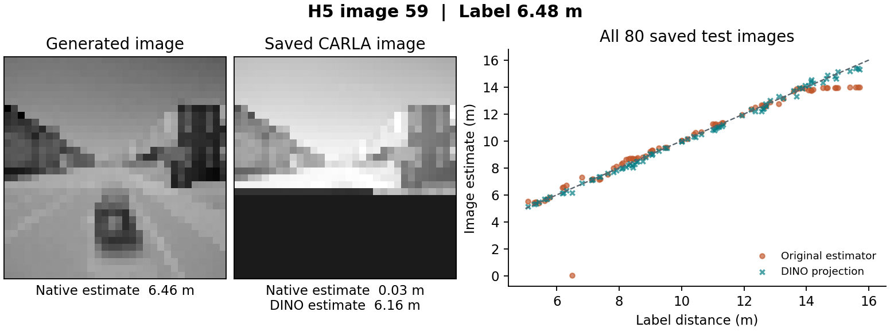

# AEBS 中，原 SPVC 的视觉代理与相机读数相差多少？

**同一个控制器能承受 ±0.45 m 的观测误差。把两个冻结的前端放进同一个 24,000 图回放环境，原 SPVC 的距离估计器直接迁移后需要 ±8.0584 m；当前 RGB DINO 前端只需要 ±0.4096 m。** 后者可以直接使用这份控制器和屏障的数值证书。把环境改成只允许选择 4,920 张测试图，当前前端仍然 500/500 次完成制动，但误差增至 ±1.1561 m，同一份屏障出现反例。[密图库结果](../../../artical-F122/results/aebs_native_cross_20261117_v1/full_release_bank/report.json) · [测试图库结果](../../../artical-F122/results/aebs_native_cross_20261117_v1/report.json)

## 1. 比较的是哪一块

原工程有三个可以实际加载的部件。生成器 $G(z,d)$ 根据潜变量和距离生成 32×32 灰度图；距离估计器 $h$ 把图像转成一个数字；PPO 控制器根据这个数字和实测速率决定制动量。仓库的演示入口把 $z$ 固定为零。这给出**原生成模型的名义观测** $g_0(d)=h(G(0,d))$。模拟相机真的提供图像 $I$ 时，原估计器能从这张图读出另一个值 $h(I)$。本次逐个加载原件，同时测这两条路径。原件的具体权重和结果均有 SHA-256 记录。[原演示入口](../../../artical-F122/Aebs/system/combined_legacy.py) · [冻结协议](../../../artical-F122/results/aebs_native_cross_20261117_v1/protocol.json)

当前视觉前端用冻结的 DINOv2 ViT-S/14 把图像编码成 384 维特征，再用训练好的投影头得到一维归一化距离。AEBS 这一版固定 $C=[1,0]$。把观测乘回训练时的距离尺度，$Cx$ 对应真实距离 $d$，给出**当前方法的名义观测**。灰度 DINO 与 RGB DINO 分别使用它们各自的投影头。跨接控制器前全部先还原成米，再按该控制器的自身尺度归一化。[灰度训练与划分](../../../artical-F122/Aebs/vision_sls/run.py) · [RGB 投影头训练](../../../artical-F122/Aebs/vision_sls/real_artifact.py)

有三项需要分开读：

- **桥接误差**衡量相机和自己的代理是否一致。旧模型比较 $|h(I)-g_0(d)|$，新模型比较 $|\hat d(I)-d|$。在纯生成回路上，观测直接由 $g_0(d)$ 产生，桥接误差恒为零。
- **物理距离误差**衡量读出的数离真实距离有多远。对所有前端一律比较 $|\hat d-d|$，包括纯生成回路的 $|g_0(d)-d|$。控制器和屏障用米定义允许的输入，所以本次用这个共同口径检查屏障。
- **任务行为**由实际后继状态判定。车进入距障碍 5–6 m 的区间且速度不超过 0.5 m/s 就算完成；驶至 6 m 及以内时速度仍大于 0.5 m/s 就算危险；在 6 m 以外提前停住单列。一条轨迹的视觉误差很大，仍可能早停，或者碰巧完成制动。[终止判据](../../../artical-F122/Aebs/system/outcomes.py)

## 2. 三个图库及它们能回答的问题

| 回放环境 | 视觉端看到的内容 | 如何解释 |
|---|---|---|
| 原工程的 400 张 H5 灰度图中选取 80 张 | 旧估计器和灰度 DINO 读取完全相同的 32×32 像素 | 落实“同一小图换前端”。400 是整包；DINO 投影用 240 图拟合、80 图选 epoch、80 图测试，冻结骨干已在外部数据上预训练 |
| RGB 数据中标记为 test 的 4,920 张 | 两边基于同一源 PNG 择图；旧估计器使用 32×32 灰度，当前投影使用原 640×640 RGB 的 DINO 特征 | 测原估计器直接迁移及当前 RGB 前端在稀疏测试图库上的表现。距离区段的间隙会计入闭环误差 |
| 发布使用的全部 24,000 张 RGB 图 | 同样两套输入表示，密集距离网格和 12 种天气/车色组合 | 测这一个**冻结的部署回放环境**能否衔接同一屏障。库中包含拟合/验证/测试图，结论适用于固定库上新抽的轨迹 |

H5 的 80 张是灰度 DINO 的留出集。逐图比较像素字节，80 张互异且与该 DINO 的训练/验证集零重合。原生成器的训练入口把全部 H5 原图送入同一个数据加载器；原估计器的训练入口使用全部 H5 距离标签加随机潜变量，按生成图监督回归。这两个旧权重是裸参数文件，没有随附逐文件训练/选择日志，因此无法确认这 80 张对原方法独立留出。240 张下游训练图也不代表 DINO 从头训练只见过 240 张图。RGB 数据的标记为 14,172 张 train、4,908 张 validation、4,920 张 test。发布投影训练程序从 train 内部分出 1,417 张选 epoch，12,755 张参与梯度训练，train 全部用于估计特征均值和尺度。本次没有重新拟合任何观测器或控制器。[原生成器训练](../../../artical-F122/Aebs/cGAN/train_mlp.py) · [原数据加载](../../../artical-F122/cGAN/taxi_models_and_data.py) · [原估计器训练](../../../artical-F122/Aebs/controller/StateEstimate_train.py) · [像素重复核对](../../../artical-F122/results/aebs_native_cross_20261117_v1/noise_diagnostic/report.json)

## 3. 怎么做成配对实验

1. 冻结生成器、原估计器、两个 DINO 头、原 PPO、新鲁棒控制器及其神经屏障。按文件名、距离、split 核对 RGB 灰度缓存与 DINO 特征库逐行一致；H5 数据哈希与灰度投影训练记录一致。
2. 每轮从 $[15,16]$ m 和 $[2.5,3]$ m/s 均匀抽起点。RGB 回放还均匀抽取 12 个外观组合之一，整个回合保持不变。比较双方共享起点与外观，随后各自根据反馈选动作、推进状态。每步在本组库中选择距**当前**距离最近的图。不同动作会访问不同的后续图，这正是闭环对比的含义。
3. 每 0.05 s 更新 $d'=d-0.05v$、$v'=\operatorname{clip}(v-0.05a,0,3)$。用同一终止判据和最多 400 个控制步。冻结生成回路读取 $g_0(d)$；图像回路读取预先对选中图像算出的距离。全部保留危险、提前停止与超时回合。
4. 每条校准轨迹取得**所有实际用于控制的帧**中的最大误差。用 199 条轨迹的第 190 小分数作 95% split CP 半径 $q$。每个前端、控制器和回放律各自校准。先冻结全部阈值，再用另一个随机种子抽 500 条留出轨迹。密图库比较用了单独的新一组种子。表中“覆盖”统计整段峰值不超过各自 $q$ 的轨迹数。
5. 对同一鲁棒控制器与固定神经屏障，用所有允许物理距离误差 $e\in[-q,q]$ 检查。已经数值覆盖的区间为 ±0.45 m；更小的区间可用集合包含直接通过，更大的区间实际搜索使屏障上升的一步后继。[交叉实验代码](../../../artical-F122/Aebs/experiments/native_spvc_camera_cross.py) · [密图库代码](../../../artical-F122/Aebs/experiments/native_spvc_full_release_bank.py) · [数值证书父报告](../../../artical-F122/results/aebs_robust_synthesis_20261117_release/development_certificate.json)

## 4. 同一部署图库、同一鲁棒控制器和同一屏障

| 冻结视觉端，24,000 张库 | 桥接 $q$（m） | 物理 $q$（m） | 物理误差覆盖 | 完成 / 危险 | 物理误差集合上的固定屏障 |
|---|---:|---:|---:|---:|---|
| 原 SPVC 距离估计器，输入为真实回放帧的灰度版 | 6.2702 | 8.0584 | 487/500 | 0 / 500 | 有实际正漂移反例 |
| 当前 RGB DINO 与投影 | 0.4096 | 0.4096 | 483/500 | 500 / 0 | 包含于通过数值核验的 ±0.45 m |

相同后端下，物理半径缩小 **94.9%**。500 对轨迹上每对的物理峰值均下降，平均降低 **5.219 m**。按相同起点、外观整对有放回重抽 4,000 次，均值差的 95% 百分位区间为 **[5.084, 5.355] m**。双方找图引入的最大距离偏差都小于 0.00301 m。旧输入的覆盖数也很高，因为它用较宽的半径覆盖自己；控制器容忍多大的半径才决定证书能否使用。[逐轨迹结果及阈值](../../../artical-F122/results/aebs_native_cross_20261117_v1/full_release_bank)

一个可以直接代入网络的反例是 $d=6.00001$ m、$v=0.132085$ m/s、距离误差 $+6.043795$ m。这个误差落在旧输入的 ±8.058394 m 之内，屏障值却从 0 升到 0.593547，违反所有允许误差下不增。这个状态用于否定该屏障在**整个对称误差区间**上的主张。回放中“旧输入 500 条实际危险”另由真实回放动作产生，两种证据来自不同计算。[反例及行为记录](../../../artical-F122/results/aebs_native_cross_20261117_v1/full_release_bank/report.json)

原前端曾用原库和生成图训练，而当前前端使用大规模外部预训练、更高分辨率及目标域训练图。这里的收益归属于**实际冻结前端直接置换的整体配置**。如要估计架构或数据量各自的贡献，需要另看共同训练预算以及相同灰度像素的消融。

## 5. 只用测试图和原 400 图时会怎样

所有覆盖及行为列均为各组相同的 500 个留出起点。前两列 $q$ 都是 199 条轨迹的校准结果。三个行为数依次为完成、危险、提前安全停住。其余终止类型在本表都是零。

| 控制器 | 视觉输入 | 桥接 $q$（m） | 物理 $q$（m） | 物理覆盖 | 完成 / 危险 / 早停 |
|---|---|---:|---:|---:|---:|
| 原 PPO | 原生成图，$z=0$ | 0 | 1.9442 | 482 | 500 / 0 / 0 |
| 原 PPO | H5 测试 80 图，原估计器 | 6.6137 | 6.6118 | 480 | 500 / 0 / 0 |
| 原 PPO | 同 80 图，灰度 DINO | 0.6762 | 0.6762 | 482 | 500 / 0 / 0 |
| 原 PPO | RGB 测试图库，原估计器 | 6.2638 | 8.1584 | 492 | 0 / 500 / 0 |
| 原 PPO | 同 RGB 测试图库，RGB DINO | 1.1523 | 1.1523 | 468 | 500 / 0 / 0 |
| 新鲁棒控制器 | 原生成图，$z=0$ | 0 | 1.9442 | 482 | 500 / 0 / 0 |
| 新鲁棒控制器 | H5 测试 80 图，原估计器 | 6.6204 | 6.6176 | 467 | 0 / 0 / 500 |
| 新鲁棒控制器 | 同 80 图，灰度 DINO | 0.6762 | 0.6762 | 482 | 500 / 0 / 0 |
| 新鲁棒控制器 | RGB 测试图库，原估计器 | 6.2638 | 8.1584 | 492 | 0 / 500 / 0 |
| 新鲁棒控制器 | 同 RGB 测试图库，RGB DINO | 1.1561 | 1.1561 | 469 | 500 / 0 / 0 |

**同一原 PPO、同一批 32×32 灰度像素**是前端差异最直接的一组。在 80 张独立于灰度 DINO 下游训练的图上，静态逐帧距离 MAE 从 **0.3690 m 降至 0.1293 m**。500 条回放的每一对峰值都下降，平均少 **6.097 m**，配对 95% 区间为 **[6.091, 6.103] m**。两者均完成停车。换同一个新鲁棒控制器后，原估计器的 500 辆车都在距障碍 6.565–6.590 m 处提前停住。视觉误差存在，是否导致危险还取决于控制器如何处理该误差。[新旧控制器配对统计](../../../artical-F122/results/aebs_native_cross_20261117_v1/report.json)

**一张实际观测就能解释静态均值与轨迹峰值为何相差很多。** 从 80 个 H5 测试索引按旧估计器绝对误差最大选出的第 59 号原图，标注为 6.4824 m。旧估计器从实际保存的图读出 0.0273 m，灰度 DINO 读出 6.1622 m。很多轨迹在制动时经过同一距离段并重复看到这张图。轨迹计数说明固定库上起点变化的效果；500 条轨迹并没有创造 500 次独立的新图采集。[逐图读数](../../../artical-F122/results/aebs_native_cross_20261117_v1/frame_estimates.npz)



**剔除该类特殊图像后还剩多少收益？** 图中第 59 号原图下部整片恒灰。用“底部 8 行、共 256 个像素灰度极差恰为零”筛查全部 400 张，仅标记第 59 号（test）和第 138 号（validation）。这是看到最坏样例后做的敏感性分析，仅筛回放库，保留原模型，不更改以上主结果。保留其余 79 张，两前端和两个控制器各用新配对的 199+500 条回合重跑，得到：

| 79 图，原 PPO | 原估计器 | 灰度 DINO |
|---|---:|---:|
| 逐图平均绝对误差 | 0.2920 m | 0.1268 m |
| 轨迹桥接半径 | 0.7485 m | 0.6670 m |
| 轨迹物理半径 | 1.9707 m | 0.6670 m |
| 完成 / 危险 | 0 / 500 | 500 / 0 |

同原 PPO 的平均配对峰值差缩至 **1.096 m [1.077, 1.115]**；500 对仍全部下降。这说明“误差下降”的方向在这项检查中保留，80 图上的“平均少约 6.1 m”则很依赖反复遇见第 59 号图。原 PPO 的旧输入在 80 图协议中全部完成，在 79 图协议中却全部超速到达；新鲁棒控制器加旧输入从全部早停变为全部完成。删除一张图会改变邻近区间访问的图和刹车时机，任务行为与测距误差不单调。这里分别报告两套冻结回放律；第 59 号图下部恒灰的物理成因没有单独核实。[敏感性协议及逐轨迹数据](../../../artical-F122/results/aebs_native_cross_20261117_v1/h5_sensitivity)

RGB 测试图按距离分段留出，同一外观组里最近可用图与当前状态最大可相距 **0.8784 m**。DINO 在 4,920 个实际图像标签上的 MAE 仅 **0.0874 m**；闭环分数还包含“当前状态与选中图标签的差”。因此只用稀疏图库时，DINO 配新控制器的轨迹 $q$ 升至 1.1561 m。此时取 $d=6.00001$ m、$v=0.264160$ m/s、$e=+1.156062$ m，固定屏障从 0 升至 0.802305。灰度 DINO 的 0.6762 m 同样在这个固定屏障上找到反例。两者各 500 次任务成功，提供的是有限样本的行为证据。这些检查针对本次固定的 11 月 17 日控制器和屏障；旧灰度实验有自己的控制器、屏障和校准设置。[本次五组屏障检查](../../../artical-F122/results/aebs_native_cross_20261117_v1/report.json) · [旧灰度实验范围](../../../artical-F122/results/vision_sls_spvc_sbc_pass_20261029/summary.json)

## 6. 抽动原生成器的随机变量，能有多大变化

补充诊断固定每张图标注的真实距离，独立抽 64 个 $z\sim U[-1,1]^4$，分别通过原生成器和距离估计器，取得 64 个读数的最小值与最大值。原 H5 的 80 张灰度测试图只有 **15/80** 的实际读数落在对应区间。各状态这 64 个生成读数的跨度平均仅 **0.0582 m**，最大 **0.1242 m**；同一标签处的实际相机读数与 $g_0(d)$ 的最大差达 **6.4374 m**。新 RGB 测试库灰度图的对应命中数为 **23/4,920**。这些量直接度量生成样本与相机读数的一致性。64 次采样没有穷尽全部潜变量，原论文的状态扰动分布也还经过控制器与动力学转换。[随机潜变量诊断及完整逐图记录](../../../artical-F122/results/aebs_native_cross_20261117_v1/noise_diagnostic)

## 7. 能写成什么安全保证

原论文把 $F(s,z_0)$ 作为名义后继，假设环境变化所致 $\Delta s=F(s,z)-F(s,z_0)$ 服从固定且与当前状态独立的分布 $\mu$。随机屏障要求在相关状态满足期望后继屏障值比当前值至少小 $\epsilon>0$。定理 2.2 给出这一随机模型下的无限时域安全概率下界。文中表 1 对 CARLA AEBS 报告固定控制器 **72.6%**、交替更新 **94.2%**。本次加载的是仓库演示实际引用的生成器、距离估计器和原 PPO 初始模型；原入口中载入 VT 后期控制器的一行处于注释，当前工程及服务器原始检出的标准 VT 最终模型路径也没有同表 1 可绑定的最终控制器和屏障。这里未复现 94.2%。[原论文第 2.2 节、第 4 节与表 1](../../../docs/references/720_file_Paper.pdf) · [原入口](../../../artical-F122/Aebs/system/combined_legacy.py)

当前后端对**停止过程**核验，在误差区间内每个允许的后继均满足屏障条件。密库 DINO 的 ±0.4096 m 包含于已核验的 ±0.45 m 内；母区间检查 782,400 个单元，初始区间的屏障上界为 0，危险区间的下界为 25.0394，实际反例及未决单元都是零。于是，在已核验模型内，只要整段运行至终止或第 400 步所用的观测都在管内，该段运行就避开危险。区间计算使用 float64，未采用外向舍入。这里的 CP 条件是**冻结图库、冻结模型后，校准轨迹与未来轨迹按同一协议可交换**。在这一回放律上，分割 CP 对“随机校准集和一条新的随机轨迹”给出整段在管概率至少 95% 的边际结论，可与条件安全衔接。固定本次校准集的未来成功率、任意给定起点的保证、对新相机采集的推断，均需额外证据。原表 1 的 94.2%、这里的 CP 95% 和 500 次行为成功分别对应不同事件、模型与时域，三者相减不能得到安全概率增益。[母区间验证](../../../artical-F122/results/aebs_robust_synthesis_20261117_release/development_certificate.json) · [本次冻结校准协议](../../../artical-F122/results/aebs_native_cross_20261117_v1/full_release_bank/protocol.json)

### 冻结 ±0.45 m 后，新轨迹有多大概率能使用证书？

上面的分割保形预测（CP）让校准数据决定半径；它对“重新抽一次校准集，加上一条新的轨迹”给出 95% 的边际覆盖。本节另问一个固定系统问题：控制器、屏障、图库和早已验证的 ±0.45 m 都不变，只重新抽起点与外观，一条未来轨迹有多大概率全程在这个管里？

观测任何新结果前，固定新种子 202611170521、2,000 个独立回合、每批 200 个、最多 400 步、原终止规则及统计方法。同一回合的两个前端共用起点和外观，各自闭环演化。对每一个前端，每回合记录一次二值事件：所有实际用于控制的帧均满足 $|\hat d_t-d_t|\le0.45$ m。统计单位是回合，未将一条轨迹的多帧当作独立样本。按固定回放分布独立抽取回合，则在管数量服从二项分布。对 $n=2000$、命中 $k>0$，单侧 95% Clopper–Pearson 精确下限为 $\mathrm{Beta}^{-1}(0.05;k,n-k+1)$，$k=0$ 时下限为 0。[试验之前冻结的协议](../../../artical-F122/results/aebs_native_cross_20261117_v1/fixed_tube_2000/protocol.json) · [原始 2,000 对轨迹与结果](../../../artical-F122/results/aebs_native_cross_20261117_v1/fixed_tube_2000)

| 同一鲁棒控制器、同一 24k 密图库、固定 ±0.45 m | 整段在管 | 在管概率的单侧 95% 精确下限 | 实际完成 / 危险 |
|---|---:|---:|---:|
| 原 SPVC 估计器直接读回放帧灰度版 | 0/2,000 | 0% | 0 / 2,000 |
| 当前 RGB DINO | 1,985/2,000（99.25%） | **98.8475%** | 2,000 / 0 |

**对这一固定回放系统，以单侧 95% 置信度，当前前端的全程在管概率至少为 98.8475%。** 结合“在管则避开危险”的数值屏障结论，在父证书所建模的动力学与数值验证适用范围内，同一随机回放律下、到终止或第 400 步为止的避险概率也有这个下置信限。出管的 15 条仍然完成，它们的安全在这次实跑中可见，单凭管内证书无法推出。这里的置信度说明对同一个固定系统重复抽取 2,000 条轨迹时，该构造下限的覆盖性质。它不覆盖未经这个回放律生成的新相机数据。

另为“哪个前端更常处于**同一个已验证误差管**”预先指定了同时比较。给 DINO 取单侧 97.5% 精确下限 98.7660%，给原估计器取单侧 97.5% 精确上限 0.1843%；由 Bonferroni 不等式，两条界同时成立的置信水平至少为 95%，允许同回合配对造成的两臂相关性。据此，此协议下的**全程在管概率提升下限为 98.5817 个百分点**。这项差值度量的是同一屏障条件能适用到多少轨迹，对原论文随机模型的安全概率无直接换算关系。[精确界和共享控制器、屏障哈希](../../../artical-F122/results/aebs_native_cross_20261117_v1/fixed_tube_2000/report.json)

## 8. 复算入口

在有原权重、DINO 观测缓存、H5 和 24k 灰度缓存的服务器上，进入 `artical-F122`，使用 `vt` 环境。命令的输出路径须为新目录，防止覆盖已冻结结果。

```bash
python -m Aebs.experiments.native_spvc_camera_cross --output-dir results/native_cross_repeat
python -m Aebs.experiments.native_spvc_noise_at_camera_states --source results/native_cross_repeat
python -m Aebs.experiments.plot_native_spvc_camera_cross results/native_cross_repeat
python -m Aebs.experiments.native_spvc_h5_sensitivity --source results/native_cross_repeat
python -m Aebs.experiments.native_spvc_full_release_bank --output-dir results/native_cross_repeat/full_release_bank
python -m Aebs.experiments.native_spvc_fixed_tube_confidence --bank results/native_cross_repeat/full_release_bank --output-dir results/native_cross_repeat/fixed_tube_2000
```

每个 `*_calibration.npz` / `*_holdout.npz` 保存独立回合的初始状态、外观编号、物理误差与桥接误差的峰值、最大找图误差、步数、终止类别和末状态。对任一列校准峰值排序取第 190 个，即可复得半径。两组逐行对齐后可自行复算留出差值和区间。所有百分位区间均以固定库、固定训练产物为条件，衡量重新抽起点和外观的波动。[交叉实验数据](../../../artical-F122/results/aebs_native_cross_20261117_v1) · [密图库数据](../../../artical-F122/results/aebs_native_cross_20261117_v1/full_release_bank)
