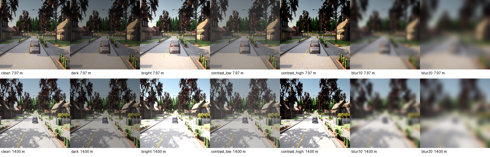
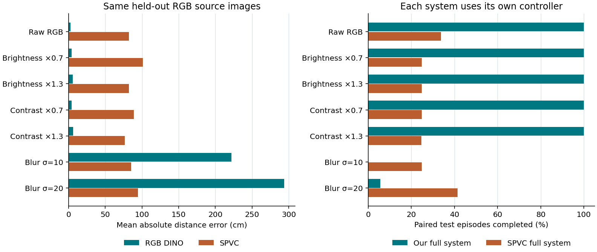

# AEBS 同图包整链路重训｜SPVC 与我方 RGB DINO

2026 年 11 月 25 日。实验在 GPU 服务器的 `vt` 环境执行。本轮采用一组训练种子，轨迹结果来自冻结留出图库回放。

两套系统使用同一个 24,000 张扩展 CARLA RGB 图包，从头训练各自的 AEBS 视觉前端和控制后端。原图上，我方完整系统完成 **2,000/2,000** 条，SPVC 完整复训完成 **674/2,000** 条。单帧测距 MAE 分别为 **2.65 cm** 和 **82.10 cm**。亮度和对比度变化后，我方仍全部完成。两档模糊下 SPVC 完成更多。

## 1. 车辆要完成什么任务？

车辆先以 2.5–3 m/s 从距障碍物 15–16 m 的地方起步，在不超过 20 s 内制动到目标区。每 0.05 s 根据动作更新一次车辆状态。模型中正的加速度指令表示制动，动作限制为 ±3 m/s²，速度更新后限制在 0–3 m/s。

| 统计项 | 判断规则 |
|---|---|
| 完成 | 距离进入 5–6 m 时，速度 ≤0.5 m/s |
| 危险 | 距离 ≤6 m 时，速度仍 >0.5 m/s |
| 提前停 | 车速归零时仍在 6 m 外 |
| 其他 | 离开模型域或 400 步仍未结束，分别记数 |

每条轨迹开始时抽取初始车距、车速和一个天气／颜色外观。车距和车速在指定范围均匀抽样，外观在 12 组中均匀抽样。两系统共用外生抽样，按自己的相机读数和制动动作推进。每一帧从对应外观内选择标签距离最近的冻结图片，可以在每个新状态上重新观察到相应车距的图像。

## 2. 两边的数据怎样相同？

使用 CARLA 扩展采集的 24,000 张 640×640 RGB 原图与距离标签。按车距把同一距离的各外观图分到同一分区，在各距离段交错分配训练、开发和留出图片。逐图核对 RGB 像素摘要，留出图与拟合区没有完全相同的 32×32 灰度输入。留出图库在每个外观内的最大相邻距离间隙为 7.81 cm。

| 图片用途 | 张数 | 两边如何使用 |
|---|---:|---|
| 训练 | 14,388 | 同一批图片 ID 和车距标签。两条视觉链各用自己的预处理。 |
| 开发 | 2,400 | 我方投影用开发 MSE 选权重，也用这批图估计鲁棒训练所用的开发误差范围。SPVC 采用作者默认训练设置、模拟回报检查点和原综合规则。 |
| 留出图库 | 7,212 | 两边在同样图片上测静态误差。固定该图库后，再分别抽校准和测试轨迹。 |

车距归一化尺度 3.18020 m 由本轮训练标签计算，供两链共用。SPVC 的原数据读取接口使用由这 14,388 张训练图转换出的 H5。PPO 的交互数据则来自作者的状态动力学模拟器。DINOv2 的外部预训练是我方方法的一部分，冻结其主干权重，表中的图像预算统计本任务数据。

所有训练图片使用图库中的原有版本。亮度、对比度和高斯模糊先作用于留出的 RGB 源图，再分送两套前端。模糊的 σ 用 640×640 源图像素表示，10 和 20 像素分别对应缩到 32×32 时约 0.5 和 1 像素的尺度。

两行分别是约 7.97 m 和 14.00 m 的留出源图。每行从左到右为原图、变暗、变亮、低对比、高对比、较轻模糊、较强模糊。两套前端各从同一张变换后的源图开始。

## 3. 两套框架各自怎样训练？

### 原 SPVC

1. **条件视觉代理。** 从车距标签和四维随机变量生成一张 32×32 灰度图。使用作者发布 AEBS 路径中的条件 MLP（5→256→256→256→256→1024，隐藏层 ReLU，末层 Tanh）、500 轮监督图像重建、batch 16、Adam 学习率 0.0001。
2. **测距头。** 冻结生成器，用生成图和对应距离训练原 1024→256→64→1 网络。隐藏层为全连接、LayerNorm 和 ReLU，末层为线性距离读出。原训练跑 50 轮、batch 16，使用距离 MSE 和 Lipschitz 惩罚。部署时同一个头读取相机灰度图。
3. **PPO。** 标称模拟器提供归一化真实距离和速度。策略输出加减速指令，奖励用接近目标的进度、时间代价，以及阈值附近低速奖励／超速惩罚。两个 64 单元 Tanh 隐藏层，约 20 万交互步。作者的评估回报用于选 PPO 初始检查点。首次执行在第 17 万步的评估回合未终止，同种子重跑时给选模评估增加 400 步上限。环境交互训练继续沿用上游奖励、终止规则和 PPO 超参数。
4. **交替综合。** 冻结视觉模块，以重训的 PPO 开始，按作者源码每轮更新屏障 10 个 epoch，执行原验证与反例收集，再更新控制器 1 个 epoch。随机扰动和期望型损失沿用上游。最高的原验证分数对应的配套控制器和屏障用于最终测试。若原验证没有任何可计分的候选，测试保存的最后一对并单列其验证状态。

### 我方 RGB DINO、轨迹 CP 与鲁棒屏障

1. **低维视觉观测。** 保留 RGB 三通道，缩放至 224×224 后按通道归一化。冻结 DINOv2-S/14 的 384 维 CLS 输出。用 384→128 GELU→128 GELU→1 视觉投影匹配 $h(x)=Cx=d/S$。投影训练 100 轮、batch 64、Adam 学习率 0.001，利用开发 MSE 选择检查点。车速由任务状态供给控制器。
2. **鲁棒训练范围。** 两套系统共用本轮新训的标称 PPO 初始权重。我方将其接入训练好的 RGB 前端，在开发图库跑 249 条轨迹，测得 95% 目标的误差半宽为 0.1704 m。训练按预设 0.45 m 下限取值。
3. **控制器与屏障。** 从随机权重训练非负神经屏障，交替更新 PPO actor。微调时把允许的视觉误差传入控制器，再传播到下一状态；惩罚最不利情况下屏障上升，并在训练图像回放检查任务保持情况。用连续状态区间核验候选，在三个 actor 微调轮次后保存配套权重。默认 0.45 m 和补做的开发范围 0.25 m 都出现正漂移，正式闭环采用原先登记的 0.45 m 开发训练路线。最终使用的网络在开发阶段更新过权重。
4. **正式校准和验证。** 模型冻结后，在留出图库、独立采样的 499 条校准轨迹上重算视觉误差半宽。将清晰输入的最终误差集合送入鲁棒验证器检查初态、危险集和沿允许后继的不增条件。

## 4. 结果怎么读？

### 静态测距

同一批图中绝对测距误差的均值（MAE）越低，代表每张图平均更接近物理距离标签。P95 表示 95% 的测试图片误差不超过该值。

| 图像条件 | 我方 RGB DINO MAE（cm） | SPVC 测距头 MAE（cm） | 我方绝对误差 P95（cm） | SPVC 绝对误差 P95（cm） |
|---|---:|---:|---:|---:|
| RGB 原图 | 2.65 | 82.10 | 7.00 | 236.14 |
| 亮度×0.7 | 4.00 | 101.39 | 11.55 | 290.97 |
| 亮度×1.3 | 5.65 | 82.23 | 17.24 | 232.72 |
| 对比度×0.7 | 4.36 | 88.91 | 13.99 | 258.79 |
| 对比度×1.3 | 6.34 | 76.44 | 19.06 | 217.38 |
| 模糊 σ=10 源像素 | 221.73 | 85.34 | 426.15 | 267.65 |
| 模糊 σ=20 源像素 | 293.86 | 94.65 | 632.96 | 317.45 |

原图平均测距误差为我方 **2.65 cm**、SPVC **82.10 cm**。七种条件中，我方的静态 MAE 有 **5/7** 项更小。

### 配对闭环

每种图像条件重新读取两侧冻结前端的预测。SPVC 完整组使用交替综合后的控制器，SPVC 的 PPO 阶段行使用该系统自己的同一个测距头和新训的 PPO，当前框架使用自己的 DINO 及鲁棒综合控制器。每臂使用 499 条校准轨迹和 2,000 条新的配对测试轨迹。

| 图像条件 | SPVC 完整复训 完成 / 危险 | SPVC 新 PPO 阶段 完成 / 危险 | 我方完整框架 完成 / 危险 |
|---|---:|---:|---:|
| RGB 原图 | 674 / 689 | 481 / 1,022 | 2,000 / 0 |
| 亮度×0.7 | 496 / 1,022 | 657 / 1,022 | 2,000 / 0 |
| 亮度×1.3 | 496 / 867 | 481 / 1,022 | 2,000 / 0 |
| 对比度×0.7 | 496 / 867 | 481 / 1,022 | 2,000 / 0 |
| 对比度×1.3 | 494 / 689 | 636 / 867 | 2,000 / 0 |
| 模糊 σ=10 源像素 | 496 / 867 | 662 / 1,022 | 0 / 2,000 |
| 模糊 σ=20 源像素 | 829 / 1,022 | 978 / 1,022 | 113 / 1,887 |

每格分母为 2,000。原图上，SPVC 自己的交替综合把完成数从 **481 提高到 674**，危险数从 **1,022 降到 689**。我方在同一批初态和外观下多完成 **1,326** 条。以完成率衡量，我方是 **100%**，SPVC 完整复训是 **33.7%**，相差 **66.3 个百分点**。强模糊下，SPVC 完成 **829** 条，我方完成 **113** 条。

| 原图系统 | 成功用时均值（s） | 成功进入目标时的车速均值（m/s） | 含失败的限时平均（s） |
|---|---:|---:|---:|
| SPVC 完整复训 | 11.552 | 0.238 | 17.153 |
| SPVC 新 PPO 阶段 | 12.441 | 0.060 | 18.182 |
| 我方完整框架 | 8.476 | 0.245 | 8.476 |

限时平均把失败计作 20 s。成功用时和成功进入速度只基于成功轨迹。

| 原图系统 | 完成 | 危险 | 提前停 | 离域 | 超时 |
|---|---:|---:|---:|---:|---:|
| SPVC 完整复训 | 674 | 689 | 149 | 0 | 488 |
| SPVC 新 PPO 阶段 | 481 | 1,022 | 149 | 0 | 348 |
| 我方完整框架 | 2,000 | 0 | 0 | 0 | 0 |

### 安全证书

整轨分数是每趟全部控制步中，实际观测车距与当时物理距离的最大绝对差。在 499 条校准中取第 475 小分数。对当前冻结图库的抽样规律，轨迹 CP 的 95% 是校准样本与一条新轨迹上的边际覆盖。鲁棒验证检查该误差事件下的安全性。原 SPVC 概率分数对应其随机转移模型。

| 系统（原图） | 整轨测距半宽 q（m） | 全程入界／2,000 |
|---|---:|---:|
| SPVC 完整复训 | 3.1324 | 1,933 / 2,000 |
| SPVC 新 PPO 阶段 | 3.1324 | 1,933 / 2,000 |
| 我方完整框架 | 0.1467 | 1,896 / 2,000 |

我方清晰图像 q=**0.1467 m**，鲁棒屏障数值区间检查**未通过**。初始屏障上界 0.000，危险下界 24.399，检查 4,096 个单元，正漂移见证 935，未决 1,041。后端使用 float64 数值区间运算。

原 SPVC 跑了 101 轮，23 轮通过原程序的下降检查。第 100 轮的初始屏障上界为 11.322，危险屏障下界为 7.091，两个区域的界无法分离。全部 101 轮均没有得到可计分的概率下界，闭环采用最后一对权重。

| 图像条件 | SPVC 完整复训 q（m） | 我方完整框架 q（m） |
|---|---:|---:|
| RGB 原图 | 3.1324 | 0.1467 |
| 亮度×0.7 | 3.8009 | 0.2461 |
| 亮度×1.3 | 3.6577 | 0.4410 |
| 对比度×0.7 | 3.4281 | 0.2859 |
| 对比度×1.3 | 2.9970 | 0.3880 |
| 模糊 σ=10 源像素 | 3.6737 | 5.7458 |
| 模糊 σ=20 源像素 | 4.3638 | 7.5844 |

原图中，我方 2,000 条均完成，仍有 104 条的整轨误差超过校准半宽。我方候选屏障在允许误差内找到上升见证，说明这次屏障条件未成立。图像变化组的 q 用于统计误差大小，鲁棒验证实跑的是原图组。

## 5. 用到的实现

- [扩展图库分组与 H5 转换](../../../artical-F122/Aebs/paper_comparison/aebs_matched_data.py)
- [SPVC 原实现训练及配套权重记录](../../../artical-F122/Aebs/paper_comparison/aebs_matched_native.py)
- [RGB 投影训练](../../../artical-F122/Aebs/paper_comparison/aebs_matched_rgb.py) · [我方鲁棒综合](../../../artical-F122/Aebs/paper_comparison/aebs_matched_robust.py)
- [配对闭环、轨迹校准和统一指标](../../../artical-F122/Aebs/paper_comparison/aebs_matched_evaluate.py)
- [SPVC 原论文](../../references/720_file_Paper.pdf) · [VISION-SLS 原论文](<../../references/VISION-SLS- Safe Perception-Based Control from Learned Visual Representations via System Level Synthesis.pdf>)

## 6. 原始结果和复算

- [共同划分、像素去重与查图间隙](../../../artical-F122/results/aebs_matched_complete_20261125/data_protocol.json) · [原始 SPVC 源码绑定检查](../../../artical-F122/results/aebs_matched_complete_20261125/source_audit.json)
- [七条件全部指标](../../../artical-F122/results/aebs_matched_complete_20261125/evaluation/results.json) · [逐图、逐轨独立复算](../../../artical-F122/results/aebs_matched_complete_20261125/evaluation/independent_recheck.json)
- [SPVC 各综合轮次](../../../artical-F122/results/aebs_matched_complete_20261125/rounds.json) · [我方原图屏障检查](../../../artical-F122/results/aebs_matched_complete_20261125/evaluation/clean_audit/report.json)

在连续状态区间检查中，本次找到的最大屏障上升点在车距约 10.30 m、车速约 1.71 m/s，屏障一步上升约 0.143。与前面的“危险终止”相比，这个数测的是数学候选函数沿一步的变化。
