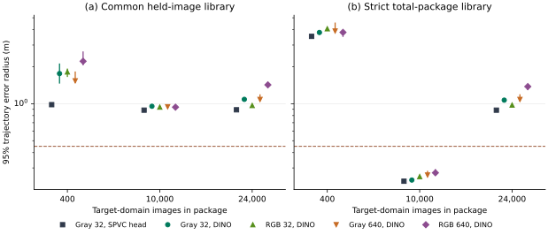

# AEBS 同源、同信息条件下的三档预算前端实验

2026-11-17。实验目标是在固定制动策略和数值鲁棒屏障上，分别测量目标域图像预算、读出架构、输入颜色和输入分辨率的影响。图像是 CARLA 仿真保存的原 RGB 帧。

**直接结论。** 在目标域训练、开发选择、像素及后端均对齐后，采用原 SPVC 灰度结构的测距头在共同库的三档预算、三个训练种子的全部 9 对都取得了更小的闭环峰值误差半径。原先观察到的 400 张 DINO 优势随灰度基线也获得相同调参预算而反转。严格 10k 由全部前端通过同一神经鲁棒屏障，其余图库/预算的每个模型都有该屏障的实际正漂移见证。部署时将原发布头直接迁移至新相机的实验仍有其单独的意义。

## 1. 实验单位与四个对照

| 前端 | 原始信息进入估计器的路径 | 在哪些比较中使用 |
|---|---|---|
| 原 SPVC 结构的目标域灰度头 | 同一张 640×640 源 RGB → PIL 灰度 → 双三次降采样为 32×32 → 1,024–256–64–1 的原结构 MLP | 同预算、同像素基础对照；重新训练此头 |
| 灰度 32 的 DINO | 取**同一数组**中的 32×32 灰度像素，重复成三个通道；固定 DINOv2 ViT-S/14 和距离读出 | 与 MLP 比较相同输入下的表示与外部预训练收益 |
| RGB 32 的 DINO | 同一源 RGB 降采样到 32×32，保留颜色，固定骨干与同结构读出 | 与灰度 32 比较颜色作用，与 RGB 640 比较输入分辨率 |
| 灰度 640 的 DINO | 同一源图转灰度，保留 640×640，在骨干预处理阶段缩放 | 与灰度 32 比较输入分辨率，与 RGB 640 比较颜色作用 |
| RGB 640 的 DINO | 同一原始尺寸 RGB，在骨干预处理阶段缩放，使用同一预训练骨干 | 2×2 的完整信息端点 |

DINO 四组均使用完全相同的双三次缩放到 224×224、ImageNet 归一化、384 维 CLS 特征和可训练的距离投影。这里的“640”描述传给预处理器的源图分辨率。该实验支持逐一比较信息路径；灰度 MLP 与灰度 DINO 的差别包含骨干规模、预训练和下游参数化。所有前端的语义输出都是距离除以 3.18272066116333，在线策略另接收同一车速。状态侧代理始终取真实距离，因此米制误差为相机估计减去本步**实际车距**。

原生 SPVC 用生成/蒸馏路径、随机扰动模型与随机屏障衡量概率安全。此受控实验将它的灰度头结构放入共同的目标域学习与验证协议。原发布生成器、PPO 与概率指标的记录见[原 SPVC 组件和固定图库交叉实验](AEBS_原生SPVC与当前前端_配对闭环对照_20261117.md)。

## 2. 原 RGB 总包和额外闭环成本怎样计算

| 总包 | 有标签训练帧 | 开发帧 | 严格图库中的测试帧 | 校准和盲测的随机单位 |
|---:|---:|---:|---:|---|
| 400 | 240 | 88 | 72 | 每种冻结前端、每个种子和图库各 199 条新校准轨迹、100 条新盲测轨迹 |
| 10,000 | 6,000 | 2,000 | 2,000 | 同上 |
| 24,000 | 14,172 | 4,908 | 4,920 | 同上 |

1. **训练。** 三档复用已注册的原图 ID、距离、天气与车色划分。在各档训练 ID 上拟合模型并估计 DINO 特征的均值、标准差。预算不是 400/10k/24k 个优化样本外加测试集，而是表内三列之和。
2. **开发。** 每个前端、每档预算、每个训练种子都尝试同样两个固定学习率 0.0001 和 0.001，各 100 轮 Adam。batch 为 64。每个种子和预算下，两边使用相同样本排列及更新次数。用相同开发集上的归一化距离均方误差选择学习率和 epoch。三个种子均完整报告。24k DINO 在这次实验中也使用与灰度头完全相同的 14,172/4,908 训练/开发划分。
3. **轨迹校准。** 各自策略闭环在冻结图库中运行，由独立抽取的起始距离、速度、天气、车色确定一条轨迹。取本轨迹所有用于控制的帧中的最大绝对米制误差，包含按真实距离查最近图像的误差。199 条轨迹的第 190 小值给出名义 95% 整轨迹误差半径。校准阈值先冻结，再运行留出。开发样本未参与此顺序统计量。
4. **盲测。** 100 个独立初态和外观使用独立种子。两边共用外生场景，之后各自的控制动作可能访问不同帧。所有超速进危险区和提前停车的运行都保留。共同图库固定为 3,229 张，排除了任何预算用于拟合/开发的图像；这是小预算额外的测试资源。严格图库仅含本档测试图。一个图库在校准与盲测中均作为固定环境，因而两组轨迹可访问同一张图。独立的是场景随机抽样，不是重新采集的图片。严格库与共同库不是实时 CARLA 渲染。
5. **验证。** 控制器和已登记神经屏障全程冻结，均采用相同速度输入、动作映射和终止逻辑。笛卡尔距离管内所有允许后继是验证对象。待检半径位于已审计的 ±0.45 m 内时，沿用相同权重、物理单位和局部区域的 782,400 个单元的父证书；更宽时搜索实际正漂移点，必要时按共同的数值区间预算求证。证书通过才支持“全程误差在管内则避开危险集”，该结论针对声明的离散数值模型。对于预先固定的一种方法，轨迹可交换时，保形覆盖与此条件结论给出 P(审计接受且新轨迹不安全) ≤ 0.05。固定校准集的条件风险或到达目标的概率需要另证。
6. **额外成本。** 服务器为了横向比较，对同一 24k 批一次解码同时提取四种 DINO 表示，共 96,000 次单帧特征，另一次读取同源原图用于逐模式像素指纹审计。缓存共享时，单个 400 张拟合任务只索引本档的训练和开发帧；整个横向研究实际使用了 24k 源帧及外部预训练骨干。45 个最终模型来自 90 次训练。共同图库和严格图库合计 90 个闭环实验臂。90×199=17,910 次校准运行和 90×100=9,000 次盲测运行共享 199+100 个配对场景。一次回放查询可以重复使用同一静态图，额外现场采集原帧为 0。共享后端历史开发的成本不包含在单个前端包中。

[预先保存的协议](../../../artical-F122/results/aebs_factorial_20261117/protocol.json) · [原图与特征提取](../../../artical-F122/Aebs/experiments/factorial_aebs_inputs.py) · [相同训练与开发过程](../../../artical-F122/Aebs/experiments/factorial_aebs_fit.py) · [轨迹校准和鲁棒审核](../../../artical-F122/Aebs/experiments/factorial_aebs_evaluate.py)

## 3. 同源同预算主结果

下表是 199 条新校准轨迹得到的半径 q（米），每格为三个训练种子的中位数。每一格的前端已单独校准和审计，不能把三个种子相加当成 300 条独立测试场景。最后一列是本行 5×3 个模型的连续域数值结论。

| 回放库 | 总包 | 原结构灰度头 | DINO 灰32 | DINO RGB32 | DINO 灰640 | DINO RGB640 | 固定神经屏障 |
|---|---:|---:|---:|---:|---:|---:|---|
| 共同 | 400 | 0.982 | 1.758 | 1.812 | 1.534 | 2.214 | 均有正漂移见证 |
| 共同 | 10000 | 0.886 | 0.953 | 0.938 | 0.944 | 0.937 | 均有正漂移见证 |
| 共同 | 24000 | 0.892 | 1.085 | 0.967 | 1.082 | 1.423 | 均有正漂移见证 |
| 严格 | 400 | 3.529 | 3.796 | 4.070 | 3.901 | 3.804 | 均有正漂移见证 |
| 严格 | 10000 | 0.234 | 0.239 | 0.255 | 0.263 | 0.274 | 均通过 |
| 严格 | 24000 | 0.886 | 1.069 | 0.975 | 1.083 | 1.378 | 均有正漂移见证 |



图中的标记是三个训练种子的中位数，竖线给出观察到的最小与最大值，虚线是同一神经屏障已验证的 ±0.45 m。实验观察到 **15/90 臂通过**（严格 10k 的所有输入和种子），**75/90 臂找到正漂移见证**。宽管内某个可能误差违反屏障不增，不代表已观察到碰撞。[90 臂原始表](../../../artical-F122/results/aebs_factorial_20261117/replay/comparison.csv) · [各训练种子的范围与中位数](../../../artical-F122/results/aebs_factorial_20261117/replay/seed_summary.csv)

**同像素前端的收益归属。** 400 张共同库上，原结构灰度头在三个种子均为 100/100 目标成功、0/100 危险。灰32 DINO 为 91/100、91/100、86/100 成功，各有 9、9、14 条危险。两组在自己的 q 内覆盖数的中位数均为 95/100，而在固定的 ±0.45 m 内均为 0/100。与之前使用旧配方时的 58.1% 半径缩小相比，这次把同一开发选模预算给两边，三个种子 DINO 反而分别多需要 0.762、0.493、1.118 m。对照说明小样本收益对基线训练设置敏感。高预算的同像素比较也均为灰度头半径较小，不能据此再给当前 DINO 归因一个独立的普遍认证收益。[同种子对比与颜色/分辨率差](../../../artical-F122/results/aebs_factorial_20261117/replay/paired_effects.csv)

**颜色和分辨率。** 用相同的 DINO 保持源图分辨率不变时，颜色作用随输入路径变化。以 24k 的共同库为例，从 32 灰度换为 32 RGB 在三个种子上各降低约 0.10–0.12 m；从 640 灰度换为 640 RGB 却各增加约 0.26–0.34 m。固定 RGB 颜色把输入从 32 提到 640，在这一档各增加 0.42–0.48 m。开发选择按静态距离均方误差，轨迹半径则受到关键制动状态的误差、天气/车色与查图误差共同影响。这些比较支持具体输入组合及域的实证，不能把信息输入更多写成证书必然更好。

**行为与成本。** 严格 10k 的 15 个模型均为 100/100 成功，所有留出轨迹也都全程落入固定的 ±0.45 m（各自较窄的 q 上覆盖数有所不同）。共同库和严格 24k 中 10k/24k 模型虽常全部完成，但严格证书仍可出现反例。严格 400 中，RGB640 DINO 三个种子分别有 31、31、46 个危险终止；部分 400 张的其他模型还出现提前停车或超时。每条轨迹均计入校准/盲测，不把超时并入成功或提前停车。主实验实际共查询缓存图像 **5,142,156 次**，其中校准 **3,418,487**、盲测 **1,723,669**。按同一判据重算全部 90 个第 190 顺位数、覆盖、各类终止计数，并核对共同控制器、屏障和轨迹起点。[全部终止类别](../../../artical-F122/results/aebs_factorial_20261117/replay/terminal_counts.csv) · [额外闭环成本与校验](../../../artical-F122/results/aebs_factorial_20261117/replay/audit_costs.json)

## 4. 数据量与学习率的补充实验

**同一批学习率。** 旧阶段冻结的原结构基线只尝试了 0.0001，DINO 读出用了 0.001。因此历史 400 张测距收益适用于当时两套检查点。本轮为两种结构提供相同学习率菜单和选模预算。随后对 400 张的 MLP 单独保留两种学习率各自的最佳 epoch，训练初始化、batch 顺序、训练/开发图、轨迹种子和控制器逐一固定。复跑的开发误差、最佳 epoch 和被选择模型的权重张量与主实验逐个完全相同。

| 同一 400 张 MLP 的训练条件 | 共同库 q，三个种子，m | 严格库 q，三个种子，m |
|---|---|---|
| 固定学习率 0.0001 | 4.2263 / 3.9963 / 5.0861 | 4.2528 / 4.0161 / 5.0617 |
| 固定学习率 0.001 | 0.9966 / 0.9806 / 0.9818 | 3.5288 / 3.5181 / 3.5620 |

共同库能让更小的读出误差体现为更紧的闭环误差管。在严格 72 帧库中，部分外观的相邻距离相隔很远（历史同一回放律达 4.86 m），更好的视觉估计器仍须承担找图误差。[固定学习率逐种子、覆盖与任务行为](../../../artical-F122/results/aebs_factorial_rate_20261117/comparison.csv)

**嵌套总包。** 历史 400 张的 240 张训练帧中只有 54 张也在 10k 训练集，历史 10k 的 6,000 张训练帧中只有 3,543 张也在 24k 训练集。因此主实验的跨预算变化同时包含图像数量与样本组成。附加实验沿用 24k 完整划分，在训练、开发、测试三个部分各自按天气、车色和 1 m 距离分箱建立有随机顺序的分层队列。每个部分依次取对应的 400 和 10k 总包份额，构成 400 ⊂ 10k ⊂ 24k，增加预算时已用训练帧始终留在训练划分中。三个训练种子各自对应一条独立选择链，每条链的两个同像素前端共享完全相同的嵌套数据，三个预算的共同回放图库、初始场景和控制器也相同。每个模型另用新的 199 条校准、100 条盲测。24k 直接复用主实验的六个对应检查点。[附加实验登记](../../../artical-F122/results/aebs_factorial_nested_20261117/protocol.json)

**嵌套结果。** 在相同的 3,229 张额外评测库上，各预算 q 的三个训练种子中位数如下。400 → 10k 时，两种模型均有改善；10k → 24k 的边际变化更小，且并非每个种子都继续改善。两种模型在 3 个预算 × 3 条嵌套链的 9 个配对中均是原结构头误差较小。三档都没有取得当前误差管上的鲁棒屏障通过。

| 前端 | 400 张 | 10k 张 | 24k 张 |
|---|---:|---:|---:|
| 32×32 原结构灰度头 | 1.029 m | 0.888 m | 0.888 m |
| 同像素 DINO | 2.051 m | 1.100 m | 1.077 m |

嵌套组另外运行 18×199 次校准、18×100 次留出，消耗 1,068,292 次图像查询。学习率敏感性另外运行 12×199 次校准、12×100 次留出，消耗 704,785 次图像查询，复用了主实验相同的情景种子，不能当作额外 3,588 个独立场景。均未新增在线实拍图像。三种子和有限图库的范围不会因附加这些查询而扩大。[嵌套 18 臂逐种子结果](../../../artical-F122/results/aebs_factorial_nested_20261117/comparison.csv)

## 5. 复算入口

在服务器 `/root/work_based_on_spvc/artical-F122`、conda 环境 `vt` 中执行。将示例的输出目录设置为尚不存在的路径。特征提取耗时约 571 秒（单块共享 RTX 4090，batch=8），该数值受服务器负载影响。特征缓存全部保存在服务器，本地可由原图和缓存清单重建。运行主实验时，在训练和取盲测结果前，可先登记附加嵌套划分。四种输入均完整复核了全部 24k 源帧的像素 SHA-256。严格/共同库与拟合/开发间均未发现相同像素，各预算内训练和开发间也未发现相同像素。这项检查不能发现同一场景下不同距离图像的近似重复。

```bash
python -m Aebs.experiments.factorial_aebs_inputs results/ae_factorial_repeat
python -m Aebs.experiments.factorial_aebs_audit pixels results/ae_factorial_repeat
python -m Aebs.experiments.factorial_aebs_nested register results/ae_factorial_repeat results/ae_nested_repeat
python -m Aebs.experiments.factorial_aebs_fit results/ae_factorial_repeat --workers 8
python -m Aebs.experiments.factorial_aebs_evaluate results/ae_factorial_repeat
python -m Aebs.experiments.factorial_aebs_audit report results/ae_factorial_repeat
python -m Aebs.experiments.factorial_aebs_nested run results/ae_factorial_repeat results/ae_nested_repeat
python -m Aebs.experiments.factorial_aebs_rate_sensitivity results/ae_factorial_repeat results/ae_rate_repeat
```

[四种输入的全库像素审计](../../../artical-F122/results/aebs_factorial_20261117/pixel_audit.json) · [模型、数据与回放核对脚本](../../../artical-F122/Aebs/experiments/factorial_aebs_audit.py) · [嵌套总包构造与评估](../../../artical-F122/Aebs/experiments/factorial_aebs_nested.py)
