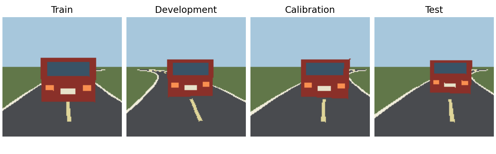
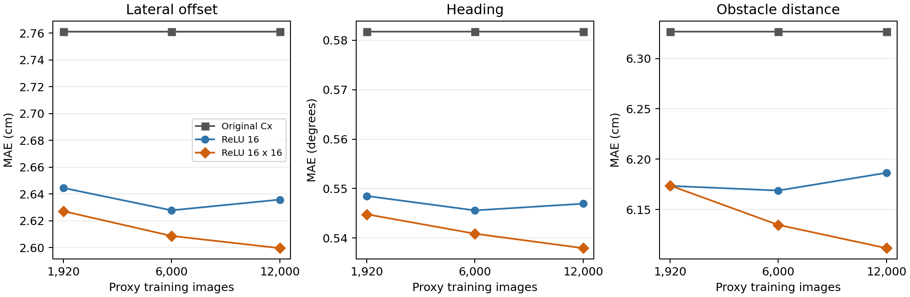

# 五维弯道制动：历次神经代理的逐层结构与扩大数据对照

本轮在服务器 vt 环境中，重新生成 16,000 张五维任务的静态 RGB 图像，冻结原 DINO、PCA 和视觉投影，比较六种小网络及三个线性基线。训练量分别为 1,920、6,000、12,000 张，每个神经结构跑三个种子，共 54 次训练。最大预算下，开发集选择了 **两层 ReLU**。相对原 Cx，横偏、航向和障碍距离的等效 MAE 分别降低约 **5.85%、7.53%、3.40%**。本报告将新结果与原先可逆代理的闭环实验一并解释。

## 1. 五维任务中，网络究竟有几个输入？

车辆沿左弯或右弯的道路行驶，遇到静止障碍物后制动并转向。五个动力学状态是横偏 $e$（m）、航向偏差 $\psi$（rad）、障碍距离 $d$（m）、车速 $v$（m/s）、前轮转角 $\delta$（rad）。后两项由直接测量提供，视觉分支预测前三项对应的低维坐标。

| 输入与输出 | 数量 | 实际内容 |
|---|---:|---|
| 完整动力学状态 | 5 | $(e,\psi,d,v,\delta)$ |
| 状态代理输入 $x$ | 3 | $(e/0.65,\psi/0.19,(d-4)/2)$ |
| 状态代理输出 $h(x)$ | 3 | 预测视觉分支的三维输出 |
| 控制器输入 | 6 | 图像解码后的三项观测、直接测量的速度与转角、已知道路曲率 |
| 控制器输出 | 2 | 纵向加速度与随行驶距离变化的转角指令 |

例如横偏 0.13 m、航向 0.019 rad、车距 5 m，对应代理输入 $(0.2,0.1,0.5)$。以下网络中的第一个“3”指这三个数。

成功要求全程车身在车道内、与障碍分离，最终停稳且车距在 [3.60,4.40] m。原闭环初态车距为 5.30–5.90 m、车速为 2.10–2.40 m/s；左右弯曲率为 ±0.02 m⁻¹，每条轨迹 14 步，每步 0.2 s。车身安全判断采用动力学采样时刻的保守几何余量。[任务与安全条件](五维弯道遇障制动_视觉代理与鲁棒屏障_20261117.md)

## 2. 固定的图像分支每一步做什么

| 顺序 | 操作 | 输出 |
|---|---|---|
| ① 根据位置成像 | 原五维渲染器生成 144×144 RGB 相机图像 | 一帧道路、障碍物和车身视角 |
| ② DINO 编码 | 冻结 DINOv2-S/14，按既有预处理得到 16×16 局部特征网格 | 每个位置 384 个数 |
| ③ 空间池化 | 每个通道将 16×16 网格平均压到 4×4，再展开 | $384×4×4=6144$ 维 |
| ④ PCA 与标准化 | 使用原训练分区拟合并保存的均值、PCA 基及尺度 | 192 维向量 |
| ⑤ 视觉投影 | 使用原配对种子 20261117501 的线性组全连接头，192→3 | 实际低维视觉输出 $y$ |

本轮同一张图对所有代理都提供同一个 $y$。只训练状态分支，图像分支提供固定目标。[成像与编码](../../../artical-F122/Aebs/curve_braking/vision.py) · [冻结模型和新图像绑定](../../../artical-F122/results/curve_proxy_depth_20261122/bank.json)

## 3. 原有可逆网络：三个小网络按顺序修改三个坐标

原 11 月 17 日实验同时训练视觉投影、矩阵 C 与可逆耦合网络。设 $z=Cx$，三个子网络分别读取当前另外两个坐标，输出一个修正值，然后乘 0.25 加到当前坐标上。

| 顺序 | 子网络逐层结构 | 更新后的坐标 |
|---|---|---|
| ① 线性基础项 | 输入 3 个数，乘可训练的 3×3 矩阵 C | 得到 $z_1,z_2,z_3$ |
| ② 修正第 1 维 | $(z_2,z_3)$ → 全连接 2→12 → Tanh → 全连接 12→1 → 输出 Tanh | $a_1=z_1+0.25f_1(z_2,z_3)$ |
| ③ 修正第 2 维 | $(a_1,z_3)$ → 全连接 2→12 → Tanh → 全连接 12→1 → 输出 Tanh | $a_2=z_2+0.25f_2(a_1,z_3)$ |
| ④ 修正第 3 维 | $(a_1,a_2)$ → 全连接 2→12 → Tanh → 全连接 12→1 → 输出 Tanh | $a_3=z_3+0.25f_3(a_1,a_2)$ |
| ⑤ 输出与逆解码 | 输出 $(a_1,a_2,a_3)$；解码时按 ④→③→② 顺序逐次减去修正，再解 C | 能将图像低维向量恢复为控制器使用的三项状态坐标 |

三个小网络各有 $2×12+12+12+1=49$ 个参数，共 147 个。原配对实验里全局偏置固定为零。线性组视觉头和 C 共 588 个可训练参数，神经组共 735 个。每个小网络只有一层隐藏层，三个坐标更新具有顺序依赖。[原网络代码](../../../artical-F122/Aebs/vision_sls/observation_coupling.py) · [联合训练与闭环报告](五维弯道制动_Cx与可逆神经代理配对实验_20261117.md)

### 原配对实验得到了什么？

下表使用原历史图像和原闭环轨迹。静态测试各有 320 帧；每个模型重新校准 199 条轨迹，测试 100 条相同初态的轨迹。所有模型共用控制器和屏障。

| 原静态测试（三种子均值） | 横偏 MAE（cm） | 航向 MAE（°） | 距离 MAE（cm） |
| --- | --- | --- | --- |
| 联合 Cx | 2.5925 | 0.5393 | 6.6971 |
| 可逆神经代理 | 2.5920 | 0.5394 | 6.6986 |

| 原训练种子（线性 / 神经） | 轨迹校准半径 | 100 条中整轨覆盖 | 100 条中安全停入目标区 |
| --- | --- | --- | --- |
| 20261117501 | 0.129914 / 0.129990 | 95 / 95 | 86 / 86 |
| 20261117502 | 0.130754 / 0.134566 | 92 / 96 | 88 / 88 |
| 20261117503 | 0.131964 / 0.132500 | 95 / 95 | 87 / 87 |

两种原前端的三对停车结果逐场景一致，六组均未观测到危险，各自在自己的半径下通过鲁棒屏障充分条件数值检查。原可逆网络在静态误差和停车成绩上没有表现出一致的明显优势。

## 4. 新实验：一层和两层分别怎样算？

新实验从同一个固定 Cx 出发，训练 $h(x)=Cx+r(x)$。Cx 和残差网络同时读取三维归一化状态，最后逐维相加。

| 步骤 | 一层网络 | 两层网络 | 作用 |
|---|---|---|---|
| 基础预测 | 固定 3→3 的 Cx | 相同 | 保存原有预测，供最后相加 |
| 第一隐藏层 | 全连接 3→16，加激活 | 相同 | 将三个状态组合成 16 个响应 |
| 第二隐藏层 | 直接送到输出层 | 全连接 16→16，加同种激活 | 进一步组合上一层响应 |
| 输出层 | 全连接 16→3 | 全连接 16→3 | 输出三个有正有负的修正量 |
| 相加 | Cx+r(x) | Cx+r(x) | 得到预测低维视觉向量 |
| 可训练参数量 | 115 | 387 | 两层增加 272 个参数；深度与容量一起变化 |

输出层权重和偏置从零初始化，因此第 0 步精确恢复原 Cx。这里按隐藏层数命名。

| 本次模型 | 第一隐藏层 | 第二隐藏层 | 输出 |
|---|---|---|---|
| 一层 Tanh | 3→16，Tanh | 无 | 16→3，再加 Cx |
| 两层 Tanh | 3→16，Tanh | 16→16，Tanh | 16→3，再加 Cx |
| 一层 ReLU | 3→16，ReLU | 无 | 16→3，再加 Cx |
| 两层 ReLU | 3→16，ReLU | 16→16，ReLU | 16→3，再加 Cx |
| 一层 SiLU | 3→16，SiLU | 无 | 16→3，再加 Cx |
| 两层 SiLU | 3→16，SiLU | 16→16，SiLU | 16→3，再加 Cx |

Tanh 将响应平滑限制在 −1 到 1，ReLU 将负响应置零，SiLU 用平滑门控调节响应。输出层为线性层，允许修正量为任意正负数。三个额外基线分别为固定原 Cx、只在训练集重拟合的 3×3 线性矩阵和带三维偏置的仿射模型。线性拟合采用最小二乘解析解。[本轮网络](../../../artical-F122/Aebs/paper_comparison/proxy_architecture_compare.py)

## 5. 新图像和训练的输入输出

| 阶段 | 输入 | 做了什么 | 输出 |
|---|---|---|---|
| 采集 | 原静态采样范围及冻结渲染器 | 独立随机采样 $e∈[-0.54,0.54]$ m、$\psi∈[-0.15,0.15]$ rad、$d∈[2.5,6.3]$ m，曲率等概率 ±0.02 | 16,000 帧像素不同的图像，与原 2,560 帧无像素完全重复 |
| 视觉推理 | 每帧 RGB 和固定 DINO、PCA、视觉头 | 固定 8 帧组批，提取真实低维向量 | 三维 y、三维真实状态 x、图像哈希与划分 |
| 划分 | 12,000 张训练池 | 生成嵌套的 1,920、6,000、12,000 张训练集 | 所有预算共用 1,000 开发、1,000 静态校准、2,000 测试 |
| 拟合 | 相同预算的 x、y | 六种网络各三个种子，Adam 1,500 次更新，批量 128，学习率 0.001 | 54 个训练后模型及各自开发选中的权重 |
| 选型 | 开发数据 | 每 50 步检查（包括第 0 步），选归一化 MSE 最小权重；结构按三种子平均开发 MSE | 与测试集分离的选型记录 |
| 评估 | 冻结权重与同批 2,000 测试帧 | 计算 $C^{-1}(y-h(x))$，分别乘回 0.65 m、0.19 rad、2 m | 等效横偏、航向、距离误差 |

这些是代理预测与同一冻结视觉输出之差，始终用原 C 的逆换算到统一物理坐标。训练损失为三个归一化坐标的平均平方误差；表中报告每一维的绝对误差均值。同种子同预算的六种网络使用相同训练批次序列。相同更新预算下，扩大训练集也减少了每张图片被平均抽中的次数。



## 6. 六种网络与三个基线的全部测试结果

每格按 **横偏 MAE（cm） / 航向 MAE（°） / 距离 MAE（cm）** 排列，神经网络为三个种子的均值。每列的测试帧完全相同。

| 结构 | 1,920 张训练 | 6,000 张训练 | 12,000 张训练 |
| --- | --- | --- | --- |
| 原始 Cx | 2.7611 / 0.5817 / 6.3267 | 2.7611 / 0.5817 / 6.3267 | 2.7611 / 0.5817 / 6.3267 |
| 重拟合 Cx | 2.7197 / 0.5760 / 6.2875 | 2.7168 / 0.5756 / 6.2851 | 2.7171 / 0.5755 / 6.2837 |
| 仿射 Ax+b | 2.7217 / 0.5762 / 6.2874 | 2.7171 / 0.5757 / 6.2848 | 2.7171 / 0.5755 / 6.2840 |
| 一层 Tanh | 2.6609 / 0.5613 / 6.2496 | 2.6524 / 0.5567 / 6.2138 | 2.6699 / 0.5587 / 6.2178 |
| 两层 Tanh | 2.6561 / 0.5586 / 6.2342 | 2.6428 / 0.5532 / 6.2223 | 2.6599 / 0.5587 / 6.2343 |
| 一层 ReLU | 2.6445 / 0.5485 / 6.1734 | 2.6278 / 0.5456 / 6.1689 | 2.6358 / 0.5469 / 6.1864 |
| 两层 ReLU | 2.6271 / 0.5448 / 6.1738 | 2.6087 / 0.5409 / 6.1347 | 2.5996 / 0.5379 / 6.1116 |
| 一层 SiLU | 2.6722 / 0.5655 / 6.2150 | 2.6668 / 0.5621 / 6.1943 | 2.6654 / 0.5607 / 6.1915 |
| 两层 SiLU | 2.6532 / 0.5577 / 6.1977 | 2.6472 / 0.5528 / 6.1718 | 2.6467 / 0.5529 / 6.1880 |

| 训练量 | 开发集选中的结构 | 该模型测试误差（cm / ° / cm） |
| --- | --- | --- |
| 1920 | 两层 ReLU | 2.6271 / 0.5448 / 6.1738 |
| 6000 | 两层 ReLU | 2.6087 / 0.5409 / 6.1347 |
| 12000 | 两层 ReLU | 2.5996 / 0.5379 / 6.1116 |

| 最大训练量 | 横偏 MAE（cm） | 航向 MAE（°） | 距离 MAE（cm） |
| --- | --- | --- | --- |
| 原始 Cx | 2.7611 | 0.5817 | 6.3267 |
| 一层 ReLU | 2.6358 | 0.5469 | 6.1864 |
| 两层 ReLU | 2.5996 | 0.5379 | 6.1116 |

按最大预算的开发选型，神经候选为 **两层 ReLU**。相对原 Cx，三项 MAE 的变化率（负值表示下降）分别为 **-5.85%、-7.53%、-3.40%**。各维误差和归一化总损失分别反映不同侧面，应结合全表判断。



图中三个面板分别表示三种物理量，各自刻度不同。曲线固定网络结构后比较训练量，全表同时保留了其它激活函数和线性基线。[逐种子指标与选型结果](../../../artical-F122/results/curve_proxy_depth_20261122/summary.json)

## 7. 新旧实验怎样比较，能得到什么安全保证？

| 方面 | 原 11/17 可逆代理实验 | 本轮普通残差网络结构对比 |
|---|---|---|
| 训练范围 | 视觉头、C、可逆代理一起更新 | 固定历史一个线性前端，只更新状态侧残差网络 |
| 测试样本 | 历史 320 帧静态测试和新闭环轨迹 | 新 2,000 帧标称静态测试图 |
| 误差的物理解释 | 用各自完整逆映射解码后的状态估计误差 | 经同一个原 C 逆映射换算的代理残差 |
| 控制器接入 | 可逆结构允许使用显式逆映射接原控制器 | 普通 MLP 可逆性尚未约束，进入后端需要适配 |
| 闭环与证书 | 各模型独立轨迹 CP、原屏障新半径数值检查 | 已完成静态拟合，尚无该六种新代理的轨迹校准与证书 |

因此，本轮可用来讨论五维任务里哪种小网络更贴近实际视觉输出。车辆是否更容易停入目标区、轨迹误差盒能否缩小、可认证范围能否扩大，需要在新名义代理下重采闭环轨迹与校准，并执行对应的鲁棒验证。历史与本轮测试集及评分解释有差异，比较收益时看同表中的原 Cx 与候选。

原六个可逆或线性前端的已有安全结论，以登记动力学、初始域及各自误差集合为前提；轨迹 CP 的边际覆盖还要求校准与未来轨迹可交换。原验证为普通浮点充分条件数值检查，完整浮点向外舍入证明尚未建立。

## 8. 复现与复核

在服务器 vt 环境的 artical-F122 下运行以下命令，使用新输出目录。

```bash
OUT=results/curve_proxy_depth_repeat
python -m Aebs.paper_comparison.curve_proxy_depth collect "$OUT" --device cuda:1
python -m Aebs.paper_comparison.curve_proxy_depth train "$OUT"
python -m Aebs.paper_comparison.summarize_curve_depth "$OUT"
```

汇总脚本逐个加载网络权重重放预测，核对 63 个评估记录中的指标、开发损失、同种子批次哈希、嵌套训练行号和固定留出集。额外重渲染了 8 个归档状态，像素哈希全部一致，重做视觉推理最大潜变量差为 5.96×10⁻⁸。[图像复核](../../../artical-F122/results/curve_proxy_depth_20261122/bank_replay.json) · [配对测试帧重采样](../../../artical-F122/results/curve_proxy_depth_20261122/paired_test.json) · [训练入口](../../../artical-F122/Aebs/paper_comparison/curve_proxy_depth.py)


纯全连接版本 $h(x)=\mathrm{MLP}(x)$ 的后续实验也已完成，六种结构与残差版、原 Cx 的全表见[三任务纯网络对照](../跨实验对照/三个任务_纯全连接网络替换Cx_结构与对照_20261122.md)。
