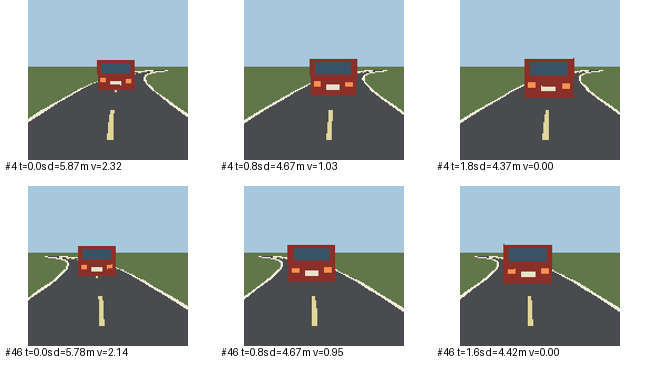

# 五维弯道遇障制动实验

2026-11-17 在服务器 vt 环境完成。一辆已进入制动接近段的车，通过前视图像看弯道与静止车辆的后表面，控制减速和转向。以 100 个配对留出初态评估，三个前端各有 100 条停稳、88 条停入指定距离区间，100 条全程有正车身安全余量。三个前端分别校准整条轨迹的误差包络，同一个五维结构化神经屏障在三个包络下均通过数值检查。该版本采用一个训练种子、两种固定道路曲率。[运行结果](../../../artical-F122/results/curve_braking_5d_20261117/evaluation/summary.json)

## 1. 场景和判定

| 状态（顺序即模型输入顺序） | 含义 | 信息来源 |
|---|---|---|
| e，m | 车身参考点到车道中心线的带符号横向偏差 | 图像估计 |
| ψ，rad | 车身相对于道路切线的航向误差 | 图像估计 |
| d，m | 从车身中心所在道路站位，到障碍物后表面的沿道距离 | 图像估计 |
| v，m/s | 当前速度 | 假设准确测得 |
| δ，rad | 当前实际前轮转角，具有执行器记忆 | 假设准确测得 |

每条轨迹随机选择曲率 −0.02 或 +0.02 m⁻¹，控制器知道当条曲率。初态各维独立均匀分布在 ±0.08 m、±0.028 rad、[5.30,5.90] m、[2.10,2.40] m/s、±0.035 rad。半车道宽 1.75 m，车身按长 3.20 m、宽 1.40 m 的矩形处理，参考点取中心。停稳后状态吸收。时域 14 步，每步 0.2 s。安全判定检查 15 个状态时刻的整车道路余量及与障碍后表面的分离余量。任务达标还要求最终 v=0 且 d 属于 [3.60,4.40] m。这里的 d 是中心站位距离，车头净间隙另算。

动力学采用离散 Frenet 自行车模型。设 a 为加速度，u 为单位行驶距离的转角改变量，L=2.6 m，κ 为曲率。先算 v′=clip(v+0.2a,0,2.6)，本步行程 s=0.2v′，沿中心线进度为 g=s cosψ/(1−κe)。再更新 e′=e+s sinψ、ψ′=ψ+s tanδ/L−κg、d′=d−g、δ′=clip(δ+su,−0.07,0.07)。控制实际形成的转向角速度与当步速度有关。这是为该实验定义的离散模型，证书针对该模型的采样时刻。[动力学及车身余量](../../../artical-F122/Aebs/curve_braking/plant.py)

## 2. 图像、三类代理与误差集合

1. 在同一投影相机中绘制左右弯道、边线、中心线及已知宽高的障碍后表面。相机位置随 e 移动，方向随 ψ 改变，障碍的可见尺寸和位置随 d 变化。每个控制时刻根据实际后继重新渲染 144×144 RGB 图。下图两行取自神经前端留出轨迹，分别展示起步、中段和停稳。第 4 号停进区间，第 46 号停早。图中 d 是沿道距离，v 是速度。



2. 静态训练样本共 2,560 张，渲染时先按像素哈希去重，再分为训练 1,920、开发 320、测试 320 张。冻结 DINOv2-S/14，经预处理输入 224×224，取 patch 特征，按 4×4 空间分区池化。仅用训练集拟合 192 维 PCA、尺度和岭回归初始化。保存特征、原始图像和状态标签。[数据构建](../../../artical-F122/Aebs/curve_braking/data.py)
3. 图像特征经可训练投影输出三维 y。令 z=(e/0.65,ψ/0.19,(d−4)/2)，分别拟合可训练线性 h(z)=Cz、仿射 h(z)=Cz+b、可逆神经 h(z)=H(Cz+b)。H 是三个加性耦合层，各更新一维，依赖另外两维。三组采用相同初始化视觉头、批次顺序、损失和 35 epoch 预算，按开发集解码 MSE 和 C 的条件数选模型。损失为原始低维匹配 L2 均值加 0.1 倍解码状态 MSE。控制使用 h⁻¹(y)。静态测试中三组 MAE 均约为横向 0.026 m、航向 0.0094 rad、障碍距离 0.067 m。
4. 冻结模型后，每个前端各生成 199 条校准轨迹和 100 条留出轨迹。三组共享抽取的初态和曲率，各自闭环演化。单轨迹得分是 14 个观测时刻、三个归一化解码分量的最大绝对误差，包含停稳后观测。取第 190 个有序校准得分为 q，再运行留出。原始低维误差 y−h(z) 对应的集合为 {h(z+η)−h(z): ‖η‖∞≤q}。显式逆映射让控制端可以按 z+η 验证。以神经版为例，q=0.125062 分别对应约 ±0.0813 m、±0.0238 rad、±0.2501 m 的误差范围。

## 3. 五维控制器与结构化鲁棒屏障怎样获得

控制网络输入三个视觉估计量、v、δ 和已知曲率，输出两个执行器指令。训练使用制动距离和车道跟踪教师，拟合 1,000 次更新，同时惩罚中心及三维误差盒八个角点中的最坏动作偏差，训练半径 0.12。这个抽样损失用于综合候选，随后另做连续误差集合检查。输出层包含近障最低制动力：当估计距离不大于 7.50 m，制动强度至少 1.20 m/s²，最大 3.50 m/s²；转角变化每米不超过 0.16 rad。近障动作边界是证书的必要设计输入。该首版是鲁棒模仿训练的神经控制器，与此前车道用 PPO 初始化再优化的流程不同。[控制器与训练](../../../artical-F122/Aebs/curve_braking/train.py)

本实验的确定性鲁棒屏障采用非负、分段线性的五输入神经函数，形式中包含 ReLU、绝对值和最大值，后两者均可由 ReLU 表示。设计采用停车余量先验，固定铰链位置和四个分离阈值，优化四个组合系数 450 次。旧车道的鲁棒屏障采用 Tanh 多层感知机，用区间界检查后继。五维版将停车余量写入 ReLU 屏障，检查四项边界在每个允许后继上都不增。“神经”指 B 的函数表示，“确定性鲁棒”指约束要对包络内每一种误差成立。

定义 S(v)=0.2 Σⱼ max(v−0.24j,0)，j=0,…,11。分别检查以下四个量是否接近边界：

| 量 | 边界 | 训练得到的系数 |
|---|---:|---|
| 横向偏差绝对值 + αₑ S(v) | 上界 0.65 | αₑ=0.195175 |
| 航向误差绝对值 + β·转角绝对值 + αθ S(v) | 上界 0.19 | β=0.025395，αθ=0.054105 |
| 1.92 + αd S(v) − d | 上界 0 | αd=1.018307 |
| d | 上界 6.15 | 固定 |

实际 B 对每行取“量减边界”，分别除以 0.028、0.014、0.18、0.15，再取四者最大值，最后 B=20 ReLU(1+最大值)。在初始盒上 B 的上界为 0；若处于物理状态域内且已触及危险，则 B≥20。[屏障实现](../../../artical-F122/Aebs/curve_braking/models.py)

**为什么能证明下一步仍然安全。** 当 B≤20 时，有 |e|≤0.65、|ψ|≤0.19、d≤6.15，且 d≥1.92。若误差在 CP 集合中，估计距离至多 6.15+2q。三个前端该值都小于 7.50，因此执行器提供最低制动力。速度每步至少降低 0.24 m/s，直至停稳。S 的相邻铰链间隔恰为 0.24，项逐个抵消可得 S(v)−S(v′)≥s。左边是消耗掉的停车余量，右边是本步实际行程。

验证器再检查 αₑ≥sin(0.19)、αd≥1/(1−0.02·0.65)、αθ≥tan(0.07)/L+0.02/(1−0.02·0.65)+0.16β。这三条分别约束每米行驶的横移、沿道进度、航向及转角变化；d 也只会减小。因此四个量分别不增，从而 B(x′)≤B(x)。左右弯道以及允许集合内任意误差序列都包含在推导内。初态 B≤1，逐步不增，因此无法到达 B≥20 的危险区。此处检查的是结构化充分条件的全域数值界，未实行浮点向外舍入。[证书检查器](../../../artical-F122/Aebs/curve_braking/verify.py)

**车身边界如何进入证书。** 令 ρ 为车身半对角线。圆弧 Frenet 坐标中，车身范围内站位梯度的范数至多 1/[1−|κ|(|e|+ρ)]。用该值乘 ρ 即可保守估计最前端站位。横向用车宽、航向导致的车头外摆和圆弧距离函数的二阶余项计算。代入 B≤20 的最坏边界，整车到车道边线至少保留 **0.06579 m**，整车与障碍后表面至少保留 **0.08566 m 沿道分离余量**。这两个是证书下界，有限留出实际取得的余量更大。

## 4. 结果和对照

| 前端 | 轨迹 q | 留出整条覆盖 | 停稳 | 停入目标区且安全 | 车身安全余量全程为正 | 鲁棒屏障充分条件的数值检查 |
|---|---:|---:|---:|---:|---:|---|
| Cz | 0.124149 | 97/100 | 100/100 | 88/100 | 100/100 | 通过 |
| Cz+b | 0.125102 | 97/100 | 100/100 | 88/100 | 100/100 | 通过 |
| 可逆神经代理 | 0.125062 | 96/100 | 100/100 | 88/100 | 100/100 | 通过 |

神经版留出最终 d 为 4.14546–4.45926 m，12 条超过目标区上界 4.40 m，均为提前停车。按 100 条留出轨迹取最小值，车身到车道边线的保守余量为 0.867 m，到障碍后表面的沿道余量为 2.334 m。三组前端误差接近，本设置和单训练种子的证据支持五维闭环可运行、可验证，未显示神经前端优于线性前端。

在相同 100 个留出初态上，训练后另作控制对照。停稳后位置保持，平均横向偏差按全部记录状态计算。

| 执行方式 | 全程有正安全余量 | 停稳 | 指定区间停车 | 平均横向偏差 |
|---|---:|---:|---:|---:|
| 滑行，零制动和零转角变化 | 0/100 | 0/100 | 0/100 | 13.89 cm |
| 固定制动 2.0 m/s²，零转角变化 | 100/100 | 100/100 | 22/100 | 4.29 cm |
| 图像反馈制动，零转角变化 | 100/100 | 100/100 | 89/100 | 4.36 cm |
| 图像反馈制动和转向 | 100/100 | 100/100 | 88/100 | 4.12 cm |

零转角变化保持每条轨迹初始实际转角。完整控制降低了平均横向偏差，当前较短的制动距离和较中心的初态使转向对避险和停车达标率的贡献有限。滑行组的数字表示未能保持保守分离条件。[对照数据](../../../artical-F122/results/curve_braking_5d_20261117/evaluation/baselines.json)

## 5. 保证适用范围

从规定初态出发，只要每一步视觉误差落在相应包络内，屏障值就始终不超过初始上界 1，因而到不了屏障值至少为 20 的危险状态。这项确定性保证覆盖登记离散模型在采样时刻的整车车道边界和障碍分离。

轨迹级 CP 校准的是 14 个观测时刻的最大误差。在每个预先冻结的前端下，若校准与未来轨迹可交换，整条新轨迹落入包络的边际概率至少为 95%，概率同时计入校准样本和新轨迹的随机性。以可逆神经代理为例，100 条留出轨迹里有 96 条全程在包络内，可以逐条应用证书。另 4 条实测也避开了危险，但至少一次误差超出包络，这份证书对它们不给出避险结论。88/100 衡量停入目标区的任务表现。三个前端共用初态抽样，覆盖率分别统计。

该范围限于固定相机和照明、准确速度与转角、已知曲率、确定性动力学与已进入制动接近段的初态。连续采样间碰撞、轮胎打滑、传感器偏差、移动障碍和任意远距离进场需要另行建模。证书证明避险；停车精度由任务指标衡量。

## 6. 复现

在服务器项目子目录 `/root/work_based_on_spvc/artical-F122`、conda 环境 `vt` 下运行，下列目录名选为新的输出目录。原始数据、网络、协议、检查点与运行时源码快照随本地结果保存。评估前将模型、DINO 权重、静态数据与源码哈希写入协议。每个前端先写入校准合同，再运行留出。

```bash
python -m Aebs.curve_braking.data results/curve_braking_5d_reproduction
python -m Aebs.curve_braking.train results/curve_braking_5d_reproduction
python -m Aebs.curve_braking.evaluate results/curve_braking_5d_reproduction
python -m Aebs.curve_braking.diagnostics results/curve_braking_5d_reproduction
python -m pytest -q tests/test_curve_braking_5d.py
```

本地与服务器均通过三项回归测试，覆盖左右弯道车身几何、证书对过大半径及不合格屏障的拒绝、非零屏障区域的后继检查、非线性坐标可逆性和动作边界。
