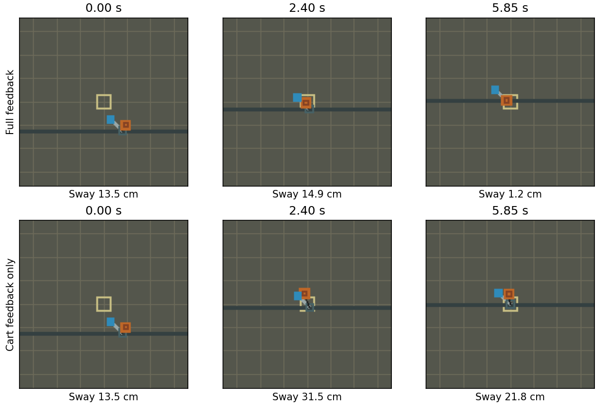

# 八维桥式起重机：从俯视图像到定位、消摆与鲁棒屏障

2026-11-17 在服务器 `vt` 环境完成。小车要把吊载运到地面的目标点并停稳。小车加速会激起吊载摆动，到达目标附近时吊载可能还在往复运动。在同一批 100 条留出轨迹上，完整视觉反馈有 **89 条**在 6 秒内达标。仅去掉视觉摆移反馈项，保留相同的小车位置、小车速度和摆速反馈增益，达标数降为 **0 条**。这组对照中，完整反馈在全部 100 对轨迹上的末段平均摆幅都更小。[逐组结果](../../../artical-F122/results/overhead_crane_8d_20261117_v1/evaluation/summary.json)

## 1. 起重机的八个状态与两个动作

对水平 x、y 两个方向，各记录四个状态。p 是小车位置，v 是其速度，s 是吊载相对于小车铅垂线的水平位移，r 是摆移速度。吊载实际位置是 p+s，每个方向有一个小车加速度命令 u。相机提供两个方向的 p 和 s，假设两个方向的 v 和 r 均由独立传感器准确测得。

单轴采用小角度、固定绳长的离散模型。对于小车驱动扰动 d 和吊载外扰 w，每 0.15 秒执行一次下列更新：

```text
v′ = v + 0.15 (u + d)                  p′ = p + 0.15 v′
r′ = r + 0.15 (−4s − 0.16r − u − d + w)   s′ = s + 0.15 r′
```

同一加速度在两行的符号相反。向右加速时，小车向右运动，吊载会相对小车向左滞后。两个方向共享电机总加速度预算 |uₓ|+|uᵧ|≤6 m/s²，每轴另有 ±3.8 m/s² 限幅。

| 项目 | 本轮设置 |
|---|---|
| 初态 | 每轴小车在目标左侧或右侧 0.34–0.70 m，速度在 ±0.09 m/s，摆移在 ±0.13 m，摆速在 ±0.12 m/s |
| 扰动 | 每轴每条轨迹抽取一个恒定偏置，每步再抽取阵风。验证覆盖任意逐步组合，要求绝对驱动扰动 ≤0.025 m/s²、吊载外扰 ≤0.04 m/s² |
| 安全边界 | 每轴小车位置、速度、摆移、摆速的绝对值依次小于 1.45 m、1.8 m/s、0.65 m、1.5 m/s。吊载每轴位置绝对值小于 1.55 m，并满足斜向净空规则，即吊载 x、y 坐标之和的绝对值小于 2.6 m |
| 任务达标 | 全程安全，最后连续四个状态时刻，每轴吊载离目标 ≤9 cm、小车速度 ≤0.12 m/s、摆移 ≤5.5 cm、摆速 ≤0.12 m/s |
| 时长 | 40 次观测与控制，41 个状态时刻，共 6 秒 |

安全条件允许小车在工作区内移动。任务条件要求它在规定时间内把吊载送到更小的目标区并消除残余摆动。[模型、采样和判定实现](../../../artical-F122/Aebs/overhead_crane/plant.py)

## 2. 从相机图像到状态代理，再到实际视觉误差

1. **采图。** 俯视正交相机观察小车支架上的蓝色标记、橙色吊载及地面目标框。渲染时，小车标记按已知安装偏移放置，吊载按 p+s 放置。静态数据共 2,560 张像素互异的 RGB 图，训练、开发、测试各为 2,048、256、256 张。闭环每一步都按该控制器实际到达的状态重新渲染。一条轨迹采用一种固定光照，从三种设置中抽取。
2. **学习四维图像观测。** 冻结 DINOv2-S/14，使用 16×16 个 patch 特征。训练一个读出网络定位两个标记，用各 patch 的权重、位置和局部偏移得到两个中心。由二者推算小车位置与吊载相对位移，再通过可训练线性层输出四维 y。训练时可以从渲染几何得到标记中心，用它监督定位。
3. **联合学习状态代理。** 状态侧用 z=(pₓ,pᵧ,sₓ/0.5,sᵧ/0.5) 构造 h(z)=Cz。C 是独立训练的 4×4 正交矩阵，使用 Cayley 参数化以保证可逆。损失包括标记定位、y 与 Cz 的匹配以及解码误差。按开发集误差选第 24 个训练轮次。静态测试中小车 x、y 的平均绝对误差分别为 **1.19、0.98 cm**，吊载相对摆移 x、y 分别为 **1.89、1.56 cm**。
4. **打通误差与控制。** 执行时控制器读取图像解码值 ẑ=C⁻¹y 和实测速率。校准记录 η=ẑ−z 和实际低维输出 y。二者在实数模型下满足 y−Cz=Cη，因此归一化误差盒 ‖η‖∞≤q 在低维视觉空间中对应集合 {Cη : ‖η‖∞≤q}。独立复算已核对逐帧残差与这一坐标关系。[相机和观测模型](../../../artical-F122/Aebs/overhead_crane/camera.py) · [联合训练](../../../artical-F122/Aebs/overhead_crane/train.py) · [测试误差与矩阵 C](../../../artical-F122/results/overhead_crane_8d_20261117_v1/static.json)

## 3. 控制器如何得到

在每个方向上，用离散线性二次型调节器（LQR）生成反馈增益，执行命令为 u=−K·(p̂,v,ŝ,r)。训练视觉网络与求控制器增益是两个独立步骤。后者搜索 16 组摆移与控制用力的代价权重，先在开发半径 0.12 上检查连续误差集合的安全界，有 15 组通过。再从 128 个开发初态出发，在零偏差和两组相反的持续角点偏差下比较吊载位置、摆移和用力代价。最终增益为 **K=(1.7103, 2.3227, −2.4583, −0.4332)**，正式轨迹校准之前已冻结。

例如 s 为正表示吊载在小车右侧。在其他反馈项取零时，第三项会命令小车向右加速，让小车追上吊载，抑制相对偏移。只看小车位置的控制器缺少这条反馈路径。本例复用视觉代理和误差集合接口，后端使用适合小角度动力学的 LQR 增益和解析构造的屏障。[增益搜索结果](../../../artical-F122/results/overhead_crane_8d_20261117_v1/evaluation/synthesis.json)

## 4. 轨迹级 CP 与有限时域鲁棒屏障

**先校准误差。** 冻结视觉与策略后，生成 199 条完整图像反馈轨迹。每条取 40 个观测时刻、四个解码分量的最大绝对误差，用第 190 小的轨迹分数得到 **q=0.188049**。它对应每轴小车位置误差 ±18.80 cm、每轴摆移误差 ±9.40 cm。冻结 q 后独立验证并运行留出。此处 q 描述整段最坏误差，与静态测试的平均绝对误差含义不同。[冻结协议](../../../artical-F122/results/overhead_crane_8d_20261117_v1/evaluation/protocol.json) · [CP 合同](../../../artical-F122/results/overhead_crane_8d_20261117_v1/evaluation/contract.json)

**再构造能随剩余时间变化的屏障。** 每条安全或电机约束可以写成“某个量除以它的限值”。例如摆移绝对值除以 0.65，达到 1 就触及危险边界。对当前状态 x 和时刻 t，定义 Bₜ(x) 为从现在到第 40 步之间，这些归一化约束在全部允许误差与扰动下的最大值。计算用未限幅的线性闭环，同时把单轴和双轴电机预算也列入屏障。只要 Bₜ<1，实际执行器在当前步就无需限幅，线性闭环的后继与实际模型一致。

**怎样检查连续的无限多种误差。** 单轴记 F=A−bK，b 为驱动输入方向，g 为吊载外扰方向。对一个线性约束行向量 h，j 步后的名义值为 hFʲx。令 γ=(|Kₚ|+0.5|Kₛ|)q，则视觉误差引起的加速度偏差至多 γ。该约束在 j 步内可能累积的偏差上界是

```text
Dⱼ(h) = Σᵢ₌₀…ⱼ₋₁ [ |hFⁱb|(γ+0.025) + |hFⁱg|·0.04 ] .
```

这就是在误差盒上取线性函数最大值。把名义值的绝对值加上这个偏差，再除以该约束的限值，对约束与步数取最大值得到 Bₜ。电机在执行当步额外计入当前视觉命令偏差 γ。斜向净空按两轴坐标之和计算，共享电机预算按两轴绝对值之和计算。

**为什么能推出避险。** 验证器在包含全部注册初态的连续八维盒上得到 **B₀≤0.776860<1**，最接近限值的是第 0 步的共享电机预算。对任意一个允许后继，它的所有后续误差序列都已包含在上一时刻取最大值的范围内，因此 Bₜ₊₁(x′)≤Bₜ(x)。从初态逐步推出所有采样状态都满足 Bₜ<1，触及危险边界所需的 Bₜ≥1 无法发生。验证使用有理数计算实数离散模型的支撑界。0.776860 是归一化约束占比的上界，与安全概率的数值无关。[屏障实现](../../../artical-F122/Aebs/overhead_crane/certificate.py) · [各约束的最坏上界和发生步数](../../../artical-F122/results/overhead_crane_8d_20261117_v1/evaluation/certificate.json)

在同一冻结协议下，若校准和未来轨迹可交换，轨迹级 CP 对一条新轨迹提供至少 95% 的边际误差覆盖，概率同时计入校准样本和新轨迹。对误差全程落入包络的轨迹，屏障给出上述确定性结论。若按校准半径决定是否接受证书，记 A 为接受、U 为越界，可推出 Pr(A 且 U)≤0.05。给定这一次 q 的条件风险需要单独分析。

## 5. 四组控制对照与相机观测样例

四组复用全部 100 个留出初态和逐步外扰。三个图像策略各自在自己的后继状态上重新取图。对照保留共同反馈项的原增益，用来隔离移除某一项的影响。CP 与鲁棒证书绑定完整图像策略。

| 反馈方式 | 全程安全 | 定位且稳定消摆 | 终点吊载离目标的平均距离 | 最后七个采样时刻平均摆幅 |
|---|---:|---:|---:|---:|
| 完整图像反馈（小车位置、摆移和两种实测速率） | 100/100 | **89/100** | 7.63 cm | **1.28 cm** |
| 去掉视觉摆移项，保留摆速反馈 | 100/100 | 0/100 | 15.28 cm | 10.01 cm |
| 仅用图像小车位置和实测小车速度 | 100/100 | 0/100 | 10.54 cm | 14.79 cm |
| 完整反馈，使用精确位置和摆移 | 100/100 | 100/100 | 1.25 cm | 0.56 cm |

这里的摆幅是吊载相对小车水平位移的二维欧氏长度，在每条轨迹末段七个时刻取平均，再跨轨迹平均。**11 条未达标轨迹**在末段都满足摆移、小车速度和摆速要求，但至少有一个末段时刻的吊载位置超过每轴 ±9 cm 的任务容差。四组留出都观测到安全，这组对照支持的是消摆与任务完成表现的改善。

完整视觉反馈的 100 条中，**97 条**全程误差被覆盖，均可逐条应用证书，其中 **86 条**达标。另 3 条误差至少一次超出 q，实测都安全且达标。安全覆盖、控制达标、有限样本观察到安全分别回答三个问题。

下图取固定编号 0 的配对轨迹，由实际保存的状态和光照重建。蓝块是小车参考标记，橙块是吊载，浅色方框为目标。两行起点相同，上排为完整视觉反馈，下排仅使用小车反馈。每张图下方给出当时的真实摆幅。



## 6. 适用范围与复现

这是八维、小角度、两个水平轴的桥式起重机基准。轴内小车与摆动相互关联，跨轴约束来自电机总预算和斜向净空。结论限于规定的六秒离散时域、固定绳长、理想执行模型、合成相机、三种光照与准确速率测量。大角度摆动、连续采样间净空、变化的绳长及实机视觉尚未验证。本轮采用一个视觉训练种子。去项对照没有为删减后的策略单独调参，也未实施与原 SPVC 的同预算端到端比较。

在服务器项目的 `artical-F122` 目录、`vt` 环境下使用新输出目录复现：

```bash
python -m Aebs.overhead_crane.train results/overhead_crane_8d_reproduction
python -m Aebs.overhead_crane.evaluate results/overhead_crane_8d_reproduction
python -m pytest -q tests/test_overhead_crane.py
```

结果包保存静态图像、视觉权重、控制增益、协议、校准轨迹与三组图像留出轨迹。已按保存的状态、动作、低维向量与扰动重算后继、CP 秩、任务指标和证书精确初始界，核对文件散列。三个回归测试在本地与服务器通过，覆盖动力学和限幅、危险边界与过大半径的拒绝，以及角点后继与时间屏障的关系。[评估入口](../../../artical-F122/Aebs/overhead_crane/evaluate.py) · [测试](../../../artical-F122/tests/test_overhead_crane.py) · [完整结果包](../../../artical-F122/results/overhead_crane_8d_20261117_v1/)
