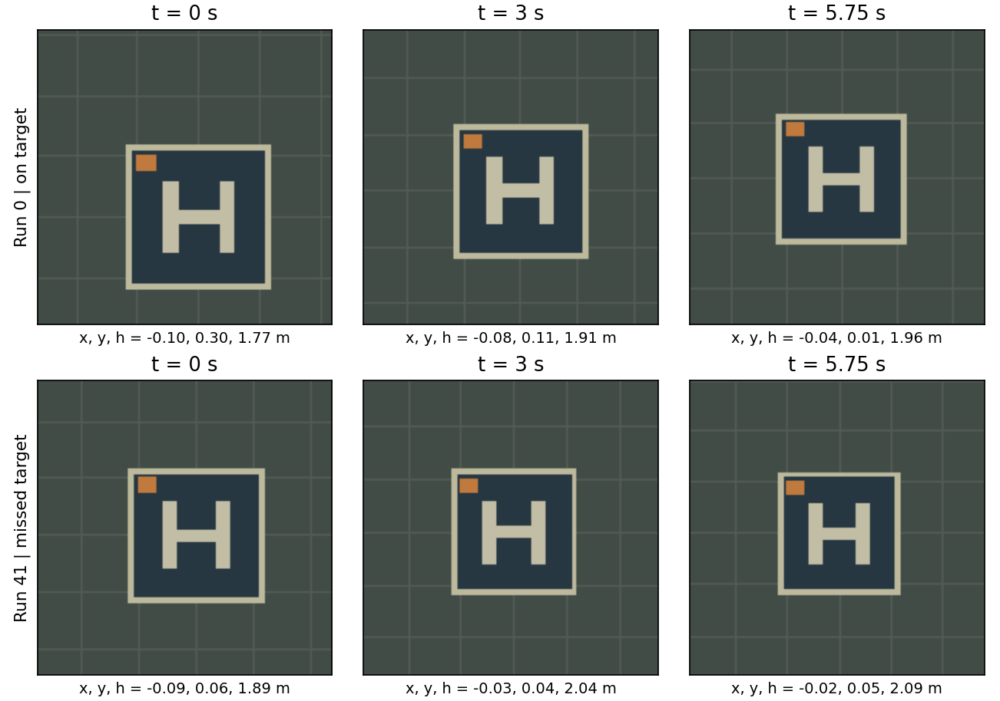

# 六维无人机视觉悬停：从停机坪图像到鲁棒屏障

2026-11-17 在服务器的 `vt` 环境跑通一个带风的三维平移控制实验。飞机从停机坪上方一个有偏差的位置出发，目标是在中心正上方 2 m 处稳定悬停。100 条配对留出轨迹中，使用图像位置反馈有 **99 条达到悬停目标**，只做速度阻尼有 **3 条达到**，两组都未越过安全边界。图像反馈组有 **95 条全程处于轨迹 CP 误差包络内**，鲁棒屏障在该包络上验证通过。[逐组结果](../../../artical-F122/results/visual_hover_6d_20261117_v1/evaluation/summary.json)

## 1. 状态、动作与任务判据

六维状态包含三个位置和三个速度。下视相机看到地面停机坪，图像提供水平位置与高度信息。控制器额外读取三轴速度，假设速度测量准确。模型假定姿态内环能执行三轴净加速度指令，显式加入有界风加速度。每步 0.25 s，每条轨迹 24 步，共检查 25 个状态时刻。

令逐轴尺度为 D=(0.75, 0.65, 0.50) m。将相对悬停目标的物理位移、速度逐轴除以 D，得到位置 p 和速度 v。x、y、z 三个方向都进入图像估计、动作、后继更新和安全判据。

| 项目 | 登记的条件 |
|---|---|
| 初态 | 各轴归一化位置独立均匀抽自 ±0.56，归一化速度独立均匀抽自 ±0.16 |
| 动力学 | p′=p+0.25v，v′=v+0.25(u+w)。u 为归一化加速度命令，每轴截断在 ±4.4 |
| 风 | 每条轨迹抽一个三轴恒定偏置，每轴在 ±0.06 内。每步再加一个 ±0.02 的阵风分量。验证允许每轴任意变化，只要求绝对值不超过 0.08 |
| 安全 | 每轴始终满足位置绝对值 <1.25，速度绝对值 <2.70。位置对应水平范围 ±0.9375 m、±0.8125 m 和高度 (1.375, 2.625) m |
| 悬停达标 | 全程安全，且最后连续四个采样状态各轴均满足位置绝对值 ≤0.18、速度绝对值 ≤0.14。对应高度容差 ±9 cm |

这样定义可以区分两种飞行表现。飞机很快减速却停在错误位置，可以满足安全约束，但无法完成定点悬停。[动力学与判定实现](../../../artical-F122/Aebs/visual_hover/plant.py)

## 2. 怎样从图像得到控制器所需的三维观测

1. **渲染图像。** 给定水平位置、高度和光照，用向下的针孔相机绘制 144×144 RGB 图。水平移动会使地面标志偏离画面中心，升高会使已知尺寸的标志缩小。每条轨迹从三种光照中选一种，沿途保持。每个控制时刻根据飞机当前状态重新渲染。静态数据按像素去重，分为 1,536 张训练、256 张开发、256 张测试。
2. **学习低维观测与状态代理。** 图像经冻结 DINOv2-S/14 提取 patch 特征，按 4×4 网格池化。用训练集拟合 160 维 PCA，再由可训练视觉头输出三维向量 y。状态侧预测同一向量 h(p)=Cp，C 为按行归一化的可训练矩阵。视觉头与 C 共同拟合低维匹配损失和解码位置误差，按开发集选权重。静态测试三轴平均绝对误差依次为 **2.71、2.23、3.07 cm**。学到的 C 接近单位阵，本次结果没有单独检验学习 C 的收益。
3. **把代理误差接入控制。** 执行时计算估计位置 p̂=C⁻¹y，再与实测速度一起反馈。离线记录两侧低维向量的残差 y−Cp。令 η=p̂−p，则在实数坐标下 y−Cp=Cη。后面校准的是 η 的盒子，原始低维空间中对应的误差集合为 {Cη : ‖η‖∞≤q}。离线使用真实位置计算训练标签与误差，执行图像策略只读 p̂ 和速度。[渲染、投影与联合训练](../../../artical-F122/Aebs/visual_hover/perception.py) · [静态测试与矩阵 C](../../../artical-F122/results/visual_hover_6d_20261117_v1/static.json)

## 3. 怎样得到控制器与鲁棒屏障

给定估计位置 p̂ 和实测速度 v，控制器输出 u=clip(−lm p̂−(l+m)v)。位置项把飞机拉回目标，速度项抑制经过目标时的漂移。控制器采用带限幅的比例－微分反馈。与车道实验的 PPO 控制器相比，这里可直接写出闭环方程，用于检查误差和风的所有取值。

开发阶段搜索 36 组控制增益与屏障宽度。先对归一化设计误差半径 0.35 做鲁棒充分条件检查，有 10 组可行。再在 128 个开发初态上分别施加零视觉偏差和两种相反的持续角点偏差，比较每个初态三种情况下的最大位置、速度及控制代价。正式 CP 前冻结胜出的 l=0.7、m=1.0 和宽度 S=0.63。本版以有限参数搜索综合控制器和结构化屏障。[综合记录](../../../artical-F122/results/visual_hover_6d_20261117_v1/evaluation/synthesis.json)

屏障同时看位置和速度。定义 s=v+lp。飞机在右侧且仍向右飞时，同样的位置偏差会产生更大的 s。令

```text
N(x) = max(‖p‖∞, ‖v+lp‖∞/S)
B(x) = 20 max(0, (N(x)−1)/0.25)
```

这是一个可用绝对值、最大值和 ReLU 表示的分段线性函数。全部初态满足 N≤1，故 B=0。若触及任一危险位置边界，就有 N≥1.25、B≥20。速度边界同样受到保护，因为 N<1.25 时 ‖v‖∞<1.25(S+l)=1.6625，低于危险阈值 2.70。

**为什么下一步不会破坏分离？** 给定观测误差半径 q，先检查在 N≤1.25 时所有允许命令都在限幅内。此时闭环的两条更新式为

```text
p′ = (1−0.25l)p + 0.25s
s′ = (1−0.25m)s + 0.25(w−lmη)
```

对任意 1≤r≤1.25，若 N≤r，则当前 ‖p‖∞≤r、‖s‖∞≤Sr。第一式用 |1−0.25l|+0.25S≤1 保证 ‖p′‖∞≤r。第二式用 |1−0.25m|S+0.25(0.08+lmq)≤S 保证 ‖s′‖∞≤Sr。于是 N′≤r。对 N≤1 取 r=1，下一步仍在零屏障区域。对 1<N≤1.25 取 r=N，就得到 B(x′)≤B(x)。由此从初态逐步推出避险。

验证器用有理数比较这些标量界，所用 q 取保存的浮点半径对应的精确值。最终半径下位置更新和 s 更新的不等式分别有 0.0175、0.10037 裕量。回归测试还给了一个拒绝例子：把 q 扩大为 1.1，可以构造 B 从零上升的允许后继。证明针对实数离散模型，未验证整个浮点执行栈。[证书检查器](../../../artical-F122/Aebs/visual_hover/certificate.py) · [最终证书](../../../artical-F122/results/visual_hover_6d_20261117_v1/evaluation/certificate.json)

## 4. 轨迹级 CP 怎样校准，95% 指什么

冻结前端、控制器、屏障、采样规则与评分函数后，独立生成 199 条图像反馈校准轨迹。每条轨迹在 24 次观测和全部三轴上取最大解码误差，得到一个分数。按 95% split CP 规则取第 190 小的分数，得到 **q=0.212185**。三轴物理误差半宽分别为 **15.91 cm、13.79 cm、10.61 cm**。本实验在这个 q 上检查证书，另取 100 条留出轨迹评估。[冻结协议](../../../artical-F122/results/visual_hover_6d_20261117_v1/evaluation/protocol.json) · [校准结果](../../../artical-F122/results/visual_hover_6d_20261117_v1/evaluation/contract.json)

- **确定性保证。** 在登记动力学、初态与速度测量假设下，只要图像误差全程落在该包络内，每轴风扰动的绝对值不超过 0.08，所有采样状态都避开规定的位置和速度危险边界。证明允许误差和风在时间与坐标上取任意组合。
- **统计保证。** 若校准轨迹和新轨迹按同一冻结协议可交换，轨迹 CP 对一条新轨迹提供至少 95% 的**边际误差覆盖**，概率同时涉及校准样本与新轨迹。若发布取决于证书通过，记 A 为通过、U 为新轨迹越界，可推出 Pr(A 且 U)≤0.05。这个式子本身不给出固定本次 q 或给定 A 后的条件风险上界。
- **任务表现。** 屏障证明采样时刻的安全。悬停达标要求位置和速度收敛到更小的目标区，其证据来自独立的留出运行。

## 5. 同一批初态和风下，视觉反馈有多少作用

对每条留出轨迹复用相同的初态、风偏置与阵风序列。速度阻尼对照只去掉位置反馈项，保留相同速度增益与动作限幅。理想位置对照使用精确位置，其余与图像策略一致。

| 反馈输入 | 采样全程安全 | 达到悬停目标 | 终点到目标的平均三维距离 |
|---|---:|---:|---:|
| 只有实测速度 | 100/100 | 3/100 | 36.43 cm |
| DINO 图像位置＋实测速度 | 100/100 | 99/100 | 6.23 cm |
| 精确位置＋实测速度 | 100/100 | 100/100 | 5.28 cm |

这批轨迹显示，加入图像位置反馈主要改善了**定点悬停精度**。三组的实测安全次数相同。图像组的 95 条包络内轨迹全部达标。其余 5 条也观测到安全，其中 4 条达标。第 41 号轨迹的最大归一化误差为 0.22119，略超 q，最后四个状态的最大高度偏差为 9.59 cm，超出 ±9 cm 的任务容差。

下图按保存的留出状态与光照重建相机输入。上排为预先编号的第 0 条，下排为唯一未达标的第 41 条。三列分别为开始、中段及最后一次相机观测，坐标标签用米表示。



**适用范围。** 本例展示了同一感知误差接口可以用于有持续外扰的六维平移任务。三个轴共享控制结构，平移动力学按轴解耦。实验使用一次训练、固定向下相机、已知地标尺寸、三种离散光照和准确速度。姿态耦合、旋翼及推力动态、相机倾斜、实机图像和采样间的连续时间安全需要单独研究。本例的对照衡量反馈方式对悬停的作用，未做与原 SPVC 的同预算端到端比较。

## 6. 复现与逐项核对

在服务器项目子目录 `/root/work_based_on_spvc/artical-F122`、`vt` 环境中，选择新的输出目录执行：

```bash
python -m Aebs.visual_hover.perception results/visual_hover_6d_reproduction
python -m Aebs.visual_hover.evaluate results/visual_hover_6d_reproduction
python -m pytest -q tests/test_visual_hover.py
```

所需的 DINOv2 仓库和 ViT-S/14 权重按项目既有目录放在 `../external/` 下。结果包保存了静态图像、模型、逐步状态、动作、风、原始低维残差、解码误差和轨迹得分。可分别重算 CP 秩、留出覆盖、成功次数和屏障条件。留出记录已回算核对，三项证书回归测试在服务器与本地均通过。[评估入口](../../../artical-F122/Aebs/visual_hover/evaluate.py) · [测试](../../../artical-F122/tests/test_visual_hover.py) · [运行结果包](../../../artical-F122/results/visual_hover_6d_20261117_v1/)
