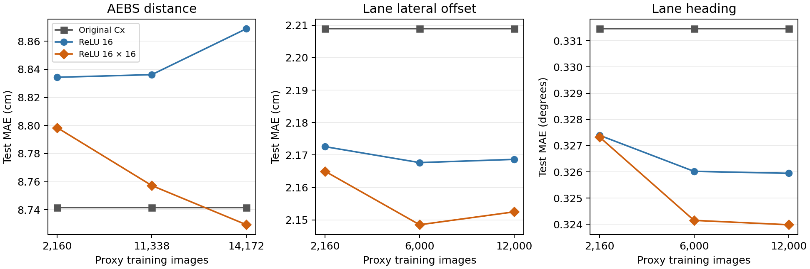

# 从 Cx 到小型神经网络：AEBS 与车道保持的历次结构和结果

**最直观的结果出现在车道保持。** 在同一批 2,000 张新测试图像上，给原代理加一层 ReLU，横向等效误差由 2.209 降到 2.169 cm；加两层后进一步降到 2.152 cm。AEBS 最大训练预算下，带偏置的一次函数达到 8.708 cm，优于六种小网络。两种任务对同一种结构给出了不同答案。

| 实验 | 真正改变了什么 | 比较能回答的问题 |
|---|---|---|
| 11 月 15 日，RGB AEBS | 冻结视觉头，在线性预测上加两层 Tanh 修正车距 | 用一个小网络能多拟合多少距离偏差？ |
| 11 月 15 日，车道 | 同时训练视觉头、矩阵 C 和两个可以反向计算的小网络 | 新代理能否接入实际图像反馈和鲁棒验证？ |
| 11 月 17 日，车道 | 用三个配对训练种子比较联合学习的 Cx 和同款可逆神经代理 | 在共用控制器下，车是否跟得更准？误差包络是否更小？ |
| 11 月 21 日，两任务 | 冻结各自视觉头，比较三种一层网络与两层 Tanh | 更换激活函数或增加一层，哪个模型更贴近已有视觉输出？ |
| 11 月 22 日，两任务 | 三种激活都做一层、两层，每项任务各试三档训练量 | 在同一测试集上，增加深度和增加数据分别带来多少收益？ |

## 1. 先看网络的两条输入路线

以车道保持的一帧为例。摄像机看到一张道路图像，视觉分支给出两个数 $y=(y_1,y_2)$。同一时刻，仿真器知道真实横偏和航向；状态代理只根据这两个物理量给出两个预测值 $h(x)$。最近两轮比较的是：**哪种网络只看状态，就能最准确地预测视觉分支在这张图上会输出什么？**

| 任务 | 图像路线：从像素得到比较目标 $y$ | 状态路线：网络实际读入的 $x$ | 状态代理输出 |
|---|---|---|---|
| RGB AEBS | 冻结 DINO 给出 384 维整图特征，标准化后经全连接 384→128、GELU、128→128、GELU、128→1 | 后两轮只用距离 $d/3.18272$，$d$ 以米计；11 月 15 日另在基础线性项中保留辅助速度 | 一个与视觉距离坐标对应的数 |
| 车道 | 冻结 DINO 给出 16×16 个局部特征，每处 384 维。1×1 卷积 384→64、GELU、3×3 卷积 64→64、GELU、1×1 卷积 64→1；对 256 个位置做 softmax，用权重对平面坐标加权求和，再用全连接 2→2 | $x=(e/0.85,\theta/0.30)$。$e$ 是横偏（米），$\theta$ 是航向误差（弧度）。曲率会影响图像，但该代理只读这两个数 | 两个低维视觉坐标，乘回原尺度后可分别报告横偏和航向等效误差 |

例如，横偏 0.17 m、航向偏角 0.03 rad 时，车道代理的输入是 $(0.2,0.1)$。它接下来看到的始终是这两个数。图像分支的 384 维特征和状态分支的 16 个隐藏单元分别属于两个网络。“冻结视觉头”表示同一张图在该轮的所有候选代理面前都有同一个目标答案。[AEBS 视觉投影](../../../artical-F122/Aebs/vision_sls/model.py) · [车道视觉投影](../../../artical-F122/Aebs/lane_keeping/patch_perception.py)

## 2. 怎么数“一层”和“两层”

后两轮的代理都写成 $h(x)=Cx+r(x)$。先用原始矩阵 $C$ 算出基础预测，同时把同一个 $x$ 送入小网络 $r$，最后把两路按坐标相加。全连接 $a$→$b$ 表示输入 $a$ 个数，用 $b$ 组可学习的权重和偏置产生 $b$ 个数。**本文按隐藏层计深度**：两层网络有两次隐藏变换，外加一次输出变换。

| 计算顺序 | 一层：AEBS / 车道 | 两层：AEBS / 车道 | 这一步做什么 |
|---|---|---|---|
| ① 基础预测 | 1→1 / 2→2 | 1→1 / 2→2 | 固定的 $Cx$，结果留到最后相加 |
| ② 第一隐藏层 | 1→16 / 2→16，加激活 | 1→16 / 2→16，加激活 | 从距离或两个车道量算出 16 个响应 |
| ③ 第二隐藏层 | 直接进入输出层 | 16→16，加同一种激活 | 对前一层的 16 个响应重新加权组合 |
| ④ 线性输出层 | 16→1 / 16→2 | 16→1 / 16→2 | 汇总为 1 个距离修正量，或 2 个车道视觉坐标修正量；输出可正可负 |
| ⑤ 逐坐标相加 | $Cx+r(x)$ | $Cx+r(x)$ | 得到最终状态代理。输出层权重和偏置均从零开始，第 0 步恢复原 Cx |
| 仅残差网络的参数 | 49 / 82 | 321 / 354 | 第二层增加 $16×16+16=272$ 个参数；与深度一起变化的还有容量 |

下面把六种网络的**实际层序**逐个列出。$p$ 在 AEBS 等于 1，在车道等于 2。每行输出后都要加回 $Cx$。

| 名称 | 第一隐藏层 | 第二隐藏层 | 输出层 | 哪次训练过 |
|---|---|---|---|---|
| Tanh 16 | 全连接 p→16，再 Tanh | 无 | 全连接 16→p | 11/21、11/22 |
| Tanh 16×16 | 全连接 p→16，再 Tanh | 全连接 16→16，再 Tanh | 全连接 16→p | 11/21、11/22；11/15 AEBS 另加斜率约束 |
| ReLU 16 | 全连接 p→16，再 ReLU | 无 | 全连接 16→p | 11/21、11/22 |
| ReLU 16×16 | 全连接 p→16，再 ReLU | 全连接 16→16，再 ReLU | 全连接 16→p | 11/22 |
| SiLU 16 | 全连接 p→16，再 SiLU | 无 | 全连接 16→p | 11/21、11/22 |
| SiLU 16×16 | 全连接 p→16，再 SiLU | 全连接 16→16，再 SiLU | 全连接 16→p | 11/22 |

**激活函数决定每个隐藏单元怎样响应。** Tanh 把数值平滑压到 −1 到 1；ReLU 把负值置零、保留正值，可以分段拟合；SiLU 用 $t/(1+e^{-t})$ 做平滑调节。三种基线都没有隐藏层：原 Cx 直接用已有系数，重拟合 Cx 用训练数据重估斜率，仿射 $Ax+b$ 还允许整体平移。仿射基线能帮助判断网络是否只是学到了斜率和偏置。[残差代理与训练代码](../../../artical-F122/Aebs/paper_comparison/proxy_architecture_compare.py)

## 3. 11 月 15 日：先试两层 Tanh，再试能解码的车道网络

### RGB AEBS：两层 Tanh 能修正多少？

基础项是 $C_d(d/S)+C_vv$，残差支路依次为距离 $d/S$ → 全连接 1→16 → Tanh → 全连接 16→16 → Tanh → 全连接 16→1 → 加回基础项。只有基础项使用速度，静态图像包没有实测速度标签；评分取辅助速度 1.5 m/s。每次更新后限制各层权重谱范数乘积不超过 0.5，控制修正量随距离变化的斜率。训练、开发、预留校准、测试分别为 12,755、1,417、4,908、4,920 张，三个种子各训练 2,000 步。

| 测试模型 | 等效距离 MAE（cm） | 95% 分位绝对误差（cm） |
| --- | --- | --- |
| 原 Cx | 8.4585 | 25.3699 |
| 仿射修正 | 8.4591 | 25.3638 |
| 两层 Tanh，种子 151 | 8.4553 | 25.3530 |
| 两层 Tanh，种子 152 | 8.4479 | 25.3380 |
| 两层 Tanh，种子 153 | 8.4521 | 25.3595 |

三个种子的平均 MAE 约 8.4518 cm，较原 Cx 少约 0.07 毫米。这一轮使用联合 C 版的冻结视觉头，后两轮 AEBS 使用鲁棒综合发布包中的冻结视觉头，两套基线的绝对数值应分别解读。[原始结果](../../../artical-F122/results/rgb_aebs_nonlinear_proxy_probe_20261115/report.json) · [两层 Tanh 与斜率约束](../../../artical-F122/Aebs/vision_sls/nonlinear_proxy_probe.py)

### 车道：两个各带一个隐藏层的小网络，怎样让控制器用上？

这一版与 11 月 17 日都使用**可逆加性耦合**。目标是从二维状态得到视觉坐标，也能从视觉坐标按相反顺序解回状态，让原有的语义控制器继续接收横偏与航向。DINO 冻结，视觉投影、矩阵 C 和下表的两个小网络一起训练。

| 顺序 | 输入与层 | 输出与作用 |
|---|---|---|
| ① 坐标变换 | 归一化车道状态 2→2，乘可训练矩阵 C | 得到 $z_1,z_2$；按行归一化，选择模型时检查 C 可逆及其条件数 |
| ② 小网络 $f$ | 只读 $z_1$：全连接 1→16，Tanh，全连接 16→1，输出再做 Tanh | 输出标量乘 0.25，加到 $z_2$ 上，得到 $b=z_2+0.25f(z_1)$ |
| ③ 小网络 $g$ | 只读更新后的 $b$：全连接 1→16，Tanh，全连接 16→1，输出再做 Tanh | 输出标量乘 0.25，加到 $z_1$ 上，得到 $a=z_1+0.25g(b)$ |
| ④ 输出 | 按顺序拼接 $a,b$ | 得到二维代理 $h(x)=(a,b)$。$f,g$ 各 49 个参数，共增加 98 个 |
| ⑤ 实际解码 | 将图像得到的两维坐标当作 $a,b$ | 先算 $z_1=a-0.25g(b)$，再算 $z_2=b-0.25f(z_1)$，最后解 $Cx=z$。两次相加可以逐步撤销 |

11 月 15 日这版在 360 张静态测试图上，解码后横向 MAE 为 **1.7981 cm**，航向 MAE 为 **0.2908°**。随后用 199 条各 80 步的轨迹校准，归一化半径为 0.087538；100 条留出中 96 条全程在界内，100 条均未观测到越界。三个曲率下均通过该半径的鲁棒屏障数值检查。这轮首先说明整套接口能跑通。[耦合与逆映射代码](../../../artical-F122/Aebs/lane_keeping/nonlinear_observation.py) · [静态结果](../../../artical-F122/results/lane_nonlinear_joint_20261115_v1/report.json) · [闭环结果](../../../artical-F122/results/lane_nonlinear_trajectory_20261115_v1/report.json)

## 4. 11 月 17 日：同款可逆网络与线性版本的闭环对照

线性组使用上表第①步，图像输出直接经 $C^{-1}$ 解码；神经组使用全部五步。两组从配对起点训练视觉头，使用相同图像、训练预算、语义控制器及鲁棒屏障。每个训练种子、每种前端独立运行 199 条校准轨迹和 100 条留出轨迹，每条 80 步。

| 360 张历史测试图上的解码结果（三种子均值） | 横偏 MAE（cm） | 航向 MAE（°） |
|---|---:|---:|
| 联合训练的线性 Cx | 1.8025 | 0.2932 |
| 联合训练的可逆神经代理 | 1.7894 | 0.2916 |

下表换到真实图像反馈的闭环仿真。“轨迹 CP 半径”用独立校准轨迹的**全程最大归一化视觉误差**确定。覆盖一条轨迹要求 80 步全部纳入该半径；车辆实际偏差则按物理位置到中心线的距离计算。

| 训练种子（各格均为线性 / 神经） | 车辆实际偏离车道中心（mm） | 各自轨迹 CP 半径 | 100 条中全程在各自界内 |
| --- | --- | --- | --- |
| 202611171 | 36.29 / 35.29 | 0.08824 / 0.08239 | 96 / 93 |
| 202611172 | 37.19 / 33.96 | 0.09342 / 0.08420 | 98 / 93 |
| 202611173 | 35.36 / 33.53 | 0.08503 / 0.08682 | 96 / 95 |

车辆实际平均偏差由 **36.28 降至 34.26 mm**，三对均改善。这是闭环行驶指标。神经组三对中有两对半径缩小，三对留出覆盖计数都更低；两组各三个模型都通过各自半径下的鲁棒屏障数值检查。由于视觉投影也参与了训练，这 2.02 mm 的平均差属于整套前端。证书结论以登记的动力学、初始域及误差集合为前提，数值验证采用普通浮点区间计算。[三对模型原始结果](../../../artical-F122/results/lane_proxy_comparison_20261117_v1/summary.json)

## 5. 11 月 21 日：冻结视觉，只比较代理的四种结构

AEBS 用 11,338 张训练、2,834 张开发、4,908 张静态校准、4,920 张测试；车道对应为 2,160、540、540、360。每个神经结构训练三个种子，各用 Adam 更新 1,500 步，批量 128，学习率 0.001。每 50 步及第 0 步记录开发均方误差，用开发集选权重和结构。下表取这些权重的测试平均绝对误差（MAE），数值越小越好。误差按同一原始 C 的逆映射换算为物理单位。

| 结构 | AEBS 距离（cm） | 车道横偏（cm） | 车道航向（°） |
| --- | --- | --- | --- |
| 原 Cx | 8.7415 | 1.7878 | 0.2938 |
| 重拟合 Cx | 8.7228 | 1.7817 | 0.2930 |
| 仿射 Ax+b | 8.7106 | 1.7843 | 0.2929 |
| 一层 Tanh | 8.7087 | 1.7878 | 0.2938 |
| 一层 ReLU | 8.7349 | 1.7878 | 0.2938 |
| 一层 SiLU | 8.7285 | 1.7878 | 0.2938 |
| 两层 Tanh | 8.7310 | 1.7878 | 0.2938 |

AEBS 开发集选出一层 SiLU，测试表里最低的是一层 Tanh。车道的 4 种结构 × 3 个种子都选中第 0 步：后续权重完成了训练，但开发评分没有超过初始 Cx，所以发布的测试预测相同。旧车道测试集有 54/360 行与训练或开发图像像素相同。本轮归档 v1、v2 的选中预测一致，v2 增存末步模型，表中只计一次。[11 月 21 日结果与复算](../../../artical-F122/results/proxy_architecture_20261121_v2/) · [旧测试集去重诊断](../../../artical-F122/results/proxy_architecture_20261121_v2/lane_nonoverlap_diagnostic.json)

## 6. 11 月 22 日：补齐两层 ReLU、两层 SiLU，扩大数据再比

保持第 2 节的层序、宽度、优化器和三种子预算。同一任务的三个训练集逐级包含，开发、校准和测试集固定；同一预算、同一种子的六个网络看到相同批次。共 108 次神经网络训练。以下每一列都包含同批测试图上的线性基线，可直接上下比较。

### AEBS：4,920 张固定测试图，表中全是等效距离 MAE（cm）

三档来自同一批 24,000 张 CARLA RGB 图像，表头是用于代理训练的张数。中档训练行与 11 月 21 日相同，但本轮开发和静态校准各 2,454 张，改了选权重的依据。

| 结构 | 2,160 张训练 | 11,338 张训练 | 14,172 张训练 |
| --- | --- | --- | --- |
| 原 Cx | 8.7415 | 8.7415 | 8.7415 |
| 重拟合 Cx | 8.7170 | 8.7228 | 8.7202 |
| 仿射 Ax+b | 8.7063 | 8.7106 | 8.7075 |
| 一层 Tanh | 8.7970 | 8.7930 | 8.8141 |
| 两层 Tanh | 8.8071 | 8.7649 | 8.7678 |
| 一层 ReLU | 8.8343 | 8.8362 | 8.8689 |
| 两层 ReLU | 8.7984 | 8.7572 | 8.7293 |
| 一层 SiLU | 8.8280 | 8.8452 | 8.8216 |
| 两层 SiLU | 8.8377 | 8.8095 | 8.8009 |

三档开发集依次选中一层 SiLU、一层 SiLU、一层 Tanh。三档测试 MAE 最低的都是仿射模型。最大预算下，两层 ReLU 为 8.7293 cm，原 Cx 为 8.7415 cm，仅差约 **0.12 毫米**；三个种子中两次选中第 0 步。AEBS 目前缺少把增加网络深度作为收益来源的证据。

### 车道：2,000 张固定测试图，每格为横偏 MAE（cm） / 航向 MAE（°）

新渲染 16,000 张标称路况图像，其中 12,000 张为最大训练池，另有 1,000 张开发、1,000 张静态校准、2,000 张测试。逐图排除了本轮内部及与原 3,600 行历史图像的像素完全重复。各预算共享这 2,000 张测试图。

| 结构 | 2,160 张训练 | 6,000 张训练 | 12,000 张训练 |
| --- | --- | --- | --- |
| 原 Cx | 2.2089 / 0.3315 | 2.2089 / 0.3315 | 2.2089 / 0.3315 |
| 重拟合 Cx | 2.2105 / 0.3313 | 2.2079 / 0.3311 | 2.2072 / 0.3309 |
| 仿射 Ax+b | 2.2120 / 0.3318 | 2.2094 / 0.3316 | 2.2081 / 0.3311 |
| 一层 Tanh | 2.1985 / 0.3313 | 2.2021 / 0.3307 | 2.2055 / 0.3305 |
| 两层 Tanh | 2.2011 / 0.3309 | 2.2007 / 0.3303 | 2.1989 / 0.3304 |
| 一层 ReLU | 2.1726 / 0.3274 | 2.1677 / 0.3260 | 2.1687 / 0.3259 |
| 两层 ReLU | 2.1650 / 0.3273 | 2.1485 / 0.3242 | 2.1525 / 0.3240 |
| 一层 SiLU | 2.2042 / 0.3316 | 2.2034 / 0.3308 | 2.2003 / 0.3306 |
| 两层 SiLU | 2.2001 / 0.3314 | 2.2034 / 0.3304 | 2.2015 / 0.3303 |

三档开发集都选中两层 ReLU。最大预算下，横偏 MAE 从原 Cx 到一层 ReLU 减少 **0.40 毫米**，再加第二层平均多减少 **0.16 毫米**；两层相对原 Cx 合计减少 **0.56 毫米（2.55%）**。航向从 0.3315° 到 0.3240°，约降 2.26%。固定两层 ReLU 看训练量，6,000 张到 12,000 张时横偏略回升、航向基本持平。

图中每条线固定结构，仅改变代理训练样本数。三个面板纵轴单位和刻度不同，绝对改善幅度以表格为准。[全结构、逐种子与尾部误差](../../../artical-F122/results/proxy_depth_data_20261122/summary.json) · [配对测试帧上的改善区间](../../../artical-F122/results/proxy_depth_data_20261122/lane_paired_test.json)

## 7. 五维弯道制动也完成了同款结构对比

五维任务的视觉代理输入为横偏、航向和障碍距离三个归一化量，速度与转角直接测量。一层为 **3→16→3**，两层为 **3→16→16→3**；每个隐藏层后分别试 Tanh、ReLU、SiLU，末层输出三个修正量并加回固定 Cx。两种结构分别有 115、387 个可训练参数。沿用上述同批次、同更新预算、开发集选型方法，新采 16,000 帧图像，三档训练量为 1,920、6,000、12,000 张。

| 最大训练预算下的状态代理 | 横偏 MAE（cm） | 航向 MAE（°） | 障碍距离 MAE（cm） |
|---|---:|---:|---:|
| 原 Cx | 2.7611 | 0.5817 | 6.3267 |
| 仿射 Ax+b | 2.7171 | 0.5755 | 6.2840 |
| 一层 ReLU | 2.6358 | 0.5469 | 6.1864 |
| 两层 ReLU | **2.5996** | **0.5379** | **6.1116** |

三档开发集都选中两层 ReLU。最大预算下相对原 Cx，三维等效 MAE 分别降低 5.85%、7.53%、3.40%。这是固定一个原视觉前端后，对同一批 2,000 帧新静态测试图测得的代理拟合结果。原五维可逆代理联合训练及其闭环成绩、三个预算的九种模型全表、各层计算和实际图像见[五维专项报告](../五维弯道制动/五维弯道制动_历次代理逐层结构与扩大数据对比_20261122.md)。

## 8. 怎样把几轮结果放在一起讲

| 常见读法 | 数据实际支持的解读 |
|---|---|
| 旧车道横偏 1.788 cm、新车道 2.152 cm，是否退步？ | 两轮使用不同的测试图像。相同的原 Cx 在两套图上也分别是 1.788 和 2.209 cm。应在同一列比较候选与 Cx。11/22 才加入两层 ReLU；新数据与新增候选的影响不能只用两轮最优值拆开。 |
| 两层结构为什么有时赢，有时不赢？ | 在同一数据和激活下看一层与两层才能衡量增加深度的实际影响。最大车道预算下 ReLU 的两项指标均改善，SiLU 则是横偏略增、航向略降。AEBS 的简单仿射基线在三个预算上都很强。 |
| 哪一轮能说明车辆跟得更好？ | 11/17 直接测了车辆离中心线的距离，平均少 2.02 mm。11/22 的 0.56 mm 来自同一帧上两条低维向量的差，代表代理对冻结视觉输出拟合得更紧。两项改善度量不同、模型也不同。 |
| 两层 ReLU 已有新的安全保证吗？ | 11/15 和 11/17 的车道可逆模型有各自的闭环轨迹校准和数值验证。11/21 和 11/22 的普通残差 MLP 未约束为可逆，两轮只评估了固定视觉系统的静态误差；要将两层 ReLU 用于控制，还需适配后端、重新校准轨迹并验证。 |

就当前证据而言，论文可分别报告两项发现：可逆车道前端在配对闭环实验中降低了实际跟踪偏差；冻结视觉后，两层 ReLU 在新标称车道图像上降低了代理残差，而 AEBS 的仿射模型已具有竞争力。

随后完成了 $h(x)=\mathrm{MLP}(x)$ 的纯全连接版本，覆盖 AEBS、车道和五维三项任务。各层结构、162 次训练的完整对照和开发集选型结果见[纯网络替换 Cx 报告](三个任务_纯全连接网络替换Cx_结构与对照_20261122.md)。
