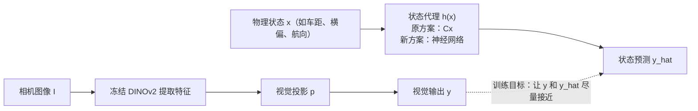
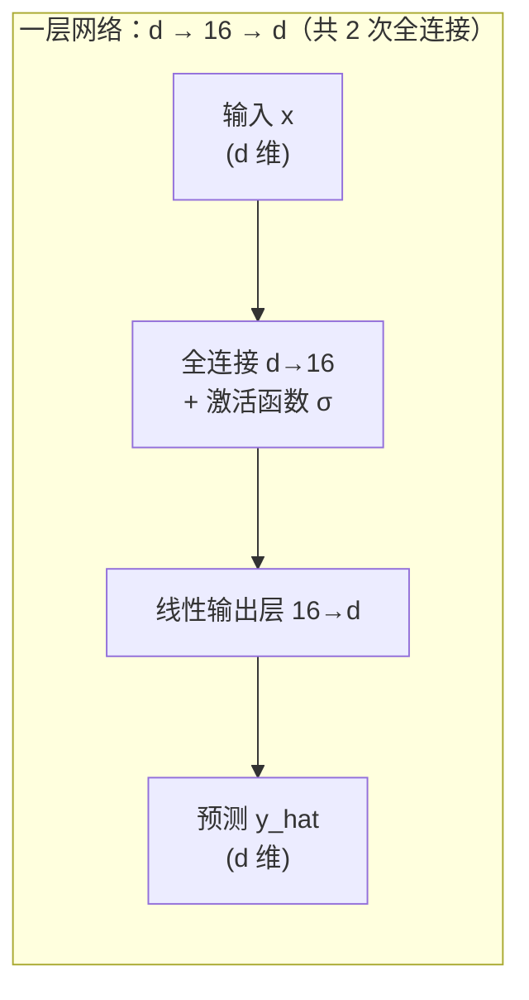
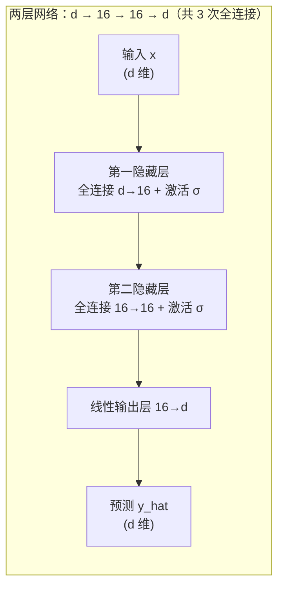
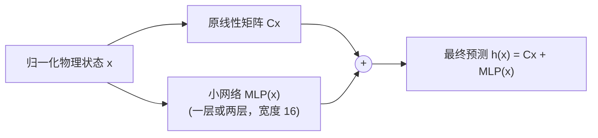
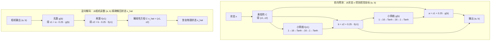
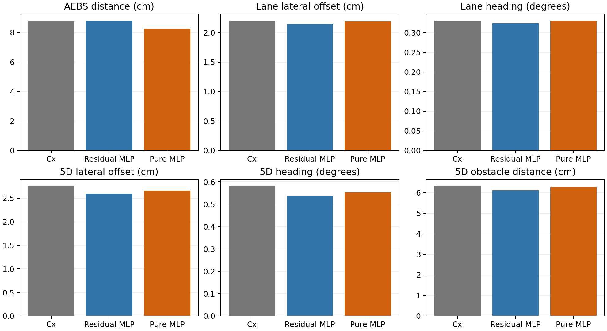
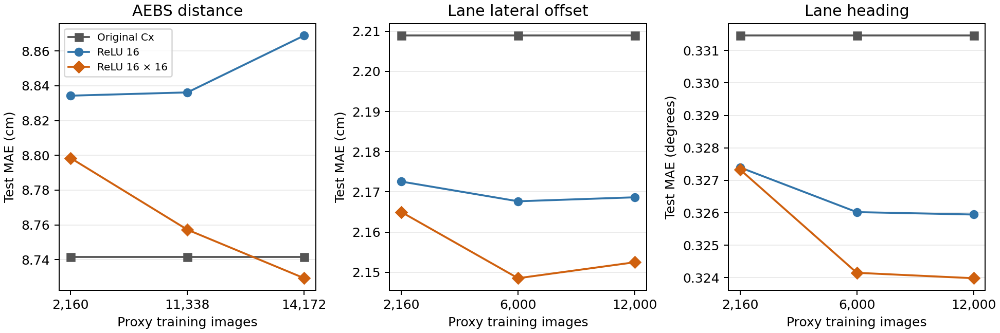
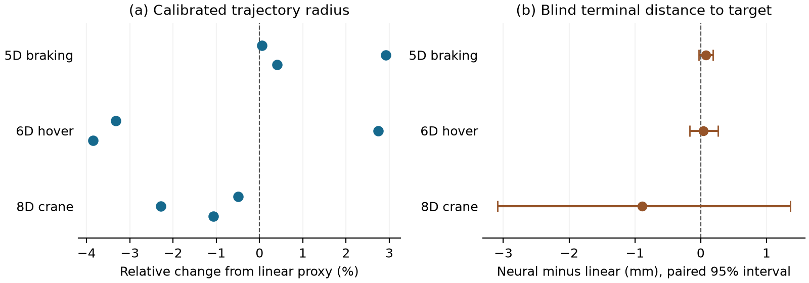

# 把线性 `Cx` 替换成神经网络：通俗报告与网络结构详解

> **一句话总结**：在视觉控制框架中，我们尝试用小型神经网络替代原本的线性状态代理 `h(x) = Cx`，一共验证了**可逆耦合网络**、**线性+残差网络**和**纯全连接网络（MLP）**三种方案。结果显示：在固定视觉前端的静态拟合上，纯网络和残差网络都能小幅降低预测误差（AEBS 降幅达 **5.49%**，车道横偏降 **2.55%**，五维横偏/航向降 **3.71%–4.80%**）；在闭环联合训练中，可逆网络可无缝接入原有控制器与鲁棒安全验证，并在车道保持（平均偏离减少 **2.02 mm**）和八维起重机（误差半径缩小 **1.30%**）上带来小幅改善。

如果您只需要在组会或向导师快速汇报，请直接查看配套的[**汇报简版**（docs/presentation/Cx替换成神经网络_汇报版.md）](../../presentation/Cx替换成神经网络_汇报版.md)。

---

## 1. 为什么要把 `Cx` 替换成神经网络？

在当前框架里，系统有**两条路线**在同时工作，它们必须在同一个“低维坐标空间”里对齐：

- **图像路线（左边）**：相机拍到一张图 $I$，经过冻结的 DINOv2 和视觉投影，输出一个低维向量 $y$（例如 AEBS 是 1 个数，车道保持是 2 个数，五维弯道制动是 3 个数）。
- **状态路线（右边）**：状态代理 $h(x)$ 只看真实的物理状态 $x$（例如车距、横向偏移、航向角），预测“图像路线在这张图上应该输出什么”。

**原方案的局限**：原本的状态代理是一个固定的线性矩阵乘法 $h(x) = Cx$。它相当于假设“物理状态和视觉输出之间是纯粹的直线/平面比例关系”。但真实相机成像和 DINO 特征提取往往带有透视、遮挡、边缘非线性等复杂变化，线性矩阵 $Cx$ 可能拟合不够准确。

**核心研究问题**：
1. 把 $Cx$ 换成神经网络后，能不能更准确地预测视觉输出 $y$？
2. 换成神经网络后，能不能在真实闭环控制中让车开得更稳、让安全误差界（CP 半径）更紧？
3. 不同的网络结构（可逆耦合、残差 MLP、纯 MLP）各自有什么优缺点？

---

## 2. 三种神经网络替换方案：结构逐层拆解

为了既能测试“纯拟合能力”，又能满足“闭环控制器需要把图像反解回状态”的工程约束，我们先后设计并对比了三种神经网络结构。

| 方案名称 | 数学形式 | 核心特点 | 能否直接反解回物理状态？ | 对应实验日期 |
|---|---|---|---|---|
| **方案 A：纯全连接网络（Pure MLP）** | $h(x) = \mathrm{MLP}(x)$ | 彻底去掉矩阵 $C$，从头学习状态到视觉的映射 | **不能**（无显式逆，用于测拟合上限） | 2026-11-22 |
| **方案 B：线性 + 残差网络（Residual MLP）** | $h(x) = Cx + \mathrm{MLP}(x)$ | 保留原 $Cx$ 作为主干，神经网络只学非线性修正量 | **不能**（未加全局可逆约束） | 2026-11-21 / 22 |
| **方案 C：可逆加性耦合网络（Reversible Coupling）** | $h(x) = H_\phi(Cx)$ | 通过交替加减两路信息，保证每一步都能精确倒推回去 | **能**（可无缝接入原控制器与安全验证） | 2026-11-15 / 17 |

---

### 2.1 方案 A：纯全连接网络（Pure MLP）长什么样？

这是最纯粹的替换方式——模型内部**完全不包含矩阵 $C$**，前向计算就是一个标准的多层感知机（MLP）。

#### ① 输入与输出有几维？
不同任务需要由相机估计的物理量不同，因此网络的输入维数 $d$ 和输出维数 $d$ 也不同（先做归一化再送入网络）：

| 任务 | 网络读入的归一化状态 $x$ | 输入/输出维数 $d$ | 备注 |
|---|---|---|---|
| **AEBS 紧急制动** | 车距 $d_{\text{dist}} / 3.18272$ | **1 → 1** | 静态图像无速度标签，只输入车距 |
| **车道保持** | 横偏 $e / 0.85$、航向角 $\theta / 0.30$ | **2 → 2** | 预测二维视觉坐标 |
| **五维弯道制动** | 横偏 $e / 0.65$、航向角 $\psi / 0.19$、障碍距离 $(d_{\text{obs}}-4)/2$ | **3 → 3** | 车速和前轮转角由传感器直接测量，不走视觉分支 |

> **具体例子**：在车道保持中，如果当前车偏离中心线 `0.17 m`、航向偏差 `0.03 rad`，归一化后输入网络的向量就是 $(0.2, 0.1)$。

#### ② “一层”和“两层”是怎么数的？
文档和实验代码中，**按隐藏层的数量来命名**，每个隐藏层固定包含 **16 个神经元**（宽度为 16）：

- **全连接（Linear）在算什么？**：每个神经元接收上一层的所有数值，做一次加权求和再加上偏置：$t_j = \sum_k w_{jk} x_k + b_j$。
- **最后一层为什么不加激活函数？**：输出层是纯粹的线性加权 $16 \to d$，这样输出值可以自由取正数或负数，用来精确对齐视觉向量 $y$ 的坐标范围。
- **参数量有多少？**（每个 $a \to b$ 全连接层有 $a \times b + b$ 个参数，激活函数无参数）：
  - **AEBS (d=1)**：一层 = $49$ 个参数；两层 = $321$ 个参数（第二层多出 $16 \times 16 + 16 = 272$ 个）。
  - **车道保持 (d=2)**：一层 = $82$ 个参数；两层 = $354$ 个参数。
  - **五维弯道 (d=3)**：一层 = $115$ 个参数；两层 = $387$ 个参数。

#### ③ 三种激活函数（ReLU / Tanh / SiLU）有什么区别？
如果没有激活函数，多层全连接叠加起来本质上还是一个线性矩阵。激活函数的作用是把每个隐藏神经元的输出 $t_j$ 做一次非线性变换 $\sigma(t_j)$：

| 激活函数 | 数学公式 | 直观效果 | 实验表现特点 |
|---|---|---|---|
| **ReLU** | $\max(0, t)$ | 负数直接归零，正数原样保留，形成**分段折线**拟合 | 对局部变化敏感，在车道保持和五维任务中表现稳健 |
| **Tanh** | $\tanh(t)$ | 把数值平滑压缩到 $(-1, 1)$ 之间 | 在极端/较大输入时容易**饱和**（梯度变小），纯网络随机初始化下在 AEBS 上收敛较慢 |
| **SiLU** | $t / (1 + e^{-t})$ | 既平滑又允许部分负响应通过，类似“软门控” | 拟合能力强，在 AEBS 和车道保持纯网络中取得很低的测试误差 |

---

### 2.2 方案 B：线性 + 残差网络（Residual MLP）

纯网络需要从完全随机的权重开始学起；而残差网络则是**“站在原 $Cx$ 的肩膀上做微调”**：

- **零初始化技巧**：残差分支最后一层 `16 → d` 的权重和偏置全部初始化为 **0**。这意味着训练刚开始（第 0 步）时，$\mathrm{MLP}(x) = 0$，网络的输出**精确等于原 $Cx$**。
- **直观意义**：如果非线性确实有用，网络就会慢慢学出修正量；如果某任务本身就高度线性（比如开发集发现怎么改都不如原 $Cx$），模型就会自动退回第 0 步的原 $Cx$，保证不会“越学越差”。

---

### 2.3 方案 C：可逆加性耦合网络（Reversible Coupling）—— 怎么做到“能正着算、也能倒着解”？

在闭环控制中，光能从状态算视觉（$x \to y$）还不够；当相机拍到图并输出 $y$ 时，控制器需要知道“当前车大概在什么状态”，也就是必须能算逆映射 $\hat{x} = h^{-1}(y)$。

普通 MLP 没法直接求逆，因此我们在闭环实验中使用了**可逆加性耦合层**（参考 RealNVP / 耦合变换思想）。以二维车道保持为例，它把输入分成两路，用两个 16 单元 Tanh 小网络 $f$ 和 $g$ 交替修改：

- **为什么一定能精确解码？**：注意第②步算 `b` 时，`z1` 没有被改写；第③步算 `a` 时，`b` 也没有被改写。所以解码时只要**倒着把加上的部分减去**，不需要对神经网络 $f$ 或 $g$ 求逆，就能 100% 精确恢复 $(z_1, z_2)$，再解 $Cx=z$ 即可！
- **多维推广（如五维弯道中的 3 维代理）**：用三个小网络 $f_1, f_2, f_3$（结构 `2→12→Tanh→12→1→Tanh`，各 49 参数，共 147 参数），每次固定其余两维去修正当前那一维，解码时按 `③→②→①` 倒序相减即可。

---

## 3. 实验结果全览：替换后到底好不好？

### 3.1 静态拟合对比：纯网络 vs 残差网络 vs 原 `Cx`（11 月 22 日，162 次训练）

在固定冻结视觉前端、相同训练步数（1,500 步 Adam，3 个随机种子均值）的公平对比下，**按开发集均方误差（MSE）自动选型**的测试结果如下：

| 任务与物理误差指标（MAE，越小越好） | 原 `Cx` | 选中残差网络 `Cx+MLP(x)` | 选中纯网络 `MLP(x)` | 纯网络相对原 `Cx` 变化 |
|---|---|---|---|---|
| **AEBS 车距**（cm） | 8.7415 | 8.8141（一层 Tanh） | **8.2612**（一层 ReLU） | **降低 5.49%**（少 4.80 mm） |
| **车道保持**：横偏（cm） / 航向（°） | 2.2089 / 0.3315 | **2.1525 / 0.3240**（两层 ReLU） | 2.1912 / 0.3307（两层 SiLU） | 横偏降 0.80% / 航向降 0.22% |
| **五维弯道**：横偏（cm）/ 航向（°）/ 距离（cm） | 2.7611 / 0.5817 / 6.3267 | **2.5996 / 0.5379 / 6.1116**（两层 ReLU） | 2.6586 / 0.5538 / 6.2744（两层 ReLU） | 分别降 **3.71% / 4.80% / 0.83%** |

> **小提示**：在 AEBS 中，纯两层 SiLU 的测试 MAE 甚至低至 **7.4153 cm**（降幅约 15%），但因为预设规则是“严格按开发集 MSE 选模型”，开发集选中了一层 ReLU（8.2612 cm）。我们在报告中保留全结构数据，避免“看测试集挑冠军”。

---

### 3.2 闭环控制与安全验证：可逆神经代理 vs 线性 `Cx`（11 月 17 日）

当把视觉投影和**可逆耦合神经代理**一起联合训练，并实际接入控制器和鲁棒屏障（SBC）跑闭环轨迹（每个模型 199 条校准轨迹 + 100 条盲测轨迹）时，结果如下：

| 任务 | 闭环控制表现 | 轨迹 CP 误差半径 $q$（越小越好） | 鲁棒屏障安全检查 |
|---|---|---|---|
| **车道保持**（2D 代理） | 车辆实际偏离中心线均值由 **36.28 mm 降至 34.26 mm**（3 个种子全部改善） | 3 个种子中有 2 个缩小（如 `0.0882→0.0824`、`0.0934→0.0842`） | 两组全部通过各自半径下的数值检查 |
| **五维弯道制动**（3D 代理） | 3 对盲测达标数完全一致（86/88/87），终点偏差均值差 +0.079 mm | 3 个种子均略变宽（均值 `0.1309 → 0.1324`，+1.13%） | 全部零越界，全部通过屏障检查 |
| **六维无人机悬停**（3D 代理） | 两组均 **100/100** 安全悬停 | 2/3 种子缩小（均值 `0.2257 → 0.2222`，**-1.55%**） | 全部零越界，全部通过有理数复算 |
| **八维桥式起重机**（4D 代理） | 达标数 99→100、97→95、99→99，终点均差 -0.889 mm | **3/3 种子全部缩小**（均值 `0.1909 → 0.1885`，**-1.30%**），可证初态尺度扩大 +0.30% | 全部零越界，全部通过有理数支持界 |

---

## 4. 关键结论与工程边界（给读者和评审的坦诚说明）

1. **纯全连接网络确实能学会状态到视觉的映射**：不需要依赖 `Cx` 主干，16 单元的小型 MLP（如一层 ReLU、两层 SiLU/ReLU）就能在 1,500 步内学出甚至略优于原 `Cx` 的静态拟合精度。
2. **保留 `Cx` 主干的残差结构更稳健**：在车道保持和五维弯道任务上，`Cx + MLP(x)` 的两层 ReLU 取得了比纯 MLP 更低的拟合误差，而且零初始化保证了起点不劣于 `Cx`。
3. **可逆网络在闭环实际工作区域“非常接近仿射”**：追加的同图像仿射诊断显示，在五、六、八维任务实际走到的状态区域里，可逆神经代理去掉非线性弯曲成分后，解码变化 RMS 小于 `0.00010`。这说明闭环中的改善，部分来自非线性本身，部分也来自**重新联合训练整个观测前端**的协同效应。
4. **不能直接拿静态 MAE 当作闭环安全证书**：
   - 静态图像上的代理误差变小，不自动等价于闭环到达率提升或轨迹 CP 半径缩小；
   - 普通 MLP 和残差 MLP 还没有施加全局可逆约束，接入依赖 `h^-1(y)` 的控制器前需要补齐解码接口，并在新名义映射下重新做**轨迹级 CP 校准**与**鲁棒屏障验证**。

---

## 5. 相关原始报告与代码索引

如果您需要核对逐种子原始数据、完整实验协议或复现命令，可以查看以下对应文件：

- **纯全连接网络替换 Cx（三任务 162 次训练完整数据）**：[三个任务_纯全连接网络替换Cx_结构与对照_20261122.md](三个任务_纯全连接网络替换Cx_结构与对照_20261122.md)
- **AEBS 与车道历次神经代理逐层结构对照**：[AEBS与车道_历次神经代理逐层结构与结果对照.md](AEBS与车道_历次神经代理逐层结构与结果对照.md)
- **五、六、八维可逆神经代理闭环对比**：[五六八维场景_Cx与可逆神经代理_同预算闭环对比_20261117.md](五六八维场景_Cx与可逆神经代理_同预算闭环对比_20261117.md)
- **五维弯道历次代理逐层结构**：[五维弯道制动_历次代理逐层结构与扩大数据对比_20261122.md](../五维弯道制动/五维弯道制动_历次代理逐层结构与扩大数据对比_20261122.md)
- **核心代码实现**：
  - 纯网络实现：[pure_proxy_compare.py](../../../artical-F122/Aebs/paper_comparison/pure_proxy_compare.py)
  - 残差网络与训练对比：[proxy_architecture_compare.py](../../../artical-F122/Aebs/paper_comparison/proxy_architecture_compare.py)
  - 可逆耦合层实现：[observation_coupling.py](../../../artical-F122/Aebs/vision_sls/observation_coupling.py) · [nonlinear_observation.py](../../../artical-F122/Aebs/lane_keeping/nonlinear_observation.py)
