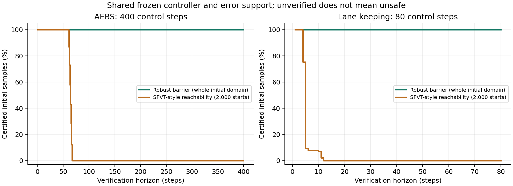
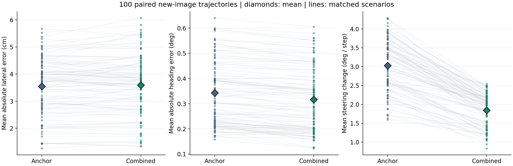
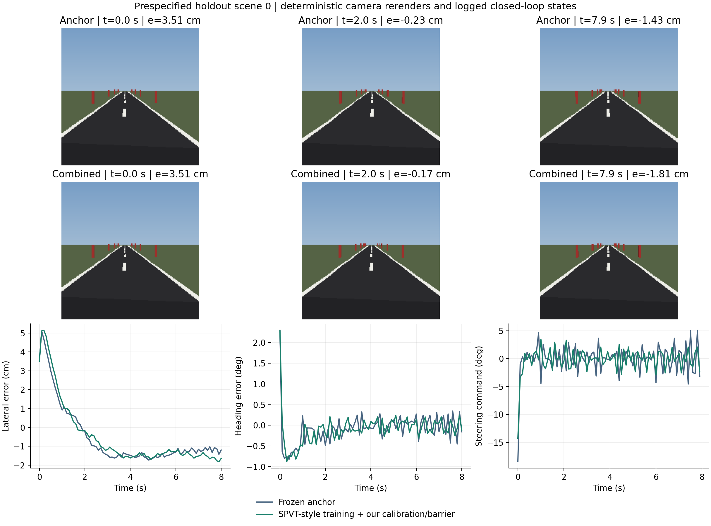

# SPVC、SPVT 与当前框架：五任务实测对照、收益与适用范围

2026-11-18。运行位置：服务器 10.11.154.191:20147，conda vt；代码与结果同步到主项目 main。

**本轮实际测到的主要收益是：在相同视觉误差支持、相同非线性控制器下，当前屏障验证可以完成 AEBS 和车道保持的长时域安全检查，而本轮 SPVT 式多步可达实现及其分区强化在给定预算内仍未完成。** 这个收益属于验证能力与计算方式，不能表述成车辆安全率从 0 提高到 100%。

另一个已经用新图像确认的收益是：**将 SPVT 式多步训练接入当前视觉校准与屏障框架，车道测试的平均转角变化减少约 39.1%，新策略也通过了自己的新 CP 半径下的屏障数值检查。** 这是组合框架相对冻结起点的改进，训练贡献来自 SPVT 思想；平均横偏略增，完整结果见第 7.5 节。

本轮也保留了不占优的结果：强化可达方法完整通过了悬停和起重机；同支持的随机屏障条件可以继承当前鲁棒证明；最坏情况训练在本次安全起点上没有胜过期望训练。当前数据支持有边界的改进，没有支持“全面胜过两篇论文”。

**比较范围必须先说清楚。** 已实跑的是五任务共同接口下的 SPVC 式期望验证、SPVT 式可达验证与当前鲁棒验证，并增加车道同预算控制器微调。这些是为了固定信息条件、区分组件作用而做的受控变体；没有将两篇论文的 cGAN、图像控制器、全部训练与验证流程在五个任务上各自从头完整重训。原生全链路与本轮受控实验的区别，在第 2 节逐项列出。

两篇原文的完整理论、源码审阅、旧实验对照和公平性分析见[原文与五任务的方法分析](五个实验与SPVC_SPVT的方法对照与收益分析_20261118.md)。本文件以这次新增的实际运行结果为主。

## 1. 本轮到底运行了哪些实验

| 新实验 | 实际执行内容 | 固定了什么 | 能回答什么 |
|---|---|---|---|
| 五任务后端对照 | 每任务重新运行当前证书；运行随机期望积分；运行多步可达验证 | 视觉接口、控制器、动力学、误差支持和任务安全条件 | 安全验证组件的可认证性与成本差别 |
| SPVT 式逐初态验证 | 每任务 2000 个新独立初态，曲率也独立抽取，共 10,000 个初态 | 每任务统一的抽样协议和 300 秒总预算 | 声明时域内有多少初态能被这套实现认证 |
| 强化可达验证 | 线性任务保留相关性的 zonotope；三个非线性任务再做初始域分区与完整重传播 | 同一控制器和误差集合 | 优势是否仅来自把基线设得过弱 |
| 车道真实转移误差诊断 | 对已有 199／100 条图像轨迹重新计算视觉误差引起的真实后继差 | 不修改前端、策略或校准阈值 | 状态无关转移误差近似是否遗漏了可预测信息 |
| 车道三种训练目标 | 三个训练种子，各 240 次更新，三种目标从同一策略起步 | 网络、初始权重、开发批次、学习率、共同性能项与固定屏障 | 不同安全训练目标能否产生更好的策略 |
| 新图像独立确认 | 冻结起点与预先指定的第一个 SPVT 微调策略，各 199 条新校准＋100 条新盲测，合计 47,840 帧有效图像 | 相同前端、B、配对初态和曲率；每个策略自己形成闭环轨迹 | 平滑收益能否在实际运行图像前端后保留，并重新建立自己的误差接口与证书 |

2000 个验证初态不是 2000 条新相机轨迹。后端直接使用已冻结的低维误差支持，没有在这些验证运行中重新执行 DINO。新相机采集的结果与成本另行列出，不与初态验证混算。

## 2. 三种方法怎样落在同一个实验上

### 2.1 共同的视觉控制接口

每个任务保留现有真实闭环，图像经 DINO 与投影获得低维观察，必要时解码成控制器使用的物理量。离线验证将观察写成“名义状态侧读数＋允许残差”。速度、曲率等原有旁路量对各方法相同。

| 任务 | 状态维数／视觉维数 | 登记时域 | 共同的归一化或物理误差半径 |
|---|---:|---:|---:|
| AEBS | 2／1 | 至终止或 400 步，20 s | 0.405193 m 测距误差 |
| 车道保持 | 2／2 | 80 步，8 s | 0.099687，横偏／航向使用原尺度 |
| 弯道遇障制动 | 5／3 | 14 步，2.8 s | 0.125062 |
| 无人机悬停 | 6／3 | 24 步，6 s | 0.212185 |
| 起重机消摆 | 8／4 | 40 步，6 s | 0.188049 |

后面三项的数字只能在各自归一化定义内解释，不能把 0.212 与 AEBS 的 0.405 m 比大小。五个任务的状态、尺度、危险集和成功条件见[任务定义](五个实验与SPVC_SPVT的方法对照与收益分析_20261118.md#4-五个任务到底验证什么)。本轮前后端对照没有修改这些条件。

### 2.2 SPVC 式随机期望后端

原 [SPVC 稿件](../../references/720_file_Paper.pdf) 的核心是随机转移模型和期望型神经屏障。本轮实跑两个模型，分别保存结果。

**固定加性转移模型。** 在开发用的模型轨迹上拟合一个全局转移残差范围，假设其中为均匀分布，再检查

$$
\mathbb E_\mu[B(x^+)]\le B(x).
$$

这保留了状态无关加性扰动建模的思想，但这里拟合用的是登记支持内的模型扰动，不是新相机图像；均匀分布也没有被证明是真实视觉分布。AEBS 和五维制动共享原任务的吸收停止规则，停止后关闭扰动，因此更准确的名称是“停止过程上的受控加性模型”。

**同观察支持的随机模型。** 在与当前鲁棒验证完全相同的观察误差和物理外扰范围内假设均匀分布，经实际控制器与动力学传播，再计算期望。它保留状态相关的转移效应，属于强化的期望型受控变体，不满足原文全空间固定 μ 的逐字假设。

期望由覆盖整个扰动支持的等质量子盒和 B 区间上下界积分得到。采样只用于寻找显著反例，不用来接受证书。每项上限为 300 秒、100,000 个状态盒，噪声划分为 32 个子盒；先触发哪个预算都明确记录。

原稿还要求严格正余量 ε。当前 B 在安全内核或吸收停止点可以恒为 0，这会与处处严格下降不兼容。程序单列严格 ε 结果，将其视为**当前候选的迁移兼容性诊断**，没有把它当作原 SPVC 无法学习别的证书的证据。

### 2.3 SPVT 式多步可达后端

原 [SPVT 论文](../../references/Learning%20Vision-Based%20Neural%20Network%20Controllers%20with%20Semi-Probabilistic.pdf) 的核心验证机制是逐步包住所有允许的后继，并验证完整有限时域。作者本地仓库未提供完整最终验证入口，因此本轮实现了与其核心机制对应的受控版本。

1. 给定初态或初始状态盒，计算所有允许视觉误差下的动作范围。
2. 经实际动力学得到下一时刻状态外包。
3. 检查外包是否全部安全，并继续传播到登记终点。
4. 遇到不够紧的界，细分状态、误差或物理外扰；保留未决状态。
5. 对 2000 个独立初态统计完整时域和各前缀的认证数。

每个任务的逐初态组共享 300 秒总预算。先粗查全部初态，再用剩余预算细化；未获细化的点仍留在 2000 分母中。没有因难验证而删掉初态。

**专门加强了基线。** 悬停与起重机在线性且未饱和的区域采用不降阶 zonotope，精确保留线性状态相关性，并直接对耦合安全面和动作上限取支持函数。三个非线性任务另投入每任务 300 秒，按初始状态分区，从时间零重新传播完整轨迹，减少早期区间过松的影响。

这个版本固定了现有控制器，没有将“原 SPVT 会通过训练改善可验证性”遗漏为结论；第 7 节专门补了训练对照。但它仍然是共同低维接口上的受控变体，而非原 cGAN 图像链路的完整复现。

### 2.4 当前鲁棒后端

当前后端检查允许误差集合内的所有后继。AEBS、车道重新检查初始域、危险域和完整相关安全子水平域上的神经屏障条件；三个高维任务分别重新计算几何／减速度、位置—速度组合、有限时域支持函数的充分条件。

没有把读取历史证书文件的时间当成新验证时间。计时不含前置任务装载、已有控制器训练和 DINO 预训练；验证接口内部的必要处理仍计入，例如五维接口再次读取屏障检查点。

## 3. 主要实测结果：长时域神经任务上的差别最清楚

### 3.1 重新运行的当前证书

| 任务 | 全登记初态域 | 新验证时间 | 新审核内容 |
|---|---|---:|---|
| AEBS | 数值检查通过 | 115.77 s | 534,658 个状态格；初态、危险域与停止过程一步条件 |
| 车道保持 | 数值检查通过 | 9.44 s | 13,922 个状态格；三个曲率的完整相关域 |
| 5D 制动 | 数值充分条件通过 | 0.0179 s | 车身几何、制动下界、横移和航向变化 |
| 6D 悬停 | 有理数充分条件通过 | 0.000327 s | 位置、速度、推力与扰动不等式 |
| 8D 起重机 | 有理数支持界通过 | 0.14245 s | 40 步状态、净空及电机约束；最坏初态用量 0.776859<1 |

高维结构化条件的时间很短，原因是利用了任务结构，不能拿它证明通用神经屏障合成已经扩展到任意八维系统。亚毫秒结果也不宜报告成精确稳定的加速倍数。

### 3.2 SPVT 式逐初态可达验证

| 任务 | 完整时域认证初态 | 总时间 | 结果应怎样读 |
|---|---:|---:|---|
| AEBS，400 步 | 0/2000 | 300.00 s | 全部初态完成粗验，但完整时域未决；已证明前缀约 60–67 步 |
| 车道，80 步 | 0/2000 | 300.00 s | 完整时域未决；已证明前缀约 3–11 步 |
| 5D 制动，14 步 | 2000/2000 | 17.19 s | 全部抽样初态通过 |
| 6D 悬停，24 步 | 2000/2000 | 4.38 s | 全部抽样初态通过 |
| 8D 起重机，40 步 | 2000/2000 | 13.99 s | 全部抽样初态通过 |

表中的 0/2000 表示**没有获得完整时域的证明**。没有发现这些初态实际不安全的反例，更不表示 2000 趟都撞车。

AEBS 有 125 个初态获得进一步细化，车道有 158 个，其余因全批预算限制没有继续细化。粗验时使用深度 0，不能将其产生的深度未决标签解释为“所有初态都尝试过最深细分”。原始每个初态、曲率、认证前缀和预算状态均保存。

图 1：绿色表示当前全初态域数值证明可覆盖这些抽样初态；橙色表示 300 秒逐初态可达验证实际完成的比例。二者共享同一允许误差支持。纵轴是认证结果，既不是新视觉 CP 覆盖率，也不是实际任务成功率。每个整数时域的比例从同一次最大时域运行的已认证前缀统计，并非给每个时域分别再分配 300 秒；专门为短时域分配预算可能得到不同结果。两种算法的已有训练成本未计入该图。

### 3.3 增强基线后，收益是否还存在

| 任务 | 更强的整初态域可达检查 | 当前结果 |
|---|---|---|
| AEBS | 额外 300 s，检查 11,655 个初始子盒，从时间零完整重传播；400 步仍未完成 | 当前证书完成整个初态域的停止过程检查 |
| 车道 | 额外 300 s，三个曲率分别检查约 10,100 个初始子盒；80 步仍未完成 | 当前证书完成三个曲率的整个初态域检查 |
| 5D 制动 | 额外 300 s，两个曲率分别覆盖初始盒几何体积 91.1026%、91.4063%；其余未决 | 当前结构化条件覆盖整个初态域 |
| 6D 悬停 | 精确线性支持的整初态盒直接通过，0.00254 s | 两者都能证明完整任务 |
| 8D 起重机 | 精确线性支持的整初态盒直接通过，0.00729 s | 两者都能证明完整任务；本轮浮点可达计算比当前有理数计算更快 |

5D 的几何覆盖比例按各曲率分别计算，不能直接当作“两种曲率同时成立的覆盖比例”，也不是 CP 概率。8D 两边的算术质量不同，0.00729 s 对 0.14245 s 不是同精度下的纯实现速度比较。

**这组结果可支持的主张：** 对本轮 AEBS 和车道这两个非线性神经闭环，一步屏障归纳能避免本轮多步外包逐步变松带来的长时域认证困难。在相同误差模型下，当前验证完成了强化可达实现尚未完成的全域条件。不能由此推出一切 SPVT 实现、所有控制器或所有任务都不如屏障。

## 4. 为什么会出现“实际都安全，但可达验证证不出来”

举一个车道保持的直观例子。真正的闭环中，“车偏到右边”和“控制器向左打轮”存在对应关系。经过很多步之后，状态仍可能集中在一条很窄的倾斜区域内。

若用独立区间描述横偏和航向，就可能把这条斜区域包成大矩形。下一步又允许大矩形中的每一种组合，继续产生更大矩形。某些组合其实无法由最初状态和前面动作同时产生。它们触碰危险边界时，验证器只能说未决。

屏障的做法是检查“当前 B 小，下一步 B 仍不会更大”。它每次只需处理一步，并用同一个归纳性质衔接所有后继，因此不必保存整条多步矩形链。

这个解释也有边界：屏障本身可能难以找到；更强的可达表示可以保留依赖关系；线性任务中的 zonotope 已在本轮做到这一点。因此，本轮 6D/8D 的强化可达基线也完整通过，恰好说明不能将任何区间膨胀都当作 SPVT 的不可克服缺陷。

## 5. SPVC 式期望后端：怎样公平解释结果

### 5.1 同支持强基线也成立

对同一个控制器、B 和误差支持，有一个直接的包含关系：

$$
\bigl[\forall e\in E(x),\ B(x^+)\le B(x)\bigr]
\Longrightarrow
\bigl[\mathbb E[B(x^+)\mid x]\le B(x)\bigr].
$$

只要概率分布的支持落在 E(x) 内，就不需要额外假设均匀性或坐标独立性。**因此，本轮五个当前鲁棒条件都通过后，同支持的非增随机条件也全部成立。** 这是原问题本身的逻辑关系，不能为了突出新方法而忽略。

程序读取同批新验证结果，逐项核对控制器、屏障、集合、曲率、外扰和时域身份，五项均无不匹配。继承的是原验证的算术质量，严格 ε 条件、另一个加性噪声模型及真实相机概率不自动继承。

### 5.2 独立期望积分的计算结果

| 任务 | 同观察支持的独立区间积分 | 固定加性转移模型的独立积分 |
|---|---|---|
| AEBS | 300 s 内未决 | 300 s 内未决 |
| 车道 | 300 s 内未决 | 非增条件通过，55.90 s，6805 个状态盒 |
| 5D 制动 | 300 s 内未决 | 208.97 s 触及 100,000 状态盒上限，未决 |
| 6D 悬停 | 284.44 s 触及状态盒上限，未决 | 35.55 s 触及状态盒上限，未决 |
| 8D 起重机 | 300 s 内未决 | 300 s 内未决 |

这些是通用期望积分程序的结果，不是“随机方法失败”。本轮正式结果未找到显著正期望漂移反例。对同支持那一列，更强的鲁棒证明已经给出了期望非增结论，积分程序的未决只反映此种独立计算方式没有及时完成。

车道固定加性模型通过，说明原期望建模在这个任务中也可能有效。由于加性模型和当前观察误差映射的支持不同，不能把 55.90／9.44 简单写成“SPVC 方法必然慢 5.9 倍”。它最多是本轮登记模型、候选和实现下的计时。

### 5.3 本轮修掉的伪反例

初始实现曾在一个 AEBS 吸收停止点将约 7×10⁻¹⁵ 的浮点求和差当作正漂移，还存在停止后继续添加噪声的模型语义差异。修复后，两种模型对这些点都给出恒等自环，采用完整支持积分与显著性保护；所有主实验重新按原预算运行。

旧诊断文件单独保留，不进入结果表。这个修复说明，比较安全算法时必须区分真正的模型反例、证明未决和数值误差。不能把实现错误制造的“对手失败”当作收益。

## 6. 真实图像误差为什么值得保留状态关系

对已有车道图像轨迹，计算

$$
\Delta x_t=f(x_t,\pi(\hat z_t))-f(x_t,\pi(z_t)).
$$

第一项使用真实图像读数，第二项使用名义真值读数，其他条件相同。199 条旧轨迹在本次重新指定为开发数据，拟合两个固定模型：每种曲率的常数均值，以及每种曲率内固定二阶状态基函数的岭回归。随后在另 100 条旧留出轨迹上进行探索性重分析，没有按结果选择模型。

| 指标 | 每曲率常均值 | 状态相关模型 |
|---|---:|---:|
| 下一步航向误差预测 RMSE | 0.26403° | 0.25869° |
| 转角偏差预测 RMSE | 1.71137° | 1.67653° |
| 航向预测 MSE 改善 | — | 4.002% |
| 留出轨迹改善／恶化 | — | 76／24 |

整轨迹 bootstrap 的航向 MSE 收益区间为 [6.18×10⁻⁷,1.09×10⁻⁶] rad²。横向在当前离散方程中的本步差严格为零，已如实记录。

改善幅度不大，但说明真实视觉诱发的转移误差中存在可由状态解释的成分。这支持继续研究状态相关接口，不证明原 SPVC 不安全，也没有为新分布增加 CP 保证。统计单位是整条轨迹，没有把 8000 帧当成独立样本。

现有更直接的认证收益仍应与本轮结果一起保留：五曲率车道的视觉—动作联合集合使同一神经策略、屏障通过普通盒失败的条件；起重机状态分段相对强固定分轴盒扩大认证倍率 2.74%，独立新数据确认仍有改善。详见[五曲率集合实验](../车道保持/车道保持_固定神经策略五曲率三种误差集合_20261117.md)与[状态相关盒独立确认](五六八维_固定与状态相关CP误差盒_配对验证_20261117.md)。

## 7. 同预算训练：给 SPVT 改善控制器的机会

### 7.1 公共设置

三种子、每臂 240 次更新，使用相同的神经网络、同一个已鲁棒训练的共同起点、同一个固定 B、相同开发状态和批次。共同加入锚定原动作的损失及四步名义跟踪损失，学习率固定为 3×10⁻⁵。按 SPVT 可达难度构造的困难样本池由三臂共用。这是相同更新次数，不是相同计算量或相同训练耗时；多步传播和一步屏障损失每次更新的工作量不同。

具体顺序如下：先冻结 4481 参数的共同策略及原神经屏障；为每个种子生成 4096 个初始域状态和 4096 个满足 B<20 的开发状态；每次从普通池和困难池各取 32 个状态，将同一个批次交给三种训练目标；每 60 次更新刷新共同困难池，并将 SPVT 展开时域从 4 步依次增至 6、8、10 步；Adam 完成 240 次更新后保存最终策略；再使用相同的 2000 个独立测试场景进行性能与交叉验证。种子固定为 202611188101、202611188102、202611188103。

每个新策略同时接受两种检查：在原半径仅作为固定支持的条件下，重新验证当前神经 B；另外用 SPVT 式可达算法检查 4、10、20、40、80 步。后一项每策略 300 秒、每点细化最多 1 秒，初态种子 202611188901；这与第 3 节初次后端实验的种子和细化设置不同，所以只与本组重新运行的 anchor 比较。

| 臂 | 安全训练项 | 需要区分的性质 |
|---|---|---|
| SPVC 式 | 支持内均匀误差求积后的正期望 B 漂移 | 25 点求积是训练近似；最终安全不能靠该训练求积接受 |
| SPVT 式 | 真实多步可达界产生的终点安全损失，课程为 4→6→8→10 步 | 保留多步界、锚定性能、困难样本和课程思想 |
| 当前鲁棒式 | 对误差子盒全覆盖后的最坏 B 正漂移 | 一步条件的最坏情况损失 |

所有模型使用最后一次更新，不根据测试挑检查点。这是固定起点、固定 B 下的局部目标比较，没有重现原 SPVC 的完整交替证书综合，也没有重现 SPVT 的原 cGAN 图像网络训练。

### 7.2 一个必须报告的结果：期望与最坏情况两臂没有被区分开

三个种子中，SPVC 式与鲁棒式两臂的安全损失在各自全部 240 次更新中都为零，最终权重逐元素完全相同。原因是共同起点已通过鲁棒条件，在本次小步跟踪优化中两种约束都未被激活。

所以这组实验没有证明期望训练优于最坏情况训练，也没有证明相反结论。若要研究二者的综合能力，需要另登记确实触发安全约束的共同开发问题，并允许相同预算更新证书；不能从本次零损失结果编造优劣。

### 7.3 SPVT 式训练产生了真实的性能折中

三个登记种子，在相同 2000 个初态和逐步独立合成误差下，先对每个策略计算逐轨迹指标，再取三个种子的均值：

| 指标 | 两种屏障微调臂，相同权重 | SPVT 式微调 |
|---|---:|---:|
| 平均绝对横偏 | 0.030854 m | 0.031717 m |
| 平均绝对航向偏差 | 0.017318 rad | 0.014695 rad |
| 平均相邻步转角变化 | 0.203740 rad | 0.141983 rad |
| 实测安全轨迹 | 每个种子均 2000/2000 | 每个种子均 2000/2000 |

SPVT 式微调使这批合成测试的转角变化减少 **30.31%**，平均横向误差增加 **0.864 mm**。以相同场景配对、固定这三套模型、按整轨迹 bootstrap，差值的 95% 区间分别为 −0.06209 至 −0.06144 rad，以及 +0.777 至 +0.952 mm。这个区间反映测试场景抽样差异，没有把三个训练种子当作足以精确估计所有训练随机性的样本。

不只检查逐步独立误差。另两种登记测试分别在一趟中保持误差恒定，以及每一步在相反角点间交替。转角变化的三种子均值如下：

| 合成误差序列 | 屏障两臂，rad／步 | SPVT 式，rad／步 | SPVT 式变化 |
|---|---:|---:|---:|
| 逐步独立均匀 | 0.203740 | 0.141983 | −30.31% |
| 整趟恒定均匀 | 0.003452 | 0.002839 | −17.76% |
| 正负角点交替 | 0.496348 | 0.351840 | −29.11% |

三种扰动模式、九个策略均为 2000/2000 条采样轨迹安全；这是有限样本测试。全部九个策略另行通过了同一 B 的连续域数值条件检查。恒定误差下 SPVT 式的平均航向偏差略有增加，横偏三种模式的平均值也都略大，因此这是平滑与跟踪精度之间的折中。

### 7.4 训练是否改善了可达认证

| 策略 | K=4 认证初态 | K=10 认证初态 | K=20／40／80 | 当前 B 的 80 步集合内条件 |
|---|---:|---:|---|---|
| 共同起点 anchor | 1525/2000 | 258/2000 | 各 0/2000，未决 | 通过 |
| SPVT 式，种子 8101 | 1904/2000 | 278/2000 | 各 0/2000，未决 | 通过 |
| SPVT 式，种子 8102 | 1914/2000 | 275/2000 | 各 0/2000，未决 | 通过 |
| SPVT 式，种子 8103 | 1909/2000 | 278/2000 | 各 0/2000，未决 | 通过 |
| SPVC 式，三个种子 | 各 1527/2000 | 各 264/2000 | 各 0/2000，未决 | 全部通过 |
| 鲁棒式，三个种子 | 1527、1527、1528/2000 | 264、263、264/2000 | 各 0/2000，未决 | 全部通过 |

表内种子末四位对应前面登记的完整种子。SPVC 式与鲁棒式权重完全相同；它们个别计数相差 1 是总时间截止时完成细化的数量不同，不能视为策略差异。K=4 的 SPVT 认证比例从 76.25% 提高到平均 95.45%，增加 **19.20 个百分点**；K=10 改善较小，完整 80 步仍未决。SPVT 的验证引导训练在本轮确实有效，但没有消除长时域认证困难。

以上输入是人为规定的误差序列，不能直接换算成真实相机表现或新策略的 CP 保证。每个新策略都另外接受条件模型的验证；下面进一步给出重新进行图像采集、校准与验证的结果。

### 7.5 新图像确认：训练收益能否接上实际视觉误差与证书

这里的“新图像”是车道渲染器按每一步到达的状态重新生成的 RGB 相机输入，再实际执行冻结 DINO 与视觉投影。它不是直接往真值添加合成噪声，也不是复用旧轨迹；它仍是简化道路仿真图像，**不是新采的真实道路视频，也不是本轮新跑 CARLA**。

**第一步，先固定比较对象。** 使用原鲁棒策略作为 anchor，以及训练种子 202611188101 的 SPVT 式最终策略。选择“登记的第一个种子”发生在本轮图像采集之前，没有看这批图像的表现再挑模型。两边 DINO、视觉投影、神经屏障相同；仅策略不同。后续没有按测试结果调整策略、盒形、阈值规则或初态域。

**第二步，各自重新形成闭环。** 每边生成 199 条校准轨迹，再生成 100 条盲测轨迹，每条 80 步。两边使用相同的外生初态和曲率，便于配对；进入闭环后，策略不同会产生不同状态和不同图片，所以一边的校准轨迹不拿给另一边使用。光照为 1、相机高度 1.25 m，无遮挡、模糊和额外像素噪声；曲率每趟固定为 −0.01、0、0.01 m⁻¹ 之一。结论只覆盖这套登记分布。

**第三步，独立计算新 CP 阈值。** 每帧计算归一化视觉残差

$$
e_t=\hat z_t-[e_t^{\rm physical}/0.85,\ \theta_t/0.30],
\quad S_i=\max_{0\le t<80}\|e_{i,t}\|_\infty.
$$

此式左边的向量 e_t 表示观测残差，右边的 \(e_t^{\rm physical}\) 表示车辆横偏，二者不可混淆。每边用自己的 199 个整轨迹分数，取升序第 \(\lceil(199+1)\times0.95\rceil=190\) 个作为 q；冻结 q 后才进行本边的 100 条盲测。

**第四步，用新 q 重新验证。** 将每边的策略、新 q 和同一神经 B 交给当前鲁棒验证器；没有因为沿用原 B 就省略新验证，也没有把旧 q 自动算作新策略的 CP 保证。

| 检查项 | 原冻结起点 anchor | SPVT 式训练＋当前校准／屏障 |
|---|---:|---:|
| 独立新校准／盲测轨迹 | 199／100 | 199／100 |
| 新轨迹 CP 半径 q | 0.09535210 | 0.09183867 |
| 盲测全程在自身误差管内 | 96/100 | 95/100 |
| 盲测全程安全／完成车道任务 | 100/100 | 100/100 |
| 自身新 q 下的 B 条件 | 数值检查通过 | 数值检查通过 |
| 新 B 审核时间 | 8.37 s | 7.63 s |

表中的 96 和 95 不是一方安全性优于另一方的证据。两边都执行相同的 95% 目标校准，小样本盲测覆盖有波动；新 q 的差异也不能单独证明视觉前端更准，因为前端没有改变，而访问的状态及有限校准样本改变了。anchor 有 4 条、新策略有 5 条超出包络，它们虽然实测安全，却不能算作“整趟由该误差管内证书直接覆盖”。

**第五步，在相同 100 个新盲测场景上比较控制表现。** 横偏、航向指标先对每条轨迹的 80 个后继采样点取平均；转角变化是相邻 79 对控制指令绝对差的平均，指令已乘 0.45 换算为 rad；峰值横偏包含初态。再将 100 条轨迹平均，并按完整配对轨迹 bootstrap 5000 次。下列区间为各指标分别的 95% 区间，没有宣称多指标同时覆盖。

| 指标 | anchor | 组合版本 | 组合减 anchor 的配对 95% 区间 |
|---|---:|---:|---|
| 平均相邻步转角变化 | 0.052840 rad | **0.032172 rad，减少 39.11%** | [−0.022304, −0.019044] rad |
| 平均绝对转角 | 0.038913 rad | **0.029322 rad，减少 24.65%** | [−0.010435, −0.008772] rad |
| 平均绝对航向偏差 | 0.005982 rad | **0.005527 rad，减少 7.60%** | [−0.000538, −0.000364] rad |
| 平均绝对横偏 | 0.035431 m | 0.035918 m，增加 0.487 mm | [−0.163, +1.138] mm |
| 每趟峰值横偏的平均值 | 0.122278 m | 0.122886 m，增加 0.608 mm | [+0.192, +1.082] mm |

100/100 对的平均转角变化下降，88/100 对的航向误差下降；平均横偏 49 对下降、51 对上升。峰值横偏有小幅恶化，因此不能说所有跟踪指标都变好。转角变化衡量指令平滑性，不是直接测得的乘坐舒适度、转向电机能耗或实际车辆 jerk。

图 2：每条浅线连接同一外生场景下的两条完整闭环轨迹，大菱形为 100 条均值。左图展示略大的平均横偏，中图展示航向改善，右图展示更明显的动作平滑收益。图中单位为 cm 和角度，正文原始统计用 m 和 rad。

图 3：预先指定展示盲测第 0 条，不是从 100 条中挑最好的一条。初态横偏 0.03509 m、航向 0.04007 rad、曲率 0；展示 0、2.0、7.9 秒图像及全程记录。图像在原实验服务器的同一渲染环境中从保存状态复现，两臂整条 80 帧的图像哈希均与原采集记录完全一致；绘图读取这些已核对的像素，不在不同软件版本的本地环境重新渲染，且不增加独立测试样本。[图像一致性记录](../../../artical-F122/results/paper_controller_image_confirmation_20261118_v2/scene0_reconstruction.json)。本例在末端横偏上组合版本稍大，仍可看到转角振荡减小。

正式确认共 598 条轨迹、47,840 帧有效图像观测，约 389.1 秒，包含两边模型装载、采集和新证书审核；不含前期训练及绘图。47,840 是运行时的有效观测次数，不是独立去重图片数，统计单位仍是整条轨迹。为提高采集速度，正式版本将 CPU 渲染改为 8 进程，先对 36 个独立状态逐像素核对一致。此前串行吞吐试跑只完成了 80 条校准轨迹，未形成阈值或盲测；正式数据全部重新生成，旧试跑没有被混入，也没有被再计作额外独立样本。

完整成本还应另列：上述 389.1 秒不含 36 个像素一致性检查、进程启动、此前 GPU 性能检查和串行试跑；试跑已有至少 6400 个完成图像观测，因部分场景与正式重跑相同，不能加成独立样本。两种策略的全程覆盖率双侧 95% 精确二项区间分别为 [90.07%,98.90%] 和 [88.72%,98.36%]；两边 100/100 实测安全各自的对应区间为 [96.38%,100%]，并非两边同时的置信声明。原汇总中的零事故 bootstrap 差值区间不用于宣称零风险，补充记录见[统计与成本审计](../../../artical-F122/results/paper_controller_image_confirmation_20261118_v2/statistical_and_cost_audit.json)。

**这一步完成后的结论：** 组合方法在这对冻结策略及这套图像分布中获得了可重复的动作平滑收益，并为新闭环重新建立了轨迹 CP 接口和集合内屏障数值证据。尚不能外推到另外两个训练种子的新图像闭环、不同天气或真实车辆；也不能称为当前训练算法击败了完整原生 SPVT。

收益归因也要分开：本次图像确认比较的是“SPVT 式安全项＋共同锚定／跟踪项的完整微调”与未微调 anchor，没有在这批图像上增加“仅共同性能项”的第三臂，所以 39.1% 不是 SPVT 安全损失单独的净贡献。CP 和 B 在此作为离线校准、审核环节，本身不改变在线转角；它们的作用是让改变后的控制器重新具备明确的误差前提和安全证据。

## 8. 怎样写成论文里的收益

### 8.1 有数据依据的表述

> 在五个共享视觉误差接口的控制任务上，我们比较了随机期望验证、有限时域可达验证和鲁棒屏障验证。对 AEBS 和车道两个非线性神经闭环，屏障验证分别在约 116 秒和 9.4 秒完成全初始域条件检查，而逐初态可达验证及额外初始域分区在登记预算内未完成完整时域。线性悬停与起重机中的强化可达方法同样成功，表明收益与动力学及验证结构有关。

> 实际视觉残差分析与已有集合消融表明，应保留误差对状态和控制动作的依赖，而不仅仅最小化图像重建误差或平均误差盒体积。当前框架为这些依赖提供了明确的低维校准与验证接口。

> 在单独登记的新图像确认中，SPVT 式多步训练与当前轨迹校准、鲁棒屏障结合，使 100 个配对场景的平均转角变化降低约 39.1%，航向误差降低 7.60%；两策略分别在新校准半径下通过 80 步集合内数值安全检查。平均和峰值横偏分别增加约 0.49 mm、0.61 mm，体现了平滑与跟踪精度的取舍。

### 8.2 目前还不能写的表述

- “完整原 SPVC、完整原 SPVT 在我们的五个任务上都失败了。”本轮是受控组件实现，且多个基线已经通过。
- “当前方法安全率 100%，SPVT 为 0%。”0 是预算内完整证明数，实际安全反例为零。
- “同支持随机屏障得不到证书。”鲁棒条件已经蕴含相应期望条件。
- “总计算速度提高了几十倍。”现有训练成本、屏障寻找成本、图像预训练与推理成本未纳入计时。
- “神经代理或 DINO 是本轮后端收益的原因。”三种后端共享了这些组件，未改变它们。
- “新的 SPVT 微调策略沿用旧 CP 就有 95% 视觉安全率。”策略改变后，需要自己的新轨迹校准。

### 8.3 当前更值得继续的组合

数据提示可以让 SPVT 式多步训练负责改善动作或跟踪，再用当前实际视觉残差校准和鲁棒屏障完成长时域验证。这样既利用原论文有效的训练信号，也保留当前可校准的视觉接口和一步归纳验证。

第 7.5 节已完成该组合的一对独立新图像确认：动作更平滑，新 q 下的证书也通过。后续扩展应在新天气和更多独立训练种子上重复同一冻结、校准、盲测流程，检验这个收益的稳定范围；本轮没有依靠反复查看盲测来选择策略。

### 8.4 对准原论文自己强调的优点，怎样评价当前改进

| 原文强调的能力 | 当前对照真正测了什么 | 可以主张的进展 | 仍需尊重的边界 |
|---|---|---|---|
| SPVC：视觉神经控制器的可验证安全概率 | 五任务期望后端、现有实际残差的状态关系、新策略的独立轨迹校准 | 给实际视觉读数与低维代理之间的失配补上可观测、有限样本的校准接口 | 没有证明数值安全概率高于原文 94.2%；两者概率事件不同 |
| SPVC：交替调整策略和屏障改善可验证性 | 从相同已安全起点进行三种损失的局部策略微调 | 明确发现本轮期望／最坏安全项均未激活，避免将无区别写成收益 | 尚未公平比较完整交替综合；当前五维以上也不都是通用神经屏障 |
| SPVT：验证引导训练提高可认证性 | 真实可微多步界、困难样本和课程；三种子训练后重新检查 | SPVT 式训练改善短时域认证；当前一步屏障还能为这些新策略提供完整 80 步条件检查 | 优点来自两者结合，不能将 SPVT 的训练贡献改称为我们独有 |
| SPVT：有限时域对所有允许观测变化安全 | 五任务整域及逐初态多步可达，额外加强相关性表示与初态分区 | 在两个非线性神经任务上，当前屏障完成强化可达实现预算内未完成的全域长时域验证 | 线性两任务均成功；不能外推为所有动力学和所有 SPVT 实现都占优 |
| SPVT：代理覆盖真实图像 | 两个新策略各自重新产生图像、观测残差、轨迹分数与阈值 | 用可重复采集和 CP 秩统计支撑分布内、有限时域的误差覆盖前提 | 牺牲了统一覆盖所有图像环境的强形式；不能保证未见天气或真实道路 |

因此论文更合适的主线是“**可校准的低维视觉误差接口＋适合长时域的鲁棒验证**”，并把验证引导训练作为可兼容组件。现有实验还不足以支撑“DINO 架构普遍更准”“最坏情况训练普遍更好”或“完全替代两篇原论文所有优点”。

## 9. 安全结论与数值审计

本轮后端实测的结论是**共同误差支持成立时的条件安全检查**。已有轨迹 CP 只在原先冻结的闭环及登记分布中解释。初态验证的 Hoeffding 界、CP 的轨迹覆盖与实际任务成功率分别报告；不相乘，也不直接相减。

第 7.5 节的新 CP 是例外中的明确新增：两策略各自冻结、各自新采 199 条校准轨迹，故在登记轨迹可交换前提下，各自有整条新轨迹落在自身集合内的 95% 边际覆盖；概率同时涉及校准样本与新轨迹，不是每个固定状态各有 95%，也不是给定这一个已实现阈值后的条件覆盖。令 A 表示对应 q 的鲁棒条件确实有效，则对预先指定的单个协议有 \(\Pr(A\cap\{\text{不安全}\})\le0.05\)。不能只因观察到本次验证通过，就未经分析写成 \(\Pr(\text{安全}\mid A)\ge0.95\)，更不能在验证未通过时仍声称安全。当前 A 的实现证据还受下面的浮点限制约束。100/100 实测安全同样不是零风险证明。

对于 2000/2000 初态通过，原 SPVT 式 Hoeffding 公式在 95% 置信水平下给出约 96.9632% 的比例下界。准确的事件是：从初态与每趟固定曲率的联合分布抽样，在登记误差支持内、K 步对所有允许扰动安全。不能解释为每种曲率分别达到该下界。全批自适应预算会改变哪些点获得认证，所以不将它解释成“此预算算法在整个总体中能够认证的比例”；有效认证的样本必然是条件安全样本，其数量可用于对后者给出保守下界。这个数依赖支持内可达验证有效，不能替代实际视觉误差覆盖。

数值可靠性分层记录：AEBS、车道、五维以及通用区间算法采用浮点数值界，未作外向舍入；六维、八维当前结构化充分条件有有理数复核。IEEE 浮点实际执行误差、未建模物理误差和采样间连续运动，均没有因本轮后端对照自动得到新保证。

另外独立做了 80 个大小不同的状态盒×96 个内部／角点样本×5 任务，共 38,400 个后继及屏障一致性检查，没有发现超出容差的漏包。它用于发现实现错误，不替代连续域证明。车道首次越界后继仍落在被审计的 ±1.3 归一化危险带，AEBS 一步距离下界与停止闭包，也单独核对并保存。

## 10. 文件、配置和复现

| 内容 | 文件 |
|---|---|
| 预先登记的五任务后端设计 | [design.json](../../../artical-F122/results/paper_backend_comparison_20261118_v1/design.json) |
| 五任务统一接口 | [tasks.py](../../../artical-F122/Aebs/paper_comparison/tasks.py) |
| 新鲜当前证书审核 | [run_current.py](../../../artical-F122/Aebs/paper_comparison/run_current.py) |
| SPVC 式期望积分 | [spvc_stochastic.py](../../../artical-F122/Aebs/paper_comparison/spvc_stochastic.py) |
| 同支持随机条件继承核对 | [spvc_inheritance_summary.json](../../../artical-F122/results/paper_backend_comparison_20261118_v1/spvc_inheritance_summary.json) |
| SPVT 式可达验证 | [spvt_reachability.py](../../../artical-F122/Aebs/paper_comparison/spvt_reachability.py) |
| 初始域分区强化 | [spvt_global_refinement.py](../../../artical-F122/Aebs/paper_comparison/spvt_global_refinement.py) |
| 新增后端完整结果 | [结果目录](../../../artical-F122/results/paper_backend_comparison_20261118_v1/) |
| 当前审核对应源码快照 | [source_snapshots](../../../artical-F122/results/paper_backend_comparison_20261118_v1/source_snapshots/) |
| 车道真实转移诊断 | [结果](../../../artical-F122/results/paper_backend_comparison_20261118_v1/lane/transition_state_diagnostic.json) |
| 三种目标同预算微调 | [代码](../../../artical-F122/Aebs/paper_comparison/lane_controller_comparison.py)、[结果目录](../../../artical-F122/results/paper_controller_comparison_20261118_v1/) |
| 新图像配对确认 | [冻结协议](../../../artical-F122/results/paper_controller_image_confirmation_20261118_v2/protocol.json)、[汇总](../../../artical-F122/results/paper_controller_image_confirmation_20261118_v2/summary.json)、[逐轨迹指标](../../../artical-F122/results/paper_controller_image_confirmation_20261118_v2/paired_holdout_metrics.csv) |
| 新图像采集及逐步原始记录 | [采集入口](../../../artical-F122/Aebs/paper_comparison/lane_image_confirmation_parallel.py)、[anchor 记录](../../../artical-F122/results/paper_controller_image_confirmation_20261118_v2/anchor/test.npz)、[组合记录](../../../artical-F122/results/paper_controller_image_confirmation_20261118_v2/spvt_first_seed/test.npz) |
| 图像确认绘图 | [plot_lane_confirmation.py](../../../artical-F122/Aebs/paper_comparison/plot_lane_confirmation.py) |
| 汇总与图生成 | [summarize_results.py](../../../artical-F122/Aebs/paper_comparison/summarize_results.py) |

控制器、屏障、误差集合、动力学源文件与程序版本均有身份记录。原论文代码与旧实验结果没有被覆盖。本轮补充实验以独立目录保存；记录中的修复前诊断不进入正式对比表。
