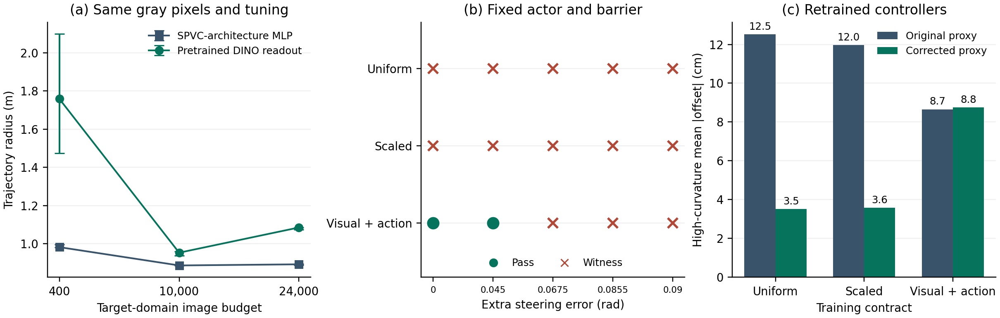

# SPVC 的三项对照实验：AEBS 公平比较、冻结车道策略、重新综合控制器

2026-11-17，服务器 `10.11.154.191:20147` 的 `vt` 环境。AEBS 使用原 SPVC 的 H5 任务和另行保存的 CARLA 图像。车道保持在每个实际到达的状态重新渲染图像。读表时，AEBS 的半径为整条轨迹测距误差的 95% 分割保形校准半径，车道的转向余量指固定证书在包络内能再容许的外加前轮转角。任务成功、误差覆盖和证书成立分别统计。

| 论文要回答的问题 | 本次数据支持的结论 |
|---|---|
| 给原结构公平的目标域训练，DINO 是否仍有测距收益？ | 相同灰度像素与调参机会下，三个预算、三个种子的九对比较均由原结构取得更小的轨迹半径。 |
| 对一个冻结的非线性控制器，动作信息是否值得纳入视觉误差界？ | 在同一曲率补偿和同一神经屏障下，两种盒都存在零额外扰动的屏障反例；加入动作偏差约束后，五种曲率均容许额外 ±0.045 rad 的转向误差。 |
| 重新训练改善了什么？ | 保持同一误差盒和旧屏障，仅更换为重训的统一或分维策略，就能消除旧策略的认证失败。急弯跟踪改善主要来自共同观测补偿；补偿后的联合重训臂反而有更大的横向偏差。 |

左图的点为三个训练种子的中位数，线段为最小至最大值。中图的圆点表示五种曲率全部通过，叉号表示至少有一个真实的模型内屏障反例。右图是每个训练臂在急弯上的平均绝对横偏，越低越好；同色柱使用同一批外生场景，两种颜色来自不同轮次的独立盲测。[论文用矢量图](../../assets/spvc_benefit_20261117/controlled_studies.svg) · [绘图代码](../../../artical-F122/Aebs/experiments/plot_controlled_studies.py)

## 一、AEBS 的收益来自哪里

### 原方法与原指标

保留作者发布的条件生成器、状态估计头和 PPO 初始化权重。沿作者仓库的训练及随机屏障验证入口，按原评分方法完成 8 次复跑，共 808 轮验证。默认设置下，三个种子的交替综合最高分为 **95.4759%、90.5584%、90.9510%**，固定策略为无可计分分离、91.6185%、83.1985%。另在同一种子使用论文正文列出的学习率运行两种训练设置。单独报告了论文表 1 的固定策略 **72.6%** 和交替优化 **94.2%**。

作者公开的 14 个可达提交中缺少与表 1 对应的最终策略和随机屏障权重。本次检查的是重新训练的候选。在五个可按源码计分的默认候选上，独立审计均找到了违反随机后继期望下降条件的数值反例。以种子 171 的交替模型为例，源码第 93 轮标记接受并给出 95.4759%；独立审计在相关安全状态上计算出的期望漂移为正。因此该分数保留作**源码复跑分数**。这项复核没有否定论文未发布的那一对权重。[原随机 SBC、训练协议、期望漂移检查与原指标](../AEBS/AEBS_原SPVC随机SBC复跑与前后端交叉_20261117.md)

### 可归因的前端和后端比较

同预算实验每档从同一源 RGB 图像取样，比较原结构的图像测距 MLP 与冻结 DINO 后训练的读出。两者都看相同的 32×32 灰度像素、训练 100 轮、使用相同批序、可从相同两个 Adam 学习率择优，分别用三个配对训练种子运行。再在 DINO 内做“32 或 640 源分辨率 × 灰度或 RGB”消融。DINO 均在自身预处理后进相同骨干。“640”指保留高分辨率源像素直到该预处理。外部预训练资源仍属于 DINO 方案。

| 目标域原 RGB 图总包 | 前端梯度训练 / 开发选型 / 包内测试图库 | 轨迹 CP 和盲测如何计数 |
|---:|---|---|
| 400 | 240 / 88 / 72 张 | 各冻结前端和回放律使用 199 条校准、100 条盲测 |
| 10,000 | 6,000 / 2,000 / 2,000 张 | 同上 |
| 24,000 | 14,172 / 4,908 / 4,920 张 | 同上 |

严格总包使用本档测试帧组建相机库。共同评测使用独立列账的 3,229 张测试帧，从所有前端训练、开发图像中按文件、像素去重；它们是小预算模型的额外评测资源。校准样本的单位是整条闭环轨迹。每次按当前位置、天气及车色查图。额外回放次数需要计费，但查表不产生新的独立相机图像。旧主划分中的不同预算并不嵌套，因此还固定了训练、开发和测试各自的抽样次序，专门复查样本量效应。[同源图像、训练、嵌套抽样与成本明细](../AEBS/AEBS同源同信息_三档预算与输入消融_20261117.md)

**相同调参机会改变了结论。** 下表是 3,229 帧共同库上三个训练种子的轨迹半径中位数，单位是米。每一列都使用同一个鲁棒控制器和验证器。

| 总包 | 原结构 MLP，灰度 32 | DINO 灰度 32 | DINO RGB 32 | DINO 灰度 640 | DINO RGB 640 |
|---:|---:|---:|---:|---:|---:|
| 400 | **0.982** | 1.758 | 1.812 | 1.534 | 2.214 |
| 10k | **0.886** | 0.953 | 0.938 | 0.944 | 0.937 |
| 24k | **0.892** | 1.085 | 0.967 | 1.082 | 1.423 |

在同像素、同训练与学习率搜索预算下，原结构灰度头有更紧的误差半径。400 档原头的三个种子均 100/100 成功，灰度 DINO 分别有 9、9、14 条危险终止。单独固定原头输入、种子和批次顺序，把学习率由 0.0001 换到 0.001，三个半径分别从 4.226、3.996、5.086 m 变为 0.997、0.981、0.982 m。此前的“DINO 降低 58.1%”只适用于旧实验选中的两套训练配方，不再用作公平前端收益。在真正嵌套的样本量对照中，灰度 MLP 三档为 1.029、0.888、0.888 m，灰度 DINO 为 2.051、1.100、1.077 m，均随预算增加而改善或接近持平。改变颜色或分辨率的影响取决于预算，在所有三档均没有给 DINO 带来相对原头的证书优势。

**闭环验证和成本。** 3 个预算 × 5 个模型/输入组合 × 3 个训练种子得到 45 个冻结模型，各做两种回放，合计 90 个协议组合。严格 10k 库的 15 组均通过同一 ±0.45 m 父证书，其余 75 组均实际找到了当前屏障的正漂移见证。主实验 17,910 条校准运行与 9,000 条盲测运行分别用了 **3,418,487 和 1,723,669 次**缓存查图；两种相机律和各模型共享 199 与 100 个外生随机情形。预先对 24,000 个源 RGB 帧作四种 DINO 编码（96,000 份特征），额外实时相机采集为 0。嵌套、独立学习率与控制器交叉属附加诊断，未混入这组 90 臂账目。[90 组配对结果](../../../artical-F122/results/aebs_factorial_20261117/replay/seed_summary.csv) · [主实验成本账](../../../artical-F122/results/aebs_factorial_20261117/replay/audit_costs.json)

前端和控制器也可以交叉。下表固定共同图库、同像素灰度、第一组预先指定的训练种子及同一批 100 个盲测场景，比较原发布 PPO 初始策略和当前鲁棒策略。两者读取同一个物理距离预测和同一个速度，各自按自己的输入尺度换算。每个控制器独立校准。表中为 **目标成功 / 危险终止**。

| 总包 | 前端 | 原发布 PPO | 当前鲁棒控制器 |
|---:|---|---:|---:|
| 400 | 目标域重训原结构 MLP | 100 / 0 | 100 / 0 |
| 400 | 同像素 DINO | 68 / 32 | 91 / 9 |
| 10k | 两种前端，各自计 | 100 / 0 | 100 / 0 |
| 24k | 两种前端，各自计 | 100 / 0 | 100 / 0 |

在 400 档固定 DINO 时，单换控制器就少了 23 条危险终止，但 9 条危险轨迹仍应计入。在该共同库上这十二个组合均为 0/100 条全程满足 ±0.45 m。另在全 24k 密集部署库中，原发布视觉头与当前 RGB DINO 的对照保留原结论。将 DINO 分别接到本次重训的原生交替策略和当前鲁棒策略，两边都有 1,985/2,000 条在 ±0.45 m 内，目标成功却分别为 0/2,000 和 2,000/2,000。原因在于 ±0.45 m 的证明绑定当前策略，给不同策略喂相同质量的观测，并不能移用该证书。这两组代表不同图库和不同原生策略，结果应各自引用。[共同图库两控制器配对表](../../../artical-F122/results/aebs_factorial_actor_cross_20261117/summary.csv) · [密集图库的原生交替控制器交叉结果](../../../artical-F122/results/aebs_original_random_sbc_20261117/evidence.json)

## 二、面对非线性控制器，动作约束能否扩大可认证范围

车道曲率取 0、±0.01、±0.02 m⁻¹。初态均匀抽自横向 ±0.25 m、航向 ±0.06 rad 的矩形。每条轨迹在同一个曲率上走 80 步。三种集合分别为统一盒、按两维残差尺度拟合的盒、同时约束视觉误差和实际非线性转向差的集合。最后一种使用 **π(相机读数) 与 π(理想读数) 的差**，包括转向饱和。共同的神经屏障检查初始分离、危险分离和集合中所有允许后继的不增条件。反例由具体状态和允许误差在真实网络中复算。

**保留原代理。** 在第一次五曲率新采的 199 条校准、100 条盲测上，三个集合都是 97/100 全程覆盖，观察到 0 次越界。联合集合把相同状态处相机误差在一个控制周期内可造成的最坏航向变化差至少缩小 52.29%，三种集合在五曲率合并校准下却都存在零额外扰动的屏障反例。追加的分组检查把问题定位到 ±0.02 m⁻¹。按已知曲率大小单独校准后，0 与 ±0.01 各组有通过的证明，±0.02 的三种集合仍有反例。[固定旧代理、连续域验证和按曲率诊断](../车道保持/车道保持_固定神经策略五曲率三种误差集合_20261117.md)

**加入共同的目标域偏差补偿。** 将上一批 199 条旧策略轨迹划为发展数据，按一个已知道路曲率拟合一个固定的二维偏置 b。状态侧代理由 g(x) 变为 g(x)+b(κ)，线上向同一策略输入相机读数减 b(κ)。三臂共用同一偏置表、旧控制器、旧神经屏障和同一套新完整图像轨迹。在 ±0.02 处横向和航向误差会随转弯方向改变符号，这一步把可预测部分从剩余不确定性中去掉。推理时只查已知曲率，未使用真实横向位置或航向。

| 固定同一已补偿视觉、同一旧策略与旧屏障 | 全五曲率，零外加扰动 | 全五曲率，额外转角 ±0.045 rad |
|---|---|---|
| 统一盒 | 有正漂移反例 | 相同反例仍允许 |
| 分维盒 | 有正漂移反例 | 相同反例仍允许 |
| 视觉及非线性转向联合约束 | 通过连续域数值检查 | **通过** |

这回答了第二项中最难归因的问题。三组使用同样的补偿后，单独改变误差集合，就能从零额外扰动下有反例，变为在 50 m 半径弯道也能证明容忍约 **2.58°** 的额外转角。统一盒的两维归一化半宽均为 0.12385，其直道反例需要归一化动作差 0.75708。联合集合允许的视觉半宽反而更大，分别为 0.15693 和 0.15729，但允许的动作差最多 0.30899，排除了上述不利组合。进一步加到 ±0.0675 rad，联合集合也出现正漂移实例。这里的容许量是**以视觉误差在管内为前提的模型验证**。真实执行器持续受额外扰动会改变图像访问分布，对这种分布给概率结论还需要相应的校准。[补偿后统一盒审计](../../../artical-F122/results/lane_paired_synthesis_target_20261117_v2/fixed_corrected/uniform/supplemental_audit.json) · [补偿后联合集合审计](../../../artical-F122/results/lane_paired_synthesis_target_20261117_v2/fixed_corrected/joint/supplemental_audit.json)

## 三、同等预算重新训练控制器和屏障

三个训练臂从相同的现有检查点暖启动，控制器 **4,481** 个参数，神经屏障 **193** 个参数。每臂三轮反例反馈，每轮控制器和屏障各更新 80 步，每个网络共 **240 步**。反例搜索每轮限时 30 s，最终连续域验证每个扰动幅值、每臂限时 180 s，并限制同样的网格和细分深度。训练后冻结最终迭代的权重，各策略分别从它实际访问的状态重新渲染、各自用 199 条轨迹校准。所有阈值冻结后，才开始 100 个配对场景的盲测。校准、测试和早期训练数据的来源、随机种子和模型哈希可单独复查。[训练、冻结与逐臂验证报告](../车道保持/车道保持_五曲率同预算控制器与屏障重综合_20261117.md)

**第一轮采用原开发误差集合。** 在 100 条盲测中有 41 条 |κ|=0.02 的急弯。平均绝对横向偏差分别为统一盒 **0.12524 m**、分维盒 **0.11963 m**、联合 **0.08657 m**。联合相对统一少 **0.03867 m（30.87%）**，41 对均改善，按整轨迹配对重抽样的 95% 区间为 **[0.03627, 0.04104] m**。同期平均每步转角变化从 0.04967 增至 0.05478 rad，增加约 10.3%。三臂在实际盲测均 0 次越界，在五曲率合并校准后都未建立鲁棒证书。因此本轮的 30.87% 可以作为**指定检查点的跟踪性能改善**。一个共同训练种子上的轨迹区间没有覆盖换训练种子带来的差异。[第一轮盲测与配对区间](../../../artical-F122/results/lane_paired_synthesis_20261117_v1/blind_summary.json)

**第二轮把训练分布与目标道路对齐。** 各臂共用前述曲率偏置，使用同一批已转作开发数据的五曲率轨迹设定训练误差，仍从完全相同的旧权重开始，保持三轮反例反馈、网络步数和最终验证限时不变。冻结后使用不同于第一轮的种子，原始相机读数、校正后的低维读数、误差和实际动作分别存档。额外运行“旧控制器＋原代理”和“旧控制器＋同一补偿”两条基线，两者使用与三条重训策略配对的初态和曲率。这样可检验相机偏差校正的作用，也可在校正完全相同的条件下检验换控制器的增量作用。

用各自冻结后的轨迹分别校准，三个重训臂都在五曲率、零附加执行器扰动下通过；统一与分维臂在 ±0.045 rad 都出现具体屏障反例，联合臂在该幅值仍通过。用同一误差集合再交换部件：把已补偿旧策略的统一误差盒（两维半宽均为 0.123852）和原神经屏障都固定，旧策略出现反例，换成重训统一或分维策略后零额外扰动的五曲率检查通过。反过来固定旧策略，仅换相应新屏障，反例仍存在。这组对照把改善定位到**控制器权重**。共同误差盒本身提供条件鲁棒结论，概率声明仍需用每个实际控制器自己的校准记录。[固定误差盒的部件交叉](../../../artical-F122/results/lane_paired_synthesis_target_20261117_v2/common_box_cross) · [各臂自己的验证与重新校准](../../../artical-F122/results/lane_paired_synthesis_target_20261117_v2)

**第二轮的盲测把跟踪精度与认证能力分开。** 五套系统各跑相同的 100 个新场景，其中 38 个为半径 50 m 的急弯。横偏是每个时刻车辆中心到车道中心线的绝对距离，先在每条轨迹内平均，再对急弯轨迹平均。

| 输入与策略 | 急弯平均绝对横偏 | 盲测越界 | 全程满足本臂的误差集合 |
|---|---:|---:|---:|
| 原输入，旧策略 | 0.11627 m | 0/100 | 统一、分维、联合各 98/100 |
| 共同补偿，旧策略 | **0.03426 m** | 0/100 | 统一 92、分维 92、联合 96/100 |
| 共同补偿，重训统一盒策略 | 0.03520 m | 0/100 | 98/100 |
| 共同补偿，重训分维盒策略 | 0.03577 m | 0/100 | 94/100 |
| 共同补偿，重训联合约束策略 | 0.08759 m | 0/100 | 97/100 |

只改观测补偿、保持旧策略权重，38 对急弯横偏全部降低，平均少 **0.08202 m（70.54%）**，配对 95% 区间 [0.07969, 0.08434] m。同样补偿后，联合重训相对统一重训在 38 对中都跟得更差，平均多 **0.05239 m**，区间 [0.05050, 0.05427] m。统一与分维重训相对已补偿旧策略分别多 0.00094 和 0.00151 m，这两项区间均跨零。第一轮观察到的联合重训精度收益依赖实验配置。以上区间针对冻结系统与整轨迹抽样，两轮每臂各用一个匹配训练种子。[盲测原始统计与配对区间](../../../artical-F122/results/lane_paired_synthesis_target_20261117_v2/blind_summary.json)

对两套联合系统追加相同预算的细网格验证，已补偿旧网络通过到 ±0.063 rad，重训联合网络通过到 ±0.0495 rad。后者在 0.054 至 0.0675 rad 未决，在 0.0855 rad 有反例。可报告的是各自**已证明的余量**，真实极限可能落在未决区间。固定旧网络加共同补偿和联合集合，同时取得本轮最低的急弯平均横偏与最大的已证转向余量。[六组细网格审计](../../../artical-F122/results/lane_paired_synthesis_target_20261117_v2/margin_sensitivity/)

**实际图像采集成本。** 固定旧策略一次、第一轮重新综合 3 个策略、第二轮连同两个旧策略基线共 5 条控制路径。每条路径用 199 条校准、100 条盲测、每条 80 个时刻，合计 **2,691 条闭环运行、215,280 个实际控制时刻的重新渲染观测**。相同外生初态与曲率在配对策略之间复用，最后一小批推理补齐的样本不计入这些数字。三个集合共用同一策略时只收一份轨迹。此处的渲染成本与 AEBS 的缓存查图次数不等价。

## 安全口径和复现

- **原 SPVC。** 原指标的概率来自指定随机后继律和随机屏障定理。源码“接受”与独立验证期望不增是两层判断。加性后继噪声还可能引起离域，原生随机模拟的结果与不加该噪声的固定相机回放分开报告。
- **当前 AEBS 与车道。** 神经鲁棒屏障检查误差集合内每个相关后继。以车道为例，初始区域要求 B≤1，危险区域要求 B≥20，相关安全状态的所有允许后继要求 B 不增。成功检查给出包络内避险。对冻结模型和规则、同分布可交换的整轨迹，分割 CP 给出 95% 边际覆盖；若 A 是根据此次校准所发证书通过审计的事件，得到 P(A 且新轨迹不安全)≤0.05。该式区别于对任意一次已接受校准集的条件风险。这里的 AEBS 与车道神经网络检查均为浮点数值区间审计。已知五个离散曲率、固定相机、车辆模型、误差输入和 80 步时域规定了车道结论的适用范围。
- **复核。** 五曲率采集逐帧渲染并保存每条轨迹的图像哈希；独立程序从物理状态和权重重算所有实际动作、动力学后继、各臂的校准顺位和盲测覆盖数，也按状态重渲染抽选的整条轨迹。两轮重综合均保存权重、随机种子、全部最终阈值和通过、反例、未决的分类。共同图库 AEBS 控制器交叉中的六个鲁棒策略臂也逐条与主实验核对，100 个场景的终止类型和峰值分数一致。[车道独立检查入口](../../../artical-F122/Aebs/lane_paired_synthesis/check_results.py) · [AEBS 后端交叉入口](../../../artical-F122/Aebs/experiments/factorial_aebs_actor_cross.py)
