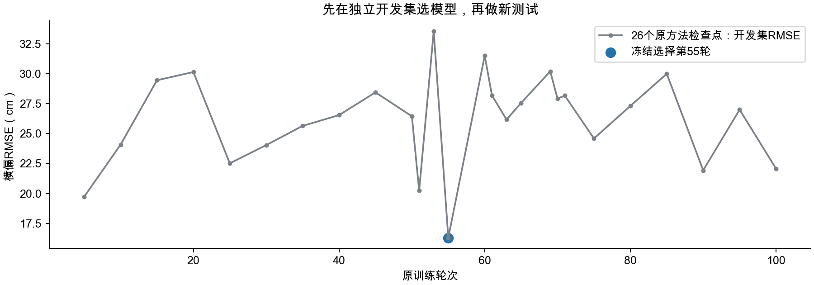
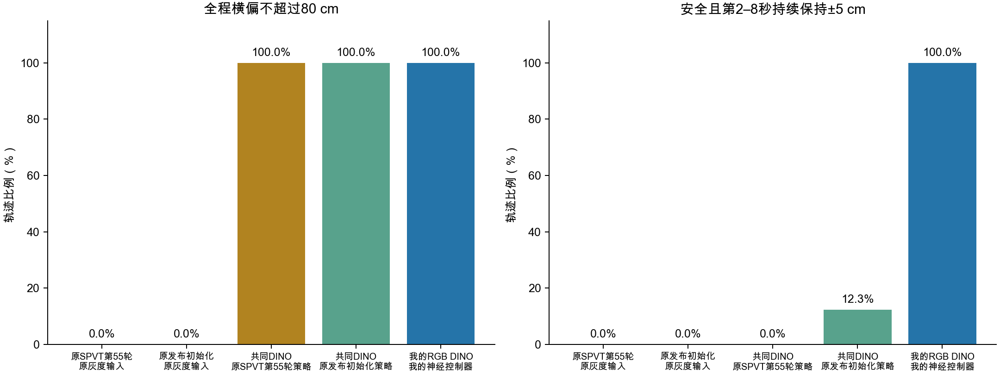
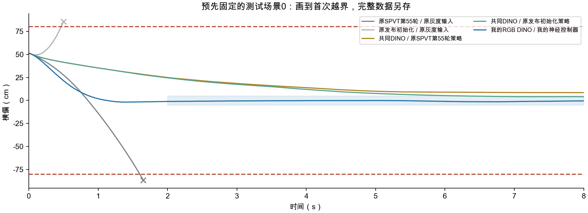
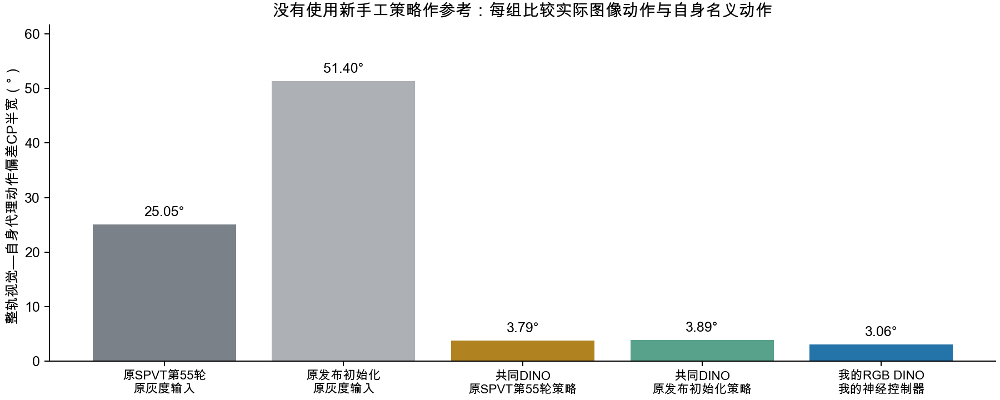
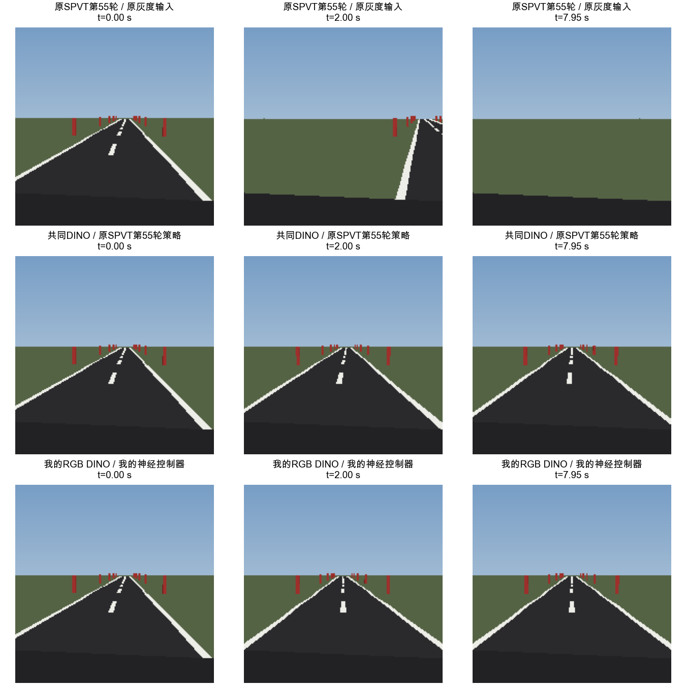

# SPVT与当前RGB框架：原实现对照、任务精度与代理误差

2026年11月23日。服务器vt环境实跑，结果归档到main。原SPVT使用原代码与冻结检查点。

**主要结果：** 共同RGB DINO条件下，横偏RMSE从16.092 cm降到6.439 cm，下降59.99%；持续±5 cm由0/1000提高到1000/1000。动作代理CP半宽和任务精度包络同步收紧，神经鲁棒屏障结果见第6节。

## 1. 实验安排

本轮完成两组实验：先在原SPVT生成观测和原车辆模型中，重新选择并测试原训练模型；再把原方法权重与我方RGB DINO神经控制器接入同一个新RGB道路环境。另加共同DINO观测的交叉组，区分图像迁移和控制精度。

| 组别 | 输入到控制动作的实际链路 | 作用 |
|---|---|---|
| 原SPVT完整视觉控制权重迁移 | RGB→原尺寸灰度128维→原SPVT训练控制器 | 完整权重在目标图像域的部署表现 |
| 原发布初始化 | 相同RGB→相同灰度128维→发布PID初始化网络 | 发布初始策略参照 |
| 共同DINO＋原策略 | RGB→DINO二维观测→换算状态单位→原G(0,x̂)→原控制网络 | 固定视觉信息后的策略比较 |
| 我的完整RGB链路 | RGB→DINO→二维观测→我方神经控制器 | 当前RGB版本的任务表现；状态代理为固定归一化Cx |

我方采用固定线性状态代理h(x)=[e/0.85,ψ/0.30]，e以m、ψ以rad计，DINO保留RGB三通道。

网络输入沿用0.85 m与0.30 rad的归一化尺度，安全阈值统一为横偏80 cm。

## 2. 原SPVT模型选型与原任务结果

使用原工程100轮历史训练保存的26个检查点，256个独立开发初态，每条8秒。先比较是否越过原80 cm安全边界，再在同安全率下选横偏RMSE最小者，冻结为第55轮。随后在2000个新测试初态上评价冻结模型。

模型来源为原工程的历史训练：100轮、batch64、IBP、seed0。对照包含开发选定的第55轮、固定第100轮和发布初始化。

**读图：** 横轴是原训练轮次，纵轴是开发轨迹RMSE。蓝点标出开发集选定的第55轮。

### 原生成观测任务的新测试

双方使用原生成器128维观测，车速5 m/s、步长0.05 s、轴距2.5 m，160步共8秒。初始横偏±60 cm、航向±7°；此表每步独立抽取z∈[-0.8,0.8]^10。

| 原生成观测任务 | 危险率 | 横偏RMSE（cm） | 第2–8秒持续±5 cm | 稳定进入±5 cm时间（s，上限8） |
|---|---|---|---|---|
| 原发布PID初始化 | 0.0% | 13.974 | 308/2000 | 4.965 |
| 原SPVT开发选型第55轮 | 0.0% | 15.742 | 0/2000 | 8.000 |
| 原SPVT固定第100轮 | 0.0% | 21.691 | 0/2000 | 8.000 |

三组在原生成观测任务的2000条测试中均保持安全。开发选定的第55轮RMSE为15.742 cm，优于第100轮的21.691 cm。

此前的“128维观测→二维回归→解析反馈”结果作为历史消融归档，本轮主比较采用下面的RGB链路。

## 3. 共同RGB实验流程与设置

每一步根据各控制器的当前状态渲染192×192道路RGB图片。控制器读取该帧的视觉输出，计算动作后更新车辆状态。

| 条件 | 所有测试臂共同设置 |
|---|---|
| 车辆动力学 | 原SPVT的dynamics函数，5 m/s、0.05 s、轴距2.5 m |
| 任务 | 直道，曲率0；8秒、160步 |
| 初态 | 均匀横偏[-60,60] cm、航向[-7,7]°；同一批初态逐臂配对 |
| 安全 | 全程每个采样时刻横偏不超过80 cm |
| 严格精度目标 | 全程安全，且第2秒到第8秒每个时刻都在±5 cm／±10 cm |
| 校准／测试 | 各臂199条校准，冻结全部阈值后，各测1000条新轨迹 |
| 原策略动作 | 原归一化输出按原函数换算至±30° |
| 我方动作 | 原神经网络输出×0.45 rad，再换算为同一动力学函数的归一化接口 |

原SPVT相机接口设为RGB转灰度、双三次缩至16×8、归一化[-1,1]、展开128维；我方保留RGB输入。图像来源为逐状态渲染的合成道路。

我方DINO和投影保持既有权重；神经控制器为预先指定的训练种子202611200701、adversarial_precision版本，3→64 Tanh→64 Tanh→1并限幅。比较条件：原SPVT采用历史训练检查点，我方采用目标道路训练的RGB前端和既有精度／鲁棒控制器，使用DINO外部预训练；两边保留各自训练预算。

| 网络 | 逐层结构 |
|---|---|
| 原SPVT生成器 | 输入10维z＋2维状态→256 ReLU→256 ReLU→256 ReLU→128 Tanh，输出8×16灰度观测 |
| 原SPVT控制器 | 128→64全连接＋BatchNorm＋ReLU→32全连接＋BatchNorm＋ReLU→8全连接＋BatchNorm＋ReLU→1 Tanh |
| 我方视觉读出 | 冻结DINOv2 ViT-S/14，16×16网格、每格384维；1×1卷积384→64 GELU→3×3卷积64→64 GELU→1×1卷积64→1；空间soft-argmax得到二维位置，再经2→2线性层输出观测 |
| 我方控制器 | 3→64全连接 Tanh→64全连接 Tanh→1全连接，限幅[-1,1]；第三维为已知曲率，本轮固定0 |
| 我方状态代理 | 固定线性归一化h(x)=[e/0.85,ψ/0.30]，用于离线预测名义观测 |
| 本轮我方新屏障 | 2→16全连接 Tanh→8全连接 Tanh→1全连接 ReLU；离线验证对应控制器的安全条件 |

原SPVT的端到端验证图包含生成器和控制器，合计178625个参数；我方后端验证低维控制器4481个参数和屏障193个参数，DINO通过CP误差接口与后端连接。系统推理和预训练还包含DINO与视觉读出。

两种前端读取同一渲染规律；相同初态下第一帧相同，动作不同后，各自读取自己的新帧。共同DINO交叉也仅固定观测函数，各控制器之后的轨迹允许不同。

## 4. 全部任务成绩

**最直接的受控收益：共用RGB DINO观测时，对比原SPVT开发选定策略，我方横偏RMSE下降59.99%，从16.092 cm降到6.439 cm；持续±5 cm由0/1000提高到1000/1000，两组均全程保持80 cm安全约束。** 进入并持续保持±5 cm的平均时间从7.748 s降至0.781 s。没有稳定进入的轨迹按8 s计，因此该时间也包含原策略未达到精度要求的情形。

原策略保留原训练目标，我方控制器已有精度与鲁棒微调；本组固定视觉函数，评价两套控制策略的精度和响应速度。

按整条轨迹配对重采样4000次，我方减去原SPVT策略的RMSE差为-9.653 cm，95%配对bootstrap区间为[-9.849, -9.456] cm。该区间的统计单位为配对轨迹，适用于本轮冻结模型和场景分布。

| 共同RGB测试组 | 全程安全／N | 持续±5 cm／N | 持续±10 cm／N | 全轨RMSE（cm） | 转向每步平均变化（°） |
|---|---|---|---|---|---|
| 原SPVT第55轮＋原灰度输入 | 0/1000 | 0/1000 | 0/1000 | 1194.897（含越界后） | 0.290 |
| 原发布初始化＋原灰度输入 | 0/1000 | 0/1000 | 0/1000 | 836.779（含越界后） | 0.324 |
| 共同DINO＋原SPVT第55轮策略 | 1000/1000 | 0/1000 | 78/1000 | 16.092 | 0.491 |
| 共同DINO＋原发布初始化策略 | 1000/1000 | 123/1000 | 275/1000 | 15.202 | 0.714 |
| 我的RGB DINO＋我的神经控制器 | 1000/1000 | 1000/1000 | 1000/1000 | 6.439 | 0.843 |

**左图**回答是否全程保持原80 cm安全约束；**右图**进一步要求第2–8秒每一帧都保持±5 cm。每条完整轨迹是一个统计样本，包含160个控制步。

安全组之间比较持续达标率与RMSE；越界组的RMSE记录完整8秒行为。转向每步变化衡量动作活跃程度，我方精度提升同时伴随更大的转向变化。

**读图：** 浅蓝区域从第2秒开始表示±5 cm目标；×表示首次越界，图只画到该点。原始8秒轨迹未截掉，保存在结果文件中。

## 5. 代理误差与CP结果

本轮动作误差定义为每个模型的**实际图像动作－自身名义代理动作**：

$$R_i^u=\max_t|u^{cam}_{i,t}-u^{proxy}_{i,t}|.$$

原SPVT名义动作取原G(0,x)和原控制器输出；我方名义动作取我方神经控制器读取h(x)。共同DINO的原策略分支使用G(0,x̂)，因此该分支的分数衡量DINO观测误差传到原名义策略后的动作偏差。全部偏差统一换算为转向角度统计。

| 共同RGB测试组 | 动作代理CP半宽（°） | 测试覆盖／N | 安全＋尾部精度CP半宽（cm） |
|---|---|---|---|
| 原SPVT第55轮＋原灰度输入 | 25.046 | 965/1000 | 无有限界 |
| 原发布初始化＋原灰度输入 | 51.396 | 912/1000 | 无有限界 |
| 共同DINO＋原SPVT第55轮策略 | 3.791 | 947/1000 | 35.225 |
| 共同DINO＋原发布初始化策略 | 3.889 | 955/1000 | 39.001 |
| 我的RGB DINO＋我的神经控制器 | 3.061 | 952/1000 | 1.704 |

动作CP半宽衡量实际视觉动作与自身代理动作的偏差，任务CP半宽衡量安全轨迹的尾部横偏。各策略按自己的闭环轨迹分别校准，原SPVT行采用相同的事后评价流程。

在共同DINO的原SPVT策略与我方策略之间，动作代理半宽减少19.25%；任务尾部精度半宽减少95.16%。两项分别对应动作代理误差和物理跟踪精度。

覆盖列为独立测试的实际计数；95%目标的概率含义统一在第6节说明。

### 原生成代理的动作区间覆盖

另外取1000条新测试轨迹的同一初始状态、同一第一帧，使用原网络和已有backward LiRPA选项，对全部z∈[-0.8,0.8]^10计算原G与控制器的动作区间，再检查真实RGB经原灰度输入得到的动作是否在区间内。该项固定在相同初态的第一帧，直接评价原生成代理对目标相机输出的覆盖。

| 原模型 | 原代理动作区间包含真实相机动作／1000 | 原代理动作区间平均全宽（°） | 落在区间外的距离P95（°） |
|---|---|---|---|
| 原SPVT第55轮＋原灰度输入 | 561/1000 | 24.008 | 12.216 |
| 原发布初始化＋原灰度输入 | 530/1000 | 47.567 | 10.603 |

第55轮模型的原代理动作区间覆盖561/1000个目标RGB动作，发布初始化覆盖530/1000个。区间外距离的P95分别为12.216°和10.603°，量化了目标图像域中实际观测与生成代理的适配差距。

[全潜变量区间原始结果](../../../artical-F122/results/spvt_complete_comparison_20261123/native_proxy_coverage_v2/summary.json)

### 我方低维视觉误差集合

我方按一整条轨迹、全部160个观测时刻、两个归一化坐标同时取最大绝对残差。199条校准取第190个顺序统计量，得到q=0.083471656。对应整个矩形为横偏误差±7.095 cm、航向误差±1.435°。该矩形由一个联合分数校准，同时约束两个坐标及全部观测时刻。

在新测试中，970/1000条全程满足此低维误差集合。共同DINO交叉组的q可能不同，变化来自不同策略的状态访问分布，DINO权重保持相同。

| CP对象 | 本轮用途 |
|---|---|
| 二维视觉观测－状态代理h(x) | 构造神经屏障使用的鲁棒误差集合 |
| 实际图像动作－自身名义代理动作 | 统一评价实际视觉与自身代理的动作偏差 |
| 全程安全＋第2–8秒尾部横偏 | 给出新轨迹安全与尾部跟踪精度的统计界 |

## 6. 安全与精度保证

### A. 直接从新轨迹校准的安全＋精度统计界

另定义任务分数：轨迹任何时刻越过80 cm则为无穷大，否则取第2–8秒的最大绝对横偏。也用199条校准、秩190得到表中的任务半宽。校准轨迹大量越界时，任务半宽记为“无有限界”。

我方本轮任务半宽为1.704 cm。这个界同时包含“全程安全”和“后半段精确跟踪”，前提是固定模型与相同的独立初态／确定相机抽样律。

其统计声明为：P(r有限且（新轨迹危险或尾部误差>r）)≤0.05。概率对校准集与一条新轨迹联合抽样取边际。

### B. 神经屏障对当前观测误差集合的检查

本轮针对5 m/s、0.05 s及横偏±60 cm、航向±7°的初态范围重新学习和验证我方神经屏障，前端与控制器保持冻结。

新任务的神经屏障完成数值区间检查，初始上界为0.000000≤1，危险下界为24.523844≥20，鲁棒不增检查的未决单元和实际反例均为0。它对应本轮冻结控制器、当前误差集合及原SPVT车辆参数。验证采用float64数值区间运算，未做定向舍入。 [新任务证书](../../../artical-F122/results/spvt_complete_comparison_20261123/own_barrier_audit_r4_depth20/certificate.json)。

求解步骤为：先冻结前端和控制器；用本轮视觉CP确定误差集合；在原SPVT车辆参数及较大初态范围上训练我方神经屏障，使初始集低值、危险集高值，并惩罚允许误差下的正漂移；随后做全域区间检查，把发现的模型反例反馈给屏障训练。

实际记录中，初步候选投入4000次参数更新；按正式q继续5000次更新后的候选已在训练样本上满足条件，但全域检查仍发现反例。再反馈训练250次、500次更新后，16层细分尚余1个未决单元，继续到第17层才全部解决。每次更新从训练池抽取一批状态，前端和控制器始终冻结。最终动态分区含41907个已处理单元。证书以全域区间检查全部通过为验收条件。 [训练与验证历史](../../../artical-F122/results/spvt_complete_comparison_20261123/our_barrier_learning_history.json)

本轮屏障还使用辅助航向域|ψ|≤0.30 rad，使模型验证对应的安全域闭合；共同任务实测的原安全指标仍是横偏80 cm。后端验证所有允许视觉误差下的鲁棒不增条件。

在上述数值验证成立的模型下，CP—验证过程满足P(过程给出通过证书且新轨迹危险)≤0.05。观测误差事件覆盖全部160步，连接该8秒视觉轨迹与后端安全条件。

**保证范围：** 固定前端和控制器、相同初态与相机采样律下的160步离散模型。视觉CP和任务精度CP各自给出边际声明，鲁棒屏障覆盖视觉误差集合内的全部允许误差；各项概率分别报告。

## 7. 实际观测样例

每行是一种实际闭环；列为t=0、2.0、7.95 s的取样。第一帧对应相同初态；后续图像随各自状态变化。图像是本轮记录的RGB，原控制器实际读取其16×8灰度版本，我方读取RGB DINO版本。场景由同一个合成道路渲染器逐状态生成。

## 8. 本轮体现的收益

1. **控制精度提升。** 共同RGB DINO下，我方RMSE从16.092 cm降到6.439 cm，持续±5 cm从0/1000提高到1000/1000。
2. **响应更快。** 稳定进入±5 cm的平均时间从7.748 s降至0.781 s，同时记录转向变化这一控制代价。
3. **误差和任务包络更紧。** 动作代理CP半宽缩小19.25%，安全与尾部精度的任务CP半宽缩小95.16%。
4. **实际视觉接入可验证。** 直接校准RGB观测与状态代理之间的整轨误差，970/1000条新轨迹满足该集合；相应神经鲁棒屏障通过全域数值区间检查。
5. **后端验证网络更小。** 原SPVT验证图包含生成器与控制器共178625个参数；我方验证低维控制器与屏障共4674个参数，通过校准误差集合连接大视觉编码器。

## 9. 复现文件

- [原任务登记与模型来源](../../../artical-F122/results/spvt_complete_comparison_20261123/native_task_v2/protocol.json)、[26个检查点开发选型](../../../artical-F122/results/spvt_complete_comparison_20261123/native_task_v2/development_selection.json)、[原任务2000条新测试](../../../artical-F122/results/spvt_complete_comparison_20261123/native_task_v2/summary.json)。
- [RGB实验登记](../../../artical-F122/results/spvt_complete_comparison_20261123/rgb_complete_v3/protocol.json)、[先冻结的CP阈值](../../../artical-F122/results/spvt_complete_comparison_20261123/rgb_complete_v3/frozen_thresholds.json)、[全部新测试结果](../../../artical-F122/results/spvt_complete_comparison_20261123/rgb_complete_v3/summary.json)。
- [原任务执行](../../../artical-F122/Aebs/paper_comparison/spvt_native_checkpoint_study.py)、[共同RGB及交叉执行](../../../artical-F122/Aebs/paper_comparison/spvt_rgb_complete_control.py)、[我方新任务屏障适配](../../../artical-F122/Aebs/paper_comparison/spvt_task_own_barrier.py)。
- [冻结模型、CP契约与数值证书包](../../../artical-F122/results/spvt_complete_comparison_20261123/verified_current_package/contract.json)、[全部输入与样本核对](../../../artical-F122/results/spvt_complete_comparison_20261123/comparison_audit.json)。
