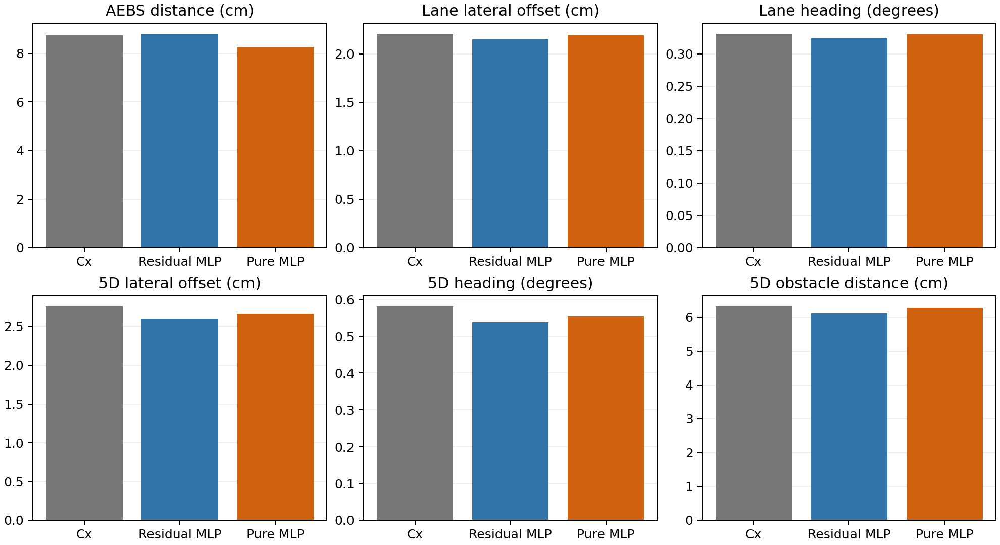

# 完全用神经网络替换 Cx：三个任务的纯全连接代理对照

本轮对 AEBS、车道保持和五维弯道制动，分别训练六种 **$h(x)=\mathrm{MLP}(x)$**。模型由全连接层与激活函数直接组成，最后一层输出即是三维、二维或一维的低维视觉预测。三种任务、三档数据量、六种结构、三个随机种子，共完成 **162 次训练**，在服务器 vt 环境执行。原 Cx 和上轮残差代理使用同一批归档观测与划分参与对照。

| 最大预算下，按开发集选型 | 原 Cx | 选中的纯网络 | 三种子平均测试 MAE |
|---|---|---|---|
| AEBS 距离（cm） | 8.7415 | 一层 ReLU | 8.2612 |
| 车道横偏（cm）/航向（°） | 2.2089 / 0.3315 | 两层 SiLU | 2.1912 / 0.3307 |
| 五维横偏（cm）/航向（°）/距离（cm） | 2.7611 / 0.5817 / 6.3267 | 两层 ReLU | 2.6586 / 0.5538 / 6.2744 |

AEBS 开发选中的一层纯 ReLU，相对原 Cx 的测试距离 MAE 降低约 **5.49%**，绝对改善约 **4.80 毫米**。纯两层 SiLU 的测试值更低（7.4153 cm），但开发集选中了其它结构；这个数作为全结构结果保留。

车道开发选中两层纯 SiLU，横偏和航向 MAE 分别改善约 **0.80%、0.22%**，仍高于上轮两层残差 ReLU 的 2.1525 cm、0.3240°。五维开发选中两层纯 ReLU，三项 MAE 相对原 Cx 分别改善约 **3.71%、4.80%、0.83%**，也高于上轮两层残差 ReLU 的 2.5996 cm、0.5379°、6.1116 cm。上述结果对应固定视觉前端下的代理误差。

## 1. 纯网络每一层做什么

### 1.1 网络在学习哪条对应关系？

每个训练样本包含同一时刻的图像和真实状态。图像送入冻结的 DINO 与视觉投影，得到低维向量 $y$；真实状态经过归一化后送入小网络，得到预测向量 $\hat y=h_\phi(x)$。训练让两个向量尽量接近。

| 路线 | 输入 | 处理 | 输出及作用 |
|---|---|---|---|
| 图像路线 | 图像 $I$ | 冻结 DINO，再经过冻结的视觉投影 $p$ | $y=p(\mathrm{DINO}(I))$，作为训练目标 |
| 状态路线 | 归一化真实状态 $x$ | 本轮训练的全连接网络 | $\hat y=h_\phi(x)$，预测上述视觉输出 |

本轮更新的是状态路线的小网络参数 $\phi$。例如，某个车道状态对应的图像让视觉前端输出两个数，网络就根据该状态学习预测这两个数。

### 1.2 三个任务分别有几个输入、几个输出？

| 任务 | 输入的实际内容 | 输入神经元数 | 输出神经元数 | 最后一层的输出含义 |
|---|---|---:|---:|---|
| AEBS | 距离 $d/3.18272$，$d$ 以 m 计 | 1 | 1 | 一维预测视觉坐标 |
| 车道保持 | 横偏 $e/0.85$、航向角 $\theta/0.30$，原单位分别为 m、rad | 2 | 2 | 二维预测视觉向量 |
| 五维弯道制动 | 横偏 $e/0.65$、航向角 $\psi/0.19$、障碍距离 $(d-4)/2$，原单位为 m、rad、m | 3 | 3 | 三维预测视觉向量 |

五维弯道任务的完整动力学状态还包含车速和转角，这两项由直接测量提供。视觉代理学习另外三个有视觉观测的坐标，所以本轮网络输入、输出均为三维。

例如，车道横偏为 0.17 m、航向偏差为 0.03 rad 时，网络读入的是 $(0.2,0.1)$。输出维数与冻结视觉前端的低维向量维数对应。

### 1.3 “一层”和“两层”按什么数？

本文按**隐藏层数量**命名。隐藏层位于输入与最终输出之间，每层都含 16 个神经元。因此，一层网络包含两次全连接计算，两层网络包含三次全连接计算。

以车道任务为例：

| 计算顺序 | 一层网络 2→16→2 | 两层网络 2→16→16→2 | 这一步在做什么 |
|---|---|---|---|
| 输入 | 2 个数 | 2 个数 | 读入归一化横偏、航向 |
| 第一隐藏层 | 全连接 2→16，再做激活 | 全连接 2→16，再做激活 | 形成 16 种不同的输入响应 |
| 第二隐藏层 | 直接进入输出层 | 全连接 16→16，再做同种激活 | 进一步组合第一层的 16 个响应 |
| 最终输出层 | 全连接 16→2 | 全连接 16→2 | 将隐藏响应加权组合成两个预测视觉坐标 |

“16”表示这一层有 16 个神经元。每个神经元都接收上一层的全部输出，所以称为**全连接**。例如第一层的第 $j$ 个神经元计算：

$$
t_j=w_{j1}x_1+w_{j2}x_2+b_j,\qquad u_j=\sigma(t_j).
$$

这里 $w_{j1},w_{j2}$ 是两项输入的权重，$b_j$ 是偏置，$\sigma$ 是激活函数。16 个神经元各自具有不同的权重、偏置，形成 16 个隐藏响应。

### 1.4 六种结构逐个列清楚

括号中的激活函数紧跟在前面的全连接层后面。每行最后一个数字表示最终输出维数，该输出层做线性计算。

| 结构 | AEBS 的完整层序 | 车道保持的完整层序 | 五维任务视觉代理的完整层序 |
|---|---|---|---|
| 一层 ReLU | 1→16（ReLU）→1 | 2→16（ReLU）→2 | 3→16（ReLU）→3 |
| 两层 ReLU | 1→16（ReLU）→16（ReLU）→1 | 2→16（ReLU）→16（ReLU）→2 | 3→16（ReLU）→16（ReLU）→3 |
| 一层 Tanh | 1→16（Tanh）→1 | 2→16（Tanh）→2 | 3→16（Tanh）→3 |
| 两层 Tanh | 1→16（Tanh）→16（Tanh）→1 | 2→16（Tanh）→16（Tanh）→2 | 3→16（Tanh）→16（Tanh）→3 |
| 一层 SiLU | 1→16（SiLU）→1 | 2→16（SiLU）→2 | 3→16（SiLU）→3 |
| 两层 SiLU | 1→16（SiLU）→16（SiLU）→1 | 2→16（SiLU）→16（SiLU）→2 | 3→16（SiLU）→16（SiLU）→3 |

所有全连接层都有可训练权重和偏置。各个任务、各个训练数据量和三个随机种子都按这六种层序执行。因此 162 次训练的变化因素为任务、训练量、激活函数、隐藏层数和训练随机种子，隐藏层宽度始终为 16。

### 1.5 ReLU、Tanh、SiLU 在每层做什么？

激活函数逐个处理隐藏神经元的加权计算结果，为网络提供非线性表达能力。若多次全连接计算之间都只做加权和，它们整体仍可以合并为一个仿射映射。

| 激活函数 | 公式 | 直观含义 |
|---|---|---|
| ReLU | $\sigma(t)=\max(0,t)$ | 将负响应置零，正响应保留，可形成分段变化关系 |
| Tanh | $\sigma(t)=\tanh(t)$ | 将响应平滑压到 −1 到 1，较大的正负输入逐渐饱和 |
| SiLU | $\sigma(t)=t/(1+e^{-t})$ | 根据输入平滑调节响应大小，并保留部分负响应 |

例如，三个神经元的加权计算结果为 $(-2,0,2)$，经过 ReLU 后变为 $(0,0,2)$。代码会对该层全部 16 个结果分别执行同一激活函数。

### 1.6 最后一层到底是什么意思？

以两层 ReLU 车道网络为例，第二隐藏层做“16→16 全连接＋ReLU”，随后**最终输出层做 16→2 全连接**，其计算为：

$$
\hat y_1=\sum_{j=1}^{16}a_{1j}u_{2j}+c_1,\qquad
\hat y_2=\sum_{j=1}^{16}a_{2j}u_{2j}+c_2.
$$

$a_{1j},a_{2j}$ 是可学习的输出权重，$c_1,c_2$ 是偏置。它将 16 个隐藏响应汇总成两个预测视觉坐标。输出为线性组合，可以取正值或负值，适合拟合冻结视觉前端的低维坐标。

一层网络和两层网络的完整公式分别为：

$$
u_1=\sigma(W_1x+b_1),\qquad
h_\phi(x)=W_2u_1+b_2,
$$

$$
u_1=\sigma(W_1x+b_1),\qquad
u_2=\sigma(W_2u_1+b_2),\qquad
h_\phi(x)=W_3u_2+b_3.
$$

### 1.7 参数量怎么算？

一个 $a\rightarrow b$ 的全连接层具有 $ab+b$ 个可训练参数，分别为 $ab$ 个权重和 $b$ 个偏置。上述激活函数本身没有可训练参数。

AEBS 一层网络为 1→16→1，参数量为：

$$
(1\times16+16)+(16\times1+1)=49.
$$

增加第二隐藏层会额外增加 $16\times16+16=272$ 个参数，所以两层为 $49+272=321$ 个。

| 任务 | 一层参数量 | 两层参数量 |
|---|---:|---:|
| AEBS | 49 | 321 |
| 车道保持 | 82 | 354 |
| 五维任务的三维代理 | 115 | 387 |

增加隐藏层时，网络深度与参数量一起增加。纯网络按标准随机初始化各全连接层；上一轮残差代理使用相同层序，输出层零初始化，使初始预测为 Cx。

实现检查中，将构造时参考矩阵 C 的数值放大七倍，同一种子构造的纯网络输出逐元素一致。C 在构造阶段仅提供输入输出维数，预测过程直接计算上述 MLP。[纯网络实现](../../../artical-F122/Aebs/paper_comparison/pure_proxy_compare.py)

## 2. 数据、起点和比较方法

视觉分支继续提供冻结目标 $y=p(\mathrm{DINO}(I))$。本轮完全复用上轮已存的每一行状态、视觉输出、原 C、物理尺度及划分，测试集保持固定。纯网络从 PyTorch 全连接层的标准随机初始化出发。旧残差代理的末层从零初始化，起点为原 Cx。这项对照同时反映了结构和起点带来的训练差异。

| 任务 | 训练张数（三档嵌套） | 开发 | 静态校准 | 测试 | 数据来源 |
|---|---|---:|---:|---:|---|
| AEBS | 2,160 / 11,338 / 14,172 | 2,454 | 2,454 | 4,920 | 原 24k CARLA RGB 图像包 |
| 车道 | 2,160 / 6,000 / 12,000 | 1,000 | 1,000 | 2,000 | 上轮新采 16k 道路图像 |
| 五维 | 1,920 / 6,000 / 12,000 | 1,000 | 1,000 | 2,000 | 上轮新采 16k 弯道障碍图像 |

每种结构和预算都使用三个种子 2026112101、02、03，Adam 学习率 0.001，批量 128，共 1,500 次更新。同种子同预算的纯网络与上一轮残差网络具有相同训练行、相同批次序列、相同更新次数。每 50 步检查开发集（包含第 0 步），取开发归一化均方误差最小的权重。架构按三个种子的平均开发误差选，测试只作报告。

为与旧代理统一度量，损失为 $(y-h(x))C^{-T}$ 的坐标均方误差；C 是原冻结视觉系统的参考坐标变换。预测 $h(x)$ 的前向路径只计算 MLP(x)。报告再按原物理尺度换成厘米和度，因此可以和旧实验逐列比较。


### 2.1 损失函数的目标是什么？

本轮根据状态预测固定视觉前端的输出。对第 $i$ 个样本，真实图像产生训练目标 $y_i$，网络输出 $\hat y_i=h_\phi(x_i)$。先将二者的差换算到共同的归一化状态坐标：

$$
r_i=C^{-1}\bigl(y_i-h_\phi(x_i)\bigr).
$$

这里 $C$ 为原冻结视觉系统的参考矩阵。所有候选代理共用同一个 C，因此误差方向与尺度具有共同参照。网络计算 $h_\phi(x)$ 的前向路径直接使用纯全连接模型，C 在损失中承担固定的坐标换算作用。

### 2.2 代码实际优化的损失

批量均方误差写为：

$$
\boxed{
L(\phi)=\frac{1}{Bp}
\sum_{i=1}^{B}\sum_{j=1}^{p} r_{ij}^{\,2}
}
$$

| 符号 | 含义 |
|---|---|
| $B$ | 每个训练批次的样本数，本轮为 128 |
| $p$ | 输出维数，AEBS、车道、五维任务的视觉代理分别为 1、2、3 |
| $r_{ij}$ | 第 $i$ 个样本、第 $j$ 个坐标的归一化误差 |
| $\phi$ | 全连接网络全部可训练权重和偏置 |

代码把每个样本存成一行，因此用残差矩阵右乘 $C^{-T}$ 实现同一个变换，再对全部元素平方取平均。其对应的列向量形式就是上式。[损失与训练实现](../../../artical-F122/Aebs/paper_comparison/proxy_architecture_compare.py)

本轮总损失由这一项观测拟合 MSE 构成。纯网络与上一轮残差网络使用同一个损失定义。

### 2.3 为什么这样设计？

1. **训练目标对应实际视觉输出。** 状态代理要根据状态预测图像分支会输出什么。
2. **在共同归一化坐标中比较。** 用同一个固定 C 换算误差，再对各坐标求平均，使所有候选使用统一的评分尺度。
3. **对较大误差施加更高代价。** 单项误差增大两倍，对应平方损失增大四倍。

例如，一个车道样本经过 C 换算后的误差为 $r=(0.02,0.04)$，则该样本损失为：

$$
L_i=\frac{0.02^2+0.04^2}{2}=0.001.
$$

这里两项均在归一化状态坐标中计算。各坐标按归一化误差等权求平均，乘回原尺度后代表各自的米或弧度误差。

### 2.4 损失数值怎样换成表中的厘米和度？

训练使用归一化 MSE。报告结果则先把残差换成物理单位，再逐维求绝对值和平均值，即 MAE。

| 任务坐标 | 换算方式 |
|---|---|
| AEBS 距离 | 归一化误差乘 3.18272，得到等效距离误差，单位 m，再乘 100 得 cm |
| 车道横偏 | 乘 0.85 得 m，再乘 100 得 cm |
| 车道航向 | 乘 0.30 得 rad，再乘 $180/\pi$ 得度 |
| 五维横偏 | 乘 0.65 得 m，再换成 cm |
| 五维航向 | 乘 0.19 得 rad，再换成度 |
| 五维障碍距离 | 乘 2 得 m，再换成 cm |

例如，车道的归一化横偏误差为 0.02，对应：

$$
0.02\times0.85=0.017\ \mathrm m=1.7\ \mathrm{cm}.
$$

训练日志里的损失 0.001 是归一化平方误差，结果表里的 2 cm 是物理单位的平均绝对误差，两者需要按上述定义分别阅读。表中的“等效误差”使用原 C 的坐标换算，反映新代理与固定视觉输出之间的偏差。

### 2.5 损失怎样用于训练和选模型？

每次更新抽取 128 行训练样本，算出 $h_\phi(x)$，计算上述损失，再用 Adam 更新权重和偏置。每个模型训练 1,500 次更新，学习率为 0.001。

每 50 步以及第 0 步，在固定开发集上计算相同定义的 MSE，保留开发 MSE 最低的权重。结构选择按三个训练种子的平均开发 MSE 进行。最终测试表报告所选权重在测试集上的物理 MAE，因此开发选择的结构和测试 MAE 最低的结构可能不同。

CP 在模型冻结后使用独立校准集计算误差分位数。本轮拟合损失由上述 MSE 决定，CP 分位数作为后续误差诊断单独记录。

## 3. 先看每个任务最大预算的全部结果

以下每格均为三个训练种子的测试 MAE 均值。固定 Cx、线性拟合与仿射基线分别只有一次确定性求解。

### AEBS

距离误差单位为 cm。

| 结构 | 纯 MLP(x) | 上轮 Cx+MLP(x) |
| --- | --- | --- |
| 一层 Tanh | 41.6203 | 8.8141 |
| 两层 Tanh | 14.9199 | 8.7678 |
| 一层 ReLU | 8.2612 | 8.8689 |
| 两层 ReLU | 8.5138 | 8.7293 |
| 一层 SiLU | 8.0072 | 8.8216 |
| 两层 SiLU | 7.4153 | 8.8009 |

| 基线 | 测试 MAE |
| --- | --- |
| 原 Cx | 8.7415 |
| 重拟合 Cx | 8.7202 |
| 仿射 Ax+b | 8.7075 |

开发集选出的纯网络为 **一层 ReLU**，测试误差为 **8.2612**。上轮开发选出的残差网络为 一层 Tanh，其测试误差为 8.8141。这些选择均采用开发 MSE，测试 MAE 的最小值可能由其它结构取得。

### 车道保持

每格依次为横偏（cm） / 航向（°）。

| 结构 | 纯 MLP(x) | 上轮 Cx+MLP(x) |
| --- | --- | --- |
| 一层 Tanh | 2.4741 / 0.3748 | 2.2055 / 0.3305 |
| 两层 Tanh | 2.4320 / 0.3800 | 2.1989 / 0.3304 |
| 一层 ReLU | 2.4684 / 0.4039 | 2.1687 / 0.3259 |
| 两层 ReLU | 2.2442 / 0.3409 | 2.1525 / 0.3240 |
| 一层 SiLU | 2.3143 / 0.3389 | 2.2003 / 0.3306 |
| 两层 SiLU | 2.1912 / 0.3307 | 2.2015 / 0.3303 |

| 基线 | 测试 MAE |
| --- | --- |
| 原 Cx | 2.2089 / 0.3315 |
| 重拟合 Cx | 2.2072 / 0.3309 |
| 仿射 Ax+b | 2.2081 / 0.3311 |

开发集选出的纯网络为 **两层 SiLU**，测试误差为 **2.1912 / 0.3307**。上轮开发选出的残差网络为 两层 ReLU，其测试误差为 2.1525 / 0.3240。这些选择均采用开发 MSE，测试 MAE 的最小值可能由其它结构取得。

### 五维弯道制动

每格依次为横偏（cm） / 航向（°） / 障碍距离（cm）。

| 结构 | 纯 MLP(x) | 上轮 Cx+MLP(x) |
| --- | --- | --- |
| 一层 Tanh | 2.7503 / 0.5756 / 7.0061 | 2.6699 / 0.5587 / 6.2178 |
| 两层 Tanh | 2.7270 / 0.5581 / 6.9872 | 2.6599 / 0.5587 / 6.2343 |
| 一层 ReLU | 2.8260 / 0.5696 / 7.0344 | 2.6358 / 0.5469 / 6.1864 |
| 两层 ReLU | 2.6586 / 0.5538 / 6.2744 | 2.5996 / 0.5379 / 6.1116 |
| 一层 SiLU | 2.8436 / 0.5743 / 6.5297 | 2.6654 / 0.5607 / 6.1915 |
| 两层 SiLU | 2.6833 / 0.5585 / 6.2782 | 2.6467 / 0.5529 / 6.1880 |

| 基线 | 测试 MAE |
| --- | --- |
| 原 Cx | 2.7611 / 0.5817 / 6.3267 |
| 重拟合 Cx | 2.7171 / 0.5755 / 6.2837 |
| 仿射 Ax+b | 2.7171 / 0.5755 / 6.2840 |

开发集选出的纯网络为 **两层 ReLU**，测试误差为 **2.6586 / 0.5538 / 6.2744**。上轮开发选出的残差网络为 两层 ReLU，其测试误差为 2.5996 / 0.5379 / 6.1116。这些选择均采用开发 MSE，测试 MAE 的最小值可能由其它结构取得。

## 4. 同一纯网络增加数据后怎样变化

各表的不同列使用固定的开发、校准与测试帧；数据增加仅发生在训练分区。训练批次数固定，数据更多时每行样本平均被抽中的次数会减少。

### AEBS

| 纯网络结构   | 2,160 张训练 | 11,338 张训练 | 14,172 张训练 |
| ------- | --------- | ---------- | ---------- |
| 一层 Tanh | 41.7331   | 41.6514    | 41.6203    |
| 两层 Tanh | 15.1772   | 14.9086    | 14.9199    |
| 一层 ReLU | 8.2948    | 8.2734     | 8.2612     |
| 两层 ReLU | 8.5438    | 8.4896     | 8.5138     |
| 一层 SiLU | 8.0581    | 8.0032     | 8.0072     |
| 两层 SiLU | 7.3964    | 7.4378     | 7.4153     |

| 训练张数 | 开发选中的纯网络 | 选中权重的测试 MAE |
| --- | --- | --- |
| 2160 | 一层 ReLU | 8.2948 |
| 11338 | 一层 ReLU | 8.2734 |
| 14172 | 一层 ReLU | 8.2612 |

### 车道保持

| 纯网络结构 | 2,160 张训练 | 6,000 张训练 | 12,000 张训练 |
| --- | --- | --- | --- |
| 一层 Tanh | 2.4903 / 0.3772 | 2.4786 / 0.3746 | 2.4741 / 0.3748 |
| 两层 Tanh | 2.4485 / 0.3791 | 2.4308 / 0.3767 | 2.4320 / 0.3800 |
| 一层 ReLU | 2.4857 / 0.4040 | 2.4778 / 0.4064 | 2.4684 / 0.4039 |
| 两层 ReLU | 2.2346 / 0.3425 | 2.2421 / 0.3409 | 2.2442 / 0.3409 |
| 一层 SiLU | 2.3274 / 0.3403 | 2.3202 / 0.3394 | 2.3143 / 0.3389 |
| 两层 SiLU | 2.1944 / 0.3309 | 2.1989 / 0.3317 | 2.1912 / 0.3307 |

| 训练张数 | 开发选中的纯网络 | 选中权重的测试 MAE |
| --- | --- | --- |
| 2160 | 两层 SiLU | 2.1944 / 0.3309 |
| 6000 | 两层 SiLU | 2.1989 / 0.3317 |
| 12000 | 两层 SiLU | 2.1912 / 0.3307 |

### 五维弯道制动

| 纯网络结构 | 1,920 张训练 | 6,000 张训练 | 12,000 张训练 |
| --- | --- | --- | --- |
| 一层 Tanh | 2.7596 / 0.5740 / 7.0238 | 2.7513 / 0.5748 / 6.9938 | 2.7503 / 0.5756 / 7.0061 |
| 两层 Tanh | 2.7290 / 0.5612 / 7.0088 | 2.7213 / 0.5562 / 6.9962 | 2.7270 / 0.5581 / 6.9872 |
| 一层 ReLU | 2.8312 / 0.5709 / 7.0281 | 2.8196 / 0.5712 / 7.0324 | 2.8260 / 0.5696 / 7.0344 |
| 两层 ReLU | 2.6692 / 0.5599 / 6.3352 | 2.6486 / 0.5510 / 6.2840 | 2.6586 / 0.5538 / 6.2744 |
| 一层 SiLU | 2.8681 / 0.5758 / 6.5179 | 2.8442 / 0.5742 / 6.5294 | 2.8436 / 0.5743 / 6.5297 |
| 两层 SiLU | 2.6856 / 0.5609 / 6.2670 | 2.6684 / 0.5573 / 6.2510 | 2.6833 / 0.5585 / 6.2782 |

| 训练张数 | 开发选中的纯网络 | 选中权重的测试 MAE |
| --- | --- | --- |
| 1920 | 两层 ReLU | 2.6692 / 0.5599 / 6.3352 |
| 6000 | 两层 ReLU | 2.6486 / 0.5510 / 6.2840 |
| 12000 | 两层 ReLU | 2.6586 / 0.5538 / 6.2744 |



图中每个模型类别根据各自开发评分选定结构，柱状高度表示测试 MAE，各面板单位和范围不同。图中基线从零起画，细微差异应结合表中的具体数字判断。

## 5. 从这些结果可以得到什么

本轮直接回答普通全连接网络能否从状态预测现有视觉前端输出，以及给定更新预算下纯网络、线性代理和残差网络各有多少误差。所有输出与逐帧残差均已保存，可以继续检查尾部或不同距离段。

纯网络需要从随机起点学会基本状态映射。特别是 Tanh 的隐藏响应会在较大输入时趋向饱和；是否导致某个距离段拟合不佳，需要按输入区间检查。固定 1,500 次更新的结果反映本次训练预算，不能唯一归因于网络的表达能力。

这些实验的视觉分支与实际控制器均未重新训练。代理残差与车辆闭环跟踪、停车目标误差分别度量不同对象。新纯网络的单帧分位数属于静态诊断，闭环轨迹 CP 和对应鲁棒屏障验证需在新名义映射下重新执行。普通 MLP 尚未施加全局可逆约束，接入依赖逆解码的控制器前需要处理这一接口。

## 6. 原始文件与复现

在服务器 vt 环境、artical-F122 下，用新结果目录执行：

```bash
OUT=results/pure_proxy_repeat
python -m Aebs.paper_comparison.pure_proxy_compare aebs "$OUT"
python -m Aebs.paper_comparison.pure_proxy_compare lane "$OUT"
python -m Aebs.paper_comparison.pure_proxy_compare curve_braking "$OUT"
```

每项任务末尾自动重放全部入选网络权重，复算开发损失与测试误差，核对输入逐元素一致、嵌套划分和与上轮相同的批次哈希。归档保存了各预算的权重、最终步权重、逐行预测、开发历史、静态分位数及汇总。

- [AEBS 全结构、逐种子结果](../../../artical-F122/results/pure_proxy_20261122/aebs_summary.json)
- [车道全结构、逐种子结果](../../../artical-F122/results/pure_proxy_20261122/lane_summary.json)
- [五维全结构、逐种子结果](../../../artical-F122/results/pure_proxy_20261122/curve_braking_summary.json)
- [前两任务的上轮数据协议](AEBS与车道_扩大数据与两层代理_20261122.md)
- [五维上轮数据协议和逐层结构](../五维弯道制动/五维弯道制动_历次代理逐层结构与扩大数据对比_20261122.md)
