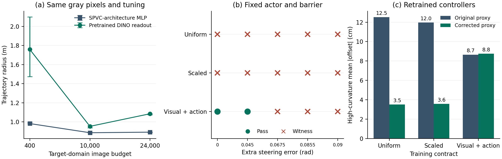
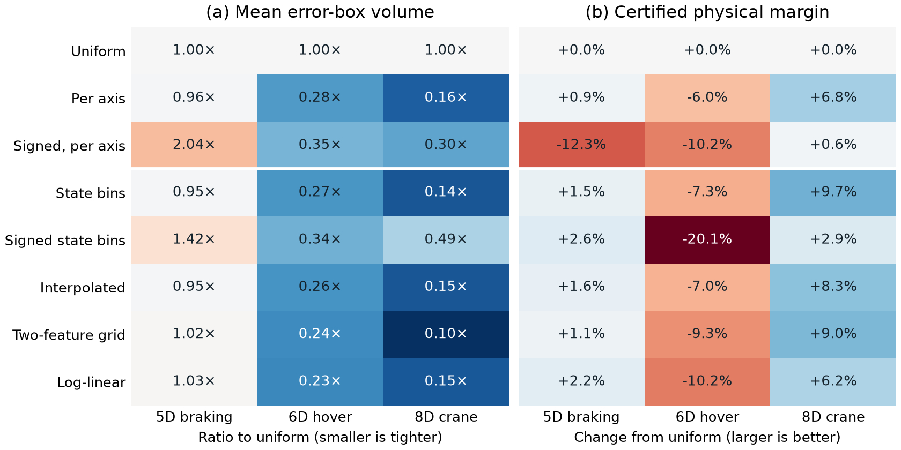

# 五个视觉控制实验与 SPVC、SPVT 的方法对照及收益分析

日期：2026-11-18。本文核对指定的两篇原文、本地实现，以及主项目 main 中截至本日保存的实验报告和结果文件。

**目前最有依据的收益，是把实际视觉误差与安全验证明确接起来，并利用误差和状态、控制动作之间的关系，扩大特定任务的可认证范围。** 五个实验已经展示了这一接口在不同动力学和控制器上的适用性。其中，车道保持的动作相关集合、起重机的状态相关集合，有较清楚的受控对照证据。AEBS 最新同像素、同调参机会的实验则显示，原结构测距 MLP 的误差小于当前 DINO 前端；必须一起报告。

这份报告侧重**原文与实现分析、已有实验结果的逐项比较和论文论据整理**。随后已在服务器实际完成五任务的共同接口后端对照、强化可达基线及三种子车道控制器训练，详见[五任务实测对照、收益与适用范围](SPVC_SPVT五任务实测对照_收益与适用范围_20261118.md)。两份报告配套阅读：本文件解释理论与历史证据，新文件给出新增受控实验。两篇论文的原生 cGAN、控制器与全部综合流程仍未在五个任务上各自完整重训，不能把受控组件实验写成该项工作已经完成。

## 1. 比较对象与阅读顺序

### 1.1 两篇论文分别是什么

| 名称 | 本文依据 | 方法与发表信息的口径 |
|---|---|---|
| 原 SPVC，原文称 SafePVC | [指定的 720_file_Paper.pdf](../../references/720_file_Paper.pdf)；本地 [artical-F122](../../../artical-F122/) | 标题为 *Provably Probabilistic Safe Controller Synthesis for Vision-Based Neural Network Control Systems*。指定 PDF 是署名 Anonymous、带 DAC ’26 页眉的稿件；仅凭该文件不确认正式发表状态。下文沿用项目习惯称“原 SPVC”。 |
| SPVT | [指定的 Semi-Probabilistic 论文](../../references/Learning%20Vision-Based%20Neural%20Network%20Controllers%20with%20Semi-Probabilistic.pdf)；[本地 SPVT](../../../../SPVT/) | *Learning Vision-Based Neural Network Controllers with Semi-Probabilistic Safety Guarantees*，Ma 等；核对 [arXiv:2503.00191 v2](https://arxiv.org/abs/2503.00191v2)，2025-11-11 版本。方法名为 semi-probabilistic verification-guided training。 |
| 当前框架 | [框架与逐步流程](../../framework/SPVC当前框架_逐步流程与安全保证_20261109.md)、[最新公平对照](SPVC三项对照_AEBS公平实验与车道重新综合_20261117.md)、本文列出的结果包 | DINO 低维视觉读数＋状态侧代理＋轨迹级 CP＋集合内鲁棒验证；AEBS、车道使用神经控制器和神经屏障，高维任务还有结构化控制器与证书。 |

artical-F122 现在已经混入本项目的视觉前端和鲁棒验证改造，默认入口也已改变，不能直接把当前整个目录当作未经修改的原 SPVC。原方法审阅同时参考最早本地快照 47a1a1a；它仍只代表本地可追溯快照。SPVT 阅读时的提交为 d78955eaceb6682d7bd093f3c08eee2a7ea8c14b。

### 1.2 五个实验的分工

| 实验 | 在论文中最适合回答什么 | 目前证据性质 |
|---|---|---|
| AEBS 自动紧急制动，2 维 | 回到原 SPVC 的直接同源任务，收益究竟来自目标域适配、视觉结构还是后端？ | 有原权重迁移、原随机 SBC 复跑、前后端交叉和同像素前端对照；新增受控后端比较见实测报告，SPVT 原生图像链路迁移仍缺。 |
| 车道保持，2 维 | 面对非线性神经控制器，动作相关误差集合能否改善认证？ | 固定前端、策略、屏障的集合对照；另有同预算重新综合。 |
| 弯道遇障制动，5 维 | 多个视觉量共同影响转向和制动时，误差的正负方向是否重要？ | 当前框架内部消融及代理、误差盒配对比较。 |
| 无人机悬停，6 维 | 误差盒平均体积变小，是否必然增加抗扰能力？ | 有反向结果，适合说明方法适用边界。 |
| 桥式起重机消摆，8 维 | 保留“误差发生在什么状态”的信息，能否扩大可认证初始域？ | 六套前端上的一致改进，另有独立新数据确认。 |

先看第 2–4 节了解三种方法和保证；第 5–9 节逐个看实验；第 10–13 节整理论文主张、剩余公平比较和复现风险。

## 2. 三种方法怎样从图像走到安全结论

### 2.1 原 SPVC：生成视觉代理，建立随机转移模型，再综合随机屏障

原文第 2–5 页的主线可以分成六步。

1. **采集图像与状态标签。** 输入是仿真图像和对应物理状态。AEBS 的标签主要是距离，速度通过另一条测量通道提供。
2. **学习视觉生成代理。** 输入状态和表示天气、外观等变化的潜变量 z，经条件生成模型产生低分辨率灰度图，并用 MLP 蒸馏等处理提高后续验证的可行性。
3. **建立控制闭环。** 生成图像进入状态估计网络，再进入 PPO 控制器，最后通过物理动力学得到后继状态。实际运行时，控制器前面的估计器也可以读取相机图像。
4. **将视觉变化转换为状态转移扰动。** 选一个名义潜变量 z₀，比较其他 z 引起的后继差。若完整代理闭环为 F，则定义 Δx=F(x,z)−F(x,z₀)，再用固定加性扰动分布 μ 描述这项差异。
5. **学习神经随机障碍证书。** 屏障 B 在初始域小，在危险域大，要求随机后继的屏障期望下降。
6. **用验证反例交替修改控制器和屏障。** 原文 Algorithm 1 还要求控制器更新后重新估计扰动分布。得到满足条件的模型后，在线执行控制器。

这条路线已经具有视觉代理、低维状态验证入口、PPO、神经屏障和反例反馈。当前工作不能把这些已有组件本身作为新增贡献。

它最关键的建模假设是：**原文 Assumption 1 将 Δx 的分布视为与当前状态无关的 μ。** 这使随机屏障计算可处理，但实际相机误差在远近距离、不同姿态及不同光照处往往不同。指定稿件没有另外给出“真实相机读数与生成／蒸馏代理之间残差”的有限样本 CP 校准桥接。

### 2.2 SPVT：包住全部可达状态，再用验证结果指导训练

SPVT 第 2–4 页的主线是另一种做法。

1. **先获得一个可用控制器。** 通过模仿学习或强化学习获得初始策略；后续继续兼顾原任务性能。
2. **学习图像生成代理。** 用状态 x 和潜变量 z 生成可能图像 g(x,z)。原文还明确引入真实图像与生成图像之间的误差 ε。
3. **从一个初始状态展开 K 步闭环。** 每一步都包住潜变量以及允许图像误差下可能出现的动作，再通过动力学传播到下一步。
4. **得到真实可达集的外包。** 外包全部落在安全区域内，则该初始状态在声明的 K 步、全部允许环境变化下安全。
5. **用验证结果改善策略。** 可达界产生训练信号，难验证的状态进入后续训练；原文结合困难样本处理和逐步增加时域的课程训练。
6. **对独立初始状态样本进行最终验证。** 统计多少初始状态能通过，再用集中不等式给出“随机初始状态可认证比例”的置信下界。

SPVT **明确考虑了生成代理失配**。其 Assumption 1 是：每个相关状态和真实环境下的图像，都能被某个生成图像在 ε 内逼近。实际难点在于建立这个统一上界；平均重建误差较小，不能自动证明最坏图像误差满足该假设。

### 2.3 当前框架：直接校准实际视觉读数与状态代理的差异

当前框架沿用离线综合、在线反馈执行的主线，将验证接口放在低维视觉读数上。

| 步骤 | 输入 | 做什么 | 输出 |
|---|---|---|---|
| 1. 视觉表示 | 实际输入图像 I | 冻结 DINO 特征提取器，训练任务相关投影 p | 少量视觉读数 y=p(DINO(I)) |
| 2. 状态代理 | 有标注的真实状态中可观测部分 z | 学习线性 h(z)=Cz，或可逆神经 h(z)=H(Cz) | 与 y 在同一接口上可比较的名义读数 |
| 3. 控制执行 | y、必要解码结果、实测速度等旁路量 | 固定控制器根据当前观察产生动作 | 动作 u 及下一步真实状态 |
| 4. 开发误差集合 | 开发轨迹的观察、真值、动作 | 拟合分轴、正负、状态相关尺度，或者加入动作偏差约束 | 尚未正式校准的集合形状 |
| 5. 轨迹级校准 | 冻结系统产生的新完整轨迹 | 每条轨迹取全程最坏分数，再做一次分位数校准 | 集合 E_q(x)，目标是整条轨迹同时满足 |
| 6. 鲁棒验证 | 状态代理、E_q、控制器、动力学、候选屏障 | 对每个相关状态和每个允许误差检查后继安全条件 | 通过、未决，或具体反例 |
| 7. 必要的重新综合 | 开发反例与开发集合 | 修改控制器和屏障；再次冻结后重新采集、校准 | 新的闭环系统及其自己的验证记录 |

这意味着前端可以复杂，验证器处理的是它与低维代理之间的误差。DINO 无须作为像素网络逐层进入屏障验证。但误差大小仍由实际运行中的图像、模型及闭环分布决定，不能仅根据训练损失指定。

**现有代码有两种等价接口的实现方式，需要分清。** 理念上可以直接约束视觉空间残差 y−h(z)。当前多项配对实验实际先解码得到 ẑ=h⁻¹(y)，再校准语义误差 e=ẑ−z。对可逆 h，语义盒 z+E 对应视觉空间集合 h(z+E)；该集合一般并非同样大小的轴对齐盒。不能把解码前后的 q 混用。详见[三场景代理实验](五六八维场景_Cx与可逆神经代理_同预算闭环对比_20261117.md)和[误差盒定义](五六八维_固定与状态相关CP误差盒_配对验证_20261117.md)。

### 2.4 Cx 与神经代理不是五个任务中的统一收益来源

高维配对中，神经代理使用可逆耦合结构，先分组再做两次加性变换：一组给另一组添加由小型 tanh 网络产生的修正，再反向修正。逆变换按相反顺序做减法，所以可以把视觉读数解码回原控制器所用的物理坐标。三维观测版比线性版增加 147 个参数，四维版增加 244 个参数。

这样设计的意义是保持接口可解码、方便公平比较和验证。现有学习结果在实际访问区域接近仿射，神经代理的收益很小且不稳定。它目前适合作为表示灵活性的消融，尚不适合承担“依靠强非线性表示获得主要改进”的论文结论。

## 3. 三种安全保证的数学含义

这一节是比较的核心。安全概率、置信水平、误差覆盖率、测试成功率描述不同事件，不能放在同一列直接相减。

### 3.1 原 SPVC：随机转移模型下的逐初态安全概率

原文第 2 页 Definition 2.1 与 Theorem 2.2 希望得到：

$$
\forall x_0\in X_0:\quad
\Pr_{x_0}(\forall t\in\mathbb N_0,\ x_t\notin X_u)\ge p.
$$

这里先固定任意允许初始状态，再对后续随机扰动求概率；理论时域无限。其屏障条件包括：

$$
B\ge0,\quad B|_{X_0}\le1,\quad
B|_{X_u}\ge\frac{1}{1-p},
$$

以及在定理规定的安全子水平域内，存在正数 ε 使

$$
\mathbb E_{\Delta x\sim\mu}
\left[B(F(x,z_0)+\Delta x)\right]
\le B(x)-\epsilon.
$$

例如 p=0.95 时，危险域阈值是 20。某些后继的 B 可以上升，只要平均满足定理条件。这个期望条件可能比“每一个后继都不升”宽松，所以原随机路线有自身优势。

结论依赖正确的随机转移模型、定理要求的域和全部验证条件。原文第 4 页还用网格及 Lipschitz 余量将点上的不等式推广到连续域；不能把原方法描述成只有随机测试。

### 3.2 SPVT：对单个初态全称验证，对初态分布给概率下界

原文第 2 页的生成代理假设为

$$
\sup_{x,\omega}\inf_{z\in Z}
\|h_{\mathrm{camera}}(x,\omega)-g(x,z)\|\le\epsilon.
$$

通俗地说：在相关状态与环境范围内，每张真实相机图像都必须能被生成集合加 ε 邻域覆盖。Theorem 1 利用这个假设建立真实 K 步可达集包含关系。对某个通过的初态，它保护的是**全部被模型覆盖的图像／环境扰动序列**。

随后，从初始状态分布 D 独立抽 N 个状态，固定控制器进行验证。设通过的初态集合为 V，Theorem 2 用 Hoeffding 界给出：以至少 1−δ 的置信水平，

$$
\Pr_{x_0\sim D}
\bigl[\mathrm{Reach}_{K}(x_0,\pi)\text{ 全部安全}\bigr]
\ge \frac{|V|}{N}-\sqrt{\frac{\ln(2/\delta)}{2N}}.
$$

负下界可取 0。这里 δ 控制**抽样统计结论出错的概率**，安全比例本身是右侧整个表达式。举例：N=2000，δ=0.05，即使 2000 个初态全部通过，公式下界也约为 96.963%，不能直接称“95% 安全”。

这也解释了“半概率”的含义：初始状态使用概率分布，单个已认证初态内的视觉不确定性使用全称验证。

### 3.3 当前框架：轨迹误差覆盖＋集合内鲁棒安全

以状态相关、可不对称的语义误差盒为例，在开发阶段冻结正尺度 a_j(x)、b_j(x)，对一条完整轨迹 τ 定义

$$
s(\tau)=\max_{t,j}
\left\{\frac{e_{tj}}{b_j(x_t)},
\frac{-e_{tj}}{a_j(x_t)}\right\}.
$$

用 N 条独立校准轨迹的分数，取第

$$
k=\lceil(N+1)(1-\alpha)\rceil
$$

小的值 q；若 k>N，需要无穷阈值等合法边界处理，不能强行取最大值冒充目标覆盖。现有 N=199、α=0.05 时取第 190 小；N=499 时取第 475 小。

得到

$$
E_q(x)=\{e:-qa_j(x)\le e_j\le qb_j(x),\ \forall j\}.
$$

在模型、分数和轨迹协议固定、校准轨迹与新轨迹可交换的条件下，分割 CP 保证

$$
\Pr\bigl[\forall t\le H,\ e_t\in E_q(x_t)\bigr]\ge1-\alpha.
$$

概率同时包含随机校准集和新轨迹。它通常是初态、环境等联合分布上的**边际**覆盖，不是每个固定初态、每个状态分区或每个天气各有 95%。轨迹内部帧可以相关，因为统计单位是一条轨迹。

后端则验证：从登记的初始域出发，只要每一步误差属于 E_q(x)，并满足声明的动力学、外扰、传感器和工作域条件，后继就不进入危险域。神经屏障常用的充分条件可以写为

$$
B|_{X_0}\le1,\quad B|_{X_u}\ge20,\quad B\ge0,
\qquad
B(x^+)\le B(x)\ \text{对所有允许后继成立}.
$$

从不超过 1 出发，全程不增，就不可能到达 B 至少为 20 的危险点。这是确定性的集合内推理。这里的 20 是分离阈值，**不会再额外产生原随机 SBC 的 1−1/20 概率因子**。高维任务用不同的结构化屏障，起重机使用阈值为 1 的时变屏障，不能把上述网络形式套到全部任务。

严谨表述还要处理“校准之后才知道验证是否通过”：令 A 表示对应校准集合的鲁棒条件经可靠验证确实成立，S 表示新轨迹安全；A 不能仅用未经舍入误差控制的程序通过标志代替。对预先指定的单个协议，可以推出

$$
\Pr(A\ \text{且}\ S^c)\le\alpha.
$$

如果所有可能校准结果都能通过，或有其他足够条件，才能进一步直接写无条件安全概率至少 1−α。仅仅观察到本次 A 成立，不能未经分析把它写成 \(\Pr(S\mid A)\ge1-\alpha\)。本次冻结阈值的实际覆盖，可另用独立盲测及二项置信区间评价。按测试结果挑方案、换控制器、换初态分布后，须相应重新冻结与确认。

### 3.4 三者的保证范围对照

| 问题 | 原 SPVC | SPVT | 当前框架 |
|---|---|---|---|
| 主要不确定性 | 固定加性状态转移分布 μ | 生成潜变量及图像 ε 邻域 | 实际视觉读数与状态代理的残差集合 |
| 后端条件 | 随机期望下降 | K 步可达外包安全 | 集合中所有允许误差下的鲁棒安全条件 |
| 概率取自哪里 | 后续随机转移 | 初始状态分布；另有估计置信度 | 整条新视觉轨迹与校准样本 |
| 初态要求 | 理论对每个允许初态 | 认证单点；统计初态总体比例 | 证书可覆盖初态域，普通 CP 对采样分布作边际声明 |
| 时域 | 原定理无限时域 | 声明的 K 步 | 轨迹校准登记的 H；不能自动无限延长 |
| 核心失配义务 | 随机模型与真实视觉闭环的一致性 | 统一生成覆盖误差 ε | 冻结和可交换轨迹；真实残差的可靠标签 |
| 数值严谨性 | 需真正有效的 Lipschitz 与期望界 | 需正确的可达外包及实现 | 当前若干任务仍为无外向舍入的浮点数值证据 |

**三种常见误读。** “100 趟都没出事”不等于证书通过；“95 趟全程在误差盒内”不等于 95 趟完成目标；“95% CP 覆盖”也不等于“以 95% 置信度，每个初态有 95% 安全率”。

### 3.5 SPVT 原作者数据的实际结果

为避免只比较概念，本次还读取作者仓库中的两个各含 2000 行的验证步数 CSV，按第 3.2 节原式重算。下表使用论文正文的 95% 置信水平；本地绘图脚本默认 99%，两者不应混用。

| 原作者任务 | 验证步数 K | Anchor/PID 通过数 | SPVT 通过数 | Anchor/PID 的 95% 置信下界 | SPVT 的 95% 置信下界 |
|---|---:|---:|---:|---:|---:|
| CARLA 车道 | 5 | 1996/2000 | 2000/2000 | 96.7632% | 96.9632% |
| CARLA 车道 | 10 | 718/2000 | 1857/2000 | 32.8632% | 89.8132% |
| CARLA 车道 | 15 | 201/2000 | 1188/2000 | 7.0132% | 56.3632% |
| CARLA 车道 | 20 | 115/2000 | 444/2000 | 2.7132% | 19.1632% |
| X-Plane | 20 | 1831/2000 | 2000/2000 | 88.5132% | 96.9632% |
| X-Plane | 50 | 1552/2000 | 1912/2000 | 74.5632% | 92.5632% |
| X-Plane | 65 | 1438/2000 | 1707/2000 | 68.8632% | 82.3132% |

这是**原作者旧实验数据的公式重算**，不是本次五个任务的训练或验证重跑。它确实显示作者方法相对其初始策略改善了可验证性；不能将原 CARLA 的 K=20 与当前车道 80 步直接排名。原 X-Plane K=20 时，RESPO 也为 2000/2000，不能写 SPVT 在所有时域严格优于所有基线。[CARLA 原始 CSV](../../../../SPVT/spv/verification_results/CARLA_verification_results.csv) · [X-Plane 原始 CSV](../../../../SPVT/spv/verification_results/X-Plane_verification_results.csv)。

原文还包含 12 维 AirSim 无人机及实物 F1Tenth：路径任务使用约 20,000 对图像—状态数据，实车以 400 张标注图片微调已有 CARLA 生成器，无人机使用 64×64 灰度图。当前六维平移悬停更简化，不能把维数增加到八维称为超越其已展示的维数能力。论文正文与附录在部分训练批大小、学习率和无人机步数上有差别，正式复现须固定采用哪个配置。

## 4. 五个任务到底验证什么

### 4.1 状态、图像和旁路测量

| 任务 | 物理状态 | 相机负责估计 | 控制器另行知道 | 图像来源 |
|---|---|---|---|---|
| AEBS | 距离 d、速度 v | 距离 | 速度 | 固定 CARLA 图库，依据当前真实距离和当趟外观条件选图 |
| 车道 | 横偏 e、航向偏差 θ | 两者 | 曲率 κ；速度固定 4 m/s | 到达新状态后重新渲染 |
| 5D 制动 | e、ψ、障碍距离 d、v、实际轮角 δ | e、ψ、d | v、δ、κ | 到达新状态后重新渲染 |
| 6D 悬停 | 三轴位置和三轴速度 | 三轴位置 | 三轴速度 | 下视相机仿真渲染 |
| 8D 起重机 | 两轴各含小车位置 p、速度 v、摆移 s、摆速 r | 两轴 p 与 s，共四维 | v、r | 俯视相机仿真渲染 |

这里的“真实图像 AEBS”是使用实际保存的 CARLA 渲染 RGB 图片，不等于真实道路相机新采集。冻结图库中的图像可以复用；闭环轨迹随着动作变化，不是播放同一条预定视频。复用可以在**固定图库条件下的同一抽样协议**中定义 CP 问题，但不会凭空增加独立相机数据量，也不能自动推断到未来未见相机域。

### 4.2 安全与成功分别怎样判断

| 任务 | 时域 | 安全／危险 | 成功标准 |
|---|---|---|---|
| AEBS | 每步 0.05 s，至终止或最多 400 步 | 运行中 d≤6 m 且 v>0.5 m/s 为危险；出域另计；屏障另对闭危险矩形做更保守分离 | 到达 5≤d≤6 m 且 v≤0.5 m/s。远处提前停住不算完成目标。 |
| 车道 | 每步 0.1 s，共 80 步 | 任一采样点 绝对横偏>0.85 m 或 绝对航向偏差>0.30 rad 为越界；证书还检查边界 | 全程不越界即任务完成；横向误差另外衡量跟踪质量。 |
| 5D 制动 | 每步 0.2 s，共 14 步 | 整车车身与道路边缘、障碍的保守几何间隙保持正值 | 全程安全，停车速度为 0，车身中心距障碍后表面 d 在 3.60–4.40 m。 |
| 6D 悬停 | 每步 0.25 s，共 24 步 | 三轴位置绝对值分别小于 0.9375、0.8125、0.625 m；速度绝对值分别小于 2.025、1.755、1.35 m/s | 全程安全；最后四个采样点位置分别不超过 0.135、0.117、0.090 m，速度分别不超过 0.105、0.091、0.070 m/s。 |
| 8D 起重机 | 每步 0.15 s，共 40 步 | 每轴 小车位置绝对值<1.45 m、速度绝对值<1.8 m/s、摆移绝对值<0.65 m、摆速绝对值<1.5 m/s、负载位置绝对值<1.55 m；另有对角净空约束 | 全程安全；末四个采样点每轴负载位置 负载位置绝对值≤0.09 m、摆移 摆移绝对值≤0.055 m，速度绝对值、摆速绝对值≤0.12 m/s。 |

起重机的对角净空精确为 \(|(p_x+s_x)+(p_y+s_y)|<2.6\) m，是一个斜向带状约束。它不等于两个轴绝对值之和，也不等于欧氏距离。上述仿真和证书主要针对离散采样状态；未加入扫掠或插值证明的任务，不能自动声称采样之间连续物理运动也得到同等保证。

### 4.3 控制器与证书并非全部相同

| 任务 | 当前控制器 | 当前证书／验证方式 | 能支持的推广层次 |
|---|---|---|---|
| AEBS | PPO 初始化，再进行鲁棒控制器调整 | 神经鲁棒屏障，区间检查停止过程 | 与原 SPVC 最接近的神经后端比较 |
| 车道 | 非线性神经策略；PPO 初始化及鲁棒微调 | 神经屏障，区间／仿射界及细分 | 方法对非线性神经控制器的核心证据 |
| 5D 制动 | 鲁棒教师模仿得到的神经控制器，含制动约束 | 车身几何、最低减速度等结构化充分条件 | 多视觉变量与方向相关误差的接口检验 |
| 6D 悬停 | 限幅 PD 类反馈控制器 | 位置与变换速度的结构化屏障；关键不等式有理数复核 | 误差集合与抗风能力的分析 |
| 8D 起重机 | 固定 LQR 类反馈及执行器限制 | 有限时域时变屏障／可达界，检查电机与净空 | 状态相关误差与可认证域的分析 |

因此，五个任务支持“统一视觉误差接口、允许任务适配的验证后端”。它们尚不支持“五个任务均由同一个通用神经控制器＋神经屏障综合器完成”的更强表述。

## 5. AEBS：把迁移收益、结构收益与证书收益分开

### 5.1 原文报告的结果应原样保留

SPVC 第 6 页 Table 1 报告的是所建随机模型下的**可验证安全概率下界**：

| 原文任务 | 固定控制器 | 交替更新控制器与 SBC |
|---|---:|---:|
| X-Plane11 滑行 | 84.9% | 92.1% |
| CARLA AEBS | 72.6% | 94.2% |

同时联合更新的两项均为 OT，即登记的 100 轮预算内未收敛。AEBS 使用 400 张状态—图像样本、32×32 灰度生成图、4 维潜变量；PPO 预训练为 200k 步。原方法也将实测速度直接提供给控制器。

这些数字不能与当前 95% CP、100/100 成功率相减；它们对应不同事件、模型和时域。

### 5.2 发布权重直接迁移：当前适配系统有明显收益

固定同一个当前鲁棒控制器、同一个 ±0.45 m 证书误差管，在 24k 稠密回放图库中比较冻结前端：

| 指标 | 原 SPVC 发布测距模型 | 经过目标域适配的当前 RGB DINO |
|---|---:|---:|
| 整轨迹测距误差 CP 阈值 | 8.0584 m | 0.4096 m |
| 先期 500 条任务成功 | 0/500 | 500/500 |
| 独立追加 2000 条全程落在固定 ±0.45 m 管内 | 0/2000 | 1985/2000 |
| 追加 2000 条任务成功 | 0/2000 | 2000/2000 |

轨迹误差阈值减少约 94.9%。在这个冻结协议上，全程在管概率提升的同时 95% 置信下界为 **98.5817 个百分点**。它衡量的是**同一份鲁棒证书能适用于多少真实回放轨迹**。

但这里原权重没有获得同等目标域重训，图像信息量、外部预训练和训练方案也不同。稠密图库还包含训练帧。因此，这说明目标域适配后的完整视觉接口改善了给定回放协议，不能将 94.9% 全归于 DINO 架构。

把图库限制到 4920 张包内测试图，当前前端仍然 500/500 完成任务，但 CP 半径增加至 1.1561 m，原 ±0.45 m 证书不再适用，并找到屏障漂移反例。这说明图像采样密度也会影响观测误差及认证。

来源：[配对闭环与独立 2000 条确认](../AEBS/AEBS_原生SPVC与当前前端_配对闭环对照_20261117.md)、[独立确认原始结果](../../../artical-F122/results/aebs_native_cross_20261117_v1/fixed_tube_2000/report.json)。

### 5.3 同信息、同调参机会：目前原结构 MLP 更好

下一组控制了数据来源、灰度像素、训练轮数和学习率选择机会。原结构 MLP 与 DINO 都使用相同 32×32 灰度信息，100 轮训练、相同批次顺序、两个 Adam 学习率的开发选择预算，三个配对种子。DINO 的外部预训练单独记为额外先验。

| 原 RGB 总图包 | 梯度训练 | 开发选择 | 包内测试 |
|---|---:|---:|---:|
| 400 | 240 | 88 | 72 |
| 10k | 6000 | 2000 | 2000 |
| 24k | 14172 | 4908 | 4920 |

下面是在共同的 3229 张图库上，三个种子的**轨迹 CP 半径中位数，单位 m**。共同图库与所有训练、开发图像按文件和像素去重，对小图包属于额外评估资源。

| 图包 | 原结构 MLP 灰度32 | DINO 灰度32 | DINO RGB32 | DINO 灰度640 | DINO RGB640 |
|---|---:|---:|---:|---:|---:|
| 400 | **0.982** | 1.758 | 1.812 | 1.534 | 2.214 |
| 10k | **0.886** | 0.953 | 0.938 | 0.944 | 0.937 |
| 24k | **0.892** | 1.085 | 0.967 | 1.082 | 1.423 |

“640”表示高分辨率源图路径，DINO 内部仍按其输入预处理缩放。九个同灰度配对均由原结构 MLP 得到更小的半径。400 图包下，MLP 三种子均 100/100 成功；DINO 灰度32 分别出现 9、9、14 条危险轨迹。

这里的 MLP 是**按原测距结构重新做目标域监督训练**，不等于完整 cGAN＋PPO＋随机 SBC 的全链路复现。它足以否定“只要换 DINO 就能获得普遍误差优势”的主张。

对全部 45 个模型和两类回放律形成的 90 个协议，只有严格包内测试图库的 10k 组 15 个协议通过既定 ±0.45 m 母证书包含检查；其余 75 个存在实际正屏障漂移见证。不能将部分轨迹 100% 完成任务写成 90 个协议都认证成功。

采集成本共 17,910 条校准和 9000 条盲测，约 514 万次图库查询；新增独立真实相机帧为 0。重复查询不能与独立采集图像等量计数。

来源：[公平实验详细报告](../AEBS/AEBS同源同信息_三档预算与输入消融_20261117.md)、[逐种子 CSV](../../../artical-F122/results/aebs_factorial_20261117/replay/seed_summary.csv)、[成本审计](../../../artical-F122/results/aebs_factorial_20261117/replay/audit_costs.json)。

### 5.4 后端有帮助，但不能掩盖较大的视觉误差

同一 400 图包、同像素 DINO 前端的一个冻结种子，原发布 PPO 为 68/100 成功、32/100 危险；当前鲁棒控制器为 91/100 成功、9/100 危险。原结构 MLP 配两种控制器均为 100/100 成功、0 危险。

这一交叉实验支持“后端适配可以减轻该前端误差的影响”，没有支持“更好的后端消除了视觉问题”。10k、24k 中两种前端和两种策略均达到 100/100，指标已饱和，需进一步看误差、证书和更困难任务。[前后端交叉与原 SBC 复跑](../AEBS/AEBS_原SPVC随机SBC复跑与前后端交叉_20261117.md)。

**AEBS 的论文角色：** 保留原任务、原指标和公平前端对照；用它展示迁移失配及其对证书适用性的影响。当前数据不支持把它写成 DINO 普遍胜过原测距网络的主结果。

## 6. 车道保持：最接近神经控制器方法贡献的实验

### 6.1 先补齐整轨迹覆盖这一环

原三曲率任务为 κ∈{−0.01,0,0.01} m⁻¹，4 m/s、80 步。冻结图像前端和 PPO 后，199 条完整轨迹校准得到 q=0.090093，约等于横偏 ±7.66 cm、航向 ±1.55°。

在同一批 100 条留出轨迹中，旧半径 0.08 只全程覆盖 82 条；新半径覆盖 95 条，100 条均实际安全。新半径下原神经屏障通过。这里得到的收益是把帧级或工程指定误差范围改成有登记时域的完整轨迹校准，而不是将 82% 的不安全率改善成 95%——原来 100 条本来就都未越界。

后续鲁棒综合版固定前端，修改策略和屏障后重新校准，得到 q=0.099687，98/100 条全程在管、100/100 条安全，三个曲率通过数值验证。[轨迹校准报告](../车道保持/车道保持_轨迹级CP校准与SBC衔接_20261107.md) · [鲁棒综合记录](AEBS与车道_旧前端鲁棒综合_20261116.md)。

### 6.2 同一个非线性策略，改变误差集合能否改变认证结果

扩展到五种曲率 κ∈{0,±0.01,±0.02} m⁻¹。对所有臂统一使用从开发数据拟合的曲率观测偏置补偿，冻结同一视觉前端、同一神经策略和同一神经屏障，只改变集合：

1. **统一盒：** 各归一化方向允许同样的误差。
2. **分轴盒：** 两个方向分别拟合尺度，再用共同的轨迹分数校准。
3. **视觉—动作联合集合：** 除了限制视觉误差，还限制这组误差通过实际非线性策略后引起的动作偏差。

第三种可示意为

$$
E(x)=\{e:|e_j|\le q a_j(x),\quad
|\pi(z+e,\kappa)-\pi(z,\kappa)|\le q b(x)\}.
$$

实际采用共同最大分数进行一次联合校准，不能分别声称两个 95% 条件相交后仍自动得到 95%。动作差按登记的归一化输出计算，最终转角还要经过动作缩放。

| 冻结同一策略和屏障 | 五曲率，零额外转向扰动 | 五曲率，额外 ±0.045 rad 转向扰动 |
|---|---|---|
| 统一盒 | 有正屏障漂移反例 | 原反例仍在允许集合中 |
| 分轴盒 | 有正屏障漂移反例 | 原反例仍在允许集合中 |
| 视觉—动作联合集合 | 通过连续域数值检查 | **通过** |

这些是固定误差模型下的条件鲁棒裕量。若额外转向扰动实际改变了闭环轨迹与图像分布，须在相应扰动协议下重新采集、校准后才能附加概率声明。±0.045 rad 约为 ±2.58°。后续细化扫描，旧补偿策略＋联合集合可证明到 ±0.063 rad；相邻更大取值存在未决或反例，不能把扫描网格的最大通过值称作系统绝对鲁棒极限。

### 6.3 为什么视觉盒更宽，反而可以证明安全

统一盒的两个半宽约为 0.123852。联合方案视觉半宽约为 0.15693、0.15729，表面上更宽，却额外限制归一化动作偏差不超过 0.30899。

可以把统一盒想成允许“横偏看错一点、航向也看错一点”的所有组合。某些同时看错的组合经过非线性策略，会产生明显错误的转向。联合约束允许较大的单项误差，但排除这些会触发过大动作变化的组合。旧盒中的一个反例需要约 0.75708 的动作偏差，超过联合约束，因此被排除。

这不是人为删掉不喜欢的扰动：联合条件的阈值来自冻结后的整轨迹共同校准。真实状态只用于离线标注、分数计算与验证，运行控制器仍接收图像读数和既有旁路信息。

**这组实验最有价值的归因是：在同一非线性神经控制器、同一屏障下，保留视觉误差对动作的影响，可以改善可认证性。** 它是当前框架内部的集合方法对照，还不是已运行 SPVT 后获得的三方领先结论。

来源：[五曲率固定策略实验](../车道保持/车道保持_固定神经策略五曲率三种误差集合_20261117.md)。

### 6.4 重新综合的结果没有统一胜出

三臂使用同容量网络、各 240 次策略与屏障更新、相同反例反馈及验证时限，冻结后各自采 199 条新校准和 100 条盲测。五曲率 v2 的同一批盲测中，有 38 条急弯：

| 控制方式 | 急弯平均绝对横偏 |
|---|---:|
| 原策略，未修正视觉 | 0.116273 m |
| 原策略，共用视觉修正 | **0.034256 m** |
| 共用修正，统一盒重新综合 | 0.035198 m |
| 共用修正，分轴盒重新综合 | 0.035767 m |
| 共用修正，联合集合重新综合 | 0.087590 m |

视觉修正本身使误差下降 70.54%。联合重综合反而比统一盒重综合差 0.05239 m；这批 38 条急弯全部变差，配对场景 95% 区间为 [0.05050,0.05427] m。该区间不包含重新抽训练种子的波动。

三种新策略均在自己的最终集合上通过零额外扰动验证；联合重综合扫描到 ±0.0495 rad，小于旧补偿策略＋联合集合的 ±0.063 rad。不能将最好的补偿收益记在联合重综合名下。

另一个交叉检查固定同一误差盒和旧屏障，仅更换为新统一盒／分轴盒控制器即可从存在反例变成通过；仅换屏障、保留旧策略仍失败。这说明控制器更新确实可以改善可认证性，但优化目标与跟踪性能仍需进一步平衡。[同预算重新综合报告](../车道保持/车道保持_五曲率同预算控制器与屏障重综合_20261117.md)。

图 1：复用已归档的受控对照图。其中重综合面板的 v1／v2 来自不同盲测批次，分别含 41／38 条急弯，不能作为逐场景配对前后比较。AEBS 的误差、车道的认证和跟踪分别解释，三者没有统一的“安全提升百分比”。

## 7. 五维弯道遇障制动：方向相关误差的小幅收益

这个任务同时存在转向、速度变化、障碍距离和转角记忆，状态为 (e,ψ,d,v,δ)。相机提供其中三项，速度与实际轮角通过旁路输入。任务是在路内避开障碍，并在 d∈[3.6,4.4] m 停稳。

### 7.1 已经做成什么

开发中用含视觉误差的鲁棒教师训练控制器，以几何边界和最低减速度构造结构化证书。原基线 100 条留出运行中：

| 控制方式 | 停入目标区 | 实测安全 |
|---|---:|---:|
| 固定制动力 | 22/100 | 100/100 |
| 图像反馈制动 | 89/100 | 100/100 |
| 图像反馈制动与转向 | 88/100 | 100/100 |

完整反馈的平均横偏约 4.12 cm，图像反馈制动版约 4.36 cm。它显示闭环制动对停准有帮助；这组场景没有证明必须使用视觉转向才能安全。完整反馈的 12 次未达标主要表现为安全提前停车。

原任务验证给出采样时刻道路间隙至少 6.58 cm、障碍间隙至少 8.57 cm 的数值下界。完整系统一个神经代理版本的轨迹覆盖为 96/100。安全间隙、覆盖数、停准数分别报告。[任务与完整步骤](../五维弯道制动/五维弯道遇障制动_视觉代理与鲁棒屏障_20261117.md)。

### 7.2 误差有方向，平均盒体积不是最终指标

对后续六套冻结前端，统一盒可以认证额外正向测距偏差 1.10045 m；按距离分段并区分正负方向的盒为 1.12907 m，多约 **2.86 cm**，但平均盒体积增大 41.8%。

原因是“把障碍看得过远”会延迟制动。第一套线性前端在 d>约 4.70 m 的区域，统一误差范围约为 [−0.253,+0.253] m，状态相关范围约为 [−0.316,+0.232] m。后者允许更多低估，却减少危险方向的高估，因此可能获得更好的制动余量。

此处扩大的数值是**给定误差模型下的条件鲁棒余量**。若在真实相机中加入新的正偏差，改变了运行分布，还需重新采集与校准后才能声明该新分布上的 CP 概率。

### 7.3 与两篇方法怎样公平比较

原 SPVC 可以迁移为三视觉量的生成代理、联合转向制动策略和五维 SBC；必须重新拟合转移扰动，不能沿用二维 AEBS 的 μ。SPVT 可以在 14 步模型上展开可达集，包含轮角更新和车身几何安全条件。二者均需要实际实现和运行，现有记录没有这两臂的结果。

当前方法在此的已知优势是可直接检查哪个方向的视觉残差限制制动，并利用结构化证书减少验证难度。由于我们使用了任务结构，不能把“已处理 5 维”解释成通用神经验证器无条件扩维成功。

此外，Cx 换神经代理的三对平均 q 为 0.130877→0.132352，恶化 1.13%，三对都没有变紧。该任务目前不支持非线性代理收益。[配对实验](../五维弯道制动/五维弯道制动_Cx与可逆神经代理配对实验_20261117.md)。

## 8. 六维悬停：用于检验方法边界的反向例子

### 8.1 已经做成什么

状态是三维位置和速度，目标是停机坪正上方 2 m；相机估计位置，速度假设准确。固定 PD 类反馈在有风模型下控制三轴加速度，结构化屏障检查位置、变换速度和推力条件。

原基线中，只有速度阻尼时 3/100 达标；加入图像位置反馈后 99/100 达标，两臂均 100/100 实测安全。平均末端位置误差约从 36.43 cm 降至 6.23 cm，理想位置反馈约 5.28 cm。图像版误差全程覆盖为 95/100。[完整任务报告](../六维无人机悬停/六维无人机视觉悬停_轨迹CP与鲁棒屏障_20261117.md)。

这说明位置反馈对定点悬停有用。速度阻尼本来就缺少返回目标位置的项，因此它是任务必要信息的消融，不能替代 SPVC 或 SPVT 基线。

### 8.2 状态相关盒更小，却降低可证抗风能力

固定六套闭环，比较统一盒与状态对数线性盒：

| 指标，六套系统平均 | 统一盒 | 状态对数线性盒 |
|---|---:|---:|
| 相对平均盒体积 | 1 | 0.2314 |
| 可证每轴总风上限，归一化加速度 | 0.48627 | 0.43649 |
| 100 条盲测中的全程覆盖均值 | 97.67 | 93.17 |

平均体积减少 **76.86%**，可证总风上限却下降 **10.24%**。控制安全由最不利的轴和状态区域限制，平均收紧可能伴随关键高度区域的误差放大。两种盒仍高于原任务要求的 0.08 归一化风加速度，但抗扰余量没有同步提高。

这组负面结果支持一个更准确的研究问题：**应按闭环约束优化误差集合，而不仅仅最小化平均体积或视觉均方误差。** [配对验证报告](../六维无人机悬停/六维无人机悬停_Cx与可逆神经代理同预算比较_20261117.md)。

### 8.3 与两篇方法的关系

SPVC 的期望条件可能在少量不利误差上比全称鲁棒约束宽松，适合比较相同视觉残差下的认证保守性。SPVT 原论文已包含 AirSim 无人机和其他复杂场景；当前 PD 悬停不能据此声称场景比 SPVT 更复杂。

这项任务最适合做“集合体积、最坏控制效应、认证余量”的机制实验。现有 Cx→神经代理 q 平均改善 1.55%，只有 2/3 种子变紧，任务达标率没有提升，暂不足以单独支撑主贡献。

## 9. 八维起重机：当前最完整的状态相关集合收益

### 9.1 已经做成什么

小车移动会带动吊载摆动；相机估计两轴小车位置及吊载相对摆移，速度和摆速通过旁路输入。固定 LQR 类反馈控制电机，时变屏障检查有限 40 步内的状态约束、净空和电机用量。

原基线全反馈 89/100 在 6 s 内完成定位与消摆；仅去掉视觉摆移反馈为 0/100，但仍保留准确摆速，两者均 100/100 实测安全。末端平均摆移约为 1.28 cm 与 10.01 cm。整轨迹视觉误差覆盖为 97/100。[任务与证书报告](../八维起重机/八维桥式起重机_视觉消摆与有限时域鲁棒屏障_20261117.md)。

这说明视觉摆移反馈对收敛有用；不能说 89/100 对 0/100 是相对 SPVC 或 SPVT 的成功率提升。

### 9.2 同一控制器，保留状态关系可扩大认证域

固定三个种子的两种前端，共六套闭环；误差集合不参与在线控制，只改变验证允许哪些误差。以下是可认证初态盒的**线性边长共同缩放倍率**平均值：

| 误差集合 | 已证初态倍率 |
|---|---:|
| 固定统一盒 | 1.36833 |
| 固定分轴盒，固定类中最强 | 1.46167 |
| 按小车位置分段的状态相关盒 | **1.50167** |
| 将同一个分段盒压成全域最大固定外包 | 1.4317 |

状态分段相对统一盒提高 **9.74%**，相对更强的固定分轴盒提高 **2.74%**，六套前端方向一致。倍率不是体积增幅，也不是成功概率增幅。

关键在于：某种较大视觉误差只在特定位置允许发生时，验证器不必假设它在所有位置都发生。压成全域固定外包丢失了这种关系，结果退回 1.4317。这个对照比单纯比较两个不同宽度的盒更能说明机制。

共同 1.50 倍初态范围下，状态分段六组均通过。固定分轴集合中可构造使限幅前两电机总命令超过 6 的合法状态和误差，破坏当前证书的无饱和条件。实际执行器仍会限幅，因此该反例说明此证书条件失败，不能直接称为实际撞击轨迹。

### 9.3 独立确认避免只挑八种方案里的最好结果

主实验比较八种盒后，另锁定一个训练种子的 Cx 和神经两支，固定开发阶段得到的形状及分区。每支用 499 条全新轨迹校准，再用同一批 500 个新场景盲测：

| 前端 | 统一固定倍率 | 分轴固定倍率 | 状态分段倍率 | 分段全程覆盖 | 实测安全／达标 |
|---|---:|---:|---:|---:|---:|
| Cx | 1.38 | 1.47 | **1.51** | 470/500 | 500/500；479/500 |
| 可逆神经 | 1.38 | 1.46 | **1.51** | 477/500 | 500/500；492/500 |

分段相对分轴增加倍率 0.04、0.05；两支覆盖数都少 2/500，不能声称概率覆盖同步提升。把分段盒改成最大固定外包，倍率分别退到 1.45、1.44。

这次新增 1998 条闭环、79,920 个有效相机时刻。确认适用于这一对冻结前端及登记的采样分布。**扩大初始采样分布后，还需在扩大后的分布上重做 CP，才能对扩大区域声明相应整体概率。** 现有扩域数字首先是固定误差模型下的条件鲁棒认证结果。

来源：[八种盒主实验与独立确认](五六八维_固定与状态相关CP误差盒_配对验证_20261117.md)、[确认原始 JSON](../../../artical-F122/results/crane_cp_boxes_confirmation_20261117_v1/summary.json)。

### 9.4 相对 SPVC 与 SPVT 的合理意义

相对原 SPVC 固定状态无关扰动 μ，这个实验突出“误差允许范围与当前状态的关系”有实际价值。但 SPVC 也可以发展状态相关随机模型；现有实验尚未与这种扩展进行比较。

SPVT 的生成器本来就以状态为条件，其可达验证也可能保留部分状态—视觉关系。因此不能声称 SPVT 必然丢掉这项关系。我们目前展示的是低维、独立校准的状态相关接口可在结构化验证器中产生可测收益。后续共同接口的实测已发现 SPVT 式强化线性可达方法也能通过此任务；原生全链路的成本与认证域比较仍需完整图像生成链路迁移，不能将这个内部盒形消融算作已击败 SPVT。

图 2：小体积与大认证余量没有固定对应关系。五维制动关注危险方向的测距高估，六维悬停受最坏轴与状态限制，八维起重机受状态相关净空和电机条件限制。

## 10. 五个实验合起来，哪些收益已经有证据

### 10.1 可以支持的主要主张

| 拟写进论文的主张 | 支持证据 | 需要保留的边界 |
|---|---|---|
| 建立实际视觉输出与可验证状态代理之间的显式误差接口 | AEBS、车道及三个高维任务都有实际闭环残差、独立校准和对应验证记录 | 仿真／固定图库结论；分布与模型假设必须列出 |
| 动作相关集合能改善非线性神经控制器的可认证性 | 车道固定前端、策略、神经屏障，联合集合通过而两种盒有反例 | 包含共同观测补偿；尚不是与 SPVT 的直接胜负 |
| 状态相关集合能扩大可认证初始域 | 起重机主实验六前端方向一致，独立确认仍扩大 0.04／0.05 倍率 | 有限时域结构化后端；扩初态分布需重校准 |
| 同一视觉误差接口可适配多类控制任务 | 2、2、5、6、8 维五任务，视觉估计维数分别为 1、2、3、3、4 | 控制器与证书结构不同，不能宣称通用神经综合器扩维 |
| 视觉误差小、盒体积小和控制性能好不是同一个目标 | 公平 AEBS、6D 悬停、车道重综合均有反向结果 | 这些是方法选择与评估的结论，不应包装成每个组件都改进 |

### 10.2 Cx 换神经代理的证据级别

| 任务 | Cx 平均 q | 神经平均 q | 变化 | 目前解释 |
|---|---:|---:|---:|---|
| 车道 | 0.088897 | 0.084471 | −4.98% | 2/3 种子半径变紧；平均横偏约改善 2.02 mm，六组均通过 |
| 5D 制动 | 0.130877 | 0.132352 | +1.13% | 三对均变宽，停准数不变 |
| 6D 悬停 | 0.225726 | 0.222218 | −1.55% | 2/3 变紧，成功率无变化 |
| 8D 起重机 | 0.190949 | 0.188459 | −1.30% | 3/3 变紧；认证初态倍率平均仅增 0.30% |

q 只能在同一任务、同一归一化与分数定义内比较。三个高维任务的终点误差配对区间均跨 0，未发现稳定任务性能提升；三个训练种子也不足以穷尽训练波动。现有神经代理接近仿射，应将这一部分作为消融与适用边界，保留 Cx 强基线。

来源：[车道配对报告](../车道保持/车道_Cx与神经代理_同预算对比_20261117.md)、[高维配对与仿射诊断](五六八维场景_Cx与可逆神经代理_同预算闭环对比_20261117.md)。

### 10.3 相对两篇论文，真正有区别的部分

| 方面 | 原论文已有内容 | 当前可强调的变化 |
|---|---|---|
| 离线学习与验证 | 两篇都有验证指导学习／修正 | 将真实前端残差及轨迹校准接入这一流程 |
| 降维与代理 | 两篇已有状态条件生成代理，验证输入本来就是低维状态和潜变量 | 无须生成整幅图像；直接拟合任务相关视觉接口 |
| 误差处理 | SPVC 建转移扰动分布；SPVT 明确引入图像 ε 失配 | 在实际运行读数上校准完整轨迹误差，允许状态、方向和动作相关形状 |
| 安全后端 | SPVC 为期望型 SBC；SPVT 为有限时域可达验证 | 集合内鲁棒屏障及结构化后端；方法收益需在同任务上实测 |
| 神经训练 | 两篇都有神经控制器训练和反例／困难样本 | 控制相关集合的设计与认证效率，而非“第一次训练安全控制器” |

直接低维接口可能减小验证网络规模、方便替换视觉编码器，也可能免去图像生成训练。但目前没有全五任务的同硬件时间与显存基准，不能提前写“计算加速多少倍”。DINO 的外部预训练、推理耗时和特征存储也需要计入。

## 11. 当前结果不应写成哪些结论

1. **不能写“DINO 在相同预算下普遍胜过原 SPVC”。** 最新同像素测距对照九对都由原结构 MLP 得到更小半径；完整原链路公平重训仍需单列。
2. **不能写“神经状态代理普遍优于 Cx”。** 五维反而变宽，高维任务成功率没有稳定提升。
3. **不能写“状态相关盒越小越安全”。** 悬停盒体积减少 76.86%，可证风裕量反而减少 10.24%。
4. **不能写“联合集合重综合得到最好的控制器”。** 车道新联合策略跟踪明显差于共同补偿的旧策略和其他新策略。
5. **不能写“95% 高于原文 94.2%，安全概率提升 0.8 个百分点”。** 两个数字的事件、时域和初态量词不同。
6. **不能写“五个任务全面实测优于 SPVT”。** 新增共同接口实测发现 AEBS／车道长时域的验证收益，同时强化可达基线也通过六维／八维任务；这不等于原生全链路全面胜出。SPVT 原文还包含实车 F1Tenth，当前仿真任务不能替代真实部署证据。
7. **不能写“全部已经是严格机器证明”。** AEBS、车道和五维部分结果仍依赖浮点区间且没有外向舍入；数值验证证据与严格舍入证书需区分。
8. **不能把删去关键反馈的控制器当作原论文基线。** 速度阻尼悬停、去摆移起重机、固定力度制动都是机制消融。
9. **不能把安全保证写成任务完成保证。** 远处停住、无人机停在目标外、起重机摆动未收敛，都可能安全但未达标。

## 12. 下一步怎样做成真正公平的三方论文对照

**后续实际执行状态：** 本节保留的是完整对照设计，不是所有项目仍待开始。五任务统一动力学和误差接口、SPVC 式两种期望模型、SPVT 式逐初态及整域强化验证、三种子车道局部训练、两策略新图像独立确认均已完成，见[新增实测报告](SPVC_SPVT五任务实测对照_收益与适用范围_20261118.md)。仍待完成的是各原论文自己的完整图像生成链路与交替／验证引导综合迁移，以及更多图像环境和扩域分布的独立确认。

### 12.1 分别保留原生比较和受控比较

**原生比较**按原论文流程训练，各自报告原指标，保留 SPVC 的随机 SBC、SPVT 的有限时域验证和当前鲁棒证书。它回答完整系统在实际预算下能做成什么。

**受控比较**冻结同一个真实视觉前端、语义控制器、动力学和安全定义，只替换不确定性接口或验证方式。它回答误差表示与后端本身带来什么。这时应标为“受控变体”，不能冒充两篇方法的完整原版。

### 12.2 五个任务的迁移清单

| 任务 | 原 SPVC 需新增或核对 | SPVT 需新增或核对 | 当前路线优先补什么 |
|---|---|---|---|
| AEBS | 同源 400／10k／24k 完整生成器、估计器、控制器、SBC；完整期望条件复核 | 二维制动动力学、成功／终止规则、图像误差接口、长达 400 步的验证策略 | 更密但严格独立的测试采图；修复公平条件下大误差；比较完整成本 |
| 车道 | 同一相机域的生成代理与扰动模型；相同神经策略容量 | 对齐当前自行车模型、五曲率、转角单位及 80 步时域 | 联合集合与统一盒的多训练种子；更好的性能—认证联合目标 |
| 5D 制动 | 五维动力学、三视觉量、两动作及车身安全集 | 14 步展开，转角状态和几何约束 | 同一神经控制器下比较误差方向性；补连续运动安全检查 |
| 6D 悬停 | 视觉位置与速度旁路对齐；三轴扰动 | 24 步推力、风扰和安全域的可达界 | 与强固定分轴盒比较；解释哪个轴／状态限制裕量 |
| 8D 起重机 | 八维状态模型及四视觉量；联合电机限制 | 40 步传播、两轴耦合净空、限幅动力学 | 在扩大后的初态分布重新校准；保留独立确认设计 |

这里没有给 SPVC 或 SPVT 预填“失败”。达到时限且仍未决，必须报告时限未决；找到具体反例，要标清反例否定的是候选证书、外包条件还是实际安全。

### 12.3 必须对齐的预算与统计口径

| 类别 | 应登记的内容 |
|---|---|
| 图像信息 | 同源原图、分辨率、颜色、视角；原图和预训练先验分别计数 |
| 旁路信息 | 车速、摆速、曲率等两边完全一致；不能一边真值测速、一边单帧猜速度 |
| 数据划分 | 训练、开发、最终校准、最终测试的用途；图像重复与场景配对关系 |
| 额外采集 | 新独立原图、完整轨迹、图库查询三者分开计数 |
| 优化预算 | 网络容量、调参次数、梯度更新、反例轮数、验证时限；外部模型预训练另列 |
| 安全指标 | 相同危险集、动力学、离散步长、时域；停止过程规则一致 |
| 控制指标 | 任务成功率、跟踪误差、停车偏差、控制幅值和变化、能耗或时间 |
| 认证指标 | 可认证初态域、外扰余量、通过／未决／反例、验证时间与内存 |
| 统计指标 | 整轨迹覆盖与区间；独立训练种子和配对测试场景分开统计 |

如果给所有方法强加同一个鲁棒误差集合，就已经改变原 SPVC 的随机期望模型。这个比较很有价值，但名称必须反映它是受控后端变体。若直接比较原生理论保证，应逐项列出概率主体、初态量词、时域和假设，不合并成一个未经解释的“保证率”。

### 12.4 最有希望形成论文主线的安排

建议将方法问题收敛为：**如何从实际视觉轨迹构造控制相关、状态相关的低维误差集合，使其在有统计覆盖依据的同时改善闭环可认证性？**

- AEBS 负责原任务继承与公平性审计，展示视觉适配和信息条件如何改变结论。
- 车道负责非线性神经控制器上的核心集合方法：固定策略验证、再做同预算综合。
- 起重机负责状态相关机制及独立确认，补扩域后的新分布校准。
- 五维制动负责误差方向性与多视觉量的案例。
- 六维悬停保留负面结果，解释为何纯平均体积优化不足。

理论上，可先完整陈述“轨迹 CP 事件＋正确鲁棒验证”的组合命题，明确模型冻结、分布、时域和选择规则。它是必要的接口定理，单纯把两个已有结论串起来通常不足以证明理论新颖性。更有潜力的新增理论是控制相关集合的构造性质、连续状态下的有效验证方法，以及认证余量与集合设计的关系；这些仍需进一步证明与文献查重。

## 13. 原文、代码与数值证据的复现附录

### 13.1 原 SPVC：保留原结果，同时审查实现覆盖的条件

本地原生随机 SBC 复跑中，源码验证最高分达到 95.4759%；独立浮点区间审计对五个可评分的默认候选得到正期望漂移的数值下界。例如 B(x)=5.99391，后继期望数值下界约为 7.73609。审计未采用定向舍入，示例针对实现中的未截断加性扰动，部分后继越出声明状态域；另行进行后噪声截断敏感性检查后仍有正漂移。该结果提示候选未满足完整条件，不能直接升级为严格机器反证。

代码检查发现，本地版本有薄壳筛选、单点梯度当局部 Lipschitz 量、固定扰动盒与论文重估步骤接线不足等需要核对的地方。薄壳只覆盖危险阈值附近，不能代替定理要求的整个相关安全子水平域；一点梯度也不自动成为一片区域的梯度上界。

原论文 Table 1 最终权重未在所查 14 个可达提交中找到。因此，上述结果限定为**给定本地代码复跑候选的审计**，不能据此否定原文定理或宣布推翻论文的准确检查点。当前自身的浮点验证局限也要同等披露。

证据：[原生随机 SBC 复跑与审计](../AEBS/AEBS_原SPVC随机SBC复跑与前后端交叉_20261117.md)、[证据 JSON](../../../artical-F122/results/aebs_original_random_sbc_20261117/evidence.json)、[原验证器](../../../artical-F122/Aebs/VT/verify.py)、[原训练循环](../../../artical-F122/Aebs/VT/loop.py)。

### 13.2 SPVT：给定仓库尚不能直接当作论文全流程复现

本地 SPVT 已提供训练代码、预训练模型及 CARLA／X-Plane 验证 CSV，但 spv 目录中没有完整的最终 K 步验证入口。README 仍说明 X-Plane 训练未整合；现有训练默认 bound-gap 配置与论文完整多步安全损失需要对齐。

在所查训练界传播路径中，显式设界的是状态与潜变量，未看到论文 ε 图像邻域的完整实现。另外，动作在 loss 中已从归一化值换成角度，进入 dynamics 后存在再次换算的代码路径，需要先排除单位重复变换。

这些是开始公平迁移前应修复或澄清的本地实现问题。不能运行有单位问题的默认代码，再把失败作为当前方法的优势；也不能将仓库静态 CSV 当作本次五任务的重跑结果。

证据：[SPVT README](../../../../SPVT/README.md)、[训练参数](../../../../SPVT/spvt/args.py)、[损失与界传播](../../../../SPVT/spvt/loss.py)、[动力学与输入界](../../../../SPVT/spvt/utils.py)、[原结果绘图脚本](../../../../SPVT/spv/plot_prob_bound.py)。

### 13.3 当前结果的严谨性边界

- AEBS、车道及部分五维计算采用浮点区间、没有外向舍入。这些结果应称连续域数值验证，距离完全处理舍入误差的机器证书还有一步。
- 六维和八维部分关键不等式有有理数复核；这不会自动覆盖相机模型真实性、全部物理建模误差和连续时间行为。
- 状态相关尺度必须在整个状态格或可达区域取有效上下界，不能只取中心状态的宽度。
- 同一闭环换八种盒，并没有多出八倍独立轨迹。主高维代理实验与后续误差盒实验各自有新采集；统计中应保留配对场景关系。
- 五、六、八维 144/144 个名义条件组合通过，是所选验证方法与登记模型的结果；扩大状态、风扰、图像域后需要重新检查前提。

## 14. 可直接用于导师讨论的表述

我们保留 SPVC 的离线控制器与安全验证思路，将状态到整幅图像的生成接口，改为实际图像的低维表示与状态代理之间的可校准误差接口。安全推理分成两层：轨迹 CP 说明误差全程满足集合前提的边际覆盖；鲁棒验证说明在该集合内所有允许误差下闭环都满足安全条件。

现有五个实验中，最明确的方法收益来自控制相关和状态相关的误差集合。车道实验固定同一个非线性神经策略与屏障，加入动作偏差约束后，能够验证普通误差盒下失败的条件；起重机保留误差与状态的对应关系后，扩大了可认证初态范围，且独立新数据确认了这一方向。DINO、神经代理和重新综合的收益均有边界，最新公平 AEBS 实验没有显示 DINO 普遍优于原结构网络。

与两篇原文相比，当前工作的优势集中在可观测残差、轨迹级校准和控制需求之间的衔接。原 SPVC 的无限时域逐初态随机保证，以及 SPVT 的全环境有限时域验证和实车证据，仍是必须尊重的比较基准。下一步应补齐同任务、同信息、同预算的原方法迁移，用可认证范围、验证成本和控制质量共同证明收益。

## 15. 证据导航

| 结论或数字 | 原始证据入口 |
|---|---|
| SPVC 定理、流程、原结果 | [PDF 第 2–6 页](../../references/720_file_Paper.pdf) |
| SPVT 生成覆盖假设、定理、训练方法、实验 | [PDF 第 2–7 页](../../references/Learning%20Vision-Based%20Neural%20Network%20Controllers%20with%20Semi-Probabilistic.pdf) |
| AEBS 同信息前端对照、车道归因与重综合 | [三项对照总报告](SPVC三项对照_AEBS公平实验与车道重新综合_20261117.md) |
| AEBS 2000 条独立确认 | [原始结果](../../../artical-F122/results/aebs_native_cross_20261117_v1/fixed_tube_2000/report.json) |
| AEBS 三预算、三种子 | [逐种子表](../../../artical-F122/results/aebs_factorial_20261117/replay/seed_summary.csv) |
| 车道重综合跟踪结果 | [盲测汇总](../../../artical-F122/results/lane_paired_synthesis_target_20261117_v2/blind_summary.json) |
| 高维代理配对 | [汇总与配对区间](../../../artical-F122/results/high_dim_proxy_comparison_20261117/summary.json) |
| 固定与状态相关盒 | [24 行汇总](../../../artical-F122/results/high_dim_cp_boxes_20261117/summary.csv) |
| 起重机独立确认 | [冻结协议](../../../artical-F122/results/crane_cp_boxes_confirmation_20261117_v1/protocol.json)、[结果](../../../artical-F122/results/crane_cp_boxes_confirmation_20261117_v1/summary.json) |
| 当前全部任务定义与汇报图 | [汇报 1117](../../presentation/汇报%201117.md) |

本文件的原文分析与历史结果未改写已有实验。后续新增运行以独立结果目录保存，详见[实测对照报告](SPVC_SPVT五任务实测对照_收益与适用范围_20261118.md)。第 12 节的原生全链路迁移仍是待完成项；其中共同接口后端比较与局部控制器目标比较已由新报告补充，不能再概括为“尚未做任何实际对照”。
