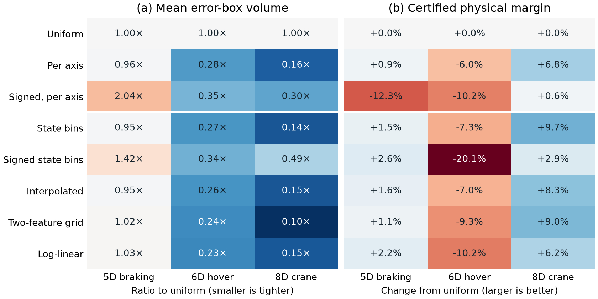
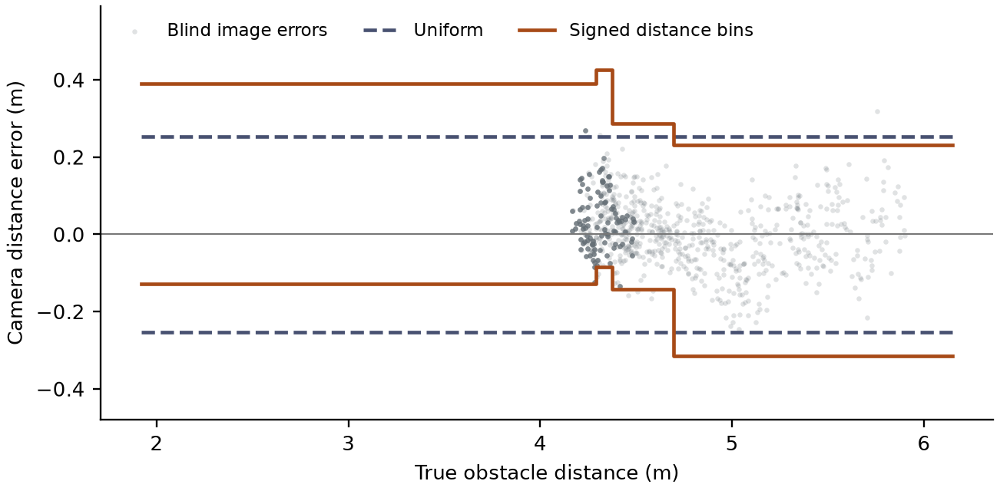

# 同一视觉系统下，固定与状态相关的 CP 误差盒能多证明什么？

在五维弯道制动、六维悬停和八维起重机上，固定上一轮的视觉投影、状态代理和控制器，比较 **3 种固定盒与 5 种状态相关盒**。每个场景保留三对训练种子的 $Cx$ 与可逆神经代理。18 套冻结前端分别接受八种验证，**144/144 个组合在原定工作范围通过**。所以区分方案要看具体能承受多大的测距偏差、风扰或初始运动范围。最明显的扩大出现在起重机，最清楚的反方向结果出现在悬停。

## 实验步骤与分母

1. **记录实际视觉误差。** 用 $z$ 表示相机所要估计的归一化物理量。图像经 DINO 和已冻结视觉投影得到 $y$，由各自代理的逆解码成 $\hat z$。第 $j$ 个分量的误差为 $e_j=\hat z_j-z_j$。要验证的集合为 $-q a_j(x)\le e_j\le q b_j(x)$。例如 $b_j$ 给出高估障碍距离时的相对半宽，$a_j$ 给出低估距离时的相对半宽。真实状态 $x$ 用于仿真标注和离线验证；运行中的控制器仍读取原相机和传感器。用可逆代理 $h$ 时，这个盒在原始视觉空间中对应 $y\in h(z+[-qa(x),qb(x)])$。
2. **用开发数据决定形状。** 每个冻结前端只用上一轮归档的 199 条校准轨迹来确定这次的宽度函数 $a,b$。宽度估计可使用其中的各帧。确定好后，它们对本次校准和盲测固定。主特征和第二特征依次为：制动的障碍距离、绝对航向角；悬停的相对目标高度、三轴变换速度的最大绝对值（速度与位置反馈的组合）；起重机的两轴小车位置最大绝对值、两轴相对摆移最大绝对值（归一化）。后端按同样的物理定义在连续状态区域内给宽度取界。
3. **独立校准每个盒的共同倍数。** 每个前端重新跑 199 条图像反馈轨迹。每个方案对一条轨迹只打一个分数 $s=\max_{t,j}\{e_{tj}/b_j(x_t),-e_{tj}/a_j(x_t)\}$。按从小到大排序，取第 190 个分数为 $q$，把所有边同时乘以 $q$。一套模型的八个分数定义使用完全相同的轨迹。八种方案的基础尺度不同，比较大小时看实际边长或体积；直接比较缩放因子 $q$ 会混入尺度选择。
4. **封存再盲测。** 每个任务的六套前端、48 组阈值全部封存后，才在新的 100 个外生场景上运行各自相机闭环。每个模型按照自己实际到达的状态成像。在同一模型内，换误差盒只影响统计和验证，所以同一趟的动作、是否危险及是否达标都相同。主实验共 **5,382 次新闭环、139,932 个有效相机时刻**。一套前端的 100 次盲测不能算作八组独立采集。制动六套系统各 84–85/100 停入目标区，悬停各 100/100 达标，起重机各 96–99/100 到位并消摆；各系统实测均 100/100 未进入危险集。
5. **在盒内检查所有允许误差。** 制动按障碍距离分段，求整个屏障子水平集上的最坏感知车距。悬停按高度和变换速度划分连续区域，检验每轴后继及推力饱和条件。起重机按初始位置分区，逐步包住可达位置与摆移，把该区间内所有允许视觉误差传到电机命令、负载间隙和其他状态约束。后端使用固定的物理模型及判据；起重机按每个冻结集合重新构造相应的时变可达界。各方法均独立检验证书，并核对盲测轨迹是否从头到尾在界内。

这样的归一化分数沿用了分割保形预测中按局部尺度调整区间宽度的思想。此处把最大值取遍整条轨迹和全部坐标，统计单位为整次闭环。对预先指定的方案和可交换的校准、新轨迹，95% 是整条新轨迹在管内的边际覆盖，计入校准样本和新轨迹的随机性。每个状态分区、任意固定初态以及从八种结果里事后选出的方案，都需要另外依据才能获得相应的条件保证。模型内全程在管且对应检查通过，才可用这份证书推出避险。改变实际风扰或初态采样分布后，新的相机轨迹覆盖须重新校准。[Lei 等的分割及局部尺度 CP](https://arxiv.org/abs/1604.04173) · [Lindemann 等的轨迹保形验证](https://arxiv.org/abs/2211.01539) · [本实验的分数与连续区域半宽](../../../artical-F122/Aebs/conformal/trajectory_boxes.py)

## 八种误差盒各自怎样得到

| 方案 | 开发轨迹提供什么 | 换一个状态时，盒子怎样变化 |
|---|---|---|
| 固定统一 | 所有轴及正负方向的基础半宽均置为 1 | 所有归一化方向的半宽恒为 $q$ |
| 固定分轴 | 各轴绝对误差的 90% 分位数 | 不同轴有不同半宽，同一轴两侧对称 |
| 固定分轴正负 | 分别取各轴误差正部、负部的 90% 分位数 | 每个方向可有不同宽度，跨状态固定 |
| 主状态分段 | 按主特征的开发四分位点分区，每区估计分轴对称宽度 | 跨越区间边界时换盒 |
| 主状态分段正负 | 同样分区，各区分别估计误差的正、负两侧 | 允许特定状态下更常出现高估或低估 |
| 主状态插值 | 对称分段估计的宽度放在各段主特征中位点 | 结点间线性插值，两端延用端点宽度 |
| 双状态网格 | 两个特征各按开发三分位点分区，在至多 $3\times3$ 个格子中估计分轴对称宽度 | 根据两个状态特征所在的格子取盒 |
| 状态对数线性 | 用两个截断、归一化的状态特征拟合每轴对数误差尺度，斜率带岭惩罚 | 取指数得到正宽度，特征超出开发第 5–95 分位范围时沿用边界值 |

局部分区样本少时，估计向全局尺度收缩，空分区沿用全局值；估计器设有正下限以避免除零。开发中的 90% 分位仅用于决定**相对形状**，正式轨迹目标 95% 由独立校准的共同倍数给出。三维或四维归一化盒的体积是各轴实际全宽的乘积。先算该模型在盲测时访问状态的平均体积，再除以它自己的固定统一盒体积，最后对六套前端取平均。这个比值有共同分母意义，绝对体积则不能跨任务比较。

## 全部方案在同一批轨迹上的结果

下表每格依次为 **相对体积 / 平均全程覆盖数**。固定统一盒的体积设为 1；覆盖数为六套系统各自 100 次盲测的算术平均。逐模型覆盖数、体积和认证结果都保存在结果表中。[24 行总表](../../../artical-F122/results/high_dim_cp_boxes_20261117/summary.csv) · [14,400 条“轨迹×盒”盲测记录](../../../artical-F122/results/high_dim_cp_boxes_20261117/blind_trajectories.csv)

| 盒形 | 五维制动 | 六维悬停 | 八维起重机 |
|---|---:|---:|---:|
| 固定统一 | 1.000 / 90.17 | 1.000 / 97.67 | 1.000 / 94.83 |
| 固定分轴 | 0.958 / 91.67 | 0.278 / 92.67 | 0.156 / 94.83 |
| 固定分轴正负 | 2.042 / 90.50 | 0.349 / 93.50 | 0.303 / 94.00 |
| 主状态分段 | 0.951 / 92.67 | 0.270 / 94.00 | 0.144 / 96.17 |
| 主状态分段正负 | 1.418 / 93.33 | 0.338 / 90.50 | 0.487 / 94.67 |
| 主状态插值 | 0.949 / 91.17 | 0.262 / 93.67 | 0.146 / 95.83 |
| 双状态网格 | 1.018 / 93.33 | 0.242 / 93.00 | 0.104 / 94.00 |
| 状态对数线性 | 1.030 / 91.83 | 0.231 / 93.17 | 0.148 / 95.33 |



左图越小表示平均装进盒里的误差组合越少。右图越大表示具体安全判据能承受的额外偏差、总风扰或初态尺度越大。所有数值相对于同一任务的固定统一盒。[矢量图](../../assets/high_dim_cp_boxes_20261117/box_comparison.svg)

| 盒形 | 制动：额外正向测距偏差（m） | 悬停：每轴可证总风上限（归一化加速度） | 起重机：可证明的初态盒共同倍率 |
|---|---:|---:|---:|
| 固定统一 | 1.10045 | 0.48627 | 1.36833 |
| 固定分轴 | 1.11034 | 0.45693 | 1.46167 |
| 固定分轴正负 | 0.96532 | 0.43670 | 1.37667 |
| 主状态分段 | 1.11684 | 0.45076 | 1.50167 |
| 主状态分段正负 | 1.12907 | 0.38838 | 1.40833 |
| 主状态插值 | 1.11796 | 0.45220 | 1.48167 |
| 双状态网格 | 1.11203 | 0.44117 | 1.49167 |
| 状态对数线性 | 1.12518 | 0.43649 | 1.45333 |

### 为什么更小的盒有时反而给出更弱的证明？

**制动取决于看得过远这一侧。** 以第一组线性前端为例，原统一盒的测距误差为 ±0.253 m。按车距分段并区分正负后，距障碍物超过约 4.70 m 时允许的误差为约 [−0.316, +0.232] m。车辆可能低估更多，却更少高估，制动器因看得过远而延迟介入的最坏情况因此被收紧。六个前端的这种盒体积平均增大 41.8%，证书可以额外吸收的正向测距偏差从 1.10045 m 增到 1.12907 m，多 **2.86 cm**。在同一附加偏差下承诺实际相机的整体概率覆盖，仍须采集相应分布的轨迹。[五维任务的全部结果与验证条件](../五维弯道制动/五维弯道制动_Cx与可逆神经代理配对实验_20261117.md)



每个灰点对应第一组线性前端实际盲测时刻的车距和测距误差。蓝色虚线是固定统一盒的两侧，橙色是分段正负盒的两侧。两端少有观测的区间仍纳入连续域验证。

**悬停受最不利高度或轴向误差限制。** 状态对数线性盒体积为统一盒的 23.14%，减少 **76.86%**，但水平轴收紧时，部分高度和运动状态中允许的高度误差更大。需要同时保护三轴和整片声明区域，因而可证总风加速度上限均值从 **0.48627 降至 0.43649**，降低约 **10.24%**。两者都高于原实验要求的 0.08（每轴归一化加速度）。盲测全程覆盖均值分别为 97.67/100、93.17/100；这些是新阈值和指定测试样本下的实测数。[悬停逐轴物理量、风扰和独立复核](../六维无人机悬停/六维无人机悬停_Cx与可逆神经代理同预算比较_20261117.md)

**起重机要保留误差发生时的小车位置。** 主特征是小车相对中心的最大轴向位移。相同形状下，若把不同位置的最大宽度全合成一个固定外包盒，验证器就得允许“任何位置都遇到最宽误差”。这样六套模型平均可认证初态尺度只有 **1.4317**。保留状态分段并按各时刻的可达区域取宽度，均值为 **1.5017**。对照组中，固定统一盒为 **1.3683**，最强的固定分轴盒为 **1.4617**。状态分段相对它分别增加 **9.74% 和 2.74%**，相对固定分轴在六个前端上都改善。在共同的 1.50 倍初态范围下，分段方案六组全部通过。固定分轴盒中可构造合法状态与视觉误差，使两电机限幅前的总命令超过上限 6，破坏现有证书所需的无饱和条件。实际电机将执行限幅，超额命令说明这套证明的条件被破坏。[起重机的可达域验证和固定外包复核](../八维起重机/八维桥式起重机_Cx与可逆神经代理_同预算对比_20261117.md) · [固定外包的逐模型结果](../../../artical-F122/results/crane_cp_boxes_20261117_v1/global_wrapper_check.json)

## 独立确认：换一批起重机轨迹，分段盒的优势还在吗？

主实验完整比较了八种盒，因而从中挑出的最大余量还需要新数据确认。另行锁定第一对训练种子（817731 的 $Cx$、神经版），以及固定统一、固定分轴、按小车位置分段三种方案。沿用原开发轨迹定出的每条边和分段点，不再拟合。每个模型再用 **499 条全新轨迹**独立校准（第 475 小分数），两个模型的六组阈值全封存后，再各跑同一批 **500 个新盲测场景**。共增加 1,998 次闭环，79,920 个有效相机时刻。

| 前端 | 固定统一盒 | 固定分轴盒 | 按小车位置分段盒 | 同一分段盒改取全域最大外包后的尺度 |
|---|---|---|---|---:|
| $Cx$ | 1.38，475/500 | 1.47，472/500 | **1.51，470/500** | 1.45 |
| 可逆神经 | 1.38，472/500 | 1.46，479/500 | **1.51，477/500** | 1.44 |

每格依次为已证初态倍率和名义采样分布的实测全程覆盖。按小车位置分段后，线性、神经两套前端的已证倍率比固定分轴分别提高 **0.04、0.05**，两组盲测覆盖都少 **2/500** 条。相同分段盒的逐状态验证还优于将其压成全域外包的做法。两种前端各 500/500 实测安全，分别有 479、492 次达标。这次独立确认针对这一对冻结的前端和同一采样分布。[预先锁定的确认协议](../../../artical-F122/results/crane_cp_boxes_confirmation_20261117_v1/protocol.json) · [逐模型确认结果](../../../artical-F122/results/crane_cp_boxes_confirmation_20261117_v1/summary.json)

## 如何复核数值

逐步采集命令、冻结检查点和动力学检查见各任务专报。所有新轨迹和模型权重保存在项目主目录及服务器结果包。完成采集后，在 artical-F122 中重跑以下命令可校验已封存的开发与校准文件、按原证明重新审计并重画两张图。

```bash
for task in braking hover crane; do
    python -m Aebs.experiments.high_dim_cp_boxes "$task" freeze
    python -m Aebs.experiments.high_dim_cp_boxes "$task" evaluate
done
python -m Aebs.experiments.summarize_cp_boxes
python -m Aebs.experiments.plot_cp_boxes
```

覆盖和体积的附加区间按配对场景重抽样，同一外生场景下保留六个前端之间的对应关系；三个训练种子和两种代理共用场景，不能当成六倍独立数据。全部方案均有记录，逐盒 CP 是单个预先固定协议的边际保证；按盲测挑出的最优方案应另行冻结与确认。
