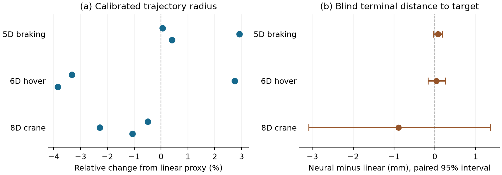

# 五维制动、六维悬停、八维起重机的 Cx 与可逆神经代理对比

2026-11-17。在三个任务上各训练三对视觉前端，冻结后让每个前端实际驱动控制器。**八维起重机中，神经代理在三个种子下均缩小整轨迹误差半径，平均缩小 1.30%。五维制动中三对均略微变宽；六维悬停中两对缩小、一对变宽。18 个系统都在自己的校准范围内通过鲁棒屏障验证。三个任务都没有观察到稳定的到达率提升。**

## 一、同一个问题落在三种任务上

模型总状态有 5、6 或 8 个分量。相机负责的量分别有 3、3、4 个。用 $z$ 表示这些量归一化后的真值。其余传感器和已知道路参数与原控制器相同。

| 场景 | 相机要估计什么 | 当作成功的条件 | 训练 / 开发 / 静态测试图 | 每臂更新 / 可训练参数（线性，神经） |
|---|---|---|---|---|
| 五维弯道遇障制动 | 横偏、航向偏差、到障碍物的纵向距离 | 全程避开危险且停在距障碍物 3.60–4.40 m 的区间 | 1,920 / 320 / 320 | 700 步 / 588，735 |
| 六维无人机悬停 | 目标上方的三轴位置偏差，速度单独测量 | 有风时全程安全，最后四个采样状态的位置和速度均在目标范围 | 1,536 / 256 / 256 | 560 步 / 492，639 |
| 八维桥式起重机 | 两轴小车位置、两轴吊载相对摆移，速度单独测量 | 全程安全，末四个采样状态的负载位置、摆移和速度满足稳定要求 | 2,048 / 256 / 256 | 768 步 / 25,066，25,310 |

## 二、从训练到安全结论

1. **从一张图得到两个可比较的读数。** 冻结 DINOv2，由可训练投影输出相机读数 $y=p_\theta(\mathrm{DINO}(I))$。状态侧线性组计算 $h(z)=Cz$；神经组计算 $h(z)=H_\phi(Cz)$。每一层 $H$ 用其余坐标的神经网络输出平移一个坐标。解码时倒转层顺序并减去同一平移，再求解线性方程，得到 $\hat z=h^{-1}(y)$。因此两组送给旧控制器的输入仍有相同物理含义。VISION-SLS 的 Remark 3 允许可微非线性观测；这里选择有显式逆的一类，使原有反馈和验证接口可以继续使用。[VISION-SLS 原文](<../../references/VISION-SLS- Safe Perception-Based Control from Learned Visual Representations via System Level Synthesis.pdf>) · [耦合层及其逆](../../../artical-F122/Aebs/vision_sls/observation_coupling.py)
2. **在配对条件下联合训练视觉头和状态代理。** 每一对使用相同静态图、DINO 特征、初始视觉头、初始 $C$、批次顺序、损失和更新次数。神经部分初始化为恒等，所以开始时两个系统给出同样的预测。五维和六维从训练集上的岭回归读出开始；八维从已有的线性视觉检查点暖启动，两个版本均继续训练。每版只用开发集解码误差选择轮次。三种任务内部做配对，神经版本的额外参数如上表。
3. **按各自实际到达的状态重新取图。** 冻结模型和控制器，对每臂新跑 199 条校准轨迹。每一步由本臂的状态渲染相机、提取视觉读数、计算动作并推进动力学。各臂共用外生初态、道路曲率或风扰动，控制动作不同后，下一帧图也可以不同。五维在停稳后仍执行采样，仅对像素逐字节相同的图复用 DINO 特征。五维、六维和八维分别观察 14、24 和 40 个控制时刻。
4. **测量实际视觉与代理误差。** 保存低维差 $e_y=y-h(z)$ 和进入控制器的解码差 $e_z=h^{-1}(y)-z$。证书使用后一种，把每条轨迹所有时刻、所有视觉分量的最大绝对误差记为一个分数。对 199 个分数，从小到大取第 190 个作为 $q$。这样，每版的 $q$ 均使用同一物理坐标口径；对可逆的 $h$，$\|e_z\|_\infty\le q$ 也等价于 $y\in h(z+[-q,q]^d)$。这个集合把实际低维读数与状态侧预测联系起来。单独测得的原始低维半径保存在汇总数据中。
5. **把各自的误差集合送入原任务验证器。** 五维使用原制动控制器和原结构化神经屏障，做连续状态区域的数值不等式检查；悬停使用同一控制器与屏障，用有理数复算约束；起重机固定反馈增益与有限时域屏障的构造规则，代入各自的 $q$，分别生成并检查相应屏障。在新轨迹整个时域均落在所证集合内的前提下，模型闭环避开危险集。对冻结系统、预先指定协议与同分布可交换的整轨迹，分割 CP 提供 95% 的边际覆盖。令 $A$ 为校准所得证书通过，单个协议满足 $P(A\ \mathrm{且新轨迹不安全})\le0.05$。概率同时针对随机校准样本和新轨迹。每个已冻结阈值上的 100 条盲测有其自己的经验覆盖数。
6. **在全新外生场景上盲测。** 每个任务先冻结全部六组阈值，再独立取 100 个场景，各模型分别闭环。总计 5,382 次完整运行和 139,932 个有效观测时刻。同一任务 6 个系统共享 199 个校准场景和 100 个盲测场景。文末数据每一行是一条完整运行，原始轨迹还含逐步动作、状态和误差。[逐轨迹数据](../../../artical-F122/results/high_dim_proxy_comparison_20261117/per_trajectory.csv) · [交叉复核程序](../../../artical-F122/Aebs/experiments/compare_high_dim_proxies.py)

## 三、观测半径、证书和控制表现

表中 $q$ 是三个训练种子的算术平均，相对变化为两列均值之比减一。每个达标数的分母都是同一批 100 个盲测场景。半径越小，验证器需要包容的观测误差越小。

| 场景 | 线性 $q$ | 神经 $q$ | 神经版相对变化 | 神经版更紧的种子数 | 盲测达标数，线性 → 神经 |
|---|---:|---:|---:|---:|---|
| 弯道制动 | 0.130877 | 0.132352 | +1.13% | 0/3 | 86→86、88→88、87→87 |
| 无人机悬停 | 0.225726 | 0.222218 | −1.55% | 2/3 | 100→100、100→100、100→100 |
| 起重机 | 0.190949 | 0.188459 | −1.30% | 3/3 | 99→100、97→95、99→99 |

每个模型均在 100 条盲测中观测到零次越界。全程在各自管内的条数如下，同样按匹配种子排列。以悬停为例，一个模型的 89/100 描述这批轨迹对一个已冻结误差管的覆盖；表中的 100/100 达标是另一个事件。轨迹可以在某帧超出屏障证明所用的观测界，最后仍安全悬停。

| 场景 | 线性全程在管 / 100 | 神经全程在管 / 100 | 冻结后端可接受半径的数值上界位置 | 两种前端各自的证书通过数 |
|---|---|---|---:|---|
| 弯道制动 | 95、92、95 | 95、96、95 | 约 0.675000 | 3/3、3/3 |
| 无人机悬停 | 91、89、94 | 89、92、93 | 约 0.785714 | 3/3、3/3 |
| 起重机 | 93、98、94 | 92、97、98 | 约 0.352955 | 3/3、3/3 |

三个上界由同一任务原有的充分条件在固定控制器下对 $q$ 二分得到，通过和未通过的包围宽度小于 $10^{-12}$。这量化**选用的验证器能容忍多宽的管**。起重机的两种前端平均分别使用这项预算的 54.10% 和 53.39%。若额外固定每组得到的误差管、仅按比例放大初态盒，三对模型的可证初态尺度上确界均小幅提高，均值 **1.37175 → 1.37586（+0.30%）**。扩大初态分布后的整体视觉覆盖率仍需要该分布上的新校准。[起重机尺度计算和逐种子结果](../../../artical-F122/results/crane_proxy_comparison_20261117_v1/summary.json)



左图一点对应一对训练种子，负数表示神经版管更紧。右图计算同一外生场景下神经版减线性版的终点物理距离，按场景对三个种子取均值，再以整场景为单位配对重抽样 10,000 次。制动计停车距 4 m 目标中心的绝对偏差；悬停和起重机计最终位置至目标的欧氏距离。五维、六维、八维的均差依次为 **+0.079、+0.043、−0.889 mm**，各自 95% 区间为 **[−0.031, +0.183]、[−0.172, +0.258]、[−3.088, +1.359] mm**。三个区间均含零。它们反映这些冻结模型上的盲测场景差异，未覆盖重新抽取训练种子的波动，也未作多重比较校正。[图的矢量版](../../assets/high_dim_proxies_20261117/paired_effects.svg) · [完整数值与区间](../../../artical-F122/results/high_dim_proxy_comparison_20261117/summary.json)

## 四、神经代理实际用了多少非线性

因为两边都重新训练了视觉头、线性映射和相应解码器，看到 $q$ 变小本身无法判定是映射的哪一部分起作用。为此做了一个同图像追加检查。保留神经版的真实盲测轨迹和相机读数，用原静态**训练**状态拟合两个替代映射，分别是通过原点的矩阵和带平移的仿射映射。只替换解码公式，测同一个 $y$ 的解码值改变多少。该诊断固定已经获得的图像，作用是量化神经映射的弯曲程度。

| 场景 | 换成训练集拟合的仿射逆后，盲测解码值的归一化 RMS 变化范围（三个种子） |
|---|---:|
| 五维制动 | 0.000011–0.000021 |
| 六维悬停 | 0.000010–0.000023 |
| 八维起重机 | 0.000058–0.000099 |

这些检查点上的可逆神经映射在实际访问的区域很接近仿射。以起重机为例，在同一批相机读数上去除拟合出的弯曲成分，解码变化的 RMS 低于 0.00010 个归一化单位。权重变化、视觉头联合适配和开发集选轮次都可能影响不同训练臂的最终半径。本次能够归因的是**更换并重新联合训练整套观测模型**所产生的配对差异。[同读数仿射替代检查](../../../artical-F122/results/high_dim_proxy_comparison_20261117/same_image_affine_diagnostic.json) · [复算代码](../../../artical-F122/Aebs/experiments/check_proxy_affinity.py)

## 五、复现和论文表述

各任务专报给出数据来源、训练和采集命令、完整三个种子的数字以及每个检查点的验证记录。

- [五维制动的模型、盲测和屏障](../五维弯道制动/五维弯道制动_Cx与可逆神经代理配对实验_20261117.md)
- [六维悬停的配对训练和盲测](../六维无人机悬停/六维无人机悬停_Cx与可逆神经代理同预算比较_20261117.md)
- [八维起重机的误差管、可证初态尺度和稳定率](../八维起重机/八维桥式起重机_Cx与可逆神经代理_同预算对比_20261117.md)

三个任务均在服务器的 vt 环境实跑。原图、原控制器及先前结果包保留。进入项目的 artical-F122 目录，使用本机或服务器已保存的逐时刻数组和模型，可重算本文的总表、追加诊断及图。

```bash
python -m Aebs.experiments.compare_high_dim_proxies
python -m Aebs.experiments.check_proxy_affinity
python -m Aebs.experiments.plot_high_dim_proxies
```

**论文可以报告的发现。** 同一套“图像投影—可逆状态代理—整轨迹校准—鲁棒验证”接口在三种更高维控制任务上同时支持线性和非线性观测模型。起重机上可观察到小幅且同方向的认证余量改善；更换代理对任务达标率的影响小且随种子变化。这些数据支持保留 $Cx$ 作为基线，单独报告神经版本何时真正改变可证范围。

保持这些前端和控制器冻结后，八种误差盒的后续实验见[固定与状态相关 CP 误差盒配对验证](五六八维_固定与状态相关CP误差盒_配对验证_20261117.md)。
