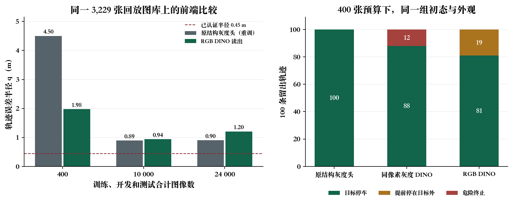
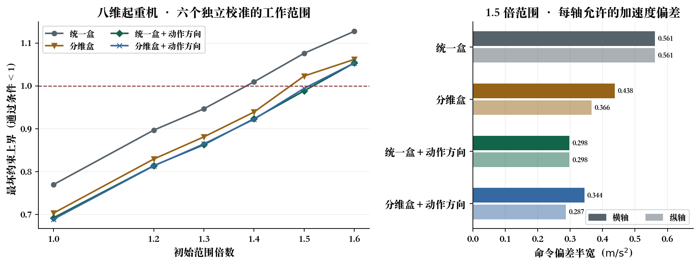
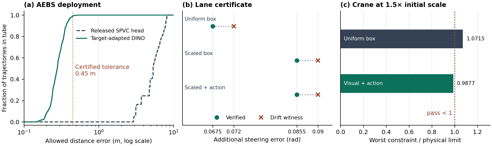

# 原 SPVC 和当前框架的配对实验：替换前端有什么收益，收益怎样进入证书

2026-11-17。实验在服务器的 `vt` 环境完成。本文的 AEBS 相机帧来自 CARLA 仿真。车道与起重机采用随闭环状态重新渲染的程序相机。

投稿用的摘要结果段、矢量主图、线性命令偏差命题及公平比较边界见[第 9 节](#9-论文主结果怎么写)。

## 1. 哪些改进已经有数据支撑

| 想回答的问题 | 可归因的改动 | 实验给出的答案 |
|---|---|---|
| 把原发布视觉头直接接入扩展 AEBS 图库，再换成当前前端，证书会怎样？ | 同一 24,000 张部署图库、同一控制器、动力学、初态采样和神经屏障，切换两个现成的视觉前端 | 物理距离误差半径 **8.0584 → 0.4096 m**。旧头有屏障反例，新前端落入已验证的 **±0.45 m** 范围。另在 2,000 对独立轨迹上，相对原发布头，全程落入同一已认证误差管的概率提升至少 **98.58 个百分点**（单侧 95% 同时置信口径）。 |
| 让原结构也在目标图像上重训，DINO 还有收益吗？ | 共用训练划分、回放库、控制器和屏障，另做两边都只看 32×32 灰度图的消融 | 400 张总预算、同灰度输入时，共同图库的轨迹误差半径 **4.5020 → 1.8880 m**。每条留出轨迹的峰值误差都减小，但有 **12/100** 条出现危险终止。10k、24k 总预算没有普遍的 DINO 优势。 |
| 同一套视觉控制器，改进误差的表示能多证明什么？ | 固定观测、代理和控制器，对相同轨迹做不同的整轨迹校准 | 车道中，分维集合让固定屏障能证明的额外转向扰动增大。八维起重机中，加入动作方向后，通过的最大已测初始范围 **1.3 → 1.5 倍**，随后在独立的 999 条校准和 1,000 条留出轨迹上确认了 1.5 倍处的证书差异。 |

**适合论文的主张**是把“实际图像读数与状态代理在闭环中能差多少”作为可测量、可校准的接口，再量化它对某个控制器和某个安全证书的影响。小数据精度、任务成功率、可认证工作范围和推理成本是四种不同的结果。下面逐项给出数值。

## 2. 原方法和当前方法分别在验证什么

| 环节 | 原 SPVC 论文与发布实现 | 当前实验 |
|---|---|---|
| 怎样从状态得到观测 | 论文用条件生成、蒸馏和环境扰动建模，构造可验证的感知闭环。我们还加载了仓库发布的生成器、灰度状态估计头和 PPO，测量它们在指定输入上的表现 | 冻结 DINOv2，把图像特征投影成低维观测。另设状态侧代理，使验证时可以从状态计算理想读数。AEBS 的这个读数是归一化距离，表中误差均换算为米 |
| 怎样处理相机与模型的差 | 原文在给定建模假设与扰动律下分析概率安全。本次另测原件相机读数与其零潜变量生成路径之间的偏差 | 对一条完整闭环轨迹取最大的视觉与代理偏差，把每条轨迹压成一个数。用新抽取的整轨迹做分割保形校准（CP），得到误差集合 |
| 怎样证明安全 | 原论文的随机屏障证书约束后继屏障值的条件期望。表 1 在其 CARLA AEBS 设置下报告 **94.2%** 的概率安全下界 | AEBS 和车道用固定控制器和神经鲁棒屏障，验证集合内每一个允许后继满足屏障条件。起重机用模型推导的、随剩余时间变化的鲁棒屏障 |

本文同时回答两个问题。第一，换掉原发布前端，具体部署系统能得到什么。第二，让旧结构也适配目标域，剩下的好处还有多少。本次没有可与原论文表 1 绑定的交替优化最终控制器及其随机证书。发布入口引用的是原 PPO 初始策略，本文另用当前已验证的鲁棒控制器作共同后端。原文的 94.2% 是其随机闭环下对给定初态的无限时域结论，当前轨迹级的 95% 是注册场景分布和有限观测时域下的边际覆盖水平，二者不能相减。[原 SPVC 论文，定义与表 1](<../../references/Provably Probabilistic Safe Controller Synthesis for Vision-Based Neural Network Control Systems.pdf>) · [VISION-SLS 论文](<../../references/VISION-SLS- Safe Perception-Based Control from Learned Visual Representations via System Level Synthesis.pdf>) · [本项目的 CP 与屏障条件](../../framework/SBC_CBC_CBF_CP概念与安全保证详解_20261116.md)

## 3. 对照一：用原发布前端检验端到端收益

### 3.1 在同一 24k 密集图库上，能否通过同一张证书

固定 12 种天气与车色组成的部署图库。每条轨迹抽取一次外观，在每一步按当前真实车距查同组最近的帧。两个前端使用相同的抽帧规则、随机初态和外观编号。控制动作不同会改变后续距离，因此配对的是外生条件和相机规律，后续帧可以不同。旧前端使用原权重及其 32×32 灰度输入，当前前端采用在此目标域训练的 RGB DINO 读出。两个输出都用米接入同一鲁棒神经控制器。另抽 199 条做校准，以第 190 小的整轨迹峰值作为半径，再测 500 个相同的留出场景。

| 指标 | 直接迁移原发布灰度头 | 当前 RGB DINO |
|---|---:|---:|
| 相机与各自状态侧代理的轨迹误差半径 | 6.2702 m | 0.4096 m |
| 相机与真实距离的轨迹误差半径，共同验证接口 | 8.0584 m | 0.4096 m |
| 留出全程落在各自物理误差界内 | 487/500 | 483/500 |
| 留出的目标成功 / 危险终止 | 0 / 500 | 500 / 0 |
| 同一控制器和神经屏障 | 有正漂移反例 | 通过已有 ±0.45 m 父证书的集合包含检查 |

这里的收益有三层含义。

1. **观测**。共同物理接口的半径缩小 **94.9%**。500 对轨迹的峰值误差全部下降，平均少 **5.219 m**，按配对轨迹重抽样得到的 95% 区间为 **[5.084, 5.355] m**。该区间固定了图库和检查点。查图距离偏差两边都不超过 0.00301 m。
2. **控制**。危险终止指距离已经到 6 m 或以内，车辆速度仍大于 0.5 m/s。成功指进入 5–6 m 目标区且速度不超过 0.5 m/s。它们是留出模拟轨迹的实际结局。
3. **证书**。旧头需要的共同误差界允许一个状态和误差组合，使屏障值从 0 增至 0.59355，违反不增条件。新读出的 0.4096 m 小于 0.45 m，所有允许后继都落入同一控制器、同一屏障原先检查过的范围。这里引用的是先前在 **782,400** 个状态单元完成的连续域数值验证。缩小误差集合足以继承这个证明。

全 24k 图库含视觉头训练和开发时见过的图像。这一实验衡量固定部署图库上重新抽初态与天气的闭环；独立性来自新抽的整轨迹。对新图库、新场景或道路实拍的泛化要看其他实验。旧头使用原权重，DINO 用目标图像适配过，这一行衡量实际替换的总效果。第 4 节让两边都适配目标域。[完整部署配对结果和具体反例](../../../artical-F122/results/aebs_native_cross_20261117_v1/full_release_bank/report.json)

### 3.2 固定证书容许的 0.45 m，重新估计两个前端实际能使用证书的概率

前一组给每个前端校准自己的半径，可回答“它需要多宽的包络”。这里反过来问**证书只容许 ±0.45 m，这个前端能有多少条轨迹全程满足它？** 先冻结既有证书的阈值、两个模型、同一全 24k 图库、2,000 个新随机场景的种子、样本量与统计方法。独立抽取初态和外观，配对运行两种前端。每种前端按整条停止轨迹记一次成功或失败，以精确二项方法计算置信限。

| 固定 ±0.45 m 的指标 | 原发布灰度头直接迁移 | 当前 RGB DINO |
|---|---:|---:|
| 新轨迹全程在管内 | 0/2,000 | **1,985/2,000** |
| 实际目标成功 / 危险终止 | 0 / 2,000 | **2,000 / 0** |
| 在管概率的同时置信界（两个单侧界合计 95%） | ≤ 0.1843% | ≥ 98.7660% |

因此，在该固定图库与初态/外观分布下，**全程满足同一证书误差前提的概率增益，单侧 95% 下置信限为 98.58 个百分点**。两臂各用单侧 97.5% 的 Clopper–Pearson 界，Bonferroni 同时覆盖后再相减，从而允许同一对轨迹的结果相关。若单独评价事先指定的 DINO 系统，其在管概率的一侧 95% 下置信限约为 **98.8475%**。在管就避险，因此这也给出已核验数值模型、同一停止时域下避险概率的统计下置信限。额外 15 条轨迹出了管，实测仍达到目标。前一个 95% 是为固定系统做独立抽样推断的置信水平，第 7 节的 95% CP 是随校准集变化的分割保形边际覆盖。两者没有相乘。[独立 2,000 对原始计数、阈值与精确二项界](../../../artical-F122/results/aebs_native_cross_20261117_v1/fixed_tube_2000/report.json)

### 3.3 保留原 PPO，改用原始灰度相机图

在原始 400 张 H5 图中的 80 张固定测试帧上，两边读取完全相同的 32×32 灰度像素，使用同一个原发布 PPO。原头的物理误差半径为 **6.6118 m**，DINO400 为 **0.6762 m**；两边均 **500/500** 到达目标。DINO 的 240 张训练、80 张开发和 80 张测试互相分开。原生成器训练代码会读取全部 400 张，其发布权重缺少逐图训练记录。这里能确认同一相机信息、同一 PPO 下两个具体检查点的差异。两边同时到达目标，说明本条件下的直接收益是读数误差。

对 H5 结果还做了异常帧敏感性检查。第 59 号测试帧底部八行像素完全恒定，其标注车距是 6.4824 m，原头读成 0.0273 m。这张图在多条闭环中被反复访问。事后按像素规则去掉这一帧，用剩余 79 帧重新抽取 199 条校准和 500 条留出。物理半径仍从 **1.9707 降至 0.6670 m**，但每条轨迹平均峰值误差改善从 **6.097 m** 变成 **1.096 m**。同一原 PPO 的原头在此敏感性测试中反而 500 条全部危险终止，DINO 仍全部成功。这暴露出固定图库中一帧对策略时机的影响。主表的 24k 密库交叉实验独立于此帧。

用原生成器的零潜变量路径代替相机并运行原 PPO，得到的物理半径是 **1.9442 m**。这个数字回答生成路径自身离真实距离多远。它与相机相对该生成路径的 **6.6137 m** 是两个问题。另在扩展库的 4,920 张测试帧上保留原 PPO，原迁移头与 DINO 的物理半径分别是 **8.1584 / 1.1523 m**，成功分别为 **0 / 500 条**与 **500 / 500 条**。这些检查展示了改变图库或观测模型时，哪些数字必须重算。[原件、两种控制器与三种观测来源的交叉实验](../../../artical-F122/results/aebs_native_cross_20261117_v1/report.json)

## 4. 对照二：原结构也在目标域重训，同预算下谁更好

用 400、10,000、24,000 张 CARLA 原 RGB 帧作为三个**总包**，其中包含训练、开发和测试帧。基线取原 SPVC 的灰度状态头结构，直接在目标图像上重训。DINO 主臂使用冻结预训练骨干与 RGB 投影头。每档固定同一个神经控制器和屏障，按完整轨迹重新独立校准。各模型对帧的预测可以缓存，闭环始终按各自实际到达的状态取帧。所有危险和提前停止的轨迹都计入。

有两种合理的测试问题。**共同图库**用 3,229 张与各预算训练及开发集排除重合的测试图，所有预算面对同一相机规律，测试库作为外部评估资源。**严格总包**仅用本档内部的测试帧回放，其采样密度也是总预算的后果。两种协议都含全部 12 种外观。下表每一格左边为重训灰度头，右边为 RGB DINO。

| 图库 | 图像总包 | 轨迹半径 q，m | 全程覆盖 /100 | 目标成功 /100 | 危险终止 /100 | 同一神经屏障 |
|---|---:|---:|---:|---:|---:|---|
| 共同 3,229 张 | 400 | 4.5020 / **1.9767** | 95 / 89 | 100 / 81 | 0 / 0 | 均有反例 |
| 共同 3,229 张 | 10k | **0.8930** / 0.9416 | 93 / 97 | 100 / 100 | 0 / 0 | 均有反例 |
| 共同 3,229 张 | 24k | **0.9007** / 1.2048 | 99 / 99 | 100 / 100 | 0 / 0 | 均有反例 |
| 严格 72 张 | 400 | 4.5018 / **4.4821** | 96 / 98 | 50 / 50 | 8 / 11 | 均有反例 |
| 严格 2,000 张 | 10k | **0.25767** / 0.25801 | 96 / 98 | 100 / 100 | 0 / 0 | **均通过** |
| 严格 4,920 张 | 24k | **0.8979** / 1.1627 | 99 / 99 | 100 / 100 | 0 / 0 | 均有反例 |

**单独控制输入信息量。** 在 400 总包的同一 240 张训练图、88 张开发图上，两边都训练 100 轮，输入使用逐像素核对的相同 32×32 灰度。共同库上的 DINO 半径是 **1.8880 m**，比重训灰度头小 **58.1%**。100 对轨迹的峰值误差全部下降，平均少 **2.696 m**，配对 bootstrap 95% 区间 **[2.619, 2.771] m**。留出覆盖 **95 → 90/100**，任务成功 **100 → 88/100**，危险终止 **0 → 12/100**。RGB DINO 的 19 条未成功轨迹则全部提前停在目标外。制动时机取决于误差的方向、位置和速度，绝对误差半径一项解释不了这些差异。外部 DINO 预训练仍是模型资源的一部分，预算约束的是目标域图像。主表的 RGB 读出与灰度头沿用各自既有的训练轮数，共享后端还使用过独立的开发资源。



**为什么 10k 严格库通过，24k 严格库却有反例？** 回放在同一天气与车色下查最近距离。严格 10k 两个臂遇到的最大找图距离偏差约 **0.267 m**，严格 24k 为 **0.878 m**，严格 400 则达到 **4.860 m**。图库变大并不保证每种外观在每个制动距离上都更密。半径把选到的图读数与当前真实状态相减，因此包含了查图偏差。共同图库上 10k 和 24k 的重训灰度头也有较小半径，不能把所有高预算结果只归咎于查图。这些是冻结图像库回放的结论。[八组对照、区间和覆盖明细 CSV](../../../artical-F122/results/aebs_matched_replay_20261117/paired_comparison.csv)

## 5. 对照三：固定车道控制器，能少承担多少视觉引起的转向误差

车道实验有横向偏移、航向误差两种视觉量。每一步将实际图像投影与状态代理相减得到两个残差。比较三个集合：统一盒对两个归一化残差给相同半宽；分维盒先用开发数据确定两维的相对尺度；联合集合同时限制各视觉分量和它们通过当前神经控制器引起的实际转向差。三个集合各用相同的 199 条完整 80 步轨迹校准一个分数，100 条新轨迹做留出。

| 结果 | 统一盒 | 分维盒 | 分维视觉＋动作 |
|---|---:|---:|---:|
| 留出整轨迹覆盖 | 93/100 | 95/100 | 97/100 |
| 初态域内，视觉导致的最大动作差所在区间，rad | [0.28093, 0.30437] | [0.24940, 0.27282] | [0.11547, 0.11548] |
| 在细分网格上，屏障已证明可再容忍的额外转向扰动，rad | ±0.0675 | ±0.0855 | ±0.0855 |

第一行谈视觉覆盖。第二行的下界来自集合中实际可取的状态和误差，上界来自覆盖连续初态域的验证。表内上下界按向外方向截取小数。统一盒确实允许产生 **0.28093 rad** 的偏差，联合集合中所有允许偏差至多 **0.11548 rad**，因此动作方向上的最坏偏差至少缩小 **58.9%**。第三行问的是在承受视觉误差后，是否还能额外容忍执行器偏差。统一盒在 **0.072 rad** 已有正漂移见证，另外两种在 **0.0855 rad** 仍通过。细分网格是在查看预设粗网格后补做。分维本身已经带来这个屏障余量收益，进一步限制动作带来第二行的收益。100 条无额外扰动的留出轨迹共用同一控制器，均未越界。若改变执行器噪声造成闭环分布变化，视觉 CP 概率也需要对应的轨迹校准。[车道完整实验与验证口径](../车道保持/车道保持_三种轨迹误差集合与转向余量_20261117.md)

## 6. 对照四：八维起重机能从多大的初始范围出发并得到证明

### 为什么动作方向与证书有关

起重机同时沿两个水平轴运动。每个轴有小车位置、速度、吊载相对摆移和摆速。图像提供两轴的小车位置与摆移，速度量由模型直接提供。对一个轴，控制律中的视觉误差对加速度命令的贡献为

$$
\Delta u = -K_p e_p - 0.5 K_s e_s .
$$

这里的 0.5 是归一化摆移到物理量的换算。统一盒会容许“位置和摆移两个误差各自都取到最大、符号又恰好使制动需求叠加”的组合，即使这两个读数在相机中来自同一幅图。联合集合仍然约束四个视觉分量，同时用实际轨迹校准两个带符号的命令方向。这样既不会漏掉对视觉代理的约束，又可以使用更符合相机误差关系的控制量上界。不同分数定义下的标量 q 单位和尺度会变化，所以这里比较物理动作界和能通过的初始范围。

### 怎样做配对实验

1. 冻结原有起重机相机、DINO 投影、状态代理、反馈增益、执行器限制和有界动力学扰动。从旧开发轨迹确定分维比例。较早的试验用于选定联合分数形式和测试范围。
2. 在采集新轨迹前写入六个工作范围、四个集合定义和随机种子。将两轴所有初始状态半宽乘相同倍数，得到待验证的整个矩形域。每档新抽 **199 条**轨迹用于校准，**200 条**留出。每条闭环 40 步，每步重新渲染和读取图像。同一档的四种方法共用同一组轨迹。
3. 对每个集合分别取整轨迹分数的第 190 小值。用有理数支撑函数计算未来各步最坏的限位、摆移、载荷间隙以及单轴、双轴执行器用量。表中值是最坏约束用量相对物理限值的比例。**小于 1** 表示这些条件可以同时证明。达到或超过 1 意味着这次证明未建立，不能据此断言发生了碰撞。
4. 扫描完成后另冻结一个确认问题，只检验 1.5 倍范围，沿用统一盒和“统一盒＋动作方向”两个既定分数。使用此前未用的种子、**999 条**校准、**1,000 条**留出；分别以第 950 小值重新求证。这样可以区分扫出来的有利点和换一批数据还能重复的结果。

| 初始倍数 | 统一盒 | 分维盒 | 统一盒＋动作方向 | 分维盒＋动作方向 |
|---:|---:|---:|---:|---:|
| 1.0 | 0.7695 | 0.7028 | 0.6919 | 0.6887 |
| 1.2 | 0.8966 | 0.8291 | 0.8136 | 0.8131 |
| 1.3 | 0.9464 | 0.8809 | 0.8625 | 0.8644 |
| 1.4 | 1.0094 | **0.9387** | **0.9232** | **0.9220** |
| 1.5 | 1.0760 | 1.0229 | **0.9883** | **0.9941** |
| 1.6 | 1.1273 | 1.0617 | 1.0533 | 1.0533 |
| 最大已通过的测试倍数 | 1.3 | 1.4 | **1.5** | **1.5** |



**1.5 倍的独立确认**得到统一盒 **1.07147**，加入动作方向 **0.98768**，原先观察到的通过差异再次成立。每个轴承担的视觉命令偏差从 **0.54768 降至 0.29165 m/s²**，约小 **46.7%**。在该确认批次，四个视觉分量的统一盒半宽为 0.18632，联合集合的分量半宽反而放宽至 0.19844；对命令方向的约束解释了认证收益。对应留出全程覆盖分别为 **955/1,000、954/1,000**。行为来自同一组轨迹，观察到 **1,000/1,000 安全，955/1,000 按目标稳定**。

1.3 → 1.5 代表已测线性初始尺度多 **15.4%**。例如小车每轴位置界从 ±0.91 m 到 ±1.05 m，同时还扩大了初始速度、相对摆移和摆速。六档都同时报告，1.6 倍处所有方法均未通过。概率适用的初态按已注册规律采样，几何证书则对该初始矩形中的所有点、并满足误差前提的路径成立。起重机的基线是当前框架的统一误差盒，原论文没有这个起重机算例。[六档逐项界与留出覆盖](../../../artical-F122/results/crane_contract_benefit_20261117_v1/summary.json) · [1.5 倍独立确认](../../../artical-F122/results/crane_contract_confirmation_20261117_v1/summary.json) · [动力学、相机与初始范围](../八维起重机/八维桥式起重机_视觉消摆与有限时域鲁棒屏障_20261117.md)

## 7. 推理代价与安全结论

**计算代价。** 在同一 Xeon Platinum 8352V CPU 核上，PyTorch 单线程、batch=1，12 张预热后，对 108 张已解码的 CARLA RGB 帧逐帧随机交换测量顺序。计入各自预处理和视觉骨干，不含读盘、策略、模拟器和离线生成器。原发布灰度读出的中位数 / P90 为 **2.45 / 2.49 ms**，当前 24k RGB DINO 为 **143.08 / 144.42 ms**，中位数约 **58.5 倍**。前向涉及参数 **279,553 / 22,122,497**。冻结参数仍占用推理资源。这是指定 CPU 和实现的结果，GPU 或整车周期需另测。[逐帧基准与运行环境](../../../artical-F122/results/aebs_observation_cost_20261117_v1/summary.json)

**安全结论有两个环节。** 令 E 为新轨迹在整个声明时域内始终满足已校准的误差集合，A 为该校准结果通过对应屏障审计。在固定模型和回放律、以整条轨迹为可交换单位、模型及分数在校准前冻结时，单个预先规定试验的分割 CP 给出 P(E) ≥ 0.95，概率针对校准样本和新轨迹一起取。鲁棒证明给出 A 且 E 蕴含安全。因此可写 **P(A 且新轨迹不安全) ≤ 0.05**。把图库换成新的采集规律，在新平台运行，或只挑通过审计的校准批次再问其条件风险，都需要额外依据。各预设方法或各工作范围的 95% 也不构成同时覆盖所有格子的联合保证。数值神经网络区间审计的精度口径见各报告；起重机的有理数论证针对写出的离散模型。

**论文适合突出三项结果。** 第一，在明确的视觉部署变化下，用相机实测值校准代理，能解释为什么一个前端越过既有证书的容许上限、另一个前端能获得证书。第二，在相同小样本标签与相同像素下，预训练读出确有误差收益，同时存在任务反例和计算成本。第三，在不同控制任务中区分“观测误差有多大”和“它怎样影响动作”，可以扩大固定控制器的可证扰动或者初始范围。数据还不支持声称对所有预算都有优势、部署成功率一定增加，或比原 SPVC 有更高的无限时域安全概率。

## 8. 专项报告与复现

- [AEBS 原发布组件、原 PPO、真实相机和冻结部署图库的配对实验](../AEBS/AEBS_原生SPVC与当前前端_配对闭环对照_20261117.md) 给出 400 图像包、异常帧敏感性、原件生成路径与最终屏障的逐项数据。
- [AEBS 同预算双协议和同像素消融](../AEBS/AEBS同预算_双协议冻结回放与鲁棒证书_20261117.md) 给出每档训练/开发/测试划分、像素去重、相机查图空档和复跑命令。
- [车道三种误差集合](../车道保持/车道保持_三种轨迹误差集合与转向余量_20261117.md) 给出三臂的精确策略动作、区间上界、可取见证及粗细两级检查。
- 起重机与测速入口分别为[六档扫描](../../../artical-F122/Aebs/experiments/compare_crane_contracts.py)、[预选 1.5 倍后的独立确认](../../../artical-F122/Aebs/experiments/confirm_crane_operating_range.py)、[单帧前向测速](../../../artical-F122/Aebs/experiments/aebs_observation_cost.py)。在服务器仓库的 `artical-F122` 目录与 `vt` 环境运行下列命令，输出目录需为新路径。首次扫描约定的种子、模型哈希、校准与留出原始数组分别保存在两个对应结果目录中。

```bash
python -m Aebs.experiments.compare_crane_contracts results/overhead_crane_8d_20261117_v1 results/crane_grid_reproduction --batch 8
python -m Aebs.experiments.confirm_crane_operating_range results/overhead_crane_8d_20261117_v1 results/crane_grid_reproduction results/crane_confirmation_reproduction --batch 8
python -m Aebs.experiments.aebs_observation_cost results/camera_cost_reproduction
```

## 9. 论文主结果怎么写

**研究问题。** 在 SPVC 式视觉闭环中，能否用可计算的状态代理替代昂贵的图像模型进行验证，同时依据实际相机误差，说明哪些轨迹、哪些初始条件可以使用这张证书？部署端使用相机低维读数 $h(I)$，验证端使用状态代理 $g(x)$。在完整图像闭环上测量 $e_t=h(I_t)-g(x_t)$，然后校准误差在整条轨迹上的集合，并将这个集合传给固定控制器的鲁棒屏障验证器。

VISION-SLS 已研究预训练特征、低维观测和状态相关误差界。CP-NCBF 已研究将分割保形预测用于神经控制屏障验证，含测量误差的 CBF 文献也已将保形误差界用于控制。本文可以主张的具体贡献是，在 SPVC 式视觉闭环上把**相机与状态代理的整轨迹偏差、策略对该偏差的响应、固定证书实际可适用的范围**连接起来，并用可重现的对照测量这三者。这一定位保留了前人各自的方法贡献。[VISION-SLS](https://arxiv.org/abs/2604.24894) · [CP-NCBF](https://arxiv.org/abs/2503.17395) · [含数据驱动状态估计器的风险感知 CBF](https://dasc-lab.github.io/papers/2025-conformal-prediction/)

### 9.1 摘要可以直接采用的结果段

> 我们以完整闭环轨迹校准视觉观测与状态代理的偏差，并用固定策略下的鲁棒屏障验证误差集合中的所有允许后继。在固定的 24,000 帧 CARLA 制动回放环境中，沿用同一控制器与 ±0.45 m 已验证误差界，原发布灰度估计器直接迁移后有 0/2,000 条独立测试轨迹全程满足该误差界，经目标域适配的视觉前端有 1,985/2,000 条满足。两者在该回放分布上全程满足证书误差前提的概率差，其 95% 单侧置信下限为 98.58 个百分点。为了单独评价误差建模的贡献，我们进一步固定视觉前端和控制器。在车道保持中，分别校准横向和航向误差后，固定神经屏障可容许的额外转向扰动幅值较统一误差盒至少增加 18.75%。在八维起重机中，联合约束视觉误差及其对命令的影响，使固定误差管条件下的可认证初始尺度上确界扩大 10.10%。

### 9.2 一张图说明每个数字的分母和对手



**图注。** (a) 每条 AEBS 轨迹只贡献一个数，即本条轨迹的最大物理测距误差。曲线在横坐标 $r$ 处的高度是整条轨迹都满足 ±$r$ 的比例，竖线是预先验证的容许半径。2,000 对场景共用初态与外观，图库包含训练时见过的帧。(b) 其余模块冻结，只改变视觉误差集合。圆点是通过车道连续域数值验证的额外转向幅值，叉号是已找到屏障上升实例的幅值，中间的点线标出两者的间隔。后两组均在 0.0855 rad 通过，两行重合的结果说明分维定标已能解释这项余量收益。(c) 使用另一批 999 条轨迹校准，在同一 1.5 倍起重机初始盒上，最坏约束用量必须小于物理限值 1。统一盒得到 1.0715，视觉与动作联合约束得到 0.9877。闭环策略和相机均相同。[矢量原图 SVG](../../assets/spvc_benefit_20261117/paper_benefits.svg) · [绘图代码](../../../artical-F122/Aebs/experiments/plot_paper_benefits.py)

| 建议放在论文的位置 | 主要指标和结果 | 能回答的问题 |
|---|---|---|
| 主文，AEBS 部署对照 | 相同 ±0.45 m 门槛内的轨迹 0/2,000 → 1,985/2,000 | 将原发布前端直接迁移，与目标域适配的当前部署方案相比，有多大比例的运行能使用同一证书？ |
| 主文，车道方法消融 | 统一盒在 0.072 rad 有反例，分维盒在 0.0855 rad 通过。由反例的单调性和通过点得 $(0.0855/0.072-1)=18.75\%$ 的保守增益 | 保持同一神经屏障、视觉和控制器，改变集合形状，最多可证明的额外扰动幅值能否增加？这是视觉在管前提下的鲁棒余量。 |
| 主文，起重机方法消融 | 同一批冻结误差管下，可认证线性初始尺度的上确界 1.37940 → 1.51877（+10.10%）。独立留出中的全程覆盖为 955/1,000 → 954/1,000 | 保持相同相机和控制器，动作方向的误差约束能否减少验证的保守性？ |
| 消融，公平的 AEBS 前端比较 | 400 张总包、相同灰度像素和 100 轮训练，半径减少 58.1%，配对留出峰值平均少 2.696 m，95% 区间 [2.619, 2.771] m。危险终止 0/100 → 12/100 | 少量目标域训练数据下，预训练观测是否更准确？这组对照也揭示了固定控制器对误差时机和符号的敏感性。 |

在同预算 AEBS 对照中，还可以对所有前端使用与图 (a) **完全相同的 ±0.45 m 门槛**。从逐轨迹峰值重新计数，3,229 帧共同库的 400、10k、24k 三档中，重训灰度头与 RGB DINO 都是 **0/100**。严格总包的三档，两边依次均为 **0/100、100/100、0/100**。400 张同像素 DINO 的共同库和严格库也均为 0/100。故 98.58 个百分点属于“原发布头直接迁移”这个对照，不能移写成给两种架构相同目标域训练后的证书收益。本次未复现可绑定到原论文表 1 的最终随机控制器和证书，原文的无限时域 94.2% 不能与上述数值作差。[同预算逐条轨迹](../../../artical-F122/results/aebs_matched_replay_20261117/paired) · [同像素消融轨迹](../../../artical-F122/results/aebs_matched_replay_20261117/gray_paired)

### 9.3 为什么起重机结果可以写成方法贡献

**一个可检验的小命题。** 设视觉误差只通过线性命令偏差 $Je$ 进入验证，视觉分量的固定尺度为正对角矩阵 $D$，$J_i$ 是第 $i$ 个非零动作行。记 $v(e)=\lVert D^{-1}e\rVert_\infty$，$L_i=\lVert J_iD\rVert_1$，$a(e)=\max_i |J_ie|/L_i$。普通盒对每条轨迹使用 $s_b=\max_t v(e_t)$。联合集合取 $s_j=\max_t\max\{\beta v(e_t),a(e_t)\}$，其中 $0<\beta\le1$，本例预先取 0.5。在相同的校准轨迹上取相同秩的分位数 $q_b,q_j$，得到每个命令分量的上界 $L_iq_j\le L_iq_b$。

**证明与意义。** 由 $|J_i e|\le\lVert J_iD\rVert_1\lVert D^{-1}e\rVert_\infty$，逐轨迹有 $\beta s_b\le s_j\le s_b$。排序取同一顺位保持不等式。联合集合保留 $|e_k|\le D_{kk}q_j/\beta$ 的有限视觉分量界，同时直接限制 $|J_i e|\le L_iq_j$。一个位置偏差和一个摆移偏差各自可能很大，但通过给定反馈增益后，对电机命令的作用可能互相抵消。校准留下了这种信息。对于只用逐轴命令半宽、约束上界对半宽单调的起重机支撑函数证明，原盒已通过的初始域也能用联合界通过。两套原始视觉集合可以互不包含。饱和前命令满足线性式，起重机证书同时检查单轴与共享电机上限。车道的非线性策略使用经验动作尺度，其数值结论由实际验证器给出。一维误差加非零常数增益时恒有 $a(e)=v(e)$，这个命题本身不会给出额外收益。

**把“能从多远开始”算成精确指标。** 以独立确认批次冻结的误差管为条件，令所有初始状态半宽共同乘 $\lambda$。每项约束的最坏用量都形如 $a_k\lambda+b_k$，据此求出使全部用量严格小于 1 的 $\lambda$ 上确界。统一盒的 1.37940 由起始时刻两轴总加速度限制，联合集合的 1.51877 由第 2 步吊载对角间隙限制。两者之比给出 **10.10%**。对同一批轨迹只校准一次每种集合，这个指标消除了六档网格间距的影响。原先的 **1.3 → 1.5（15.4%）** 则是每个工作范围重新采样和校准后，实际通过的最大已测档位。两数回答不同问题。1.51877 是严格可行集合边界的近似显示值，概率覆盖适用原本的 1.5 倍采样律。

**动作界的强对照。** 在相同 999 条校准轨迹上额外比较只校准动作的做法。统一盒、仅动作、视觉＋动作的每轴命令半宽分别为 **0.54768、0.28970、0.29165 m/s²**。保留对所有视觉分量的校准，相对仅动作的半宽只增加约 **0.67%**；相比统一盒，半宽缩小 **46.7%**。仅动作分数无法限制位于 $J$ 零空间的视觉误差。联合版仍给每个归一化视觉分量 **0.19844** 的有限半宽，符合本工作的初衷。精确尺度和仅动作对照均为对既有确认数据的追加分析。[计算结果与输入指纹](../../../artical-F122/results/crane_fixed_contract_analysis_20261117/summary.json) · [可复算代码](../../../artical-F122/Aebs/experiments/analyze_crane_fixed_contracts.py)

### 9.4 如果要主张优于完整原 SPVC，最该补哪一组

优先补**同域训练、独立相机采集的端到端 AEBS 对照**。固定训练图像预算、动力学、初始分布、危险与目标集合和评估时域，分别运行原 SPVC 的生成、蒸馏、控制器与随机证书流程，以及本方法的视觉、轨迹校准与鲁棒证书流程。让相机按各自实际闭环状态即时渲染，使用共同的地图、天气和初态种子。模型选择完成后，以全新整轨迹校准，再留出独立场景作最终配对评估。公布原流程各阶段所用权重及最终证书的验证状态。

预先指定同一时域内的危险终止率为两套完整系统的主要共同比较量，同时列出目标到达率及其配对差的区间，防止用提前停车换取看似更好的避险表现。另设一个**同后端**对照，让两个已在目标域适配的前端共用同一鲁棒证书，在校准和测试前固定误差容许半径，检验在管概率差的置信下限是否大于零。这个设计分别回答完整系统的任务收益和单独替换前端的认证收益。现有证据支持摘要里的有限范围主张；这项尚待运行的对照才直接检验更强的完整算法优越性。
