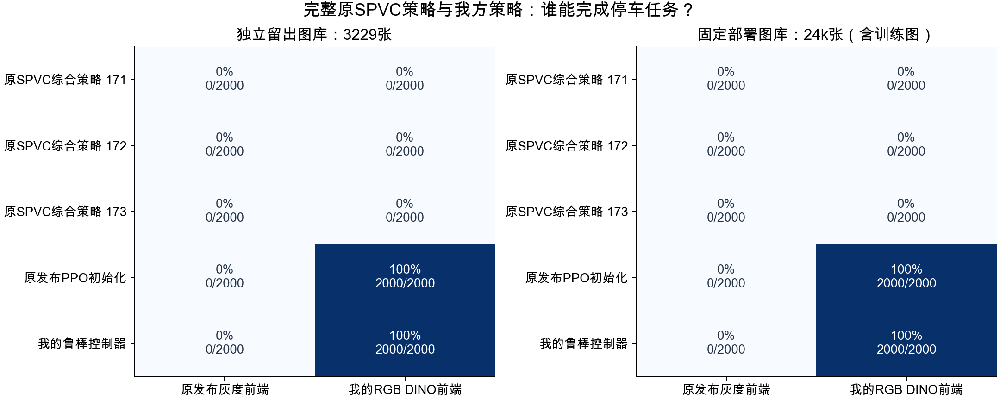
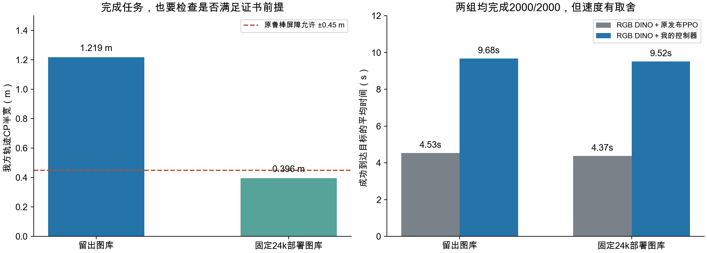

# 原实现整链路对照与我方接入复核

2026年11月23日。本轮实验在服务器 `10.11.154.191:20147`、`vt` 环境执行，结果与文档同步到本地主项目的 `main`。

**本轮原则：SPVC、SPVT保留原实现，不替它们修正或优化算法。检查和修复集中在我们的评价接入、实验口径和结果解释。** 已停止的修改版实验不参与本报告，排除记录见[审计清单](../../../artical-F122/results/native_method_control_20261123/audit.json)。

## 1. 先看这次真正补齐了什么

以前的RGB前端交叉实验，两边都接我方控制器。这次增加了**原SPVC自己综合得到的三个控制器，以及各自配套的SBC文件**。原SPVC主行与我方主行使用各自的整套在线链路，交叉组合另外列出。

| 组别 | 在线图像与前端 | 在线控制器 | 配套离线模型与屏障 |
|---|---|---|---|
| 原SPVC整链路复现，三个训练种子 | 原RGB源图→32×32灰度→原发布距离估计器 | 原SPVC交替综合得到的控制器 | 原cGAN与同次综合保存的SBC |
| 我的RGB整链路 | 同源RGB图→RGB DINO→低维距离观测 | 我方冻结鲁棒控制器 | 状态代理、轨迹CP与我方鲁棒屏障 |
| 发布PPO诊断 | 分别接上述两个前端 | 原发布PPO初始化权重 | 用于区分初始化和后续综合的表现 |
| 前后端交叉 | 切换两个前端 | 保留同一控制器 | 用于检查性能差异来自哪一部分 |

原SPVC的三个模型来自此前按冻结作者源码完成的复现，训练种子为202611171、202611172、202611173。各采用原开发／验证分数选定的检查点，这次没有按相机测试结果挑选种子。配套SBC随同完整策略保存，逐个核验文件哈希与综合轮次；它不是在线安全过滤器，不在每步替控制器修改动作。

作者发布的PPO是初始化，不能替代交替综合后的完整SPVC。本次分别报告这两种身份。作者未发布与论文表格绑定的最终策略／SBC，这里使用的是原代码复现模型，不称为作者最终发布模型。

**这组补齐的是原实现整链路在共同相机环境中的部署对照。** 原SPVC前端沿用原400张H5训练来源，我方前端使用24k目标域RGB及外部DINO预训练，训练历史与输入分辨率不同。因此它回答“这些完整系统在当前RGB任务环境中表现如何”；同预算的算法归因仍应结合原有受控消融，不能把本表改称同预算结果。

## 2. 场景怎么设置？一样和不一样的地方是什么？

车辆接近障碍物。状态为障碍距离d（m）和车速v（m/s），每0.05 s更新一次：

$$
d_{t+1}=d_t-0.05v_t,\qquad
v_{t+1}=\operatorname{clip}(v_t-0.05a_t,0,3).
$$

制动加速度a的单位为m/s²，限制为[-3,3]，正值表示制动。初始距离均匀取15–16 m，初速均匀取2.5–3 m/s。每条轨迹固定一种外观，从12种天气／车辆颜色组合中均匀抽取。

| 项目 | 本次固定条件 |
|---|---|
| 相机来源 | 相同原始RGB图像ID与真实距离标签 |
| 动力学与动作限制 | 上述同一离散车辆模型 |
| 初态与外观 | 每个比较臂读取完全相同的抽样，随后各自闭环运行 |
| 校准 | 各臂499条新轨迹，先校准并冻结所有阈值 |
| 测试 | 各臂2000条新轨迹，与校准随机种子分开 |
| 最大时长 | 400步，即20 s，遇终止条件提前结束 |
| 不同条件 | 方法自己的前端、控制器、训练历史和安全建模 |

**成功**：距离进入[5,6] m且车速不大于0.5 m/s。**危险**：距离不大于6 m且车速大于0.5 m/s。提前停在6 m以外、离开模型距离域、超时分别计数，均不算完成任务。

这是到达终止条件即结束的AEBS回合。结果不包含“成功后继续执行控制器”的后续驾驶，也没有检查连续时间采样间行为。

### 两种图库分开评价

| 图库 | 大小 | 用途 |
|---|---:|---|
| 共同留出图库 | 3229张 | 排除登记预算的训练／开发图像ID及碰撞图，作为本轮主测试环境 |
| 固定部署图库 | 24000张 | 含训练／开发图片，评价固定部署回放环境及图库密度的影响 |

每步按当前真实距离，在相同外观组中取最近的历史图片，再读取该图片对应的视觉网络输出。图像预测是冻结模型的缓存，不是把真实距离直接交给控制器。原灰度估计器和我方RGB DINO读取相同图像ID，各用自己的预处理。

这属于**固定图库反馈回放**，没有在线调用CARLA重新拍摄。新随机种子产生新初态和新外观组合，不等于采集了新图片。

## 3. 完整原SPVC与我的完整链路，任务表现如何？

| 完整链路 | 留出图库：完成／2000 | 留出图库：危险／2000 | 固定24k图库：完成／2000 | 固定24k图库：危险／2000 |
|---|---:|---:|---:|---:|
| 原SPVC，种子171，原前端＋自己的综合控制器 | 0 | 2000 | 0 | 2000 |
| 原SPVC，种子172，原前端＋自己的综合控制器 | 0 | 2000 | 0 | 2000 |
| 原SPVC，种子173，原前端＋自己的综合控制器 | 0 | 2000 | 0 | 2000 |
| 我的RGB DINO＋我的鲁棒控制器 | **2000** | **0** | **2000** | **0** |

**直观收益：在这个目标RGB相机环境和共同任务下，我方冻结整链路完成了全部测试任务；三个原代码综合的SPVC系统未完成，并实际到达共同危险条件。** 各种子使用同一批2000个场景，不能把三行当成6000个独立测试场景。

我方2000/2000完成的单组二项95%置信区间约为[99.816%,100%]。它描述固定模型／图库和登记初态分布下的任务完成概率，不是屏障安全定理的结论。

三个原SPVC检查点分别保留原源程序的验证记录。原随机SBC建模的噪声律与这里的实际相机回放律不同，不能把源程序分数直接搬到这个相机测试环境，也不能用这里的结果直接代替其论文原场景结果。

## 4. 交叉以后，收益来自哪里？

**怎么看图？** 每行固定一个控制器，两列切换前端。上面三行左列是原SPVC主比较组，最后一行右列是我方完整链路；其它格子用于解释原因。左右两幅图分别是留出图库与固定部署图库，每格分母均为2000。

| 控制器 | 原发布灰度前端：完成／2000 | 我的RGB DINO：完成／2000 |
|---|---:|---:|
| 原SPVC综合控制器171 | 0 | 0 |
| 原SPVC综合控制器172 | 0 | 0 |
| 原SPVC综合控制器173 | 0 | 0 |
| 原发布PPO初始化 | 0 | **2000** |
| 我的鲁棒控制器 | 0 | **2000** |

两种图库下该完成率表相同。它说明：

1. **原发布灰度前端直接迁移到当前RGB环境有明显问题。** 换成我方前端后，发布PPO从0/2000变为2000/2000。
2. **换前端不能自动修复任意已有控制器。** 三个原综合控制器接我方DINO，仍未完成任务。
3. **这组正常环境中，我方控制器没有比“DINO＋发布PPO”多完成任务。** 两者都是2000/2000，还要比较时间、终端速度和证书范围。

为排除我方提取控制器时接错网络或换错单位，另外对256个共同状态和随机潜变量做了直接核验：完整原网络的动作，与提取控制器读取同一原估计输出得到的动作，三个检查点最大差值均为**0 m/s²**。见[接入等价性记录](../../../artical-F122/results/native_method_control_20261123/adapter_equivalence.json)。

## 5. 任务时间和最终速度：我方也有代价

下面固定我方RGB DINO，只切换控制器。两者都完成全部2000条，因此表中时间是真正的成功到达时间，没有把失败时限混入平均值。

| 图库 | 控制器 | 平均达标时间 | 进入目标时平均车速 |
|---|---|---:|---:|
| 留出3229张 | 原发布PPO | **4.529 s** | 0.348 m/s |
| 留出3229张 | 我方鲁棒控制器 | 9.683 s | **0.124 m/s** |
| 固定24k张 | 原发布PPO | **4.368 s** | 0.328 m/s |
| 固定24k张 | 我方鲁棒控制器 | 9.516 s | **0.058 m/s** |

我方当前控制器以更低车速进入目标，但用时更长。不能把“终端速度更低”直接改写成“所有任务精度都更高”，也不能宣称这一组运行更快。两者都满足原0.5 m/s要求；效率与安全支持范围需要分别呈现。

## 6. 这次最重要的我方问题：成功率不等于证书覆盖

我方该AEBS版本的状态代理在距离坐标中为恒等名义映射，轨迹分数为：

$$R_i=\max_{t<\tau_i}|\hat d_{i,t}-d_{i,t}|.$$

τ为成功、危险、提前停车等终止时刻或400步时限。499条独立校准轨迹按95%覆盖目标取第475个顺序统计量为q；所有臂阈值冻结后才执行测试。这里测的是**实际视觉输出相对当前物理距离的整轨误差**。原SPVC组的同单位统计仅作诊断，不是其原随机SBC里的参数。

| 我的完整链路 | 留出图库 | 固定24k部署图库 |
|---|---:|---:|
| 新轨迹CP半宽q | **1.21924 m** | **0.39591 m** |
| 测试轨迹全程落在新CP界内 | 1950/2000，97.50% | 1909/2000，95.45% |
| 测试轨迹全程满足原±0.45 m证书前提 | **0/2000** | **1988/2000** |
| 实际任务完成 | 2000/2000 | 2000/2000 |
| 该q能否接入原冻结屏障？ | **不能，找到正漂移反例** | **可以，误差集合包含于原已检查集合** |

**左图**：虚线是原鲁棒屏障允许的±0.45 m。留出图库的新q高于这条线，不能继承原证书。**右图**：固定相同RGB前端，原PPO到达更快，我方控制器更慢。

### 为什么留出图库的误差这么大？

误差中同时包含网络测距误差和最近图片与当前距离不一致的误差：

$$
\hat d(I_{\rm selected})-d
=\big(\hat d(I_{\rm selected})-d_{\rm selected}\big)
+\big(d_{\rm selected}-d\big).
$$

| 我方RGB控制轨迹 | 留出图库 | 固定24k图库 |
|---|---:|---:|
| 网络相对所选图片标签的平均绝对误差 | 0.04348 m | 0.03260 m |
| 最近图片距离失配的平均绝对值 | **0.23068 m** | **0.00131 m** |
| 测试中最大的图片距离失配 | **0.89781 m** | **0.00300 m** |

均值先在每条轨迹内计算，再对2000条求平均。两项绝对误差会相互抵消，不能把两个均值直接相加当成总MAE。数据说明图库密度是本轮CP差异的重要来源，不能把1.219→0.396 m全部解释为网络本身更准，也不能把含训练图的部署结果写成新图泛化结果。

### 屏障反例是什么？为什么不等于已经撞车？

对留出图库的q重新检查我方冻结屏障，在d=6.00001 m、v=0.26416 m/s、观测距离偏差+1.21924 m处，找到一步屏障上升约0.93684的例子，违反该屏障要求的鲁棒不增条件。

它说明**原来那一份屏障不能覆盖这个更大的误差集合**。它不是一条已经危险的轨迹，也不说明不存在其它可用屏障；这正是本轮需要修正的我方证书表述。

### 当前到底得到什么安全保证？

- **固定24k回放环境**：新q小于0.45 m，集合包含检查通过，绑定的策略／前端／屏障哈希一致。原连续状态区间检查涉及782400个单元。若校准与未来回合遵循本次登记的同一固定图库、独立初态及外观抽样律，轨迹CP给出95%的边际整轨覆盖；在该误差事件上，鲁棒屏障的数学条件对应终止式离散AEBS的安全性。实现仍是float64数值区间检查，没有定向舍入，尚不是机器严格形式化证明。
- **留出图库环境**：2000条实际完成且未触发危险，但原屏障对新q不成立。目前应报告经验安全与完成率，不能给这批回合套用原鲁棒保证。

原终止规则、固定图库回放律及离散模型都属于结论的条件；结果不能直接扩展到在线CARLA新图像、连续时间车辆或成功后的无限驾驶。

## 7. SPVT这次怎么处理？

**按用户要求保持原代码。修改版已停止并排除，不进入任何方法比较。** 对保留的原实现，逐一比较训练入口、模型、损失、动力学及其它Python源文件，执行副本与原工程哈希全部一致。

本轮完成了一次原训练流程的预算试跑：256个登记初始训练状态、20轮、batch32、原默认backward界传播，保留原损失、难例回放、自适应权重、K=4…10课程和冻结原生成器。原数据文件有20000个状态，默认训练100轮；这次不是默认完整预算，因此单列为复现诊断。

然后固定检查点，在2000个新初态上评价：横偏±60 cm、航向±7°，车速5 m/s、步长0.05 s、时长8 s，读取原生成观测。下表取每步独立随机z的模式。

| 原实现组 | 原安全条件：全程横偏≤80 cm | 横偏RMSE | 第2–8秒持续±5 cm |
|---|---:|---:|---:|
| 原发布PID初始化 | 2000/2000 | 14.071 cm | 304/2000 |
| 本轮原实现预算试跑，第20轮 | 0/2000 | 113.966 cm | 0/2000 |

**这次预算试跑没有得到可用的SPVT基线，不能用其失败支撑我方优越性。** 原发布初始化和此前历史第100轮的结果继续保留各自身份；也不把20轮试跑伪称为作者默认完整训练或作者最终模型。

本次没有新增完整RGB DINO框架在原SPVT任务上的配对训练。此前“128维生成观测→二维状态回归→解析反馈”仍属于我方适配消融，不能改名为完整DINO—代理—CP—神经控制器／屏障链路。SPVT完整方法收益在当前证据中仍待补齐。

## 8. 其它不合理之处，如何纠正？

| 问题 | 本轮处理 |
|---|---|
| 两边都接我方控制器，却称完整原SPVC对照 | 增加原SPVC自己的三个综合控制器及配套SBC，交叉表另列 |
| 发布PPO与最终综合模型混称 | 单列初始化诊断，三个综合检查点分别报告 |
| 我方抽取控制器可能换错单位／网络 | 对256个状态验证动作严格一致，三组差值均为0 |
| 我方“2000条成功”被表述为全部获得证书保证 | 分开报告任务完成、轨迹误差覆盖和屏障条件；留出图库明确未获得该保证 |
| 新环境CP超过原误差集合仍沿用证书 | 对新q检查；记录留出图库的实际正漂移反例 |
| 24k混合图库与留出图实验混称 | 两种图库分表，报告图像距离失配 |
| 失败轨迹用时上限被当成成功平均耗时 | 时间表只比较全部成功的两组，失败仍保留原始记录 |
| 原数据训练与我方目标域训练被称同预算 | 保留两边实际训练来源，主张限定为当前目标环境部署对照 |
| 原方法试跑失败成为“方法更差”的证据 | SPVT预算试跑单列，不进入我方收益主表 |
| 用修改后的原方法当原生基线 | 停止修改版，并在审计文件中标记排除 |

## 9. 结果与复现入口

- [AEBS登记协议](../../../artical-F122/results/native_method_control_20261123/aebs_complete_v2/protocol.json)：模型、输入文件哈希、抽样律和比较身份。
- [AEBS全部20个比较臂结果](../../../artical-F122/results/native_method_control_20261123/aebs_complete_v2/summary.json)：两种图库×两种前端×五个控制器；各有499条校准和2000条测试记录。
- [我方证书接入复核与排除清单](../../../artical-F122/results/native_method_control_20261123/audit.json)：来源一致性、新q的屏障检查及未纳入实验。
- [SPVT原实现新测试](../../../artical-F122/results/native_method_control_20261123/spvt_original_evaluation_v2/summary.json)与[原训练配置](../../../artical-F122/results/native_method_control_20261123/spvt_released_cpu/protocol.json)。
- [AEBS执行入口](../../../artical-F122/Aebs/paper_comparison/native_spvc_complete_control.py)、[原SPVT复跑入口](../../../artical-F122/Aebs/paper_comparison/rerun_native_spvt.py)、[SPVT评价入口](../../../artical-F122/Aebs/paper_comparison/native_spvt_task_evaluate.py)。原训练与验证源码本身不由这些评价入口优化。
- [原SPVC综合流程、原论文与原始记录](../AEBS/AEBS_原SPVC随机SBC复跑与前后端交叉_20261117.md)。
