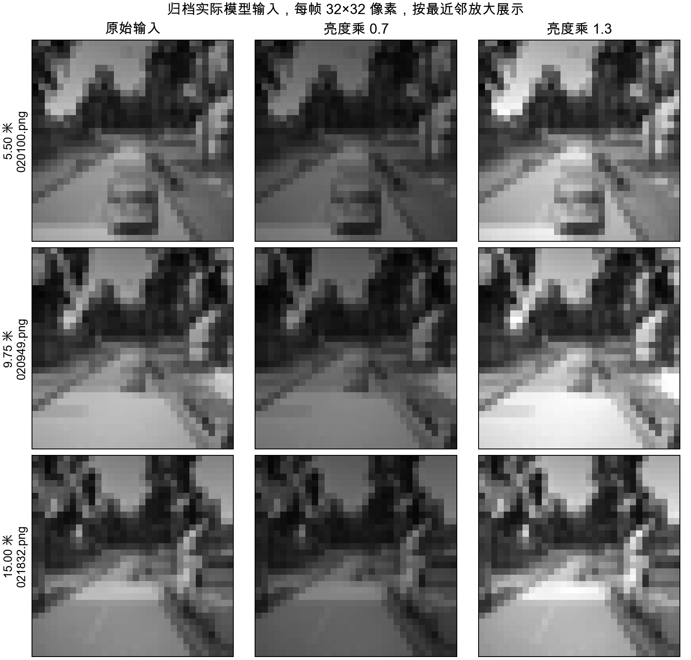
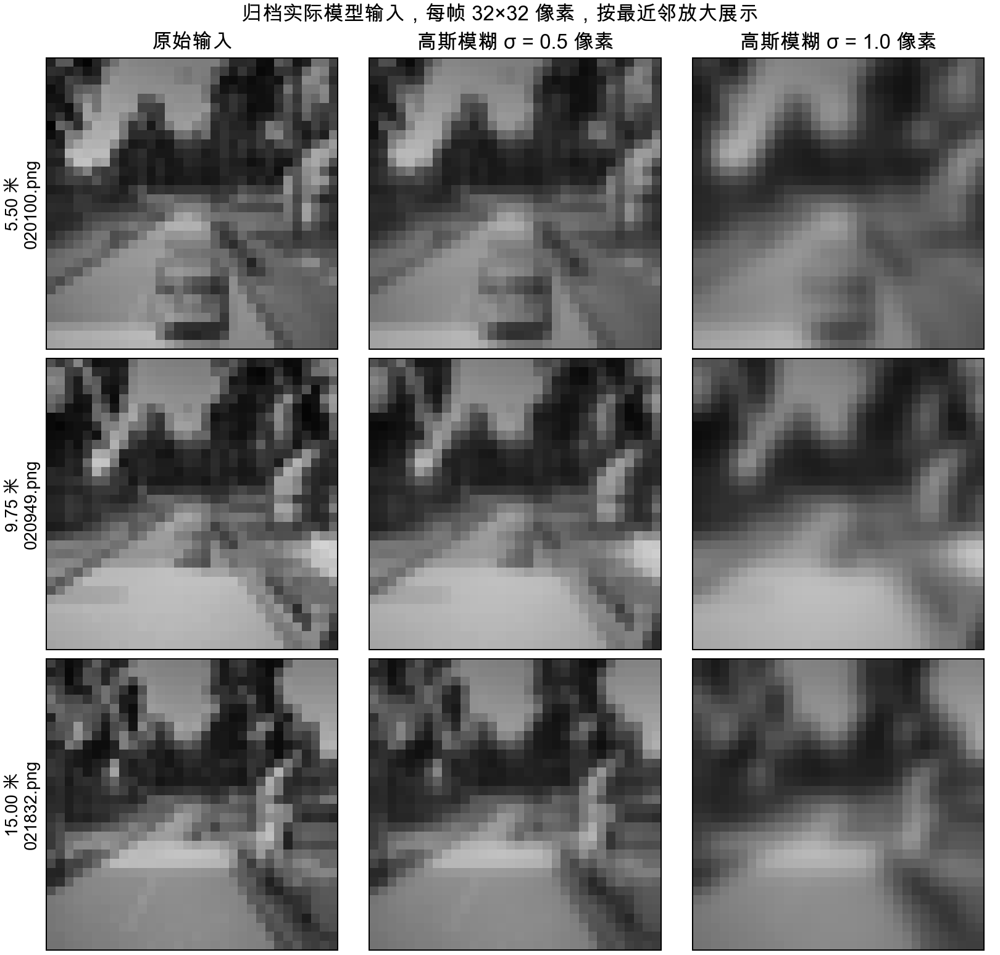
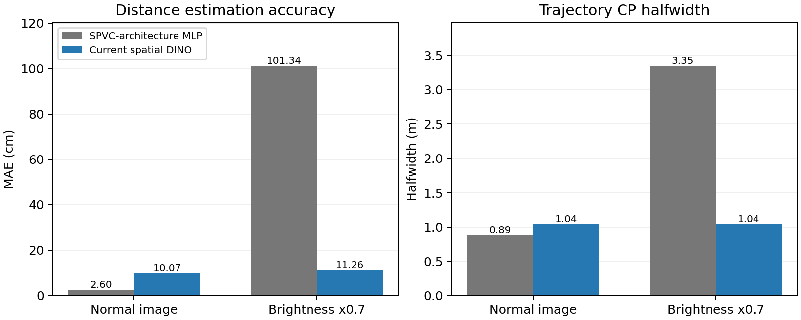
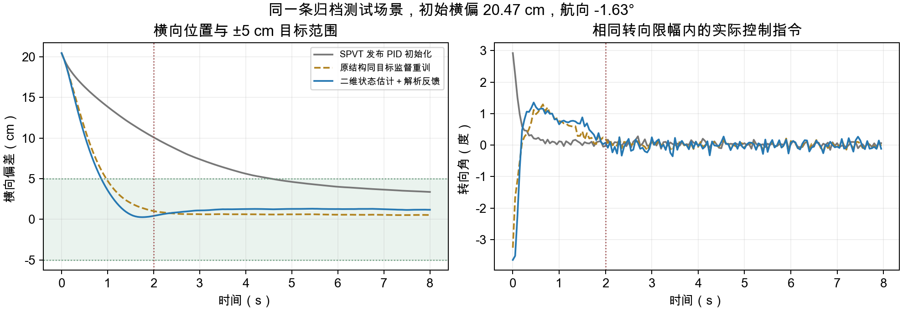
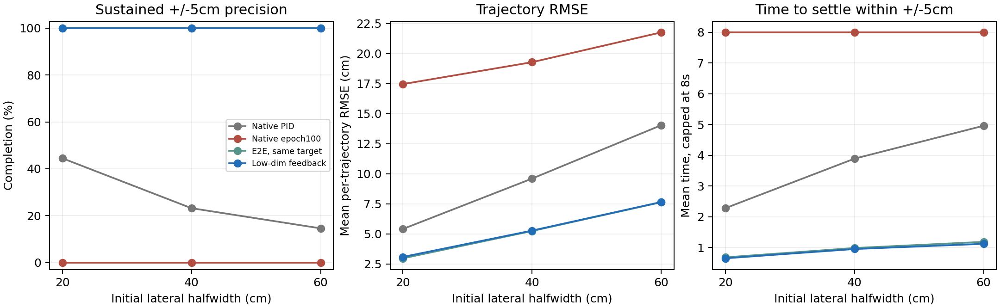

# 当前框架与SPVC、SPVT的统一实验比较报告

更新于2026年11月23日。训练和新轨迹测试在服务器vt环境执行，原始结果同步到主项目main，并独立复算。本文把SPVC的AEBS与SPVT的车道对照放在同一份报告中，按实验设置、指标含义、实测成绩和具体收益展开。

**本轮收益：** 新RGB车道实验中，共同DINO下横偏RMSE从16.09 cm降到6.44 cm，持续±5 cm从0/1000提高到1000/1000；对应神经鲁棒屏障数值验证通过。AEBS整链路对照和此前组件实验一并保留。

| 报告 | 主要内容 |
|---|---|
| [SPVT与当前RGB框架](SPVT与当前RGB框架_原实现对照与误差校准_20261123.md) | 原模型开发选型、原任务2000条、五组RGB各1000条、CP与新屏障 |
| [AEBS整链路对照](原实现整链路对照与我方接入复核_20261123.md) | 原SPVC配套控制器与我方RGB系统，20个比较臂及图库／证书范围 |
| 本文历史组件实验 | 灰度前端受控消融、发布PPO比较、128维观测下的反馈与训练目标消融 |

**版本说明。** 当前完整前端使用RGB DINO。本文的AEBS七条件表采用共同32×32灰度输入；旧SPVT适配组采用“128维生成观测→二维状态估计→解析反馈”。参考动作CP用于策略模仿诊断，实际视觉—代理误差见新增RGB报告。数据与设置复核见[实验设计记录](../../archive/2026-11_旧汇报与阶段对照/阶段对照/SPVC_SPVT统一对照_实验设计复核_20261123.md)，图文结果见[汇报稿](../../presentation/当前框架与SPVC_SPVT比较_汇报简版_20261123.md)。

**AEBS 最新主对照**见[同 RGB 图包整链路重训](../AEBS/AEBS同图包整链路重训_SPVC与RGB_DINO_20261125.md)，包括两套系统各自训练、各自闭环以及 RGB 源图七条件的测距表。

**车道保持最新主对照**见[同 RGB 图包整链路重训](../车道保持/车道保持同图包整链路重训_SPVT与RGB_DINO_20261125.md)，两边用共同图包分别训练，并在配对初态上各自闭环。

## 1. 比较对象与已观察到的性能差异

| 比较对象         | 固定的条件                      | 主要指标           | 原基线→当前版本           | 体现了什么                 |
| ------------ | -------------------------- | -------------- | ------------------ | --------------------- |
| SPVC结构前端     | 同源24k图包、相同32×32灰度输入和训练选择机会 | 亮度×0.7下静态测距MAE | 101.34→11.26 cm    | 该输入条件下，测距误差减少88.9%    |
| SPVC结构前端     | 同一控制器、独立轨迹校准、相同95%覆盖目标     | 亮度×0.7下测距CP半宽  | 3.354→1.043 m      | 整趟允许测距偏差缩小68.9%       |
| SPVC发布PPO    | 固定相同的原MLP测距前端              | 强模糊下任务完成率      | 三种子平均0.55%→100%    | 当前控制器更能承受该误差反馈并完成减速任务 |
| SPVT发布PID初始化 | 同一生成器、初态与z流、同一动力学              | 全程横偏RMSE       | 13.81→7.53 cm      | 平均轨迹跟踪误差降低45.4%       |
| SPVT发布PID初始化 | 相同2000个测试初态                | 第2秒后持续保持±5 cm  | 308/2000→2000/2000 | 达到精确跟踪目标的轨迹更多         |
| SPVT发布PID初始化 | 相同任务与精度范围                  | 稳定进入±5 cm的平均时间 | 4.91→1.13 s        | 更快消除初始偏差              |

正常条件也完整测试。AEBS六个起步域中，两种控制器均100%完成，发布PPO达标更快；原MLP在清晰画面上测距更准。SPVT九个初态域中，当前低维反馈三个种子均100%达到持续±5 cm目标。以下各表将这些成绩与具体组件和条件逐项对应。

## 2. 比较模型与训练资源

| 项目 | SPVC／SPVT 侧 | 当前框架侧 | 本轮固定条件 |
|---|---|---|---|
| AEBS 视觉结构 | 原 SPVC 的 32×32 灰度像素 MLP，在共同 24k 图包上重训 | 同一灰度输入的冻结 DINO＋空间低维投影 | 同源图像、相同标签、划分、三个种子和四次候选选择机会；均 100 epochs、batch 64 |
| AEBS 控制器 | 原项目发布 PPO 控制器 | 现有鲁棒综合控制器 | 同一个已冻结测距前端、相同速度测量接口、初态、动作范围和任务判据 |
| SPVT 原模型 | 发布 PID 初始化控制器，以及原代码本地历史训练第 100 轮检查点 | 由 128 维生成观测得到二维状态估计，再进入精度反馈 | 原生成器、原 5 m/s 车辆模型、0.05 s 步长、±30°转向限幅和同一初态抽样 |
| SPVT 同目标控制组 | 原 E2ENetworkBN 结构，用新精度目标重训 | 当前二维观测解码器，使用同一目标反馈 | 同一 24,000 个训练样本、4,000 开发样本、三个种子、3,000 更新和 batch 128 |

SPVT 的“第 100 轮”来自本地原代码历史训练文件，其角色是一个冻结的原方法训练检查点。AEBS 的前端对照使用目标图像域重训后的原结构。DINO 采用外部预训练权重。表中分别列出了任务适配和学习资源，便于按相同组件评估收益。

### 2.1 首页六行分别在比较什么？

首页前三行来自三个AEBS比较。末三行是同一组SPVT车道轨迹的三种评价，分别计算RMSE、持续达标率和稳定进入时间。

| 首页指标 | 双方实际比较对象 | 双方共用的设置 | 双方改变的设置 |
|---|---|---|---|
| A．亮度×0.7静态测距MAE | 原SPVC结构像素MLP，对比当前空间DINO读出 | 同一24k原始图包、同一划分与标签；同一张32×32灰度图先做相同亮度变换；同一3229张留出图片计分；相同三个种子和四次候选机会 | 前端结构和编码方式、可训练参数、后续预处理、外部预训练资源不同 |
| B．亮度×0.7轨迹测距CP半宽 | A中的两种前端，各接同一份当前鲁棒控制器 | 控制器权重、动力学、初态分布、外观抽样、制动限幅、停止判据、95%覆盖目标、499条校准与2000条测试的初态抽样 | 图像到测距的函数不同，导致读数、动作和后续访问状态变化；分别产生校准分数和q |
| C．强模糊下AEBS完成率 | 发布PPO，对比当前鲁棒控制器 | 对每个前端种子固定完全相同的原MLP权重和模糊1.0输入规则；相同初态、外观、速度测量接口、车辆模型、动作范围、目标判据 | 控制器权重与训练过程不同；两车实际动作、位置、速度和后续查到的图片随之变化 |
| D①．SPVT场景全程RMSE | 原PID初始化控制器，对比二维状态估计＋解析反馈适配版 | 原生成器权重、相同初始横偏与航向、相同z抽样流、5 m/s、0.05 s、2.5 m轴距、160步、±30°限幅、±80 cm安全条件 | 观测到动作的映射、状态监督、训练目标和额外训练预算不同 |
| D②．第2秒后持续±5 cm | 与D①完全相同的模型和归档轨迹 | 复用同一2000个测试初态及D①的执行记录；两边使用同一±5 cm阈值和第2–8秒时间窗 | 模型差异与D①相同；本行只改变对轨迹的计分方式 |
| D③．稳定进入±5 cm时间 | 与D①完全相同的模型和归档轨迹 | 复用同批执行记录；统一要求进入后一直保持到8 s，未达到统一计8 s | 模型差异与D①相同；评价进入目标范围的速度 |

### 2.2 怎样理解“同一个输入”“同一个控制器”和“相同初态”？

**A是逐帧比较。** 例如归档中的一张图距离为9.75 m，将其亮度乘0.7后，把完全相同的32×32灰度字节分别送给两个前端。原MLP将像素展平后预测距离；DINO按自身预处理放大、复制灰度通道并编码局部特征，再由空间投影输出距离坐标。两边对同一个9.75 m标签算误差。本项只测试视觉前端，控制器未参与评分。

**B固定同一控制函数和权重。** 两个前端都接同一份控制器π，但它们给出的测距可能不同，因此π的动作也可能不同。之后两车到达不同距离，分别按实际位置查图。共同固定的是初态和外观的抽样流、控制规则与误差计分规则，每条闭环轨迹由自己的反馈形成。静态表A最直接隔离前端；表B还反映前端对实际访问状态和停止时刻的影响。

**C固定同一个视觉函数和权重。** 对同一前端种子，发布PPO与当前控制器都使用同一个原MLP。若某时刻两车恰好位于相同距离、相同外观，就会获得相同视觉读数。控制器选择不同动作后，后续读数随各自位置变化。这里隔离的是现有控制器检查点在该视觉条件下的表现，两者的训练预算和训练过程仍存在差别。

**D固定同一个生成器G和相同z序列。** 两组从相同的真实状态出发，在第一个时刻获得相同128维观测。它们计算的转角不同后，下一步真实状态x也可能不同，所以G(z,x)会随状态变化。实验比较同一观测生成机制下的反馈表现。D①、D②和D③共用一次执行的轨迹，提供互补的三个指标。

校准与测试使用两个独立随机流。两个模型在校准阶段共享校准初态抽样，在测试阶段共享测试初态抽样，便于配对；每个模型沿自己的闭环路径计算分数、保存自己的q。这也是“各自校准”的具体含义。

### 2.3 同目标端到端重训组进一步固定了什么？

SPVT主要表除了两个已有检查点，还加入原网络结构的同目标监督重训组。它与二维状态估计＋解析反馈组共用24000个训练样本、4000个开发样本、三个种子、3000次更新、batch128、Adam学习率0.001及同一参考动作目标。

两者仍有以下差别。端到端组直接输出动作，使用动作MSE；低维组先回归状态，损失包含状态MSE与动作MSE，再接解析反馈。其结构、辅助监督和开发选型损失分别对应各自实现。这个组帮助检查新精度目标的贡献，完整SPVT验证引导训练的比较见前面的设计复核。

### 2.4 原图、变亮图、变暗图和模糊图，分别用在哪个阶段？

**本报告这组AEBS前端实验，先用原始版本的图片训练和开发选型，冻结模型后，再对留出图片施加亮度、对比度和模糊变换来评估。变换图还用于后续对应条件下的CP轨迹校准。**

这里“原始版本”指施加本实验人工变换之前的图片。图库本来具有天气、车色和原有光照差异，这些差异都保留；训练脚本使用原始灰度输入，额外的亮度×0.7、×1.3和高斯模糊0.5、1.0属于冻结后的评估条件。

| 阶段 | 具体用什么图片或轨迹 | 数量和用途 | 会更新什么？ |
|---|---|---|---|
| ① 目标域训练 | 训练划分的原始图片，统一处理为32×32灰度输入 | 24k总包中的14172张，用距离标签拟合原MLP或DINO空间读出 | 更新测距网络／空间投影的参数；DINO骨干冻结 |
| ② 开发选型 | 开发划分的原始灰度图片 | 4908张，在四个候选配置、各100个epoch中按开发MSE选模型 | 确定候选及权重检查点 |
| ③ 冻结模型 | 保存上一步选中的权重 | 后续各亮度与模糊条件共用这些已冻结模型 | 测距模型保持冻结 |
| ④ 静态评估 | 从共同留出的3229张原图生成七种输入版本 | 原始、亮度×0.7、×1.3、对比度×0.7、×1.3、模糊0.5、1.0，逐帧计算误差 | 只前向预测和统计误差 |
| ⑤ 当前报告的CP校准 | 在每一种输入条件下，用冻结模型运行新校准轨迹 | 每个条件、每个冻结系统499条轨迹，按全程最大误差确定自己的q | 只确定CP阈值q，模型与控制器权重保持冻结 |
| ⑥ 当前报告的闭环测试 | 同一种输入条件下，另抽测试初态并运行轨迹 | 每组2000条，统计完成、危险、误差和在该q内的覆盖 | 使用已确定的模型和q计算最终指标 |

24k表示图像总包量，训练、开发、包内测试分别为14172、4908、4920张。共同静态评估库从各预算训练与开发以外按文件及灰度像素筛出3229张。七种变换版本共享这些底层图片ID，物理距离标签保持相同。

**用亮度×0.7这一项举例。**

1. 两种前端都先在原始训练图片上学习，在原始开发图片上选择权重。
2. 权重选定后，把共同留出图片的灰度数值乘0.7，分别送入两个冻结前端，得到101.34 cm和11.26 cm的静态MAE。
3. 对“整趟始终使用亮度×0.7图片”的环境，运行499条校准轨迹，确定各自CP半宽。
4. 再用独立测试初态运行2000条同条件轨迹，得到完成率和整轨覆盖率。表中的3.354 m与1.043 m来自这一步之前的校准。

**用模糊1.0的控制器对照举例。** 原MLP先按原始图片训练好并冻结。随后两种控制器都接这个相同的测距模型，闭环运行时读取模糊1.0版本的图库图片，得到33、0、0与2000、2000、2000的完成计数。评估期间模型和控制器权重固定。

### 2.5 “变换图片用于测试”和“用于CP校准”怎样同时理解？

静态MAE衡量模型冻结后对变换图的预测表现，亮度或模糊图未参与该轮网络梯度训练与开发选型。当前报告的CP表则是在获取该变化条件的校准轨迹后，计算相应阈值的结果。模型参数和误差阈值属于两个不同的学习对象，表中将其用途分别列明。

校准与测试按轨迹使用独立随机流。两阶段会查询同一套固定图片库，可能查到相同的图库图片；每条轨迹仍由自己的初态、外观及反馈执行形成。因此499和2000的计数单位为完整轨迹，底层图像资源为上述固定留出库。

项目早期还做过“原始条件校准q，变换条件直接测试”的实验，结果保存在spvc_shift_closed_loop_20261120_v1。当前报告的CP数值来自benefit_cp_aebs_20261122，它为每种变化条件重新采499条校准轨迹。使用当前CP表时，按“对应条件下重新校准后”的协议解释。

本说明对应两种AEBS前端及本报告的图像变换对照。SPVT车道部分使用原生成器的128维观测，扰动为随机变量z，其数据流程见第5节。

[原始图片训练与选型协议](../../../artical-F122/results/aebs_spatial_readout_20261118_v1/protocol.json) · [训练实现](../../../artical-F122/Aebs/experiments/spatial_aebs.py) · [冻结后图像变换实现](../../../artical-F122/Aebs/paper_comparison/aebs_shift_evaluation.py) · [本轮按条件重新校准实现](../../../artical-F122/Aebs/paper_comparison/benefit_cp_aebs.py)

### 2.6 为什么DINO这里也使用灰度？完整方案怎样用RGB？

本报告的AEBS空间读出实验，主动让原像素MLP与DINO读取相同32×32灰度源图，用来控制输入信息条件。DINO将同一灰度图复制为三个相同通道，再按自己的预处理放大、归一化；三个通道的数值相同，模型获得的是灰度信息。

这属于“相同输入信息下更换编码器”的消融。完整前端替换方案应从原始RGB图像出发，保留颜色信息，再用DINO、低维投影和状态代理匹配。这两类实验分别回答不同问题。

| 实验角色 | SPVC侧输入 | DINO侧输入 | 主要回答什么 |
|---|---|---|---|
| 完整前端主对照 | 沿用SPVC的原灰度输入流程 | 原RGB图像，按DINO正常流程预处理 | 实际替换整套前端后，任务、误差和认证范围是否改善？ |
| 灰度输入消融，即本报告已有空间读出表 | 同一32×32灰度源图 | 同一32×32灰度源图复制为三通道 | 固定源图信息时，编码结构带来什么差异？ |
| DINO内部颜色消融 | — | 同源图像的RGB与灰度两种版本，其余训练、选型和评价保持一致 | 保留颜色本身带来多少收益？ |

公平比较可以固定图像来源、图像ID、训练／开发／测试划分、标签、训练种子和任务条件，同时允许两种完整方法使用各自设计的输入处理。颜色、源分辨率和DINO外部预训练资源分别记录，灰度消融用于解释贡献来源。

项目2026-11-17的因子实验已有gray32、rgb32、gray640、rgb640四种DINO输入配置；本报告较新的空间读出及亮度／模糊图使用灰度版本。两轮的读出结构和训练配置不同，各自按对应结果解释。完整RGB版的主要结论应来自它自身冻结后的测距误差、CP和闭环任务数据。[历史颜色／分辨率实验协议](../../../artical-F122/results/aebs_factorial_20261117/protocol.json) · [本报告空间读出的实际灰度输入协议](../../../artical-F122/results/aebs_spatial_readout_20261118_v1/protocol.json)

## 3. 指标和数值怎样读？

| 指标 | 实际计算与单位 | 一个读数例子 | 说明什么 |
|---|---|---|---|
| 静态测距MAE | 同一批图片的平均绝对距离误差，cm | 真值10 m，估计10.12 m，该帧误差12 cm | 前端在共同图片上的准确性 |
| 闭环测距MAE | 每趟对运行期间所有测距绝对误差平均，再对各趟平均，cm | 某趟有100次读数，先求这100次的平均 | 车辆实际获得的测距反馈质量 |
| 轨迹横偏RMSE | 每趟横偏平方平均后开方，再对轨迹平均，cm | 横偏2、6 cm的两个样本，RMSE为4.47 cm | 全程跟踪精度，对大偏差更敏感 |
| 持续±5 cm达标率 | 全程安全，且第2–8秒每个采样点都在±5 cm内 | 1000趟中900趟全部满足，计90% | 精确且稳定跟踪的完成比例 |
| 稳定进入时间 | 第一次进入±5 cm并一直保持到8秒的时刻，未达到记8 s | 1.2 s进入且后面一直满足，计1.2 s | 初始偏差消除速度 |
| AEBS任务完成率 | 首次进入5–6 m时速度≤0.5 m/s | 1000趟中990趟满足，完成率99% | 在要求位置及时减速的能力 |
| AEBS截断达标时间 | 成功取实际时间，其他结果统一记20 s | 一趟危险终止记20 s | 同时考虑完成与执行效率 |
| 轨迹CP半宽q | 校准每趟的最大误差，再取登记顺位，单位随误差对象确定 | q=1 m，误差集合为±1 m，总宽2 m | 同覆盖目标下所需的允许误差预算 |
| 测试整轨覆盖率 | 一趟所有控制时刻都在自己的q内才计覆盖 | 2000条中1900条全程在界内，计95% | 新轨迹对校准范围的经验检验 |
| 危险条数 | 按各任务的登记危险条件逐趟计数 | 车道任一采样点横偏超过80 cm | 仿真执行中的安全约束违反情况 |

车道RMSE取160个后继时刻，覆盖8 s执行过程。MAE衡量平均绝对偏差，RMSE会更重地计入较大偏差；轨迹CP则关注每趟最差的时刻。平均误差小、整轨最大误差小、任务达标率高，分别提供不同侧面的证据。

每个冻结模型独立校准自己的q，汇总表显示三个训练种子的q和指标均值。三个模型使用相同初态形成配对，独立场景数按每组1000或2000计。

## 4. 与SPVC比较：AEBS场景、设置与实测结果

### 4.1 车辆在做什么，怎样算完成或危险？

车辆沿直线接近目标距离区域。每步0.05 s，最多400步即20 s，车速限制0–3 m/s，动作范围−3到3 m/s²，正数表示制动。

- 任务完成要求首次进入5–6 m时，速度已不超过0.5 m/s。
- 危险终止指车距≤6 m时速度仍超过0.5 m/s，表示接近目标时减速不足。
- 车距仍大于6 m便停稳，记为安全但停早；超时和离域分别保留在失败统计中。

主要对照从距离15–16 m、速度2.5–3 m/s均匀抽初态，每趟固定一个天气／车色组合。每步根据实际距离从共同留出库选最近图片，再读取该图片的冻结模型输出。比较的是同一图像库上的视觉反馈运行。

### 4.2 前端如何训练，输入输出是什么？

| 阶段 | 原SPVC结构MLP | DINO空间读出（灰度消融） |
|---|---|---|
| 输入 | 相同32×32灰度像素 | 相同32×32灰度像素 |
| 图像处理 | 原像素MLP | 冻结DINO局部特征，保留空间池化网格后投影 |
| 输出 | 距离估计 | 一维低维观测，再按统一尺度换成距离 |
| 目标域数据 | 24k图包，训练14172、开发4908、包内测试4920 | 相同划分 |
| 训练与选型 | 三个种子，每种子四次候选机会，100 epochs，batch64 | 相同更新与选择机会，另使用DINO外部预训练权重 |

共同评估库为3229张灰度输入不与各预算训练、开发重合的图片。静态误差在这批图片上计算；闭环误差还包含实际距离与所查图片标签之间的离散差。

测距比较保持控制器相同。控制器比较则保持前端相同，并使两边读取同样的距离、车速信息。

#### 灰度输入消融的实际图片长什么样？

**图中变暗、变亮与模糊后的图片用于冻结模型之后的评估，以及本报告对应条件的CP校准；前端训练和开发选型使用原始版本图片。详细流程见第2.4–2.5节。**

下面展示归档模型使用的32×32灰度输入，按最近邻放大以便查看。每行来自同一原始图片，列间只改变已登记的变换。取固定外观组中距离5.5、10、15 m最近的三帧，选择规则只看距离和文件名。

**亮度变化。** 左列原图，中列亮度乘0.7，右列乘1.3。乘0.7表示保留原灰度数值的70%，即降低约30%亮度；每个像素的灰度数值乘0.7，例如200变成140；结果裁剪到0–255并四舍五入。图中所有格子使用同一黑白显示范围0–255，因此可直接观察整体变暗。



**高斯模糊。** 左列原图，中列σ=0.5像素，右列σ=1.0像素，σ相对于32×32的模型原始输入计算。像素与邻近位置加权平均后，目标边缘和小纹理变得不清晰，图像大小保持32×32。实现使用反射边界和4σ截断，之后裁剪并取整。



图像变换发生在两个模型共同的灰度输入上。DINO后续对自己的输入编码采用既有预处理，测试中两边都接收同一个变换后的源图。这里改变的是离线测试输入的亮度或模糊程度，原车距标签保持对应原图的真值。图中原始文件名和实际车距写在每行左侧。[样例选择与来源](../../assets/general_benefits_20261123/spvc_report_observations_20261123.json) · [归档像素数组](../../assets/general_benefits_20261123/spvc_report_observations_20261123.npz)

### 4.3 正常画面：扩大起步距离与速度

保持正常图像像素，测试三档起步距离与两档车速组合。每个组合使用499趟新校准和1000趟新测试，固定同一个原MLP前端，比较两个控制器。下表为三个前端训练种子的均值。

| 起步距离 / 初速 | 发布 PPO 完成率 | 当前鲁棒控制器完成率 | 发布 PPO 截断达标时间（s） | 当前截断达标时间（s） |
| --- | --- | --- | --- | --- |
| 10–12 m / 1–2 m/s | 100.0% | 100.0% | 3.91 | 8.32 |
| 10–12 m / 2–3 m/s | 100.0% | 100.0% | 3.32 | 7.83 |
| 12–14 m / 1–2 m/s | 100.0% | 100.0% | 4.03 | 9.04 |
| 12–14 m / 2–3 m/s | 100.0% | 100.0% | 3.75 | 8.73 |
| 14–16 m / 1–2 m/s | 100.0% | 100.0% | 4.51 | 9.53 |
| 14–16 m / 2–3 m/s | 100.0% | 100.0% | 4.38 | 9.31 |

六域中，两种控制器均完成全部测试任务；发布 PPO 的达标时间更短。这项正常条件对照显示两者完成能力持平，以及当前鲁棒控制器在这套任务上的时间代价。失败和超时在截断达标时间中统一按 20 s 计入。完整结果还包括当前视觉前端下两种控制器、危险计数、误差和 CP 半宽。[正常图像六域结果](../../../artical-F122/results/general_aebs_precision_20261123/aggregate.json)

### 4.4 固定同一前端，看误差反馈下谁完成得更多

使用模糊强度1.0的图片，固定同一个原SPVC结构MLP前端，分别接发布PPO和当前鲁棒控制器。初态仍为15–16 m、2.5–3 m/s，每个种子有新的2000条测试轨迹。

| 前端种子 | 发布PPO完成 | 当前控制器完成 | 发布PPO危险 | 当前控制器危险 |
| --- | --- | --- | --- | --- |
| 27411 | 33/2000 | 2000/2000 | 1967/2000 | 0/2000 |
| 27412 | 0/2000 | 2000/2000 | 2000/2000 | 0/2000 |
| 27413 | 0/2000 | 2000/2000 | 2000/2000 | 0/2000 |

三种子平均完成率由0.55%升到100%，提高99.45个百分点。配对场景重采样的95%百分位区间为[99.25,99.63]个百分点。前端保持相同，这项收益体现的是控制器在该误差反馈下完成AEBS的能力。

### 4.5 比较前端精度和测距CP

以下均固定当前鲁棒控制器，用共同 24k 图包训练的原 SPVC 结构 MLP 与当前空间 DINO 比较。每个 q 来自新 499 条校准轨迹，每个测试结果来自同一批新 2,000 个场景，表中取三个冻结训练种子的均值。每格依次为原SPVC结构MLP／当前空间DINO。

| 图像条件 | 静态测距MAE（cm） | 轨迹CP半宽（m） | 新测试整轨覆盖率 | 任务完成率 |
|---|---|---|---|---|
| 原始画面 | 2.60 / 10.07 | 0.888 / 1.043 | 94.80% / 94.87% | 100.0% / 100.0% |
| 亮度×0.7 | 101.34 / 11.26 | 3.354 / 1.043 | 94.62% / 94.95% | 100.0% / 100.0% |
| 亮度×1.3 | 24.89 / 20.58 | 1.416 / 2.154 | 96.63% / 93.78% | 100.0% / 100.0% |
| 对比度×0.7 | 2.69 / 11.44 | 0.895 / 1.097 | 95.80% / 94.88% | 100.0% / 100.0% |
| 对比度×1.3 | 5.18 / 55.98 | 0.973 / 2.290 | 96.18% / 96.85% | 100.0% / 89.1% |
| 模糊0.5 | 15.07 / 22.31 | 1.038 / 1.419 | 94.25% / 95.77% | 100.0% / 96.9% |
| 模糊1.0 | 61.62 / 276.30 | 2.465 / 7.859 | 96.00% / 94.50% | 100.0% / 13.3% |

静态测距MAE说明同图像上的估计精度。亮度×0.7时，当前前端由101.34 cm降至11.26 cm，减少88.9%；闭环平均测距误差由54.56 cm降至26.27 cm，减少51.9%。

整轨CP半宽由3.354 m降至1.043 m，缩小68.9%。例如在某个真实距离附近，前者需要容许约±3.354 m的整轨测距偏差，后者为±1.043 m；这给后端提供更紧的误差范围。两边独立测试的整轨覆盖率均约95%，均以各自的499条校准轨迹定界。

清晰图像中原MLP更准，正常AEBS完成率持平。完整七条件表同时给出当前前端在对比度增强和强模糊条件下的成绩，便于判断各输入条件中的实际效果。



[AEBS全部指标与模型索引](../../../artical-F122/results/benefit_cp_aebs_20261122/aggregate.json) · [配对统计](../../../artical-F122/results/benefit_cp_aebs_20261122/independent_audit.json)

## 5. 与SPVT比较：车道场景、设置与实测结果

### 5.1 原观测和控制路线

原 SPVT 生成器读取真实仿真状态和随机变量 $z$，产生 128 维观测。原控制器直接把这 128 个数变为转角指令。每一步生成器按实际到达的状态重新生成观测。

### 5.2 当前低维反馈适配版

同一个 128 维观测送入以下解码器：

| 顺序 | 操作 | 输出 |
|---|---|---|
| ① 第一层 | 全连接 128→64，ReLU | 64 个响应 |
| ② 第二层 | 全连接 64→32，ReLU | 32 个响应 |
| ③ 低维输出 | 全连接 32→2，乘回 60 cm 和 7° 的尺度 | 横偏与航向估计 |
| ④ 精度反馈 | $u=-0.6\hat e_m-2.5\hat\psi_{rad}$，限制在 ±30° | 转向指令 |

控制时只用生成观测推得的两个估计值。真实状态用于仿真推进、训练标签和误差评价。该版本的状态侧名义代理为归一化二维恒等映射，低维观测误差由实际估计值与真实状态之差得到。这是当前低维语义反馈思路在 SPVT 原观测接口上的适配。

反馈系数由车辆线性化模型选择。近中心线时，$\dot e=5\psi$、$\dot\psi=2u$；上述反馈给出特征多项式 $s^2+5s+6$，极点为 −2、−3，目标是在数秒内消除偏差。训练解码器时使用归一化状态 MSE 与该反馈的动作 MSE 之和。与它同目标重训的原端到端结构采用动作 MSE，两边共享样本和更新预算。

这给出了明确的任务精度来源：物理误差被直接映射到目标反馈，训练同时要求观测包含可用于控制的横偏和航向信息。[训练和执行代码](../../../artical-F122/Aebs/paper_comparison/benefit_native_spvt.py)

初始横偏均匀取 [−60,60] cm，航向取 [−7,7]°，每次运行 8 s，共 160 步。安全条件是全程横偏不超过 ±80 cm；精度达标要求从 2 s 到 8 s 的每个采样点都留在给定精度范围内。每个当前或同目标重训版本均有三个训练种子，表中取均值；它们共用相同的 2,000 个测试场景。

### 5.3 每步独立扰动 $z_t\sim U([-0.8,0.8]^{10})$

| 冻结模型 | 轨迹 RMSE（cm） | 2–8 s 持续在 ±5 cm | 持续在 ±20 cm | 进入并保持 ±5 cm 的截断时间（s） | 危险条数 |
| --- | --- | --- | --- | --- | --- |
| SPVT 发布 PID 初始化 | 13.81 | 308/2000 | 1199/2000 | 4.911 | 0/2000 |
| SPVT 本地历史训练第 100 轮 | 21.52 | 0/2000 | 377/2000 | 8.000 | 0/2000 |
| 原端到端结构，同目标重训 | 7.51 | 2000/2000 | 2000/2000 | 1.185 | 0/2000 |
| 当前低维观测＋精度反馈 | 7.53 | 2000/2000 | 2000/2000 | 1.126 | 0/2000 |

#### 同一个初态如何变成不同轨迹？

下图选归档测试场景的第0条，初始横偏20.47 cm、航向−1.63°。三个模型共用该初态和z抽样，后续根据自己的动作推进。左图为实际横偏，绿色带为±5 cm，竖虚线标出第2秒；右图为实际转向指令。学习模型取事先固定的种子2026112211。



图中的初态相同，整条曲线随各自控制而变化。RMSE使用左图整段轨迹；持续达标率检查第2秒之后所有时刻是否留在绿色带内；稳定进入时间寻找第一次进入后一直留在带内的时刻。总体表对全部2000个场景计算这些指标，这一条曲线用于直观解释算法。[曲线选择与图像来源清单](../../assets/general_benefits_20261123/illustrations_manifest.json)

### 5.4 每条轨迹固定一个随机 z

该设置让一次观测偏差持续整趟，考查长期偏差下的精度。

| 冻结模型 | 轨迹 RMSE（cm） | 2–8 s 持续在 ±5 cm | 进入并保持 ±5 cm 的截断时间（s） |
| --- | --- | --- | --- |
| SPVT 发布 PID 初始化 | 13.81 | 307/2000 | 4.914 |
| SPVT 本地历史训练第 100 轮 | 21.50 | 0/2000 | 8.000 |
| 原端到端结构，同目标重训 | 7.51 | 2000/2000 | 1.185 |
| 当前低维观测＋精度反馈 | 7.54 | 2000/2000 | 1.126 |

当前三个种子在两种扰动模式下均达到 2,000/2,000 的 ±5 cm 严格目标。原端到端结构在获得相同目标训练后也达到同样的严格达标率，这表明精度目标本身对成绩的贡献很大。当前低维路线的平均进入时间进一步由同目标端到端结构的 1.185 s 缩到 1.126 s，约快 5.0%；端到端结构的全程 RMSE 和动作跟随误差略低。两条训练路线分别量化了精度反馈与观测结构的效果。

按相同测试初态逐条配对，低维路线相对 PID 初始化的 RMSE 平均少 6.27 cm，5,000 次场景重采样的 95% 百分位区间为 [6.11,6.43] cm；相对第 100 轮检查点少 13.98 cm，区间为 [13.77,14.19] cm。这些区间在固定三个已训练种子的条件下重采样测试场景。[完整轨迹成绩](../../../artical-F122/results/benefit_native_spvt_20261122/aggregate.json) · [配对统计与逐步重算](../../../artical-F122/results/benefit_native_spvt_20261122/independent_audit.json)

### 5.5 初始横偏与航向扩大后，还能精确跟踪吗？

所有模型冻结后，新登记九个初始状态域。横偏半宽取 20、40、60 cm，航向半宽取 2、4、7°，构成 3×3 网格。每格另有 499 条校准和 1,000 条测试轨迹。使用相同的归一化初态随机数、相同的 z 序列逐格测试，以比较任务难度变化。

表中为从第 2 秒开始持续保持在 **±5 cm** 的测试比例。每格中三个训练种子仍共用同一批 1,000 个场景。

| 初始横偏 / 航向范围 | SPVT 发布 PID 初始化 | SPVT 第100轮 | 同目标端到端重训 | 当前低维反馈 |
| --- | --- | --- | --- | --- |
| ±20 cm / ±2° | 44.9% | 0.0% | 100.0% | 100.0% |
| ±20 cm / ±4° | 45.1% | 0.0% | 100.0% | 100.0% |
| ±20 cm / ±7° | 44.5% | 0.0% | 100.0% | 100.0% |
| ±40 cm / ±2° | 23.2% | 0.0% | 100.0% | 100.0% |
| ±40 cm / ±4° | 22.8% | 0.0% | 100.0% | 100.0% |
| ±40 cm / ±7° | 23.2% | 0.0% | 100.0% | 100.0% |
| ±60 cm / ±2° | 14.8% | 0.0% | 100.0% | 100.0% |
| ±60 cm / ±4° | 15.0% | 0.0% | 100.0% | 100.0% |
| ±60 cm / ±7° | 14.6% | 0.0% | 100.0% | 100.0% |



九个域中，当前三个训练种子的 ±5 cm 严格达标率均为100%。最宽初态域的新1,000条场景上，当前平均 RMSE 为7.65 cm，PID初始化为14.04 cm，第100轮为21.76 cm；进入并保持±5 cm的时间分别为1.12、4.96、8.00 s。

这张表直接回答“从更远、更歪的位置出发，是否仍能完成精确跟踪”。任务难度完全由初始状态域决定。[九域完整结果](../../../artical-F122/results/general_spvt_precision_20261123/aggregate.json) · [冻结协议](../../../artical-F122/results/general_spvt_precision_20261123/protocol.json)

### 5.6 参考策略模仿偏差的统计包络（辅助诊断）

在 SPVT 场景中，定义每条轨迹分数：

$$
R_i=\max_{t<160}|a_{it}^{actual}-a^*(x_{it})|,
$$

其中 $a^*$ 为第 5.2 节的目标转向反馈，误差以度计。它量化实际观测控制链条在整个执行过程偏离目标动作多少。对每个冻结系统分别运行 499 条校准轨迹，取第 **475** 小的分数作为半宽 q，再在独立 2,000 条轨迹检查覆盖。

| 模型 | 每步随机：q（°） | 新轨迹全程覆盖 | 整轨固定：q（°） | 新轨迹全程覆盖 |
| --- | --- | --- | --- | --- |
| SPVT 发布 PID 初始化 | 15.234 | 94.20% | 15.218 | 94.05% |
| SPVT 本地历史训练第 100 轮 | 18.822 | 94.95% | 18.822 | 94.95% |
| 原端到端结构，同目标重训 | 1.075 | 94.47% | 1.078 | 95.33% |
| 当前低维观测＋精度反馈 | 3.348 | 95.03% | 3.376 | 95.18% |

这项分数含有对新参考策略的偏离。当前组训练时以该参考律为目标，旧检查点学习其它目标，因此15.23°与3.35°的差异混入了策略目标变化。相同目标监督重训组为1.075°，小于当前3.348°。新增共同状态诊断中，旧PID的名义参考律偏差为7.3295°，z变化引起的动作变化为0.0666°，进一步显示旧分数主要反映参考策略差异。这一包络用于策略行为诊断，前端误差的比较应直接校准真实观测与代理之间的残差。


这里的CP误差对象是实际转角相对任务目标反馈的偏差，包含观测误差和控制器映射偏差，单位为度。AEBS的误差对象是测距偏差，单位为米。各自的指标在对应任务、对应单位内比较。

## 6. CP为什么这样算，和安全保证怎样衔接？

每个系统先冻结模型，另采499条完整校准轨迹。每条只产生一个分数，取这一趟全时域最大误差。排序后，选择第475小的分数：

$$
k=\lceil(499+1)\times0.95\rceil=475,\qquad q=R_{(475)}.
$$

一条轨迹有159个时刻在界内，但另一个时刻超过q，就记为该整条未覆盖。因此CP表中的覆盖率要求全程成立。

给定训练后冻结的模型与事先确定的采集分布，499 条校准轨迹与下一条新轨迹可交换时，split conformal 选择 $q=R_{(475)}$，给出

$$
P(R_{new}\le q)\ge 1-0.05.
$$

概率同时针对随机校准集和未来轨迹；样本单位是整条轨迹，分数内部取全时域最大值。九个初态域各自校准，覆盖结论对应各自采样分布。q 越小，表示达到同一边际覆盖目标所需的误差预算越少，测试全程覆盖率则提供独立经验检查。

## 7. 验证组件的对照：相同误差支持下的长时域检查

沿用此前五任务共同接口实测：固定视觉误差支持、神经控制器和动力学，分别运行 SPVT 式多步可达外包与当前鲁棒屏障验证。它比较两种验证组件的计算机制。

| 相同任务与误差支持 | 当前鲁棒屏障的新检查 | 多步可达外包，在每任务300s预算下 |
|---|---|---|
| AEBS，400 步 | 115.77 s，登记初态域检查通过 | 完整时域处于未决状态，已证明前缀约60–67步 |
| 车道，80 步 | 9.44 s，三个曲率相关域检查通过 | 完整时域处于未决状态，已证明前缀约3–11步 |
| 五维制动，14 步 | 充分条件数值检查通过 | 2,000/2,000 个测试初态完成验证 |
| 六维悬停，24 步 | 有理数充分条件通过 | 2,000/2,000 个测试初态完成验证 |
| 八维起重机，40 步 | 有理数支持界通过 | 2,000/2,000 个测试初态完成验证 |

当前方案利用屏障一步不增关系作归纳，长时域目标可以转化为相关区域上的一步检查。表中的多步方法使用共同低维接口，并增加了保留相关性的 zonotope 和初始域细分。[后端实验设置及原始表](SPVC_SPVT五任务实测对照_收益与适用范围_20261118.md)

## 8. 论文结果的组织

结果分为三类，分别回答性能、误差和安全验证的问题。

- **任务性能表：** 轨迹RMSE、持续±5／±10／±20 cm达标率、稳定进入时间和不同初态范围的精度曲线。新增RGB报告对应完整迁移与共同视觉策略比较，本文保留历史反馈和训练目标消融。
- **误差校准表：** 冻结模型后，用同一覆盖目标报告整轨CP半宽与测试覆盖率。动作偏差用度、测距用米，二维视觉集合同时列物理半宽与归一化半宽。
- **验证结果表：** 在登记误差支持下，报告可认证初始范围、时域、验证时间和未决单元。第7节评价共同接口上的验证组件，新增RGB报告给出对应控制器和新误差集合的神经屏障结果。

视觉CP确定观测误差事件，鲁棒屏障验证集合内全部允许误差下的安全条件。两者按登记的动力学、初态域、采样律和时域连接，任务精度统计界另行报告。

## 9. 原始结果、样本量与复现

本轮补充的实验如下。

- AEBS 七条件、两种前端、三个种子、两个控制器：84组，每组499校准＋2,000测试，共209,916趟。
- SPVT 原场景、两种扰动模式、八个冻结控制器：16组，每组499校准＋2,000测试，共39,984条。
- 正常图像 AEBS 六个初态域：72组，每组499校准＋1,000测试，共107,928趟。
- SPVT 九个初态域：72组，每组499校准＋1,000测试，共107,928条。

重复使用同一个随机初态的模型组形成配对证据。三训练种子各组取均值，报告的独立测试场景数按2,000或1,000计。CP阈值在测试前保存，模型权重在所有新场景前冻结。

```bash
python -m Aebs.paper_comparison.benefit_cp_aebs results/新AEBS目录
python -m Aebs.paper_comparison.benefit_native_spvt results/新SPVT目录 --device cuda:1
python -m Aebs.paper_comparison.general_aebs_precision results/新六域目录
python -m Aebs.paper_comparison.general_spvt_precision results/新九域目录 --device cuda:1
```

审计程序从归档逐轨迹数据重算 CP 第475顺位、覆盖计数、任务完成、RMSE、精度阈值和稳定进入时间；原场景的SPVT还逐步重算全部车辆状态转移和动作偏差。文件记录模型、原代码及数据哈希。[AEBS新校准代码](../../../artical-F122/Aebs/paper_comparison/benefit_cp_aebs.py) · [SPVT原场景代码](../../../artical-F122/Aebs/paper_comparison/benefit_native_spvt.py) · [AEBS正常初态域代码](../../../artical-F122/Aebs/paper_comparison/general_aebs_precision.py) · [车道九域代码](../../../artical-F122/Aebs/paper_comparison/general_spvt_precision.py) · [正常工况复核](../../../artical-F122/Aebs/paper_comparison/audit_general_precision.py)


原SPVT车辆动力学另外在10,000个随机状态和动作上逐项对照原仓库函数。[原动力学核对](../../../artical-F122/results/general_spvt_precision_20261123/native_dynamics_audit.json) · [归档的原第100轮检查点](../../../artical-F122/results/benefit_native_spvt_20261122/baseline_checkpoints/checkpoint_epoch_100.pth)
