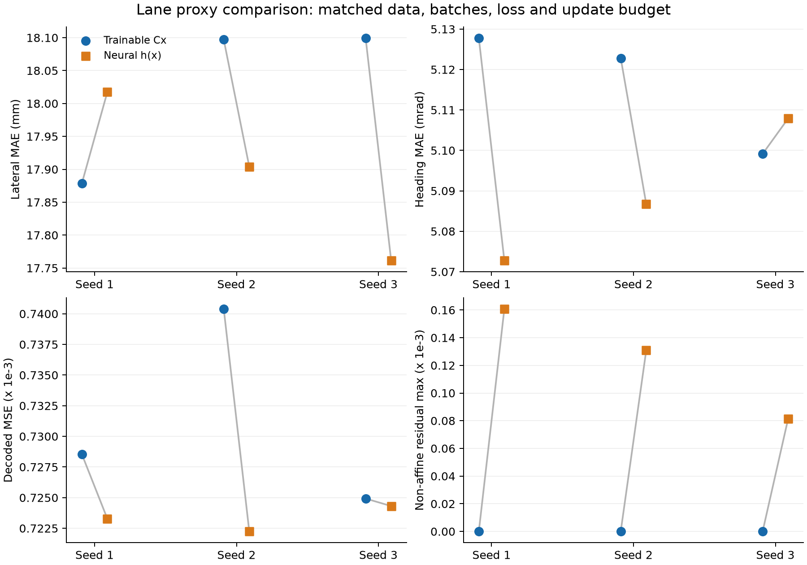

# 车道保持：Cx 与神经代理的同预算对比

> 本地附件收录该次运行的验证记录和报告引用的材料。文中的复现命令按原服务器项目目录执行。

2026-11-17 完成三对训练种子的车道保持实验。可逆神经代理接入同一鲁棒控制器后，六个模型均通过各自半径下的鲁棒屏障数值验证。神经组三对的车辆横向跟踪偏差都减小，平均改善约 2.02 mm。轨迹校准半径在两对中减小、一对中增大，留出整轨迹覆盖在三对中均较低。详细闭环数据见第 7.3 节。

六组共用同一份确定性鲁棒屏障。变化的是视觉前端及其校准包络，每组都要在自己的包络上重新验证全部允许后继。

## 1. 比较什么

两组均使用“当前道路图像 → 冻结 DINOv2 → 可训练二维视觉投影 → 代理的逆映射 → 同一个鲁棒控制器”。仅替换并联合学习状态到低维观测的模型：

| 项目 | 线性组 | 神经组 |
|---|---|---|
| 状态代理 | h(x)=Cx，C 可训练 | hφ(x)=Hφ(Cx)，C 和 Hφ 均可训练 |
| 真实视觉输出 | y=pθ(DINO(I)) | 相同结构的 y=pθ(DINO(I)) |
| 控制器实际输入 | C⁻¹y | hφ⁻¹(y) |
| 低维输出维数 | 2 | 2 |
| 训练起点 | 共享视觉头与旋转矩阵 C₀ | 与线性组完全相同，H 初始为恒等映射 |
| 后端 | 冻结的最新鲁棒控制器和神经鲁棒屏障 | 与线性组逐字节相同 |

这里的 x 是归一化状态 `(横向位置/0.85, 航向角/0.30)`。道路曲率仍是原实验设定的已知输入。

对照组的 C 也参与训练，不能将“固定 C 的旧模型”和“额外训练过的神经模型”混在一起归因。两组视觉投影都会更新，DINO 主干均冻结。

本次神经代理是**可逆神经网络这一受约束类别**，不是任意的二输入二输出 MLP。它内部保留一个可训练线性层 C，但整体函数已经是非线性的 hφ；是否真正学到明显非线性，需要另外测量，而不是看名字判断。

## 2. 为什么不能直接拿 11 月 15 日的结果对比

旧线性训练仅有视觉—代理匹配项，旧神经训练还增加了解码重建项。训练种子和最终轨迹也不同。直接比较旧报告中的两个误差，不能确定变化来自非线性、损失函数还是抽样差异。

本轮重新做配对实验：

- 同一份 3,600 张图像、相同数据划分、同一个视觉 warm start。
- 重新提取共享的 DINO patch 特征，给每张图片记录 SHA256，校验特征行与图像行对应。
- 每对模型使用完全相同的批次顺序，批次随机生成器与模型构造独立。
- 相同损失、Adam 学习率 10⁻⁴、batch 64、30 epoch，共 1,020 次更新。
- 各自仅用开发集解码 MSE 和 C 条件数选检查点，不使用静态 test、新 CP 或最终留出选模型。
- 三个配对训练种子：202611171、202611172、202611173；全部报告，不只展示最好的一个。

这里的“同预算”是相同训练样本、epoch 和更新次数，不是完全相同的参数量、浮点运算量或用时。神经模型多了耦合网络；参数量和优化用时另行记录。这是共享已有视觉模型之后的适配预算，也不是从零训练 DINO 的总预算。

## 3. 神经代理怎么定义，为什么能接同一个控制器

设 z=Cx，神经代理采用两次加性耦合：

\[
b=z_2+0.25f_\phi(z_1),\quad h_\phi(x)=(z_1+0.25g_\phi(b),b).
\]

f、g 各为 `1→16→1` 的小网络，隐藏层与输出采用 Tanh。它们参与优化，不是固定的后处理。逆映射为：

\[
z_1=y_1-0.25g_\phi(y_2),\quad z_2=y_2-0.25f_\phi(z_1),\quad x=C^{-1}z.
\]

C 每行归一化，检查点要求条件数不超过 10；小网络两层权重的范数乘积约束不超过 1。这限制局部误差放大并保留可逆性。条件数接近 1 表示线性部分没有接近奇异；它不等于图像没有视觉歧义。

采用显式逆映射的目的，是让两组都能给同一个控制器提供同一含义的二维状态估计，而不是让“线性模型用旧控制器、神经模型另练一个控制器”造成混淆。本轮没有重练后端，但会为每个新前端重新校准并重新审计鲁棒屏障。

## 4. 每一步的输入输出

### 4.1 绑定图像与 DINO 特征

**输入：**`data/lane_keeping_v2/dataset.npz` 中的图像、状态、曲率和划分，以及固定的 DINOv2-S/14 权重。

**操作：**按完整数据行顺序，固定 batch 8 重新提取 256×384 patch 特征；记录整个数据文件、DINO 权重、特征缓存及逐张图片的哈希。两组使用这同一份缓存。

**输出：**服务器结果目录中的 `features.pt` 和 `feature_protocol.json`。大缓存保留服务器；文档和报告记录其哈希与再生成步骤。

### 4.2 同步训练视觉头与代理

**输入：**2,160 张训练图片的特征和状态；540 张开发图片；同一视觉初始化。

两组使用完全相同的损失：

\[
L=\operatorname{mean}\|p_\theta(F)-h(x)\|_2
+0.1\operatorname{mean}\|h^{-1}(p_\theta(F))-x\|_2^2.
\]

第一项约束真实视觉输出接近状态代理；第二项约束输出经过解码后仍能保留控制所需状态。它防止只看潜在空间误差而忽略逆映射放大的问题。

**输出：**每个训练种子的线性／神经两套观察模型、批次顺序哈希、完整训练历史、静态误差以及非线性程度诊断。记录各自被开发集选择的 epoch；两组虽都运行 30 epoch，最佳 epoch 可以不同。

### 4.3 保持同一控制器与鲁棒屏障，重新运行图像闭环

**输入：**六个冻结前端，以及 `lane_robust_synthesis_20261116_v2/package` 中同一个控制器和神经鲁棒屏障。

**操作：**每个控制时刻按当前状态重新渲染图像，再真实经过 DINO 和对应视觉投影。控制器只读取解码后的视觉观测和已知曲率，不读取真实横向位置／航向角。

两组使用相同初态和曲率抽样流，因此可以配对比较。但前端不同后，实际动作、后续状态和后续图像可能不同；不会强行让两组回放相同的状态轨迹。

**输出：**每个模型单独保存完整状态、观测、动作、低维向量、误差和图像摘要。六个模型是六次真实图像反馈实验，不是把同一份误差文件复制给六种方法。

### 4.4 独立轨迹 CP

每个模型：199 条校准、100 条留出，每条 80 步，α=0.05。

轨迹分数：

\[
R_i=\max_{t<80}\|h^{-1}(y_{it})-x_{it}\|_\infty.
\]

q 取 199 个校准分数的第 190 小值。每个模型独立得到自己的 q，冻结 q 后才开始最终留出；不删失败和大误差轨迹，不把 q 截断成一个容易验证的数。

六个模型共享校准种子 202611170101 和留出种子 202611170102，是为了控制抽样差异。对每一个冻结模型，校准与留出仍是不同随机流；但不能将不同模型下重复使用的初态样本池化成额外独立轨迹，虚增样本量。

### 4.5 与鲁棒屏障衔接

对于线性和神经模型，分别定义低维空间的误差集合：

\[
\mathcal E_y(x)=\{h(x+\delta)-h(x):\|\delta\|_\infty\le q\}.
\]

线性时这是 `{Cδ}`；非线性时随状态变化，不是一个固定大小的原始低维方盒。

因为 h 可逆，在这个集合内有：

\[
h^{-1}(h(x)+\varepsilon)=x+\delta.
\]

所以同一个语义控制器和鲁棒屏障验证器可以直接检查所有 `δ∈[-q,q]²` 的后继。这是实数模型下的结构等式；程序还检查逆映射及动作恢复的数值误差，但数值抽样本身不是这条等式的证明。

**输出：**每个模型在自己新 q 下的独立连续区域数值验证报告。报告包含初始 B 上界、危险 B 下界、三个曲率的反例和未决数量。旧鲁棒屏障权重相同，不意味着通过结论自动相同。

## 5. 怎样判断有没有收益

### 5.1 主要比较量

- 解码后横向位置误差（m）与航向角误差（rad）：物理意义一致。
- 完整轨迹 CP 半径 q：反映整个闭环时域的误差尾部。
- 独立留出的整轨迹覆盖率、越界数量和跟踪误差。
- 同一个鲁棒后端在各自 q 下是否通过鲁棒屏障数值验证。

### 5.2 补充比较量

- `y−h(x)` 原始低维误差。不同 h 的坐标和增益不同，不能只凭这个数更小判断更适合控制。
- 去除最佳仿射拟合之后的代理残差：检测学到的是明显非线性，还是几乎仍为线性加一个偏置。
- 代理与初始 Cx 的差、C 条件数、参数量及优化用时。

三对种子只报告均值、样本标准差和逐对变化，不用三个点宣称统计显著性。若一个误差指标下降而另一个上升，或 q 没有稳定下降，应当报告取舍。

## 6. 原数据划分的重复图片问题

本次额外审计发现：四个划分的 scene_id 没有交集，但仍有完全相同的像素图跨集合出现。训练与 test 共享 27 种图片哈希；360 张 test 中有 54 行的图片出现在训练或开发集中。

这说明“场景编号不同”不等于“图片全部不同”，不能把整个静态 test 宣称为全新图片测试。进一步检查确认，本次训练与 test 共享的 27 种图片，其二维状态标签也完全相同。因此这里确实存在重复样本，不能把这些行计作完全未见图像上的泛化证据。

处理方式：

1. 保留预先登记的全量静态 test 结果，避免看到结果后悄悄换测试集。
2. 追加 306 张与训练／开发图片不重合的静态子集结果，选择标准仅为逐像素 SHA256，不参考模型误差。
3. 不用这个追加子集重新选模型，不从 CP 中删除任何轨迹。
4. 将原划分的重复性明确作为本轮共享历史数据比较的限制。未来若要声称全新图像泛化，应重新设计采集与去重划分，并控制 warm start 的数据接触范围。

新轨迹 CP 的样本单位是完整随机闭环轨迹，不要求每一帧像素都前所未见。它的范围是登记的渲染分布和固定模型，而不是任意未见天气或真实道路。

## 7. 实际结果

### 7.1 已完成的静态误差比较

以下是三对种子的均值；每对模型都使用相同 360 张静态 test 图片，重复图片限制见第 6 节。

| 指标 | 可训练 Cx | 神经代理 | 变化 |
|---|---:|---:|---|
| 横向 MAE | 0.0180250 m | 0.0178942 m | 平均约降 0.73%，并非每个种子都下降 |
| 航向 MAE | 0.00511658 rad | 0.00508911 rad | 平均约降 0.54%，并非每个种子都下降 |
| 归一化解码 MSE | 0.000731294 | 0.000723277 | 两组均值比较约降 1.10% |
| 可训练参数量 | 61,643 | 61,741 | 神经组增加 98 个 |

逐对解码 MSE 降幅为 **0.724%、2.454%、0.085%**。这是小幅改善，不能只展示第二对的 2.454% 作为整个方法的收益。

图中前三幅采用非零起点的局部纵轴，以显示很小的种子间差异；不能根据线段视觉长度判断改善幅度。横向视觉估计误差与实际车辆跟踪偏差分别统计，不混用。

剔除与训练／开发图片重合的 54 张 test 图片后，剩余 306 张上的解码 MSE 仍然是三对均略降。这个追加核对没有改变模型选择，也没有替换原先登记的主要报告。

### 7.2 学到了多少非线性

在归一化状态域 `[-1,1]²` 的 41×41 网格上，给 hφ 拟合最佳仿射模型 `Ax+b`。去除该仿射部分后，三个神经代理的最大残差分别约为 **0.000161、0.000131、0.0000815**；线性组为数值零。

这说明网络确实产生了非线性，但程度很弱。进一步固定神经组已经学好的视觉头，仅把逆映射换成最佳仿射拟合的逆，在静态 test 上得到 MSE：0.000723301、0.000722256、0.000724335，几乎等于原神经逆映射的结果。

该附加诊断**没有重新训练一个仿射对照组，也没有为替换后的逆映射做新 CP 或证书**；不能把它当作第三条已验证方法。它提示我们，目前的观察模型接近线性加偏置，尚不能把收益归因于强非线性表达能力。若要进一步论证非线性是必要因素，需要额外训练 `Cx+b` 的同预算对照。

### 7.3 完整轨迹与鲁棒屏障

每个模型独立运行 199 条校准轨迹和 100 条留出轨迹。表中每格按 **线性组 / 神经组** 排列。q 和留出误差 P95 均采用归一化状态坐标。P95 是把各条留出轨迹的全程最大视觉误差排序后取第 95 百分位。

| 配对训练种子 | 校准半径 q | 留出误差 P95 | 全程落在各自 q 内（每组 100 条） | 车辆横向平均绝对偏差（mm） |
|---|---:|---:|---:|---:|
| 202611171 | 0.088235 / 0.082393 | 0.086011 / 0.085971 | 96 / 93 | 36.289 / 35.293 |
| 202611172 | 0.093424 / 0.084205 | 0.089347 / 0.086326 | 98 / 93 | 37.191 / 33.960 |
| 202611173 | 0.085032 / 0.086816 | 0.082637 / 0.084655 | 96 / 95 | 35.360 / 33.535 |
| 三对均值 | 0.088897 / 0.084471 | 0.085998 / 0.085651 | 96.67 / 93.67 | 36.280 / 34.263 |

按两组均值之比，神经组校准半径小 4.98%，留出误差 P95 仅小 0.40%。第三对的 q 增大了 2.10%，留出 P95 也增大。三对共用相同的初态和曲率抽样流，样本的 95% 分位附近仅有少数轨迹，证据不足以支持神经代理稳定改善尾部误差的结论。

车辆跟踪结果在三对里方向一致，神经组平均离车道中心的距离由 36.28 mm 降至 34.26 mm，约减少 5.56%。平均相邻步归一化动作变化由 0.10524 增至 0.10630。静态 MSE、车辆跟踪、轨迹尾部这三个指标分别来自不同的观测量。

**安全验证。** 六组均通过各自校准 q 下三个曲率的连续区间数值检查。每组实际反例和未决区间均为零。共用屏障的初始区上界为 0.214508，危险区下界为 23.546547。每个模型的 199 条校准和 100 条留出轨迹都未观测到越界。误差超出各自 q 的轨迹只能据实报告其仿真结果。完整逐种子指标、留出误差、证书状态及模型绑定见[结果汇总](../../assets/实验佐证/lane_proxy_comparison_20261117_v1/summary.json)。

这项实验支持可逆神经代理与 SPVC 鲁棒后端的兼容性，也量化了当前渲染设置下的跟踪改善。拟合得到的 h 接近仿射函数，视觉投影与代理又共同训练。因此，观测到的收益属于整套训练后的前端，单独由非线性部分带来的收益仍待验证。

## 8. 安全保证与结论边界

若某个模型的数值验证通过，则在规定动力学、初始区域及误差集合内，神经屏障的初始／危险分离和逐步不增条件支持条件避险结论。轨迹 CP 在同一冻结协议下、校准与未来完整轨迹可交换的前提下提供至少 95% 的边际覆盖；不是所有固定状态条件下的覆盖保证，也不是给定本次 q 后的固定样本条件保证。

数值区间验证使用 float64 及小量填充，尚未形成完整 IEEE 向外舍入形式化证明。单条留出未越界不等于它全程落在证书误差集合内；覆盖、实际安全和证书通过分开报告。100 条留出中的实测覆盖可能低于 95/100，这不能单凭一个样本比例否定边际 CP 定理，也不能反过来宣称固定阈值已被实验证明具有至少 95% 的覆盖。

本报告分别给出六个冻结模型的结果，不声称它们同时以 95% 概率覆盖，也不根据最终 test／CP 挑出一个部署种子。若之后按这些最终指标选模型，应重新处理模型选择后的校准问题。

本次比较回答的是：**在同一车道数据、视觉结构和鲁棒后端下，可逆神经代理相对可训练 Cx 的适配收益。** 它不自动证明一般神经代理优于线性代理，也不证明原 VISION-SLS 的全部理论在任意非线性模型下原样成立。

本地与服务器的相关实现测试均为 **19 项通过**，包括两组起点／损失一致性、梯度、共享图像推理接口、非线性逆映射及轨迹校准逻辑。测试不替代候选的鲁棒屏障区间验证。

## 9. 代码与结果入口

服务器：`root@10.11.154.191:20147`，`conda vt`；工作目录 `/root/work_based_on_spvc/artical-F122`。

- `Aebs/lane_keeping/compare_proxy_train.py`：绑定特征、配对训练、静态误差与非线性诊断。
- `compare_proxy_run.py`：预登记协议和两 GPU 执行；三个种子交错 GPU 分配。
- `compare_proxy_cp.py`：两组共享图像推理实现、独立轨迹 CP 与鲁棒屏障检查。
- `summarize_proxy_comparison.py`：汇总全部模型，检查后端与初始样本配对绑定。
- 结果：[本地验证记录](../../assets/实验佐证/lane_proxy_comparison_20261117_v1)。
- 背景：[上一版非线性代理结构与保证](车道非线性神经代理_联合训练与完整验证_20261115.md)、[本轮使用的鲁棒控制器与鲁棒屏障](../跨实验对照/AEBS与车道_旧前端鲁棒综合_20261116.md)。
