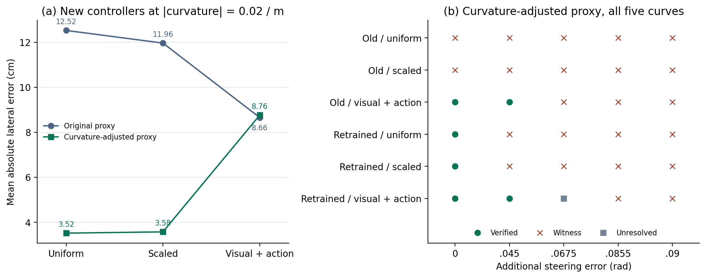

# 五种曲率下的车道保持：同预算重新训练神经控制器和鲁棒屏障

## 比较什么

前一轮固定策略与屏障，只改变对视觉误差的描述。本实验进一步检验，以各自的误差集合训练之后，学得的控制器能否跟踪更准，以及学得的屏障能否容许更大的执行器扰动。横向偏差越小表示跟踪越准。能证明整片初始区域不驶出车道属于另一项指标。学习的屏障只在离线验证中使用，行驶时由冻结的视觉网络和控制器直接转向。

车辆以 4 m/s 行驶，仿真步长 0.1 s，每条轨迹含 80 次控制。原场景的恒定曲率为 −0.01、0、0.01 m⁻¹，新增 ±0.02 m⁻¹，将最小弯道半径从 100 m 减至 50 m。校准和盲测按轨迹均匀随机选一个曲率，初态在横偏 ±0.25 m、航向偏差 ±0.06 rad 的矩形中独立均匀抽取。安全条件为每一步横偏绝对值不超过 0.85 m，航向偏差绝对值不超过 0.30 rad。已知曲率输入无误差。未额外采集外观变化、过程噪声或执行器扰动下的图像概率样本。

## 第一步：设置三个可公平比较的训练臂

三臂从同一对已训练权重开始，在同一曲率集上重新优化。控制器结构为 3–64–64–1，4,481 个参数。神经屏障为 2–16–8–1，193 个参数，Tanh 隐藏层与非负 ReLU 输出。相机、冻结 DINOv2、视觉投影、动力学和三个控制器的容量一致。每个版本仅有一个匹配的训练种子，后面的置信区间衡量场景抽样造成的变化。

每个完整误差轨迹压成一个分数。令 $v_i$ 为第 $i$ 个视觉残差沿全程的最大绝对值，$d_i$ 为开发集给定的分量尺度，$a$ 为带裁剪的神经控制器在视觉读数与状态侧读数之间的全程最大转向差，$d_a$ 为开发动作尺度。三种分数分别取 $\max_i v_i$、$\max_i v_i/d_i$、$\max(0.5\max_i v_i/d_i,a/d_a)$。每臂均校准自己的一维分数，同时界住该臂声明的所有分量。第三臂的屏障验证使用视觉盒与动作差约束的交集。

## 第二步：交替训练控制器与屏障

1. 在三臂训练前冻结轮数、随机种子、部署前的模型来源、曲率、动作/屏障训练损失和验证器预算。v1 使用原三曲率旧开发轨迹给出的设计误差集合，在五曲率上训练。v2 用共同的五曲率开发轨迹重新适配误差模型。两轮分别保留独立结果。
2. 各臂均执行 **3 轮**。每轮先在相同的 52×52 状态网格、五种曲率以及两向额外归一化转向 0.20 下搜索违反屏障不增的具体例子。一轮最多 30 s，同一曲率取到首个有效见证后转到下一曲率。把找出的状态、曲率及其邻域用于后续训练，原始见证保存在各臂 training.json。搜索没有发现见证时仍执行相同更新预算。
3. 每轮先冻结屏障进行 **80 步控制器 Adam 更新**，学习率 $3\times10^{-5}$。训练损失包含 12 步滚动预测的横偏、航向误差、转向幅值和变化量，以及当前屏障对候选后继的最大正漂移。每个小批的 96 个初态复制为名义读数及两种反号偏差情形。对于联合臂，将候选动作偏差裁到开发合同给定的上限。固定状态下的神经转向为连续标量，名义与候选之间的转向值能由连接两观测的线段实现。
4. 随后固定控制器进行 **80 步屏障 Adam 更新**，学习率 $2\times10^{-4}$。优化初始区/危险区的分离以及允许扰动下一步不增的裕量。三轮总计每臂更新控制器、屏障各 **240 步**。固定使用最后一轮最终权重，训练中使用的有限扰动候选只提供损失和见证，完整连续域检查留到冻结之后。
5. 冻结每臂两套权重并计算 SHA-256。每臂使用新的 199 条完整图像轨迹校准。每一步从各臂实际到达的状态重新渲染相机，通过同一个 DINO 与视觉投影生成读数，未越界和越界的运行全部保留。取第 190 小分数作为覆盖水平 95% 的阈值。登记的所有阈值均冻结后，使用另外 100 条初态与曲率运行盲测。不同控制动作会造成不同的相机图像，配对的是相同外生场景。
6. 每臂、每个额外转向幅值有相同 **180 s** 墙钟上限，40×40 初始网格，最多分裂 16 层，最多保留 30,000 个待判状态盒，每个误差维度一分为二。用连续区间界验证初始 $B\le1$、危险 $B\ge20$、相关在域状态的 $B(x^+)\le B(x)$，联合臂显式纳入相对名义动作的约束。测试的额外物理幅值为 0、0.045、0.0675、0.0855、0.09 rad。通过、实际正漂移见证和未解决分别报告，浮点区间有保守垫量但未使用定向舍入。增量转向是集合内的鲁棒压力测试，非零增量下没有独立轨迹校准概率。

## 第三步：解释为什么加入目标域开发数据

v1 统一盒的开发半宽 0.09682 来自原三曲率。旧视觉前端在更急的弯道中呈现随曲率改变符号的持续偏差。在共享旧控制器的五曲率开发集里，±0.02 两种急弯上的归一化视觉残差均值分别为负、正横偏及正、负航向误差。直接用全轨迹绝对误差求半宽，会让每一个状态都承受这个持续偏差的正负两个方向。

v2 只用固定旧策略的新 **199 条开发轨迹**估计 $b_\kappa$。这批数据来自单独的固定策略对照，未使用该对照的留出结果来计算偏置。先对每条轨迹的两个误差分量各取时间中位数，再在同曲率轨迹之间取中位数。五个偏置值固定后，无论哪种误差集合，在线都向神经控制器传入 $z-b_\kappa$ 与已知曲率。原相机、DINO 和投影仍输出 $z$。在原始观测空间，状态侧参考读数为 $g(x)+b_\kappa$，校准的残差为 $z-(g(x)+b_\kappa)$。这给出了原始观测和状态相关代理的误差界。

| 曲率，m⁻¹ | 补偿的横向残差 | 补偿的航向残差 |
|---:|---:|---:|
| −0.02 | −0.13741 | +0.21840 |
| −0.01 | +0.00371 | +0.02338 |
| 0 | +0.01123 | −0.00821 |
| +0.01 | −0.00130 | +0.01269 |
| +0.02 | +0.23621 | −0.28837 |

表中均为归一化坐标，乘以 0.85 m 或 0.30 rad 分别还原物理量。v2 训练阶段的统一盒半宽为 0.13679，分维盒为 [0.13679, 0.13711]，联合臂分量宽为 [0.24189, 0.24245]，归一化动作差上限为 0.47627。在同一批开发状态上计算这些设计值只用于优化。每套新控制器改变闭环分布，分别需要上一步的重新校准。v2 额外纳入两种控制器权重相同的对照，一种保留原始读数，另一种也采用公共偏置补偿，以量化单独补偿和进一步重训的贡献。[目标域开发协议与偏置](../../../artical-F122/results/lane_paired_synthesis_target_20261117_v2/bias.json) · [v1 训练预算](../../../artical-F122/results/lane_paired_synthesis_20261117_v1/protocol.json) · [v2 训练预算](../../../artical-F122/results/lane_paired_synthesis_target_20261117_v2/protocol.json)

## v1 结果：只换训练用的误差集合，急弯跟踪改善了多少

| 新训练臂 | 新校准的归一化视觉半宽 | 动作差上限（归一化） | 全部 100 条平均横偏 | 急弯 41 条平均横偏 | 盲测覆盖 / 安全 | 五曲率零额外扰动的审计 |
|---|---|---:|---:|---:|---:|---|
| 统一盒 | [0.38026, 0.38026] | — | 0.07032 m | 0.12524 m | 95 / 100 | 正漂移见证 |
| 分维盒 | [0.63072, 0.41404] | — | 0.06350 m | 0.11963 m | 95 / 100 | 正漂移见证 |
| 视觉＋动作 | [0.59366, 0.38971] | 0.76790 | 0.04901 m | 0.08657 m | 95 / 100 | 正漂移见证 |

“95 / 100”一栏的两个计数分别表示 95 条全程在管、100 条模拟轨迹始终在车道内。三组均使用相同初态与曲率。联合臂相对统一臂在 41 对急弯上逐对降低平均横偏，平均少 0.03867 m，即 **30.87%**，配对轨迹 bootstrap 95% 区间为 [0.03627, 0.04104] m。相对分维盒，联合臂在 41 对急弯中也均降低横偏，平均少 0.03306 m，区间为 [0.02934, 0.03671] m。急弯平均每步绝对转角变化量却从统一盒的 0.04967 升至联合臂的 0.05478 rad，表明联合臂使用了更频繁或幅度更大的转向调整。每种方法使用一个训练种子，区间对冻结网络与登记的场景分布成立。[配对结果和三种方法的全部盲测指标](../../../artical-F122/results/lane_paired_synthesis_20261117_v1/blind_summary.json) · [转向变化与幅值](../../../artical-F122/results/lane_paired_synthesis_20261117_v1/steering_metrics.json)

举一个证书失败例子。统一盒接受归一化观测误差 [−0.38026,−0.38026]。在直道的归一化状态 [−0.825, 0.675] 与上述误差下，没有额外执行器扰动，联合车辆动力学和当前控制器后，屏障值从 18.69000 升到 20.91071。该点否定固定屏障在整个允许集合上不增，并不要求这条见证恰好来自 100 条图像轨迹。分维盒和联合臂在五曲率的校准集合内也各有正漂移见证。[统一审计与见证](../../../artical-F122/results/lane_paired_synthesis_20261117_v1/uniform/audit.json) · [分维审计](../../../artical-F122/results/lane_paired_synthesis_20261117_v1/diagonal/audit.json) · [联合审计](../../../artical-F122/results/lane_paired_synthesis_20261117_v1/joint/audit.json)

为了定位困难来自哪里，在观察到统一臂的五曲率半宽后，追加按曲率分组的校准与连续域检查。把被冻结的 199 条校准轨迹划分成原三种曲率和新增两种急弯，各组分别按自己的样本数取 $\lceil(n+1)0.95\rceil$ 顺位，使用相同的三个分数定义。原三曲率各自校准时，三个已重训策略与神经屏障都能容忍登记网格最高的 ±0.09 rad 额外转向。只取新增急弯校准时，三臂在 0 rad 都有真实正漂移点。这项追加分析不提供五曲率混合总体通过的证书，也没有另外采集盲测数据。[统一盒分组结果](../../../artical-F122/results/lane_paired_synthesis_20261117_v1/uniform/supplemental_audit.json) · [分维盒分组结果](../../../artical-F122/results/lane_paired_synthesis_20261117_v1/diagonal/supplemental_audit.json) · [联合集合分组结果](../../../artical-F122/results/lane_paired_synthesis_20261117_v1/joint/supplemental_audit.json)

## v2 固定组件消融：究竟是偏差补偿、误差集合还是重训带来证书

**把偏差补偿和集合形状拆开。** 在 v2 的全新采样中，旧控制器权重与旧屏障不动。保留原始会产生系统偏差的读数时，三种新校准集合在五曲率、零额外扰动条件下均有真反例。给**所有臂**加上同一个曲率补偿后，统一盒和分维盒仍在零额外扰动处有反例，联合集合则能验证到 **±0.045 rad**，在 **±0.0675 rad** 找到一步正漂移。五个离散曲率均参与检查。这组实验在同一个非线性神经控制器上将联合集合的作用与训练随机性分开了。

直道上的具体反例说明其原因。统一盒的两个归一化半宽均为 0.123852，盒内存在引起 **0.75708** 归一化转向差的误差。联合集合的两个视觉半宽增至 **[0.15693, 0.15729]**，同时要求此网络实际产生的归一化动作差至多 **0.30899**（0.13904 rad）。原反例中的视觉分量仍落在新的分量范围，实际神经转向差却违反新约束。这里的“通过”来自对新集合内全部允许后继的连续域验证。[同补偿固定网络的统一证书审计](../../../artical-F122/results/lane_paired_synthesis_target_20261117_v2/fixed_corrected/uniform/supplemental_audit.json) · [分维审计](../../../artical-F122/results/lane_paired_synthesis_target_20261117_v2/fixed_corrected/diagonal/supplemental_audit.json) · [联合审计](../../../artical-F122/results/lane_paired_synthesis_target_20261117_v2/fixed_corrected/joint/supplemental_audit.json)

**交换控制器与屏障。** 如果两套最终模型同时换策略、屏障及 CP 阈值，“新组合通过了”本身无法指出是哪项变化起效。于是补做相同视觉盒 [±0.123852, ±0.123852]、同一偏差补偿、同一五曲率的交叉检查。这个视觉盒选自冻结旧策略在补偿后的统一校准。下表均在零额外转向处检查相同的连续域条件。

| 控制器权重 | 屏障权重 | 五曲率零额外扰动 |
|---|---|---|
| 旧 | 旧 | 有正漂移见证 |
| 统一臂重训 / 分维臂重训 | **旧** | 两个新控制器均通过 |
| **旧** | 统一臂新屏障 / 分维臂新屏障 / 联合臂新屏障 | 三者均有正漂移见证 |
| 统一臂重训 / 分维臂重训 | 各自的新屏障 | 两组均通过 |
| 联合臂重训 | 旧或联合臂新屏障 | 在此统一大盒上均有正漂移见证 |

该结果意味着固定旧屏障和同一视觉误差盒，只替换为统一或分维臂重训的**控制器权重**，已足以使这一条件性审计从反例变为通过。联合臂的结论还取决于验证器是否使用它实际训练和校准的动作相关集合。交叉检查在看到统一臂正式校准结果后补做，对组件重组只报告相同误差条件下的鲁棒性质。其正式概率结果仍需相应闭环的轨迹校准。[交叉检查的固定误差盒与全部十种组合](../../../artical-F122/results/lane_paired_synthesis_target_20261117_v2/common_box_cross/)

## v2 盲测：跟踪收益是由哪一项改动产生的

以下五套行驶系统共享 100 个新初态与曲率，含 38 个 ±0.02 m⁻¹ 急弯。旧网络的三种合同用于审计同一批行驶轨迹，故按统一、分维、联合顺序分别列覆盖数。重训行每个控制器只对应自己正式校准的合同。

| 行驶系统 | 全部平均横偏，m | 急弯平均横偏，m | 观测到越界的条数 | 全程在管的条数 |
|---|---:|---:|---:|---|
| 旧网络、原始读数 | 0.06847 | 0.11627 | 0/100 | 98、98、98 / 100 |
| 旧网络、公共曲率补偿 | 0.02818 | 0.03426 | 0/100 | 92、92、96 / 100 |
| 公共补偿＋重训统一臂 | 0.02988 | 0.03520 | 0/100 | 98/100 |
| 公共补偿＋重训分维臂 | 0.02970 | 0.03577 | 0/100 | 94/100 |
| 公共补偿＋重训联合臂 | 0.05961 | 0.08759 | 0/100 | 97/100 |

1. **单独适配状态代理和控制输入**使冻结旧控制器在 38/38 条急弯上横偏下降，平均降低 **0.08202 m（70.54%）**，按轨迹配对的 95% bootstrap 区间为 [0.07969, 0.08434] m。
2. **已有相同补偿时，重新训练没有进一步提高急弯跟踪。** 以同补偿旧控制器为基准，新统一臂横偏增加 0.00094 m，区间 [−0.00085, 0.00275] m。新分维臂增加 0.00151 m，区间 [−0.00071, 0.00372] m。新联合臂增加 0.05333 m，区间 [0.05020, 0.05640] m。
3. **同补偿的训练臂之间**，联合臂相对统一臂的急弯横偏增加 0.05239 m，38/38 条均更差，区间 [0.05050, 0.05427] m。每步绝对转角变化量在急弯中为统一 0.03906、分维 0.03639、联合 0.04961 rad。分维相对统一平均少 0.00266 rad，区间 [0.00112, 0.00419] rad。区间均为单个对比的名义 95%，没有对多重比较作整体校正。
4. 在 v1 中，联合臂的急弯横偏低于统一臂，但三组五曲率校准管均没有通过证书。v2 中，固定旧网络加曲率补偿已取得本组最低的平均急弯横偏，同时用联合集合可取得正的执行器余量。上述两个版本给出的效果方向不同，不能推出联合鲁棒训练一定获得更好的跟踪控制器。[v2 完整盲测和配对区间](../../../artical-F122/results/lane_paired_synthesis_target_20261117_v2/blind_summary.json) · [v2 转向指标](../../../artical-F122/results/lane_paired_synthesis_target_20261117_v2/steering_metrics.json)



左图每个点对应本版本一套重训控制器，两个版本用不同的独立测试组，因此应比较**同一版本内部**的三臂。右图圆点表示五曲率均通过连续域检查，叉号表示至少一个曲率存在实际正漂移见证，方块表示未决。旧补偿策略的三行共享同一神经控制器和屏障。[作图代码](../../../artical-F122/Aebs/lane_paired_synthesis/plot_results.py)

## v2 正式校准及审计结果

P 表示五曲率全域通过，W 表示至少一处实际见证，U 表示在公共验证预算内未解决。前两维是归一化视觉分量，动作上限同样为归一化值。额外转向列头为物理弧度。

| 已补偿的系统 / 误差集合 | 199 条校准所得分量半宽 | 动作差上限 | 0 | ±.045 | ±.0675 | ±.0855 | ±.09 |
|---|---:|---:|:---:|:---:|:---:|:---:|:---:|
| 旧网络 / 统一 | [.12385, .12385] | — | W | W | W | W | W |
| 旧网络 / 分维 | [.12385, .12414] | — | W | W | W | W | W |
| 旧网络 / 联合 | [.15693, .15729] | .30899 | **P** | **P** | W | W | W |
| 重训 / 统一 | [.11925, .11925] | — | **P** | W | W | W | W |
| 重训 / 分维 | [.13436, .13467] | — | **P** | W | W | W | W |
| 重训 / 联合 | [.17013, .17053] | .33498 | **P** | **P** | U | W | W |

在 ±0.0675 rad 处，新联合组在 −0.02 m⁻¹ 急弯有未决状态盒，其余四种曲率通过。看到正式粗网格后，对表中六行在相同原预算下补测 ±0.0495、0.054、0.0585、0.063、0.06525 和 0.0675 rad。冻结旧网络＋联合集合在 0.063 rad 仍全域通过、0.06525 未决、0.0675 有反例。重训联合组在 0.0495 全域通过，0.054–0.0675 均未决。新模型有较小的**已证明**余量，未决区段的真实临界值无法据此比较。在各自的正式新 CP 集合上，重训的统一和分维控制器与屏障从“零附加扰动也有反例”变为能在五个曲率上通过。[统一新模型审计](../../../artical-F122/results/lane_paired_synthesis_target_20261117_v2/uniform/audit.json) · [分维新模型审计](../../../artical-F122/results/lane_paired_synthesis_target_20261117_v2/diagonal/audit.json) · [联合新模型审计](../../../artical-F122/results/lane_paired_synthesis_target_20261117_v2/joint/audit.json) · [六组共同细网格复核](../../../artical-F122/results/lane_paired_synthesis_target_20261117_v2/margin_sensitivity/)

在同一服务器环境重新执行联合臂完整 3 轮重训，从相同初始化与种子得到字节相同的 actor.pt、sbc.pt。另用独立程序从保存的权重复算两版本正式校准顺位、盲测覆盖、每一个动力学后继及屏障反例。此处重复运行是可重复性检查，训练随机性分析仍需独立种子。

## 概率保证与复现

对预先固定的误差形状与冻结模型而言，新图像轨迹若与独立校准轨迹在指定五曲率分布上可交换，轨迹级分割 CP 在同时抽取校准样本和下一条轨迹的意义下保证至少 95% 的整段覆盖。对于完成连续域审计的误差管，整段在管推出在模型内这 80 步不驶出车道。令 A 为本轮校准得到的管通过审计，则 $P(A\ \text{且新轨迹不安全})\le0.05$。这个式子的事件含义与“对已接受的这一批校准，在任意初态或任意新曲率都有 95% 安全概率”不同。若实际额外施加非零执行器扰动，图像轨迹的访问分布会改变。本次相同的确定性误差前提仍有对应的连续验证，若要在改变后的分布给出 95% 轨迹覆盖，需重新校准。浮点数值审计使用小垫量和分割检查，未做向外舍入。

计算成本按 80 步完整轨迹计。v1 三套新策略各用 199 条正式校准、100 条盲测，共 897 条闭环或 71,760 次直接渲染/视觉读出。v2 的共同开发偏置使用另一组 199 条旧策略轨迹（来自五曲率固定网络实验，15,920 帧），正式评估另取新种子。v2 对原权重未补偿、原权重已补偿及三套重训练策略，共五种相机闭环分别采集 199+100 条，共 1,495 条或 119,600 次视觉读出。三个固定策略误差形状可共用其相同闭环轨迹。采样器为固定 GPU 张量形状在末批补齐数据，补齐只影响计算开销，不增加有效轨迹数。训练阶段额外使用的是状态侧滚动预测、有限扰动和反例，没有渲染独立训练图像。

在服务器仓库的 `artical-F122` 目录中用 `vt`，输出应选择新目录。以下命令所需的历史模型和五曲率开发结果均保存在服务器现有结果包中。

```bash
v1=results/lane_paired_reproduction_v1
v2=results/lane_paired_reproduction_v2
python -m Aebs.lane_paired_synthesis.train register --root "$v1"
python -m Aebs.lane_paired_synthesis.target_development --root "$v2"
for arm in uniform diagonal joint; do
    python -m Aebs.lane_paired_synthesis.train "$arm" --root "$v1"
    python -m Aebs.lane_paired_synthesis.train "$arm" --root "$v2"
done
python -m Aebs.lane_paired_synthesis.steering "$v1" --register
python -m Aebs.lane_paired_synthesis.steering "$v2" --register
python -m Aebs.lane_paired_synthesis.evaluate trained "$v1" --device cuda:1 --batch 8
python -m Aebs.lane_paired_synthesis.evaluate_target "$v2" --device cuda:1 --batch 8
for arm in uniform diagonal joint; do
    python -m Aebs.lane_paired_synthesis.audit "$arm" --root "$v1"
    python -m Aebs.lane_paired_synthesis.audit "$arm" --root "$v2"
    python -m Aebs.lane_paired_synthesis.audit_supplement "$v1" "$arm" "$arm"
    python -m Aebs.lane_paired_synthesis.audit_supplement "$v2" fixed_raw "$arm"
    python -m Aebs.lane_paired_synthesis.audit_supplement "$v2" fixed_corrected "$arm"
done
python -m Aebs.lane_paired_synthesis.cross_audit register "$v2"
for arm in fixed uniform diagonal joint; do
    python -m Aebs.lane_paired_synthesis.cross_audit "$arm" "$v2"
done
python -m Aebs.lane_paired_synthesis.refine_margin "$v2" register
for which in fixed_corrected trained; do
    for arm in uniform diagonal joint; do
        python -m Aebs.lane_paired_synthesis.refine_margin "$v2" "${which}_${arm}"
    done
done
for study in "$v1" "$v2"; do
    python -m Aebs.lane_paired_synthesis.check "$study"
    python -m Aebs.lane_paired_synthesis.steering "$study"
done
```

[训练与搜索](../../../artical-F122/Aebs/lane_paired_synthesis/train.py) · [目标域偏置计算](../../../artical-F122/Aebs/lane_paired_synthesis/target_development.py) · [连续域审计](../../../artical-F122/Aebs/lane_paired_synthesis/audit.py) · [交叉检查](../../../artical-F122/Aebs/lane_paired_synthesis/cross_audit.py) · [独立重算轨迹、分位数和正漂移见证](../../../artical-F122/Aebs/lane_paired_synthesis/check.py)
