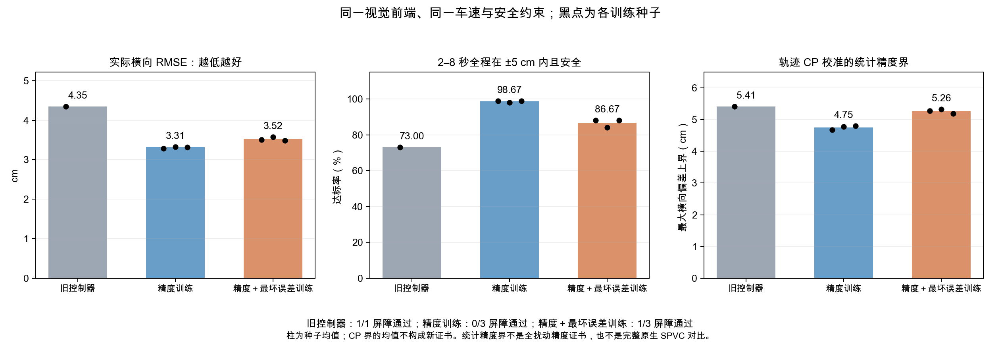
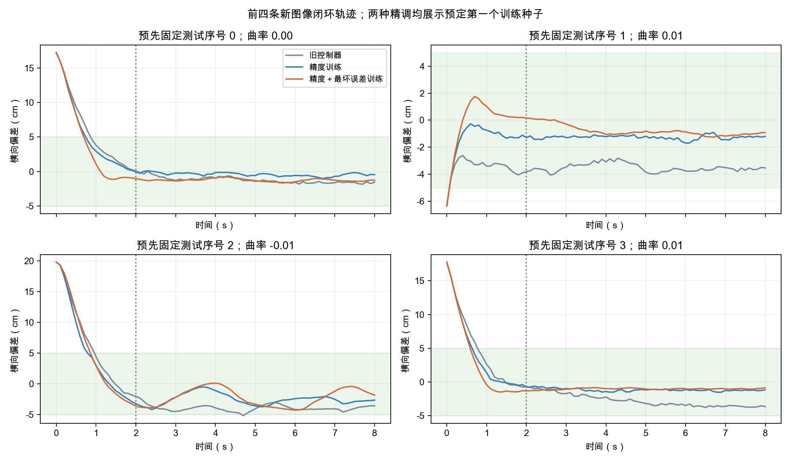
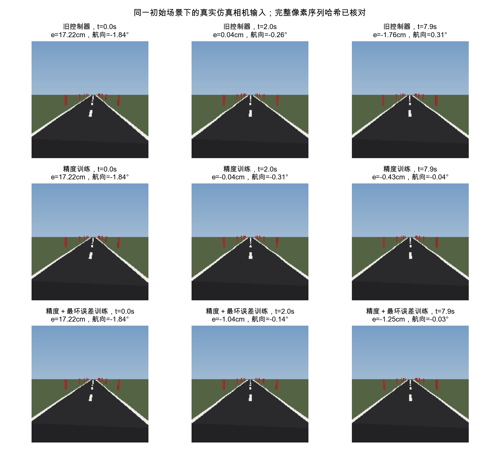

# 车道保持：任务精度训练、真实闭环图像评价与统计精度界

日期：2026-11-20。代码在本地 main，计算使用 GPU 服务器的 vt 环境。旧实验和模型保留。

本实验回答：**在同一视觉前端、同一车速和安全边界下，重新优化控制器能否让车辆更贴近车道中心？加入最坏视觉误差训练，是否比只优化无误差轨迹更好？**

本轮固定现有 DINO 空间读出前端，属于后端受控消融。它不是完整原生 SPVC/cGAN 对比，也没有训练新的 C 或神经视觉代理。新控制器从旧 PPO 导出的神经网络初始化，通过可微模型进行精调；**这次优化器不是 PPO**。

## 1. 任务与输入输出

车辆以 4 m/s 行驶，仿真步长 0.1 s，一条轨迹运行 80 步，即 8 s。物理状态为横向位置偏差 e（m）和航向误差 θ（rad）。道路曲率 κ 为已知输入，从 −0.01、0、0.01 m⁻¹ 中独立均匀抽取，一条轨迹内不变。

初始状态独立均匀采样：e∈[−0.25,0.25] m、θ∈[−0.06,0.06] rad。控制器得到两维视觉估计和 κ/0.01，输出归一化转向 u∈[−1,1]；实际前轮转角为 0.45u rad。

每一步的计算链为：

`当前物理状态 → 道路渲染器产生新图像 → 冻结 DINO patch 特征 → 冻结空间投影 → 两维归一化观测 → 神经控制器 → 转向 → 下一物理状态`

观测代理为归一化状态 `(e/0.85, θ/0.30)`，也就是该旧前端版本的恒等 C。视觉残差是实际两维观测减去这个代理。图像随每个控制器产生的状态重新渲染，不是查冻结图片；但这是**仿真渲染图像，不是实车道路录像或 CARLA 新采集数据**。

动力学沿用原车道代码：

\[
e_{t+1}=e_t+0.4\sin\theta_t,\qquad
\theta_{t+1}=\theta_t+\frac{0.4}{2.6}\tan(0.45u_t)-0.4\kappa.
\]

## 2. 什么叫安全，什么叫精确完成

| 概念 | 本轮定义 |
|---|---|
| 危险 | 任一采样时刻 \(|e|>0.85\) m 或 \(|\theta|>0.30\) rad |
| 横向 RMSE | 每条轨迹第 1–80 步的真实 e 的平方均值再开方；最后在轨迹间平均，以 cm 表示 |
| 最大横向偏差 | 包括初始时刻的整条轨迹最大 \(|e|\) |
| 调整后最大偏差 | 第 20–80 步，即 2.0–8.0 s 内最大的 \(|e|\) |
| 严格精度达标 | 全程安全，且第 20–80 步每一步均满足 \(|e|\le\epsilon\) |
| 预先指定的精度档位 | ε=2、5、10、20 cm；全部报告，不只挑最有利档位 |

第 20 步也在检查范围内。先越界再返回、最后一帧落到中心、在调整期发生危险，均不能算严格达标。没有删除危险轨迹或只对成功轨迹计算精度。

这些是离散采样时刻上的定义，不自动覆盖两个采样时刻之间的连续运动。

## 3. 三组控制器

| 组别 | 输入与网络 | 本轮更新 |
|---|---|---|
| 旧控制器 anchor | 旧 DINO 观测＋已知曲率；原神经 actor | 不更新，作为原有性能参照 |
| nominal_precision | 与旧控制器相同 | 加强横向精度、航向和转向平滑目标，优化无视觉误差的模型轨迹 |
| adversarial_precision | 与上一组相同 | 同时优化无误差轨迹和 PGD 搜索的受扰轨迹 |

网络结构均为 `3 → 64 → 64 → 1`，两个隐藏层使用 Tanh，最后把输出截断到 [−1,1]，共 4,481 个参数。后两组分别运行三个预先指定种子：202611200701、202611200702、202611200703。每一对使用同一个初始网络、同一 minibatch、同一 PGD 初始扰动、相同的冻结神经屏障和更新次数。旧控制器已经接受过历史鲁棒训练，因此不能把它称为“纯原生 SPVC”。

## 4. 训练每一步做什么

**输入：**初始化 actor、冻结神经屏障 B、已知动力学、开发阶段固定扰动盒。**输出：**两个更新后的 actor；视觉前端和 B 不更新。

1. 在初始状态集合采样一批 64 个状态，同时从 B<20 的开发状态池采样用于安全训练的状态。两组使用相同样本。
2. 可微地展开未来 24 步。每步累计横向、航向、转向幅度和转向变化代价，并加入超出安全域的惩罚。
3. 对观测扰动执行四步投影梯度上升（PGD）：寻找让跟踪代价增大的扰动，每步后投影回 [−0.10,0.10]²。这里的 0.10 是预设的**开发训练半径**，不是新策略最终的 CP 半径；对应 e 方向 ±8.5 cm、航向方向 ±0.03 rad 的观测误差。
4. nominal 组优化无扰动性能；adversarial 组优化 0.5×无扰动性能＋0.5×PGD 扰动性能。
5. 两组均加同一鲁棒屏障训练损失及对旧动作的轻微约束。屏障损失用四个误差子盒对一步后继作区间包络，再惩罚正的屏障漂移。
6. Adam 更新网络，共 600 次，学习率 10⁻⁴，梯度范数上限 1。保存最终一步，不根据校准或测试结果选 checkpoint。

性能代价采用固定物理归一化：`e/0.10m`、`θ/0.05rad`、`转向/0.10rad`、`转向变化/0.05rad`。每步权重依次为 1、0.2、0.01、0.05，安全域越界平方惩罚权重为 25；24 步平均后另加终点横向平方误差。总训练损失再加 `10×屏障损失＋0.05×旧动作均方差`。

为控制计算预算，两组都执行 PGD、名义与扰动轨迹计算，只改变代价权重。PGD 只是有限步训练搜索，不能把它找到的最坏误差当作数学上的全局最坏误差；训练损失为零也不是证书。

## 5. 冻结后重新采图与校准

所有六个新 actor 及旧 anchor 都冻结后，登记七组模型文件哈希。每组各自采集 199 条校准轨迹和 100 条测试轨迹，使用新的种子 202611200901、202611200902。

七组共用外部场景种子，初态、曲率逐条一致；因为动作不同，它们沿途渲染的图像通常不同。每条轨迹是一个统计样本，80 帧不是 80 个独立样本。共计 7×299×80=167,440 次有效新图像观测；固定 batch=32 的末批 padding 不计入这个样本量。

图像校准使用每条轨迹中所有 80 步、两维视觉残差的最大绝对值作为分数，α=0.05，取 199 个分数升序排列的第 190 个作为 q。每组 q 冻结后才采集其测试轨迹。

此外，另做 1,000 条配对合成误差轨迹，覆盖零误差、逐步独立均匀误差和整条轨迹保持不变的偏置误差。这部分只作诊断，不算新图像实验，也不提供图像 CP 覆盖保证。

## 6. 新增的统计精度界是什么

除了校准视觉误差 q，还用同一批独立校准轨迹计算一个**直接描述任务表现**的分数：

\[
S(\tau)=\begin{cases}
+\infty,&\text{整条轨迹任一采样时刻危险},\\
\max_{t=20,\ldots,80}|e_t|,&\text{否则}.
\end{cases}
\]

取这些分数的第 190 小值为 R，单位是 m。R 越小，统计校准得到的安全跟踪精度范围越窄。例如“R 为若干厘米”描述的是调整后整段轨迹的偏差范围，绝不是神经网络测距 MAE。

这是 split conformal 的顺序统计量构造。冻结策略之后，每条独立生成的完整轨迹是一个可交换样本；轨迹内部的时间相关性不需要消失。[理论参考：Angelopoulos 与 Bates 的 Conformal Prediction 教程](https://arxiv.org/abs/2107.07511)。

精确的边际声明是：

\[
\Pr\{R<\infty\ \land\ [\text{新轨迹危险}\ \lor\ \max_{t=20:80}|e_t|>R]\}\le 0.05.
\]

概率同时针对校准数据和新轨迹的随机性。若 R=∞，这个界没有可用的精度意义；不能去掉危险校准样本来把它变小。也不能在只保留有限 R、只保留证书通过的模型之后，自动声称条件覆盖仍为 95%。

**这个统计精度界不等于鲁棒精度证书。** 它对注册的随机场景分布给出边际声明，不证明误差盒内每一种扰动都能实现同样精度。视觉误差 CP 和任务精度 CP 分别校准，不能把两个各 95% 的边际声明直接拼成联合 95%。

## 7. 神经屏障如何重新检查

每个 actor 用自己重新校准的 q，重新运行既有连续状态盒数值验证器，检查初始 B≤1、危险集合 B≥20、允许后继屏障不增。不会因为沿用相同 B 就继承旧通过结果。

验证通过只提供“误差在集合内时的模型安全”依据；若失败，则报告 witness 或 unknown，不挑掉失败组。验证器使用浮点区间计算，没有定向舍入，因此仍属于数值区间审核。

这里的屏障 witness 是“某个允许状态和误差使 B 增加”的反例，未必是从初始集合可达的危险轨迹。它能推翻**当前 B 对这个新控制器的证书条件**，不能据此断言控制器一定会出事故，也不能断言换一个 B 后仍无法证明。

另接入一个**全扰动精度审核入口**：针对相同的 2、5、10、20 cm 规格，先从初始域 3×3 网格、三种曲率和零误差／四种恒定误差角点搜索可重放反例。若没有反例，再尝试对整个初始状态盒作 80 步区间可达传播，每种曲率最多 3 秒。反例会保存完整状态序列和允许误差，区间超时或包络过宽记为 unknown；没有发现反例不等于通过。

这个附加检查不训练新 Lyapunov 函数，也不修改任何模型或 CP 阈值。若一个误差盒允许某条扰动导致超过 5 cm，就不能声称“盒内所有误差都保证 5 cm 精度”，即使实际图像大多数时候跟踪很好。它检验的是比统计精度界更严格的规格，两者必须分别报告。

## 8. 实测结果

**精度改善已得到新图像闭环数据支持；安全证书尚未在三个新种子上全部恢复。** 本轮训练和七组新图像评估均已完成，六项回归测试和七组原始数据独立复算通过。

| 组别 | 横向 RMSE（cm） | 平均绝对横向误差（cm） | ±5 cm 严格达标率 | 观察到危险 |
|---|---:|---:|---:|---:|
| 旧控制器 | 4.348 | 3.623 | 73.00% | 0.00% |
| 精度训练 | 3.310 | 2.220 | 98.67% | 0.00% |
| 精度＋最坏误差训练 | 3.521 | 2.196 | 86.67% | 0.00% |

新训练组为三个固定种子在同一批 100 条场景上的平均；不是 300 个独立外部场景。旧控制器有 100 条测试轨迹。全七组共 700 次测试执行均未观察到危险，这不是零风险证明。

### 8.1 改善幅度与配对区间

- 精度训练：RMSE 降低 **23.87%**；新−旧的平均差为 **-1.038 cm**，场景配对 95% bootstrap 区间 [-1.146, -0.932] cm。严格达标率增加 **25.67 个百分点**，区间 [17.00, 34.67] 个百分点。
- 精度＋最坏误差训练：RMSE 降低 **19.01%**；新−旧的平均差为 **-0.827 cm**，场景配对 95% bootstrap 区间 [-0.960, -0.696] cm。严格达标率增加 **13.67 个百分点**，区间 [6.33, 21.00] 个百分点。

本实验中，加入最坏误差性能训练没有在实际平均精度上胜过只做名义精度训练；它的作用需要结合屏障结果看，不能只挑相对旧控制器的改善而省略这个比较。



### 8.2 每个种子的完整结果

| 模型 | RMSE（cm） | ±5 cm 达标／100 | 视觉盒覆盖／100 | 统计精度 R（cm） | R 对应安全精度覆盖／100 | 原屏障重验 |
|---|---:|---:|---:|---:|---:|---|
| 旧控制器 | 4.348 | 73 | 92 | 5.414 | 97 | 通过 |
| 701 精度训练 | 3.284 | 99 | 97 | 4.673 | 97 | 非增条件反例 |
| 701 精度＋最坏误差训练 | 3.503 | 88 | 94 | 5.270 | 96 | 通过 |
| 702 精度训练 | 3.329 | 98 | 95 | 4.773 | 94 | 非增条件反例 |
| 702 精度＋最坏误差训练 | 3.574 | 84 | 97 | 5.322 | 92 | 未判定 |
| 703 精度训练 | 3.316 | 99 | 96 | 4.797 | 95 | 非增条件反例 |
| 703 精度＋最坏误差训练 | 3.486 | 88 | 97 | 5.188 | 93 | 非增条件反例 |

名义精度组的三个种子均出现原 B 的非增条件反例。最坏误差组第一个预定种子通过，第二个因细分层数／单元预算留下 251 个未解决盒而未判定，第三个出现正漂移反例。不能把未判定算作通过，也不能把原 B 的失败等同于从初态出发的实际事故。

因此，“第一个预定种子保持原屏障数值条件且 RMSE 降低约 19%”可以作为个例结果；它不能替代整组三个种子的混合结论，更不能据此把模型筛选后的 CP 条件覆盖写成 95%。

统计精度界 R 为每个模型单独校准。图中的平均柱只是展示，平均 R 不构成新的 95% 证书。

### 8.3 全误差盒精度检查

七个控制器在 2、5、10 cm 规格下都找到了可重放的允许扰动反例。20 cm 规格下，旧控制器有反例，六个新控制器均为区间审核 unknown，**没有一个完成全误差盒精度证明**。新控制器实际图像精度更高，与这些结果不矛盾：恒定盒允许一些真实图像轨迹中很少出现、甚至未观察到的长期偏差。

例如旧控制器的允许恒定误差可以使横向偏差达到约 20.13 cm。它反驳的是“所有盒内误差都保证 20 cm 精度”，不反驳测试中 97/100 条轨迹落入统计精度界，也不反驳安全边界为 85 cm 的安全屏障。

### 8.4 轨迹与实际相机输入

以下轨迹固定展示测试序号 0–3，两个新训练组固定展示第一个训练种子，未按效果选择场景。



以下展示测试序号 0 在第 0、20、79 步的实际仿真相机输入。根据保存状态重新渲染后，逐模型核对了整条 80 帧像素序列的 SHA256，与采集时一致。



### 8.5 结果文件与复核

- [总表和场景配对区间](../../../artical-F122/results/lane_precision_20261120_v1/camera/summary.json)
- [全部逐轨迹指标](../../../artical-F122/results/lane_precision_20261120_v1/camera/per_trajectory.csv)
- [独立原始数据复核](../../../artical-F122/results/lane_precision_20261120_v1/camera/independent_audit.json)
- [全扰动精度审核](../../../artical-F122/results/lane_precision_20261120_v1/camera/precision_robust_audit.json)

复核重新生成全部初态与曲率，检查真实动力学更新、保存动作与 actor 重放、视觉误差与轨迹最大分数、两个 CP 的秩及阈值、危险计数、所有精度指标和模型哈希。七组均通过。该检查确认实现和记录一致，不提升浮点验证器的证明等级。

下一阶段应把新反例纳入控制器／屏障联合修复，或用预定回退规则控制精调幅度，并重新采集校准与盲测；本报告没有把这个尚未完成的阶段算成已获得的安全保证。

## 9. 文件与复现

- [训练、指标与统计精度界代码](../../../artical-F122/Aebs/paper_comparison/lane_precision.py)
- [新图像采集、逐策略 CP 与屏障重验](../../../artical-F122/Aebs/paper_comparison/lane_precision_camera.py)
- [完整流水线](../../../artical-F122/Aebs/paper_comparison/lane_precision_experiment.py)
- [失败计数、截止时刻、动力学及梯度测试](../../../artical-F122/Aebs/paper_comparison/test_lane_precision.py)
- [绘图程序](../../../artical-F122/Aebs/paper_comparison/plot_lane_precision.py)
- [全扰动精度反例与有限时域区间审核](../../../artical-F122/Aebs/paper_comparison/lane_precision_verify.py)

在服务器 `/root/work_based_on_spvc/artical-F122` 中，用一个**新的**输出目录完整运行：

```bash
/opt/miniconda3/envs/vt/bin/python -m Aebs.paper_comparison.lane_precision_experiment \
  --root results/lane_precision_new_run --device cuda:1 --batch 32
```

如果六个训练模型已完整冻结，可以使用 `--skip-training`。这不是覆盖或恢复半份评估结果的开关；输出目录已含评估结果时程序会拒绝覆盖。实际本轮结果保存在 `results/lane_precision_20261120_v1/`，其中 `camera/summary.json` 为总表，逐轨迹结果见 `camera/per_trajectory.csv`，各模型、分数、阈值、区间审核及源码快照均单独保留。

本轮训练开始后新增了统计精度计分函数；训练源码快照保留在各 seed/source.py，训练主体未因这次新增而修改。摄像头评估另行绑定新增计分函数的源码哈希，避免把两个阶段误认为同一源码快照。

合成评价首次运行时遇到 NumPy 对布尔数组求插值分位数的兼容错误。已将汇总时的分位数输入显式转成浮点，并增加回归测试；失败中间文件保留在 `synthetic_summary_bug_archive/`，不参与报告。修复发生在新图像校准／测试开始前，未改变训练或测试场景。

## 10. 论文中能用来支持什么

本实验可以检验“同一视觉系统的精度导向后端训练能否降低任务误差”“在保持原神经屏障条件时是否仍有精度改善”。它不单独证明 DINO 优于 cGAN，不是完整原生 SPVC 与新框架的排名，也不把换奖励函数本身当作新的理论贡献。

统计精度校准也可以用于其他控制方法，包括原 SPVC；真正值得比较的是：在相同任务、数据和置信水平下，哪个控制器的实际误差更低、校准出的精度范围更窄，以及需要付出多少安全性、平滑性和计算代价。

名义图像环境的收益不能直接推广到模糊、遮挡、雨天或实车。只有三个精调种子；配对 bootstrap 先对这三个固定种子在同一场景上的结果取平均，再在 100 个完整场景上重采样。它刻画场景抽样不确定性，不是对所有训练随机性的置信保证。七个控制器各自 95% 的边际 CP 声明也不是七者同时成立的 95% 声明。
