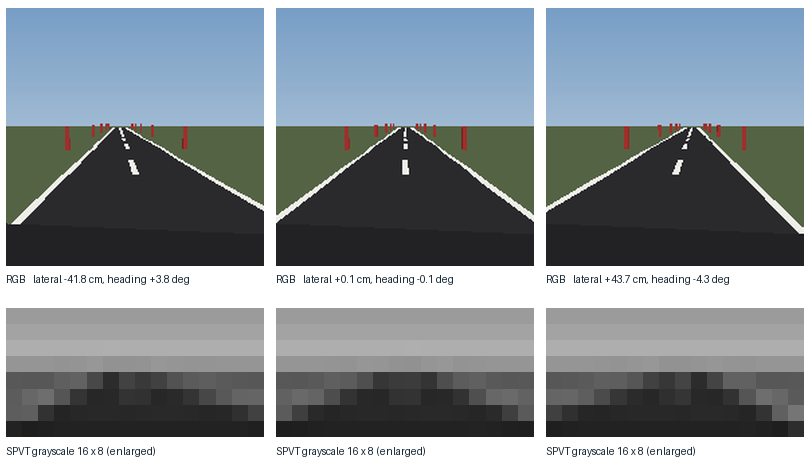
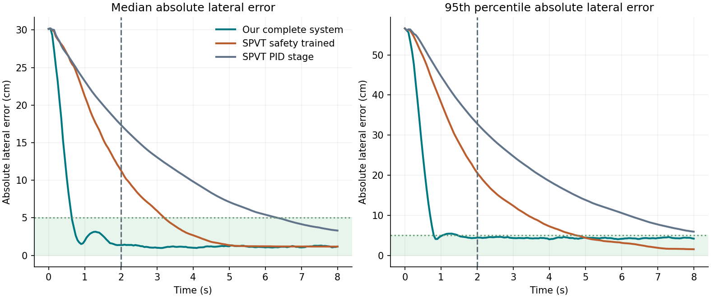

# 车道保持同图包整链路重训｜SPVT 与我方 RGB DINO

同一批 192×192 彩色道路图分给两种方法。SPVT 保留 16×8 灰度观测、条件生成器和原安全训练，我方保留 RGB DINO、二维状态代理、轨迹 CP 和鲁棒屏障。两边从新权重开始训练，闭环各用自己的相机前端和控制器。

我方与 SPVT 完整复训分别 **500/500**、**500/500** 全程安全，严格 ±5 cm 分别 **393/500**、**122/500**。横偏 RMSE 从 **11.32 cm 降到 6.38 cm**，降幅 **43.6%**。SPVT 选用独立开发集表现最好的第 80 轮候选。

实验使用一组训练种子。生成器、我方视觉投影和控制器在本机训练，SPVT 原安全训练和两边的区间验证在服务器 CPU 执行。

## 1. 数据和任务

| 用途 | 数量 | 用法 |
|---|---:|---|
| 训练图 | 20,000 张 | 相同源图、横偏和航向标签。两套系统各用自己的预处理。 |
| 开发图 | 2,000 张 | 我方用来选视觉投影和确定训练误差尺度。 |
| 静态留出 | 4,000 张 | 检查我方视觉估计的物理误差。SPVT 的相机网络直接输出转向。 |
| 闭环 | 199 条校准、500 条测试 | 两套系统共用初态抽样，每一步从自己当前状态渲染一张 RGB 图。 |

静态图分区之间核验 RGB 像素无完全重复。实验是固定相机和标称光照的合成直道。静态图横偏和航向分别在 ±80 cm、±12° 内采样。闭环初始横偏在 ±60 cm、航向在 ±7° 内均匀抽取。车速 5 m/s，轴距 2.5 m，步长 0.05 s，转角限幅 ±30°，每趟 8 s。安全要求每个采样时刻的横偏都在 ±80 cm 内。严格达标还要求第 2 秒到第 8 秒持续留在 ±5 cm 内。±10 cm 使用同样的判定步骤。

上排为三张共同留出的相机源图。下排将 SPVT 的 16×8 灰度实际输入放大显示。DINO 保留上排的 RGB 三通道。

## 2. 两套方法怎样训练？

### SPVT 从生成代理到控制器

1. 用训练图的 16×8 灰度版本重训公开的生成器结构。输入为横偏、航向和十维潜变量，输出 128 个灰度像素。生成器沿用作者结构，判别器按论文描述实现为带谱归一化的条件卷积判别器。训练 100 轮、batch 128、学习率 0.0007，并在生成器损失加入正交正则。
2. 用 20,000 张共同训练图的灰度输入重训原控制器结构 128→64→32→8→1。动作标签来自作者代码的 PID 公式。输入是相机图，预训练 200 轮、batch 256、学习率 0.0005。
3. 冻结生成器，按原训练入口传入新训练状态、新生成器和新控制器权重。采用作者代码支持的 IBP，训练 100 轮、batch 256，保留 K=4 到 10 的时域课程、困难样本缓冲区、原监督动作目标与安全训练损失。安全训练前后核对源码哈希。
4. 用独立渲染的 64 条开发闭环从预设检查点中选模型，优先选全程安全数更多的，再比较横偏 RMSE。最终对照另列 SPVT 的新训 PID 初始化阶段，方便看安全训练前后的效果。

原仓库公开了网络及安全训练。本轮的生成器、判别器和 PID 初始化训练程序依据论文和公开结构补齐，判别器细节和 GAN 损失实现由本次适配给出。留出图上，以零潜变量生成的灰度图与原灰度图平均相差 1.69 个灰度级，计量范围为 0–255。

### 我方 RGB DINO 与鲁棒控制

1. 保留 RGB，经 DINOv2-S/14 得到 16×16 个 384 维 patch token。空间平均池化至 4×4，再用岭回归把 6,144 维特征映射到二维观测。状态代理固定为归一化横偏和航向。岭系数只用开发图选。
2. 控制器结构为 3→64→64→1，隐藏层 Tanh。第三输入是已知曲率，本次为零。先用二维视觉估计和原 SPVT 的同一 PID 动作标签训练初始化。
3. 从同一批训练状态出发，在共同动力学上做 1,200 次 32 步滚动优化。名义轨迹和在开发视觉误差盒内搜索到的困难轨迹共同训练。损失包含横偏、航向误差、转向幅度、相邻转角变化、状态边界和终点横偏。
4. 冻结投影及控制器，再训练神经屏障。最终误差集合由新相机闭环的轨迹 CP 校准，用该半宽检查全误差盒的鲁棒不增。

## 3. 闭环成绩

| 系统 | 500 条中全程安全 | 持续 ±5 cm | 持续 ±10 cm | 全程 RMSE（cm） | 持续进入 ±5 cm 时间（s） | 转向每步平均变化（°） |
|---|---:|---:|---:|---:|---:|---:|
| 我方完整框架 | 500 | 393 | 500 | 6.38 | 1.705 | 2.512 |
| SPVT 完整复训 | 500 | 122 | 219 | 11.32 | 2.908 | 0.589 |
| SPVT 新 PID 初始化 | 500 | 87 | 142 | 14.56 | 5.386 | 0.261 |

SPVT 按 64 条开发轨迹选定第 80 轮。我方与 SPVT 完整复训分别 **500/500**、**500/500** 全程安全，严格 ±5 cm 分别 **393/500**、**122/500**。横偏 RMSE 分别为 **6.38 cm** 和 **11.32 cm**。同一测试初态下，我方减 SPVT 的 RMSE 平均差为 -4.93 cm，按配对场景重采样的 95% 区间为 [-5.22, -4.65] cm。RMSE 使用完整 8 秒记录，未进入持续 ±5 cm 的轨迹按 8 s 计入时间。

左图看中位横偏，右图看每一时刻横偏绝对值的第 95 分位数。竖线为第 2 秒，浅绿带是 ±5 cm 要求对应的绝对误差范围。

第 2 秒，我方的横偏 P95 为 **4.43 cm**，SPVT 为 **20.65 cm**。第 8 秒两者分别为 **4.19 cm** 和 **1.55 cm**。我方更早拉回车道中心，SPVT 在末段偏差更小。我方为此使用了更频繁或更大的转向调整，每步平均变化为 **2.51°**，SPVT 为 **0.59°**。

## 4. 视觉误差与安全验证

我方观测 CP 每条轨迹只取一个分数，即两个归一化残差在整个时域的最大绝对值。199 条校准取第 190 小分数。SPVT 的代理为条件图像生成器，另报其潜变量盒下的可达验证前缀和实际第一帧动作落入代理动作外包络的次数。两边分别报告可直接比较的跟踪指标和动作偏差。

共同静态留出集上，我方观测 MAE 为 **2.98 cm 横偏、0.34° 航向**。原图整轨视觉 $q=0.14503$，即横偏误差 ±12.33 cm、航向 ±2.49°。新测试有 **463/500** 条全程入界。新神经屏障的数值区间检查 **未通过**。

SPVT 在自己的 10 维潜变量盒下，500 个配对初态中有 **137** 个至少验证到第 10 步，**0** 个验证到完整 160 步，中位可验证前缀为 8 步。真实相机第一帧动作有 **500/500** 落在生成代理的动作外包络内。

| 系统 | 整轨动作误差半宽（°） | 动作误差全程入界 | 安全且尾段横偏的任务半宽（cm） |
|---|---:|---:|---:|
| 我方完整框架 | 8.746 | 479/500 | 5.60 |
| SPVT 完整复训 | 3.416 | 479/500 | 20.44 |
| SPVT 新 PID 初始化 | 3.548 | 466/500 | 33.90 |

动作偏差取真实相机动作减去本系统名义代理动作。任务半宽取第 2–8 秒的最大横偏，安全失败的校准轨迹记为无穷。

我方屏障的初始集条件未通过，危险集条件未通过，并检测到 885 个逐点正漂移见证。95% 轨迹 CP 对应整轨观测误差的边际覆盖。 两边的数值验证均使用普通浮点区间运算。

## 5. 复现入口

- [共同 RGB 图包与划分](../../../artical-F122/Aebs/paper_comparison/lane_matched_data.py)
- [SPVT 生成器、PID 初始化和原训练入口](../../../artical-F122/Aebs/paper_comparison/lane_matched_native.py)
- [我方 RGB 投影与控制器](../../../artical-F122/Aebs/paper_comparison/lane_matched_own.py)
- [共同闭环、开发选型与轨迹 CP](../../../artical-F122/Aebs/paper_comparison/lane_matched_evaluate.py)
- [两边各自的安全验证](../../../artical-F122/Aebs/paper_comparison/lane_matched_certificate.py)

- [原始校准、逐轨迹成绩与独立复算](../../../artical-F122/results/lane_matched_complete_20261125/independent_recheck.json)
- [我方最终鲁棒检查](../../../artical-F122/results/lane_matched_complete_20261125/own_certificate/final/certificate.json) · [SPVT 可达验证](../../../artical-F122/results/lane_matched_complete_20261125/native_certificate/summary.json)
- [SPVT 原论文](<../../references/Learning Vision-Based Neural Network Controllers with Semi-Probabilistic.pdf>)
