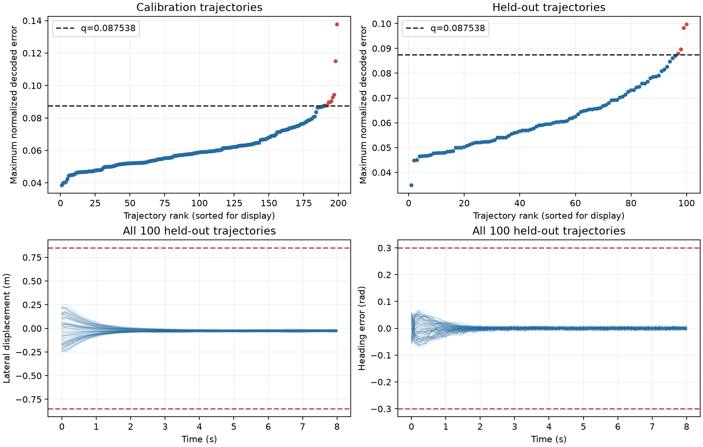

# 车道非线性神经代理：联合训练与完整验证

日期：2026-11-15。独立新增版本，保留原固定 C 和联合 C 版本。

当前阶段：视觉与非线性代理联合训练、新闭环轨迹 CP、独立留出及神经鲁棒屏障审计均已完成。三个曲率场景均通过条件鲁棒屏障数值审计；留出整轨迹覆盖 96/100，100 条均未越界。

## 1. 本次与 RGB 初试有什么不同

RGB 初试冻结视觉前端，只拟合状态代理。本次同时更新车道视觉投影、矩阵 C 和非线性代理网络，并把新的非线性逆映射真正用于图像反馈控制。随后重新生成闭环轨迹，校准新误差集合，再审计神经鲁棒屏障。

实际视觉仍是“道路图像→冻结 DINO→可训练低维投影”。真实状态只用于离线训练、仿真、误差计算和数学验证；控制器不会读取真实横向位置或真实航向角。

非线性观察模型的依据是 [VISION-SLS Remark 3](https://arxiv.org/html/2604.24894v1)：低维观察模型允许采用可微非线性函数。下面的可逆耦合结构是本项目为保留 SPVC 控制和验证接口所作的适配，不是原论文已经提供的这套实现。

## 2. 为什么选择可逆神经代理

车道归一化状态为 x=(e/0.85, θ/0.30)，低维观察也是二维。任意的二输入二输出 MLP 可能把不同状态映射到同一点，不能直接求逆。若视觉头与代理一起只最小化匹配误差，它们还可能同时趋向常数，使误差很小却没有控制信息。

本次使用 hφ(x)=Hφ(Cx)，其中 C 每行归一化，并在选择检查点时要求条件数≤10。令 z=Cx，定义：

\[
b=z_2+\tfrac14 f_\phi(z_1),\qquad
y_1=z_1+\tfrac14 g_\phi(b),\qquad y_2=b.
\]

f、g 分别为 1→16→1 网络，使用 Tanh 激活，并在输出端再经过 Tanh。它们均参与训练。这是两个平滑的非线性耦合变换。

逆映射可以直接算出：

\[
z_1=y_1-\tfrac14 g_\phi(y_2),\qquad
z_2=y_2-\tfrac14 f_\phi(z_1),\qquad
x=C^{-1}z.
\]

这里不需要训练一个近似逆网络，也不需要迭代求根。两个耦合变换的雅可比行列式均为 1，所以 h 的雅可比行列式等于 det(C)；C 可逆时，代理不能整体塌缩成常数。

这类以简单可逆模块组合复杂映射的设计可参考 [NICE](https://arxiv.org/abs/1410.8516)。本次只使用加性耦合的结构性质，不训练密度模型，不采用 NICE 的似然目标，也不将该结构本身作为新的理论贡献。

每次更新后还约束每个小网络两层权重的 Frobenius 范数乘积不超过 1。结合 Tanh 导数界，耦合增量的导数绝对值在实数模型中不超过 0.25，有助于避免逆映射过度放大误差。这不等于给视觉网络本身提供全局可观测性证明，也不是对普通浮点计算的向外舍入证明。

## 3. 每一步做了什么

### 第一步：复用相同图像与冻结 DINO 特征

输入是原车道 3,600 张渲染图、状态标签和已有 patch 特征，划分为 2,160 训练、540 开发、540 静态校准预留、360 静态测试。特征由冻结 DINOv2-S/14 提取，尺寸为 256×384。

保留原 patch 视觉头作为 warm start，C 从与原联合版本相同的旋转矩阵开始。非线性网络最后一层零初始化，所以起点 h(x)=Cx，控制语义不会因随机初始化突然改变。

缓存使用既有顺序和数据绑定。缓存不是新采集数据；本轮新轨迹评估另行从原图实时编码，不能以缓存拟合结果代替真实图像闭环。

### 第二步：联合学习视觉投影与神经代理

输入训练图像特征和归一化状态，更新视觉投影 pθ、C、fφ、gφ。训练目标为：

\[
L=\frac1N\sum_i\|p_\theta(F_i)-h_\phi(x_i)\|_2
+0.1\frac1N\sum_i\|h_\phi^{-1}(p_\theta(F_i))-x_i\|_2^2.
\]

第一项使实际视觉输出贴近状态代理，第二项要求解码后的观察仍能恢复控制所需状态。后者是本次新增的控制语义约束，不应说成逐项照搬 VISION-SLS 原损失。

训练 30 epoch，batch 64，Adam 学习率 0.0001，种子 20261115。只按开发集解码 MSE 和 C 条件数选择检查点，未按新轨迹 CP 或测试误差挑模型。

输出是冻结的新观察模型、训练历史、数据绑定及静态误差报告。选择第 27 个 epoch。

### 第三步：实际控制使用非线性逆映射

新控制器是组合映射：

\[
u=\pi_{\rm old}(h_\phi^{-1}(y),\kappa),\qquad
y=p_\theta(\operatorname{DINO}(I)).
\]

输入只有当前图像和原任务中已知的道路曲率 κ。新 h 的逆映射包含 f、g 网络，因此实际控制链路已经改变。原语义控制器参数保持冻结，本轮没有新 PPO 训练。

沿用原神经鲁棒屏障作为候选，但必须用新误差集合重新验证。复用权重不等于复用通过结论；如果验证失败，状态必须记录为未通过，不能把旧证书贴过来。

### 第四步：冻结协议并生成新图像轨迹

在服务器 vt 环境中，以 GPU 执行冻结 DINO 与新观察网络，使用固定 batch 8。动力学及原控制器沿用注册实现，每步根据当前状态重新渲染 192×192 图像。

注册协议为：199 条校准、100 条留出，每条 80 步；初始状态在原初始盒内独立均匀采样，曲率从原来的 −0.01、0、0.01 中均匀选择且一条轨迹内固定。相机、光照和无噪声条件保持原设定。

校准与留出使用不同随机流。先完成校准、冻结 q，再开始留出；不删除越界或大误差轨迹。保存状态、动作、低维向量、误差、每条轨迹的图像摘要以及模型和源码哈希。

### 第五步：按非线性代理定义误差集合

原始代理误差仍然是 ε=y−hφ(x)。为了精确衔接控制器，轨迹分数定义为：

\[
s_j=\max_{t<80}\|h_\phi^{-1}(y_{j,t})-x_{j,t}\|_\infty.
\]

取 α=0.05、n=199，对校准分数取第 190 小值作为 q。它对应原低维空间中的状态相关集合：

\[
\mathcal E_y(x)=\{h_\phi(x+\delta)-h_\phi(x):\|\delta\|_\infty\le q\}.
\]

该集合一般有弯曲边界，不是固定的 ±q 低维盒。它确实覆盖代理与实际观察之间的差：若解码误差 δ=h⁻¹(y)−x 在盒内，则 y=h(x+δ)，因此 ε=h(x+δ)−h(x) 属于上面的集合。

q 的单位为归一化状态单位，解码后的物理误差界分别为横向 0.85q 米、航向 0.30q 弧度。原始 latent 误差不能直接当作米。

### 第六步：用坐标恒等式连接神经鲁棒屏障

对任意 ε∈E_y(x)，存在允许 δ 使 ε=h(x+δ)−h(x)，因此：

\[
\pi_{\rm old}(h^{-1}(h(x)+\varepsilon),\kappa)
=\pi_{\rm old}(x+\delta,\kappa).
\]

这使验证器可以检查同一个语义控制器在所有 ||δ||∞≤q 下的后继。这里并没有忽略 h 的非线性：非线性由代理、其显式逆和经过一致定义的误差集合一起精确抵消。

所以无需把 h 和 h⁻¹ 分别作宽松区间近似再叠加，也不能把这个结论推广到任意 h 或任意原始 latent 盒。没有显式可逆结构时，应重新设计验证接口。

新审计检查原初始集 B≤1、危险区域 B≥20，以及所有允许活跃后继 B 不增，包含首次越界后继。只有三个曲率全部完成且无实际见证、无未解决区域，才记为数值通过。

## 4. 当前训练结果

| 指标 | 结果 |
|---|---:|
| 选择 epoch | 27/30 |
| 视觉参数变化 L2 | 0.709340 |
| 非线性网络参数变化 L2 | 0.063410 |
| C 与初始化的距离 | 0.001069 |
| C 条件数 | 1.001384 |
| 360 张静态测试横向 MAE | 0.017981 m |
| 360 张静态测试航向 MAE | 0.005075 rad |
| 静态测试最大归一化误差 | 0.118281 |
| 数据状态上 h(x)−Cx 的最大分量 | 0.000754 |

额外检查了若干状态处的雅可比和 Hessian：雅可比变化最大约 1.03×10⁻⁴，Hessian 最大绝对值约 9.63×10⁻⁵。因此训练结果确实包含非线性，但幅度很小；不能夸大成发现了完全不同的观察结构。点检查用于诊断，逆映射恒等式的依据仍是代数结构。

旧联合 C 版本的静态测试 MAE 约为 0.018018 m、0.005140 rad。两版结果接近；本次种子、损失、推理设备和新轨迹随机流不同，不构成已经隔离非线性结构贡献的公平消融。

## 5. 新轨迹 CP 与鲁棒屏障结果

| 项目 | 完成结果 |
|---|---:|
| 校准轨迹 | 199 条，每条 80 步 |
| 冻结 CP 半径 q | 0.0875379788 |
| 校准整轨迹覆盖 | 190/199 |
| 独立留出整轨迹覆盖 | 96/100 |
| 留出覆盖率二项 95% 区间 | 约 90.07%–98.90% |
| 校准／留出实际越界数 | 0/199、0/100 |
| 初始集 B 上界 | 0.0858280104，满足 ≤1 |
| 危险集 B 下界 | 23.6534957924，满足 ≥20 |
| 三个曲率的实际见证／未解决数 | 各为 0/0 |
| 总体审计状态 | passed_numerical |

对应解码后的物理误差界为横向约 0.074407 m、航向约 0.026261 rad。三种曲率的动态审计均在第 4 层细分完成。原神经 B 权重没有更新，但这份新半径下的连续域审计是重新执行的。

剩下的 4 条留出轨迹虽然实际没有越界，但至少一个时刻超过了校准误差集合，不能称为这份条件证书覆盖的轨迹。“100 条都没越界”和“96 条全程满足证书的误差前提”必须分开报告。

上排每个点对应一条轨迹的全程最大解码误差，按大小排序便于观察；红点表示超出 q。下排是全部 100 条留出状态轨迹，红虚线为状态安全边界。图中没有删掉超出误差包络的轨迹。

这证明当前可逆神经代理方案的完整闭环与证书链条可以跑通，不证明它优于原线性版本。旧联合 C 的 q≈0.084338 与本次 q≈0.087538 使用不同训练／推理和采样配置；也不能因为本次留出覆盖 96/100 高于旧版 93/100 就声称获得了方法收益。

## 6. 最终保证应该如何理解

数学上，误差全程位于新 E_y(x) 内且鲁棒屏障条件完整成立时，B 从初始不超过 1 出发，不可能到达要求 B≥20 的危险集。轨迹 CP 则在冻结模型和注册轨迹分数满足可交换性等前提下提供边际覆盖。

这不自动变成对每个固定初始状态、任意相机、任意道路或任意更长时域的安全保证。校准后只发布通过的模型还涉及发布选择问题，不能直接声称给定发布成功后的条件安全概率仍为 95%。普通浮点运行与验证没有向外舍入证明，最终状态应称为连续域条件鲁棒屏障数值审计通过。

本轮没有引入新的 PPO 训练，也没有预设必须重新训练 B：先检验现有神经 B 是否能覆盖新系统，只有存在实际缺口时才需要新的开发阶段。任何改变实际控制行为的后续训练都需要重新冻结、采集和校准。

## 7. 实际图像与推理复现检查

在服务器上根据保存状态重渲染第 0 条校准轨迹的全部 80 帧，图像摘要与原采集记录一致。抽查第 0、20、40、60 步，用相同 CUDA 设备和 batch 8 重跑，解码观察与记录的最大差为 0。

同样图像改用 CPU、batch 4 推理，抽查解码最大差约 0.000523 个归一化单位，不能称不同推理路径逐位一致。另一次本地 macOS 重渲染未匹配服务器图像摘要；已知本地 Pillow 为 13.0.0，服务器为 10.4.0，不能据此单独断定差异仅由 Pillow 造成。正式校准和留出始终在同一服务器环境执行，没有混用这次本地重渲染。

记录的服务器环境为 Python 3.8.20、PyTorch 2.3.1、NumPy 1.24.4、Pillow 10.4.0、SciPy 1.10.1。新误差合同适用于注册的服务器图像与推理配置；换环境部署时需要检查并按实际配置重新校准。

## 8. 文件入口

- [非线性观察与显式逆](../../../artical-F122/Aebs/lane_keeping/nonlinear_observation.py)
- [联合训练](../../../artical-F122/Aebs/lane_keeping/train_nonlinear_observation.py)
- [新图像轨迹 CP 和鲁棒屏障审计入口](../../../artical-F122/Aebs/lane_keeping/nonlinear_trajectory_cp.py)
- [接口测试](../../../artical-F122/tests/test_lane_nonlinear_observation.py)：3 项通过，检查非线性逆、误差集合等价、梯度和局部非退化。
- [训练报告](../../../artical-F122/results/lane_nonlinear_joint_20261115_v1/report.json)
- [非线性诊断](../../../artical-F122/results/lane_nonlinear_joint_20261115_v1/nonlinearity_audit.json)
- [新闭环最终报告](../../../artical-F122/results/lane_nonlinear_trajectory_20261115_v1/report.json)
- [新误差合同](../../../artical-F122/results/lane_nonlinear_trajectory_20261115_v1/perception_contract.json)
- [新鲁棒屏障证书](../../../artical-F122/results/lane_nonlinear_trajectory_20261115_v1/verification/certificate.json)
- [图像和推理复现抽查](../../../artical-F122/results/lane_nonlinear_trajectory_20261115_v1/replay_audit.json)

训练与闭环执行位置：服务器 `/root/work_based_on_spvc/artical-F122`，环境 `/opt/miniconda3/envs/vt/bin/python`。训练使用 CPU 与缓存特征，闭环 DINO 使用 CUDA；这两种计算路径的数值差异不能被当作非线性方法本身的收益。
