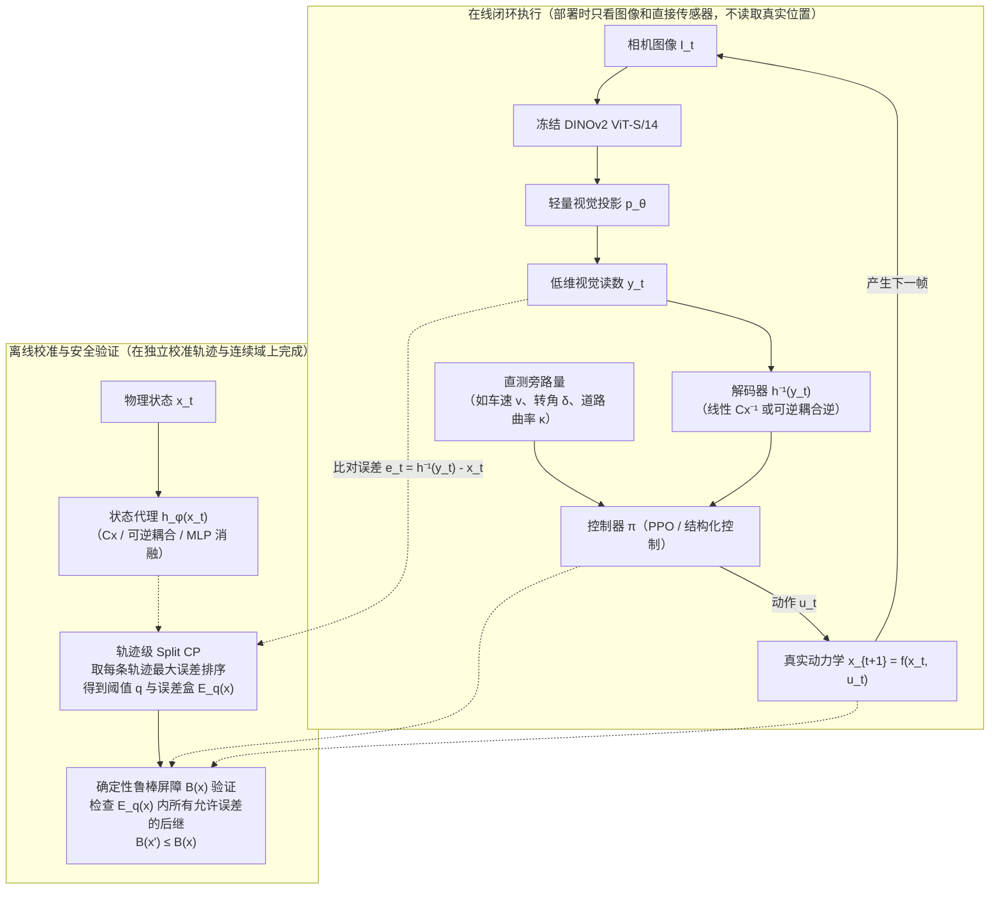
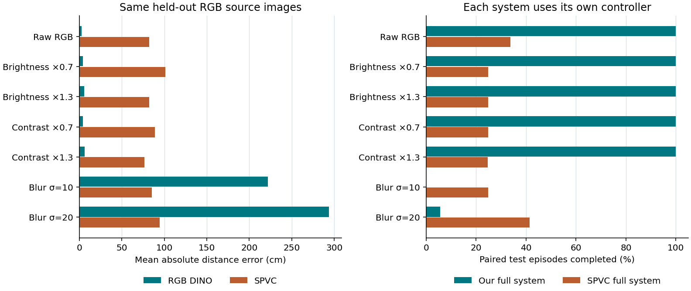
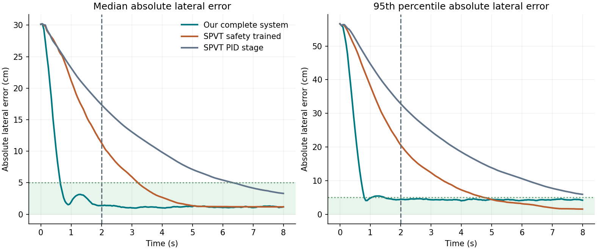

# 当前整体框架与实验全景详解

> **一句话看懂整个项目**：  
> 我们的框架用**冻结视觉主干（DINOv2）+ 轻量投影头**把高维图像压缩成少量有物理语义的低维读数，用**状态代理**（线性 $Cx$ 或小型神经网络）建立状态与视觉读数的对齐关系，再通过**轨迹级保形预测（Trajectory-level Split CP）**标定出一个覆盖全轨迹的视觉误差集合，最后在这个误差集合上训练并验证**确定性鲁棒屏障（SBC / 结构化屏障）**，从而得到有明确统计与连续域前提的**条件安全保证**。

---

## 0. 先分清五个核心组件各自回答什么问题

很多同学第一次看视觉安全控制文档，容易把“图像误差小”“95% 覆盖率”和“95% 安全”混为一谈。在当前框架中，五个模块严格分工、环环相扣：

| 模块 | 输入 | 输出 | 它回答什么问题？ | 它**不是**什么？ |
|---|---|---|---|---|
| **1. 视觉感知前端** | 相机图像 $I_t$ | 低维视觉读数 $y_t = p_\theta(\mathrm{DINO}(I_t))$ | 怎么从高维像素里稳定提取车距、横偏、航向等控制量？ | 不是直接送进形式化验证器的像素级大网络 |
| **2. 状态代理** | 归一化物理状态 $x_t$ | 名义观测 $\hat{y}^{\text{nom}}_t = h_\phi(x_t)$ | 理想无误差时，物理状态对应的视觉输出应该是什么？ | 不直接替代真实相机反馈 |
| **3. 轨迹级 CP 校准** | 冻结系统的独立校准轨迹 | 误差半径 $q$ 与误差集合 $\mathcal{E}_q(x)$ | 未来同分布新轨迹**全程**误差落在集合内的统计把握有多大？ | 不是“每帧 95%”，也不是“实车无条件安全概率” |
| **4. 控制器** | 视觉读数/解码状态 + 直测旁路量（如车速） | 控制动作 $u_t$（加减速、转向等） | 如何兼顾任务性能（快、稳、准）和误差盒内的抗扰能力？ | 不依赖在线高耗时采样优化 |
| **5. 鲁棒屏障 / 验证器** | 动力学模型、控制器、误差集合 $\mathcal{E}_q(x)$ | **通过 / 未决 / 反例** | 只要整条轨迹的视觉误差都在 $\mathcal{E}_q(x)$ 内，系统是否**绝对不碰危险集**？ | 不覆盖超出误差集合或未建模环境变化的情况 |

---

## 1. 整体架构与数据流

下面这张图展示了**离线训练与验证（上/右）**和**在线闭环控制（左）**是如何通过“低维视觉接口”和“轨迹级 CP”接在一起的：

### 为什么这套架构能绕开“像素级验证太难”的瓶颈？
传统的端到端像素验证（如 SPVC/SPVT 的图像生成器路线）需要把高维图像生成器或卷积网络一起放进区间传播，维数一高或时域一长（如 AEBS 400 步、车道 80 步）就极易发生区间爆炸。  
我们的做法是**把复杂的视觉特征提取（DINOv2）封装在低维接口 $y_t$ 之前**，离线验证器只需要面对“低维物理状态 + 有明确统计覆盖的 CP 误差集合 $\mathcal{E}_q(x)$”，从而把感知不确定性与动力学安全验证解耦。

---

## 2. 五大核心模块详解

### 2.1 视觉感知前端：DINOv2 + 任务投影头
- **主干冻结**：统一使用预训练的 **DINOv2 ViT-S/14**，参数完全冻结，保留 RGB 三通道语义与光照/对比度稳定性。
- **两种特征接法**：
  1. **全局特征接法**（如 AEBS）：取 DINO 的 384 维整图 CLS 特征，经标准化后送入全连接投影 `384 → 128 → GELU → 128 → GELU → 128 → 1` 输出一维测距。
  2. **空间局部特征接法**（如车道保持、五维弯道）：取 DINO 的 $16 \times 16 \times 384$ 局部 patch 特征，经 $1\times 1$ / $3\times 3$ 卷积与空间加权（softmax 坐标加权）或空间池化+PCA 后读出 2 维或 3 维位置姿态量。

### 2.2 状态代理与 `Cx` 神经网络替换
状态代理 $h_\phi(x)$ 负责把真实状态 $x$ 映射到低维视觉空间。我们系统研究了四种形式（详见[Cx 替换成神经网络易读报告](../experiments/跨实验对照/Cx替换成神经网络_易读版报告与结构解析.md)）：
1. **线性代理 $h(x) = Cx$**：结构最简、天然可逆，是当前各任务的默认基线。
2. **可逆加性耦合网络 $h(x) = H_\phi(Cx)$**：在 $z=Cx$ 之后，用小型 16 单元 Tanh 网络对各坐标分组做交替加性修正（例如二维下 $b = z_2 + 0.25 f(z_1),\ a = z_1 + 0.25 g(b)$）。解码时只需**倒序相减**即可 100% 精确解回 $\hat{x}$，能直接接入原有控制器和屏障验证器。
3. **线性 + 残差 MLP $h(x) = Cx + \mathrm{MLP}(x)$**：保留 $Cx$ 主干，用 1 层或 2 层、宽度 16 的小网络学习非线性修正，输出层零初始化确保从 $Cx$ 起步。
4. **纯全连接网络 $h(x) = \mathrm{MLP}(x)$**：完全去掉矩阵 $C$，用于验证纯神经网络在不借助先验线性矩阵时的拟合上限。

### 2.3 轨迹级保形预测（Trajectory-level Split CP）
单帧 CP 只能保证“随机挑一帧有 95% 在界内”，但一条 80 步或 400 步的控制轨迹只要有一帧误差炸了，整条轨迹就可能出事。因此我们采用**轨迹级 CP**：
1. **冻结系统**：锁定视觉前端、代理、解码器与控制器，在独立校准集上运行 $n$ 条完整闭环轨迹（例如 $n = 199$ 或 $499$）。
2. **每条轨迹打一个最坏分数**：取整条轨迹所有时刻 $t$、所有视觉分量 $k$ 的最大归一化误差：
   $$s_j = \max_{0 \le t < T} \max_{k} \frac{|\hat{x}_{j,t,k} - x_{j,t,k}|}{\text{scale}_k(x_{j,t})}$$
3. **有限样本分位数**：将 $n$ 个分数从小到大排序，取第 $r = \lceil (n+1)(1-\alpha) \rceil$ 个分数作为最终半宽 $q$（当 $\alpha=0.05, n=199$ 时取第 $190$ 个；$n=499$ 时取第 $475$ 个）。
4. **八种误差盒形状**：除了最基础的“各轴同宽固定盒”，我们还验证了**固定分轴盒、正负不对称盒、主状态分段/插值盒、双状态网格盒、状态对数线性盒**，使误差集合能贴合不同距离/姿态下的真实误差大小。

### 2.4 控制器综合（Nominal + 鲁棒微调）
- **初始化**：通过强化学习（如 AEBS 中的 PPO）或模仿学习（如车道保持中拟合 PID 动作标签）获得标称任务表现良好的初始策略 $\pi$。
- **鲁棒综合**：在开发数据确定的误差范围内，针对每个状态寻找最不利的感知误差后继，将屏障下降惩罚与任务奖励结合，微调控制器参数，使策略既能完成任务又能扛住误差盒内的最坏扰动。

### 2.5 确定性鲁棒屏障与安全验证
验证器检查的是一个非负函数 $B(x) \ge 0$ 是否满足以下三条硬性不等式（以 AEBS / 车道为例）：
1. **初始集上界**：对所有初始状态 $x_0 \in X_0$，有 $B(x_0) \le 1$；
2. **危险集下界**：对所有危险状态 $x_u \in X_u$，有 $B(x_u) \ge 20$（或对应阈值）；
3. **集合内后继不增**：对安全工作域内每个状态 $x$ 及 CP 误差集合 $\mathcal{E}_q(x)$ 内的**每一个**允许误差 $e$，由误差观测算出的动作所推进的后继状态 $x'$ 都满足：
   $$B(x') \le B(x)$$
验证器把连续状态域切分成大量小区间盒（Interval Bound Propagation / 仿射界 / 有理数支持函数），逐盒检查，最终输出**通过（0 反例、0 未决）**、**未决**或**具体反例**。在高维任务（五/六/八维）中，则对应使用几何/减速度充分条件、有理数复算或有限时域可达支持函数。

---

## 3. 从任务到证书的 8 步标准工作流

> **铁律**：开发集上用于训练的误差范围**不能**直接充当最终安全证书的阈值；正式的 CP 半径 $q$ 必须在**全部模型权重冻结之后**，用独立采集的闭环校准轨迹重新计算，然后再送入验证器做最终审计。

---

## 4. 实验全景：七大任务与四条核心验证主线

截至 **2026-11-25**，整个框架已在 **7 个控制任务**上完成不同深度的实验与对照，并形成了 **4 条主要实验结论**。

### 4.1 七大任务一图总览

| 任务 | 动力学维数 / 视觉维数 | 时域 | 核心控制与安全目标 | 关键实验结论与证书状态 |
|---|---|---|---|---|
| **AEBS 紧急制动** | 2D / 1D（车距） | 400 步 (20 s) | 停入 5–6 m 目标区，车速 $\le 0.5$ m/s | **11/25 同图包整链路**：原图 2,000/2,000 完成（SPVC 674/2,000），光强变化全完成；强模糊下 SPVC 更优；旧鲁棒综合版通过 0.45 m 区间验证，11/25 新训版屏障未通过 |
| **车道保持** | 2D / 2D（横偏+航向） | 80 步或 160 步 | 全程横偏 $\le 80$ cm，第 2–8 s 稳在 $\pm 5$ cm 内 | **11/25 同图包整链路**：500/500 安全，横偏 RMSE **6.38 cm**（比 SPVT 的 11.32 cm 降 **43.6%**）；旧冻结版及 11/17 可逆代理版均通过屏障数值检查，11/25 新训版未通过 |
| **弯道遇障制动** | 5D / 3D（横偏+航向+障距） | 14 步 (2.8 s) | 避开障碍且停在距障碍 3.60–4.40 m | **11/17–11/22**：闭环 0 越界，6 套线性/可逆代理全部通过数值屏障检查；纯 MLP/残差 MLP 静态误差降 3.7%–7.5% |
| **无人机悬停** | 6D / 3D（三轴偏差） | 24 步 (6 s) | 有风扰动下全程安全并稳定悬停 | **11/17**：盲测 100/100 达标，0 越界；全部通过有理数复算充分条件；可逆代理使 CP 半径均值缩小 1.55% |
| **桥式起重机** | 8D / 4D（小车+摆移） | 40 步 (6 s) | 小车定位且消除吊载摆动 | **11/17**：可逆代理 3/3 种子缩小 CP 半径（均值 -1.30%）；状态分段 CP 盒将可证初态倍率从 **1.368 提升到 1.502**，全部通过有理数支持界 |
| **绕障停车（停车场）** | 4D / 3D（位姿） | 30 步 | 绕过障碍停入车位（带在线区间后备） | **11/03**：15/15 零碰撞通过，233/240 启动审计覆盖，结构化神经屏障在连续初态盒 $\pm 0.02$ 上通过 |
| **移动机器人** | 3D / 3D（俯视位姿） | 120 步 | 避障到达目标点（无在线后备） | **11/08 反例教学案例**：开发与留出 20/20 安全到达，但 CP 盒内找出 **28/32 精确反例**，屏障未通过——证明“测试全过 $\neq$ 鲁棒安全” |

---

### 4.2 主线一：同 RGB 图包整链路重训——我方 vs SPVC 与 SPVT（2026-11-25 最新）

为了消除“数据集不同、训练预算不同”的干扰，11 月 25 日我们在**完全相同的 RGB 源图和状态标签**上分别完整重训了我方框架与原论文方法（SPVC、SPVT），并在相同初态上配对闭环测试：

#### ① AEBS 紧急制动：我方完整框架 vs SPVC（24,000 张扩展 CARLA RGB 图，2,000 条配对测试轨迹）

| 图像测试条件 | 我方测距 MAE (cm) | SPVC 测距 MAE (cm) | 我方完成 / 危险 | SPVC 完整复训 完成 / 危险 |
|---|---:|---:|---:|---:|
| **RGB 原图** | **2.65** | 82.10 | **2,000 / 0** | 674 / 689 |
| **亮度 ×0.7 / ×1.3** | **4.00 / 5.65** | 101.39 / 82.23 | **2,000 / 0**（两档均全过） | 496 / 1,022 及 496 / 867 |
| **对比度 ×0.7 / ×1.3** | **4.36 / 6.34** | 88.91 / 76.44 | **2,000 / 0**（两档均全过） | 496 / 867 及 494 / 689 |
| **高斯模糊 $\sigma=10$** | 221.73 | **85.34** | 0 / 2,000 | **496 / 867** |
| **高斯模糊 $\sigma=20$** | 293.86 | **94.65** | 113 / 1,887 | **829 / 1,022** |

- **结果解读**：在原图及亮度、对比度变化下，保留彩色语义的 DINO 前端使我方测距误差压到 2.65–6.34 cm，2,000 条轨迹全部安全完成（平均用时 8.476 s）；但在强高斯模糊（$\sigma=10, 20$）下，未做模糊增强的 DINO 特征严重退化，SPVC 的灰度生成路线反而完成更多。
- **诚实记录**：本轮新重训的 AEBS 模型在各自新误差下**均未通过**最终屏障验证（我方 4,096 单元中出现 935 个上升见证；SPVC 101 轮后初始上界 11.322 高于危险下界 7.091）。

#### ② 车道保持：我方完整框架 vs SPVT（26,000 张 192×192 RGB 图，500 条配对测试轨迹，每条 8 s）

| 系统 | 500 条全程安全 | 持续 $\pm 5$ cm（第 2–8 s） | 全程横偏 RMSE (cm) | 持续进入 $\pm 5$ cm 用时 (s) | 转向每步平均变化 (°) |
|---|---:|---:|---:|---:|---:|
| **我方完整框架** | **500** | **393** | **6.38** | **1.705** | 2.512 |
| **SPVT 完整复训** | 500 | 122 | 11.32 | 2.908 | **0.589** |
| **SPVT 新 PID 初始化** | 500 | 87 | 14.56 | 5.386 | 0.261 |

- **结果解读**：两边 500 条轨迹全部安全；我方全程横偏 RMSE 降低 **43.6%**（第 2 秒横偏 P95 为 **4.43 cm** vs SPVT 的 **20.65 cm**），早段纠偏明显更快；SPVT 则转向更平顺、第 8 秒末段 P95 更低（1.55 cm vs 4.19 cm）。安全验证方面，SPVT 在 500 个初态中可验证到第 10 步的有 137 个、完整 160 步为 0 个；我方本轮新屏障也未通过（另有 885 个上升见证），此前冻结版则已通过 80 步验证。

---

### 4.3 主线二：相同误差支持下的五任务验证后端对照（2026-11-18）

在固定同一视觉接口、同一控制器和相同误差半径的前提下，比较三种安全验证后端的能力（SPVT 式多步可达每任务限制 300 s 总预算，评估 2,000 个抽样初态）：

| 任务 | 验证时域 | 我方鲁棒屏障检查 | SPVT 式多步可达（及强化 zonotope 版） |
|---|---|---|---|
| **AEBS** | 400 步 | **数值检查通过**（115.77 s） | 完整时域未决 |
| **车道保持** | 80 步 | **数值检查通过**（9.44 s） | 完整时域未决 |
| **五维弯道制动** | 14 步 | **数值检查通过**（0.0179 s） | 2,000 / 2,000 初态通过 |
| **六维无人机悬停** | 24 步 | **有理数充分条件通过**（0.00033 s） | 2,000 / 2,000 初态通过 |
| **八维桥式起重机** | 40 步 | **有理数支持界通过**（0.1424 s） | 2,000 / 2,000 初态通过 |

- **核心发现**：在短时域（14–40 步）高维任务上，强化后的可达集验证也能全部通过；但在长时域非线性任务（AEBS 400 步、车道 80 步）上，我方屏障验证能快速给出完整时域结论，而多步可达传播在预算内无法闭合。

---

### 4.4 主线三：`Cx` 替换成神经网络（2026-11-17 / 11-22）

- **静态拟合（11 月 22 日，162 次训练）**：在固定视觉前端下，用 16 单元纯 MLP 或 `Cx + MLP` 替换 `Cx`，按开发集自动选型，三任务测试 MAE 均有小幅下降（AEBS 降 **5.49%** 到 8.2612 cm；车道横偏降 **2.55%** 到 2.1525 cm；五维三项分别降 **5.85% / 7.53% / 3.40%**）。
- **闭环对照（11 月 17 日，可逆耦合网络）**：接入真实闭环后，车道保持实际偏离中心线均值从 **36.28 mm 降至 34.26 mm**；八维起重机 3/3 种子缩小 CP 误差半径（均值 **-1.30%**）；六维悬停 2/3 种子缩小（均值 **-1.55%**）；五维制动略变宽（+1.13%）。

---

### 4.5 主线四：固定与状态相关 CP 误差盒（2026-11-17）

在五、六、八维任务上对比 3 种固定盒与 5 种状态相关盒，18 套冻结前端 × 8 种盒形共 **144/144 个组合全部在原定工作范围通过验证**。其中**八维起重机**收益最显著：用“主状态分段盒”把平均误差盒体积压到固定统一盒的 **14.4%**，并将可证明的初始状态盒共同倍率从 **1.36833** 扩大到 **1.50167**（+9.7%）。

---

## 5. 安全性结论到底保证了什么？（条件安全声明与边界）

把全套流程跑通后，我们对外可以严谨地给出如下**条件安全声明**：
1. **前提**：系统所有权重冻结；校准与测试轨迹满足同分布可交换假设；实际物理动力学与注册模型一致（无未建模突发扰动）。
2. **保证内容**：设 $A$ 为“校准所得误差集合 $\mathcal{E}_q$ 通过确定性鲁棒屏障审计”，则对一条独立抽取的新闭环轨迹，同时计入校准样本与新轨迹抽样的随机性，有：
   $$\mathbb{P}\bigl(A \ \text{且新轨迹进入危险集}\bigr) \le \alpha \quad (\text{通常 } \alpha = 0.05).$$

**哪些话不能讲？（必须严守的学术边界）**：
- ❌ 不能说“实车或真实世界绝对 95% 安全”（缺少域偏移与传感器突发故障建模）；
- ❌ 不能说“开发/盲测 100% 到达就等于鲁棒安全”（三维移动机器人实验已给出 28/32 盒内反例）；
- ❌ 不能把旧冻结模型的屏障证书直接套用到新训练的前端或控制器上；
- ❌ 11 月 25 日整链路重训的 AEBS 与车道新模型虽然闭环成绩优异，但其各自新屏障检查未通过，因此**不宣称这两个新权重已获得鲁棒屏障安全证书**。

---

## 6. 延伸阅读与代码导航

- **汇报简版（给导师/组会）**：
  - [当前框架与 SPVC、SPVT 比较｜图文汇报](../presentation/当前框架与SPVC_SPVT比较_汇报简版_20261123.md)
  - [Cx 替换成神经网络｜汇报版](../presentation/Cx替换成神经网络_汇报版.md)
- **专题深入报告**：
  - [Cx 替换成神经网络｜易读版报告与结构解析](../experiments/跨实验对照/Cx替换成神经网络_易读版报告与结构解析.md)
  - [AEBS 同图包整链路重训（2026-11-25）](../experiments/AEBS/AEBS同图包整链路重训_SPVC与RGB_DINO_20261125.md)
  - [车道保持同图包整链路重训（2026-11-25）](../experiments/车道保持/车道保持同图包整链路重训_SPVT与RGB_DINO_20261125.md)
  - [SPVC、SPVT 五任务实测对照（2026-11-18）](../experiments/跨实验对照/SPVC_SPVT五任务实测对照_收益与适用范围_20261118.md)
  - [固定与状态相关 CP 误差盒配对验证（2026-11-17）](../experiments/跨实验对照/五六八维_固定与状态相关CP误差盒_配对验证_20261117.md)
- **底层公式与术语**：
  - [CP 如何连接视觉代理、PPO 与神经鲁棒屏障](CP如何连接视觉代理_PPO与神经SBC_详细说明_20261116.md)
  - [SBC、CBC、CBF 与 CP 概念详解](SBC_CBC_CBF_CP概念与安全保证详解_20261116.md)
