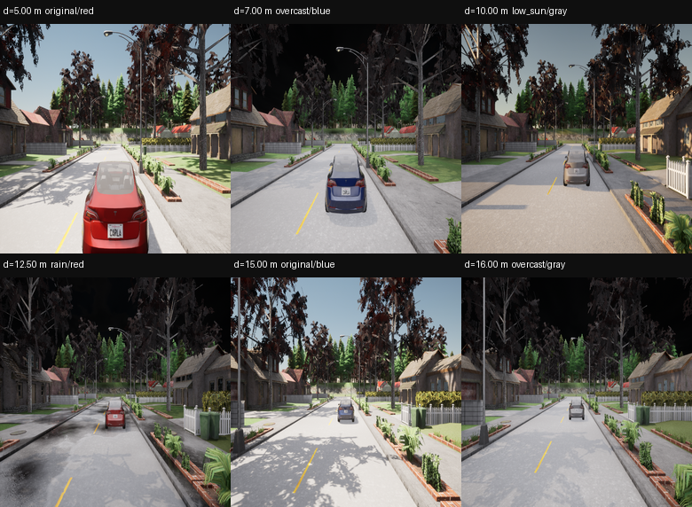
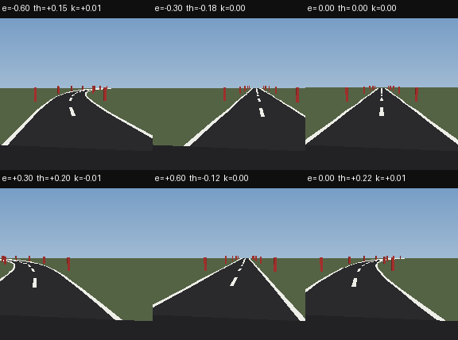

### AEBS

AEBS 是自动紧急制动任务。车辆靠近前方目标，根据视觉估计距离和实测速度输出制动动作。

| 配置   | 当前主实验设置                                 |
| ---- | --------------------------------------- |
| 状态   | d，单位 m；v，单位 m/s                         |
| 初态   | d∈[15,16]，v∈[2.5,3]                     |
| 动作   | a∈[−3,3]，正值制动，负值加速                      |
| 动力学  | d_next=d−0.05v；v_next=clip(v−0.05a,0,3) |
| 危险区域 | d∈[5,6] 且 v∈[0.5,3]                     |
| 视觉量  | 归一化距离；速度不由图片估计                          |
| 主版 C | 固定 [1,0]                                |

| 指标        |         常量主版 |                    状态相关版 |
| --------- | -----------: | -----------------------: |
| 半径        |   0.418359 m | 平均约 0.3217 m，最大约 0.720 m |
| 同批留出全程覆盖  |       99／100 |                   92／100 |
| 同一鲁棒屏障检查 | 292,024 区间通过 |              41,070 区间通过 |

| 总包量 | 像素 realhead MAE | DINO MAE |   像素 q | DINO q |      像素覆盖 |   DINO 覆盖 |
| --: | --------------: | -------: | -----: | -----: | --------: | --------: |
| 400 |          0.6937 |   0.2978 | 4.1690 | 0.8649 |     71／72 |     69／72 |
| 10k |          0.0085 |   0.0205 | 0.0209 | 0.0557 | 1894／2000 | 1893／2000 |
| 24k |          0.0247 |   0.0874 | 0.0307 | 0.2307 | 4382／4920 | 4592／4920 |

## 车道保持

车辆沿道路中心线行驶，控制器根据图像估计的横向偏差与航向误差输出转向。

| 配置       | 设置                                  |
| -------- | ----------------------------------- |
| 物理状态     | e：横向偏差，m；θ：相对道路方向误差，rad             |
| 归一化状态    | x=(e/0.85, θ/0.30)                  |
| 初态       | e∈[−0.25,0.25]，θ∈[−0.06,0.06]       |
| 安全边界     | e∈[−0.85,0.85] m、θ∈[−0.30,0.30] rad |
| 速度／步长／轴距 | 4 m/s、0.1 s、2.6 m                   |
| 曲率       | −0.01、0、0.01；每条固定，作为已知输入            |
| 动作       | PPO 输出归一化转向，裁剪后乘 0.45 rad           |
| 观察时域     | 80 步，8 s                            |
运动采用车道误差坐标下的车辆模型，e 的变化由速度和航向决定，θ 的变化同时受转向与道路曲率影响。它与 AEBS 使用同类 PPO／神经鲁棒屏障方法，但动力学、动作含义和安全集不同。

| 训练种子     |   固定 C q |   联合 C q |   固定覆盖 |   联合覆盖 | 两侧鲁棒屏障 |
| -------- | -------: | -------: | -----: | -----: | ------ |
| 20261109 | 0.088690 | 0.086439 | 96／100 | 95／100 | 均通过    |
| 20261111 | 0.087447 | 0.085980 | 96／100 | 97／100 | 均通过    |
| 20261112 | 0.082158 | 0.086194 | 94／100 | 94／100 | 均通过    |
| 20261113 | 0.085749 | 0.084497 | 98／100 | 97／100 | 均通过    |
| 20261114 | 0.082272 | 0.085384 | 94／100 | 92／100 | 均通过    |

| 汇总指标 | 固定 C | 联合 C |
|---|---:|---:|
| q 均值 | 0.085263 | 0.085699 |
| 留出覆盖均值 | 95.6% | 95.0% |
| 留出越界 | 0／500 | 0／500 |
| 鲁棒屏障通过模型数 | 5／5 | 5／5 |
| 静态横向 MAE | 0.017927 m | 0.018012 m |
| 静态航向 MAE | 0.005104 rad | 0.005124 rad |
