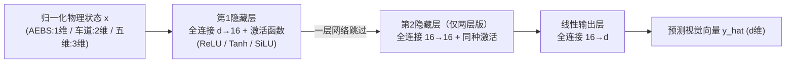
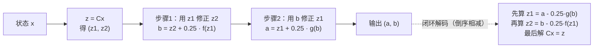
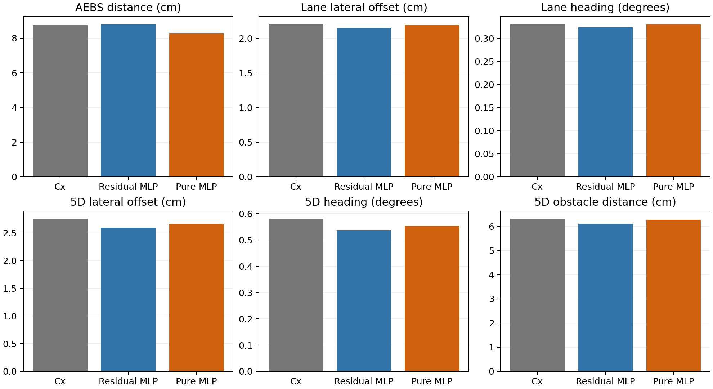

# 汇报｜把线性 `Cx` 替换成神经网络：结构设计与实验对比

> **适用场景**：向导师或组会快速汇报“用神经网络替换状态代理 `Cx`”的动机、网络结构、静态与闭环实验结果及后续边界。  
> **详尽技术报告**：[Cx替换成神经网络_易读版报告与结构解析.md](../experiments/跨实验对照/Cx替换成神经网络_易读版报告与结构解析.md)

---

## 1. 一句话讲清我们在做什么

在视觉控制框架中，图像分支把相机画面编码成低维向量 $y$，状态代理则根据真实物理状态 $x$ 去预测这个视觉向量 $\hat{y} = h(x)$。  
过去我们一直用**线性矩阵 $h(x) = Cx$**；本次工作系统地把它替换成了**三类小型神经网络**，回答两个核心问题：
1. **拟合准不准**：换成神经网络后，预测视觉输出是不是更准了？
2. **闭环稳不稳**：接入控制器和安全验证后，实际轨迹跟踪和安全误差界（CP 半径）有没有变好？

---

## 2. 神经网络结构怎么设计的？（一张图看懂三种方案）

为了兼顾“拟合能力”和“闭环控制器需要把图像解码回状态”的需求，我们设计了三种递进结构：

| 方案 | 公式 | 一句话解释 | 能否直接解码 $\hat{x}=h^{-1}(y)$？ |
|---|---|---|---|
| **① 纯全连接网络（Pure MLP）** | $h(x) = \mathrm{MLP}(x)$ | 完全去掉 $C$，从头学习状态到视觉的映射 | 不能（测拟合上限） |
| **② 线性 + 残差网络（Residual MLP）** | $h(x) = Cx + \mathrm{MLP}(x)$ | 保留原 $Cx$，小网络只学非线性修正（零初始化起步） | 不能（未加可逆约束） |
| **③ 可逆耦合网络（Reversible Coupling）** | $h(x) = H_\phi(Cx)$ | 交替加减两路特征，保证每一步都能精确倒推回状态 | **能**（直接接入闭环控制与屏障验证） |

### 2.1 纯 MLP 与残差 MLP 的逐层结构（宽度统一为 16）

按**隐藏层数量**命名，分别在 AEBS（1 维）、车道保持（2 维）、五维弯道（3 维，仅视觉相关 3 维）上测试：

- **参数量极小**：一层网络仅 **49–115** 个参数，两层网络仅 **321–387** 个参数。
- **残差版设计**：把上面这套 MLP 的输出层权重/偏置**全初始化为 0**，再与原 $Cx$ 相加，保证训练起点精确等于原 $Cx$。

### 2.2 可逆耦合网络是怎么实现“可逆”的？（以二维车道保持为例）

- 小网络 $f, g$ 各为 `1→16→Tanh→16→1→Tanh`（各 49 参数）；多维任务（五/六/八维）则依次固定其余维去修正当前维，同样倒序相减即可精确解码。

---

## 3. 核心实验结果（静态拟合 + 闭环验证）

### 3.1 静态拟合：纯网络与残差网络都能小幅降低误差（11 月 22 日，162 次训练）

在固定冻结 DINO 视觉前端、按**开发集 MSE 自动选型**的公平协议下（3 种子均值，MAE 越小越好）：

| 任务 | 原 `Cx` | 选中残差网络 `Cx+MLP` | 选中纯网络 `MLP` | 最直观改善 |
|---|---:|---:|---:|---|
| **AEBS 车距**（cm） | 8.7415 | 8.8141（一层 Tanh） | **8.2612**（一层 ReLU） | 纯网络比原 `Cx` 降 **5.49%**（-4.80 mm） |
| **车道保持**（横偏 cm / 航向 °） | 2.2089 / 0.3315 | **2.1525 / 0.3240**（两层 ReLU） | 2.1912 / 0.3307（两层 SiLU） | 残差网络横偏降 **2.55%**、航向降 **2.26%** |
| **五维弯道**（横偏 / 航向 / 距离） | 2.7611 / 0.5817 / 6.3267 | **2.5996 / 0.5379 / 6.1116**（两层 ReLU） | 2.6586 / 0.5538 / 6.2744（两层 ReLU） | 残差网络三项分别降 **5.85% / 7.53% / 3.40%** |

### 3.2 闭环控制与安全验证：可逆神经代理 vs 线性 `Cx`（11 月 17 日）

联合训练视觉投影和可逆耦合代理，并实际跑 199 条校准轨迹 + 100 条盲测轨迹：

| 任务 | 闭环控制表现 | 轨迹 CP 误差半径 $q$ | 安全验证（鲁棒屏障） |
|---|---|---|---|
| **车道保持** | 实际中心偏离均值 **36.28 → 34.26 mm**（3/3 种子改善） | 2/3 种子缩小 | 两组全部通过 |
| **八维起重机** | 终点均差 -0.889 mm，可证初态尺度 **+0.30%** | **3/3 种子全部缩小**（均值 **-1.30%**） | 全部零越界、全部通过 |
| **六维无人机悬停** | 两组均 **100/100** 安全悬停 | 2/3 种子缩小（均值 **-1.55%**） | 全部零越界、全部通过 |
| **五维弯道制动** | 3 对盲测达标数一致（86/88/87） | 3/3 种子略变宽（+1.13%） | 全部零越界、全部通过 |

---

## 4. 汇报结论与下一步建议

1. **方法可行**：16 单元小型神经网络即可替代或修正 `Cx`；不依赖 `Cx` 的纯 MLP 也能在 1,500 步内学会略优于 `Cx` 的映射；可逆耦合网络可无缝跑通“图像→解码→控制→CP 校准→鲁棒屏障”全链路。
2. **收益客观但温和**：静态 MAE 改善约 1%–5%，闭环误差半径在八维起重机（-1.30%）和车道保持（偏离降 2.02 mm）上小幅改善；同图像诊断表明，可逆网络在闭环实际区域与仿射变换非常接近。
3. **部署原则**：普通 MLP / 残差 MLP 尚无全局可逆保证，**不能直接替换**当前依赖 `h^-1(y)` 的在线控制器；任何新代理上线前，都必须在新映射下重新跑**轨迹级 CP 校准与鲁棒屏障验证**。
