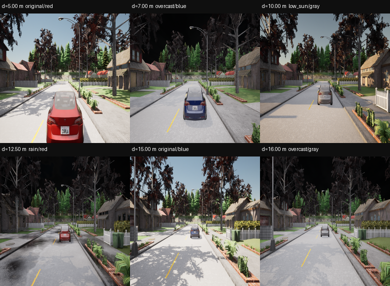
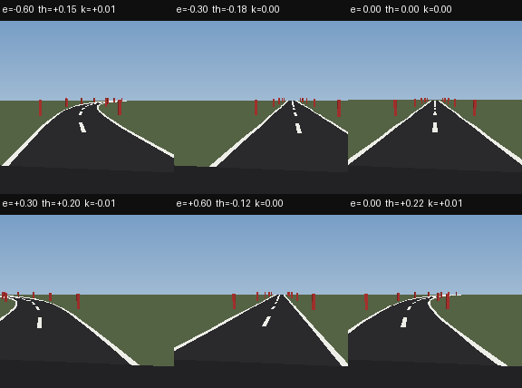
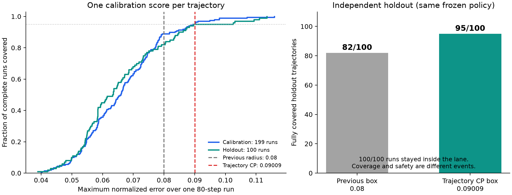
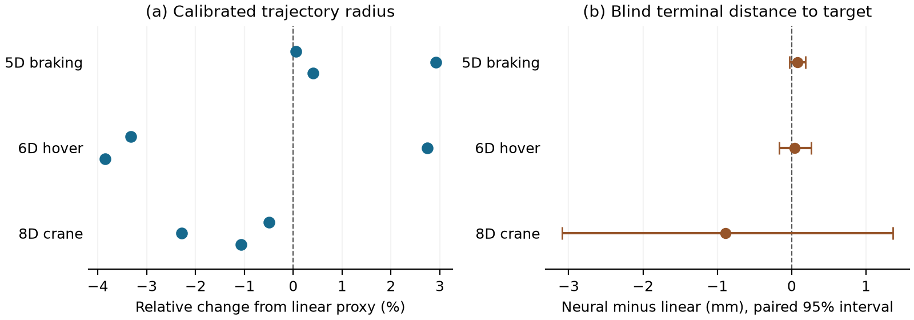
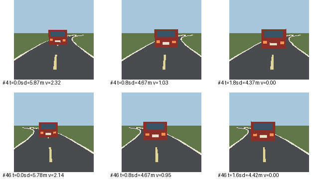
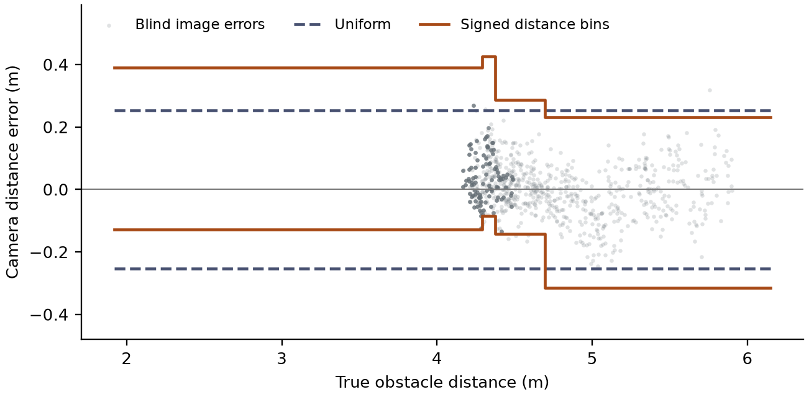
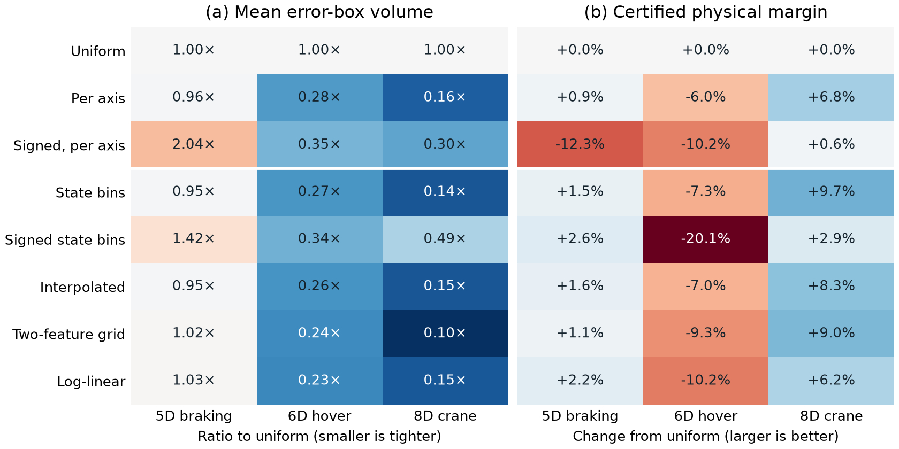

# 从灰度紧急制动到视觉闭环安全验证

**导师阶段汇报 · 2026 年 11 月 17 日**　｜　[配套口头稿](从灰度制动到视觉闭环安全验证_20261117_口头.md)

这项工作起于一个问题。原 SPVC 可以在模型里根据车距生成图像，再验证车辆如何制动。如果换成相机图像和 DINO 视觉前端，**相机读数与模型预期有偏差时，原来的控制思路还能给出什么安全保证？** 我们先在原自动紧急制动任务（AEBS）上打通流程，再用车道保持检验两个视觉量同时出错时的情况，最后在几个更高维的仿真任务上检验适用范围。

**时间顺序。** 10 月 29 日的灰度制动和 11 月 3 日的停车场是起点。11 月 5–10 日完成了车道轨迹校准、原 RGB 制动、联合学习 C 和早期前端对照。11 月 13–17 日梳理了 VISION-SLS 原理，完成了神经代理、保留旧前端的鲁棒控制器训练，以及五维、六维、八维场景的首轮验证和两种状态代理的配对比较。

## 一、先看完成了什么

| 研究问题 | 完成的工作 | 可以向导师报告的结果 |
|---|---|---|
| 图像能否接回原制动任务？ | 先用 400 张灰度图打通视觉、控制与验证，再换成 24,000 张 CARLA 原始 RGB 图 | RGB 基线在 **±0.4184 m** 测距误差内通过鲁棒屏障检查。100 次留出制动全部完成，其中 **99 次**全程满足这条误差界。 |
| 连续开车时如何处理偶尔看错的一帧？ | 对车道保持的每次 8 秒行驶记录最差一帧，重新校准整条轨迹的误差 | 同一批 100 次行驶，旧误差界覆盖 **82 次**，新界覆盖 **95 次**；新界下直道、左弯、右弯的证书均通过。 |
| 状态到视觉量的映射能否一起学？ | 比较固定矩阵、可训练矩阵、可逆小神经网络，控制器仍接收相同含义的读数 | 车道固定矩阵和学习矩阵各 **5/5** 个模型通过。换成神经代理后，三对实验的平均跟踪偏差从 **36.28 降至 34.26 mm**，误差半径只有两对变小。新增三个高维任务共 **18/18** 个模型通过，起重机的神经代理在三对训练中都缩小了误差半径。 |
| 控制器本身能否针对视觉误差改进？ | 保留已有视觉模型，让控制器在允许误差下重新训练，再训练和验证新屏障 | RGB 制动与三曲率车道都取得新证书，两项各有 **98/100** 次留出运行全程落在各自的新误差界内。 |

这里的“通过”指针对声明的仿真动力学、初态、误差集合和采样时刻，验证了相应的鲁棒屏障条件。**任务成功、误差被覆盖、屏障验证通过分别记账。** 下文每个数字都对应一套具体的前端、控制器和评估条件。

## 二、从一张图到一份证书，每一步做什么

| 步骤 | 输入 | 实际做的事 | 输出给下一步的东西 |
|---|---|---|---|
| 1. 定义危险 | 车辆状态、允许的动作、起点及道路 | 制动任务规定哪些车距与速度组合危险；车道任务规定横向和航向边界 | 动力学、初态集合、危险集合 |
| 2. 建立图像和状态两条分支 | 成对的相机图像与仿真真实状态 | 图像经冻结的 DINO 提取特征，再由可训练投影读出与任务有关的少数几个量。状态一侧用固定或学习的映射预测这几个数 | 图像实际读数 y，状态代理给出的名义读数 g(x)。视觉残差是 y−g(x) |
| 3. 接回控制器 | 图像读数，以及任务本就提供的速度或道路曲率 | 制动策略根据估计距离和实测速度给出制动；车道策略根据估计横偏、航向和已知曲率打方向。学习坐标的版本先解码回原控制量 | 实际动作、下一个状态，接着读取下一张图 |
| 4. 为整次运行定误差界 | 冻结模型后，按同一采集规则独立抽取完整轨迹 | 每条轨迹只记一次分数，即全程最大的误差；多维先按物理尺度归一化。典型协议有 199 条校准轨迹，95% 目标取从小到大第 190 个分数 | 误差半径 q。以 q 为半宽的集合容许控制器在里面遇到任意读数误差 |
| 5. 检查安全与实际效果 | 动力学、固定策略、误差集合及候选屏障 B | 检查所有相关状态及允许后继；另外用未参与定界的轨迹逐条记录是否超界、是否危险、是否完成任务 | 一份条件安全证书或具体反例，以及一份独立的行为成绩单 |

**方法来源和改动。** SPVC 提供了“视觉反馈控制器＋神经屏障”的出发点。VISION-SLS 给出的视觉设计是把图像变成低维量，再让状态侧预测同一个量；本项目把这个接口接到 SPVC 的制动和转向策略。保形预测（CP）用校准样本给误差集合确定阈值。结合 CP 与神经屏障的思路借鉴了 CP-NCBF；本项目实际校准的是**图像分支与状态代理之间的整轨迹误差**。原 SPVC 的随机屏障针对指定随机后继检查期望条件；这里的后端对集合里每一种允许的误差检查后继，称为**鲁棒屏障**。[原理与原文对照](../references/VISION-SLS原文解读_低维观测与联合训练及动力学可观测性_20261113.md) · [CP、控制器与神经屏障的衔接](../framework/CP如何连接视觉代理_PPO与神经SBC_详细说明_20261116.md)

**怎样读安全保证？** 以车道为例，起点的屏障分数至多为 1，危险处至少为 20。如果误差始终在允许集合里，每一步分数都不增加，那么从至多 1 出发就到不了至少 20 的危险处。CP 管的是这个前提发生的概率。若新轨迹与校准轨迹按同一冻结协议生成、可以交换，95% 是对“新轨迹的误差全程被覆盖”的边际保证，计入校准集和新轨迹的随机性。若验证结果决定是否接受证书，则“接受证书且新轨迹越界”的概率至多 5%。这没有给出某个固定起点的事故率，也没有证明一定按时完成任务。[安全保证和术语](../framework/SBC_CBC_CBF_CP概念与安全保证详解_20261116.md)

## 三、AEBS：先打通，再处理原始 RGB 观测

车辆从约 15–16 m 处以 2.5–3 m/s 接近目标。距离由图像估计，速度由传感器提供。原代码用“距离＋潜变量 → cGAN 生成灰度图 → 距离估计器”模拟视觉输入；替换后，相机图像直接进入 DINO，验证器处理实际估距与名义估距之间的偏差。

*图 1　按距离、天气和车辆外观选取的 CARLA 相机样例。这里的“原始 RGB”指模拟器保存的彩色图；旧生成器生成的灰度图是另一种数据来源。*

| 版本 | 做了什么 | 观测或验证结果 |
|---|---|---|
| 400 张灰度基础版 | 240 张训练、80 张开发、80 张测试。图像先压成一维距离读数，再接神经控制器；按车距拟合状态相关误差界 | 留出单图平均绝对测距误差 **0.1293 m**。该版本的状态相关集合和固定 400 图回放均通过对应检查。 |
| 24k 原 RGB，固定代理 | 静态测试保留 4,920 张。仿真每步随实际动作更新车距，再从同天气、同车色的图库取距离最近的一帧；用 199 次运行校准。修正归一化距离与米的换算后，重新训练神经屏障 | 静态平均测距误差 **0.0874 m**；整轨迹半径 **0.4184 m**。新屏障检查 292,024 个区间通过。独立留出 **99/100** 全程在界内，**100/100** 停车成功。 |
| 让误差宽度随车距变化 | 根据训练残差拟合距离相关的宽度，在新形状上重新计算和验证 | 平均半宽约 **0.322 m**，局部最大约 **0.720 m**；同批回归轨迹全程覆盖 **92/100**。允许宽度的分配变了，覆盖没有随平均宽度一起改善。 |
| RGB 与灰度，学习代理矩阵 C | 图像投影和状态侧矩阵共同训练，结合实测速度解码距离，冻结后分别重新校准 | RGB 的 q 为 **0.3945 m**，留出 **91/100** 在界内，屏障通过。灰度另一版本的 q 达 **3.516 m**，在该宽度下找到了屏障增大的实例。早期灰度证书对应上面第一行的另一套误差集合。 |

**这里的“冻结回放”怎么理解？** 例如控制器这一脚多刹了一点，下一步车距会改变，下次查到的图也可能改变。固定的是预存图库和查图规则。因而证书和轨迹覆盖适用于上述图库闭环。每次重新启动 CARLA 摄像机、改变道路几何或上实车，都会改变图像如何产生。[RGB 完整流程](../experiments/AEBS/AEBS真实RGB图像_完整实验_20261108.md) · [联合学习两条分支](../experiments/跨实验对照/联合学习视觉投影与C_实验步骤与结果_20261109.md)

**早期前端比较到底测到了什么？** 在相同的 4,920 张原 RGB 测试图上，直接搬用旧估计头、降为 32×32 灰度后用重训的 DINO 头、用 RGB DINO 头，平均测距误差分别为 **2.747、0.1079、0.0874 m**。进一步按 400、10k、24k 张原图总包做静态实验，直接用目标域图像训练的小灰度网络，与当时 RGB DINO 配方的单图平均绝对测距误差（MAE）依次为 **0.6937/0.2978、0.0085/0.0205、0.0247/0.0874 m**（每对先灰度网络，后 DINO）。这是早期不同训练配方的实测：三档测试集、源分辨率和训练轮数有差异。适合据此说明“旧头直接迁移有困难、目标域训练很重要”，单凭这些数值无法把差距归因于 DINO。[三种前端的原始比较](../experiments/AEBS/AEBS前端对比_cGAN_灰度_真实RGB_20261108.md) · [早期三档总包及实验条件](../experiments/AEBS/SPVC前端替换_收益证明_AEBS数据预算400_10k_24k_20261110.md)

## 四、车道保持：一次看错怎样影响整次行驶

车辆以 4 m/s 在直道、左弯或右弯上行驶 80 步，每步 0.1 s。图像要同时给出**离车道中心多远**和**车头偏了多少**。因此保留 DINO 图块的空间位置，从 3,600 张训练及评估用的车道渲染图中学习二维读数。每步依据车实际到达的位置和方向重新渲染，控制器输出前轮转角。实验检查横偏不超过 ±0.85 m、航向偏差不超过 ±0.30 rad。

*图 2　车道相机样例。观察道路边线在画面中的横向位置与朝向。屏障检查的是这两种估计误差共同作用于转向后的车辆状态。*

早期给两个归一化误差分量都定了 ±0.08 的界。12 次开发行驶中，有两次各出现一帧超界；两辆车都继续安全行驶。要给**整次行驶**套用证书，每一步都要满足误差前提。因此我们冻结前端和策略，另外生成 199 次校准行驶，按全程最大误差重新定界，再在独立 100 次行驶上比较。

| 同一批 100 次行驶 | 单帧落在界内 | 全程落在界内 | 实际行驶未越界 |
|---|---:|---:|---:|
| 旧界 ±0.080000 | 99.725% | 82/100 | 100/100 |
| 轨迹 CP 的新界 ±0.090093 | 99.9375% | **95/100** | 100/100 |

新半宽对应横偏约 **7.66 cm**、航向约 **1.55°**。在这个稍宽的集合上，三个曲率的同一神经控制器和屏障均通过数值验证。另行固定控制器和屏障扫描宽度，测到 0.12 仍通过，0.16 已有屏障上升的实例。[轨迹校准与验证](../experiments/车道保持/车道保持_轨迹级CP校准与SBC衔接_20261107.md) · [误差半径扫描](../experiments/车道保持/SPVC前端替换_收益证明_共同半径扫描_20261110.md)

*图 3　左图每条轨迹贡献一个全程最大值；阈值越往右，能包住的轨迹越多。右图将同一批 100 次行驶分别按新旧阈值计数。多覆盖的 13 次行驶解释了为什么要按轨迹校准。*

## 五、在同一条闭环上分别改前端与后端

**先改状态代理。** 固定 C 时，事先指定图像应预测哪两个坐标。学习 C 时，让视觉投影和矩阵一起调整，再反解回控制器熟悉的横偏和航向。五对相同预算的车道训练得到下表。随后将线性映射扩展为可逆小网络，使它能描述随状态弯曲变化的偏差。

| 比较 | 控制器和屏障怎样处理 | 结果说明 |
|---|---|---|
| 固定 C 与可训练 C，五对车道模型 | 同一策略与屏障；每个前端另采轨迹、另做校准 | 平均 q **0.085263 / 0.085699**；两边各 **5/5** 通过。联合学习可以接通，仅三对获得更小的 q。 |
| 线性 C 与神经代理，三对车道模型 | 视觉头和代理一起训练；解码到相同物理坐标；后端固定 | 六个模型均通过。三对的闭环横偏都改善，平均 **36.28 → 34.26 mm**。q 两对变小、一对变大；各自留出全程覆盖均值 **96.67% / 93.67%**。 |
| 只把 RGB AEBS 的状态侧换成神经代理 | 固定图像头，单独比较两侧读数的静态匹配 | 平均绝对匹配误差只少约 **0.07 mm**。这次静态试验提供了一个适合保留简单线性模型的实例。 |

车道用可逆网络的理由很实际：即使低维坐标的定义变了，仍能把视觉读数解码回原控制器的输入。六个模型都通过验证，说明这种替换可行；跟得更靠近中心与提高整轨迹覆盖是两个指标。[学习 C 的五对实验](../experiments/车道保持/SPVC前端替换_收益证明_阶段一至二结果_20261110.md) · [神经代理的三对实验](../experiments/车道保持/车道_Cx与神经代理_同预算对比_20261117.md) · [AEBS 静态对照](../experiments/AEBS/非线性神经观察代理_论文依据与RGB试验_20261115.md)

### 高维任务中，什么时候值得把 $Cx$ 换成神经代理？

以起重机为例，$x$ 包含相机需要观测的四个归一化量，即小车的两轴位置和吊载的两轴摆移。线性组用矩阵 $Cx$ 预测低维视觉读数，神经组在同一个矩阵后接可逆网络。两组都能把相机读数解码回位置和摆移，交给同一个控制器。弯道制动和悬停也按这个办法配对。每个任务用三组训练种子，每对共用图像、DINO 特征、初始视觉头、损失和训练步数，两边各自联合训练视觉投影与代理。

冻结后，每个模型用自己实际驱动的 **199 条轨迹校准，另用 100 个配对场景盲测**。误差半径 $q$ 取自每条轨迹上最差时刻、最差坐标的归一化解码误差。下表取三个种子的平均半径；在同一任务内，半径越小，屏障要应对的视觉误差范围越小。

| 场景 | 平均 $q$，$Cx$ → 神经 | 神经版半径更小 | 达标的盲测轨迹，每对各 100 条 |
|---|---:|---:|---|
| 五维弯道遇障制动 | 0.13088 → 0.13235（增大 1.13%） | 0/3 对 | 两种代理的停车结果逐场景相同，三组各有 86、88、87 条停入目标区 |
| 六维无人机悬停 | 0.22573 → 0.22222（缩小 1.55%） | 2/3 对 | 六个模型各有 100 条达到悬停目标 |
| 八维桥式起重机 | 0.19095 → 0.18846（缩小 **1.30%**） | **3/3 对** | 到位并消摆的次数依次为 99→100、97→95、99→99 |

*图 4　左图每个点是一对训练种子。点在零线左侧表示神经代理的误差半径更小。右图比较两种代理在相同盲测场景下离目标还有多远，负值表示神经版更近。三个任务的配对 95% 区间都跨过零。*

**起重机的收益体现在可证明的起动范围。** 18 个模型都在各自的误差管下通过了鲁棒验证。对起重机，固定每版已校准的误差管，把初始位置、速度和摆动的允许范围一起按比例放大，可证明安全的最大倍率（上确界）平均从 **1.37175 提高到 1.37586，增加 0.30%**。这一计算以前端误差全程在管内为前提；若改从放大后的区域抽取起点，还需为新分布重新校准。盲测中，神经版的吊载终点平均更靠近目标 **0.89 mm**，但不确定区间包含零。同图像检查也发现，神经代理在实际访问区域内很接近“矩阵加常数”的仿射映射。现有数据支持保留 $Cx$ 作基线，并报告起重机上小幅、一致的认证余量改善。[三场景实验、逐种子结果与图表](../experiments/跨实验对照/五六八维场景_Cx与可逆神经代理_同预算闭环对比_20261117.md)

### 保留前端后重新训练控制器和屏障

保留原有 DINO 前端，以已有的 PPO 神经策略为起点，在有视觉误差的状态上调整控制器，再训练新的非负神经屏障。冻结后用新策略实际访问的状态重新采集轨迹。AEBS 的新 q 为 **0.405193 m**，已验证的 ±0.45 m 集合包含它；制动成功 **100/100**，在 q 内 **98/100**。三曲率车道的新 q 为 **0.099687**，三种曲率都通过；留出 **98/100** 在 q 内，**100/100** 未越界。这次实际更新了控制器和屏障；q 的变化也包含行驶路线变化的影响。[AEBS 与车道后端训练及独立检查](../experiments/跨实验对照/AEBS与车道_旧前端鲁棒综合_20261116.md)

## 六、把同一问题放到更多维度

下表列出各场景首轮实验的结果。其中无人机和起重机比较的是增减视觉反馈通道的效果；上节图 4 比较的是保留反馈通道后更换状态代理的效果。

| 已有场景 | 图像与控制各负责什么 | 实际得到的结果 |
|---|---|---|
| 四维停车场 | 从视觉位置、朝向与延迟观测估计车辆状态。旧控制器在允许的视觉误差下真的可能超速；新控制器增加在线检查，始终保留可安全执行的后备动作 | 15 个中心起点与 15 个扰动起点共 **30/30** 安全到达。启动误差经 CP 校准，后续安全依靠后备动作和状态盒传播。证书属于带后备的控制器。[停车场证明与反例](../experiments/停车场/停车场神经SBC_构造证明与实验_20261103.md) |
| 三维移动机器人 | 俯视图估计平面位置和朝向，策略用线速度和角速度绕障 | 已完成图像闭环、轨迹校准和反例重放。在误差盒内存在能使动力学越界的扰动序列，因此这套策略与误差盒不能取得所要求的鲁棒证书。[机器人实验](../experiments/三维移动机器人/移动机器人_三维视觉实验_20261108.md) |
| 五维弯道遇障制动 | 前视图估计横偏、航向、障碍距离，联合控制制动与转向 | 神经代理版 **96/100** 全程在界内，**100/100** 保持安全余量并停稳，**88/100** 停进指定区间；对应误差集合通过鲁棒检查。[五维制动](../experiments/五维弯道制动/五维弯道遇障制动_视觉代理与鲁棒屏障_20261117.md) |
| 六维无人机悬停 | 下视图估计三维位置，配合实测速度抵抗有界风扰 | 加视觉位置反馈后 **99/100** 悬停达标，仅靠速度阻尼 **3/100** 达标。两组均 100 次安全，视觉组 **95/100** 全程在界内，对应鲁棒屏障通过。[六维悬停](../experiments/六维无人机悬停/六维无人机视觉悬停_轨迹CP与鲁棒屏障_20261117.md) |
| 八维起重机定位与消摆 | 俯视图同时观察小车位置和吊载相对摆移，结合实测速率控制加速度 | 完整反馈 **89/100** 到位并消摆，仅去掉视觉摆移反馈后 **0/100** 达标。两组均 100 次安全；完整组 **97/100** 全程在界内，通过有限时域鲁棒检查。[八维起重机](../experiments/八维起重机/八维桥式起重机_视觉消摆与有限时域鲁棒屏障_20261117.md) |

*图 5　两行都是已执行的仿真轨迹，三列依次为起步、中段、停稳。d 是沿路到障碍物的距离，v 是车速。第 4 号停入目标区，第 46 号停早了。两辆车都安全，这正是“安全”与“成功”分开统计的原因。*

上述任务共享的是“视觉量、状态代理、误差校准、集合内安全检查”这一接口。五维用了结构化神经屏障，六维和八维利用各自动力学构造有限时域证明。因此，**与原 SPVC 联系最直接的证据是 AEBS 和车道上由图像驱动的神经策略与学习式神经鲁棒屏障；其余场景说明感知误差接口可以迁移，以及迁移时哪些控制结构必须改变。**

## 七、误差盒要不要随状态变化？从制动、悬停和起重机看认证收益

上一组实验换的是状态代理。这一次，每套前端和控制器都冻结，只改验证器对视觉误差的描述。**固定盒**把各方向允许的误差预先定好，全程使用同样的边界；**状态相关盒**可以在某些状态收紧，在另一些状态放宽。比如前车较远时，相机把距离多估 20 cm 和少估 20 cm，对保证及时制动的影响就不同。

我们比较了三种固定盒（所有轴同宽、按轴定宽、按轴区分正负）和五种状态相关盒（按主状态分段、分段并区分正负、在段间插值、按两个状态划网格、用两个状态拟合对数宽度）。每个任务都保留上一节的三对 $Cx$ 与神经代理，共 18 套系统。先用旧轨迹学习盒子的形状；每套系统再实际跑 199 条新轨迹，用每条轨迹最坏的一帧校准八种盒，全部冻结后另跑 100 个新场景。八种盒共用同一套控制轨迹，因此可以直接看哪种描述给同一个控制器留下更多安全余量。

*图 6　横轴是真实障碍距离，纵轴是相机比实际多读或少读了多少米。灰点来自五维制动第一组线性前端的盲测。蓝色虚线始终容许约 ±0.253 m。橙线按车距改变边界；在 4.70 m 以外，允许低估约 0.316 m，但只允许高估约 0.232 m。决定能否保证及时制动的是上边界，远距离这段的上边界收紧了。*

| 场景 | 同一个控制器多获得了什么，或失去了什么？ |
|---|---|
| **五维弯道制动** | 按车距分段并区分正负误差后，平均盒体积增加 **41.8%**，可证明额外容忍的正向测距偏差却从 **1.100 m 增至 1.129 m**，多 **2.86 cm**。若希望同时减小体积，距离插值盒缩小 **5.12%**，制动余量仍增加 **1.75 cm**。 |
| **六维无人机悬停** | 对数线性盒把平均体积缩小 **76.86%**，但在部分状态允许更大的高度误差。三轴都要受保护，可证明的每轴总风加速度上限因而从 **0.486 降至 0.436**（归一化单位）。固定统一盒在这项指标上最好；八种都能承受原场景要求的 0.08。 |
| **八维起重机** | 固定统一盒、固定分轴盒、按小车位置分段盒可证明的初态放大倍数分别为 **1.368、1.462、1.502**（六套前端的均值）。分段盒比最好的固定盒再增加 **2.74%**。原任务的初始位置、速度和摆动范围同时放大到 **1.50 倍**时，分段盒下六个前端都通过；固定分轴盒下，六个前端都能找到使两台电机的总命令超过限值 6 的允许误差，现有证书依赖的无饱和条件随之失效。 |

*图 7　左图以每个前端自己的固定统一盒体积为 1。右图按列比较同一项物理指标，依次是制动测距余量、可承受的总风扰和起重机可证初态尺度。上三行为固定盒，下五行为状态相关盒。*

**再换一批起重机轨迹。** 为确认从八种盒里看到的改善，我们锁定第一对 $Cx$ 和神经前端，用另外 499 条轨迹重新校准、500 个配对场景盲测。按小车位置分段后，两种前端的已证初态倍率都达到 **1.51**；固定分轴盒分别为 **1.47 和 1.46**。两组分段盒的盲测全程覆盖反而都少了 **2/500** 条。这里得到的收益是更大的可认证初态区域。[独立确认结果](../../artical-F122/results/crane_cp_boxes_confirmation_20261117_v1/summary.json)

原定工作范围内，**144/144** 个“前端与误差盒”组合均通过相应的鲁棒验证。盲测中，每种盒、每个前端全程在界内的次数介于 **89–99/100**。95% 是可交换整轨迹下的边际覆盖目标。起重机的扩大范围以误差全程在所证盒内为前提；若要给扩大后的起点分布也配上 95% 覆盖，需要在该分布上重新校准。[完整八方案对照、轨迹覆盖与各任务验证](../experiments/跨实验对照/五六八维_固定与状态相关CP误差盒_配对验证_20261117.md)
